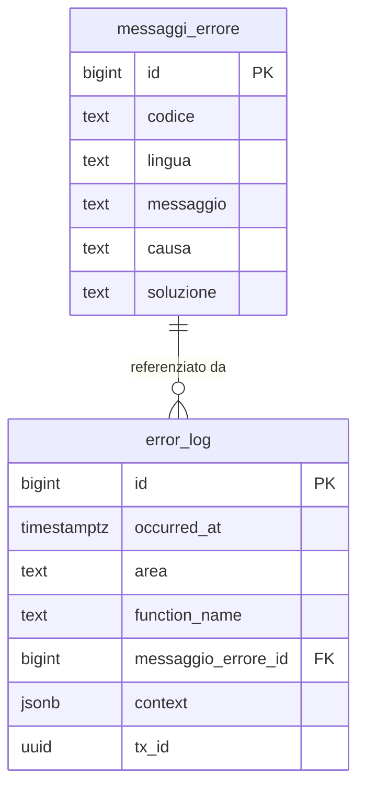
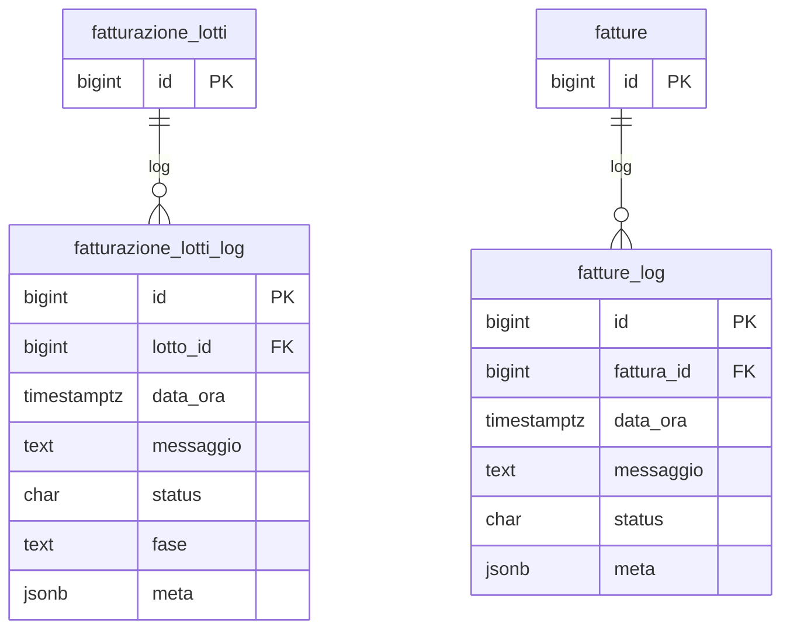

# Guida – Gestione dei Messaggi di Errore e Generazione Log

> (latest review 04-03-26)
>
> Destinatari: sviluppatori database, backend e devops
>
> Questa guida copre il modello unificato di error handling e logging in Zero ERP.
> La parte concettuale e di sviluppo e rivolta a tutti i destinatari.
> La parte di setup operativo (dblink, permessi, hardening) e rivolta principalmente a devops e DBA.
>
> Vedi anche
>
> * [Guida Fatturazione](/guide/fatturazione) — pipeline vendite con log di dominio
> * [Linee guida SQL](/linee-guida-sql) — convenzioni naming funzioni e trigger

---

## Introduzione

Ogni sistema gestionale deve produrre messaggi di errore comprensibili e mantenere una traccia completa di cosa e andato storto, quando e in quale contesto. In Zero ERP questo obiettivo e realizzato con un modello a tre componenti:

* Un **catalogo centralizzato** di messaggi, multilingua, con template, causa e suggerimento di risoluzione
* Un **registro persistente** che archivia ogni occorrenza di errore con timestamp, area, funzione e contesto
* Un insieme di **funzioni PL/pgSQL** che collegano catalogo e registro, formattando il messaggio e sollevando l'eccezione in modo uniforme

Il risultato: ogni errore nel sistema ha un codice stabile, un messaggio leggibile per l'utente, un dettaglio tecnico per lo sviluppatore, e un record di audit che sopravvive anche al rollback della transazione.

**Cosa troverai in questa guida:**

* Come funziona il catalogo messaggi e il registro errori
* Le tre funzioni di supporto e il loro ruolo nel flusso
* Il meccanismo di logging persistente via dblink
* Il routing degli errori per processi di dominio (pipeline, pratiche)
* Il contratto standard per estendere il log a nuovi domini
* Il setup operativo per devops (dblink, permessi, hardening)

---

## Tabelle coinvolte

**Configurazione:**

* [config.messaggi_errore](/dbzero/config/tabelle/messaggi_errore) — catalogo multilingua dei messaggi di errore

**Operazioni:**

* [dbops.error_log](/dbzero/dbops/tabelle/error_log) — registro persistente di ogni occorrenza di errore
* [dbops.sec_functions_owner](/dbzero/dbops/tabelle/sec_functions_owner) — registry ownership funzioni sensibili

**Log di dominio (vendite):**

* [vendite.fatturazione_lotti_log](/dbzero/vendite/tabelle/fatturazione_lotti_log) — log pipeline per lotto
* [vendite.fatture_log](/dbzero/vendite/tabelle/fatture_log) — log per singola fattura

---

## Il modello in sintesi

```text
config.messaggi_errore (catalogo messaggi)
    │
    │  codice + lingua → messaggio, causa, soluzione
    │
    ├── script.fn_get_messaggio()
    │       recupera e formatta il messaggio con placeholder
    │
    ├── script.fn_log_error_only()
    │       scrive su error_log via dblink (persiste anche in rollback)
    │       usata internamente da fn_log_and_raise_error
    │
    └── script.fn_log_and_raise_error()
            chiama fn_log_error_only + RAISE EXCEPTION
            │
            ├── dbops.error_log (registro tecnico — sempre)
            │
            └── log di dominio (routing per scope)
                    vendite.fatturazione_lotti_log (scope LOTTO)
                    vendite.fatture_log            (scope FATTURA)
```

* **Catalogo** = i template dei messaggi, mantenuti in tabella e mai hard-coded nel codice
* **Registro** = il log tecnico immutabile, scritto fuori transazione per sopravvivere ai rollback
* **Routing** = i log di dominio specifici per processo, che si affiancano al registro tecnico

---

## Componenti del modello

### 1. Il catalogo messaggi: `config.messaggi_errore`

Il catalogo e il punto unico in cui si definiscono tutti i messaggi di errore del sistema. Ogni messaggio ha un codice stabile (es. `E_GENERICO`, `E_SOGGETTO_NO_CONTATTI`), un testo con eventuali placeholder, una causa e un suggerimento di risoluzione. La tabella supporta piu lingue: lo stesso codice puo avere template in italiano, inglese e altre lingue.

Il vantaggio e duplice: lo sviluppatore usa solo il codice nel proprio codice PL/pgSQL, e il testo visualizzato puo essere modificato o tradotto senza toccare le funzioni.

Da un punto di vista tecnico:

* `id` (BIGINT, PK): chiave primaria
* `codice` (TEXT): identificativo del messaggio — univoco per lingua tramite vincolo `UNIQUE (codice, lingua)`
* `lingua` (TEXT): lingua del template (`it`, `en`, ...), default `it`
* `messaggio` (TEXT): testo con placeholder `%s` sostituibili via `format()`
* `causa` (TEXT): descrizione della causa, usata come `DETAIL` nell'eccezione
* `soluzione` (TEXT): suggerimento di risoluzione, usato come `HINT` nell'eccezione

> Documentazione dettagliata: [config.messaggi_errore](/dbzero/config/tabelle/messaggi_errore)

---

### 2. Il registro errori: `dbops.error_log`

Il registro e l'archivio immutabile di tutte le occorrenze di errore nel sistema. Ogni volta che una funzione rileva un errore e chiama `fn_log_and_raise_error` o `fn_log_error_only`, viene creato un record con il timestamp, l'area funzionale, la funzione di origine, il codice errore e un contesto JSONB con i dati rilevanti per il debug.

La caratteristica critica del registro e la **persistenza fuori transazione**: la scrittura avviene tramite dblink su una connessione separata, quindi il record sopravvive anche se la transazione principale viene annullata. Questo garantisce che nessun errore venga perso silenziosamente.

Da un punto di vista tecnico:

* `id` (BIGINT, PK): chiave primaria auto-incrementale
* `occurred_at` (TIMESTAMPTZ): istante di logging, default `now()`
* `area` (TEXT): ambito funzionale (es. `vendite`, `anagrafiche`, `database`)
* `function_name` (TEXT): nome della funzione che ha generato l'errore
* `messaggio_errore_id` (BIGINT, NOT NULL): FK verso `config.messaggi_errore.id`
* `context` (JSONB): payload libero con variabili, parametri, ID coinvolti — default `{}`
* `tx_id` (UUID): identificativo della transazione correlata
* `cleanup_at` (TIMESTAMPTZ): timestamp opzionale per retention automatica

> Documentazione dettagliata: [dbops.error_log](/dbzero/dbops/tabelle/error_log)

---

### 3. Le funzioni di supporto

Il modello di errore si appoggia su tre funzioni nello schema `script`, ciascuna con un ruolo distinto. L'ordine in cui sono presentate riflette la catena di dipendenza: `fn_get_messaggio` e la piu semplice (solo lettura), `fn_log_error_only` gestisce il logging persistente, e `fn_log_and_raise_error` le combina entrambe per il flusso completo errore + eccezione.

#### `script.fn_get_messaggio`

Recupera un messaggio dal catalogo e lo formatta con i valori forniti. E una funzione di pura lettura, marcata `IMMUTABLE`.

La lingua viene risolta con una cascata: parametro esplicito → GUC `myapp.user_language` → fallback `it`. Se il codice non esiste nel catalogo, restituisce `[MESSAGGIO NON DEFINITO: <codice>]` invece di fallire.

Da un punto di vista tecnico:

| Parametro | Tipo | Default | Descrizione |
| --- | --- | --- | --- |
| `p_codice` | TEXT | — | Codice del messaggio |
| `p_valore` | TEXT | NULL | Valore per il placeholder `%s` |
| `p_lingua` | TEXT | NULL | Lingua esplicita (sovrascrive il GUC) |

> Documentazione dettagliata: [script.fn_get_messaggio](/dbzero/script/funzioni/fn_get_messaggio)

#### `script.fn_log_error_only`

Scrive un record nel registro `dbops.error_log` senza sollevare eccezione. E la funzione su cui si basa l'intero meccanismo di logging persistente: usa dblink per scrivere su una connessione separata, garantendo che il log sopravviva al rollback.

Questa e la funzione piu critica dal punto di vista operativo. Per funzionare correttamente **deve essere `SECURITY DEFINER`** con **owner superuser** (`postgres`). La connessione dblink viene risolta dalla GUC `myapp.dblink_log_connection` (o `myapp.logconn`). Se la configurazione manca o e errata, la funzione emette un WARNING senza propagare errori al chiamante — il logging fallisce silenziosamente ma l'operazione principale non viene compromessa.

Da un punto di vista tecnico:

| Parametro | Tipo | Default | Descrizione |
| --- | --- | --- | --- |
| `p_area` | TEXT | — | Area funzionale |
| `p_function_name` | TEXT | — | Funzione che origina l'errore |
| `p_error_code` | TEXT | — | Codice del messaggio in `messaggi_errore` |
| `p_context` | JSONB | — | Contesto per il debug |
| `p_tx_id` | UUID | — | Transazione correlata |
| `VARIADIC p_valori` | TEXT[] | — | Valori per i placeholder |

Se il codice errore non esiste nel catalogo, la funzione usa il codice fallback `MESSAGGIO_NON_DEFINITO`. Se anche questo manca, il log viene saltato con WARNING.

> Documentazione dettagliata: [script.fn_log_error_only](/dbzero/script/funzioni/fn_log_error_only)

#### `script.fn_log_and_raise_error`

E la funzione principale per il flusso completo: logging + eccezione. Internamente chiama `fn_log_error_only` per il logging persistente, poi recupera il template tramite `fn_get_messaggio`, applica i valori ai placeholder, e solleva un `RAISE EXCEPTION` con `DETAIL` (causa) e `HINT` (soluzione) estratti dal catalogo.

L'applicazione riceve un errore formattato e comprensibile. Il database mantiene un record di audit completo.

Da un punto di vista tecnico:

| Parametro | Tipo | Default | Descrizione |
| --- | --- | --- | --- |
| `p_area` | TEXT | — | Area funzionale |
| `p_function_name` | TEXT | — | Funzione che origina l'errore |
| `p_error_code` | TEXT | — | Codice del messaggio |
| `p_context` | JSONB | — | Contesto per il debug |
| `p_tx_id` | UUID | — | Transazione correlata |
| `VARIADIC p_valori` | TEXT[] | — | Valori per i placeholder del messaggio |

> Documentazione dettagliata: [script.fn_log_and_raise_error](/dbzero/script/funzioni/fn_log_and_raise_error)

---

## Flusso di gestione degli errori

Quando una funzione o un trigger rileva una condizione di errore, il flusso standard e:

1. **Validazione** — la funzione/trigger identifica l'anomalia (dato mancante, vincolo violato, stato incoerente)
2. **Logging persistente** — `fn_log_and_raise_error` chiama internamente `fn_log_error_only`, che scrive su `dbops.error_log` tramite una connessione dblink separata. Il record e gia persistito a questo punto
3. **Formattazione messaggio** — `fn_get_messaggio` recupera il template dal catalogo nella lingua corrente e sostituisce i placeholder
4. **Eccezione** — `RAISE EXCEPTION` con il messaggio formattato, `DETAIL` (causa) e `HINT` (soluzione)

La transazione va in rollback, ma il record in `error_log` sopravvive perche e stato scritto fuori transazione.

```text
Trigger / Funzione PL/pgSQL
    │
    │  rileva errore
    │
    └── fn_log_and_raise_error(area, funzione, codice, context, tx_id, valori...)
            │
            ├── fn_log_error_only()  ← dblink → INSERT INTO dbops.error_log
            │                                     (persiste anche in rollback)
            │
            ├── fn_get_messaggio()   ← config.messaggi_errore
            │                          (template + lingua + placeholder)
            │
            └── RAISE EXCEPTION      ← messaggio formattato
                  DETAIL = causa       (da messaggi_errore.causa)
                  HINT   = soluzione   (da messaggi_errore.soluzione)
```

---

## Routing errori di dominio

### Il concetto

Il registro tecnico `dbops.error_log` traccia ogni errore del sistema in modo uniforme. Ma i processi applicativi — come la pipeline di fatturazione o la gestione pratiche — hanno bisogno di log piu strutturati, con informazioni di dominio (quale lotto, quale fattura, quale fase del processo).

Per questo motivo Zero ERP adotta un **routing esplicito**: ogni errore applicativo viene scritto sia nel registro tecnico standard sia nel log di dominio specifico. I due livelli convivono senza sostituirsi.

### Routing attuale (vendite)

| Scope | Target log di dominio | Descrizione |
| --- | --- | --- |
| `LOTTO` | `vendite.fatturazione_lotti_log` | Avanzamento fasi pipeline, esito complessivo lotto |
| `FATTURA` | `vendite.fatture_log` | Errori specifici sul singolo documento |

In entrambi i casi il registro tecnico `dbops.error_log` resta attivo per gli errori SQL/raise.

### Funzioni di dominio (stato attuale)

* `vendite.fn_log_pipeline_fase(...)` — scrive su `fatturazione_lotti_log` con fase, status e metadati denormalizzati dal lotto
* `vendite.fn_log_lotto_esito_fatture(...)` — aggrega gli esiti dalle fatture del lotto (priorita: C > W > I) e scrive il risultato complessivo

### Contratto standard per i log di dominio

Questo contratto e pensato per essere riusabile quando si aggiungono nuovi domini (es. `ATTIVITA_FATTURABILI`, `PRATICHE`). Ogni nuovo dominio crea le proprie tabelle di log e le proprie funzioni, ma rispetta lo stesso schema di campi:

| Campo | Tipo | Obbligatorio | Descrizione |
| --- | --- | :---: | --- |
| `scope` | TEXT | si | Identifica il contesto (`LOTTO`, `FATTURA`, `PRATICA`, ...) |
| `severity` | CHAR(1) | si | `I` = info, `W` = warning, `C` = critico |
| `code` | TEXT | si | Codice errore stabile da `config.messaggi_errore` |
| `message` | TEXT | si | Messaggio sintetico |
| `detail` | TEXT | no | Dettaglio tecnico |
| `meta` | JSONB | no | Contesto libero (task, step, funzione, parametri) |
| ID entita | varia | si | ID dell'entita di dominio (es. `lotto_id`, `fattura_id`, `pratica_id`) |

La severita segue una gerarchia a tre livelli: se almeno un errore critico (`C`) e presente, l'esito complessivo e critico. Altrimenti, se ci sono warning (`W`), l'esito e warning. Altrimenti e informativo (`I`).

---

## Best practice

### Codici errore

* **Centralizzare tutti i messaggi** in `config.messaggi_errore` — mai hard-codare testi nelle funzioni
* **Usare la convenzione `E_`** per i codici errore: `E_GENERICO`, `E_SOGGETTO_NO_CONTATTI`, `E_RUOLO_NATURA_NON_AMMESSA`
* **Usare nomi descrittivi** che rendano il codice autoesplicativo senza consultare il catalogo
* Ogni codice deve essere registrato nel catalogo **prima** di essere usato nel codice — se manca, `fn_log_error_only` ricade su `MESSAGGIO_NON_DEFINITO`

### Logging

* **Popolare il `context`** JSONB con dati rilevanti per il debug: ID coinvolti, parametri della chiamata, stato corrente
* **Non catturare errori generici** nel backend: usare `ServiceError` nei service e lasciare il middleware di core gestire il fallback (vedi `apps/core/services/error_manager.py`)
* **Sfruttare la multilingua** definendo template in piu lingue e usando il GUC `myapp.user_language`

### Monitoraggio

* Creare viste o dashboard su `dbops.error_log` per alert e metriche di errore
* Il campo `cleanup_at` permette policy di retention automatica
* Il JSONB `context` e il modello di log separato preservano la flessibilita per colonne future

---

## Setup operativo (devops)

Questa sezione e destinata a devops e DBA. Descrive come configurare il logging persistente via dblink, che permette alla funzione `fn_log_error_only` di scrivere su `dbops.error_log` fuori transazione.

### Prerequisito: perche serve dblink

In PostgreSQL, quando una transazione va in rollback, tutti gli INSERT effettuati nella stessa transazione vengono annullati — inclusi eventuali log. Per garantire che il record di errore sopravviva, `fn_log_error_only` usa `dblink_exec` per aprire una connessione separata e scrivere il log in una transazione autonoma. Questo richiede:

* L'estensione `dblink` installata
* Un ruolo dedicato con permessi minimi
* La configurazione di `pg_service.conf` e `.pgpass` sul server
* Una GUC per indicare alla funzione quale connessione usare

### 1. Ruolo di logging con privilegi minimi

Eseguire da utente admin (es. `postgres`) nel DB applicativo:

```sql
CREATE EXTENSION IF NOT EXISTS dblink;

CREATE ROLE zeroerp_log LOGIN PASSWORD 'PASSWORD_FORTE';
GRANT USAGE ON SCHEMA dbops TO zeroerp_log;
GRANT INSERT ON TABLE dbops.error_log TO zeroerp_log;
GRANT USAGE, SELECT ON SEQUENCE dbops.error_log_id_seq TO zeroerp_log;
```

### 2. Configurare `pg_service.conf`

I file devono essere creati **sul server DB**, nella HOME dell'utente OS `postgres`
(tipicamente `/var/lib/postgresql`).

`/var/lib/postgresql/.pg_service.conf`:

```
[zeroerp_log]
host=127.0.0.1
port=5432
dbname=zeroerp
user=zeroerp_log
```

### 3. Configurare `.pgpass`

`/var/lib/postgresql/.pgpass`:

```
127.0.0.1:5432:zeroerp:zeroerp_log:PASSWORD_FORTE
```

Permessi obbligatori:

```bash
chown postgres:postgres /var/lib/postgresql/.pg_service.conf /var/lib/postgresql/.pgpass
chmod 600 /var/lib/postgresql/.pg_service.conf /var/lib/postgresql/.pgpass
```

Se il servizio PostgreSQL non legge la HOME, forzare i path con systemd:

```
[Service]
Environment=PGSERVICEFILE=/var/lib/postgresql/.pg_service.conf
Environment=PGPASSFILE=/var/lib/postgresql/.pgpass
```

e riavviare `postgresql@<versione>-main`.

### 4. Impostare la GUC per i ruoli applicativi

Eseguire da admin:

```sql
ALTER ROLE titodb     IN DATABASE zeroerp SET myapp.dblink_log_connection = 'service=zeroerp_log';
ALTER ROLE zeroerp_app IN DATABASE zeroerp SET myapp.dblink_log_connection = 'service=zeroerp_log';
```

### 5. Hardening ownership funzioni

Per garantire che `fn_log_error_only` resti `SECURITY DEFINER` con owner `postgres`, il sistema usa una tabella di registry (`dbops.sec_functions_owner`) e una funzione di sincronizzazione (`dbops.fn_sync_functions_owner`).

Il changeSet Liquibase in `migrations_v2/90_end/` esegue la sincronizzazione ad ogni aggiornamento:

```bash
scripts/liquibase5.sh update --contexts=provision --username=postgres --password=***
```

La funzione `script.fn_log_error_only` e registrata in `dbops.sec_functions_owner` e viene riallineata automaticamente a `postgres`.

### Verifiche e troubleshooting

**Test di funzionamento:**

```sql
SELECT script.fn_log_error_only(
  'test',
  'diag_log_only',
  'E_GENERICO',
  jsonb_build_object('probe','manual_test','ts',clock_timestamp()),
  NULL::uuid
);

SELECT *
FROM dbops.error_log
ORDER BY occurred_at DESC
LIMIT 5;
```

**Errori tipici:**

* **`2F003` (password/GSSAPI richiesti)** — la funzione non e `SECURITY DEFINER` o non e owner superuser; oppure `pg_service.conf` / `.pgpass` non sono visibili al processo postgres
* **Log non presente ma nessun errore** — verificare `myapp.dblink_log_connection`, `pg_service.conf` / `.pgpass`, e permessi del ruolo `zeroerp_log`

---

## Diagramma ER

### Registro tecnico



### Log di dominio (vendite)



---

## Note finali

Questa guida copre il modello centralizzato di error handling. Per i processi specifici che lo utilizzano:

* [Guida Fatturazione](/guide/fatturazione) — la pipeline di fatturazione e i suoi log di dominio
* [Linee guida SQL](/linee-guida-sql) — convenzioni per naming di funzioni, trigger e codici errore

---


