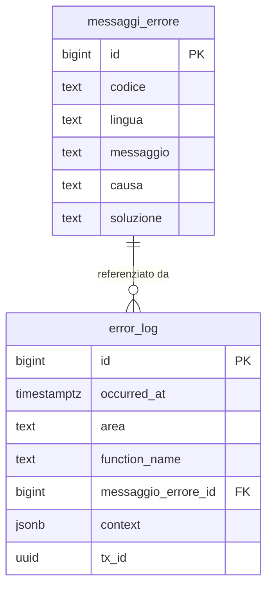
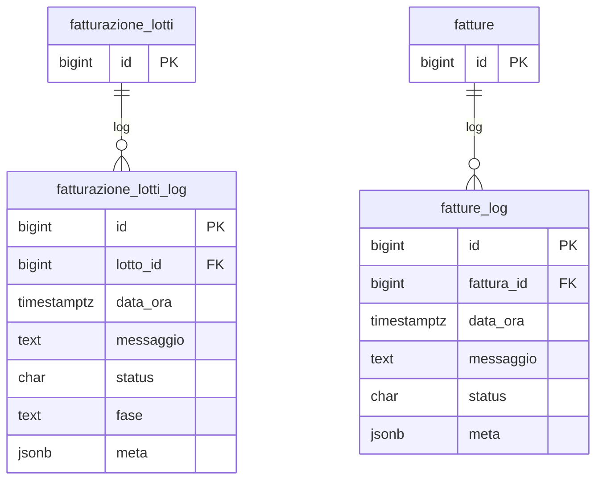

# Guida – Gestione dei Messaggi di Errore e Generazione Log

> (latest review 04-03-26)
>
> Destinatari: sviluppatori database, backend e devops
>
> Questa guida copre il modello unificato di error handling e logging in Zero ERP.
> La parte concettuale e di sviluppo e rivolta a tutti i destinatari.
> La parte di setup operativo (dblink, permessi, hardening) e rivolta principalmente a devops e DBA.
>
> Vedi anche
>
> * [Guida Fatturazione](/guide/fatturazione) — pipeline vendite con log di dominio
> * [Linee guida SQL](/linee-guida-sql) — convenzioni naming funzioni e trigger

---

## Introduzione

Ogni sistema gestionale deve produrre messaggi di errore comprensibili e mantenere una traccia completa di cosa e andato storto, quando e in quale contesto. In Zero ERP questo obiettivo e realizzato con un modello a tre componenti:

* Un **catalogo centralizzato** di messaggi, multilingua, con template, causa e suggerimento di risoluzione
* Un **registro persistente** che archivia ogni occorrenza di errore con timestamp, area, funzione e contesto
* Un insieme di **funzioni PL/pgSQL** che collegano catalogo e registro, formattando il messaggio e sollevando l'eccezione in modo uniforme

Il risultato: ogni errore nel sistema ha un codice stabile, un messaggio leggibile per l'utente, un dettaglio tecnico per lo sviluppatore, e un record di audit che sopravvive anche al rollback della transazione.

**Cosa troverai in questa guida:**

* Come funziona il catalogo messaggi e il registro errori
* Le tre funzioni di supporto e il loro ruolo nel flusso
* Il meccanismo di logging persistente via dblink
* Il routing degli errori per processi di dominio (pipeline, pratiche)
* Il contratto standard per estendere il log a nuovi domini
* Il setup operativo per devops (dblink, permessi, hardening)

---

## Tabelle coinvolte

**Configurazione:**

* [config.codici_errore](/dbzero/config/tabelle/codici_errore) — **l'identità di un codice**: una riga per codice, la sua classe, il suo eventuale ritiro
* [config.classi_errore](/dbzero/config/tabelle/classi_errore) — il vocabolario delle **dieci classi**: cosa *è* un errore, prima ancora di cosa dice
* [config.messaggi_errore](/dbzero/config/tabelle/messaggi_errore) — catalogo multilingua delle **frasi**: una riga per *(codice, lingua)*

**Operazioni:**

* [dbops.error_log](/dbzero/dbops/tabelle/error_log) — registro persistente di ogni occorrenza di errore
* [dbops.sec_functions_owner](/dbzero/dbops/tabelle/sec_functions_owner) — registry ownership funzioni sensibili

**Log di dominio (vendite):**

* [vendite.fatturazione_lotti_log](/dbzero/vendite/tabelle/fatturazione_lotti_log) — log pipeline per lotto
* [vendite.fatture_log](/dbzero/vendite/tabelle/fatture_log) — log per singola fattura

---

## Il modello in sintesi

```text
config.classi_errore (vocabolario: 10 classi)
    │
    │  DATO_ERRATO · CONFLITTO_STATO · NON_TROVATO · TECNICO · …
    │
config.codici_errore (identità: 1 riga per codice)
    │
    │  codice → classe (NOT NULL) , obsoleto_dal , note
    │
config.messaggi_errore (frasi: 1 riga per codice+lingua)
    │
    │  codice + lingua → messaggio, causa, soluzione
    │
    ├── script.fn_get_messaggio()
    │       recupera e formatta il messaggio con placeholder
    │
    ├── script.fn_log_error_only()
    │       scrive su error_log via dblink (persiste anche in rollback)
    │       usata internamente da fn_log_and_raise_error
    │
    └── script.fn_log_and_raise_error()
            chiama fn_log_error_only + RAISE EXCEPTION
            │
            ├── dbops.error_log (registro tecnico — sempre)
            │
            └── log di dominio (routing per scope)
                    vendite.fatturazione_lotti_log (scope LOTTO)
                    vendite.fatture_log            (scope FATTURA)
```

* **Identità** = *cosa è* quel codice (la classe), da cui il backend deriva la risposta HTTP
* **Catalogo** = i template dei messaggi, mantenuti in tabella e mai hard-coded nel codice
* **Registro** = il log tecnico immutabile, scritto fuori transazione per sopravvivere ai rollback
* **Routing** = i log di dominio specifici per processo, che si affiancano al registro tecnico

---

## La classe di un codice — *cosa è* un errore, prima di cosa dice

Fino al 2026-08-07 un codice errore aveva solo una **frase**. Chi lo leggeva
capiva il testo, ma nessun programma sapeva dire se quell'errore fosse un dato
sbagliato, un conflitto di stato o un guasto tecnico: quella conoscenza viveva
**solo nel backend**, in un secondo elenco scritto a mano, che poteva
disallinearsi dal catalogo senza che nulla protestasse.

Oggi ogni codice ha una **classe**, e la classe è `NOT NULL`.

> ⭐ **È questo il meccanismo, non l'adiacenza fra tabelle.** Un codice senza
> semantica **non può nascere**: la colonna è obbligatoria, e chi crea un codice
> è obbligato a decidere *cosa sia* nel momento in cui ha in testa il ramo che lo
> solleva — che è l'unico momento in cui lo sa davvero.

### Le dieci classi

| Classe | Risposta | Quando |
|---|---|---|
| `DATO_ERRATO` | 400 | il valore che l'operatore ha scritto o scelto non va bene |
| `CONFLITTO_STATO` | 409 | l'operazione non è ammessa **adesso**, per com'è il documento |
| `NON_TROVATO` | 404 | la cosa indicata non esiste |
| `NON_PERMESSO` | 403 | il diritto manca, e non dipende dallo stato |
| `NON_AUTENTICATO` | 401 | non manca il diritto: manca **chi sei** |
| `NON_ESEGUIBILE` | 422 | la richiesta è comprensibile ma non si può portare a termine |
| `NON_DISPONIBILE` | 501 | previsto dal disegno, non ancora costruito |
| `ERRORE_ESTERNO` | 502 | ha fallito un sistema di terzi |
| `TECNICO` | 500 | un guasto: l'operatore non può rimediare |
| `AVVISO` | *nessuna* | si scrive nel diario e non si solleva (i codici `W_`) |

⚠️ **La differenza che si sbaglia più spesso** è fra `DATO_ERRATO` e
`CONFLITTO_STATO`, e il criterio è pratico: *l'operatore può rimediare
correggendo un campo?* Se sì è `DATO_ERRATO`, e la pagina può evidenziare quel
campo. Se no è `CONFLITTO_STATO`, e l'unica cosa sensata è un messaggio.

### Da dove la prende il backend

**Da un file generato dal database.** L'elenco `codice → classe` non si scrive
più a mano: lo produce un comando che legge `config.vw_codici_errore_identita`, e
un controllo in CI fallisce se il file committato non è più quello che il
database produrrebbe adesso.

⚠️ Il secondo elenco **non è sparito** — ha cambiato natura: da elenco *scritto*
a elenco *generato*, cioè da qualcosa che può divergere in silenzio a qualcosa
che diverge **rumorosamente**. È il massimo ottenibile senza spostare tutto sugli
SQLSTATE, e la ragione sta nel brief del cantiere.

### Ritirare un codice, non cancellarlo

`config.codici_errore.obsoleto_dal` è la data dalla quale un codice **non si
usa più per il nuovo**. La riga resta, perché `dbops.error_log` ci punta e le
occorrenze storiche devono continuare a leggersi.

⚠️ La colonna **stava su `config.messaggi_errore`** fino al 2026-08-07, e lì era
sbagliata: quella tabella è chiavata *(codice, lingua)*, quindi si poteva
ritirare un codice in italiano e lasciarlo vivo in inglese. Ora vive
sull'identità, che ha una riga per codice — **il ritiro appartiene al codice, non
alla frase**.

---

## Componenti del modello

### 1. Il catalogo messaggi: `config.messaggi_errore`

Il catalogo e il punto unico in cui si definiscono tutti i messaggi di errore del sistema. Ogni messaggio ha un codice stabile (es. `E_GENERICO`, `E_SOGGETTO_NO_CONTATTI`), un testo con eventuali placeholder, una causa e un suggerimento di risoluzione. La tabella supporta piu lingue: lo stesso codice puo avere template in italiano, inglese e altre lingue.

Il vantaggio e duplice: lo sviluppatore usa solo il codice nel proprio codice PL/pgSQL, e il testo visualizzato puo essere modificato o tradotto senza toccare le funzioni.

Da un punto di vista tecnico:

* `id` (BIGINT, PK): chiave primaria
* `codice` (TEXT): identificativo del messaggio — univoco per lingua tramite vincolo `UNIQUE (codice, lingua)`
* `lingua` (TEXT): lingua del template (`it`, `en`, ...), default `it`
* `messaggio` (TEXT): testo con placeholder `%s` sostituibili via `format()`
* `causa` (TEXT): descrizione della causa, usata come `DETAIL` nell'eccezione
* `soluzione` (TEXT): suggerimento di risoluzione, usato come `HINT` nell'eccezione

> Documentazione dettagliata: [config.messaggi_errore](/dbzero/config/tabelle/messaggi_errore)

---

### 2. Il registro errori: `dbops.error_log`

Il registro e l'archivio immutabile di tutte le occorrenze di errore nel sistema. Ogni volta che una funzione rileva un errore e chiama `fn_log_and_raise_error` o `fn_log_error_only`, viene creato un record con il timestamp, l'area funzionale, la funzione di origine, il codice errore e un contesto JSONB con i dati rilevanti per il debug.

La caratteristica critica del registro e la **persistenza fuori transazione**: la scrittura avviene tramite dblink su una connessione separata, quindi il record sopravvive anche se la transazione principale viene annullata. Questo garantisce che nessun errore venga perso silenziosamente.

Da un punto di vista tecnico:

* `id` (BIGINT, PK): chiave primaria auto-incrementale
* `occurred_at` (TIMESTAMPTZ): istante di logging, default `now()`
* `area` (TEXT): ambito funzionale (es. `vendite`, `anagrafiche`, `database`)
* `function_name` (TEXT): nome della funzione che ha generato l'errore
* `messaggio_errore_id` (BIGINT, NOT NULL): FK verso `config.messaggi_errore.id`
* `context` (JSONB): payload libero con variabili, parametri, ID coinvolti — default `{}`
* `tx_id` (UUID): identificativo della transazione correlata
* `cleanup_at` (TIMESTAMPTZ): timestamp opzionale per retention automatica

> Documentazione dettagliata: [dbops.error_log](/dbzero/dbops/tabelle/error_log)

---

### 3. Le funzioni di supporto

Il modello di errore si appoggia su tre funzioni nello schema `script`, ciascuna con un ruolo distinto. L'ordine in cui sono presentate riflette la catena di dipendenza: `fn_get_messaggio` e la piu semplice (solo lettura), `fn_log_error_only` gestisce il logging persistente, e `fn_log_and_raise_error` le combina entrambe per il flusso completo errore + eccezione.

#### `script.fn_get_messaggio`

Recupera un messaggio dal catalogo e lo formatta con i valori forniti. E una funzione di pura lettura, marcata `IMMUTABLE`.

La lingua viene risolta con una cascata: parametro esplicito → GUC `myapp.user_language` → fallback `it`. Se il codice non esiste nel catalogo, restituisce `[MESSAGGIO NON DEFINITO: <codice>]` invece di fallire.

Da un punto di vista tecnico:

| Parametro | Tipo | Default | Descrizione |
| --- | --- | --- | --- |
| `p_codice` | TEXT | — | Codice del messaggio |
| `p_valore` | TEXT | NULL | Valore per il placeholder `%s` |
| `p_lingua` | TEXT | NULL | Lingua esplicita (sovrascrive il GUC) |

> Documentazione dettagliata: [script.fn_get_messaggio](/dbzero/script/funzioni/fn_get_messaggio)

#### `script.fn_log_error_only`

Scrive un record nel registro `dbops.error_log` senza sollevare eccezione. E la funzione su cui si basa l'intero meccanismo di logging persistente: usa dblink per scrivere su una connessione separata, garantendo che il log sopravviva al rollback.

Questa e la funzione piu critica dal punto di vista operativo. Per funzionare correttamente **deve essere `SECURITY DEFINER`** con **owner superuser** (`postgres`). La connessione dblink viene risolta dalla GUC `myapp.dblink_log_connection` (o `myapp.logconn`). Se la configurazione manca o e errata, la funzione emette un WARNING senza propagare errori al chiamante — il logging fallisce silenziosamente ma l'operazione principale non viene compromessa.

Da un punto di vista tecnico:

| Parametro | Tipo | Default | Descrizione |
| --- | --- | --- | --- |
| `p_area` | TEXT | — | Area funzionale |
| `p_function_name` | TEXT | — | Funzione che origina l'errore |
| `p_error_code` | TEXT | — | Codice del messaggio in `messaggi_errore` |
| `p_context` | JSONB | — | Contesto per il debug |
| `p_tx_id` | UUID | — | Transazione correlata |
| `VARIADIC p_valori` | TEXT[] | — | Valori per i placeholder |

Se il codice errore non esiste nel catalogo, la funzione usa il codice di ripiego `E_MESSAGGIO_NON_DEFINITO`. Se anche questo manca, il log viene saltato con WARNING.

> ⚠️ Si chiamava `MESSAGGIO_NON_DEFINITO`, senza prefisso, fino al 2026-08-07. Il nome è scritto a mano **in tre posti che non si derivano l'uno dall'altro** — il corpo di `fn_log_error_only`, i CSV di seed e il pgTAP che verifica che il ripiego esista: rinominarlo vuol dire toccarli tutti e tre.

> Documentazione dettagliata: [script.fn_log_error_only](/dbzero/script/funzioni/fn_log_error_only)

#### `script.fn_log_and_raise_error`

E la funzione principale per il flusso completo: logging + eccezione. Internamente chiama `fn_log_error_only` per il logging persistente, poi recupera il template tramite `fn_get_messaggio`, applica i valori ai placeholder, e solleva un `RAISE EXCEPTION` con `DETAIL` (causa) e `HINT` (soluzione) estratti dal catalogo.

L'applicazione riceve un errore formattato e comprensibile. Il database mantiene un record di audit completo.

Da un punto di vista tecnico:

| Parametro | Tipo | Default | Descrizione |
| --- | --- | --- | --- |
| `p_area` | TEXT | — | Area funzionale |
| `p_function_name` | TEXT | — | Funzione che origina l'errore |
| `p_error_code` | TEXT | — | Codice del messaggio |
| `p_context` | JSONB | — | Contesto per il debug |
| `p_tx_id` | UUID | — | Transazione correlata |
| `VARIADIC p_valori` | TEXT[] | — | Valori per i placeholder del messaggio |

> Documentazione dettagliata: [script.fn_log_and_raise_error](/dbzero/script/funzioni/fn_log_and_raise_error)

---


### ⭐ Due funzioni per sollevare, e a scegliere non sei tu

Dal 2026-09-08 i punti che sollevano il **codice del primo motivo** di una
`script.fn_check_*` non compongono piu' la coda a mano: chiamano
`script.fn_raise_primo_motivo_se_presente`. La domanda che decide e' **una**, e
si vede nella riga che stai scrivendo:

> **Il codice che sollevo lo sto LEGGENDO da un array di motivi, o lo sto
> SCRIVENDO come letterale?**

| Quello che scrivi | Cosa chiami |
| --- | --- |
| `'E_QUALCOSA'` — un letterale | `script.fn_log_and_raise_error` |
| `v_motivi -> 0 ->> 'codice'` | `script.fn_raise_primo_motivo_se_presente` |

⭐ **Sbagliare funzione non compila**: i tipi non legano (`42883` in un verso,
`22P02` nell'altro). L'unico modo di sbagliare e' **non usarla** — ricopiare la
coda — e quello e' silenzioso: lo presidia `db/pgtap/script/test-rubinetto-primo-motivo-v1.sql`.

⛔ **L'array non lo costruisci tu.** Se stai scrivendo
`jsonb_build_array(jsonb_build_object('codice', 'E_X', ...))` per poter usare
l'helper, stai usando l'attrezzo sbagliato: quel motivo lo conosci gia', e il
`-> 0` non sceglie niente.

⚠️ **E c'e' un caso in cui l'helper NON si usa anche se hai i motivi**: quando
la `fn_check_*` **non emette `valori`**. Li' la frase la compone il chiamante
dai propri dati, e delegare la spezzerebbe — uscirebbero i `%s` grezzi a video.
Sono tredici siti, dichiarati come debito nel presidio.

⭐ **La domanda che viene PRIMA**, quando scrivi un guard nuovo, non e' quale
funzione chiamare: e' **«questa regola deve anche accendere o spegnere un
pulsante nel frontend?»**. Se si', il predicato va in una `fn_check_*` e il
guard la CHIAMA (§12.5.2) — e allora ti ritrovi i motivi in mano. Se no,
valuti li' e sollevi il codice diretto.

Brief: `docs/it/dev/work-done/brief-db-coda-primo-motivo-in-un-posto-solo.md`.

## Flusso di gestione degli errori

Quando una funzione o un trigger rileva una condizione di errore, il flusso standard e:

1. **Validazione** — la funzione/trigger identifica l'anomalia (dato mancante, vincolo violato, stato incoerente)
2. **Logging persistente** — `fn_log_and_raise_error` chiama internamente `fn_log_error_only`, che scrive su `dbops.error_log` tramite una connessione dblink separata. Il record e gia persistito a questo punto
3. **Formattazione messaggio** — `fn_get_messaggio` recupera il template dal catalogo nella lingua corrente e sostituisce i placeholder
4. **Eccezione** — `RAISE EXCEPTION` con il messaggio formattato, `DETAIL` (causa) e `HINT` (soluzione)

La transazione va in rollback, ma il record in `error_log` sopravvive perche e stato scritto fuori transazione.

```text
Trigger / Funzione PL/pgSQL
    │
    │  rileva errore
    │
    └── fn_log_and_raise_error(area, funzione, codice, context, tx_id, valori...)
            │
            ├── fn_log_error_only()  ← dblink → INSERT INTO dbops.error_log
            │                                     (persiste anche in rollback)
            │
            ├── fn_get_messaggio()   ← config.messaggi_errore
            │                          (template + lingua + placeholder)
            │
            └── RAISE EXCEPTION      ← messaggio formattato
                  DETAIL = causa       (da messaggi_errore.causa)
                  HINT   = soluzione   (da messaggi_errore.soluzione)
```

---

## Cosa esce dall'eccezione, oltre al testo

`RAISE` di PostgreSQL ha campi strutturati oltre al messaggio, e il progetto ne
usa **due**. Non sono decorazioni: sono l'unico modo che il backend ha di sapere
cosa è successo **senza fare parsing del testo**.

| Campo | Porta | Dal |
|---|---|---|
| `CONSTRAINT` | il **codice** di dominio | 2026-08-05 |
| `COLUMN` | il **nome del campo** che l'operatore deve correggere | 2026-08-08 |

```sql
RAISE EXCEPTION '%', v_messaggio
  USING ERRCODE = 'P0001', CONSTRAINT = p_error_code, COLUMN = 'partita_iva';
```

⚠️ **Il contratto vale solo su `P0001`**, ed è essenziale: su una violazione di
vincolo vera (classe `23xxx`) `constraint_name` contiene il nome del vincolo del
database (`uq_…`, `fk_…`). Leggerlo come codice applicativo produrrebbe un codice
inesistente, cioè un 500 al posto di un 409 parlante.

### Il nome del campo: non si scrive, si dichiara

Chi solleva **non tocca il `RAISE`**: mette il nome nel contesto, e
`fn_log_and_raise_error` fa il resto.

```sql
PERFORM script.fn_log_and_raise_error(
    'database', 'anagrafiche.trgfn_soggetti_guard_cf_piva_obbligatori',
    'E_CF_OBBLIGATORIO',
    jsonb_build_object('campo', 'codice_fiscale', 'soggetto_id', NEW.id),
    NEW.tx_id
);
```

* **`campo`** — il nome esplicito, ed è la strada da usare quando si sa;
* **`parametro`** — se `campo` manca si ripiega qui, togliendo il prefisso `p_`.
  ⭐ È una convenzione che **esisteva già in 225 punti** (`'parametro','p_cognome'`)
  e non veniva trasmessa: derivarla copre **217 dei 380 punti** in cui il
  frontend potrebbe accendere un campo, **senza toccarne nessuno**.

⚠️ **Esce il nome, mai il valore.** Nei contesti c'è spesso anche quello che
l'operatore ha scritto: non ha nessun motivo di tornare indietro, ce l'ha già
davanti. E il nome deve **sembrare un identificatore**, altrimenti viene scartato.

### ⛔ I valori del messaggio: chi li mette **scrive per una persona**

I canali `CONSTRAINT` e `COLUMN` dicono al **backend** che cosa è successo e dove.
Il `VARIADIC p_valori` è un'altra cosa: riempie i `%s` del template, cioè
**compone la frase che l'operatore leggerà**. Non è debug, è interfaccia.

> ⛔ **Nel `VARIADIC` non entra mai il nome di un parametro PL/pgSQL, né il nome
> di una colonna.** Entra la cosa che l'operatore riconosce.

```sql
-- ⛔ NO — il codice è registrato, il messaggio no
PERFORM script.fn_log_and_raise_error(
    'database', 'pagamenti.fn_get_or_create_vendite_contabile',
    'E_PARAMETRO_INVALIDO',
    jsonb_build_object('campo', 'centro_riscossione_id'),
    NULL::uuid,
    'p_centro_riscossione_id (obbligatorio, maggiore di zero)'
);
--   l'operatore legge: «Parametro non valido: p_centro_riscossione_id (obbligatorio, > 0)»

-- ✅ SÌ — il messaggio nomina il dato, non il parametro
PERFORM script.fn_log_and_raise_error(
    'database', 'pagamenti.fn_get_or_create_vendite_contabile',
    'E_CONTABILE_DATI_OBBLIGATORI',
    jsonb_build_object('campo', 'centro_riscossione_id'),
    NULL::uuid,
    'il centro di riscossione'
);
--   l'operatore legge: «Per aprire una distinta contabile serve il centro di riscossione.»
```

#### ⭐ Perché la regola sta qui e non altrove

Perché il difetto **non si vede guardando il codice errore**. Il primo esempio usa
un codice registrato, con la sua classe, il suo `ui_action`, il suo campo sul
canale `COLUMN`: passa tutti i cancelli — il guardrail dei codici, il rubinetto
degli accumulatori, la rigenerazione delle policy. Eppure produce un messaggio di
qualità `E_GENERICO`.

> **Un codice registrato non garantisce un messaggio leggibile: il codice sceglie
> la *frase*, ma il *valore* che ci si infila dentro lo sceglie chi solleva.**

È lo stesso difetto che il refactor `E_GENERICO` ha tolto nel 2026 — lì viveva nel
**codice**, qui rientra dal **valore**. Caso reale: cantiere incassi, 2026-08-21,
sei guard di parametro bonificati «bene» e messaggi illeggibili
(`brief-db-posting-e-abbinamento-rata.md` §6.7).

#### ⭐ E il valore decide anche **quale codice** serve

La domanda «riuso un codice esistente o ne conio uno?» non si risponde guardando
la *condizione* (*«è un guard di parametro»*), ma **chi può rimediare** — perché è
quello che decide chi legge la frase.

| Il dato lo fornisce… | Chi legge il messaggio | Codice | Classe |
| --- | --- | --- | --- |
| una **persona**, in un form | una persona | codice di dominio, frase in italiano che **nomina il dato** | `DATO_ERRATO` (400) |
| solo un **chiamante rotto** (`id <= 0` dove il `NULL` è ammesso, enum vuoto) | chi guarda `dbops.error_log` | codice di dominio, messaggio che **nomina il parametro** | `TECNICO` (500) |

⚠️ Lo stesso guard può stare da una parte o dall'altra a seconda del parametro:
in una funzione con otto parametri due possono essere di form e sei no. Si guarda
**parametro per parametro**, non funzione per funzione.

##### ⛔ E nella seconda riga NON si riusa `E_PARAMETRO_INVALIDO`

È la scelta che sembra ovvia, ed è sbagliata per una ragione che il codice da
solo non mostra: **`E_PARAMETRO_INVALIDO` è un debito, non una sede.**

* **D11** di [brief-db-be-classe-codici-errore](/dev/work-done/brief-db-be-classe-codici-errore):
  *«`E_VALIDAZIONE` si spezza prima del seed; `E_PARAMETRO_INVALIDO` **no** —
  denominatore sicuro + `note`, e **cantiere suo**»*. È uno **split rimandato**,
  con una classe di compromesso e la ragione scritta nel catalogo. Sopravvive
  perché il backend deve poter ancora gestire le funzioni vecchie;
* **§9.1** dello stesso brief: *«la regola che chiude il **rubinetto** — vietare
  **nuovi** codici generici — resta in coda al lavoro: rincorrere gli esistenti
  senza chiudere il rubinetto è la forma in cui questi registri non calano mai»*;
* **[api.md §Tassonomia errori](/dev/api)** lo dichiara **candidato allo split**
  (113 funzioni, 111 con verità 400 e 2 con 404) e ne trae la regola *«un codice
  usato per due cose si spezza a monte, non si rimappa a valle»*.

⭐ **Precedente da citare quando qualcuno riproporrà il riuso**:
`E_VENDITE_PRICING_ESITO_ASSENTE` (2026-08-19, `TECNICO`) nasce perché il
rubinetto B-7 respinse `E_PARAMETRO_INVALIDO` su un guard analogo — *«lì non c'è
nessun parametro invalido, c'è un'invariante rotta»*.

⚠️ **`TECNICO` non è una sfumatura: sposta lo status da 400 a 500**, ed è il
punto. `DATO_ERRATO` significa *«chi l'ha fatta può correggerlo e riprovare»*: su
un bug del chiamante non c'è niente da correggere, e un 400 manda l'operatore a
cercare un campo che non esiste.

⚠️ **E su un `TECNICO` la chiave `campo` esce dal contesto**: su un 500 non c'è
nessun campo da accendere, e lasciarla farebbe evidenziare un input che l'errore
non ha causato.

#### ⚠️ L'eccezione che NON è una violazione

Un messaggio può nominare una colonna **di proposito**, quando il suo lettore è
uno sviluppatore e la colonna è l'informazione utile:

```sql
-- E_MOVIMENTO_RIFERIMENTO_INCOERENTE:
--   «Movimento incoerente con la riga contabile %s: %s vale %s, mentre la riga dice %s.»
… NULL::uuid, NEW.contabile_riga_id::text, 'fattura_id',
  NEW.fattura_id::text, v_fattura_id_riga::text
```

Qui `'fattura_id'` è **il soggetto della frase**, non un nome di parametro
travestito da spiegazione: il messaggio esiste per dire *quale* dei tre
riferimenti derivati è stato passato a mano sbagliato, e l'unico modo di dirlo è
nominarlo. Il destinatario è chi ha scritto la chiamata, non chi compila un form.

> **La domanda non è «c'è un nome di colonna nel messaggio?» ma «l'ho messo perché
> serve a chi legge, o perché non avevo voglia di scrivere una frase?».**

#### 📊 Quanto è diffuso — misurato il 2026-08-21

⚠️ **Questa non è una svista isolata: è lo stile in cui il progetto è cresciuto.**
Misurando `pg_proc` (l'oggetto vivo, non gli YAML): su **1.469** valori passati nel
`VARIADIC`, **265** sono letterali che *sembrano* un nome di parametro o di
colonna, distribuiti su **157 funzioni** in quasi tutti gli schemi. La forma
ricorrente è `'p_<nome>_id obbligatorio e > 0'`.

⛔ **E per questo NON esiste un cancello bloccante, ed è una scelta.** L'unico
controllo automatico possibile è euristico, e sbaglierebbe proprio sul caso
legittimo qui sopra — un messaggio che nomina una colonna perché è la sua
ragione d'essere. Vale il criterio già scritto per il rubinetto degli accumulatori
(`scripts/codici-errore-baseline.sh`): *un cancello che capisce un caso su cinque
boccia a caso e passa a caso, e dopo due blocchi sbagliati qualcuno lo spegne — un
presidio spento è peggio di uno assente*.

Il presidio praticabile è quindi **a valle e per caso**: dove la frase è la posta
in gioco, un `throws_like` nel pgTAP di quella funzione (vedi sotto). E il numero
sopra serve a sapere che, quando si tocca una funzione vecchia, il messaggio va
guardato — non dato per buono perché il codice è registrato.

#### Come si presidia

Un `throws_ok(..., 'P0001', ...)` **non** protegge questa regola: `P0001` dice
«errore di dominio», non *quale* e tanto meno *come è scritto*. Dove la frase è la
posta in gioco si asserisce con `throws_like` su un frammento stabile — mai
attraverso un segnaposto:

```sql
SELECT throws_like(
  $$ SELECT pagamenti.fn_get_or_create_vendite_contabile(p_centro_riscossione_id => 0, …) $$,
  '%distinta contabile%centro di riscossione%',
  'Il rifiuto nomina il centro di riscossione, non il parametro PL/pgSQL'
);
```

---

### ⚠️ Le tre trappole, prese sul campo

1. **Il codice dice *cosa* è andato storto, il contesto dice *dove*.** Due punti
   possono condividere il codice ed essere campi diversi — `E_PIVA_NON_VALIDA`
   vale sia per `partita_iva` sia per `piva_gruppo_acquisto`. Chi assegna il nome
   guardando il codice sbaglia campo;
2. **la prima riga della guardia non è la guardia.** In
   `IF NEW.ritenuta_acconto = true AND (NEW.ritenuta_aliquota IS NULL …)` il campo
   da correggere è sulla **seconda** riga: mandare il primo direbbe all'operatore
   di togliere la spunta invece che di scrivere l'aliquota;
3. **si ragiona per schermata, non per schema.** Il CF *mancante* è validato in
   `anagrafiche`, il CF *malformato* in `script`: coprire uno solo dei due lascia
   la stessa pagina che si accende in un caso e non nel gemello — e insegna
   all'operatore che il bordo rosso non è affidabile.

⛔ **Un solo mittente per canale**, presidiato dai controlli (A) e (F) del
guardrail. Un secondo mittente su `COLUMN` non farebbe fallire niente: farebbe
**evidenziare il campo sbagliato**, che è peggio di non evidenziarne nessuno.
Vedi [Presidi e registri del debito](presidi-e-registri-del-debito.md) §3.3.

---

## Routing errori di dominio

### Il concetto

Il registro tecnico `dbops.error_log` traccia ogni errore del sistema in modo uniforme. Ma i processi applicativi — come la pipeline di fatturazione o la gestione pratiche — hanno bisogno di log piu strutturati, con informazioni di dominio (quale lotto, quale fattura, quale fase del processo).

Per questo motivo Zero ERP adotta un **routing esplicito**: ogni errore applicativo viene scritto sia nel registro tecnico standard sia nel log di dominio specifico. I due livelli convivono senza sostituirsi.

### Routing attuale (vendite)

| Ambito | Target log di dominio | Descrizione |
| --- | --- | --- |
| `LOTTO` | `vendite.fatturazione_lotti_log` | Avanzamento fasi pipeline, esito complessivo lotto |
| `FATTURA` | `vendite.fatture_log` | Errori specifici sul singolo documento |

In entrambi i casi il registro tecnico `dbops.error_log` resta attivo per gli errori SQL/raise.

### Funzioni di dominio (stato attuale)

* `vendite.fn_log_pipeline_fase(...)` — scrive su `fatturazione_lotti_log` con fase, status e metadati denormalizzati dal lotto
* `vendite.fn_log_lotto_esito_fatture(...)` — aggrega gli esiti dalle fatture del lotto (priorita: C > W > I) e scrive il risultato complessivo

### Contratto standard per i log di dominio

Questo contratto e pensato per essere riusabile quando si aggiungono nuovi domini (es. `ATTIVITA_FATTURABILI`, `PRATICHE`). Ogni nuovo dominio crea le proprie tabelle di log e le proprie funzioni, ma rispetta lo stesso schema di campi:

| Campo | Tipo | Obbligatorio | Descrizione |
| --- | --- | :---: | --- |
| `scope` | TEXT | si | Identifica il contesto (`LOTTO`, `FATTURA`, `PRATICA`, ...) |
| `severity` | CHAR(1) | si | `I` = info, `W` = warning, `C` = critico |
| `code` | TEXT | si | Codice errore stabile da `config.messaggi_errore` |
| `message` | TEXT | si | Messaggio sintetico |
| `detail` | TEXT | no | Dettaglio tecnico |
| `meta` | JSONB | no | Contesto libero (task, step, funzione, parametri) |
| ID entita | varia | si | ID dell'entita di dominio (es. `lotto_id`, `fattura_id`, `pratica_id`) |

La severita segue una gerarchia a tre livelli: se almeno un errore critico (`C`) e presente, l'esito complessivo e critico. Altrimenti, se ci sono warning (`W`), l'esito e warning. Altrimenti e informativo (`I`).

---

## Best practice

### Codici errore

* **Centralizzare tutti i messaggi** in `config.messaggi_errore` — mai hard-codare testi nelle funzioni
* **Usare nomi descrittivi** che rendano il codice autoesplicativo senza consultare il catalogo
* Ogni codice deve essere registrato **prima** di essere usato: dal 2026-08-07 una riga in `config.codici_errore` (identità + classe) è **obbligatoria**, perché `config.messaggi_errore.codice` ha una chiave esterna verso di essa. Una frase senza identità non entra più: non è una raccomandazione, è un vincolo
* Se il codice manca del tutto, `fn_log_error_only` ricade su `E_MESSAGGIO_NON_DEFINITO`

#### Il prefisso dice se blocca: `E_` e `W_`

Il prefisso del codice **non è decorativo**: dichiara al lettore se l'operazione
prosegue o si ferma. Deve corrispondere alla funzione che lo solleva.

| Prefisso | Significato | Funzione da usare | Effetto |
| --- | --- | --- | --- |
| `E_` | **Errore bloccante** | `script.fn_log_and_raise_error` | logga **e** solleva: la transazione si ferma |
| `W_` | **Avvertimento** | `script.fn_log_error_only` | logga soltanto: l'esecuzione prosegue |

Esempi: `E_GENERICO`, `E_SOGGETTO_NO_CONTATTI`, `E_RUOLO_NATURA_NON_AMMESSA` da un
lato; `W_TXID_NOT_REGISTERED` dall'altro.

**Perché la regola conta.** Un codice `W_` sollevato con `fn_log_and_raise_error`
blocca pur dichiarandosi innocuo, e chi legge lo stack trace cerca la causa nel
posto sbagliato. È successo davvero: `W_TXID_NOT_REGISTERED` bloccava le
migrazioni in ogni ambiente senza canale di log, e il prefisso `W_` ha portato
fuori strada la diagnosi (vedi `brief-db-coerenza-tx-id-non-registrato.md`).

**Nel dubbio, guarda il chiamante, non il nome.** Quando si aggiunge o si modifica
un codice, la verifica è una sola riga: se passa per `fn_log_and_raise_error` deve
iniziare per `E_`, se passa per `fn_log_error_only` per `W_`.

✅ **Il debito dei nomi storici è chiuso.** Erano 57 il 2026-08-05, sono **zero**:
oggi **nessun codice vivo è fuori convenzione**. L'esempio che questa guida citava
(`ERRORE_PARAMETRI_TABELLA`) è stato ritirato e sostituito da
`E_ERRORE_PARAMETRI_TABELLA`. Il registro `dbops.messaggi_errore_codici_legacy`
resta vuoto e **non si droppa**: è il meccanismo pronto per la prossima eredità,
e un registro vuoto non è un registro inutile — è un registro in pari.

⛔ **Ma il rubinetto è chiuso**: il controllo (B) del guardrail rifiuta ogni
codice *nuovo* fuori convenzione. Il registro è per il debito **ereditato**, non
per i codici nuovi: quelli nascono giusti.

### Logging

* **Popolare il `context`** JSONB con dati rilevanti per il debug: ID coinvolti, parametri della chiamata, stato corrente
* **Non catturare errori generici** nel backend: usare `ServiceError` nei service e lasciare il middleware di core gestire il fallback (vedi `apps/core/services/error_manager.py`)
* **Sfruttare la multilingua** definendo template in piu lingue e usando il GUC `myapp.user_language`

### Monitoraggio

* Creare viste o dashboard su `dbops.error_log` per alert e metriche di errore
* Il campo `cleanup_at` permette policy di retention automatica
* Il JSONB `context` e il modello di log separato preservano la flessibilita per colonne future

---

## Consultare i log

Le sezioni precedenti descrivono come i log si **scrivono**. Questa descrive come
si **leggono**: quale registro risponde a quale domanda, e da dove ci si arriva
nell'applicazione.

> Questa è la mappa **stabile**. Lo stato di avanzamento — quali strumenti
> mancano ancora, quali registri non sono esposti, il piano per colmarli — vive
> in [analisi-osservabilita-log.md](/dev/work-in-progress/analisi-osservabilita-log),
> che si aggiorna con lo sviluppo. Qui si dice *cosa esiste e come si usa*, non
> *cosa manca*: è la distinzione che tiene una guida leggibile a distanza di mesi.

### Quale log risponde a quale domanda

La prima scelta da fare non è «apro i log», è **quale registro**. Sbagliarla
costa tempo, perché ognuno di questi risponde a una domanda diversa e in nessuno
c'è la risposta dell'altro.

| La domanda | Il registro | Nota |
| --- | --- | --- |
| «Cosa è andato storto, tecnicamente?» | `dbops.error_log` | Registro universale. **Sopravvive al rollback** (scrittura via dblink): è l'unico posto dove resta traccia di un errore in una transazione annullata |
| «Chi ha chiamato cosa, via HTTP?» | `dbops.request_log` | Utente, path, status, durata, `request_id`, `error_code` |
| «Quale funzione o automazione è stata eseguita?» | `dbops.audit_log` | `params`/`result`, `dry_run`, `sqlstate`, `rows_affected` |
| «Il job notturno è girato? com'è finito?» | `maintenance.job_run_log` | Un record per esecuzione, pgAgent e headless; `run_uuid` per correlare col dominio |
| «Cos'è successo a questo lotto/fattura, in ordine di tempo?» | `vendite.event_log` | Timeline append-only per dominio ed entità, con `severity` |
| «Perché questo lotto non avanza?» | `vendite.fatturazione_lotti_log` + `fatturazione_lotti_task_runs` | Il primo dà fase ed esito, il secondo il **tentativo per tentativo** con `error_code`/`error_message` |
| «Perché questa fattura è bloccata?» | `vendite.fatture_log` | Warning e critici del singolo documento. I critici **bloccano numerazione e invio** finché non sono disabilitati |
| «Il lavoro che ho lanciato a che punto è?» | `dbops.coda_lavori` | Stato, tentativi, `ultimo_errore`, backoff |
| «Com'era questo record prima?» | schema `storico.*` | Snapshot JSONB completo a ogni UPDATE/DELETE — non è un log eventi, è la storia del dato |

**Il filo che li lega.** `tx_id` attraversa i registri scritti nella stessa
transazione; `request_id` lega la richiesta HTTP a ciò che ne è seguito;
`run_uuid` lega un job al suo dettaglio di dominio; `correlation_id` lega gli
eventi di una stessa operazione in `event_log`. Quando si indaga, si parte da
uno di questi quattro — non dal timestamp, che con più operazioni in parallelo
non discrimina.

### Da dove si arriva, nell'applicazione

| Strumento | Percorso | Cosa mostra |
| --- | --- | --- |
| **Badge code + drawer rapido** | topbar (sempre visibile) | Job vivi delle due code e stato dei worker; da qui si scende al dettaglio |
| **Code di lavoro** | Strumenti → Code di lavoro | Due schede (lavori e stampa): stato, tentativi, ultimo errore, timeline del job; azioni annulla/riaccoda. Il dettaglio di un job apre un drawer dedicato |
| **Diagnostica del lotto** | Vendite → Lotti → clic sulla riga | Scheda **Task-run** (tentativo, esito, codice e messaggio d'errore) e scheda **Segnalazioni** con severità; da qui si fa ripartire uno step fallito |
| **Errori vivi di fatturazione** | Vendite → Dashboard competenza, pannello errori | Task in errore non ancora superati da un ritentativo, più le fatture critiche; il codice del lotto è cliccabile e porta alla diagnostica |
| **Esiti dei giri** | Vendite → Lotti, pannello in fondo | Riassunto delle esecuzioni per corsia e stato della coda di stampa |
| **Audit delle modifiche** | Amm. Software → Audit log | Chi ha cambiato cosa (riservato agli amministratori) |
| **Log email** | Amm. Software → Email log | Esiti di invio, tentativi, errore (riservato agli amministratori) |

### Log applicativi Python

Oltre ai registri su database, il backend scrive log su file
(`RotatingFileHandler`, vedi `settings.py` → `LOGGING`). Servono per i
traceback e per il comportamento interno del processo, e **si consultano sul
server**, non dall'applicazione.

⚠️ **Non sono lo stesso piano dei registri DB**, e la differenza conta quando
si indaga: un errore di dominio finisce in `dbops.error_log` **anche se la
transazione fallisce**, mentre un traceback Python resta solo nel file. Se una
richiesta è andata storta e su `error_log` non c'è nulla, la traccia va cercata
lì.

---

## Setup operativo (devops)

Questa sezione e destinata a devops e DBA. Descrive come configurare il logging persistente via dblink, che permette alla funzione `fn_log_error_only` di scrivere su `dbops.error_log` fuori transazione.

### Prerequisito: perche serve dblink

In PostgreSQL, quando una transazione va in rollback, tutti gli INSERT effettuati nella stessa transazione vengono annullati — inclusi eventuali log. Per garantire che il record di errore sopravviva, `fn_log_error_only` usa `dblink_exec` per aprire una connessione separata e scrivere il log in una transazione autonoma. Questo richiede:

* L'estensione `dblink` installata
* Un ruolo dedicato con permessi minimi
* La configurazione di `pg_service.conf` e `.pgpass` sul server
* Una GUC per indicare alla funzione quale connessione usare

### 1. Ruolo di logging con privilegi minimi

Eseguire da utente admin (es. `postgres`) nel DB applicativo:

```sql
CREATE EXTENSION IF NOT EXISTS dblink;

CREATE ROLE zeroerp_log LOGIN PASSWORD 'PASSWORD_FORTE';
GRANT USAGE ON SCHEMA dbops TO zeroerp_log;
GRANT INSERT ON TABLE dbops.error_log TO zeroerp_log;
GRANT USAGE, SELECT ON SEQUENCE dbops.error_log_id_seq TO zeroerp_log;
```

### 2. Configurare `pg_service.conf`

I file devono essere creati **sul server DB**, nella HOME dell'utente OS `postgres`
(tipicamente `/var/lib/postgresql`).

`/var/lib/postgresql/.pg_service.conf`:

```
[zeroerp_log]
host=127.0.0.1
port=5432
dbname=zeroerp
user=zeroerp_log
```

### 3. Configurare `.pgpass`

`/var/lib/postgresql/.pgpass`:

```
127.0.0.1:5432:zeroerp:zeroerp_log:PASSWORD_FORTE
```

Permessi obbligatori:

```bash
chown postgres:postgres /var/lib/postgresql/.pg_service.conf /var/lib/postgresql/.pgpass
chmod 600 /var/lib/postgresql/.pg_service.conf /var/lib/postgresql/.pgpass
```

Se il servizio PostgreSQL non legge la HOME, forzare i path con systemd:

```
[Service]
Environment=PGSERVICEFILE=/var/lib/postgresql/.pg_service.conf
Environment=PGPASSFILE=/var/lib/postgresql/.pgpass
```

e riavviare `postgresql@<versione>-main`.

### 4. Impostare la GUC per i ruoli applicativi

Eseguire da admin:

```sql
ALTER ROLE titodb     IN DATABASE zeroerp SET myapp.dblink_log_connection = 'service=zeroerp_log';
ALTER ROLE zeroerp_app IN DATABASE zeroerp SET myapp.dblink_log_connection = 'service=zeroerp_log';
```

### 5. Hardening ownership funzioni

Per garantire che `fn_log_error_only` resti `SECURITY DEFINER` con owner `postgres`, il sistema usa una tabella di registry (`dbops.sec_functions_owner`) e una funzione di sincronizzazione (`dbops.fn_sync_functions_owner`).

Il changeSet Liquibase in `migrations_v2/90_end/` esegue la sincronizzazione ad ogni aggiornamento:

```bash
scripts/liquibase5.sh update --contexts=provision --username=postgres --password=***
```

La funzione `script.fn_log_error_only` e registrata in `dbops.sec_functions_owner` e viene riallineata automaticamente a `postgres`.

### Verifiche e troubleshooting

**Test di funzionamento:**

```sql
SELECT script.fn_log_error_only(
  'test',
  'diag_log_only',
  'E_GENERICO',
  jsonb_build_object('probe','manual_test','ts',clock_timestamp()),
  NULL::uuid
);

SELECT *
FROM dbops.error_log
ORDER BY occurred_at DESC
LIMIT 5;
```

**Errori tipici:**

* **`2F003` (password/GSSAPI richiesti)** — la funzione non e `SECURITY DEFINER` o non e owner superuser; oppure `pg_service.conf` / `.pgpass` non sono visibili al processo postgres
* **Log non presente ma nessun errore** — verificare `myapp.dblink_log_connection`, `pg_service.conf` / `.pgpass`, e permessi del ruolo `zeroerp_log`

---

## Diagramma ER

### Registro tecnico



### Log di dominio (vendite)



---

## Note finali

Questa guida copre il modello centralizzato di error handling. Per i processi specifici che lo utilizzano:

* [Guida Fatturazione](/guide/fatturazione) — la pipeline di fatturazione e i suoi log di dominio
* [Linee guida SQL](/linee-guida-sql) — convenzioni per naming di funzioni, trigger e codici errore

---


