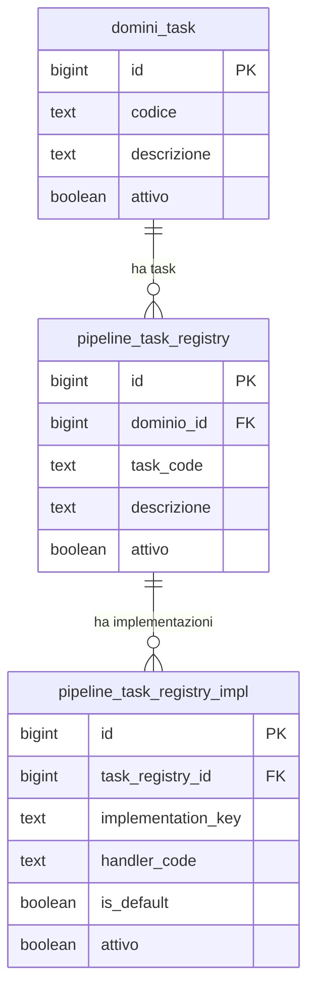
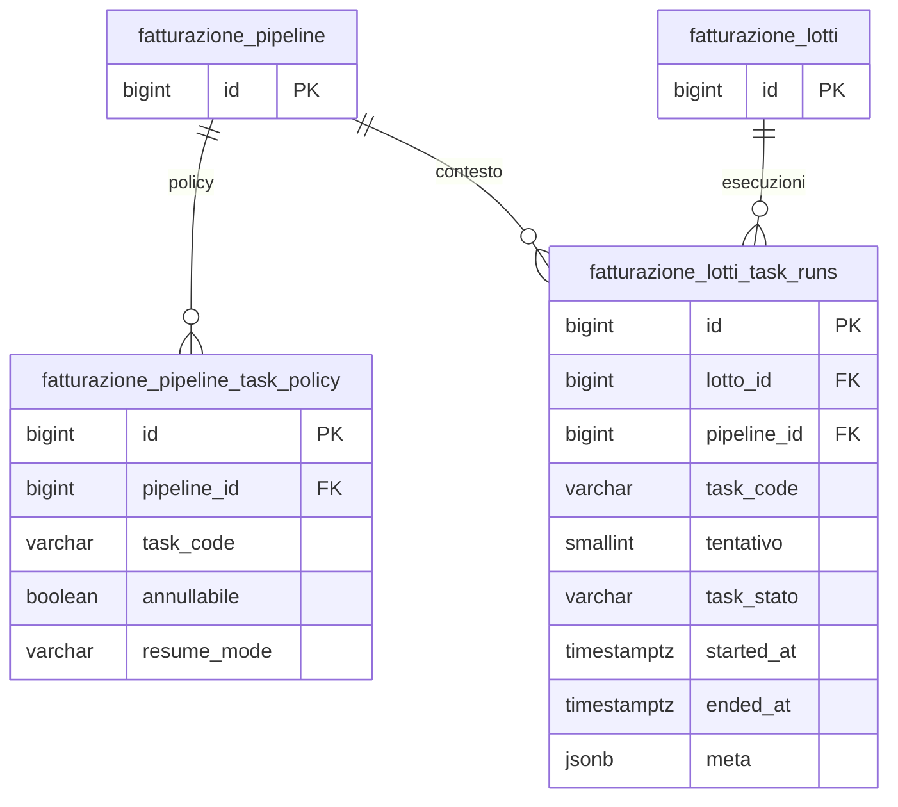

# Guida — Tracciamento processi e job

> **Ultimo aggiornamento**: 12 novembre 2026
>
> **Destinatari**: sviluppatori database, backend e analisti funzionali
>
> **Vedi anche** — schemi DB:
>
> * [dbops.audit_log](/dbzero/dbops/tabelle/audit_log) — registro operazioni generiche
> * [dbops.processi](/dbzero/dbops/tabelle/processi) — catalogo dei processi automatici: chi gira, dichiarato da chi lo lancia
> * [dbops.domini_task](/dbzero/dbops/tabelle/domini_task) — catalogo dei domini (es. FATTURAZIONE, ATTIVITA_FATTURABILI)
> * [dbops.pipeline_task_registry](/dbzero/dbops/tabelle/pipeline_task_registry) — catalogo task per dominio
> * [dbops.pipeline_task_registry_impl](/dbzero/dbops/tabelle/pipeline_task_registry_impl) — implementazioni dei task (handler, varianti)
> * [vendite.fatturazione_pipeline_task_policy](/dbzero/vendite/tabelle/fatturazione_pipeline_task_policy) — policy di esecuzione per task
> * [vendite.fatturazione_lotti_task_runs](/dbzero/vendite/tabelle/fatturazione_lotti_task_runs) — esecuzioni runtime per lotto
> * [maintenance.job_run_log](/dbzero/maintenance/tabelle/job_run_log) — log esecuzioni job schedulati (pgAgent + cron/command)
>
> **Vedi anche** — funzioni e trigger DB:
>
> * [maintenance.fn_run_and_log](/dbzero/maintenance/funzioni/fn_run_and_log) — wrapper standard dei job pgAgent
> * [script.fn_job_run_start](/dbzero/script/funzioni/fn_job_run_start) — apertura del verbale per i job headless
> * [script.fn_job_run_end](/dbzero/script/funzioni/fn_job_run_end) — chiusura del verbale e rilascio del lock
>
> **Vedi anche** — guide correlate:
>
> * [Sistema di Audit Logging](/guide/messaggi-audit) — il registro delle operazioni
> * [Messaggi di Errore e Generazione Log](/guide/Messaggi-di-Errore-e-Generazione-Log) — error logging e routing di dominio
> * [Framework di Automazione DB](/guide/automazione-db) — automazioni dichiarative e audit
> * [Gestione delle code di lavoro](/guide/gestione-code-di-lavoro) — job asincroni su richiesta; il worker che li drena si registra qui in `job_run_log`
> * [I lavori automatici: che natura hanno e per conto di chi girano](/guide/processi-automatici-classe-e-identita) — **chi** compare nel giornale delle esecuzioni, e per conto di chi
> * [PostgreSQL: pgAgent](/postgresql/pgAgent) — lo scheduler integrato

---

## Introduzione

In Zero ERP convivono processi di natura diversa: manutenzione schedulata via pgAgent, pipeline di fatturazione orchestrate da Django, operazioni batch headless. Ognuno ha bisogno di registrare cosa ha fatto, quanto ha impiegato e se ha avuto successo.

Il sistema di tracciamento e organizzato su **tre livelli**, ciascuno con un ruolo preciso:

* **Audit log** (`dbops.audit_log`) — traccia le operazioni generiche: automazioni, deploy, processi batch. E il livello trasversale, usato da qualsiasi componente
* **Job run log** (`maintenance.job_run_log`) — traccia le esecuzioni dei **job schedulati**: pgAgent (lato DB) *e* job headless cron/command (management command Django, es. `run_fatturazione_batch`). Un record per ogni esecuzione con `origine`, esito, durata, dettaglio errori e `meta`
  * **Dice anche chi**: quale lavoro (nome a registro) e con quale identità. Un run che non dice di quale processo è non si scrive: il CHECK `chk_job_run_log_processo_dichiarato` lo respinge, e il lavoro non parte.
  * **Un fallimento deve lasciare traccia**: la riga «è andata male» scritta dentro la stessa transazione dell'errore verrebbe annullata insieme all'errore, quindi il verbale viaggia su una linea separata e sopravvive al rollback.
* **Task registry e task runs** (`dbops` + `vendite`) — traccia l'esecuzione dei task all'interno delle pipeline applicative, con stato, tentativi e policy di resume

Questi tre livelli non si sostituiscono: si affiancano. Un job pgAgent puo produrre record sia in `job_run_log` (per il job schedulato) sia in `audit_log` (per le automazioni che esegue), e un errore grave viene catturato anche in `error_log`.

**Cosa troverai in questa guida:**

* L'architettura dei tre livelli di tracciamento
* Il task registry multi-dominio e come registrare nuovi task
* Il tracciamento runtime delle pipeline (esecuzione, tentativi, policy)
* I job schedulati e l'integrazione con pgAgent
* Il rapporto tra i vari sistemi di logging

---

## Il modello in sintesi

```text
dbops (trasversale)
    │
    ├── audit_log
    │       registro operazioni generiche (automazioni, batch, deploy)
    │
    ├── domini_task
    │       catalogo domini: FATTURAZIONE, ATTIVITA_FATTURABILI, ...
    │       │
    │       └── pipeline_task_registry
    │               catalogo task per dominio
    │               │
    │               └── pipeline_task_registry_impl
    │                       implementazioni: handler_code, is_default
    │
vendite (dominio specifico)
    │
    ├── fatturazione_pipeline_task_policy
    │       policy per task: resume_mode, annullabile
    │
    └── fatturazione_lotti_task_runs
            esecuzioni: lotto + task + tentativo → stato, durata, errori
    │
maintenance (job schedulati)
    │
    └── job_run_log
            un record per esecuzione (pgAgent / cron / command): jobname, origine, ok, meta
```

---

## Componenti del modello

### 1. Task registry multi-dominio

Il task registry e il catalogo centralizzato di tutti i task disponibili nei vari domini applicativi. E pensato per essere **riusabile**: quando si aggiunge un nuovo dominio (es. PRATICHE, ATTIVITA_FATTURABILI), si registrano i task nello stesso registry senza creare nuove tabelle di catalogo.

L'architettura e a tre livelli: dominio → task → implementazione.

⚠️ Un dominio a catalogo non è per forza una pipeline: `ATTIVITA_FATTURABILI` non ne ha una. La promozione da commessa ad attività fatturabili è un task idempotente dentro la pipeline di fatturazione, perché è una distribuzione senza ciclo di vita proprio; il motore serve un processo con stati, numerazione e rollback. Vedi [dbops.domini_task](/dbzero/dbops/tabelle/domini_task).

#### `dbops.domini_task`

Definisce i domini applicativi. Ogni dominio e un perimetro logico che raggruppa task correlati.

Da un punto di vista tecnico:

| Colonna       | Tipo         | Descrizione                                                 |
| ------------- | ------------ | ----------------------------------------------------------- |
| `id`          | BIGINT, PK   | Chiave primaria                                             |
| `codice`      | TEXT, UNIQUE | Codice dominio (es. `FATTURAZIONE`, `ATTIVITA_FATTURABILI`) |
| `descrizione` | TEXT         | Descrizione funzionale                                      |
| `attivo`      | BOOLEAN      | Flag attivo/disattivo                                       |
| `meta`        | JSONB        | Estensione libera                                           |

> Documentazione dettagliata: [dbops.domini_task](/dbzero/dbops/tabelle/domini_task)

#### `dbops.pipeline_task_registry`

Catalogo dei task per dominio. Ogni task ha un codice univoco all'interno del proprio dominio e rappresenta un'operazione ben definita (es. `select_attivita`, `generate_fatture_righe`).

Da un punto di vista tecnico:

| Colonna       | Tipo       | Descrizione                      |
| ------------- | ---------- | -------------------------------- |
| `id`          | BIGINT, PK | Chiave primaria                  |
| `dominio_id`  | BIGINT, FK | Riferimento a `domini_task`      |
| `task_code`   | TEXT       | Codice task (UNIQUE per dominio) |
| `descrizione` | TEXT       | Descrizione funzionale           |
| `attivo`      | BOOLEAN    | Flag attivo/disattivo            |
| `meta`        | JSONB      | Estensione libera                |

Vincolo: `UNIQUE (dominio_id, task_code)` — impedisce task duplicati nello stesso dominio.

> Documentazione dettagliata: [dbops.pipeline_task_registry](/dbzero/dbops/tabelle/pipeline_task_registry)

#### `dbops.pipeline_task_registry_impl`

Definisce le implementazioni concrete di ogni task. Un task puo avere piu varianti (es. `default`, `v2`, `gas_v1`), ciascuna con il proprio `handler_code` che il layer Python usa per risolvere il codice da eseguire.

Questa tabella e la chiave del modello di dispatch **controllato**: nessun import dinamico, il codice Python consulta il registry e mappa `handler_code` a un handler statico nel proprio registro interno.

Da un punto di vista tecnico:

| Colonna              | Tipo       | Descrizione                                             |
| -------------------- | ---------- | ------------------------------------------------------- |
| `id`                 | BIGINT, PK | Chiave primaria                                         |
| `task_registry_id`   | BIGINT, FK | Riferimento a `pipeline_task_registry`                  |
| `implementation_key` | TEXT       | Identificativo variante (es. `default`, `v2`)           |
| `handler_code`       | TEXT       | Codice handler logico (mappato dal Python)              |
| `is_default`         | BOOLEAN    | Flag implementazione default (un solo default per task) |
| `attivo`             | BOOLEAN    | Flag attivo/disattivo                                   |
| `meta`               | JSONB      | Estensione libera                                       |

Vincoli:

* `UNIQUE (task_registry_id, implementation_key)` — una variante per task
* `UNIQUE (task_registry_id) WHERE is_default IS TRUE` — un solo default per task

> Documentazione dettagliata: [dbops.pipeline_task_registry_impl](/dbzero/dbops/tabelle/pipeline_task_registry_impl)

---

### 2. Task runtime: esecuzione e policy

Il task registry definisce **cosa** puo essere eseguito. Il task runtime traccia **come** viene eseguito: con quale policy, quanti tentativi, in quale stato.

Attualmente il runtime e implementato nel dominio vendite (pipeline fatturazione). Quando si aggiungeranno nuovi domini, ciascuno avra le proprie tabelle di policy e task_runs — seguendo lo stesso schema.

#### `vendite.fatturazione_pipeline_task_policy`

Definisce le regole di esecuzione per ogni task all'interno di una pipeline: se il task e annullabile, quale strategia di recovery usare in caso di errore.

Da un punto di vista tecnico:

| Colonna       | Tipo       | Descrizione                                                                                                                                             |
| ------------- | ---------- | ------------------------------------------------------------------------------------------------------------------------------------------------------- |
| `id`          | BIGINT, PK | Chiave primaria                                                                                                                                         |
| `pipeline_id` | BIGINT, FK | Riferimento a `fatturazione_pipeline`                                                                                                                   |
| `task_code`   | VARCHAR    | Codice task                                                                                                                                             |
| `annullabile` | BOOLEAN    | Se il task e cancellabile (default: true)                                                                                                               |
| `resume_mode` | VARCHAR    | Strategia di ripresa dopo un errore: `RESET_STEP` o `RESUME_TASK`. La ripresa a livello di *step* non è una policy del task: la governa l'orchestratore |
| `attivo`      | BOOLEAN    | Policy attiva/inattiva                                                                                                                                  |
| `meta`        | JSONB      | Estensione                                                                                                                                              |

Vincolo: `UNIQUE (pipeline_id, task_code)`.

> Documentazione dettagliata: [vendite.fatturazione_pipeline_task_policy](/dbzero/vendite/tabelle/fatturazione_pipeline_task_policy)

#### `vendite.fatturazione_lotti_task_runs`

Traccia ogni singola esecuzione di un task su un lotto. E il cuore del tracciamento runtime: registra lo stato corrente, i tentativi, gli errori e i metadati di progresso.

Il campo `tentativo` permette di gestire retry deterministici: ogni nuovo tentativo crea un record distinto, mantenendo lo storico completo.

Da un punto di vista tecnico:

| Colonna                | Tipo        | Descrizione                                                 |
| ---------------------- | ----------- | ----------------------------------------------------------- |
| `id`                   | BIGINT, PK  | Chiave primaria                                             |
| `lotto_id`             | BIGINT, FK  | Lotto in elaborazione                                       |
| `pipeline_id`          | BIGINT, FK  | Pipeline di contesto                                        |
| `stato_doc_fiscale_id` | INTEGER, FK | Fase del processo                                           |
| `task_code`            | VARCHAR     | Task in esecuzione                                          |
| `fase`                 | VARCHAR     | Sotto-fase (opzionale)                                      |
| `tentativo`            | SMALLINT    | Numero tentativo (default: 1)                               |
| `task_stato`           | VARCHAR     | Stato: `IN_ESECUZIONE`, `COMPLETATO`, `ERRORE`, `ANNULLATO` |
| `started_at`           | TIMESTAMPTZ | Inizio esecuzione                                           |
| `ended_at`             | TIMESTAMPTZ | Fine esecuzione                                             |
| `error_code`           | VARCHAR     | Codice errore (se fallito)                                  |
| `error_message`        | TEXT        | Messaggio errore                                            |
| `meta`                 | JSONB       | Metadati runtime (progresso, metriche)                      |

Vincoli:

* `UNIQUE (lotto_id, stato_doc_fiscale_id, task_code, tentativo)` — tracciamento deterministico
* `CHECK (ended_at >= started_at)` — coerenza temporale

> Documentazione dettagliata: [vendite.fatturazione_lotti_task_runs](/dbzero/vendite/tabelle/fatturazione_lotti_task_runs)

---

### 3. Job schedulati: pgAgent e job headless (cron/command)

I job schedulati via pgAgent sono processi periodici gestiti dallo scheduler PostgreSQL: pulizia log, applicazione indici FK, storicizzazione, aggiornamento audit.
⚠️ **Questo elenco è la sola natura ammessa dentro l'orologio**: manutenzione del sistema. Un lavoro che tocca i dati di un'azienda non viene eseguito lì — l'orologio lo mette in coda ([perché](/guide/processi-automatici-classe-e-identita)). Ogni job ha il proprio wrapper nello schema `maintenance` e registra le esecuzioni in `job_run_log`.

`job_run_log` è però **generica**: oltre a pgAgent accoglie anche i **job headless cron/command** (management command Django via systemd, es. `run_fatturazione_batch`). La colonna `origine` (`PGAGENT` / `CRON` / `COMMAND`) distingue la sorgente; la colonna `meta` (jsonb) porta un riepilogo *generico* del run. Il dettaglio di dominio resta nei rispettivi schemi (es. `vendite.*` per la fatturazione), correlato via `run_uuid`.

#### `maintenance.job_run_log`

Un record per ogni esecuzione di un job schedulato. La struttura e piatta e semplice: nome del job, step, origine, esito, errore, righe coinvolte, meta.

Da un punto di vista tecnico:

| Colonna           | Tipo          | Descrizione                                                                                                                                             |
| ----------------- | ------------- | ------------------------------------------------------------------------------------------------------------------------------------------------------- |
| `id`              | BIGSERIAL, PK | Chiave primaria                                                                                                                                         |
| `jobname`         | TEXT          | Identificativo del job (es. `apply_storicizza_weekly`)                                                                                                  |
| `stepname`        | TEXT          | Step del job                                                                                                                                            |
| `started_at`      | TIMESTAMPTZ   | Inizio (default: `clock_timestamp()`)                                                                                                                   |
| `ended_at`        | TIMESTAMPTZ   | Fine                                                                                                                                                    |
| `ok`              | BOOLEAN       | Successo si/no                                                                                                                                          |
| `rows_affected`   | BIGINT        | Righe coinvolte                                                                                                                                         |
| `message`         | TEXT          | Messaggio esito                                                                                                                                         |
| `error_code`      | TEXT          | SQLSTATE se errore                                                                                                                                      |
| `error_detail`    | TEXT          | Dettaglio errore (DETAIL + HINT + CONTEXT)                                                                                                              |
| `agent_host`      | TEXT          | Host di origine                                                                                                                                         |
| `run_uuid`        | UUID          | Correlatore di sessione (default: `uuidv7()`); aggancia i record di dominio del run                                                                     |
| `origine`         | VARCHAR(16)   | `PGAGENT` (default) / `CRON` / `COMMAND` — CHECK `chk_job_run_log_origine`                                                                              |
| `processo_codice` | TEXT, FK      | Quale processo dichiara il run — FK a [dbops.processi](/dbzero/dbops/tabelle/processi); CHECK `chk_job_run_log_processo_dichiarato`                     |
| `auth_user_id`    | INTEGER       | L'utente **tecnico** con cui gira il processo, quando ne ha uno (non è l'operatore che ha chiesto un singolo lavoro: quello sta in `coda_lavori.scope`) |
| `meta`            | JSONB         | Riepilogo **generico** del run (es. conteggi per esito); default `{}`                                                                                   |

> Documentazione dettagliata: [maintenance.job_run_log](/dbzero/maintenance/tabelle/job_run_log)

#### `maintenance.fn_run_and_log`

La funzione wrapper standard per i job pgAgent. Gestisce:

* Advisory lock (evita esecuzioni parallele)
* Logging automatico su `job_run_log` con esito e durata
* Cattura errori con SQLSTATE e contesto
* La dichiarazione del processo: il codice arriva da `p_processo_codice` o, se assente, si **deriva dal `jobname`** (per convenzione le due stringhe coincidono); un `jobname` che non corrisponde a nessun processo non diventa una corsa senza attore: il CHECK `chk_job_run_log_processo_dichiarato` respinge la riga, e la corsa non parte

Ogni job schedulato ha una procedura dedicata (es. `proc_automations_storico_job`, `proc_automations_cleanup_job`) che internamente usa `fn_run_and_log` per la parte di logging.

#### `script.fn_job_run_start` / `script.fn_job_run_end` (job headless)

`fn_run_and_log` avvolge un blocco **SQL** e non è adatta a un corpo job in **Python** (management command). Per i job headless cron/command si usano due funzioni che spezzano start/end attorno al corpo applicativo:

* [`script.fn_job_run_start(jobname, origine, stepname, lock_key, agent_host, processo_codice, auth_user_id)`](/dbzero/script/funzioni/fn_job_run_start) → `(id, run_uuid, acquired)`: apre la riga; advisory lock di sessione opzionale per `lock_key` (anti-overlap fra run dello stesso job, cross-connessione). Se il lock è occupato ritorna `acquired=false` con riga *skip* già loggata.
* [`script.fn_job_run_end(id, ok, message, rows, error_code, error_detail, meta, lock_key)`](/dbzero/script/funzioni/fn_job_run_end): chiude la riga e rilascia il lock.

Entrambe sono `SECURITY DEFINER` (chi le chiama, l'applicazione, ha solo `EXECUTE`: **nessuna scrittura diretta** su `job_run_log`) con `search_path` fisso e `EXECUTE` revocato da PUBLIC. Ogni riga registra anche l'utente del database con cui la corsa si è collegata (`ruolo_sessione`). Lato BE le avvolge il context manager `registered_job` (vedi `apps/core/services/job_run.py`).

⚠️ **Il giornale ha tre scrittori**: `maintenance.fn_run_and_log`, `maintenance.fn_job_run_log_failure` e `script.fn_job_run_start`. Una colonna nuova del giornale si censisce su tutti e tre. E `origine` vale `PGAGENT` anche per una corsa lanciata a mano: chi ha eseguito davvero si legge da `ruolo_sessione`.

---

## Flusso tipico: pipeline fatturazione

Per concretizzare come i tre livelli interagiscono, questo e il flusso di una pipeline di fatturazione:

```text
1. Django runner (LottoPipelineRunner)
   │
   ├── Lookup task registry (dbops.pipeline_task_registry)
   │     quale task eseguire, quale implementazione usare
   │
   ├── Per ogni task:
   │     │
   │     ├── INSERT vendite.fatturazione_lotti_task_runs
   │     │     task_stato = 'IN_ESECUZIONE', tentativo = N
   │     │
   │     ├── Esecuzione handler Python
   │     │     (chiama funzioni SQL di dominio)
   │     │
   │     ├── UPDATE task_runs → 'COMPLETATO' o 'ERRORE'
   │     │     con ended_at, error_code/message se fallito
   │     │
   │     └── In caso di errore SQL:
   │           script.fn_log_and_raise_error → dbops.error_log
   │           vendite.fn_log_pipeline_fase → fatturazione_lotti_log
   │
   └── Chiusura pipeline
         vendite.fn_log_lotto_esito_fatture
         (aggrega esiti C > W > I)
```

---

## Flusso tipico: job pgAgent

```text
1. pgAgent triggera il job schedulato
   │
   └── maintenance.proc_<nome>_job()
         │
         ├── maintenance.fn_run_and_log(jobname, stepname)
         │     advisory lock + INSERT job_run_log (started_at)
         │
         ├── Esecuzione operazione
         │     (es. dbops.fn_run_automations_storico per STORICO)
         │
         ├── UPDATE job_run_log → ok=true/false, ended_at
         │
         └── Audit log (opzionale)
               dbops.fn_audit_log_once, una riga per evento
               (se il processo usa il framework di automazione)
```

---

## Come estendere a un nuovo dominio

Quando si aggiunge un nuovo dominio (es. `PRATICHE`), il pattern e:

**1. Registrare il dominio e i task (una tantum):** tre `INSERT` nell'ordine dominio → task → implementazione default ([esempio](#area-tecnica-esempi)).

**2. Creare le tabelle di runtime nel dominio** (seguendo lo schema di vendite):

* `<dominio>.pratiche_task_policy` — policy di esecuzione
* `<dominio>.pratiche_task_runs` — esecuzioni runtime

**3. Creare le tabelle di log di dominio** (vedi [contratto standard](/guide/Messaggi-di-Errore-e-Generazione-Log#contratto-standard-per-i-log-di-dominio)):

* Tabella log con `scope`, `severity`, `code`, `meta`

---

## Rapporto tra i sistemi di logging

| Sistema                                | Cosa traccia                                                       | Persistenza             | Ambito          |
| -------------------------------------- | ------------------------------------------------------------------ | ----------------------- | --------------- |
| `dbops.audit_log`                      | Operazioni (successi, skip, errori)                                | In-transazione o dblink | Trasversale     |
| `dbops.error_log`                      | Errori con codice e contesto                                       | Sempre dblink           | Trasversale     |
| `maintenance.job_run_log`              | Esecuzioni job schedulati (pgAgent + cron/command, vedi `origine`) | In-transazione          | Job schedulati  |
| `vendite.fatturazione_lotti_task_runs` | Esecuzioni task pipeline                                           | In-transazione          | Dominio vendite |
| `vendite.fatturazione_lotti_log`       | Log di dominio (fasi, esiti)                                       | In-transazione          | Dominio vendite |

Un errore durante una pipeline produce record in **tre** sistemi:

1. `fatturazione_lotti_task_runs` — il task va in stato `ERRORE` con `error_code` e `error_message`
2. `dbops.error_log` — il record tecnico persistente (via dblink)
3. `vendite.fatturazione_lotti_log` — il log di dominio con severita e fase

---

## Best practice

* **Registrare sempre i task nel registry** prima di usarli nel codice Python — il dispatch controllato impedisce l'esecuzione di task non censiti
* **Un solo `is_default` per task** — il vincolo UNIQUE lo garantisce a livello DB
* **Usare `tentativo` per i retry** invece di sovrascrivere il record precedente — lo storico completo aiuta la diagnosi
* **Separare policy da esecuzione**: la tabella `task_policy` definisce il comportamento (annullabile, resume_mode), la tabella `task_runs` registra cosa e successo
* **Per i job pgAgent, usare sempre `fn_run_and_log`** come wrapper — garantisce logging uniforme e advisory lock
* **Non duplicare il tracciamento**: se un processo usa `task_runs`, non serve anche una riga di `dbops.audit_log` sullo stesso perimetro

---

## Diagrammi ER

### Task registry (dbops)



### Task runtime (vendite)



---

## Area tecnica — esempi

**Registrare un nuovo dominio con i suoi task** — l'ordine conta: il task cerca il
`dominio_id` per codice, e l'implementazione cerca il task per `task_code`.

```sql
-- Dominio
INSERT INTO dbops.domini_task (codice, descrizione)
VALUES ('PRATICHE', 'Gestione pratiche');

-- Task
INSERT INTO dbops.pipeline_task_registry (dominio_id, task_code, descrizione)
VALUES
  ((SELECT id FROM dbops.domini_task WHERE codice = 'PRATICHE'),
   'assegna_pratica', 'Assegnazione pratica a operatore'),
  ((SELECT id FROM dbops.domini_task WHERE codice = 'PRATICHE'),
   'valida_documenti', 'Validazione documenti allegati');

-- Implementazione default
INSERT INTO dbops.pipeline_task_registry_impl
  (task_registry_id, implementation_key, handler_code, is_default)
SELECT id, 'default', 'pratiche_assegna_v1', true
FROM dbops.pipeline_task_registry
WHERE task_code = 'assegna_pratica';
```

**Aprire e chiudere il verbale di un job headless** — i due estremi di un corpo
Python, con l'advisory lock per l'anti-overlap:

```sql
-- in apertura
SELECT * FROM script.fn_job_run_start(
  p_jobname  => 'run_fatturazione_batch:immediata',
  p_origine  => 'CRON',
  p_lock_key => 'run_fatturazione_batch:immediata'
);

-- in chiusura
SELECT script.fn_job_run_end(
  p_id    => 123,
  p_ok    => true,
  p_message => 'done',
  p_meta  => '{"emittenti": 4, "falliti": 0}'::jsonb,
  p_lock_key => 'run_fatturazione_batch:immediata'
);
```

**Interrogare il giornale delle esecuzioni** — l'ultima corsa per processo, con
l'attore che si è dichiarato:

```sql
SELECT DISTINCT ON (processo_codice)
       processo_codice, jobname, origine, ok, started_at, ended_at
FROM maintenance.job_run_log
WHERE processo_codice IS NOT NULL
ORDER BY processo_codice, started_at DESC;
```

**Le corse senza attore** — sono solo quelle scritte prima del CHECK
`chk_job_run_log_processo_dichiarato` (2026-09-05): una corsa nuova senza processo non si scrive:

```sql
SELECT jobname, origine, max(started_at) AS ultima
FROM maintenance.job_run_log
WHERE processo_codice IS NULL
GROUP BY jobname, origine
ORDER BY ultima DESC;
```

---


