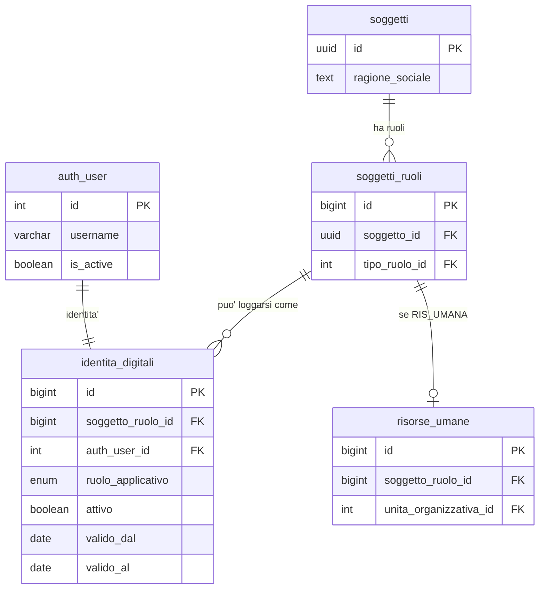
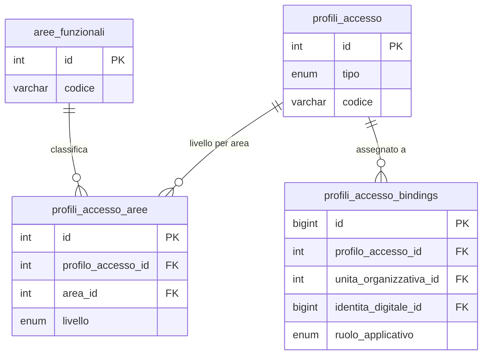

# Guida Tecnica – Architettura Multi-Face Auth

> **Destinatari:** sviluppatori database, backend, frontend e analisti funzionali
>
> **Prerequisiti:** [Guida Soggetti & Ruoli](/guide/soggetti-e-ruoli-anagrafici), [Architettura Permessi e Autorizzazioni](/guide/architettura-permessi-e-autorizzazioni), [Risorse Umane e Accessi](/guide/risorse-umane-e-accessi)
>
> **Stato:** Architettura consolidata – v2.0 (20-04-2026 — modello SSO: un auth_user, piu' vesti applicative; shop B2C canale autonomo con `canale_origine` tracciabile)

---

## 1. Cosa significa "multi-face"

Il sistema attuale pensa a chi entra nel software come **dipendente**: una risorsa
umana con un reparto, un'ereditarieta' di permessi, uno scope per emittente fiscale.
Questo va benissimo finche' l'unico modo di usare ZeroErp e' da dentro l'azienda.

Nella vita reale un ERP serio ha **piu' facce**:

- **Operatore interno** — il dipendente che gia' conosciamo
- **Cliente portale** — il cliente B2B che entra per vedere le proprie fatture, pagamenti, scadenze
- **Fornitore portale** — il fornitore che entra per vedere gli ordini ricevuti, lo stato pagamenti verso di se'
- **Cliente del negozio online** — chi si registra sul sito, fa un ordine, vuole rivederlo
- **Partner / integratore API** — in futuro, sistemi terzi che chiamano le API con un'identita' propria

Tutte queste persone hanno una cosa in comune: **entrano nel software con un account**.
Ma hanno rapporti molto diversi con l'azienda — e chiedono permessi, scope e interfacce diverse.

Questa guida propone un modello che **abbraccia tutti i casi senza rattoppare quello
degli operatori interni**. Il disegno tiene fermo cio' che funziona (soggetti/ruoli,
audit JWT, sync login, token monouso) e generalizza solo cio' che oggi e' troppo stretto.

---

## 2. Tre cose diverse, tenute separate

Il cuore del modello e' **separare tre concetti** che oggi sono fusi insieme:

| Dimensione | Domanda a cui risponde | Modello pre-refactor | Modello attuale |
| --- | --- | --- | --- |
| **Identita'** | Chi e' questa persona nel sistema? | `risorse_umane_auth_user` (solo dipendenti) | `identita_digitali` (bridge generico) |
| **Capability** | Cosa puo' fare? | `profili_reparto_aree` (solo reparti, dismessa 2026-05-04) | `profili_accesso` (reparti, portali, ad-hoc) |
| **Scope** | Su quali dati opera? | `user_emittenti_fiscali` (solo EF) | `identita_scope_bindings` (policy generiche) |

Tenerle separate permette di combinarle liberamente. Un cliente portale ha
un'**identita'** diversa da un dipendente, un **set di capability** molto piu' ristretto
e uno **scope** che e' "i miei billing account, non altri".

### 2.1 Un solo `auth_user`, piu' vesti applicative

Mario Rossi puo' essere contemporaneamente:

- dipendente della mia azienda (veste interna `OPERATORE`)
- titolare di un'azienda fornitrice che io pago (veste `FORNITORE_PORTALE`)
- cliente B2B che acquista per la sua societa' (veste `CLIENTE_PORTALE`)
- consumer occasionale del mio negozio online (veste `SHOP_CUSTOMER`)

Sono **relazioni diverse** con la mia azienda, ma **un'unica identita' di
autenticazione**: una sola email, una sola password, un ciclo di vita credenziali
unificato. Quello che cambia tra le vesti e' **cosa si puo' fare e cosa si vede**,
non chi si e'. In ZeroErp un `auth_user` rappresenta **una persona autenticabile**;
le vesti applicative (`ruolo_applicativo`) vivono sul bridge `identita_digitali`,
ciascuna con il proprio `soggetti_ruoli` di aggancio.

Questo modello e' coerente con la [guida soggetti e ruoli](/guide/soggetti-e-ruoli-anagrafici):
il soggetto e' l'identita' stabile, il ruolo anagrafico e' la funzione civilistica
nel sistema, il `ruolo_applicativo` e' la veste con cui accedo al software. Mario
puo' avere piu' vesti attive contemporaneamente sullo stesso `auth_user`: il
**canale di login** (admin, portale, shop) determina quale veste viene usata in
ciascuna sessione.

**Invariante di dominio:** al massimo **una** identita attiva per ogni
combinazione `(auth_user, ruolo_applicativo)`. E al massimo **una** identita
attiva per ogni combinazione `(soggetto_ruolo, ruolo_applicativo)`. Due vesti
diverse sullo stesso `auth_user` richiedono scelta esplicita del canale al login.

**Perche' non account separati:** la scelta "un account per veste" (separazione
credenziali) e' il modello silo classico. ZeroErp adotta invece il modello SSO
moderno (un'autenticazione unica, molte vesti applicative) per tre ragioni:

1. **UX naturale**: un dipendente che e' anche cliente non deve gestire due
   password. Un reset password vale per tutte le vesti.
2. **Sicurezza centralizzata**: lockout, TOTP, policy password sono applicati
   una sola volta, non N volte. Riduce la superficie di attacco.
3. **Coerenza civilistica**: Mario Rossi e' una persona fisica sola. Il suo
   soggetto anagrafico e' uno. Le sue vesti nel sistema sono molte. Il livello
   auth rispecchia la persona, non la veste.

La **discriminazione tra vesti** avviene al login (canale/namespace), nel JWT
token (identita specifica) e nei GUC DB (identita attiva della sessione) — non
nell'account.

---

## 3. Il nuovo bridge: `identita_digitali`

La ex tabella `anagrafiche.risorse_umane_auth_user` — il bridge del dipendente —
e' stata assorbita da `anagrafiche.identita_digitali`, il bridge generico che
collega qualunque `soggetti_ruoli` a un `auth_user`. ⛔ **Dal 12-09-2026 il nome
vecchio non esiste piu'** (ne' tabella ne' vista: `90_end/20260912-10` e `-26`);
il bridge del dipendente e' `identita_digitali` con `ruolo_applicativo = 'OPERATORE'`.

### 3.1 Struttura concettuale

```text
anagrafiche.identita_digitali
    id                    BIGINT PK
    soggetto_ruolo_id     BIGINT FK  (a anagrafiche.soggetti_ruoli)
    auth_user_id          INT  FK    (a django.auth_user)
    ruolo_applicativo     ENUM       (OPERATORE | CLIENTE_PORTALE | FORNITORE_PORTALE |
                                      SHOP_CUSTOMER | API_CLIENT | DISABILITATO)
    attivo                BOOLEAN
    valido_dal            DATE
    valido_al             DATE       NULLABLE
    invito_inviato_at     TIMESTAMPTZ NULLABLE
    storicizza            BOOLEAN
    data_insert/update, user_insert/update   (audit standard)
    UNIQUE (auth_user_id, ruolo_applicativo) WHERE attivo = true
    UNIQUE (soggetto_ruolo_id, ruolo_applicativo) WHERE attivo = true
```

**Regole di dominio:**

- Un `auth_user` puo' avere **piu' identita attive contemporaneamente**, ciascuna
  con un `ruolo_applicativo` diverso (es. `OPERATORE` + `CLIENTE_PORTALE` se
  un dipendente e' anche cliente B2B della stessa azienda).
- Al massimo **una** identita attiva per ogni coppia `(auth_user, ruolo_applicativo)`:
  non e' possibile avere due `OPERATORE` attivi sullo stesso utente.
- Un `soggetti_ruoli` puo' avere **piu' identita attive contemporaneamente**,
  ciascuna con un `ruolo_applicativo` diverso. Es. un SR-CL puo' avere un'identita
  `CLIENTE_PORTALE` (login B2B) e un'identita `SHOP_CUSTOMER` (login B2C) allo
  stesso tempo, riferite allo stesso `auth_user` o a `auth_user` diversi.
- `ruolo_applicativo` dice **in quale veste** l'utente si logga; la veste e'
  scelta dal canale/namespace di login, non da un toggle runtime.
- ⭐ **Una persona, una credenziale.** L'email della credenziale e' unica,
  senza distinguere maiuscole e minuscole (`script.fn_get_auth_user_id_for_email`
  e' l'unica lettura per email). Creare un operatore su un'email che ha gia'
  una credenziale **riusa quella** — nome utente e password restano i suoi —
  ma non in silenzio: il DB chiede la conferma
  (`E_CREDENZIALE_DA_CONFERMARE`, il messaggio nomina lo username trovato)
  e la creazione si ripete dichiarando l'id della credenziale confermata
  (`riusa_auth_user_id`): un id e non un sì, così una credenziale cambiata
  nel frattempo ferma di nuovo; se la
  credenziale e' di un'altra persona fisica il riuso e' rifiutato
  (`E_CREDENZIALE_ALTRA_PERSONA`: l'email e' sbagliata).
- ⭐ **La veste nasce spenta** e la accende solo l'**attivazione** dell'invito:
  nessuno entra da una porta prima di averla accettata. Se la credenziale ha
  gia' una password, l'attivazione e' un clic; altrimenti chiede di sceglierla.
- ⭐ **Porta e profili sono due domande.** La veste attiva dice se la porta e'
  aperta; il binding in `config.profili_accesso_bindings` dice cosa si puo'
  fare dentro. Un profilo (anche SUPER_ADMIN) si assegna a una veste spenta,
  e spegnere una veste non chiede di togliere prima i profili: li ritrova alla
  riaccensione. Chi legge i permessi chiede entrambe le cose (`fn_is_super_admin`,
  `fn_get_profili_accesso_applicabili`); l'ultimo SUPER_ADMIN attivo lo
  protegge `E_PROFILO_ULTIMO_SUPER_ADMIN`.
- ⛔ **La veste non porta stato della password.** Tentativi falliti, blocco,
  cambio password obbligatorio e (quando ci sara') l'obbligo di TOTP sono della
  **credenziale**: la password e' una sola e vale per tutte le porte, quindi chi
  la prova la sta provando per tutte. Vedi §3.1-bis.

### 3.1-bis La credenziale: tentativi, freno, blocco

Lo stato della credenziale sta in `config.credenziali` (1:1 con `auth_user`,
la riga nasce alla prima scrittura: assente = nessuno stato) e
`config.credenziali_provenienze`. L'app non le scrive: passa dalle funzioni
del DB. Al login valgono **tre regole**, verificate nell'ordine, prima di
guardare la password:

| Regola | Chi la fa scattare | Cosa colpisce | Codice |
| --- | --- | --- | --- |
| **Blocco** | un SUPER_ADMIN, con un verbo e un motivo | la credenziale su tutte le porte; non scade, e il reset password non lo toglie | `E_CREDENZIALE_BLOCCATA` |
| **Freno sulla provenienza** | automatico, dopo N password sbagliate di fila dalla stessa provenienza | la coppia credenziale + provenienza, per qualche minuto: chi attacca da una macchina non chiude fuori il titolare, che entra dalla sua | `E_UTENTE_BLOCCATO` |
| **Attesa crescente** | automatico, oltre un tetto di password sbagliate di fila da qualunque provenienza | la credenziale, che **rallenta** (secondi, con un massimo) ma non si chiude | `E_LOGIN_ATTESA` |

Tutti e tre sono `403`, non `429`: il `429` e' il throttle per IP, e il login
del frontend lo intercetta prima di leggere il codice.

- La **provenienza** e' l'IP del chiamante come lo ricava il backend dietro i
  proxy dichiarati (`get_client_ip`, setting `TRUSTED_PROXY_COUNT`): un valore
  scritto dal client non conta. Se non si ricava, il login si rifiuta.
- Un **accesso riuscito** azzera la credenziale e toglie il freno della sola
  provenienza da cui si e' entrati; un **reset password riuscito** azzera tutti
  i freni (chi possiede l'email ha superato la prova che il freno protegge),
  ma non il blocco.
- Password giusta sulla porta sbagliata (`E_VESTE_NON_ATTIVA`) non conta come
  tentativo fallito.
- ⭐ **Un nome che non esiste si comporta come uno che esiste.** Freno e
  attesa valgono anche per un nome che non trova nessuna credenziale, con gli
  stessi numeri e le stesse risposte: la chiave è il **nome tentato**
  (`config.nomi_tentati`, `config.nomi_tentati_provenienze`), e dopo N
  tentativi arriva lo stesso `E_UTENTE_BLOCCATO`. Così chi prova non impara
  se il nome esiste. Il nome **non entra in chiaro** né nel DB né nei log:
  il backend ne passa un'impronta (HMAC con una chiave che il DB non ha),
  perché chi digita la password nel campo del nome la lascerebbe lì. Il
  blocco dell'admin resta solo delle credenziali, e il suo messaggio rivela
  che il nome c'è: è accettato, al titolare serve sapere a chi rivolgersi.
- Il nome si confronta **come lo confronta l'autenticazione**: spazi in testa
  e in coda tolti, maiuscole distinte. Una normalizzazione diversa per il
  controllo farebbe sfuggire il nome al freno.
- ⚠️ **Due regole diverse, anche se i numeri si somigliano.** Il throttle
  `LoginRateThrottle` (5 richieste ogni 5 minuti per IP, qualunque credenziale)
  ferma chi **inonda** l'endpoint; il freno per provenienza (N password
  sbagliate sulla stessa credenziale) ferma chi **prova** una credenziale. Il
  primo non sa quale credenziale si prova, il secondo non conta le richieste.
- Il **cambio password obbligatorio** e' della credenziale: lo accende solo il
  verbo dedicato (`script.fn_imposta_deve_cambiare_password`), lo spegne
  qualunque nuova password (cambio, reset, attivazione). ⛔ L'invito **non**
  lo accende e non tocca la password: la credenziale puo' essere di una
  persona che ha gia' un'altra veste, e la sua password vale anche li'.

### 3.2 Il vincolo "persona fisica pura" si sposta

Oggi la regola **R4** ([Risorse umane §R4](/guide/risorse-umane-e-accessi#r4--collegamento-a-django-solo-persona-fisica-pura))
vieta il collegamento a `auth_user` per chi ha partita IVA. Questa regola nasce
dalla natura del ruolo RIS_UMANA (solo persone fisiche dipendenti), non dal bridge.

Nel nuovo modello la regola diventa:

> *Se `ruolo_applicativo = OPERATORE`, allora il `soggetto_ruolo` deve essere
> RIS_UMANA su soggetto persona fisica pura. Per gli altri ruoli applicativi,
> il vincolo non si applica.*

Cosi' un cliente persona giuridica (S.r.l., S.p.A., Ente) puo' avere un account
sul portale, senza rompere la regola originale.

### 3.3 Rapporto con `risorse_umane_auth_user` — chiuso il 12-09-2026

Durante la migrazione i due bridge sono conviventi; dal cutover (19-04-2026)
`risorse_umane_auth_user` e' stata una **vista** sopra `identita_digitali`
filtrata su `OPERATORE`, «cosi' il codice esistente non si accorge della
differenza». ⛔ Quel «non accorgersi» e' durato cinque mesi con lettori che
crescevano su tre strati, un filtro che il nome non diceva e quattro `%TYPE`
fotografati su una proiezione di compatibilita': il 12-09-2026 la vista e'
stata **ritirata** (`90_end/20260912-26`, decisione Tid «via il nome»), i
lettori riscritti sulla madre e il guard RU↔identita' scritto a mano.
Storia e censimento: `docs/it/dev/work-done/analisi-software-per-dati-morti.md` §2.1 e §6.

---

## 4. Il livello capability: `profili_accesso`

Prima del refactor i permessi erano **per reparto** (tabelle legacy
`profili_reparto_aree/_azioni`, dismesse il 2026-05-04 con il changeSet
`20260505-02-drop-profili-reparto`). Un cliente portale non ha un
reparto: ha un **ruolo nel mondo** (cliente), a cui corrisponde un set
standard di permessi.

### 4.1 Generalizzazione

`config.profili_accesso` contiene **tutti** i profili di permesso:

```text
config.profili_accesso
    id              INT PK
    tipo            ENUM (REPARTO | PORTALE | AD_HOC | SUPER_ADMIN)
    codice          VARCHAR UNIQUE    (AMMINISTRAZIONE, VENDITE, CLIENTE_PORTALE, ...)
    descrizione     TEXT
    attivo          BOOLEAN
```

Le tabelle di dettaglio sono `profili_accesso_aree` e `profili_accesso_azioni`,
legate a `profili_accesso` invece che direttamente a `unita_organizzative`
(il legame UO/profilo passa attraverso `profili_accesso_bindings`).

### 4.2 Come viene assegnato un profilo a un utente

Nasce una tabella di **binding** che dice "quale profilo vale per questa identita'":

```text
config.profili_accesso_bindings
    id                     BIGINT PK
    profilo_accesso_id     INT FK
    -- esattamente uno dei tre seguenti deve essere valorizzato:
    unita_organizzativa_id INT FK NULL    (se il profilo vale per un reparto)
    identita_digitale_id   BIGINT FK NULL (se il profilo vale per una singola identita')
    ruolo_applicativo      ENUM  NULL     (se il profilo vale per tutti gli utenti di quel ruolo)
```

Cosi' la catena di risoluzione diventa:

```text
1. profilo binding per identita' specifica?     -> ha priorita'
2. profilo binding per reparto (se OPERATORE)?  -> ereditato come oggi
3. profilo binding per ruolo applicativo?       -> fallback standard per CLIENTE, FORNITORE, SHOP
4. default -> BLOCCATO
```

### 4.3 Preset per i portali

I ruoli portale hanno un **preset di capability stretto e immutabile**, perche'
non ha senso configurare 100 clienti uno per uno. L'admin di sistema definisce
**un** profilo `CLIENTE_PORTALE` con permessi standard (lettura propri
documenti, creazione ticket, ecc.), e tutti i clienti ne ereditano.

Eccezioni per singolo cliente restano possibili via `user_override_*` (gia'
esistenti) — ma non sono la norma.

---

## 5. Il livello scope: dove guardo, cosa vedo

### 5.1 Il problema

Un operatore interno e' limitato dagli **emittenti fiscali** ([user_emittenti_fiscali](/dbzero/config/tabelle/user_emittenti_fiscali)).
Un cliente portale B2B deve vedere **tutto** il proprio rapporto con l'azienda —
fatture, scadenze, ordini — **indipendentemente dal canale** di origine (portale
o shop). E' il canale consolidato del rapporto B2B.
Un fornitore vede solo i **propri ordini ricevuti** e i DDT associati.
Un cliente shop B2C vede solo le **proprie transazioni originate dal canale shop**,
anche se il soggetto sottostante ha anche attivita' portale B2B.

Quattro regole di scope, tutte diverse. La whitelist EF esistente va bene per il
primo caso, ma non si estende.

**Asimmetria di visibilita' portale vs shop.** ZeroErp modella portale e shop
come canali self-service distinti, con regole diverse:

| Canale | Vede | Motivazione |
| --- | --- | --- |
| `CLIENTE_PORTALE` | Tutti gli ordini, fatture, scadenze del proprio `soggetto_ruolo`, su **qualunque canale** | Il portale B2B e' la voce consolidata del cliente: l'utente si aspetta di vedere l'intero rapporto col fornitore |
| `SHOP_CUSTOMER` | Solo i dati con `canale_origine = 'SHOP'` del proprio `soggetto_ruolo` | Lo shop e' un canale B2C autonomo: il consumer non deve vedere gli acquisti B2B della propria azienda |
| `FORNITORE_PORTALE` | Ordini ricevuti + DDT associati, indipendentemente dal canale | Simmetrico al portale cliente sul versante passivo |

L'asimmetria e' intenzionale e **reversibile a basso costo**: un predicato nella
USING clause delle policy RLS. Il caso portale e' "silo aperto" (nessun filtro
canale), il caso shop e' "silo chiuso" (filtro `canale_origine = 'SHOP'`).

### 5.2 Generalizzazione

Nasce `config.scope_policy`:

```text
config.scope_policy
    id          INT PK
    codice      VARCHAR UNIQUE   (EF_WHITELIST, BA_OWNERSHIP, FORNITORE_OWNERSHIP, SELF_OWNERSHIP, ...)
    descrizione TEXT
    funzione_db VARCHAR           (nome funzione PL/pgSQL che implementa il check)
```

Ogni policy e' implementata da una funzione SQL che, dati `(identita_id, target)`,
risponde *true* o *false*. Esempio:

```sql
-- Policy BA_OWNERSHIP: il cliente portale vede solo i BA dove e' titolare
CREATE FUNCTION script.fn_scope_ba_ownership(p_identita_id BIGINT, p_billing_account_id BIGINT)
RETURNS BOOLEAN LANGUAGE sql STABLE AS $$
    SELECT EXISTS (
        SELECT 1
        FROM anagrafiche.identita_digitali id
        JOIN anagrafiche.soggetti_ruoli sr  ON sr.id = id.soggetto_ruolo_id
        JOIN anagrafiche.clienti c          ON c.soggetto_ruolo_id = sr.id
        JOIN anagrafiche.billing_account ba ON ba.cliente_id = c.id
        WHERE id.id = p_identita_id
          AND ba.id = p_billing_account_id
    );
$$;
```

Poi i binding: `config.identita_scope_bindings` collega un'identita' a una o piu' policy.

### 5.3 Whitelist EF come caso particolare

`user_emittenti_fiscali` non scompare: rimane come tabella di supporto alla policy
`EF_WHITELIST`. La funzione `fn_scope_ef_whitelist` resta quella di oggi, solo
avvolta nel nuovo framework. Nessuna migrazione dati distruttiva.

---

## 6. Row Level Security: la difesa al livello giusto

### 6.1 Il salto di qualita'

Il backend filtra le letture con la condizione di scope dei repository
([§6.3 della guida permessi](/guide/architettura-permessi-e-autorizzazioni#63-ambito-dati-whitelist-ef-per-operatori-rls-per-portaleshop)).
Funziona, ma se un repository dimentica la condizione, i dati escono.

Con il nuovo modello si introducono **policy RLS native PostgreSQL** sulle tabelle
dati sensibili. Sono regole scritte nel DB che dicono: *questa riga e' visibile
solo se l'utente corrente ha uno scope che la include*.

Esempio sulle fatture:

```sql
ALTER TABLE vendite.fatture ENABLE ROW LEVEL SECURITY;

CREATE POLICY rls_fatture_scope ON vendite.fatture
    FOR SELECT
    USING (
        script.fn_identita_vede_billing_account(
            current_setting('app.current_identita_id', true)::bigint,
            billing_account_id
        )
    );
```

**Lettura e scrittura.** Una policy `FOR SELECT` filtra solo le *letture*. Sulle
tabelle dove il ruolo **scrive** (es. l'operatore che crea preventivi/ordini), la
policy va dichiarata **`FOR ALL` con `WITH CHECK`** (di norma identico alla
`USING`): su una tabella con RLS attiva una policy di sola lettura manda in
**deny-all** ogni `INSERT`/`UPDATE` (`new row violates row-level security policy`).
È quanto accaduto nell'Ondata 2 operatore e risolto estendendo le `ef_whitelist` a
`FOR ALL` (vedi `dev/work-done/db-brief-rls-ondata2-insert-bloccati.md`). I
lavori automatici che toccano i dati di un'azienda sono filtrati come gli
operatori: girano come l'applicazione, con l'utente tecnico di quell'azienda. Fuori
dalla RLS resta solo il proprietario delle tabelle (migrazioni e manutenzione),
perché non c'è `FORCE`.

**E c'e' una seconda meta', meno nota** *(misurata il 2026-08-22, cantiere
incassi)*: **`INSERT ... RETURNING` passa dalla clausola `USING`**, non solo dal
`WITH CHECK`. Una riga che il `WITH CHECK` ammette ma che la `USING` non copre fa
fallire l'`INSERT` con lo stesso messaggio (`new row violates row-level security
policy`). Conta ovunque una funzione DB restituisca l'id di cio' che ha appena
creato — `fn_get_or_create_*` e' il caso tipico.

> ⭐ La regola da tenere a mente scrivendo una policy: **cio' che l'applicazione
> scrive e poi rilegge deve essere visibile a chi l'ha scritto, nello stesso
> istante.** Un perimetro che si chiude su una riga appena creata non nasconde:
> **rompe**. In particolare, un predicato che dipende dalle **righe figlie** non
> puo' stare nella `USING` del padre: quando il padre nasce, di figlie non ce
> n'e' nessuna.

### 6.2 Come si alimentano le RLS

Il middleware esistente [JwtAuditAuthentication](/guide/risorse-umane-e-accessi#propagazione-identita-utente-al-database-guc-app)
oggi propaga `app.jwt_user` e `app.current_user_id`. Si aggiungono due GUC:

- `app.current_identita_id` — id del record in `identita_digitali`
- `app.ruolo_applicativo` — il ruolo dell'utente corrente (OPERATORE, CLIENTE_PORTALE, ...)

Con queste informazioni le policy RLS lavorano autonome. Il backend **non deve piu'
filtrare manualmente** per scope: il DB lo fa sempre, anche se lo sviluppatore
si dimentica.

### 6.3 Defense-in-depth, non sostituzione

Le permission class Django restano (autenticazione, verifica capability sull'area).
Le RLS DB si aggiungono come rete di sicurezza per lo **scope dati**. I due livelli
non si sovrappongono:

| Cosa controlla | Dove |
| --- | --- |
| Se l'utente puo' chiamare l'endpoint | Django (`ZeroERPPermission`) |
| Se l'utente puo' eseguire quell'azione | Django (capability dal profilo) |
| Quali righe **vede** nelle query | DB (RLS `USING`) |
| Quali righe puo' **creare/modificare** | DB (RLS `WITH CHECK`, policy `FOR ALL`) |

### 6.4 Tracciabilita' canale sui dati transazionali

Per distinguere portale B2B da shop B2C servono due cose: (a) **BA separati per
canale**, (b) **metadato canale sulle righe transazionali**. La prima e' una scelta
di dominio (cfr. [Risorse umane — BA shop](/guide/risorse-umane-e-accessi)); la
seconda e' una colonna `canale_origine` introdotta sulle tabelle coinvolte:

- `anagrafiche.billing_account` — su quale canale vive questo BA
- `vendite.ordini` — canale di origine dell'ordine
- `vendite.fatture` — canale di origine della fattura B2B (le ricevute shop
  vivono su tabella dedicata, vedi sotto)
- `vendite.fatture_scadenze` — eredita dal padre `fatture_id`
- (acquisti non hanno canale — sono tutti ADMIN perche' generati internamente)

**ENUM dei valori:**

```text
config.canale_origine
    ADMIN     -- creato da operatore interno
    PORTALE   -- creato da cliente/fornitore portale self-service
    SHOP      -- creato da shop customer self-service
```

**Default:** `ADMIN`. La colonna si popola in INSERT dal service/trigger sul
canale d'origine. Non e' aggiornabile dopo la creazione (trigger guard).

**Ricevute shop su tabella dedicata.** Lo shop emette **solo ricevute consumer**,
mai fatture elettroniche. Le ricevute vivono su `shop.ricevute` (schema nuovo),
non su `vendite.fatture`. Vantaggi:

- `vendite.fatture` resta la tabella B2B fiscale (emittente/SdI/XML)
- RLS di portale B2B su `vendite.fatture` non deve distinguere tipo documento
- EF_WHITELIST operatore non incrocia mai ricevute shop
- Lo shop ha il suo silo RLS completo (schema dedicato, policy dedicate)

**Immutabilita' del canale.** Una volta creato, un ordine/fattura/BA non cambia
canale. Se un ordine PORTALE viene modificato da un operatore admin, resta
`canale_origine = 'PORTALE'`: la colonna racconta l'origine, non l'ultimo editor.
L'informazione "ultimo editor" e' gia' tracciata da `user_update` e dal giornale
pratiche.

**Uso nelle policy RLS:** il caso 2 portale ignora `canale_origine` nella USING
clause. Il caso shop lo filtra esplicitamente:

```sql
-- Policy shop su ordini: silo completo
CREATE POLICY rls_ordini_shop_silo ON vendite.ordini
    FOR SELECT
    USING (
        current_setting('app.ruolo_applicativo', true) = 'SHOP_CUSTOMER'
        AND canale_origine = 'SHOP'
        AND script.fn_scope_sr_perimetro(
                (SELECT script.fn_get_identita_sr_perimetro(
                    NULLIF(current_setting('app.current_identita_id', true), '')::bigint,
                    ARRAY['SHOP_CUSTOMER'::config.ruolo_applicativo])),
                soggetto_ruolo_id
            )
    );
```

Il passaggio a "portale vede solo portale" (silo simmetrico) costa una sola
riga: aggiungere `AND canale_origine = 'PORTALE'` alla policy portale.

---

## 7. Namespace API separati

### 7.1 Perche' separati

Oggi le API vivono sotto `/api/*`. Esporre gli stessi endpoint a clienti portale
significa aggiungere molte guard *negli* endpoint — fragile e difficile da auditare.

Meglio dividere per **contesto d'uso**:

```text
/api/admin/*         -> operatori interni (ZeroERPPermission esistente)
/api/portale/*       -> clienti e fornitori (PortaleBasePermission nuova)
/api/shop/*          -> negozio online, anche pubblico (endpoint aperti + ShopPermission)
```

### 7.2 Pattern di view

Ogni namespace ha una **base view** dedicata:

- `AdminAPIView` — eredita `DomainAPIView` (gia' esistente), area funzionale richiesta
- `PortaleAPIView` — richiede `ruolo_applicativo IN (CLIENTE_PORTALE, FORNITORE_PORTALE)` e scope attivo
- `ShopAPIView` — opzionalmente autenticata (anonimi per catalogo pubblico, autenticati per checkout)

Gli endpoint admin non sono mai raggiungibili da un utente portale, e viceversa.
Il confine e' nel routing, non nel codice di ogni view.

### 7.3 Condivisione dei service

I **service di dominio** (es. `FattureService`, `OrdiniService`) restano condivisi.
Il portale cliente chiama lo stesso `FattureService.list()` dell'admin — la
differenza e' che la query riceve filtri automatici via RLS, quindi il cliente
vede solo le sue fatture.

Zero duplicazione di logica di business.

### 7.4 Login discriminato per canale

Un `auth_user` puo' avere N identita attive (fino a una per `ruolo_applicativo`).
Al login serve scegliere **quale identita** attivare. La scelta e' fatta dal
**namespace dell'endpoint di login**, non da un parametro di richiesta:

| Endpoint | Identita cercata | Comportamento se assente |
| --- | --- | --- |
| `/api/admin/token/` | `ruolo_applicativo = OPERATORE` | 403 "veste operatore non attiva" |
| `/api/portale/token/` | `ruolo_applicativo IN (CLIENTE_PORTALE, FORNITORE_PORTALE)` | 403 "veste portale non attiva" |
| `/api/shop/token/` | `ruolo_applicativo = SHOP_CUSTOMER` | 403 "veste shop non attiva" |

**Contenuto del JWT:** oltre ai claim standard (`user_id`, `exp`, ecc.), il JWT
contiene il claim custom `identita_id` che punta alla riga specifica in
`identita_digitali`. Questo e' **il dato autoritativo** per la sessione — non
si ricava a runtime da `(auth_user, ruolo_applicativo)`, si legge dal token.

**GUC derivati:** il middleware `JwtAuditAuthentication` popola i GUC a partire
da `identita_id` del JWT:

```text
app.current_identita_id  -> identita_id dal JWT
app.ruolo_applicativo    -> identita_digitali.ruolo_applicativo
app.soggetto_ruolo_id    -> identita_digitali.soggetto_ruolo_id
```

**Invariante "tutto o niente":** i 3 GUC sono popolati insieme o non popolati
affatto. Un'identita senza GUC e' un'anomalia; le policy RLS devono essere
fail-closed quando almeno uno e' `NULL`. Helper di lettura:
`script.fn_current_identita_context()` restituisce NULL-tuple se la tripla non
e' coerente.

**Impatto sul refresh token:** il refresh include `identita_id` dal token di
origine. Il refresh non cambia identita — se un user vuole loggare con altra
veste, deve fare nuovo login sul namespace corrispondente.

Dal 2026-09-28 il refresh non viaggia mai nel corpo JSON: sta nel cookie
HttpOnly `zeroerp_refresh` (`SameSite=Strict`, `Path=/api/v1/`, durata del
refresh), scritto da login, refresh, cambio password e cambio emittente
attivo; l'endpoint di refresh pretende anche l'header anti-CSRF
`X-Requested-With: XMLHttpRequest`. L'access token (10 minuti) resta nel
corpo e il frontend lo tiene solo in memoria. Contratto completo in
[api_multi_veste_token.md](../backend/core/manual/api_multi_veste_token.md#cookie-di-refresh).
Il cookie ha un nome e un path unici: nello stesso browser ne esiste uno solo,
e un login su un altro canale lo sostituisce.

**Impatto sul logout:** il logout revoca la sessione del refresh presentato nel
cookie (tutti i token col suo `sid`, via `token_blacklist` SimpleJWT) e
cancella il cookie. Le altre identita dello stesso `auth_user` restano loggate
nei rispettivi canali (se hanno JWT attivi in altre sessioni browser/device).

---

## 8. Onboarding dei portali

### 8.1 Invito da admin (clienti e fornitori)

Simmetrico al flusso operatori ([Risorse umane §Invito operatore](/guide/risorse-umane-e-accessi#invito-operatore)):

1. L'admin apre il cliente/fornitore in anagrafica
2. Preme "Abilita accesso portale"
3. Il sistema crea `auth_user` + `identita_digitali(CLIENTE_PORTALE, attiva=false)` + token monouso INVITO_PORTALE
4. Email al referente del cliente con link di attivazione
5. Il referente sceglie la password, l'identita' si attiva

Riusa tutto l'impianto esistente: [token_monouso](/dbzero/config/tabelle/token_monouso),
[fn_sync_auth_user_is_active](/guide/risorse-umane-e-accessi#sync-auth_user-is_active) (generalizzata),
il cancello degli obblighi (`apps/core/api/cancello_obblighi.py`) per il cambio password obbligato.

### 8.2 Self-service (shop)

Per il negozio online il flusso e' autonomo, ma si divide in due scenari in base
alla presenza di un `auth_user` con la stessa email.

#### 8.2.1 Email nuova (caso standard B2C)

1. Visitatore compila form registrazione (nome, cognome, email, password)
2. Sistema verifica: nessun `auth_user` con quell'email → prosegue
3. Transazione: `soggetti(PF, PR)` + `soggetti_ruoli(CL)` + `clienti` +
   `billing_account(canale_origine='SHOP')` minimal + `auth_user(is_active=false)` +
   `identita_digitali(SHOP_CUSTOMER, attiva=false)` + token `VERIFICA_EMAIL`
4. Email di verifica
5. Al click sul link: `auth_user.is_active=true`, identita attiva, primo login
   consentito su `/api/shop/token/`

#### 8.2.2 Email gia' registrata (caso cross-canale)

Se l'email corrisponde a un `auth_user` esistente (perche' l'utente ha gia'
un'identita `OPERATORE`, `CLIENTE_PORTALE` o `FORNITORE_PORTALE`):

1. Sistema rifiuta la registrazione shop con messaggio esplicito:
   *"Questa email e' gia' registrata. Accedi con la tua password esistente e
   attiva l'account shop dal tuo profilo."*
2. L'utente logga con le credenziali esistenti sul namespace pertinente
   (`/api/portale/token/` o `/api/admin/token/`)
3. Nel profilo utente trova il pulsante **"Attiva accesso shop"**
4. Click genera un token monouso `ATTIVAZIONE_SHOP` inviato alla sua email
5. Al click sul link: il sistema crea `identita_digitali(SHOP_CUSTOMER, attiva=true)`
   sullo stesso `auth_user`. Il `soggetto_ruolo` di aggancio puo' essere:
   - lo stesso SR-CL esistente (se l'utente e' gia' cliente B2B → shop si collega)
   - un nuovo SR-CL sullo stesso soggetto (se l'utente era solo operatore o
     fornitore, serve creare il ruolo anagrafico cliente)
6. Se serve un nuovo `billing_account(canale_origine='SHOP')`, viene creato
   contestualmente con dati minimali

**Perche' non aggiunta silenziosa.** Rifiutare la registrazione e forzare il
flusso "logga e attiva" invece di aggiungere l'identita shop senza consenso e'
una scelta di sicurezza: chi conosce l'email di un utente esistente non deve
poter creare per lui una veste aggiuntiva. La conferma via login + email
monouso chiude il vettore.

**Flusso simmetrico portale.** Se un utente nato come `SHOP_CUSTOMER` puro
vuole poi diventare cliente B2B (portale), il flusso e' speculare: l'admin
apre il cliente in anagrafica, popola dati fiscali completi (partita IVA,
indirizzo fatturazione), preme "Abilita accesso portale" e l'invito aggiunge
un'identita `CLIENTE_PORTALE` allo stesso `auth_user`.

#### 8.2.3 Endpoint coinvolti

- `POST /api/shop/register/` — registrazione shop email nuova, throttle aggressivo
- `POST /api/shop/register/check-email/` — pre-check email esistente (feedback UI)
- `POST /api/portale/profile/activate-shop/` — da profilo portale, attiva shop
- `POST /api/admin/profile/activate-shop/` — da profilo operatore, attiva shop
- `GET  /api/shop/activate/<token>/` — attivazione finale via link email

### 8.3 Recupero password

Il flusso esistente ([Risorse umane §Reset password dimenticata](/guide/risorse-umane-e-accessi#reset-password-dimenticata))
funziona per tutti i ruoli applicativi. L'unica accortezza e' personalizzare
il **template email** per ruolo, cosi' un cliente non riceve un'email "operatore aziendale".

---

## 9. Sync `auth_user.is_active` generalizzata

Con un `auth_user` che puo' avere N identita attive (una per `ruolo_applicativo`),
la semantica di `auth_user.is_active` diventa **OR** sulle identita:

> `auth_user.is_active = true` se e solo se esiste **almeno una** identita
> digitale attiva per quell'user, con `ruolo_applicativo != DISABILITATO` e
> finestra di validita' corrente.

Motivazione: `auth_user.is_active` e' il flag Django di autorizzazione al
login. Se Mario ha 3 vesti e ne disattivo 2, deve potersi ancora loggare con
la terza. La veste disattivata e' bloccata dalla policy RLS + guard namespace,
non dal flag `is_active`.

La funzione `fn_sync_auth_user_is_active(p_auth_user_id integer)`:

1. Calcola `bool_or` di: `id.attivo AND id.ruolo_applicativo != 'DISABILITATO'
   AND CURRENT_DATE BETWEEN id.valido_dal AND COALESCE(id.valido_al, CURRENT_DATE)`
   per tutte le identita dell'user
2. Per le identita `OPERATORE`: aggiunge il vincolo legacy su `risorse_umane.attivo`
   (gia' integrato post-cutover §13.3.4)
3. Se il bool_or e' `true` → `auth_user.is_active = true`
4. Se e' `false` (nessuna identita utilizzabile) → `auth_user.is_active = false`

**Effetto collaterale sul logout forzato:** se disattivo l'ultima identita
utilizzabile di un user, il sync mette `is_active = false` e i JWT correnti
falliranno alla prossima request (Django verifica `is_active`).

**Trigger di sync.** Un trigger `trg_identita_digitali_z90_sync_auth_user_active`
invoca `fn_sync_auth_user_is_active` dopo ogni INSERT/UPDATE su
`identita_digitali`. Cosi' un `UPDATE identita_digitali SET attivo = false` di
una qualunque veste ricalcola automaticamente l'OR.

Il management command `sync_auth_user_active` e il job pgAgent giornaliero
non cambiano chiamante — cambiano solo query interne.

---

## 10. Audit e identita' nel DB

I GUC PostgreSQL propagati dalla [JwtAuditAuthentication](/guide/risorse-umane-e-accessi#soluzione-adottata-hook-nella-drf-authentication-class):

| GUC | Oggi | Dopo |
| --- | --- | --- |
| `app.jwt_user` | username Django | invariato |
| `app.current_user_id` | `auth_user.id` | invariato |
| `app.current_identita_id` | (non esiste) | id in `identita_digitali` (nuovo) |
| `app.ruolo_applicativo` | (non esiste) | ruolo dell'identita' corrente (nuovo) |
| `app.soggetto_ruolo_id` | (non esiste) | soggetto_ruolo dell'identita' (nuovo) |

I trigger di audit esistenti non toccano i nuovi GUC, quindi non cambiano.
Le policy RLS e le funzioni di scope usano i nuovi GUC.

---

## 11. Diagrammi ER

### 11.1 Bridge identita'



### 11.2 Capability generalizzata



### 11.3 Scope generalizzato


---

## 12. Riepilogo cambiamenti

| Cosa resta | Cosa si generalizza | Cosa nasce |
| --- | --- | --- |
| `auth_user` Django (un account per persona) | Ora supporta N identita attive | `identita_digitali` (bridge N:M user/ruolo) |
| `soggetti`, `soggetti_ruoli` | SR puo' avere N identita attive (1 per ruolo) | ENUM `ruolo_applicativo`, ENUM `canale_origine` |
| `risorse_umane_auth_user` | ~~Vista compat su `identita_digitali`~~ **ritirata il 12-09-2026** | `identita_digitali` (`OPERATORE`) |
| Token monouso, sync is_active, middleware JWT | Sync is_active diventa OR su identita | 3 nuovi GUC (`current_identita_id`, `ruolo_applicativo`, `soggetto_ruolo_id`); JWT claim `identita_id` |
| `user_emittenti_fiscali` | Caso particolare di `scope_policy` (EF_WHITELIST) | `scope_policy` + `identita_scope_bindings` |
| `profili_reparto_aree/_azioni` | Sostituite da `profili_accesso_aree/_azioni` (cutover completato 2026-05-04, tabelle legacy droppate) | `profili_accesso_bindings` (tri-way: reparto / ruolo_applicativo / identita) |
| `user_override_*` | Invariati | — |
| Audit trigger | Invariati | RLS policy sulle tabelle dati, colonna `canale_origine` su ordini/fatture/BA |
| Permission class Django | Generalizzate, discriminate per namespace | `PortaleAPIView`, `ShopAPIView`, token endpoint split admin/portale/shop |
| Fatture elettroniche B2B su `vendite.fatture` | — | `shop.ricevute` (tabella nuova per ricevute consumer B2C) |

---

## 13. Perche' questo disegno e' coerente con ZeroErp

- **Onora il modello soggetti/ruoli**: non lo aggira, lo estende nel verso corretto
- **DB-first**: le RLS sono il livello giusto per lo scope, e il DB diventa la
  verita' unica anche sulla sicurezza dati
- **Nessuna duplicazione di logica business**: i service dominio restano
  condivisi tra admin e portale
- **Additive, non distruttivo**: tabelle e funzioni esistenti convivono con
  quelle nuove, con viste di compatibilita' per il codice legacy
- **Estensibile**: aggiungere in futuro ruoli come PARTNER_API, BANCA_PSP,
  AGENTE_COMMERCIALE richiede un enum value + un profilo + una policy,
  non refactor strutturali

---

## 14. Stato portale e shop (aprile 2026)

> **Aggiornamento giugno 2026 — RLS a due velocità.** La RLS è stata
> **attivata (`ENABLE`) per lo scope emittente fiscale degli OPERATORI
> interni** su fatture/fatture_scadenze/fatturazione_lotti/ordini/preventivi/
> contratti/offerte_commerciali/documenti_generati/pratiche/billing_account
> (vedi `dev/work-done/analisi-attivazione-rls-operatori.md`). Si è potuta
> attivare **prima del portale** perché il consumatore (backend interno come
> OPERATORE) e i GUC esistono già. Restano **dry-run/dormienti** solo le
> branch **portale/shop** (`BA_OWNERSHIP`, CLIENTE_PORTALE/SHOP_CUSTOMER),
> in attesa delle API di dominio descritte sotto.

L'**infrastruttura auth e' completamente predisposta** per tutte le vesti:
invito, attivazione, login, refresh, `/me/`, GUC JWT, scope policy, RLS
policy (operatori ATTIVE, portale/shop dry-run). Un operatore puo' gia' invitare un cliente come utente
portale o shop; l'utente riceve l'email, attiva l'account, fa login sul
canale corretto e ottiene un JWT con la veste giusta.

Quello che **non e' ancora sviluppato** sono le **API di dominio** per
portale e shop: fatture visibili al cliente, ordini del fornitore,
catalogo B2C, carrello, checkout. Queste richiederanno decisioni di
design (quali dati esporre, pricing B2C, ricevute consumer vs fatture)
e saranno affrontate quando il business le richiedera'.

Il vantaggio del modello attuale: aggiungere le API portale/shop non
richiede nessun refactor auth — si aggiungono endpoint sotto
`/api/v1/portale/` o `/api/v1/shop/`, si usa `PortaleBasePermission` /
`ShopPermission`, e la RLS portale/shop si attiva con `ENABLE ROW LEVEL SECURITY`
sulle tabelle gia' predisposte (la branch operatori/EF è già attiva, vedi nota
sopra). Zero breaking change sugli operatori interni.

---

## 15. Evoluzioni future

- **Utente multi-cappello come caso paradigmatico**: il modello "un account,
  molte vesti" rende naturale lo scenario "dipendente che e' anche cliente",
  "fornitore che diventa cliente", "consumer che diventa cliente B2B". Ogni
  transizione si risolve aggiungendo un'identita al bridge, senza duplicare
  auth_user.
- **SSO OAuth/OIDC per i portali**: un fornitore puo' loggarsi con l'IdP della
  sua azienda. Il bridge `identita_digitali` lo supporta nativamente; il claim
  `identita_id` puo' essere mappato da un claim esterno via provider-specific
  logic.
- **Multi-tenant per gestori separati**: se un giorno ZeroErp servira' piu'
  aziende sullo stesso DB, il modello scope policy e' gia' pronto per
  discriminare anche per tenant. Un nuovo GUC `app.tenant_id` si aggiunge alla
  tripla esistente senza romperla.
- **API client programmatici**: ruolo `API_CLIENT` gia' previsto, con
  autenticazione via token lungo (non password) e scope aziendale. Un `auth_user`
  puo' avere identita `API_CLIENT` aggiuntiva alle vesti umane.
- **Ruolo AGENTE / VENDITORE**: un venditore esterno vede solo i propri clienti,
  una policy scope `AGENTE_OWNERSHIP` lo risolve senza codice nuovo.
- **Convergenza canale portale/shop (caso 1 silo puro)**: se in futuro si
  volesse che anche il portale veda solo dati `canale_origine = 'PORTALE'`,
  basta aggiungere il predicato alle policy portale. Una riga SQL per tabella.
- **Admin di portale (CLIENTE_ADMIN_PORTALE)**: un cliente B2B grande puo'
  avere piu' utenti sotto lo stesso BA, con un admin che gestisce i permessi
  dei colleghi. Si risolve aggiungendo un enum value + un profilo accesso +
  permission class, senza toccare il bridge.

---


