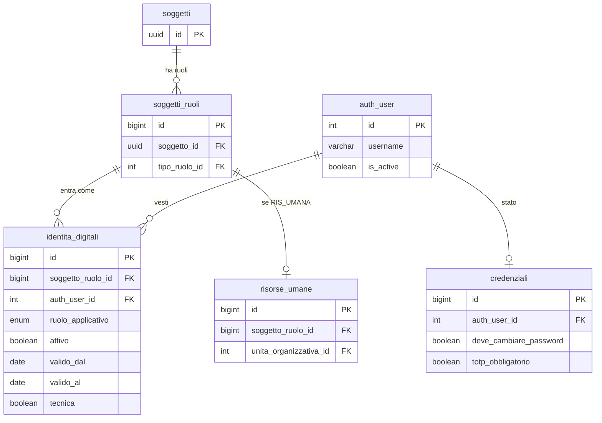
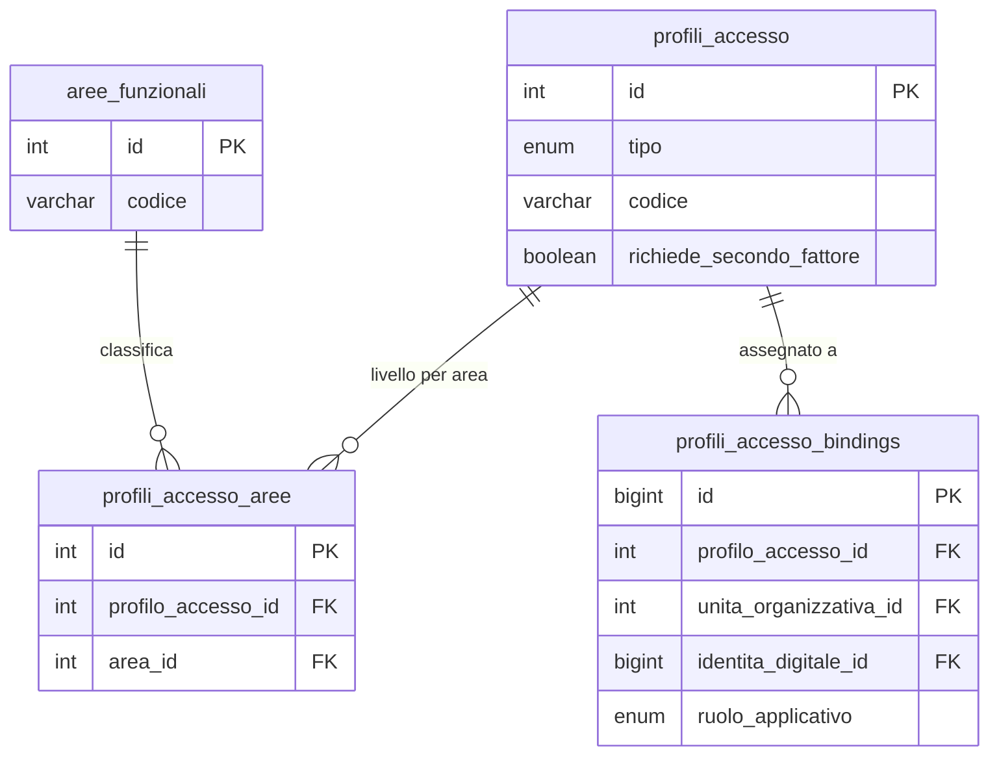
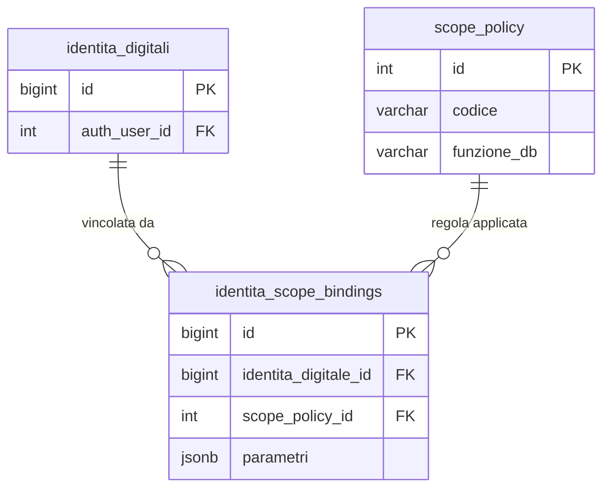

# Guida — Architettura Multi-Face Auth

> **Ultimo aggiornamento**: 25 ottobre 2026
>
> **Destinatari**: sviluppatori database, backend, frontend e analisti funzionali
>
> **Vedi anche** — schemi DB:
>
> * [anagrafiche.identita_digitali](/dbzero/anagrafiche/tabelle/identita_digitali) — la veste: chi entra, da quale porta, per quale soggetto_ruolo
> * [config.credenziali](/dbzero/config/tabelle/credenziali) — lo stato della credenziale (tentativi, blocco, cambio password, secondo fattore)
> * [config.profili_accesso](/dbzero/config/tabelle/profili_accesso) · [config.profili_accesso_bindings](/dbzero/config/tabelle/profili_accesso_bindings) — cosa si può fare
> * [config.scope_policy](/dbzero/config/tabelle/scope_policy) · [config.identita_scope_bindings](/dbzero/config/tabelle/identita_scope_bindings) — il registro delle regole di scope
> * [config.token_monouso](/dbzero/config/tabelle/token_monouso) — inviti, attivazioni, reset
>
> **Vedi anche** — funzioni DB:
>
> * [script.fn_veste_utilizzabile](/dbzero/script/funzioni/fn_veste_utilizzabile) — quando una veste conta «oggi»
> * [script.fn_get_identita_sr_perimetro](/dbzero/script/funzioni/fn_get_identita_sr_perimetro) · [script.fn_scope_sr_perimetro](/dbzero/script/funzioni/fn_scope_sr_perimetro) — il perimetro di chi guarda da controparte
> * [script.fn_get_profili_accesso_applicabili](/dbzero/script/funzioni/fn_get_profili_accesso_applicabili) — i profili di un utente, in ordine di priorità
> * [anagrafiche.fn_sync_auth_user_is_active](/dbzero/anagrafiche/funzioni/fn_sync_auth_user_is_active) — il flag di login di Django
>
> **Vedi anche** — API e service backend:
>
> * [API multi-veste: token](/backend/core/manual/api_multi_veste_token) — login per porta, refresh, cookie, logout
>
> **Vedi anche** — guide correlate:
>
> * [Soggetti & Ruoli](/guide/soggetti-e-ruoli-anagrafici) · [Architettura Permessi e Autorizzazioni](/guide/architettura-permessi-e-autorizzazioni) · [Risorse Umane e Accessi](/guide/risorse-umane-e-accessi)
> * [Contratto GUC `app.*`](/guide/contratto-guc-app) — l'identità della richiesta nel database
> * [Linee guida SQL §10](/linee-guida-sql#10-row-level-security-rls) — le regole per scrivere una policy RLS

---

## 1. Cosa significa "multi-face"

Chi entra in ZeroErp non è sempre un dipendente. Un ERP ha **più facce**:

* **Operatore interno**: il dipendente, con un reparto, permessi ereditati e uno scope per emittente fiscale.
* **Cliente portale**: il cliente B2B che vede le proprie fatture, pagamenti e scadenze.
* **Fornitore portale**: il fornitore che vede gli ordini ricevuti e lo stato dei pagamenti verso di sé.
* **Cliente del negozio online**: chi compra sul sito e vuole rivedere i propri ordini.
* **Client API**: un sistema terzo con un'identità propria (veste prevista, non ancora usata).

Tutti entrano con un account, ma hanno rapporti diversi con l'azienda e chiedono permessi, scope e
interfacce diverse. Il modello li tiene insieme senza rattoppare quello degli operatori.

---

## 2. Tre cose diverse, tenute separate

| Dimensione | Domanda a cui risponde | Dove sta |
| --- | --- | --- |
| **Identità** | chi è questa persona, e in quale veste entra? | `anagrafiche.identita_digitali` |
| **Capability** | cosa può fare? | `config.profili_accesso` e i suoi binding |
| **Scope** | su quali dati opera? | le policy RLS e i loro building block di perimetro |

Tenerle separate permette di combinarle liberamente: un cliente portale ha un'identità diversa da un
dipendente, un set di capability molto più stretto e uno scope che è «i miei dati, non altri».

### 2.1 Un solo `auth_user`, più vesti applicative

Mario Rossi può essere insieme:

* dipendente dell'azienda (veste `OPERATORE`);
* titolare di un'azienda fornitrice (veste `FORNITORE_PORTALE`);
* cliente B2B per la sua società (veste `CLIENTE_PORTALE`);
* consumer occasionale del negozio online (veste `SHOP_CUSTOMER`).

Sono relazioni diverse, ma **un'unica identità di autenticazione**: una email, una password, un ciclo
di vita della credenziale. Tra le vesti cambia cosa si può fare e cosa si vede, non chi si è. Un
`auth_user` rappresenta una persona autenticabile; le vesti (`ruolo_applicativo`) stanno su
`identita_digitali`, ciascuna agganciata al proprio `soggetti_ruoli`.

È coerente con la [guida soggetti e ruoli](/guide/soggetti-e-ruoli-anagrafici): il soggetto è
l'identità stabile, il ruolo anagrafico è la funzione civilistica, il `ruolo_applicativo` è la veste con
cui si accede al software. La **porta di login** (admin, portale, shop) decide quale veste vale in
ciascuna sessione.

**Perché non un account per veste.** Il modello «un account per veste» è il silo classico. ZeroErp
adotta il modello SSO (un'autenticazione, molte vesti) per tre ragioni:

1. **UX**: un dipendente che è anche cliente non gestisce due password; un reset vale per tutte le vesti.
2. **Sicurezza centralizzata**: freno sui tentativi, blocco, secondo fattore e regole della password si
   applicano una volta sola.
3. **Coerenza civilistica**: Mario Rossi è una persona fisica, con un solo soggetto anagrafico. Il livello
   auth rispecchia la persona, non la veste.

La distinzione tra vesti avviene alla porta di login, nel JWT (identità specifica) e nei GUC della
sessione (identità attiva), non nell'account.

---

## 3. Il bridge: `identita_digitali`

`anagrafiche.identita_digitali` collega un `soggetti_ruoli` a un `auth_user` in una veste. Il dipendente
è una riga con `ruolo_applicativo = 'OPERATORE'`: non esiste un bridge a parte per le risorse umane.

### 3.1 Struttura

Le colonne e i vincoli esatti stanno nella [doc auto-generata](/dbzero/anagrafiche/tabelle/identita_digitali).
In sintesi:

| Colonna | Significato |
| --- | --- |
| `soggetto_ruolo_id` | il ruolo anagrafico di aggancio (il dipendente, il cliente, il fornitore) |
| `auth_user_id` | la credenziale Django |
| `ruolo_applicativo` | la veste: `OPERATORE`, `CLIENTE_PORTALE`, `FORNITORE_PORTALE`, `SHOP_CUSTOMER`, `API_CLIENT`. Il valore `DISABILITATO` del tipo è ritirato: una veste spenta si riconosce solo da `attivo` |
| `attivo`, `valido_dal`, `valido_al` | se la veste è accesa, e da quando a quando vale |
| `invito_inviato_at` | quando è partito l'ultimo invito |
| `tecnica` | identità tecnica (l'utente con cui girano i lavori automatici di un'azienda), senza rapporto di lavoro |

**Una veste conta solo se è «utilizzabile oggi»** (`script.fn_veste_utilizzabile`): accesa, dentro la
sua finestra di validità, con il soggetto attivo e, per l'operatore umano, con il rapporto di lavoro in
corso. Una veste scaduta non entra e non vede più i suoi dati.

**Regole di dominio:**

* Un `auth_user` può avere **più vesti attive insieme**, ma al massimo **una** per ogni
  `ruolo_applicativo` (indice unico `uq_identita_digitali_auth_user_ruolo_attivo`).
* Anche un `soggetti_ruoli` ha al massimo una veste attiva per `ruolo_applicativo`
  (`uq_identita_digitali_sr_ruolo_attivo`). Un SR cliente può avere insieme `CLIENTE_PORTALE` e
  `SHOP_CUSTOMER`, sullo stesso `auth_user` o su due diversi.
* La veste la sceglie la **porta di login**, non un parametro della richiesta.
* ⭐ **Una persona, una credenziale.** L'email della credenziale è unica, senza distinguere maiuscole e
  minuscole (`script.fn_get_auth_user_id_for_email` è l'unica lettura per email). Creare una veste su
  un'email che ha già una credenziale **riusa quella**, ma non in silenzio: il DB chiede la conferma
  (`E_CREDENZIALE_DA_CONFERMARE`, il messaggio nomina lo username trovato) e la creazione si ripete
  dichiarando l'id della credenziale confermata (`riusa_auth_user_id`). Un id e non un sì: una
  credenziale cambiata nel frattempo ferma di nuovo. Se la credenziale è di un'altra persona fisica, il
  riuso è rifiutato (`E_CREDENZIALE_ALTRA_PERSONA`: l'email è sbagliata).
* ⭐ **La veste nasce spenta** e la accende solo l'**attivazione** dell'invito: nessuno entra da una porta
  prima di averla accettata. Se la credenziale ha già una password, l'attivazione è un clic; altrimenti
  chiede di sceglierla.
* ⭐ **Porta e profili sono due domande.** La veste accesa dice se la porta è aperta; il binding in
  `config.profili_accesso_bindings` dice cosa si può fare dentro. Un profilo (anche SUPER_ADMIN) si
  assegna anche a una veste spenta, e spegnere una veste non chiede di togliere prima i profili: li
  ritrova alla riaccensione. Chi legge i permessi chiede entrambe le cose (`fn_is_super_admin`,
  `fn_get_profili_accesso_applicabili`); l'ultimo SUPER_ADMIN attivo lo protegge
  `E_PROFILO_ULTIMO_SUPER_ADMIN`.
* ⛔ **La veste non porta lo stato della password.** Tentativi falliti, blocco, cambio password
  obbligatorio e obbligo del secondo fattore sono della **credenziale**: la password è una sola e vale
  per tutte le porte (§3.2).

### 3.2 La credenziale: tentativi, freno, blocco

Lo stato della credenziale sta in `config.credenziali` (1:1 con `auth_user`; la riga nasce alla prima
scrittura: assente = nessuno stato) e `config.credenziali_provenienze`. L'applicazione non le scrive:
passa dalle funzioni del DB. Al login valgono **tre regole**, nell'ordine, prima di guardare la password:

| Regola | Chi la fa scattare | Cosa colpisce | Codice |
| --- | --- | --- | --- |
| **Blocco** | un SUPER_ADMIN, con un verbo e un motivo | la credenziale su tutte le porte; non scade, e il reset password non lo toglie | `E_CREDENZIALE_BLOCCATA` |
| **Freno sulla provenienza** | automatico, dopo N password sbagliate di fila dalla stessa provenienza | la coppia credenziale + provenienza, per qualche minuto: chi attacca da una macchina non chiude fuori il titolare, che entra dalla sua | `E_UTENTE_BLOCCATO` |
| **Attesa crescente** | automatico, oltre un tetto di password sbagliate di fila da qualunque provenienza | la credenziale, che **rallenta** (secondi, con un massimo) ma non si chiude | `E_LOGIN_ATTESA` |

Tutti e tre sono `403`, non `429`: il `429` è il throttle per IP, e il login del frontend lo intercetta
prima di leggere il codice.

* La **provenienza** è l'IP del chiamante come lo ricava il backend dietro i proxy dichiarati
  (`get_client_ip`, setting `TRUSTED_PROXY_COUNT`): un valore scritto dal client non conta. Se non si
  ricava, il login si rifiuta.
* Un **accesso riuscito** azzera la credenziale e toglie il freno della sola provenienza da cui si è
  entrati; un **reset password riuscito** azzera tutti i freni (chi possiede l'email ha superato la
  prova che il freno protegge), ma non il blocco.
* Password giusta sulla porta sbagliata (`E_VESTE_NON_ATTIVA`) non conta come tentativo fallito.
* ⭐ **Un nome che non esiste si comporta come uno che esiste.** Freno e attesa valgono anche per un nome
  che non trova nessuna credenziale, con gli stessi numeri e le stesse risposte: la chiave è il **nome
  tentato** (`config.nomi_tentati`, `config.nomi_tentati_provenienze`). Così chi prova non impara se il
  nome esiste. Il nome **non entra in chiaro** né nel DB né nei log: il backend ne passa un'impronta
  (HMAC con una chiave che il DB non ha), perché chi digita la password nel campo del nome la
  lascerebbe lì. Il blocco dell'admin resta solo delle credenziali, e il suo messaggio rivela che il nome
  c'è: è accettato, al titolare serve sapere a chi rivolgersi.
* Il nome si confronta **come lo confronta l'autenticazione**: spazi in testa e in coda tolti, maiuscole
  distinte. Una normalizzazione diversa farebbe sfuggire il nome al freno.
* ⚠️ **Due regole diverse, anche se i numeri si somigliano.** Il throttle `LoginRateThrottle` (richieste
  per IP, qualunque credenziale) ferma chi **inonda** l'endpoint; il freno per provenienza (password
  sbagliate sulla stessa credenziale) ferma chi **prova** una credenziale.
* Il **cambio password obbligatorio** è della credenziale: lo accende solo il verbo dedicato
  (`script.fn_imposta_deve_cambiare_password`), lo spegne qualunque nuova password (cambio, reset,
  attivazione). ⛔ L'invito **non** lo accende e non tocca la password: la credenziale può essere di una
  persona che ha già un'altra veste, e la sua password vale anche lì.
* Il **secondo fattore** è anch'esso della credenziale (`config.credenziali.totp_obbligatorio`); un
  profilo può pretenderlo (`config.profili_accesso.richiede_secondo_fattore`). Ogni porta ha il suo passo
  `…/token/secondo-fattore/`. Regole e flusso:
  [Risorse umane — Secondo fattore di autenticazione](/guide/risorse-umane-e-accessi#secondo-fattore-di-autenticazione).

### 3.3 Il vincolo "persona fisica pura" vale per l'operatore

La regola **R4** ([Risorse umane §R4](/guide/risorse-umane-e-accessi#r4--collegamento-a-django-solo-persona-fisica-pura))
vieta il collegamento a `auth_user` per chi ha partita IVA. Nasce dalla natura del ruolo RIS_UMANA, non
dal bridge, e vale per la veste `OPERATORE`: il `soggetto_ruolo` deve essere RIS_UMANA su una persona
fisica pura. Per le altre vesti non si applica, così un cliente persona giuridica (S.r.l., S.p.A., Ente)
può avere un accesso al portale.

---

## 4. Il livello capability: `profili_accesso`

### 4.1 I profili

`config.profili_accesso` contiene tutti i profili di permesso, di quattro tipi (`tipo_profilo_accesso`):
`REPARTO`, `PORTALE`, `AD_HOC`, `SUPER_ADMIN`. Il dettaglio dei permessi sta in
`config.profili_accesso_aree` e `config.profili_accesso_azioni`; le eccezioni per singolo utente in
`config.user_override_aree`, `_azioni` e `_oggetti`. Il modello dei permessi è nella guida
[Architettura Permessi e Autorizzazioni](/guide/architettura-permessi-e-autorizzazioni).

### 4.2 Come un profilo arriva a un utente

`config.profili_accesso_bindings` dice a chi vale un profilo. Ogni binding ha **esattamente uno** dei tre
bersagli (lo impone un CHECK):

| Bersaglio | Il profilo vale per |
| --- | --- |
| `identita_digitale_id` | una singola identità |
| `unita_organizzativa_id` | un reparto (gli operatori lo ereditano) |
| `ruolo_applicativo` | tutti gli utenti di una veste |

`script.fn_get_profili_accesso_applicabili` li risolve dal più specifico al più generale: **AD_HOC**
sull'identità (priorità 1), **REPARTO** sull'unità organizzativa (2), **PORTALE** sulla veste (3). Senza
nessun profilo, niente permessi. Contano solo le vesti utilizzabili oggi.

### 4.3 Preset per i portali

Le vesti portale hanno un **preset** di capability: non ha senso configurare cento clienti uno per uno.
Un profilo `PORTALE` legato alla veste (`CLIENTE_PORTALE`, per esempio) vale per tutti; le eccezioni per
singolo cliente passano dagli override, ma non sono la norma.

---

## 5. Il livello scope: dove guardo, cosa vedo

### 5.1 Quattro regole diverse

* Un **operatore** vede i dati degli **emittenti fiscali** che gli sono assegnati
  ([user_emittenti_fiscali](/dbzero/config/tabelle/user_emittenti_fiscali)).
* Un **cliente portale** vede **tutto** il proprio rapporto con l'azienda (fatture, scadenze, ordini),
  qualunque sia il canale di origine.
* Un **fornitore portale** vede i **propri ordini ricevuti** e i DDT associati.
* Un **cliente shop** vede solo le **proprie transazioni nate dallo shop**, anche se il soggetto ha anche un
  rapporto B2B.

**L'asimmetria portale/shop è voluta:**

| Veste | Vede | Perché |
| --- | --- | --- |
| `CLIENTE_PORTALE` | ordini, fatture, scadenze del proprio `soggetto_ruolo`, su **qualunque canale** | il portale B2B è la voce consolidata del cliente |
| `SHOP_CUSTOMER` | solo i dati con `canale_origine = 'SHOP'` del proprio `soggetto_ruolo` | lo shop è un canale B2C autonomo: il consumer non vede gli acquisti B2B della sua azienda |
| `FORNITORE_PORTALE` | ordini ricevuti e DDT associati, qualunque sia il canale | simmetrico al portale cliente, sul versante passivo |

È reversibile a basso costo: è un predicato nella `USING` delle policy (§6.4).

### 5.2 Come è scritto il perimetro

Ogni perimetro è scritto **una volta**, in building block che le policy compongono:

| Chi guarda | Il perimetro (una volta per istruzione) | La riga (quale soggetto la possiede) | Il confronto |
| --- | --- | --- | --- |
| operatore | `script.fn_get_emittenti_scope_pk_ids` (gli emittenti dell'utente) | `script.fn_resolve_emittente_fiscale_id` | `script.fn_scope_ef_perimetro` |
| controparte (cliente, shop, fornitore) | `script.fn_get_identita_sr_perimetro` (il `soggetto_ruolo` della veste, se utilizzabile) | `script.fn_resolve_controparte_sr_id` | `script.fn_scope_sr_perimetro` |

Il perimetro si calcola in una sottoquery non correlata, valutata una volta per istruzione (Linee guida
SQL §10.3). ⚠️ I due perimetri hanno il `NULL` opposto: per l'operatore `NULL` vuol dire «tutti», per la
controparte «nessuno».

**Il registro delle regole.** `config.scope_policy` elenca le regole di scope con la funzione che risponde
alla domanda su una riga: `EF_WHITELIST` (`script.fn_scope_ef_whitelist`), `BA_OWNERSHIP`
(`script.fn_scope_ba_ownership`), `FORNITORE_OWNERSHIP` (`script.fn_scope_fornitore_ownership`).
`config.identita_scope_bindings` lega un'identità a una o più regole, con i loro `parametri`. Le policy RLS
**non passano dal registro**: usano direttamente i building block qui sopra. Le funzioni del registro
compongono gli stessi building block per chi chiede di una riga sola.

### 5.3 La whitelist degli emittenti

`config.user_emittenti_fiscali` è la tabella che assegna gli emittenti a un operatore. È la sorgente del
perimetro operatore e della regola `EF_WHITELIST`.

---

## 6. Row Level Security: la difesa al livello giusto

### 6.1 Dove è attiva

Il backend filtra le letture con la condizione di scope dei repository
([§6.3 della guida permessi](/guide/architettura-permessi-e-autorizzazioni#63-ambito-dati-whitelist-ef-per-operatori-rls-per-portaleshop)).
Le **policy RLS** sono la rete sotto: anche se un repository dimentica la condizione, la riga non esce.

La RLS è attiva sulle tabelle dei dati di un'azienda in `vendite`, `pratiche`, `documenti` e
`anagrafiche` (fatture, ordini, preventivi, contratti, offerte, lotti, documenti generati, pratiche,
billing account, clienti… e le loro figlie), e su `shop.ricevute`. Ogni tabella ha una policy per veste:

| Veste | Policy | Dove |
| --- | --- | --- |
| `OPERATORE` | `rls_<tabella>_ef_whitelist`, **`FOR ALL`** | tutte le tabelle sotto RLS |
| `CLIENTE_PORTALE` | `rls_<tabella>_ba_ownership`, `FOR SELECT` | la famiglia delle fatture |
| `SHOP_CUSTOMER` | `rls_<tabella>_shop`, `FOR SELECT`, con il filtro `canale_origine = 'SHOP'` | la famiglia degli ordini, `billing_account`, `clienti`; `shop.ricevute` (`rls_shop_ricevute_self_ownership`) |
| `FORNITORE_PORTALE` | `rls_acquisti_<tabella>_fornitore_ownership` | `acquisti.ordini`, `acquisti.ddt`: **scritte ma non attive**, perché su quelle tabelle la RLS non è accesa |

Ogni policy apre solo alla sua veste (`app.ruolo_applicativo`), quindi una veste non vede mai attraverso
la policy di un'altra. Fuori dalla RLS resta solo il **proprietario** delle tabelle (migrazioni e
manutenzione), perché `FORCE` è spento. I lavori automatici che toccano i dati di un'azienda girano come
l'applicazione, con l'utente tecnico di quell'azienda, e sono filtrati come gli operatori.

**Due regole da tenere a mente scrivendo una policy** (la prima è in Linee guida SQL §10.6):

* dove la veste **scrive**, la policy è `FOR ALL` con `WITH CHECK`: una policy di sola lettura su una
  tabella sotto RLS rifiuta ogni `INSERT`/`UPDATE` (`new row violates row-level security policy`);
* **`INSERT … RETURNING` passa anche dalla `USING`**: ciò che l'applicazione scrive e poi rilegge deve
  essere visibile a chi l'ha scritto nello stesso istante. Per questo un predicato che dipende dalle
  **righe figlie** non può stare nella `USING` del padre: quando il padre nasce, di figlie non ce n'è
  nessuna.

### 6.2 Come si alimentano le RLS

`JwtAuditAuthentication` porta nel database l'identità della richiesta come GUC della transazione:
`app.jwt_user`, `app.current_user_id`, `app.current_identita_id`, `app.ruolo_applicativo`,
`app.soggetto_ruolo_id` e, per l'operatore, `app.current_emittente_id`. Il contratto (chi li scrive, chi
li legge, cosa succede quando mancano) è nel [Contratto GUC `app.*`](/guide/contratto-guc-app).

Le tre dell'identità (`current_identita_id`, `ruolo_applicativo`, `soggetto_ruolo_id`) vanno **tutte o
nessuna**: le policy sono fail-closed quando ne manca una. `script.fn_current_identita_context()`
restituisce la tripla, o una tripla di `NULL` se non è coerente.

### 6.3 Defense-in-depth, non sostituzione

| Cosa controlla | Dove |
| --- | --- |
| se l'utente può chiamare l'endpoint | Django (permission class della view) |
| se l'utente può eseguire quell'azione | Django (capability dal profilo) |
| quali righe **vede** | DB (RLS `USING`) |
| quali righe può **creare o modificare** | DB (RLS `WITH CHECK`, policy `FOR ALL`) |

### 6.4 Il canale di origine sui dati transazionali

Per distinguere portale B2B e shop B2C servono due cose: **billing account separati per canale** (scelta
di dominio, cfr. [Risorse umane](/guide/risorse-umane-e-accessi)) e il **canale di origine** sulle righe.
La colonna `canale_origine` (tipo `config.canale_origine`: `ADMIN`, `PORTALE`, `SHOP`; default `ADMIN`)
sta su:

* `anagrafiche.billing_account`: su quale canale vive il BA;
* `vendite.ordini`: da dove è nato l'ordine;
* `vendite.fatture`: da dove è nata la fattura B2B.

Le figlie (righe, scadenze, indirizzi) non la ripetono: la leggono dal padre. Gli acquisti non hanno
canale, perché nascono tutti all'interno.

**Il canale non cambia.** Un trigger per tabella (`…_a10_canale_origine_immutable_upd`)
rifiuta la modifica: la colonna racconta l'origine, non l'ultimo che ha toccato la riga. Un ordine
`PORTALE` modificato da un operatore resta `PORTALE`; l'ultimo editor è in `user_update` e nel giornale
pratiche.

**Le ricevute dello shop stanno in una tabella loro**, `shop.ricevute`, non in `vendite.fatture`: lo shop
emette ricevute consumer, mai fatture elettroniche. Così `vendite.fatture` resta la tabella fiscale B2B
(emittente, SdI, XML), la policy del portale non distingue tipi di documento, e lo shop ha il suo silo.

**Nelle policy:** quella del portale non guarda `canale_origine`; quella dello shop lo filtra. Rendere il
portale un silo simmetrico («il portale vede solo il portale») costerebbe un predicato per policy.

---

## 7. Namespace API separati

### 7.1 Tre porte, tre basi

| Prefisso | Chi | Base della view | Permission |
| --- | --- | --- | --- |
| `/api/v1/<dominio>/` (`vendite`, `anagrafiche`, `pratiche`, …) | operatori interni | `DomainAPIView` (area funzionale), `AdminAPIView` (SUPER_ADMIN) | `ZeroERPPermission` |
| `/api/v1/portale/` | clienti e fornitori | `PortaleAPIView` | `PortaleBasePermission` |
| `/api/v1/shop/` | negozio online | `ShopAPIView` | `ShopBasePermission` |

Il confine sta nel routing e nella base della view, non nel codice di ogni endpoint. Oggi i namespace
`portale/` e `shop/` ospitano l'attivazione dell'invito e gli stub del §8.2: le API di dominio per portale
e shop non ci sono ancora (§12).

### 7.2 I service sono condivisi

I service di dominio restano gli stessi per tutte le porte. Una view del portale chiamerà lo stesso
service delle fatture usato dall'operatore: la differenza la fanno i GUC della sessione, perché le policy
RLS filtrano la query. Nessuna logica di business duplicata.

### 7.3 Login per porta

Un `auth_user` può avere più vesti attive. Al login la veste la sceglie **l'endpoint**, non un parametro:

| Endpoint | Veste cercata | Se manca |
| --- | --- | --- |
| `/api/v1/admin/token/` | `OPERATORE` | `403`, `E_VESTE_NON_ATTIVA` |
| `/api/v1/portale/token/` | `CLIENTE_PORTALE` o `FORNITORE_PORTALE` | `403`, `E_VESTE_NON_ATTIVA` |
| `/api/v1/shop/token/` | `SHOP_CUSTOMER` | `403`, `E_VESTE_NON_ATTIVA` |

Ogni porta ha il suo `…/token/refresh/` e il suo `…/token/secondo-fattore/`; il logout è comune
(`/api/v1/auth/logout/`).

* **Il JWT** porta, oltre ai claim standard, `identita_id`: la riga di `identita_digitali` della sessione.
  È il dato autoritativo: non si ricava a runtime da `(auth_user, ruolo_applicativo)`, si legge dal token.
* **Il refresh** conserva l'`identita_id` del token di origine: non cambia veste. Per entrare con un'altra
  veste si fa login sull'altra porta.
* **Il refresh token non viaggia mai nel corpo JSON**: sta nel cookie HttpOnly `zeroerp_refresh`
  (`SameSite=Strict`, `Path=/api/v1/`), scritto da login, refresh, cambio password e cambio emittente
  attivo; l'endpoint di refresh pretende anche l'header anti-CSRF `X-Requested-With: XMLHttpRequest`.
  L'access token resta nel corpo e il frontend lo tiene solo in memoria. Il cookie ha un nome e un path
  unici: nello stesso browser ne esiste uno solo, e un login su un'altra porta lo sostituisce. Contratto
  completo: [API multi-veste: token](/backend/core/manual/api_multi_veste_token#cookie-di-refresh).
* **Il logout** revoca la sessione del refresh presentato nel cookie (tutti i token col suo `sid`, via
  `token_blacklist` di SimpleJWT) e cancella il cookie. Le altre vesti dello stesso `auth_user` restano
  collegate nelle loro sessioni.

---

## 8. Onboarding

### 8.1 Invito da admin

È il flusso di tutte le vesti, simmetrico a quello degli operatori
([Risorse umane §Invito operatore](/guide/risorse-umane-e-accessi#invito-operatore)):

1. l'operatore apre il cliente o il fornitore in anagrafica e invita
   (`POST /api/v1/anagrafiche/clienti/<id>/invita-portale/`, `…/clienti/<id>/invita-shop/`,
   `…/fornitori/<id>/invita-portale/`);
2. il sistema crea (o riusa, §3.1) la credenziale e la veste **spenta**, ed emette un token monouso;
3. il referente riceve l'email con il link di attivazione;
4. l'attivazione (`/api/v1/portale/attivazione/…`, `/api/v1/shop/attivazione/…`) accende la veste.

Ogni porta ha due tipi di token (`apps/core/services/invito_veste.py`): l'**invito** (`INVITO_PORTALE`,
`INVITO_SHOP`, `INVITO_OPERATORE`), quando la credenziale è nuova e la password va scelta, e
l'**attivazione cross** (`ATTIVAZIONE_PORTALE_CROSS`, `…_SHOP_CROSS`, `…_OPERATORE_CROSS`), quando la
credenziale ha già una password e attivare è un clic. Ogni tipo ha il suo template email.

La disattivazione passa da `…/disattiva-portale/` e `…/disattiva-shop/`. Il cambio password obbligato lo
gestisce il cancello degli obblighi (`apps/core/api/cancello_obblighi.py`).

### 8.2 Self-service dello shop: non ancora costruito

La registrazione autonoma sul negozio non esiste ancora. Ci sono due **stub** che rispondono `501`:
`POST /api/v1/shop/register/check-email/` e `POST /api/v1/portale/profile/activate-shop/`. Il disegno
deciso, per quando si costruirà:

* **email nuova**: la registrazione crea in una transazione soggetto persona fisica, ruolo cliente,
  billing account con `canale_origine = 'SHOP'`, credenziale e veste `SHOP_CUSTOMER` spenta; l'email di
  verifica la accende;
* **email già registrata**: la registrazione si **rifiuta** con un messaggio esplicito, e chi ha già una
  credenziale entra dalla sua porta e attiva lo shop dal profilo, con conferma via email. Chi conosce
  l'email di un altro non deve poter creare per lui una veste in più.

### 8.3 Recupero password

Il flusso di reset ([Risorse umane §Reset password dimenticata](/guide/risorse-umane-e-accessi#reset-password-dimenticata))
è uno per tutte le vesti, perché la credenziale è una sola
(`/api/v1/auth/password-reset-request/`, `…-validate/<token>/`, `…-confirm/`).

---

## 9. Il flag di login di Django: `auth_user.is_active`

Con più vesti per credenziale, `auth_user.is_active` è un **OR** sulle vesti:

> `is_active = true` se e solo se esiste **almeno una** veste utilizzabile oggi
> (`script.fn_veste_utilizzabile`).

Se Mario ha tre vesti e ne si spengono due, deve poter entrare con la terza: le vesti spente le ferma la
porta di login, non il flag. Quando si spegne l'ultima veste utilizzabile, il flag va a `false` e i JWT
correnti falliscono alla richiesta successiva, perché Django verifica `is_active`.

`anagrafiche.fn_sync_auth_user_is_active(p_auth_user_id)` ricalcola il flag. La chiamano:

* i trigger `trg_identita_digitali_z90_sync_auth_user_active_ins` e `_upd`, a ogni scrittura di una veste;
* il management command `sync_auth_user_active` e il job pgAgent `sync_auth_user_expired_daily`, per le
  vesti che scadono col passare dei giorni.

Per l'operatore umano «utilizzabile» guarda anche il rapporto di lavoro: la fine del rapporto spegne la
credenziale, se non resta un'altra veste.

---

## 10. Diagrammi ER

### 10.1 Bridge identità

### 10.2 Capability

### 10.3 Registro dello scope

---

## 11. Perché questo disegno è coerente con ZeroErp

* **Onora il modello soggetti/ruoli**: non lo aggira, lo estende nel verso giusto.
* **DB-first**: lo scope sta nelle policy RLS, e il database è la verità anche sulla sicurezza dei dati.
* **Nessuna duplicazione di logica**: i service di dominio sono gli stessi per tutte le porte.
* **Estensibile**: una veste nuova (agente commerciale, partner API, banca) è un valore del tipo, un
  profilo, una porta e un perimetro, non un rifacimento.

---

## 12. Stato ed evoluzioni

**Costruito.** Tutte le vesti hanno invito, attivazione, login per porta, refresh, secondo fattore, GUC
della sessione e policy RLS. Un operatore può già invitare un cliente sul portale o sullo shop: il
cliente attiva l'accesso, entra dalla sua porta e riceve un JWT con la veste giusta.

**Non ancora costruito:**

* le **API di dominio** di portale e shop (fatture visibili al cliente, ordini del fornitore, catalogo
  B2C, carrello, checkout): chiedono decisioni di design (quali dati esporre, prezzi B2C, ricevute) e si
  affronteranno quando servirà. Non chiedono di rifare l'auth: si aggiungono endpoint sotto
  `/api/v1/portale/` o `/api/v1/shop/`, sulle loro basi;
* la **RLS del fornitore**: le policy su `acquisti.ordini` e `acquisti.ddt` ci sono, la RLS su quelle
  tabelle va accesa con le API del fornitore;
* il **self-service dello shop** (§8.2).

**Evoluzioni possibili:**

* **SSO OAuth/OIDC per i portali**: un fornitore entra con l'IdP della sua azienda; l'`identita_id` si
  mappa da un claim esterno.
* **Client API**: la veste `API_CLIENT` c'è già nel tipo, con autenticazione a token lungo e scope
  aziendale.
* **Agente o venditore**: vede solo i propri clienti, con una regola di scope dedicata.
* **Portale come silo** («il portale vede solo il portale»): un predicato su `canale_origine` nelle
  policy del portale.
* **Admin di portale**: un cliente B2B grande con più utenti sotto lo stesso BA e un amministratore dei
  colleghi: una veste, un profilo e una permission class, senza toccare il bridge.

---


