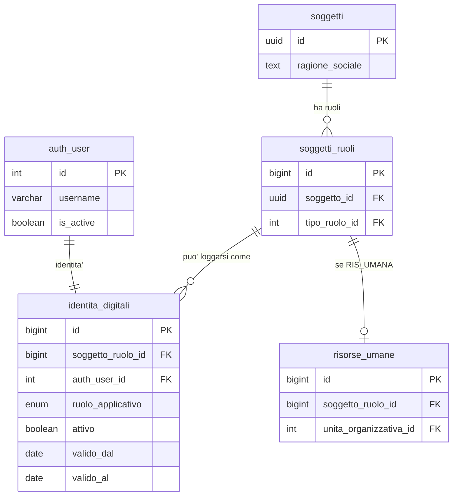
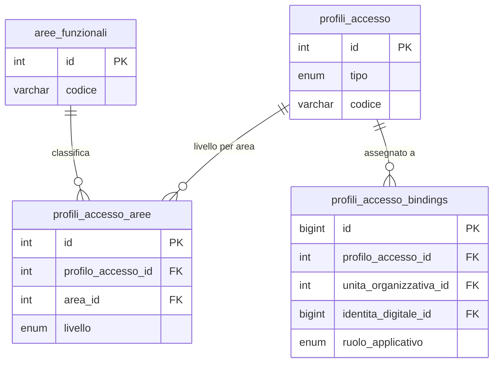

# Guida Tecnica – Architettura Multi-Face Auth

> **Destinatari:** sviluppatori database, backend, frontend e analisti funzionali
>
> **Prerequisiti:** [Guida Soggetti & Ruoli](/guide/soggetti-e-ruoli-anagrafici), [Architettura Permessi e Autorizzazioni](/guide/architettura-permessi-e-autorizzazioni), [Risorse Umane e Accessi](/guide/risorse-umane-e-accessi)
>
> **Stato:** Proposta architetturale – v1.0

---

## 1. Cosa significa "multi-face"

Il sistema attuale pensa a chi entra nel software come **dipendente**: una risorsa
umana con un reparto, un'ereditarieta' di permessi, uno scope per emittente fiscale.
Questo va benissimo finche' l'unico modo di usare ZeroErp e' da dentro l'azienda.

Nella vita reale un ERP serio ha **piu' facce**:

- **Operatore interno** — il dipendente che gia' conosciamo
- **Cliente portale** — il cliente B2B che entra per vedere le proprie fatture, pagamenti, scadenze
- **Fornitore portale** — il fornitore che entra per vedere gli ordini ricevuti, lo stato pagamenti verso di se'
- **Cliente del negozio online** — chi si registra sul sito, fa un ordine, vuole rivederlo
- **Partner / integratore API** — in futuro, sistemi terzi che chiamano le API con un'identita' propria

Tutte queste persone hanno una cosa in comune: **entrano nel software con un account**.
Ma hanno rapporti molto diversi con l'azienda — e chiedono permessi, scope e interfacce diverse.

Questa guida propone un modello che **abbraccia tutti i casi senza rattoppare quello
degli operatori interni**. Il disegno tiene fermo cio' che funziona (soggetti/ruoli,
audit JWT, sync login, token monouso) e generalizza solo cio' che oggi e' troppo stretto.

---

## 2. Tre cose diverse, tenute separate

Il cuore del modello e' **separare tre concetti** che oggi sono fusi insieme:

| Dimensione | Domanda a cui risponde | Dove sta oggi | Dove dovrebbe stare |
| --- | --- | --- | --- |
| **Identita'** | Chi e' questa persona nel sistema? | `risorse_umane_auth_user` (solo dipendenti) | `identita_digitali` (bridge generico) |
| **Capability** | Cosa puo' fare? | `profili_reparto_aree` (solo reparti) | `profili_accesso` (reparti o portali) |
| **Scope** | Su quali dati opera? | `user_emittenti_fiscali` (solo EF) | `identita_scope_bindings` (policy generiche) |

Tenerle separate permette di combinarle liberamente. Un cliente portale ha
un'**identita'** diversa da un dipendente, un **set di capability** molto piu' ristretto
e uno **scope** che e' "i miei billing account, non altri".

### 2.1 Perche' lo stesso `auth_user` non va condiviso tra contesti

Mario Rossi puo' essere contemporaneamente:

- dipendente della mia azienda (identita' interna)
- titolare di un'azienda fornitrice che io pago (identita' fornitore)
- cliente privato di un mio negozio online (identita' shop)

Sono **tre relazioni diverse** con la mia azienda. Non ha senso che condividano
lo stesso account: ognuna ha la sua password, il suo flusso di login, la sua
interfaccia. In ZeroErp un `auth_user` rappresenta **un'identita' in un contesto**,
non una persona fisica. Se Mario ha tre cappelli, ha tre account.

Questo non e' un compromesso — e' il modello corretto. Lo dice chiaramente anche
la [guida soggetti e ruoli](/guide/soggetti-e-ruoli-anagrafici): il soggetto e'
l'identita' stabile, il ruolo e' la funzione nel sistema. Un `auth_user` nasce
dal ruolo, non dal soggetto.

---

## 3. Il nuovo bridge: `identita_digitali`

La tabella [anagrafiche.risorse_umane_auth_user](/dbzero/anagrafiche/tabelle/risorse_umane_auth_user)
resta valida **come caso particolare** — il bridge del dipendente. Accanto a lei
nasce `anagrafiche.identita_digitali`, il bridge generico che collega qualunque
`soggetti_ruoli` a un `auth_user`.

### 3.1 Struttura concettuale

```text
anagrafiche.identita_digitali
    id                    BIGINT PK
    soggetto_ruolo_id     BIGINT FK  (a anagrafiche.soggetti_ruoli)
    auth_user_id          INT  FK UNIQUE  (a django.auth_user)
    ruolo_applicativo     ENUM      (OPERATORE | CLIENTE_PORTALE | FORNITORE_PORTALE |
                                     SHOP_CUSTOMER | API_CLIENT | DISABILITATO)
    attivo                BOOLEAN
    valido_dal            DATE
    valido_al             DATE      NULLABLE
    deve_cambiare_password BOOLEAN
    invito_inviato_at     TIMESTAMPTZ NULLABLE
    date_insert/update, user_insert/update   (audit standard)
    UNIQUE (auth_user_id)
    UNIQUE (soggetto_ruolo_id) WHERE attivo = true
```

**Regole di dominio:**

- Un `auth_user` ha **una sola** identita' digitale attiva alla volta
- Un `soggetti_ruoli` puo' avere piu' identita' nel tempo (cessazione e rientro),
  ma una sola attiva
- `ruolo_applicativo` dice **in quale veste** l'utente si logga

### 3.2 Il vincolo "persona fisica pura" si sposta

Oggi la regola **R4** ([Risorse umane §R4](/guide/risorse-umane-e-accessi#r4--collegamento-a-django-solo-persona-fisica-pura))
vieta il collegamento a `auth_user` per chi ha partita IVA. Questa regola nasce
dalla natura del ruolo RIS_UMANA (solo persone fisiche dipendenti), non dal bridge.

Nel nuovo modello la regola diventa:

> *Se `ruolo_applicativo = OPERATORE`, allora il `soggetto_ruolo` deve essere
> RIS_UMANA su soggetto persona fisica pura. Per gli altri ruoli applicativi,
> il vincolo non si applica.*

Cosi' un cliente persona giuridica (S.r.l., S.p.A., Ente) puo' avere un account
sul portale, senza rompere la regola originale.

### 3.3 Rapporto con `risorse_umane_auth_user`

Durante la migrazione i due bridge convivono. Poi `risorse_umane_auth_user`
diventa una **vista letta** costruita sopra `identita_digitali` filtrando
`ruolo_applicativo IN (OPERATORE)`. Cosi' il codice esistente non si accorge
della differenza, ma la vera sorgente dati e' una sola.

---

## 4. Il livello capability: `profili_accesso`

Oggi i permessi sono **per reparto** ([profili_reparto_aree](/dbzero/config/tabelle/profili_reparto_aree)).
Un cliente portale non ha un reparto: ha un **ruolo nel mondo** (cliente),
a cui corrisponde un set standard di permessi.

### 4.1 Generalizzazione

Nasce `config.profili_accesso`, che contiene **tutti** i profili di permesso:

```text
config.profili_accesso
    id              INT PK
    tipo            ENUM (REPARTO | PORTALE | AD_HOC)
    codice          VARCHAR UNIQUE    (AMMINISTRAZIONE, VENDITE, CLIENTE_PORTALE, ...)
    descrizione     TEXT
    attivo          BOOLEAN
```

Le tabelle esistenti di dettaglio (`profili_reparto_aree`, `profili_reparto_azioni`)
diventano `profili_accesso_aree` e `profili_accesso_azioni`, legate a `profili_accesso`
invece che direttamente a `unita_organizzative`.

### 4.2 Come viene assegnato un profilo a un utente

Nasce una tabella di **binding** che dice "quale profilo vale per questa identita'":

```text
config.profili_accesso_bindings
    id                     BIGINT PK
    profilo_accesso_id     INT FK
    -- esattamente uno dei tre seguenti deve essere valorizzato:
    unita_organizzativa_id INT FK NULL    (se il profilo vale per un reparto)
    identita_digitale_id   BIGINT FK NULL (se il profilo vale per una singola identita')
    ruolo_applicativo      ENUM  NULL     (se il profilo vale per tutti gli utenti di quel ruolo)
```

Cosi' la catena di risoluzione diventa:

```text
1. profilo binding per identita' specifica?     -> ha priorita'
2. profilo binding per reparto (se OPERATORE)?  -> ereditato come oggi
3. profilo binding per ruolo applicativo?       -> fallback standard per CLIENTE, FORNITORE, SHOP
4. default -> BLOCCATO
```

### 4.3 Preset per i portali

I ruoli portale hanno un **preset di capability stretto e immutabile**, perche'
non ha senso configurare 100 clienti uno per uno. L'admin di sistema definisce
**un** profilo `CLIENTE_PORTALE` con permessi standard (lettura propri
documenti, creazione ticket, ecc.), e tutti i clienti ne ereditano.

Eccezioni per singolo cliente restano possibili via `user_override_*` (gia'
esistenti) — ma non sono la norma.

---

## 5. Il livello scope: dove guardo, cosa vedo

### 5.1 Il problema

Un operatore interno e' limitato dagli **emittenti fiscali** ([user_emittenti_fiscali](/dbzero/config/tabelle/user_emittenti_fiscali)).
Un cliente portale deve vedere solo i **propri billing account**, mai quelli di altri clienti.
Un fornitore vede solo i **propri ordini ricevuti**.
Un cliente shop vede solo le **proprie transazioni personali**.

Quattro regole di scope, tutte diverse. La whitelist EF esistente va bene per il
primo caso, ma non si estende.

### 5.2 Generalizzazione

Nasce `config.scope_policy`:

```text
config.scope_policy
    id          INT PK
    codice      VARCHAR UNIQUE   (EF_WHITELIST, BA_OWNERSHIP, FORNITORE_OWNERSHIP, SELF_OWNERSHIP, ...)
    descrizione TEXT
    funzione_db VARCHAR           (nome funzione PL/pgSQL che implementa il check)
```

Ogni policy e' implementata da una funzione SQL che, dati `(identita_id, target)`,
risponde *true* o *false*. Esempio:

```sql
-- Policy BA_OWNERSHIP: il cliente portale vede solo i BA dove e' titolare
CREATE FUNCTION script.fn_scope_ba_ownership(p_identita_id BIGINT, p_billing_account_id BIGINT)
RETURNS BOOLEAN LANGUAGE sql STABLE AS $$
    SELECT EXISTS (
        SELECT 1
        FROM anagrafiche.identita_digitali id
        JOIN anagrafiche.soggetti_ruoli sr  ON sr.id = id.soggetto_ruolo_id
        JOIN anagrafiche.clienti c          ON c.soggetto_ruolo_id = sr.id
        JOIN anagrafiche.billing_account ba ON ba.cliente_id = c.id
        WHERE id.id = p_identita_id
          AND ba.id = p_billing_account_id
    );
$$;
```

Poi i binding: `config.identita_scope_bindings` collega un'identita' a una o piu' policy.

### 5.3 Whitelist EF come caso particolare

`user_emittenti_fiscali` non scompare: rimane come tabella di supporto alla policy
`EF_WHITELIST`. La funzione `fn_scope_ef_whitelist` resta quella di oggi, solo
avvolta nel nuovo framework. Nessuna migrazione dati distruttiva.

---

## 6. Row Level Security: la difesa al livello giusto

### 6.1 Il salto di qualita'

Oggi il backend filtra i queryset tramite il [EmittenteFiscaleScopeMixin](/guide/architettura-permessi-e-autorizzazioni#63-mixin-per-ambito-emittente-fiscale).
Funziona, ma se un endpoint dimentica il mixin, i dati escono.

Con il nuovo modello si introducono **policy RLS native PostgreSQL** sulle tabelle
dati sensibili. Sono regole scritte nel DB che dicono: *questa riga e' visibile
solo se l'utente corrente ha uno scope che la include*.

Esempio sulle fatture:

```sql
ALTER TABLE vendite.fatture ENABLE ROW LEVEL SECURITY;

CREATE POLICY rls_fatture_scope ON vendite.fatture
    FOR SELECT
    USING (
        script.fn_identita_vede_billing_account(
            current_setting('app.current_identita_id', true)::bigint,
            billing_account_id
        )
    );
```

### 6.2 Come si alimentano le RLS

Il middleware esistente [JwtAuditAuthentication](/guide/risorse-umane-e-accessi#propagazione-identita-utente-al-database-guc-app)
oggi propaga `app.jwt_user` e `app.current_user_id`. Si aggiungono due GUC:

- `app.current_identita_id` — id del record in `identita_digitali`
- `app.ruolo_applicativo` — il ruolo dell'utente corrente (OPERATORE, CLIENTE_PORTALE, ...)

Con queste informazioni le policy RLS lavorano autonome. Il backend **non deve piu'
filtrare manualmente** per scope: il DB lo fa sempre, anche se lo sviluppatore
si dimentica.

### 6.3 Defense-in-depth, non sostituzione

Le permission class Django restano (autenticazione, verifica capability sull'area).
Le RLS DB si aggiungono come rete di sicurezza per lo **scope dati**. I due livelli
non si sovrappongono:

| Cosa controlla | Dove |
| --- | --- |
| Se l'utente puo' chiamare l'endpoint | Django (`ZeroERPPermission`) |
| Se l'utente puo' eseguire quell'azione | Django (capability dal profilo) |
| Quali righe vede nelle query | DB (RLS policy) |

---

## 7. Namespace API separati

### 7.1 Perche' separati

Oggi le API vivono sotto `/api/*`. Esporre gli stessi endpoint a clienti portale
significa aggiungere molte guard *negli* endpoint — fragile e difficile da auditare.

Meglio dividere per **contesto d'uso**:

```text
/api/admin/*         -> operatori interni (ZeroERPPermission esistente)
/api/portale/*       -> clienti e fornitori (PortaleBasePermission nuova)
/api/shop/*          -> negozio online, anche pubblico (endpoint aperti + ShopPermission)
```

### 7.2 Pattern di view

Ogni namespace ha una **base view** dedicata:

- `AdminAPIView` — eredita `DomainAPIView` (gia' esistente), area funzionale richiesta
- `PortaleAPIView` — richiede `ruolo_applicativo IN (CLIENTE_PORTALE, FORNITORE_PORTALE)` e scope attivo
- `ShopAPIView` — opzionalmente autenticata (anonimi per catalogo pubblico, autenticati per checkout)

Gli endpoint admin non sono mai raggiungibili da un utente portale, e viceversa.
Il confine e' nel routing, non nel codice di ogni view.

### 7.3 Condivisione dei service

I **service di dominio** (es. `FattureService`, `OrdiniService`) restano condivisi.
Il portale cliente chiama lo stesso `FattureService.list()` dell'admin — la
differenza e' che la query riceve filtri automatici via RLS, quindi il cliente
vede solo le sue fatture.

Zero duplicazione di logica di business.

---

## 8. Onboarding dei portali

### 8.1 Invito da admin (clienti e fornitori)

Simmetrico al flusso operatori ([Risorse umane §Invito operatore](/guide/risorse-umane-e-accessi#invito-operatore)):

1. L'admin apre il cliente/fornitore in anagrafica
2. Preme "Abilita accesso portale"
3. Il sistema crea `auth_user` + `identita_digitali(CLIENTE_PORTALE, attiva=false)` + token monouso INVITO_PORTALE
4. Email al referente del cliente con link di attivazione
5. Il referente sceglie la password, l'identita' si attiva

Riusa tutto l'impianto esistente: [token_monouso](/dbzero/config/tabelle/token_monouso),
[fn_sync_auth_user_is_active](/guide/risorse-umane-e-accessi#sync-auth_user-is_active) (generalizzata),
middleware `PasswordChangeRequiredMiddleware`.

### 8.2 Self-service (shop)

Per il negozio online il flusso e' autonomo:

1. Visitatore compila form registrazione (nome, cognome, email, password)
2. Il sistema crea in transazione: `soggetti(PF, PR)` + `soggetti_ruoli(CLIENTE)` + `clienti` + `billing_account` minimal + `auth_user` (is_active=false) + `identita_digitali(SHOP_CUSTOMER, attiva=false)` + token VERIFICA_EMAIL
3. Email di verifica
4. Al click sul link: `auth_user.is_active=true`, identita' attiva, primo login consentito

Tutto il sistema anagrafico esistente regge — si aggiunge solo un endpoint
pubblico `/api/shop/register/` con throttle aggressivo per prevenire spam.

### 8.3 Recupero password

Il flusso esistente ([Risorse umane §Reset password dimenticata](/guide/risorse-umane-e-accessi#reset-password-dimenticata))
funziona per tutti i ruoli applicativi. L'unica accortezza e' personalizzare
il **template email** per ruolo, cosi' un cliente non riceve un'email "operatore aziendale".

---

## 9. Sync `auth_user.is_active` generalizzata

La funzione `fn_sync_auth_user_is_active` oggi parte da `risorse_umane_id`.
Nel nuovo modello parte da `auth_user_id` e:

1. Trova l'identita' digitale attiva per quel `auth_user`
2. Se `ruolo_applicativo = DISABILITATO` -> `is_active = false`
3. Se identita' non attiva o finestra validita' scaduta -> `is_active = false`
4. Se OPERATORE: applica anche la logica esistente su `risorse_umane.attivo`
5. Se CLIENTE_PORTALE / FORNITORE_PORTALE / SHOP: verifica lo stato del
   soggetto_ruolo sottostante (es. cliente non disabilitato)
6. Altrimenti -> `is_active = true`

I trigger che oggi la invocano continuano a farlo. Nasce un nuovo trigger
`trg_identita_digitali_sync_auth_user_active` simmetrico a quello esistente
sul bridge risorse umane.

Il management command `sync_auth_user_active` e il job pgAgent giornaliero
non cambiano chiamante — cambiano solo query interne.

---

## 10. Audit e identita' nel DB

I GUC PostgreSQL propagati dalla [JwtAuditAuthentication](/guide/risorse-umane-e-accessi#soluzione-adottata-hook-nella-drf-authentication-class):

| GUC | Oggi | Dopo |
| --- | --- | --- |
| `app.jwt_user` | username Django | invariato |
| `app.current_user_id` | `auth_user.id` | invariato |
| `app.current_identita_id` | (non esiste) | id in `identita_digitali` (nuovo) |
| `app.ruolo_applicativo` | (non esiste) | ruolo dell'identita' corrente (nuovo) |
| `app.soggetto_ruolo_id` | (non esiste) | soggetto_ruolo dell'identita' (nuovo) |

I trigger di audit esistenti non toccano i nuovi GUC, quindi non cambiano.
Le policy RLS e le funzioni di scope usano i nuovi GUC.

---

## 11. Diagrammi ER

### 11.1 Bridge identita'



### 11.2 Capability generalizzata



### 11.3 Scope generalizzato


---

## 12. Riepilogo cambiamenti

| Cosa resta | Cosa si generalizza | Cosa nasce |
| --- | --- | --- |
| `auth_user` Django | — | `identita_digitali` (bridge generico) |
| `soggetti`, `soggetti_ruoli` | — | ENUM `ruolo_applicativo` |
| `risorse_umane` | Vista di compatibilita' su `identita_digitali` | — |
| Token monouso, sync is_active, middleware JWT | Funzioni generalizzate per identita' | Nuovi GUC PG |
| `user_emittenti_fiscali` | Diventa caso particolare di scope_policy | `scope_policy` + `identita_scope_bindings` |
| `profili_reparto_aree` | Diventa `profili_accesso_aree` | `profili_accesso_bindings` (multi-tipo) |
| `user_override_*` | Invariati | — |
| Audit trigger | Invariati | RLS policy sulle tabelle dati |
| Permission class Django | Generalizzate | `PortaleAPIView`, `ShopAPIView` |

---

## 13. Perche' questo disegno e' coerente con ZeroErp

- **Onora il modello soggetti/ruoli**: non lo aggira, lo estende nel verso corretto
- **DB-first**: le RLS sono il livello giusto per lo scope, e il DB diventa la
  verita' unica anche sulla sicurezza dati
- **Nessuna duplicazione di logica business**: i service dominio restano
  condivisi tra admin e portale
- **Additive, non distruttivo**: tabelle e funzioni esistenti convivono con
  quelle nuove, con viste di compatibilita' per il codice legacy
- **Estensibile**: aggiungere in futuro ruoli come PARTNER_API, BANCA_PSP,
  AGENTE_COMMERCIALE richiede un enum value + un profilo + una policy,
  non refactor strutturali

---

## 14. Evoluzioni future

- **SSO OAuth/OIDC per i portali**: un fornitore puo' loggarsi con l'IdP della
  sua azienda. Il bridge `identita_digitali` lo supporta nativamente
- **Multi-tenant per gestori separati**: se un giorno ZeroErp servira' piu'
  aziende sullo stesso DB, il modello scope policy e' gia' pronto per
  discriminare anche per tenant
- **API client programmatici**: ruolo `API_CLIENT` gia' previsto, con
  autenticazione via token lungo (non password) e scope aziendale
- **Ruolo AGENTE / VENDITORE**: un venditore esterno vede solo i propri clienti,
  una policy scope `AGENTE_OWNERSHIP` lo risolve senza codice nuovo

---


