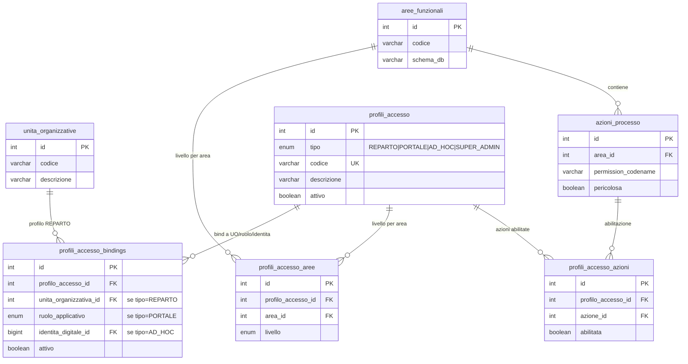
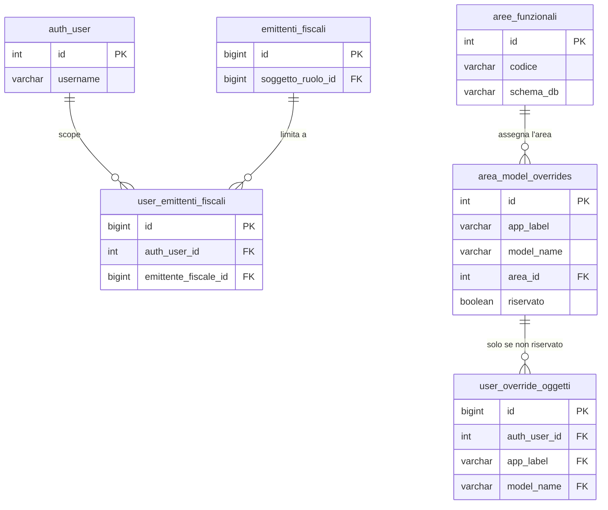

# Guida — Architettura Permessi e Autorizzazioni

> **Ultimo aggiornamento**: 15 ottobre 2026
>
> **Destinatari**: sviluppatori database, backend e analisti funzionali
>
> **Vedi anche** — schemi DB:
>
> * [anagrafiche.identita_digitali](/dbzero/anagrafiche/tabelle/identita_digitali) — il ponte multi-veste: un account, piu' vesti attive
> * [config.profili_accesso](/dbzero/config/tabelle/profili_accesso) — i profili di accesso (REPARTO / PORTALE / AD_HOC / SUPER_ADMIN)
> * [config.profili_accesso_aree](/dbzero/config/tabelle/profili_accesso_aree) / [config.profili_accesso_azioni](/dbzero/config/tabelle/profili_accesso_azioni) — cosa concede un profilo
> * [config.profili_accesso_bindings](/dbzero/config/tabelle/profili_accesso_bindings) — a chi e' legato un profilo
> * [config.aree_funzionali](/dbzero/config/tabelle/aree_funzionali) / [config.azioni_processo](/dbzero/config/tabelle/azioni_processo) — il catalogo delle aree e delle azioni
> * [config.user_override_aree](/dbzero/config/tabelle/user_override_aree) / [config.user_override_oggetti](/dbzero/config/tabelle/user_override_oggetti) / [config.user_override_azioni](/dbzero/config/tabelle/user_override_azioni) — le eccezioni individuali
> * [config.user_emittenti_fiscali](/dbzero/config/tabelle/user_emittenti_fiscali) — il perimetro di emittenti dell'operatore
> * [config.scope_policy](/dbzero/config/tabelle/scope_policy) / [config.identita_scope_bindings](/dbzero/config/tabelle/identita_scope_bindings) — le policy di scope e i loro legami
> * [config.tabelle_gestibili](/dbzero/config/tabelle/tabelle_gestibili) — le tabelle del pannello di configurazione e delle tendine, ciascuna col suo oggetto
>
> **Vedi anche** — funzioni e trigger DB:
>
> * [script.fn_is_super_admin](/dbzero/script/funzioni/fn_is_super_admin) — il check di bypass
> * [script.fn_get_profili_accesso_applicabili](/dbzero/script/funzioni/fn_get_profili_accesso_applicabili) — i profili applicabili a un utente
> * [script.fn_resolve_livello_area](/dbzero/script/funzioni/fn_resolve_livello_area) / [script.fn_resolve_livello_oggetto](/dbzero/script/funzioni/fn_resolve_livello_oggetto) — la catena risolta lato DB
> * [script.fn_get_permessi_effettivi_azioni](/dbzero/script/funzioni/fn_get_permessi_effettivi_azioni) / [script.fn_get_permessi_effettivi_oggetti](/dbzero/script/funzioni/fn_get_permessi_effettivi_oggetti) — la catena col tetto d'area, sede unica di resolver, mappe di `/me/` e pannello permessi
> * [script.fn_check_user_emittente_scope](/dbzero/script/funzioni/fn_check_user_emittente_scope) — la regola di scope emittente, sede unica
> * [script.fn_get_emittenti_scope_pk_ids](/dbzero/script/funzioni/fn_get_emittenti_scope_pk_ids) / [script.fn_get_emittenti_scope_sr_ids](/dbzero/script/funzioni/fn_get_emittenti_scope_sr_ids) — gli emittenti nel perimetro dell'utente
> * [script.trgfn_guard_emittente_scope](/dbzero/script/funzioni/trgfn_guard_emittente_scope) — il write-guard di difesa in profondita'
> * [script.fn_guard_azione](/dbzero/script/funzioni/fn_guard_azione) / [script.fn_guard_livello](/dbzero/script/funzioni/fn_guard_livello) / [script.fn_guard_super_admin](/dbzero/script/funzioni/fn_guard_super_admin) / [script.fn_guard_utente_stesso](/dbzero/script/funzioni/fn_guard_utente_stesso) — il permesso nella prima riga di un verbo di scrittura
> * [script.fn_area_di_oggetto](/dbzero/script/funzioni/fn_area_di_oggetto) — l'area a cui appartiene un oggetto, sede unica per DB e backend
> * [script.fn_notify_permessi_catalogo](/dbzero/script/funzioni/fn_notify_permessi_catalogo) / [script.trgfn_notify_permessi_catalogo](/dbzero/script/funzioni/trgfn_notify_permessi_catalogo) — l'avviso al backend che il catalogo dei permessi è cambiato
> * [config.fn_pannello_scrivi](/dbzero/config/funzioni/fn_pannello_scrivi) / [config.fn_pannello_colonne_scrivibili](/dbzero/config/funzioni/fn_pannello_colonne_scrivibili) — il verbo del pannello di configurazione e le colonne che scrive
>
> **Vedi anche** — API e service backend:
>
> * [API tabelle di configurazione](/backend/core/manual/api_config_tables) — il pannello generico, col permesso chiesto sull'oggetto della tabella
>
> **Vedi anche** — guide correlate:
>
> * [Guida Soggetti & Ruoli Anagrafici](/guide/soggetti-e-ruoli-anagrafici) — il prerequisito anagrafico
> * [Architettura Multi-Face Auth](/guide/architettura-multi-face-auth) — il modello delle vesti
> * [Contratto GUC `app.*`](/guide/contratto-guc-app) — i parametri di sessione PostgreSQL
> * [Risorse Umane e Accessi](/guide/risorse-umane-e-accessi) — il ciclo di vita degli operatori

---

## 1. Obiettivo

Definire un sistema di permessi per Zero ERP che sia:

- **scalabile** — nuovi moduli e azioni senza modifiche strutturali,
- **granulare** — controllo fino al singolo utente e singolo oggetto,
- **Circoscritto** — operativita' limitabile per emittente fiscale,
- **semplice da gestire** — pochi click per configurare un operatore,
- **coerente** — integrato con il modello soggetti/ruoli e schemi DB esistenti.

---

## 2. Concetti chiave

### 2.1 Area funzionale = Schema DB

Ogni schema del database corrisponde automaticamente a un'**area funzionale**.
Le API Django ereditano l'area dallo schema del model che servono.

| Schema DB     | Area funzionale | Esempi di oggetti                      |
| ------------- | --------------- | -------------------------------------- |
| `anagrafiche` | Anagrafiche     | soggetti, clienti, contatti, emittenti |
| `vendite`     | Vendite         | fatture, ordini, lotti                 |
| `acquisti`    | Acquisti        | ordini acquisto, DDT in ingresso       |
| `catalogo`    | Catalogo        | articoli, listini                      |
| `config`      | Configurazione  | parametri, tipi ruoli, qualifiche      |
| `contabilita` | Contabilita'    | movimenti, piano conti                 |
| `magazzino`   | Magazzino       | giacenze, movimenti magazzino          |
| `pagamenti`   | Pagamenti       | rimesse, incassi, scadenze             |
| `storico`     | Storico         | log, archivi                           |
| `core`        | Core            | funzioni dbops/scripts                 |

Questo mapping e' **automatico**: Django conosce lo schema di ogni model
dalla `Meta.db_table`. Nessuna configurazione manuale per il caso standard.

La tabella `config.area_model_overrides` (vedi sezione 4.3) e' il **catalogo
degli oggetti**: dice quali model si possono personalizzare per operatore e,
per ciascuno, a quale area appartengono. Un model fuori catalogo vale come
la sua area.

### 2.2 Tre livelli di accesso per area

| Livello      | Significato                                    |
| ------------ | ---------------------------------------------- |
| **TUTTO**    | CRUD completo su tutti gli oggetti dell'area   |
| **LETTURA**  | Solo visualizzazione (`view_*`)                |
| **BLOCCATO** | Nessun accesso, l'area non e' nemmeno visibile |

Questi tre livelli coprono il **90% delle esigenze quotidiane** e rendono
la configurazione di un operatore immediata: una riga per area, un radio button.

### 2.3 Azioni di processo (permessi puntuali)

Oltre al CRUD esistono azioni che richiedono abilitazione esplicita,
indipendentemente dal livello sull'area. Anche avendo TUTTO su vendite,
un operatore potrebbe non poter eseguire azioni critiche.

Esempi:

| Azione                         | Area      | Descrizione                 |
| ------------------------------ | --------- | --------------------------- |
| `vendite.genera_fatture_lotti` | vendite   | Generazione massiva fatture |
| `vendite.genera_fattura`       | vendite   | Generazione singola fattura |
| `vendite.approva_fattura`      | vendite   | Approvazione fattura        |
| `vendite.emetti_fattura`       | vendite   | Emissione fattura           |
| `pagamenti.approva_rimessa`    | pagamenti | Approvazione rimessa        |

Le azioni nascono nel codice Django (`Meta.permissions`) e vengono registrate
automaticamente in `auth_permission`. La tabella `config.azioni_processo`
le elenca per renderle visibili e gestibili nell'interfaccia admin.

### 2.4 Ereditarieta' dal reparto

L'unita' organizzativa (reparto) definisce un **profilo di accesso di default**
che tutti gli operatori del reparto ereditano automaticamente.

**Scelta architetturale: ereditarieta', non template.**

Questo significa che:

- Modificando il profilo del reparto, **tutti gli operatori** del reparto
  vengono aggiornati automaticamente.
- Le eccezioni individuali (override per utente) hanno **sempre priorita'**
  sul profilo ereditato.
- Non serve manutenzione individuale quando cambia una policy aziendale.

> **ATTENZIONE:** modificare il profilo di un reparto ha impatto immediato
> su tutti gli operatori associati. Prima di cambiare il livello di un'area
> su un reparto con molti operatori, verificare che non ci siano conseguenze
> indesiderate. L'interfaccia di gestione dovrebbe mostrare il numero di
> operatori impattati prima di confermare la modifica.

---

## 3. Regola di risoluzione permessi

Quando un operatore tenta un'azione, il sistema risolve i permessi in due
tempi: prima trova il valore **specifico** della voce (l'oggetto o l'azione),
poi lo confronta con il livello della sua **area**. La regola generale e' che
**il livello dell'area e' un tetto**: un permesso specifico puo' solo
**restringere** quello della sua area, mai allargarlo. In assenza di
configurazione il default e' restrittivo.

Il livello di un'**area** si risolve cosi':

1. **Override individuale sull'area** — se esiste ed e' valido oggi, vale.
2. **Profilo** — altrimenti il livello che il profilo applicabile
   all'operatore (ad hoc, di reparto o di portale, in quest'ordine) da'
   a quell'area.
3. **Default sicuro** — se nessuna delle regole precedenti applica,
   l'accesso e' `BLOCCATO`.

Per un **singolo oggetto** (model):

1. **Valore specifico** — l'override individuale sull'oggetto, se esiste;
   altrimenti il livello dell'area.
2. **Tetto** — il risultato e' il **piu' restrittivo** fra il valore
   specifico e il livello dell'area dell'oggetto. Un override `TUTTO` su un
   oggetto di un'area in `LETTURA` vale `LETTURA`; un override `BLOCCATO`
   su un oggetto di un'area in `TUTTO` vale `BLOCCATO`.

L'area di un oggetto e' quella dichiarata nel catalogo degli oggetti
(`config.area_model_overrides`) o, se l'oggetto non e' a catalogo, quella
del suo schema. La decide sempre `script.fn_area_di_oggetto`, mai il
chiamante.

Per le **azioni di processo** la risoluzione e' binaria (l'azione puo' essere
solo concessa o negata):

1. **Valore specifico** — l'override individuale sull'azione se esiste,
   altrimenti l'abilitazione del profilo, altrimenti **negata**.
2. **Tetto** — l'azione e' concessa solo se, oltre al valore specifico, il
   livello dell'area dell'azione arriva al **livello minimo** che l'azione
   dichiara (`config.azioni_processo.livello_minimo_area`). Il minimo e'
   `TUTTO` per le azioni che scrivono, e puo' essere `LETTURA` per una di
   sola consultazione; non puo' essere `BLOCCATO`. Con l'area `BLOCCATO`
   nessuna azione dell'area e' concessa.

Il tetto vale **da qualunque parte venga** il valore specifico: override
individuale o profilo.

⭐ **Un override fermato dal tetto non si cancella: resta scritto e
dormiente.** Torna valido da solo quando l'area si riapre — perche' scade un
override d'area, cambia il profilo o cambia il reparto. Per questo nessuna
regola rifiuta, in scrittura, un override piu' permissivo della sua area: il
livello dell'area puo' cambiare dopo. Il pannello permessi dell'operatore
mostra queste voci con l'etichetta «limitata dall'area».

ℹ️ Il **super admin** e' un bypass totale e precede il tetto. Restano prima
di tutto anche il controllo di contesto (una sessione che non e' di veste
operatore non ha livelli) e l'identita' operatore attiva.

La catena col tetto ha una **sede sola** a DB:
[script.fn_get_permessi_effettivi_azioni](/dbzero/script/funzioni/fn_get_permessi_effettivi_azioni)
per le azioni e
[script.fn_get_permessi_effettivi_oggetti](/dbzero/script/funzioni/fn_get_permessi_effettivi_oggetti)
per gli oggetti. Le leggono i resolver puntuali usati dal backend
(`fn_check_azione_processo`, `fn_resolve_livello_oggetto`), le mappe che
`/me/` consegna al frontend e il pannello permessi. Il frontend non ricalcola
la catena: legge i livelli gia' risolti.

> Il default e' sempre il piu' restrittivo: se non c'e' configurazione,
> l'accesso e' negato.

---

## 4. Modello dati

### 4.1 Tabella `config.aree_funzionali`

> Struttura completa: [aree_funzionali](/dbzero/config/tabelle/aree_funzionali)

Catalogo delle aree funzionali del sistema. Ogni riga mappa uno schema DB
a un'area logica con codice, descrizione e ordinamento per l'interfaccia.

**A cosa serve:** e' la tabella di riferimento per tutte le regole di accesso.
Un'area nuova e' un modulo nuovo: nasce nel seed del database (il CSV della
tabella) insieme al suo schema, e da quel momento e' configurabile nei profili
reparto e negli override utente.

⛔ **Non si modifica dal pannello di configurazione.** `schema_db` e' la chiave
con cui si risolvono i livelli: cambiarla stacca profili e override di
un'area intera. Per questo la tabella sta nelle tendine ma non nel pannello
(§7.5), come i profili di accesso.

⛔ **E non si modifica dall'applicazione.** La possiede il CSV: il nome
dell'area (`descrizione`) e l'ordine (`ordinamento`) si cambiano li', e il
migrate successivo li porta in tutte le schermate dei permessi. L'applicazione
la legge soltanto: e' fra le tabelle in sola lettura per l'app (§7.4).

**Esempio di uso:** per ottenere l'elenco delle aree attive utilizzabili
nell'interfaccia di configurazione, si filtra per quelle contrassegnate come
attive e si ordina in base al campo di ordinamento per mantenere la
presentazione coerente fra maschere e menu.

### 4.2 Tabella `config.azioni_processo`

> Struttura completa: [azioni_processo](/dbzero/config/tabelle/azioni_processo)

Registro delle azioni di processo gestibili nell'interfaccia permessi.
Ogni azione e' collegata a un'area funzionale e al `codename` del permesso
Django corrispondente (`auth_permission`).

**A cosa serve:** rende visibili all'interfaccia di gestione le azioni definite
nel codice Django (`Meta.permissions`). Il flag `pericolosa` segnala le azioni
che richiedono conferma aggiuntiva (es. generazione massiva fatture).

**Esempio di uso:** per popolare una maschera di sole azioni pericolose
raggruppate per area, si interroga la tabella incrociata con
`aree_funzionali` e si filtra sul flag di pericolosita' oltre a quello
di attivazione. Il risultato tipico e' una lista ordinata per area e poi
per descrizione dell'azione.

### 4.3 Tabella `config.area_model_overrides`

> Struttura completa: [area_model_overrides](/dbzero/config/tabelle/area_model_overrides)

Il catalogo degli oggetti. Ogni riga e' un model (app label e nome) con due
informazioni:

* **l'area a cui appartiene**. Di norma coincide con lo schema; un model
  si puo' assegnare a un'area diversa scegliendola dal catalogo delle aree
  funzionali, e da quel momento la risoluzione dei permessi usa quella;
* **se e' riservato**. Un oggetto riservato e' a catalogo ma non si
  personalizza per operatore: sono le tabelle del kernel dei permessi
  (profili, binding, gli override stessi, le identita' digitali, lo scope
  emittenti), dove un override aprirebbe un blocco ricorsivo — un
  amministratore che si toglie da solo il diritto di rimediare.

⭐ **Un override per oggetto esiste solo per un oggetto a catalogo e non
riservato**, e lo garantisce il database: qualunque percorso di scrittura
che provi a salvarne uno diverso viene rifiutato. Un oggetto fuori catalogo
— per esempio la chiave di una tabella del pannello di configurazione —
vale come la sua area.

**Quando un oggetto entra a catalogo.** Solo quando **tutte** le porte che
applicano il livello lo chiedono: le rotte del backend, i pulsanti del
frontend e, per le tabelle del pannello, il verbo di scrittura. Un oggetto a
catalogo che una porta non chiede e' un override che mente: il pannello lo
mostra, e quella porta risponde con il livello dell'area. Per la stessa
ragione il **billing account non e' a catalogo**: si gestisce dentro la
scheda cliente, e il suo permesso e' sempre quello del cliente.

**Esempio di uso:** l'amministratore vuole che un operatore del reparto
Vendite, che ha `TUTTO` sull'area, veda le offerte in sola lettura. Sceglie
l'oggetto «offerta commerciale» fra quelli personalizzabili e gli assegna
`LETTURA`: l'operatore continua a lavorare su fatture e preventivi, e sulle
offerte trova i pulsanti di modifica spenti e l'API che rifiuta le
scritture.

### 4.4 Tabella `config.profili_accesso_aree`

> Struttura completa: [profili_accesso_aree](/dbzero/config/tabelle/profili_accesso_aree)

Cuore dell'ereditarieta': definisce il livello di accesso (`TUTTO`, `LETTURA`,
`BLOCCATO`) che ogni profilo (REPARTO, PORTALE, AD_HOC) ha su ciascuna
area funzionale. Per i profili di tipo REPARTO, tutti gli operatori del
reparto bound al profilo via `profili_accesso_bindings` ereditano
questi livelli automaticamente.

**Esempio di uso:** per il reparto Amministrazione, la configurazione
tipica prevede livello `TUTTO` sull'area Vendite (gli amministrativi
emettono fatture) e livello `LETTURA` sull'area Acquisti (possono
consultare ordini e DDT di ingresso ma non modificarli). Il profilo
REPARTO `REPARTO_AMM` (collegato all'unita organizzativa via
`profili_accesso_bindings.unita_organizzativa_id`) registra una riga
in `profili_accesso_aree` per ciascuna coppia profilo/area, e tutti gli
operatori del reparto ereditano automaticamente questi livelli senza
ulteriori configurazioni.

Quando serve rivedere il profilo completo di un reparto, si consulta
questa tabella filtrata per `profilo_accesso_id` e ordinata per area:
il risultato e' la "scheda permessi" del profilo, pronta per essere
mostrata in interfaccia o esportata in audit.

### 4.5 Tabella `config.profili_accesso_azioni`

> Struttura completa: [profili_accesso_azioni](/dbzero/config/tabelle/profili_accesso_azioni)

Azioni di processo abilitate a livello di profilo. Funziona in coppia con
`profili_accesso_aree`: il livello area controlla il CRUD, questa tabella
controlla le azioni puntuali.

**Esempio di uso:** per abilitare la generazione fatture al reparto
Amministrazione, si registra il profilo con riferimento al
`profilo_accesso_id` (REPARTO_AMM), all'azione identificata dal suo
codename Django (es. `genera_fattura`) e al flag di abilitazione. Da
quel momento tutti gli operatori del reparto vedranno il pulsante di
generazione attivo senza ulteriori override individuali.

### 4.6 Tabella `config.user_override_aree`

> Struttura completa: [user_override_aree](/dbzero/config/tabelle/user_override_aree)

Override individuale per utente su un'area funzionale. Sovrascrive il profilo
ereditato dal reparto. Supporta validita' temporale (`valido_dal`, `valido_al`)
per deleghe o restrizioni temporanee.

**Esempio di uso:** una delega temporanea per sostituire il responsabile
acquisti in ferie si registra come override individuale sull'area
Acquisti, livello `TUTTO`, con motivo esplicito (es. "Delega
sostituzione ferie responsabile acquisti") e validita' limitata al
periodo di assenza (es. dall'1 al 31 marzo). Superata la data di fine,
l'override decade automaticamente e l'utente torna al livello ereditato
dal reparto.

### 4.7 Tabella `config.user_override_oggetti`

> Struttura completa: [user_override_oggetti](/dbzero/config/tabelle/user_override_oggetti)

Override individuale per utente su un singolo model/oggetto, il livello di
granularita' piu' fine. **Restringe** il livello dell'area, non lo allarga
(§3): un override piu' permissivo dell'area resta scritto ma vale il livello
dell'area finche' l'area non si riapre.

**Esempio di uso:** un operatore junior dell'area Anagrafiche con
livello `TUTTO` generale, ma che non deve poter modificare i clienti,
riceve un override individuale sul model specifico `anagrafiche.clienti`
a livello `LETTURA`, con motivo descrittivo (es. "Operatore junior:
puo' vedere i clienti ma non modificarli"). L'override vale solo per
quel model: tutti gli altri model dell'area restano con il livello del
profilo del reparto.

### 4.8 Tabella `config.user_override_azioni`

> Struttura completa: [user_override_azioni](/dbzero/config/tabelle/user_override_azioni)

Override individuale per azioni di processo. Sovrascrive l'abilitazione
ereditata dal profilo. Utile per concedere o negare azioni specifiche
a singoli operatori. ⚠️ Una concessione vale solo se l'area dell'azione
arriva al minimo che l'azione dichiara (§3): sotto un'area chiusa l'override
resta scritto e dormiente.

**Esempio di uso:** se un operatore di un reparto a cui l'azione non e'
stata abilitata deve comunque poter approvare fatture, si registra un
override individuale sull'azione (identificata dal suo codename Django),
con abilitazione positiva e motivo (es. "Autorizzato dal responsabile
vendite"). Il motivo e' obbligatorio per audit: consente di tracciare
perche' e da chi l'eccezione e' stata concessa.

### 4.9 Tabella `config.user_emittenti_fiscali`

> Struttura completa: [user_emittenti_fiscali](/dbzero/config/tabelle/user_emittenti_fiscali)

Ambito operativo: l'assegnazione fra operatore ed emittente fiscale e' **1-a-1**
(`UNIQUE (auth_user_id)`), e la regola e' **fail-closed**: se l'operatore non ha
righe **non vede nessun emittente** — la riga mancante e' un errore di
configurazione, non un permesso. L'unico attore legittimamente multi-emittente e'
il `SUPER_ADMIN`, che passa da `fn_is_super_admin` e non da questa tabella.

**Esempio di uso:** per abilitare un operatore sull'emittente 3, si registra la
sua riga con `auth_user_id` ed `emittente_fiscale_id`. Ogni tentativo di operare
su un emittente diverso viene bloccato: a livello di policy per le letture, e per
difesa in profondita' dai trigger DB sulle scritture.

Chi resta senza assegnazione si conta in `dbops.vw_operatori_senza_emittente`, che
**deve restare a zero righe**.

---

## 5. Separazione delle responsabilita'

| Livello                | Responsabilita'                                                    | Dove                                  |
| ---------------------- | ------------------------------------------------------------------ | ------------------------------------- |
| **Django/DRF**         | Autenticazione, enforcement permessi sulle API, scope emittente nelle letture | Permission classes, repository (`add_emittente_scope_condition`) |
| **DB (config/script)** | Source of truth per profili, aree, override, ambito emittente      | Tabelle config, ENUM, funzioni script |
| **DB (trigger)**       | Defense-in-depth: vincoli di coerenza, guard su ambito emittente   | Trigger sulle tabelle operative       |
| **DB (verbi)**         | Il permesso applicato alla scrittura, dove il dominio lo adotta    | Funzioni di scrittura con guard (§7.4) |

Il flusso di una richiesta attraversa, nell'ordine, cinque passaggi:

1. **Autenticazione DRF** — validazione del token JWT e identificazione
   dell'utente.
2. **Permission class principale** — risolve il livello di accesso
   sull'area/oggetto richiesto: override sull'oggetto, poi il livello
   dell'area (override o profilo) come tetto (§3).
3. **Permission class delle azioni** — per le azioni di processo,
   verifica l'abilitazione considerando profilo, eventuali override
   individuali e il tetto dell'area dell'azione.
4. **Scope emittente nella lettura** — il repository aggiunge alla query
   la condizione sul perimetro dell'utente (BB `add_emittente_scope_condition`,
   che legge `script.fn_get_emittenti_scope_*`); sulle tabelle del perimetro
   la RLS applica la stessa regola dal DB.
5. **View/Serializer** — esegue la logica applicativa; ogni eventuale
   tentativo di operare fuori perimetro viene intercettato come
   ulteriore difesa dai trigger DB al momento di INSERT/UPDATE. Sulle
   tabelle chiuse all'applicazione la scrittura passa dal **verbo**, che
   ricontrolla il permesso (§7.4).

---

## 6. Enforcement Django

> **L'enforcement non assume "un utente = un operatore interno".** Il sistema
> riconosce cinque vesti applicative (operatore, cliente portale, fornitore
> portale, cliente shop, api client) e determina la veste corrente dalla
> **sessione JWT** (claim `identita_id`). La risoluzione dei permessi e' la stessa
> per tutte le vesti, ma la **sorgente** del profilo di accesso cambia: reparto per
> gli operatori, profilo preset per portale e shop.
> Riferimento: [Architettura Multi-Face Auth](/guide/architettura-multi-face-auth).

### 6.1 Funzione di risoluzione permessi (cuore del sistema)

Il `PermissionResolver` e' il componente centrale lato backend che, dato
un utente autenticato (con identita attiva) e una richiesta, calcola il
livello di accesso effettivo seguendo la catena descritta in sezione 3.

**Ingressi del resolver:**

* `auth_user_id` (dalla richiesta autenticata)
* `identita_id` (dal JWT claim custom `identita_id`)
* `ruolo_applicativo` (dalla riga `identita_digitali` corrente)
* `area` o `azione` oggetto della verifica

La tripla `(auth_user_id, identita_id, ruolo_applicativo)` e' necessaria
perche' un `auth_user` puo' avere piu' identita attive in vesti diverse:
il resolver deve sapere per conto di **quale veste** si sta risolvendo.

**Cosa fa, in pratica:**

* **Mappa livello → verbi HTTP.** `TUTTO` ammette view/add/change/delete;
  `LETTURA` ammette solo view; `BLOCCATO` non ammette nulla. E' il
  traduttore fra la terminologia di business (livello di accesso) e i
  permessi tecnici Django.
* **Risoluzione del profilo di accesso.** Il resolver interroga l'helper
  DB `script.fn_get_profili_accesso_applicabili(auth_user_id)` che
  restituisce l'elenco dei `profili_accesso` applicabili, uniti da tre
  sorgenti in ordine di priorita' (dal piu' specifico al piu' generale):
  1. **Binding AD_HOC**: un profilo agganciato direttamente alla
     specifica `identita_digitale` (override massima priorita')
  2. **Binding per reparto**: profilo ereditato dall'unita' organizzativa
     (solo per OPERATORE; richiede catena `identita → risorsa_umana → UO`)
  3. **Binding per ruolo applicativo**: profilo di default della veste
     (es. `CLIENTE_PORTALE`, `FORNITORE_PORTALE`, `SHOP_CUSTOMER`; sulla
     veste `OPERATORE`, un profilo base per tutti gli operatori)

  Per i permessi da operatore contano solo i profili della veste
  `OPERATORE`: un operatore che e' anche cliente shop non porta nei suoi
  permessi il profilo della veste cliente. Per ogni area e azione vince il
  profilo di priorita' piu' bassa, e sotto una veste ce n'e' al massimo uno
  per priorita'. La regola sta in `script.fn_get_permessi_ereditati_aree` /
  `_azioni`, che servono sia i resolver sia la colonna «ereditato» del
  pannello permessi.
* **Risoluzione livello su area.** Prende il livello dal profilo piu'
  specifico applicabile (tabella `profili_accesso_aree`). Se esistono
  override individuali sull'area (`user_override_aree`), questi prevalgono
  rispettando la finestra temporale `valido_dal`/`valido_al`. Default
  sicuro: `BLOCCATO`.
* **Risoluzione livello su oggetto (model).** L'override sul singolo
  model (`user_override_oggetti`) prevale su quello sull'area: un
  operatore puo' avere `TUTTO` sull'area Anagrafiche ma `LETTURA` solo
  sul model `clienti`. Se non esiste override sul model, delega alla
  risoluzione sull'area.
* **Verifica azione di processo.** Prima gli override individuali
  sull'azione (`user_override_azioni`), poi la configurazione dal
  profilo (`profili_accesso_azioni`); in assenza di entrambi l'azione
  e' negata.
* **SUPER_ADMIN bypass.** Se l'identita dell'utente ha un binding al
  profilo `SUPER_ADMIN` (id 9100), la risoluzione restituisce `TUTTO`
  su ogni area e ogni azione senza consultare il resto della catena.
  L'helper `script.fn_is_super_admin(auth_user_id)` espone il check in
  un'unica query STABLE.

**Punti di attenzione:**

* Il resolver non distingue fra vesti nel meccanismo: la catena "override →
  profilo → default" e' identica per operatore e portale. Cio' che cambia
  e' la **sorgente del profilo** (reparto vs preset per ruolo applicativo
  vs ad-hoc).
* Ogni lettura rispetta la finestra temporale degli override: un
  override scaduto non viene applicato, e un override futuro non ha
  effetto fino alla sua data di inizio.
* Il resolver e' di sola lettura: non modifica mai le tabelle config.
  E' invocato ad ogni richiesta API; per questo le query sono ottimizzate
  con indici mirati, l'helper `fn_get_profili_accesso_applicabili`
  restituisce un set unificato, e la mappa finale permessi viene
  calcolata una sola volta per richiesta (cache per-request).
* **La cache fra una richiesta e l'altra, e chi la svuota.** Il backend
  conserva i permessi risolti per qualche minuto (cache Redis, per utente).
  Quando qualcosa li cambia, la cache va svuotata subito, altrimenti per
  quei minuti l'utente lavora coi permessi vecchi. Chi la svuota dipende da
  cosa è cambiato:

  | Cosa cambia | Chi avvisa | Cosa si svuota |
  | --- | --- | --- |
  | un override dell'utente, dal pannello | l'applicazione stessa | quell'utente |
  | il profilo di un reparto, dal pannello | l'applicazione stessa | il reparto |
  | il reparto di una persona | il database (canale `cambio_reparto`) | quell'utente |
  | il catalogo o i profili: aree, azioni (anche il loro livello minimo d'area), oggetti, profili e loro legami | il database (canale `permessi_catalogo`) | tutti |

  ⭐ Gli avvisi del database partono **da qualunque scrittore**: applicazione,
  aggiornamento del seed al migrate, correzione a mano. Partono al commit e
  non partono se la scrittura viene annullata. Li raccoglie il processo
  sempre acceso `listen_permessi`, che a ogni avvio e a ogni riconnessione
  svuota comunque la cache di tutti: un avviso partito mentre il processo era
  fermo (per esempio un migrate fatto col backend spento) è perso, perché il
  database non lo conserva.
  ⚠️ Una correzione a mano su una tabella **per utente** (per esempio
  l'identità digitale) non avvisa nessuno: dopo, si chiama
  `script.fn_notify_permessi_catalogo('manuale')`, che svuota la cache di
  tutti.

### 6.2 Permission class DRF

Sono previste tre permission class, una per ciascun namespace API, tutte
delegate allo stesso `PermissionResolver`:

* **`ZeroERPPermission`** — per `/api/admin/*` (operatori interni)
* **`PortaleBasePermission`** — per `/api/portale/*` (clienti, fornitori)
* **`ShopPermission`** — per `/api/shop/*` (shop customer + endpoint pubblici)

Nessuna contiene logica di business: delegano tutto al resolver e si
occupano solo di:

1. verificare che la **veste corrente** sia compatibile col namespace
   (es. `PortaleBasePermission` rifiuta un JWT con `ruolo_applicativo =
   OPERATORE`)
2. tradurre l'azione DRF in una richiesta di verifica area/azione

**Come funziona (comune a tutte e tre):**

* **Mapping azione DRF → verbo.** `list` e `retrieve` richiedono `view`,
  `create` richiede `add`, `update` e `partial_update` richiedono
  `change`, `destroy` richiede `delete`. Questo tipo di accesso e' poi
  confrontato con i verbi ammessi dal livello (TUTTO/LETTURA/BLOCCATO).
* **Superuser Django.** Se l'utente è superuser Django (`is_superuser =
  true`), viene ammesso direttamente senza consultare le tabelle config.
  Comportamento di sicurezza a monte, usato in pratica solo per
  amministrazione tecnica. **Nota:** `is_superuser` e' il flag Django,
  non il profilo `SUPER_ADMIN` di ZeroErp — sono concetti distinti.
* **Azioni custom.** Se la view dichiara un permesso esplicito per
  l'azione (es. route "genera-fatture" con `genera_fatture_permission
  = 'genera_fattura'`), la permission class chiama direttamente la
  verifica azione di processo.
* **Azioni CRUD standard.** Per le azioni CRUD si risale al model del
  queryset, si determina l'area funzionale (tramite `app_label`/
  `model_name`) e si consulta il livello effettivo. Il livello viene
  quindi tradotto in insieme dei verbi ammessi: se il verbo richiesto
  non e' nell'insieme, l'accesso e' negato.

**Determinazione dell'area di un model.** Per default, l'area coincide
con lo schema DB (uguale a `app_label` Django). Se per quel model
esiste un override in `area_model_overrides`, si usa l'area dichiarata
dall'override; questo copre i rari casi in cui la convenzione
automatica non e' corretta. La regola sta in una funzione sola,
`script.fn_area_di_oggetto`: la chiama il resolver del backend e la
chiamano i verbi del DB.

**Oggetto ricavato dalla richiesta.** Una view che serve piu' oggetti con la
stessa rotta — il pannello di configurazione, dove l'oggetto dipende dalla
tabella nell'URL — dichiara `oggetto_permesso_da_richiesta()`: la permission
class chiede il livello su quell'oggetto, in lettura e in scrittura, al posto
dell'area fissa della classe. Valutata senza una richiesta (sulla sola classe,
come fanno i tool dell'assistente) la view nega.

### 6.3 Ambito dati: whitelist EF per operatori, RLS per portale/shop

Il filtro "quali righe l'utente vede tra quelle dell'area" e' implementato
in modo **diverso per veste**, ma tramite un meccanismo unificato (scope
policy):

**Operatori interni.** Lo scope policy `EF_WHITELIST` lo applica il
repository nella query: il building block `add_emittente_scope_condition` (`apps/core/db/emittente_scope_helpers.py`), che legge il perimetro da `script.fn_get_emittenti_scope_pk_ids` / `_sr_ids` (perimetro `user_emittenti_fiscali`
intersecato con l'emittente attivo della sessione). Semantica del BB: `None` =
nessuna restrizione (super admin), lista vuota = **fail-closed**. Se
l'operatore non ha righe non passa **niente**, e la riga mancante e' un errore
di configurazione (§4.9).

**Sul lato DB la stessa regola e' una policy RLS.** Per lo scope emittente degli
operatori le tabelle del perimetro hanno la RLS **attiva** (`ENABLE`, senza `FORCE`:
ne resta fuori solo il proprietario delle tabelle, cioe' le migrazioni e i lavori
di manutenzione, §7.6). Le policy sono **`FOR ALL` con `WITH CHECK`**, non solo
`FOR SELECT`: con la RLS attiva una scrittura che nessuna policy permette viene
negata, quindi senza `WITH CHECK` ogni INSERT o UPDATE di un operatore finirebbe in
deny-all. I lavori automatici che toccano i dati di un'azienda non sono esenti:
girano come l'applicazione, con un utente tecnico di quell'azienda, dentro il suo
perimetro. Su `billing_account` la policy di inserimento e'
**gate-only**: verifica i permessi, senza decidere il contenuto della riga.

**Un nome da non confondere.** `BA_OWNERSHIP` e `SELF_OWNERSHIP` sono la stessa
policy: il ruolo anagrafico `CL` e' condiviso fra `CLIENTE_PORTALE` e
`SHOP_CUSTOMER`, quindi tenerle unite evita due definizioni divergenti dello stesso
concetto.

**Clienti portale.** Applica la scope policy `BA_OWNERSHIP` (il cliente
vede solo i propri billing account) oppure `CLIENTE_OWNERSHIP` (per dati
legati al SR-CL direttamente). Il filtro non e' nel repository: e' **nel DB
tramite Row Level Security** (cfr. §7.1 e §7.2 per la difesa DB e [Multi-Face
Auth §6](/guide/architettura-multi-face-auth#6-row-level-security-la-difesa-al-livello-giusto)
per il dettaglio). Il backend non filtra a mano: la policy RLS lo fa per
tutte le query.

**Fornitori portale.** Scope policy `FORNITORE_OWNERSHIP`, stesso
meccanismo RLS.

**Shop customer.** Scope policy `CLIENTE_OWNERSHIP` + filtro aggiuntivo
`canale_origine = 'SHOP'` dentro la policy RLS, cosi' il consumer B2C
non vede gli acquisti B2B della sua azienda.

**Superuser Django.** Non filtrato: vede sempre tutto, a tutela della
manutenzione tecnica.

L'effetto e' trasparente: la view non deve sapere dello scope — gli
basta (per operatori) dichiarare il campo emittente, e per portale/shop
non deve fare **nulla**, la RLS applica i filtri automaticamente a
ogni SELECT.

### 6.4 Propagazione identita al DB: JWT + GUC

Il middleware `JwtAuditAuthentication` propaga l'identita della sessione
JWT ai parametri di sessione PostgreSQL (GUC), in modo che i trigger DB
e le policy RLS possano sapere per conto di chi stanno eseguendo
un'operazione. Il middleware e' la "spia" che rende possibile
l'enforcement al livello piu' basso dello stack.

**GUC propagati:**

| GUC                       | Popolato da                                      | Usato da                                      |
| ------------------------- | ------------------------------------------------ | --------------------------------------------- |
| `app.current_user_id`     | `auth_user.id` del JWT                           | Trigger audit, retrocompatibilita'            |
| `app.current_identita_id` | Claim JWT `identita_id`                          | Policy RLS, scope policy                      |
| `app.ruolo_applicativo`   | `identita_digitali.ruolo_applicativo` della riga | Gate policy RLS, discriminazione portale/shop |
| `app.soggetto_ruolo_id`   | `identita_digitali.soggetto_ruolo_id` della riga | Helper scope (quando serve il SR dell'utente) |
| `app.jwt_user`            | Username Django                                  | Audit log legacy                              |

**Invariante tutto-o-niente.** I 3 GUC del multi-face
(`current_identita_id`, `ruolo_applicativo`, `soggetto_ruolo_id`) sono
popolati insieme o **nessuno**. Il middleware fail-closed con 401 se la
lettura da `identita_digitali` tramite `identita_id` del JWT fallisce.
Le policy RLS assumono tripla coerente o fail-closed. L'helper
`script.fn_current_identita_context()` esegue lettura fail-soft con
`NULLIF(current_setting(..., true), '')::tipo` e restituisce NULL-tuple
se la tripla non e' coerente.

**Come funziona, in pratica:**

* Ad ogni richiesta autenticata, prima dell'esecuzione della view, il
  middleware: (1) valida il JWT, (2) legge `identita_id` dal claim custom,
  (3) interroga `identita_digitali` per ricavare `ruolo_applicativo` e
  `soggetto_ruolo_id`, (4) imposta i 4 GUC sulla connessione corrente.
  Gli `SET LOCAL` sono scoperati a fine transazione — no pool pollution.
* Un JWT **senza** claim `identita_id` viene comunque tollerato: il middleware lo
  riconosce e deriva l'identita' da `auth_user_id`. E' la via di compatibilita' per
  i token emessi prima dell'introduzione del claim, e si esaurisce col refresh del
  token.
* I trigger DB e le policy RLS leggono i GUC per risalire all'utente,
  alla sua veste e al suo SR. Il contratto dei GUC e' centralizzato in
  una scheda dedicata: [Contratto GUC app.*](/guide/contratto-guc-app).

---

## 7. Defense-in-depth DB

Il database non si fida del backend. Fa due cose diverse:

* **il perimetro** — *quali righe*: il guard di ambito emittente e le
  policy RLS (§7.1, §7.2);
* **il permesso** — *chi puo' scrivere*: nei domini che adottano il modello
  «una scrittura = un verbo», la funzione che scrive controlla il livello o
  l'azione di chi agisce, e l'applicazione non puo' scrivere quelle tabelle
  per altra via (§7.4).

La regola resta una sola: DB e backend chiamano le stesse funzioni di
risoluzione (§7.3). I **punti di applicazione** sono due.

### 7.1 Funzione di verifica ambito emittente

> Struttura completa: [fn_check_user_emittente_scope](/dbzero/script/funzioni/fn_check_user_emittente_scope)

La funzione `script.fn_check_user_emittente_scope(p_auth_user_id, p_emittente_id)`
verifica se un utente e' autorizzato a operare su un dato emittente fiscale. E' la
**sede unica** della regola: la delegano sia il write-guard sia le policy RLS in
lettura, quindi correggerla qui la propaga a entrambi i lati.

I rami, nell'ordine:

1. **Nessun utente** → `FALSE`: chi non dice per conto di chi agisce non vede
   e non scrive niente. Anche un lavoro automatico ha un utente, quello tecnico
   della sua azienda.
2. **Un emittente diverso da quello scelto nella sessione** → `FALSE`: se
   l'utente ha selezionato un'azienda, lavora solo su quella.
3. **`SUPER_ADMIN`** → `TRUE`: e' l'unico punto in cui la selezione puo'
   restringere chi vede tutto.
4. **Utente senza una veste di operatore attiva** → `FALSE`.
5. **Nessuna riga** in `user_emittenti_fiscali` → `FALSE` (fail-closed, §4.9).
6. **Almeno una riga** → `TRUE` solo se l'emittente e' fra quelle elencate.

**Esempio di uso:** chiamando la funzione con l'identificativo dell'utente e quello
dell'emittente si ottiene `TRUE` o `FALSE` secondo i rami qui sopra. Il check e'
riutilizzabile da viste, report e altre funzioni DB che devono filtrare dati in
base all'ambito dell'utente corrente.

### 7.2 Trigger guard per ambito emittente

> Struttura completa: [trgfn_guard_emittente_scope](/dbzero/script/funzioni/trgfn_guard_emittente_scope)

I trigger guard sulle tabelle operative (es. fatture, ordini) utilizzano
la funzione di verifica per impedire operazioni su emittenti non autorizzati.
Il trigger legge l'identificativo dell'utente corrente dal parametro di
sessione impostato dal middleware Django e blocca l'operazione se
l'utente non e' nell'ambito consentito.

**Esempio di uso — cosa succede in pratica:**

Si immagini un utente limitato agli emittenti 1 e 3 che tenti di
inserire una fattura per l'emittente 5, aggirando per errore il filtro
applicativo. Al momento della scrittura su `vendite.fatture`:

1. Il middleware Django ha gia' propagato nella sessione PostgreSQL
   l'identificativo dell'utente.
2. Il trigger guard `BEFORE INSERT` sulla tabella fatture legge quel
   parametro di sessione e chiama la funzione di verifica emittente
   con l'utente corrente e l'emittente richiesto.
3. La funzione risponde "non autorizzato".
4. Il trigger solleva un errore di autorizzazione e annulla la scrittura.

L'operazione viene quindi negata anche se il backend avesse un bug che
l'ha lasciata passare ai livelli superiori.

**E se nella sessione non c'e' nessun utente?** La scrittura si ferma, con un
messaggio che dice proprio questo: *il processo non dichiara chi agisce*. Passa
solo chi la RLS lascerebbe passare comunque, cioe' il proprietario delle tabelle
quando lavora in prima persona. Se la scrittura arriva da una funzione che gira
con i diritti del proprietario (`SECURITY DEFINER`) ma per conto di qualcun altro,
quella eccezione non vale: senza un utente, una riga che appartiene a un'azienda
non si scrive.

### 7.3 Funzioni di risoluzione permessi lato DB

Per scenari in cui il DB deve risolvere i permessi autonomamente (trigger guard,
funzioni di validazione), esistono funzioni SQL che risolvono la catena (le
stesse che chiama il backend: non sono una copia):

> [fn_resolve_livello_area](/dbzero/script/funzioni/fn_resolve_livello_area) — risolve il livello effettivo di un utente su un'area (override area -> profilo reparto -> BLOCCATO)

> [fn_resolve_livello_oggetto](/dbzero/script/funzioni/fn_resolve_livello_oggetto) — risolve il livello per un singolo model (override oggetto, sotto il tetto dell'area dell'oggetto)

> [fn_check_azione_processo](/dbzero/script/funzioni/fn_check_azione_processo) — verifica se un'azione di processo e' abilitata per un utente (override -> profilo -> negata, sotto il tetto dell'area)

**Esempio di uso:** le funzioni si invocano passando l'identificativo
dell'utente e l'area o il codename dell'azione. La prima restituisce
la stringa del livello effettivo (`TUTTO`, `LETTURA`, `BLOCCATO`),
utile per stampe di audit o decisioni condizionali in altre
funzioni/trigger; la seconda restituisce un booleano per verificare
l'abilitazione di un'azione di processo. Entrambe applicano la stessa
catena del backend (override individuale → profilo reparto → default
sicuro), cosi' la regola resta unica indipendentemente dal livello
che la consulta.

### 7.4 Il permesso nel verbo di scrittura

Calcolare i permessi non basta: una scrittura che il backend autorizza per
errore — un endpoint col permesso dichiarato male, un tool dell'assistente
legato alla rotta sbagliata — il database la eseguirebbe comunque. Il modello
che chiude il buco e' **una scrittura = un verbo**.

**Il verbo.** Ogni operazione di scrittura di un dominio che adotta il modello
e' una funzione DB. Nella **prima riga** dichiara il suo permesso con uno dei
guard, senza controlli scritti a mano:

| Guard | Quando | Chi decide |
| --- | --- | --- |
| `script.fn_guard_azione` | operazioni di processo (registra, emetti, cambia stato…): il verbo **e'** l'azione | `fn_check_azione_processo` |
| `script.fn_guard_livello` | operazioni semplici (crea, modifica): il verbo dichiara l'**oggetto** su cui scrive e il livello minimo | `fn_resolve_livello_oggetto`, con l'area da `fn_area_di_oggetto` |
| `script.fn_guard_super_admin` | le porte che non sono un'area del catalogo (la gestione accessi, riservata al SUPER_ADMIN) | `fn_is_super_admin` |
| `script.fn_guard_utente_stesso` | le cose **proprie** di una persona (il dispositivo del secondo fattore): chi agisce dev'essere lei | il confronto con la credenziale su cui si agisce |

I quattro guard si comportano allo stesso modo: l'utente arriva come parametro
(il verbo lo legge da `app.current_user_id`), la regola la decide la funzione
di risoluzione che usa anche il backend, e il rifiuto e' `E_PERMESSO_NEGATO`,
lo stesso codice del backend — anche quando l'utente manca (fail-closed).

Una forma sola per le operazioni di processo, una per quelle semplici:
`azioni_processo` non si riempie di azioni che ripetono il livello, e
l'amministratore ragiona come sempre, per area, azione e oggetto.

**La porta.** Il verbo protegge solo se non si puo' aggirare:

* l'applicazione perde `INSERT`/`UPDATE`/`DELETE` sulle tabelle che il verbo
  protegge. La postura si dichiara nel loop dei grant, non con un `REVOKE`
  sparso: l'elenco delle tabelle in sola lettura per l'app e' la lista
  `v_tabelle_sola_lettura_app` del loop;
* il verbo gira come **proprietario** (`SECURITY DEFINER`), e il perimetro che
  la RLS non applica piu' lo rimette il verbo o il guard di ambito;
* l'applicazione esegue **solo i verbi**, non le primitive che i verbi usano:
  altrimenti il controllo si aggira chiamando la primitiva. Un guard che deve
  sapere se e' attraversato da un verbo lo chiede a
  `script.fn_is_proprietario_tabella`.

**Il backend chiede, non decide due volte.** L'endpoint tiene il suo controllo:
risponde 403 subito, con un messaggio utile, prima di aprire la transazione.
Non e' una seconda copia della regola, perche' chiama le stesse funzioni.

**Chi lo adotta.** I domini nuovi nascono cosi'; quelli esistenti ci passano
quando un lavoro tocca le loro scritture, uno alla volta. ⚠️ Un dominio **a
meta'** — alcune tabelle chiuse, altre ancora scrivibili dall'app — lo
dichiara nella sua guida, con l'elenco delle tabelle aperte.

⛔ **Cosa non protegge.** L'identita' la dichiara il backend: le GUC `app.*` le
imposta la connessione dell'applicazione, e codice su quella connessione le
puo' impostare a un altro utente. Il modello protegge da un backend **che
sbaglia**, non da un backend **compromesso** — lo stesso limite delle policy
RLS di perimetro.

⛔ **Perche' non una policy RLS sul livello.** Una tabella non e'
un'operazione: un operatore in `LETTURA` su un'area, con un'azione di processo
concessa, deve poter scrivere le tabelle che quell'azione tocca, e una policy
vede solo «UPDATE su questa tabella». Un'area non e' uno schema: un'operazione
scrive anche in altri schemi. E le funzioni `SECURITY DEFINER` la
scavalcherebbero. Il permesso appartiene all'**operazione**, e a DB
l'operazione ha un nome solo: la funzione che la esegue.

### 7.5 Il pannello di configurazione: un verbo generico

Il pannello «Gestione tabelle» manutiene decine di vocabolari di schemi
diversi con un solo form. Scrive con un verbo generico,
`config.fn_pannello_scrivi`, nella forma sull'oggetto:

* **la lista e' un dato del DB**: `config.tabelle_gestibili` ha una riga per
  tabella, con due capacita' distinte — `lookup` (serve le tendine
  dell'applicazione) e `pannello` (si manutiene dal pannello). Un pannello
  implica il lookup. Backend e frontend leggono la lista da li';
* **ogni riga nomina il suo oggetto** con la convenzione `(schema, tabella)`
  — per esempio `('magazzino', 'causali')` — e il verbo chiede `TUTTO` su
  quell'oggetto, cioe' sull'area a cui la tabella appartiene. Chi ha `TUTTO`
  solo su Configurazione non scrive le causali di magazzino;
* **le colonne scrivibili le dice una funzione**,
  `config.fn_pannello_colonne_scrivibili`: la usa il verbo per accettare i
  campi e il backend per costruire il form. Un campo che non si scrive e'
  rifiutato col suo nome, non scartato;
* **niente tabelle con perimetro**: il verbo, da proprietario, non vede la
  RLS, e ricopiare in un verbo generico le policy di ogni tabella ne farebbe
  una seconda sede. Le tabelle con RLS stanno nelle tendine e si scrivono dai
  loro endpoint; il verbo lo verifica da se', non si fida della lista;
* **fuori dal pannello anche cio' che ha un'altra porta o un altro padrone**:
  le tabelle con una gestione propria e il suo cancello (i profili di
  accesso, riservati al SUPER_ADMIN, e le altre con endpoint dedicati) e i
  vocabolari di sistema che il seed possiede e il codice interpreta per
  codice. Un pannello che li scrivesse sarebbe una seconda strada che salta
  il cancello della prima — nel caso dei profili, un modo per alzarsi i
  privilegi.

### 7.6 Chi si collega al database

Tutto cio' che questa guida descrive — profili, perimetri, verbi — vale per le
persone e per i processi che passano dall'applicazione. Sotto, il database ha
pochi **utenti tecnici**, sempre gli stessi in ogni installazione, ognuno con un
compito solo:

| Utente del database | Chi lo usa | Che cosa puo' fare |
| --- | --- | --- |
| `zeroerp_app` | l'applicazione, per ogni richiesta e per i lavori automatici | solo cio' che profili, perimetro e RLS permettono all'utente in sessione |
| `zeroerp_owner` | le migrazioni e i lavori di manutenzione | e' il proprietario di tutto; la RLS non lo filtra |
| `zeroerp_job` | il programmatore dei lavori notturni (pgAgent) | solo avviare i lavori previsti, che girano come proprietario |
| `zeroerp_log` | il canale che scrive i registri degli errori | solo aggiungere righe ai registri |

Due conseguenze per i permessi:

* **Nessun utente del database scavalca il perimetro.** Non esiste un utente
  «passepartout» per i lavori notturni: un lavoro che tocca i dati di un'azienda
  gira come l'applicazione, con l'utente tecnico di quell'azienda
  ([I lavori automatici](/guide/processi-automatici-classe-e-identita)). Il
  controllo `dbops.vw_processi_che_bypassano` resta vuoto finche' e' cosi'.
* **Il proprietario non lavora per conto di nessuno.** E' l'unico che la RLS
  non filtra, e per questo fa solo migrazioni e manutenzione. Il controllo
  `maintenance.vw_job_run_da_superuser` segnala un lavoro notturno eseguito da un
  amministratore del server invece che da `zeroerp_job`.

I nomi, le regole e la loro installazione: [Provisioning ruoli DB](/dev/backend/provisioning-db-roles)
e [Installazione](/installazione).

---

## 8. Interfaccia di gestione (mockup concettuale)

### 8.1 Configurazione reparto

La schermata di configurazione di un reparto mostra in un'unica
maschera tutto cio' che gli operatori del reparto erediteranno.

L'intestazione indica il reparto (es. "Amministrazione") e il numero
di operatori attualmente associati, cosi' l'amministratore sa in
partenza l'impatto di ogni modifica.

Nella prima sezione viene mostrata la matrice **Aree funzionali x
Livello**: per ogni area (Anagrafiche, Vendite, Acquisti, Catalogo,
Configurazione, Contabilita', Magazzino, Pagamenti, Storico, Core)
l'amministratore seleziona uno tra `TUTTO`, `LETTURA` o `BLOCCATO`.
Una configurazione tipica del reparto Amministrazione puo' essere
`TUTTO` su Anagrafiche, Vendite e Pagamenti; `LETTURA` su Acquisti,
Catalogo, Contabilita' e Storico; `BLOCCATO` su Configurazione,
Magazzino e Core.

Nella seconda sezione compare l'elenco delle **Azioni di processo**
disponibili, ciascuna con un flag di abilitazione. Le azioni marcate
come pericolose (es. "Genera fatture da lotti") sono evidenziate
graficamente perche' meritano attenzione specifica: tipicamente
restano disabilitate a livello di reparto e vengono concesse solo
puntualmente come override a singoli operatori.

Al salvataggio viene mostrato esplicitamente il numero di operatori
che subiranno l'effetto della modifica (es. "Impatta 5 operatori"),
cosi' l'amministratore conferma consapevolmente una variazione che
ridistribuisce permessi a piu' persone.

### 8.2 Configurazione utente

La schermata di configurazione di un singolo operatore mostra sia cio'
che **eredita** dal reparto sia cio' che il reparto ha modificato
specificamente per lui.

L'intestazione riporta nome dell'utente, reparto di appartenenza e
l'emittente fiscale su cui puo' operare (es. "ACME S.r.l."). Se non ne ha
nessuno, l'assenza va mostrata come **configurazione mancante**, non come
"nessun limite": senza riga l'operatore non vede nessun emittente (§4.9).

La prima sezione e' la matrice **Aree x Livello**, identica per forma
a quella di reparto, ma con una distinzione visiva tra livello
ereditato e livello forzato da override. Ogni riga ha un pulsante
"override" che, attivato, consente di alzare o abbassare il livello
solo per quell'utente.

La sezione **Eccezioni oggetto** (opzionale) elenca gli override
individuali su singoli model. E' la forma di controllo piu' fine:
puo' lasciare un operatore con `TUTTO` sull'area Anagrafiche ma
riportarlo a `LETTURA` solo sul model `clienti`. Questa lista resta
vuota di default e cresce solo per casi giustificati.

La sezione **Azioni** ricalca la stessa logica: mostra le azioni
abilitate dal profilo del reparto e consente all'amministratore di
forzare eccezioni puntuali con pulsante "override" e motivo
descrittivo (obbligatorio per tracciabilita' audit).

---

## 9. Diagrammi ER

Il modello dati e' suddiviso in tre diagrammi per leggibilita'.

### 9.1 Profilo reparto — ereditarieta'

Il cuore del sistema: ogni reparto (`unita_organizzative`) ha un profilo
che definisce il livello di accesso per area e le azioni di processo abilitate.
Tutti gli operatori del reparto ereditano questo profilo automaticamente.

### 9.2 Catena identita' e profilo di accesso

`auth_user` e' collegato al resto del modello tramite il bridge **generico**
`identita_digitali`: un `auth_user` puo' avere N identita attive, una per
`ruolo_applicativo`. Ogni identita si aggancia a un `soggetti_ruoli` (dipendente,
cliente, fornitore, shop customer). Il profilo di accesso si ottiene tramite
`profili_accesso_bindings`, che ammette tre modalita' di aggancio: diretta
all'identita (AD_HOC), per ruolo applicativo (preset portale/shop), per unita'
organizzativa (ereditarieta' reparto per operatori).

Il bridge non ha alternative: `risorse_umane_auth_user`, la tabella che teneva il
ponte "solo dipendenti", **non esiste in nessuna forma**. Tutti i lettori passano da
`identita_digitali` (`ruolo_applicativo = 'OPERATORE'` per gli operatori interni).

> **Lettura.** Per un operatore: `auth_user` → `identita_digitali(OPERATORE)`
> → `soggetti_ruoli(RIS_UMANA)` → `risorse_umane` → `unita_organizzative` →
> `profili_accesso_bindings(per UO)` → profilo reparto (diagramma 9.1). Se
> esistono override individuali sull'`auth_user`, hanno priorita' massima.
>
> Per un cliente portale: `auth_user` → `identita_digitali(CLIENTE_PORTALE)`
> → `profili_accesso_bindings(per ruolo_applicativo=CLIENTE_PORTALE)` →
> profilo preset `CLIENTE_PORTALE`. Nessuna catena verso `risorse_umane` ne'
> `unita_organizzative`: il portale non ha reparto.
>
> Per SUPER_ADMIN: `auth_user` → `identita_digitali(OPERATORE)` →
> `profili_accesso_bindings(AD_HOC, identita_digitale_id=X, profilo=9100)`.
> La presenza di questo binding scatena il bypass totale nel resolver
> (cfr. §6.1, helper `script.fn_is_super_admin`).

### 9.3 Ambito emittente fiscale e override model

Due meccanismi ortogonali: la whitelist emittenti fiscali limita
l'**ambito operativo** dell'utente, mentre `area_model_overrides` e' il
catalogo degli oggetti personalizzabili e dell'area a cui ciascuno
appartiene.

> **Nota:** `user_emittenti_fiscali` e' l'assegnazione **1-a-1** fra operatore ed
> emittente (al massimo una riga per utente) ed e' **fail-closed** (§4.9): senza
> righe non si vede nessun emittente, e la riga mancante e' un errore di
> configurazione. Chi ne e' privo si conta in `dbops.vw_operatori_senza_emittente`,
> che **deve restare a zero righe**.
> Un override per oggetto punta al catalogo: senza la sua riga, o con la
> riga riservata, non si salva (§4.3).

---

## 10. Riepilogo architettura

**Modello capability:**

* **Aree funzionali** → `config.aree_funzionali` (schema DB = area, automatico)
* **Profili di accesso** → `config.profili_accesso` (tipo REPARTO / PORTALE / AD_HOC), contenitore capability generalizzato
* **Livello accesso area** → `config.profili_accesso_aree` (TUTTO / LETTURA / BLOCCATO per profilo)
* **Azioni di processo** → `config.azioni_processo` + `config.profili_accesso_azioni` (abilitate per profilo)
* **Assegnazione profilo** → `config.profili_accesso_bindings` con tre modalita' (AD_HOC / ruolo_applicativo / unita_organizzativa), priorita' AD_HOC > ruolo_applicativo > reparto

**Modello identita:**

* **Bridge identita** → `anagrafiche.identita_digitali` (1 auth_user ↔ N vesti attive), con `ruolo_applicativo` per ogni identita
* **Bypass SUPER_ADMIN** → binding AD_HOC al profilo `SUPER_ADMIN` (id 9100) + helper `script.fn_is_super_admin`; il resolver ritorna TUTTO su ogni area/azione
* **Propagazione identita** → `JwtAuditAuthentication` + JWT claim `identita_id`; popola GUC `app.current_identita_id`, `app.ruolo_applicativo`, `app.soggetto_ruolo_id` (tripla tutto-o-niente)

**Override individuali (invariati):**

* **Override utente area** → `config.user_override_aree`, sovrascrive profilo con validita' temporale
* **Override utente oggetto** → `config.user_override_oggetti`, sovrascrive area per singolo model
* **Override utente azione** → `config.user_override_azioni`, sovrascrive profilo per singola azione

**Scope dati:**

* **Ambito operatore** → `config.user_emittenti_fiscali` + scope policy `EF_WHITELIST`, **fail-closed**: senza righe non si vede nessun emittente
* **Ambito portale/shop** → `config.scope_policy` + policy `BA_OWNERSHIP` / `CLIENTE_OWNERSHIP` / `FORNITORE_OWNERSHIP` (RLS nativa PostgreSQL, no filtro manuale lato BE)

**Enforcement:**

* **Permission class API** → `ZeroERPPermission` (admin) / `PortaleBasePermission` (portale) / `ShopPermission` (shop), una per namespace
* **Ambito dati operatore** → condizione di scope nei repository (`add_emittente_scope_condition`, applica EF_WHITELIST) + RLS sulle tabelle del perimetro
* **Defense-in-depth** → trigger DB + RLS policy + scope functions `script.fn_scope_*`; fail-closed su tripla GUC incoerente
* **Utenti del database** → quattro utenti tecnici fissi (§7.6), nessuno dei quali scavalca la RLS lavorando per conto di un'azienda
* **Permesso nella scrittura** → verbi DB con `fn_guard_azione` / `fn_guard_livello` / `fn_guard_super_admin` nella prima riga; tabelle protette in sola lettura per l'app (loop dei grant); il pannello di configurazione scrive col verbo generico `config.fn_pannello_scrivi`

---

## 11. Nota sulla scelta architetturale: ereditarieta'

Il sistema adotta il modello a **ereditarieta'** per i profili reparto.
Questa scelta:

**Semplifica la manutenzione:** un cambio di policy aziendale si applica
modificando il profilo del reparto, senza toccare i singoli utenti.

**Richiede attenzione:** modificare il profilo di un reparto ha impatto
immediato su tutti gli operatori associati. L'interfaccia deve sempre
mostrare il numero di operatori impattati prima di confermare modifiche.

**Preserva la flessibilita':** le eccezioni individuali (override) hanno
sempre priorita' sul profilo ereditato, permettendo personalizzazioni
puntuali senza compromettere il modello generale.

Questo pattern e' analogo al fallback per contesto gia' adottato nella
gestione contatti (default soggetto -> ruolo -> utility) e risulta
coerente con la filosofia di Zero ERP.

---

## 12. Evoluzioni future

- **Row-Level Security (RLS):** attiva per lo **scope emittente degli operatori** su
  fatture, scadenze, lotti, ordini, preventivi, contratti, offerte, documenti
  generati, pratiche e billing account. Per **portale e shop** le policy sono
  scritte ma **non ancora attive**: si accendono insieme alle rispettive API di
  dominio.
- **Permessi sotto-oggetti:** i model sono flat. La gerarchia padre/figlio (es.
  "TUTTO su cliente, BLOCCATO sugli indirizzi del cliente") e' un'evoluzione
  prevista, con UX ad albero, non ancora disponibile.
- **Ambito per unita' organizzativa sui dati:** limitare la visibilita' delle righe
  per reparto.
- **Workflow permissions:** stati avanzati (es. transizione BOZZA → EMESSA) come
  azioni di processo.
- **Audit trail permessi:** log storico delle modifiche ai profili e agli override.
- **Dashboard permessi operatore:** la vista riepilogativa "cosa puo' fare questo
  utente" e' coperta dall'endpoint dei permessi effettivi (§13); l'UX admin
  gerarchica arrivera' con i sotto-oggetti.

---

## 13. Diagnostica: cosa puo' fare questo utente

### 13.1 L'endpoint dei permessi effettivi

`/api/v1/core/users/{id}/permessi-effettivi/` restituisce la risoluzione completa per
l'utente indicato:

* `aree` — per ogni area funzionale attiva: `livello`, `azioni_consentite`,
  `has_profilo_reparto`;
* `modelli` — per ogni area, i model registrati in `config.area_model_overrides` con
  il livello oggetto risolto (`fn_resolve_livello_oggetto`: override esplicito o
  livello dell'area, sotto il tetto dell'area).

Serve quando un operatore risulta `BLOCCATO` su un model specifico e bisogna
distinguere la causa: override oggetto, profilo dell'area, tetto dell'area o
configurazione assente. Per il tetto, il pannello permessi dell'operatore mostra
la voce come «limitata dall'area».

### 13.2 L'audit degli override

`/permessi-audit/` traccia la timeline degli override. La storia vive nelle tabelle
dello schema `storico`, fra cui `storico.user_override_oggetti`.

### 13.3 Due difese che non si vedono a schermo

Spiegano rifiuti altrimenti incomprensibili, e vale la pena conoscerle prima di
diagnosticarli:

* **Anti-lockout sull'ultimo `SUPER_ADMIN`.** Il trigger
  `trgfn_profili_accesso_bindings_guard_ultimo_super_admin` impedisce di disattivare
  o eliminare l'ultimo binding `SUPER_ADMIN` attivo — errore
  `E_PROFILO_ULTIMO_SUPER_ADMIN`. Il sistema non resta senza amministratori
  raggiungibili.
* **Piu' vesti, un solo accesso.** Un `auth_user` puo' avere insieme un'identita'
  `OPERATORE` e una `CLIENTE_PORTALE` attive (es. un dipendente che e' anche cliente
  B2B della sua azienda). Il login resta possibile finche' **almeno una** veste e'
  utilizzabile: la veste disattivata viene bloccata dalle policy, senza spegnere
  l'account.

---


