# Guida Tecnica – Architettura Permessi e Autorizzazioni

> **Destinatari:** sviluppatori database, backend e analisti funzionali
>
> **Prerequisiti:** [Guida Soggetti & Ruoli](/guide/soggetti-e-ruoli-anagrafici), [risorse_umane_auth_user](/dbzero/anagrafiche/tabelle/risorse_umane_auth_user)
>
> **Stato:** Proposta architetturale – v2.0

---

## 1. Obiettivo

Definire un sistema di permessi per Zero ERP che sia:

- **scalabile** — nuovi moduli e azioni senza modifiche strutturali,
- **granulare** — controllo fino al singolo utente e singolo oggetto,
- **scopabile** — operatività limitabile per emittente fiscale,
- **semplice da gestire** — pochi click per configurare un operatore,
- **coerente** — integrato con il modello soggetti/ruoli e schemi DB esistenti.

---

## 2. Concetti chiave

### 2.1 Area funzionale = Schema DB

Ogni schema del database corrisponde automaticamente a un'**area funzionale**.
Le API Django ereditano l'area dallo schema del model che servono.

| Schema DB     | Area funzionale | Esempi di oggetti                      |
| ------------- | --------------- | -------------------------------------- |
| `anagrafiche` | Anagrafiche     | soggetti, clienti, contatti, emittenti |
| `vendite`     | Vendite         | fatture, ordini, lotti                 |
| `acquisti`    | Acquisti        | ordini acquisto, DDT in ingresso       |
| `catalogo`    | Catalogo        | articoli, listini                      |
| `config`      | Configurazione  | parametri, tipi ruoli, qualifiche      |
| `contabilita` | Contabilità     | movimenti, piano conti                 |
| `magazzino`   | Magazzino       | giacenze, movimenti magazzino          |
| `pagamenti`   | Pagamenti       | rimesse, incassi, scadenze             |
| `storico`     | Storico         | log, archivi                           |
| `core`        | Core            | funzioni dbops/scripts                 |

Questo mapping è **automatico**: Django conosce lo schema di ogni model
dalla `Meta.db_table`. Nessuna configurazione manuale per il caso standard.

Un model può essere **riassegnato** a un'area diversa dal suo schema tramite
la tabella `config.area_model_overrides` (vedi sezione 4.3), ma si tratta
di un'eccezione rara.

### 2.2 Tre livelli di accesso per area

| Livello      | Significato                                   |
| ------------ | --------------------------------------------- |
| **TUTTO**    | CRUD completo su tutti gli oggetti dell'area  |
| **LETTURA**  | Solo visualizzazione (`view_*`)               |
| **BLOCCATO** | Nessun accesso, l'area non è nemmeno visibile |

Questi tre livelli coprono il **90% delle esigenze quotidiane** e rendono
la configurazione di un operatore immediata: una riga per area, un radio button.

### 2.3 Azioni di processo (permessi puntuali)

Oltre al CRUD esistono azioni che richiedono abilitazione esplicita,
indipendentemente dal livello sull'area. Anche avendo TUTTO su vendite,
un operatore potrebbe non poter eseguire azioni critiche.

Esempi:

| Azione                         | Area      | Descrizione                 |
| ------------------------------ | --------- | --------------------------- |
| `vendite.genera_fatture_lotti` | vendite   | Generazione massiva fatture |
| `vendite.genera_fattura`       | vendite   | Generazione singola fattura |
| `vendite.approva_fattura`      | vendite   | Approvazione fattura        |
| `vendite.emetti_fattura`       | vendite   | Emissione fattura           |
| `pagamenti.approva_rimessa`    | pagamenti | Approvazione rimessa        |

Le azioni nascono nel codice Django (`Meta.permissions`) e vengono registrate
automaticamente in `auth_permission`. La tabella `config.azioni_processo`
le elenca per renderle visibili e gestibili nell'interfaccia admin.

### 2.4 Ereditarietà dal reparto

L'unità organizzativa (reparto) definisce un **profilo di accesso di default**
che tutti gli operatori del reparto ereditano automaticamente.

**Scelta architetturale: ereditarietà, non template.**

Questo significa che:

- Modificando il profilo del reparto, **tutti gli operatori** del reparto
  vengono aggiornati automaticamente.
- Le eccezioni individuali (override per utente) hanno **sempre priorità**
  sul profilo ereditato.
- Non serve manutenzione individuale quando cambia una policy aziendale.

> ⚠️ **ATTENZIONE:** modificare il profilo di un reparto ha impatto immediato
> su tutti gli operatori associati. Prima di cambiare il livello di un'area
> su un reparto con molti operatori, verificare che non ci siano conseguenze
> indesiderate. L'interfaccia di gestione dovrebbe mostrare il numero di
> operatori impattati prima di confermare la modifica.

---

## 3. Regola di risoluzione permessi

Quando un operatore tenta un'azione, il sistema risolve i permessi
seguendo questa catena di priorità:

```
1. Override utente su SINGOLO OGGETTO?
   → SÌ: applica il livello dell'override
   → NO: continua ↓

2. Override utente su AREA?
   → SÌ: applica il livello dell'override
   → NO: continua ↓

3. Profilo del reparto per quell'area?
   → SÌ: applica il livello del reparto
   → NO: BLOCCATO (default sicuro)
```

Per le **azioni di processo** la risoluzione è separata e binaria:

```
1. Override utente sull'azione? (GRANT/DENY)
   → SÌ: applica
   → NO: continua ↓

2. Azione abilitata nel profilo reparto?
   → SÌ: concessa
   → NO: negata
```

> Il default è sempre il più restrittivo: se non c'è configurazione,
> l'accesso è negato.

---

## 4. Modello dati

### 4.1 Tabella `config.aree_funzionali`

Catalogo delle aree. Popolata automaticamente dagli schemi DB,
con possibilità di personalizzazione.

```sql
CREATE TABLE config.aree_funzionali (
    id              SERIAL PRIMARY KEY,
    codice          VARCHAR(50) NOT NULL UNIQUE,
    descrizione     VARCHAR(200) NOT NULL,
    schema_db       VARCHAR(50) NOT NULL,
    attivo          BOOLEAN NOT NULL DEFAULT TRUE,
    ordinamento     INTEGER NOT NULL DEFAULT 0,

    -- audit
    created_at      TIMESTAMPTZ NOT NULL DEFAULT now(),
    created_by      TEXT NOT NULL DEFAULT current_user,
    updated_at      TIMESTAMPTZ NOT NULL DEFAULT now(),
    updated_by      TEXT NOT NULL DEFAULT current_user
);

COMMENT ON TABLE config.aree_funzionali IS
    'Catalogo aree funzionali. Ogni area corrisponde a uno schema DB.';

-- Seed iniziale
INSERT INTO config.aree_funzionali (codice, descrizione, schema_db, ordinamento) VALUES
    ('anagrafiche',  'Anagrafiche',     'anagrafiche',  10),
    ('vendite',      'Vendite',         'vendite',      20),
    ('acquisti',     'Acquisti',        'acquisti',      30),
    ('catalogo',     'Catalogo',        'catalogo',     40),
    ('contabilita',  'Contabilità',     'contabilita',   50),
    ('magazzino',    'Magazzino',       'magazzino',     60),
    ('pagamenti',    'Pagamenti',       'pagamenti',     70),
    ('storico',      'Storico',         'storico',       80),
    ('config',       'Configurazione',  'config',        90),
    ('core',         'Core',            'core',         100);
```

### 4.2 Tabella `config.azioni_processo`

Registro delle azioni di processo. Le azioni nascono nel codice Django
(`Meta.permissions`) e questa tabella le rende visibili all'interfaccia
di gestione.

```sql
CREATE TABLE config.azioni_processo (
    id              SERIAL PRIMARY KEY,
    area_id         INTEGER NOT NULL
                    REFERENCES config.aree_funzionali(id),
    permission_codename VARCHAR(100) NOT NULL UNIQUE,
    descrizione     VARCHAR(200) NOT NULL,
    pericolosa      BOOLEAN NOT NULL DEFAULT FALSE,
    attivo          BOOLEAN NOT NULL DEFAULT TRUE,

    -- audit
    created_at      TIMESTAMPTZ NOT NULL DEFAULT now(),
    created_by      TEXT NOT NULL DEFAULT current_user,
    updated_at      TIMESTAMPTZ NOT NULL DEFAULT now(),
    updated_by      TEXT NOT NULL DEFAULT current_user
);

COMMENT ON TABLE config.azioni_processo IS
    'Registro azioni di processo gestibili nell''interfaccia permessi.
     Il campo pericolosa segnala azioni che richiedono conferma aggiuntiva.';
COMMENT ON COLUMN config.azioni_processo.permission_codename IS
    'Riferimento al codename in django.auth_permission (es. genera_fatture_lotti).';

-- Esempi
INSERT INTO config.azioni_processo (area_id, permission_codename, descrizione, pericolosa) VALUES
    (2, 'genera_fatture_lotti', 'Genera fatture da lotti',      TRUE),
    (2, 'genera_fattura',       'Genera singola fattura',       FALSE),
    (2, 'approva_fattura',      'Approva fattura',              FALSE),
    (2, 'emetti_fattura',       'Emetti fattura',               FALSE),
    (7, 'approva_rimessa',      'Approva rimessa di pagamento', FALSE);
```

### 4.3 Tabella `config.area_model_overrides`

Per i rari casi in cui un model deve appartenere a un'area diversa
dal suo schema DB.

```sql
CREATE TABLE config.area_model_overrides (
    id              SERIAL PRIMARY KEY,
    app_label       VARCHAR(100) NOT NULL,
    model_name      VARCHAR(100) NOT NULL,
    area_id         INTEGER NOT NULL
                    REFERENCES config.aree_funzionali(id),

    CONSTRAINT uq_model_override UNIQUE (app_label, model_name)
);

COMMENT ON TABLE config.area_model_overrides IS
    'Override opzionale: riassegna un model Django a un''area diversa dal suo schema.';
```

### 4.4 Tabella `config.profili_reparto_aree`

Profilo di accesso del reparto per ogni area funzionale.
È il cuore dell'ereditarietà.

```sql
CREATE TYPE config.livello_accesso AS ENUM ('TUTTO', 'LETTURA', 'BLOCCATO');

CREATE TABLE config.profili_reparto_aree (
    id                      SERIAL PRIMARY KEY,
    unita_organizzativa_id  INTEGER NOT NULL
                            REFERENCES config.unita_organizzative(id),
    area_id                 INTEGER NOT NULL
                            REFERENCES config.aree_funzionali(id),
    livello                 config.livello_accesso NOT NULL DEFAULT 'BLOCCATO',

    -- audit
    created_at              TIMESTAMPTZ NOT NULL DEFAULT now(),
    created_by              TEXT NOT NULL DEFAULT current_user,
    updated_at              TIMESTAMPTZ NOT NULL DEFAULT now(),
    updated_by              TEXT NOT NULL DEFAULT current_user,

    CONSTRAINT uq_profilo_reparto_area
        UNIQUE (unita_organizzativa_id, area_id)
);

COMMENT ON TABLE config.profili_reparto_aree IS
    'Profilo accesso ereditato: livello di accesso per area per ogni reparto.
     ATTENZIONE: modificare un profilo impatta tutti gli operatori del reparto.';
```

### 4.5 Tabella `config.profili_reparto_azioni`

Azioni di processo abilitate a livello di reparto.

```sql
CREATE TABLE config.profili_reparto_azioni (
    id                      SERIAL PRIMARY KEY,
    unita_organizzativa_id  INTEGER NOT NULL
                            REFERENCES config.unita_organizzative(id),
    azione_id               INTEGER NOT NULL
                            REFERENCES config.azioni_processo(id),
    abilitata               BOOLEAN NOT NULL DEFAULT FALSE,

    -- audit
    created_at              TIMESTAMPTZ NOT NULL DEFAULT now(),
    created_by              TEXT NOT NULL DEFAULT current_user,
    updated_at              TIMESTAMPTZ NOT NULL DEFAULT now(),
    updated_by              TEXT NOT NULL DEFAULT current_user,

    CONSTRAINT uq_profilo_reparto_azione
        UNIQUE (unita_organizzativa_id, azione_id)
);

COMMENT ON TABLE config.profili_reparto_azioni IS
    'Azioni di processo abilitate per reparto. Ereditarietà come per le aree.';
```

### 4.6 Tabella `config.user_override_aree`

Override individuale per utente su un'area funzionale.

```sql
CREATE TABLE config.user_override_aree (
    id              BIGINT GENERATED ALWAYS AS IDENTITY PRIMARY KEY,
    auth_user_id    INTEGER NOT NULL
                    REFERENCES django.auth_user(id),
    area_id         INTEGER NOT NULL
                    REFERENCES config.aree_funzionali(id),
    livello         config.livello_accesso NOT NULL,
    motivo          TEXT,
    valido_dal      DATE DEFAULT CURRENT_DATE,
    valido_al       DATE,

    -- audit
    created_at      TIMESTAMPTZ NOT NULL DEFAULT now(),
    created_by      TEXT NOT NULL DEFAULT current_user,
    updated_at      TIMESTAMPTZ NOT NULL DEFAULT now(),
    updated_by      TEXT NOT NULL DEFAULT current_user,

    CONSTRAINT uq_user_override_area
        UNIQUE (auth_user_id, area_id)
);

COMMENT ON TABLE config.user_override_aree IS
    'Override individuale su area funzionale. Sovrascrive il profilo del reparto.
     Supporta validità temporale per deleghe o restrizioni temporanee.';
```

### 4.7 Tabella `config.user_override_oggetti`

Override individuale per utente su un singolo model/oggetto.

```sql
CREATE TABLE config.user_override_oggetti (
    id              BIGINT GENERATED ALWAYS AS IDENTITY PRIMARY KEY,
    auth_user_id    INTEGER NOT NULL
                    REFERENCES django.auth_user(id),
    app_label       VARCHAR(100) NOT NULL,
    model_name      VARCHAR(100) NOT NULL,
    livello         config.livello_accesso NOT NULL,
    motivo          TEXT,
    valido_dal      DATE DEFAULT CURRENT_DATE,
    valido_al       DATE,

    -- audit
    created_at      TIMESTAMPTZ NOT NULL DEFAULT now(),
    created_by      TEXT NOT NULL DEFAULT current_user,
    updated_at      TIMESTAMPTZ NOT NULL DEFAULT now(),
    updated_by      TEXT NOT NULL DEFAULT current_user,

    CONSTRAINT uq_user_override_oggetto
        UNIQUE (auth_user_id, app_label, model_name)
);

COMMENT ON TABLE config.user_override_oggetti IS
    'Override individuale su singolo model. Sovrascrive sia il reparto che l''override area.
     Esempio: utente ha TUTTO su anagrafiche ma LETTURA su anagrafiche.clienti.';
```

### 4.8 Tabella `config.user_override_azioni`

Override individuale per azioni di processo.

```sql
CREATE TABLE config.user_override_azioni (
    id              BIGINT GENERATED ALWAYS AS IDENTITY PRIMARY KEY,
    auth_user_id    INTEGER NOT NULL
                    REFERENCES django.auth_user(id),
    azione_id       INTEGER NOT NULL
                    REFERENCES config.azioni_processo(id),
    abilitata       BOOLEAN NOT NULL,
    motivo          TEXT,
    valido_dal      DATE DEFAULT CURRENT_DATE,
    valido_al       DATE,

    -- audit
    created_at      TIMESTAMPTZ NOT NULL DEFAULT now(),
    created_by      TEXT NOT NULL DEFAULT current_user,
    updated_at      TIMESTAMPTZ NOT NULL DEFAULT now(),
    updated_by      TEXT NOT NULL DEFAULT current_user,

    CONSTRAINT uq_user_override_azione
        UNIQUE (auth_user_id, azione_id)
);

COMMENT ON TABLE config.user_override_azioni IS
    'Override individuale su azione di processo.
     Sovrascrive l''abilitazione ereditata dal reparto.';
```

### 4.9 Tabella `config.user_emittenti_fiscali`

Scope operativo: emittenti fiscali su cui l'utente può operare.

```sql
CREATE TABLE config.user_emittenti_fiscali (
    id                   BIGINT GENERATED ALWAYS AS IDENTITY PRIMARY KEY,
    auth_user_id         INTEGER NOT NULL
                         REFERENCES django.auth_user(id),
    emittente_fiscale_id BIGINT NOT NULL
                         REFERENCES anagrafiche.emittenti_fiscali(id),

    -- audit
    created_at           TIMESTAMPTZ NOT NULL DEFAULT now(),
    created_by           TEXT NOT NULL DEFAULT current_user,
    updated_at           TIMESTAMPTZ NOT NULL DEFAULT now(),
    updated_by           TEXT NOT NULL DEFAULT current_user,

    CONSTRAINT uq_user_emittente
        UNIQUE (auth_user_id, emittente_fiscale_id)
);

COMMENT ON TABLE config.user_emittenti_fiscali IS
    'Scope operativo: emittenti fiscali su cui l''utente può operare.
     Se l''utente non ha righe in questa tabella, può operare su TUTTI gli emittenti.
     Se ha almeno una riga, è limitato a quelli elencati (whitelist opzionale).';
```

---

## 5. Separazione delle responsabilità

| Livello            | Responsabilità                                                     | Dove                            |
| ------------------ | ------------------------------------------------------------------ | ------------------------------- |
| **Django/DRF**     | Autenticazione, enforcement permessi sulle API, filtering queryset | Permission classes, Mixins      |
| **DB (config.\*)** | Source of truth per profili, aree, override, scope emittente       | Tabelle config, ENUM, funzioni  |
| **DB (trigger)**   | Defense-in-depth: vincoli di coerenza, guard su scope emittente    | Trigger sulle tabelle operative |

Il flusso di una richiesta:

```
Request
  → DRF Authentication
    → ZeroERPPermission (risolve livello accesso: reparto → override area → override oggetto)
      → ZeroERPActionPermission (per azioni di processo: reparto → override azione)
        → EmittenteFiscaleScopeMixin (filtra queryset per emittente)
          → View/Serializer
            → DB Trigger (defense-in-depth su scope emittente)
```

---

## 6. Enforcement Django

### 6.1 Funzione di risoluzione permessi (cuore del sistema)

```python
# core/permissions_resolver.py

from django.utils import timezone
from django.db.models import Q


class PermissionResolver:
    """
    Risolve il livello di accesso effettivo per un utente,
    seguendo la catena: override oggetto → override area → profilo reparto.
    """

    LIVELLO_MAP = {
        'TUTTO': {'view', 'add', 'change', 'delete'},
        'LETTURA': {'view'},
        'BLOCCATO': set(),
    }

    @classmethod
    def get_livello_area(cls, user, area_codice):
        """
        Restituisce il livello effettivo per un'area funzionale.
        Catena: override utente area → profilo reparto → BLOCCATO.
        """
        today = timezone.now().date()

        # 1. Override utente su area
        from config.models import UserOverrideArea
        override = UserOverrideArea.objects.filter(
            auth_user=user,
            area__codice=area_codice,
            valido_dal__lte=today,
        ).filter(
            Q(valido_al__isnull=True) | Q(valido_al__gte=today)
        ).first()

        if override:
            return override.livello

        # 2. Profilo reparto
        livello = cls._get_livello_reparto(user, area_codice)
        if livello:
            return livello

        # 3. Default sicuro
        return 'BLOCCATO'

    @classmethod
    def get_livello_oggetto(cls, user, app_label, model_name, area_codice):
        """
        Restituisce il livello effettivo per un singolo model.
        Catena: override oggetto → override area → profilo reparto → BLOCCATO.
        """
        today = timezone.now().date()

        # 1. Override utente su oggetto
        from config.models import UserOverrideOggetto
        override = UserOverrideOggetto.objects.filter(
            auth_user=user,
            app_label=app_label,
            model_name=model_name,
            valido_dal__lte=today,
        ).filter(
            Q(valido_al__isnull=True) | Q(valido_al__gte=today)
        ).first()

        if override:
            return override.livello

        # 2. Risale alla catena area
        return cls.get_livello_area(user, area_codice)

    @classmethod
    def check_azione(cls, user, permission_codename):
        """
        Verifica se un'azione di processo è abilitata.
        Catena: override utente → profilo reparto → negata.
        """
        today = timezone.now().date()

        # 1. Override utente su azione
        from config.models import UserOverrideAzione
        override = UserOverrideAzione.objects.filter(
            auth_user=user,
            azione__permission_codename=permission_codename,
            valido_dal__lte=today,
        ).filter(
            Q(valido_al__isnull=True) | Q(valido_al__gte=today)
        ).first()

        if override:
            return override.abilitata

        # 2. Profilo reparto
        return cls._check_azione_reparto(user, permission_codename)

    @classmethod
    def _get_livello_reparto(cls, user, area_codice):
        """Recupera il livello dal profilo del reparto dell'utente."""
        from config.models import ProfiloRepartoArea

        # Risale: auth_user → risorse_umane_auth_user → risorse_umane → unita_organizzativa
        try:
            from anagrafiche.models import RisorseUmaneAuthUser
            bridge = RisorseUmaneAuthUser.objects.select_related(
                'risorsa_umana'
            ).get(auth_user=user)

            uo_id = bridge.risorsa_umana.unita_organizzativa_id
            if uo_id is None:
                return None

            profilo = ProfiloRepartoArea.objects.filter(
                unita_organizzativa_id=uo_id,
                area__codice=area_codice,
            ).first()

            return profilo.livello if profilo else None

        except RisorseUmaneAuthUser.DoesNotExist:
            return None

    @classmethod
    def _check_azione_reparto(cls, user, permission_codename):
        """Verifica l'azione dal profilo del reparto."""
        from config.models import ProfiloRepartoAzione

        try:
            from anagrafiche.models import RisorseUmaneAuthUser
            bridge = RisorseUmaneAuthUser.objects.select_related(
                'risorsa_umana'
            ).get(auth_user=user)

            uo_id = bridge.risorsa_umana.unita_organizzativa_id
            if uo_id is None:
                return False

            profilo = ProfiloRepartoAzione.objects.filter(
                unita_organizzativa_id=uo_id,
                azione__permission_codename=permission_codename,
            ).first()

            return profilo.abilitata if profilo else False

        except RisorseUmaneAuthUser.DoesNotExist:
            return False
```

### 6.2 Permission class DRF

```python
# core/permissions.py

from rest_framework.permissions import BasePermission
from core.permissions_resolver import PermissionResolver


class ZeroERPPermission(BasePermission):
    """
    Permission class centrale di Zero ERP.

    Risolve automaticamente l'area funzionale dallo schema del model
    e verifica il livello di accesso tramite PermissionResolver.
    """

    # Mapping azione DRF → tipo di accesso richiesto
    ACTION_REQUIRES = {
        'list': 'view',
        'retrieve': 'view',
        'create': 'add',
        'update': 'change',
        'partial_update': 'change',
        'destroy': 'delete',
    }

    def has_permission(self, request, view):
        user = request.user
        if not user or not user.is_authenticated:
            return False
        if user.is_superuser:
            return True

        # Determina il model e l'azione
        action = getattr(view, 'action', None)
        if action is None:
            return True

        # Azione custom con permesso esplicito
        action_perm = getattr(view, f'{action}_permission', None)
        if action_perm:
            return PermissionResolver.check_azione(user, action_perm)

        # CRUD standard
        required = self.ACTION_REQUIRES.get(action)
        if required is None:
            return True

        model = getattr(view, 'queryset', None)
        if model is None:
            return True
        model = model.model

        app_label = model._meta.app_label
        model_name = model._meta.model_name
        area_codice = self._get_area_codice(app_label, model_name)

        livello = PermissionResolver.get_livello_oggetto(
            user, app_label, model_name, area_codice
        )
        allowed_actions = PermissionResolver.LIVELLO_MAP.get(livello, set())
        return required in allowed_actions

    def _get_area_codice(self, app_label, model_name):
        """
        Determina l'area funzionale di un model.
        1. Controlla override in config.area_model_overrides
        2. Altrimenti usa app_label (che corrisponde allo schema)
        """
        from config.models import AreaModelOverride
        override = AreaModelOverride.objects.filter(
            app_label=app_label,
            model_name=model_name,
        ).select_related('area').first()

        if override:
            return override.area.codice

        return app_label
```

### 6.3 Mixin per scope emittente fiscale

```python
# core/mixins.py

class EmittenteFiscaleScopeMixin:
    """
    Filtra il queryset in base agli emittenti fiscali dell'utente.
    Se l'utente non ha righe in user_emittenti_fiscali, vede tutto.
    Se ha almeno una riga, vede solo gli emittenti autorizzati.

    Uso: impostare `emittente_field` nella view con il path
    al campo emittente (es. 'emittente_fiscale',
    'billing_account__emittente_fiscale').
    """

    emittente_field = None

    def get_queryset(self):
        qs = super().get_queryset()
        user = self.request.user

        if user.is_superuser or self.emittente_field is None:
            return qs

        from config.models import UserEmittenteFiscale
        user_emittenti = UserEmittenteFiscale.objects.filter(
            auth_user=user
        ).values_list('emittente_fiscale_id', flat=True)

        if not user_emittenti.exists():
            return qs

        filter_kwarg = {f'{self.emittente_field}__in': user_emittenti}
        return qs.filter(**filter_kwarg)
```

### 6.4 Middleware sessione PostgreSQL

```python
# core/middleware.py

class PgSessionMiddleware:
    """
    Imposta variabili di sessione PostgreSQL per consentire
    al DB di conoscere l'utente corrente (defense-in-depth).
    """

    def __init__(self, get_response):
        self.get_response = get_response

    def __call__(self, request):
        response = self.get_response(request)
        return response

    def process_view(self, request, view_func, view_args, view_kwargs):
        if request.user and request.user.is_authenticated:
            from django.db import connection
            with connection.cursor() as cursor:
                cursor.execute(
                    "SELECT set_config('app.current_user_id', %s, true)",
                    [str(request.user.id)]
                )
        return None
```

---

## 7. Defense-in-depth DB

Il database non replica l'enforcement di Django ma aggiunge guardie
che il backend non può garantire.

### 7.1 Funzione di verifica scope emittente

```sql
CREATE OR REPLACE FUNCTION config.fn_check_user_emittente_scope(
    p_auth_user_id  INTEGER,
    p_emittente_id  BIGINT
) RETURNS BOOLEAN
LANGUAGE sql STABLE
AS $$
    SELECT
        CASE
            WHEN NOT EXISTS (
                SELECT 1 FROM config.user_emittenti_fiscali
                WHERE auth_user_id = p_auth_user_id
            ) THEN TRUE
            ELSE EXISTS (
                SELECT 1 FROM config.user_emittenti_fiscali
                WHERE auth_user_id = p_auth_user_id
                  AND emittente_fiscale_id = p_emittente_id
            )
        END;
$$;
```

### 7.2 Trigger guard (esempio su fatture)

```sql
CREATE OR REPLACE FUNCTION vendite.trgfn_fatture_check_emittente_scope()
RETURNS TRIGGER
LANGUAGE plpgsql AS $$
DECLARE
    v_auth_user_id INTEGER;
BEGIN
    v_auth_user_id := nullif(
        current_setting('app.current_user_id', true), ''
    )::INTEGER;

    IF v_auth_user_id IS NOT NULL
       AND NOT config.fn_check_user_emittente_scope(
           v_auth_user_id, NEW.emittente_fiscale_id
       )
    THEN
        RAISE EXCEPTION
            'Utente % non autorizzato a operare sull''emittente fiscale %',
            v_auth_user_id, NEW.emittente_fiscale_id;
    END IF;

    RETURN NEW;
END;
$$;
```

---

## 8. Interfaccia di gestione (mockup concettuale)

### 8.1 Configurazione reparto

```
╔══════════════════════════════════════════════════════════════╗
║  Profilo reparto: Amministrazione (AMM)                     ║
║  Operatori associati: 5                                     ║
╠══════════════════════════════════════════════════════════════╣
║                                                              ║
║  AREE FUNZIONALI                                             ║
║  ┌──────────────────┬────────┬──────────┬──────────┐        ║
║  │ Area             │ TUTTO  │ LETTURA  │ BLOCCATO │        ║
║  ├──────────────────┼────────┼──────────┼──────────┤        ║
║  │ Anagrafiche      │   ●    │          │          │        ║
║  │ Vendite          │   ●    │          │          │        ║
║  │ Acquisti         │        │    ●     │          │        ║
║  │ Catalogo         │        │    ●     │          │        ║
║  │ Configurazione   │        │          │    ●     │        ║
║  │ Contabilità      │        │    ●     │          │        ║
║  │ Magazzino        │        │          │    ●     │        ║
║  │ Pagamenti        │   ●    │          │          │        ║
║  │ Storico          │        │    ●     │          │        ║
║  │ Core             │        │          │    ●     │        ║
║  └──────────────────┴────────┴──────────┴──────────┘        ║
║                                                              ║
║  AZIONI DI PROCESSO                                          ║
║  ┌──────────────────────────────────┬────────┐              ║
║  │ Azione                           │ Abilit.│              ║
║  ├──────────────────────────────────┼────────┤              ║
║  │ ⚠ Genera fatture da lotti       │   ✗    │              ║
║  │ Genera singola fattura           │   ✓    │              ║
║  │ Approva fattura                  │   ✗    │              ║
║  │ Emetti fattura                   │   ✓    │              ║
║  │ Approva rimessa                  │   ✗    │              ║
║  └──────────────────────────────────┴────────┘              ║
║                                                              ║
║  [Salva]  ⚠ Impatta 5 operatori                            ║
╚══════════════════════════════════════════════════════════════╝
```

### 8.2 Configurazione utente

```
╔══════════════════════════════════════════════════════════════╗
║  Utente: Mario Rossi                                        ║
║  Reparto: Amministrazione (AMM)                             ║
║  Emittenti: ACME S.r.l., Beta S.r.l.                       ║
╠══════════════════════════════════════════════════════════════╣
║                                                              ║
║  AREE (ereditato dal reparto, override con ↻)               ║
║  ┌──────────────────┬────────┬──────────┬──────────┬───┐    ║
║  │ Area             │ TUTTO  │ LETTURA  │ BLOCCATO │   │    ║
║  ├──────────────────┼────────┼──────────┼──────────┼───┤    ║
║  │ Anagrafiche      │   ●    │          │          │ ↻ │    ║
║  │ Vendite          │   ●    │          │          │   │    ║
║  │ Acquisti         │        │    ●     │          │   │    ║
║  │ Pagamenti        │   ●    │          │          │   │    ║
║  │ ...              │        │          │          │   │    ║
║  └──────────────────┴────────┴──────────┴──────────┴───┘    ║
║                   ● = ereditato  ● = override utente        ║
║                                                              ║
║  ECCEZIONI OGGETTO (opzionale)                      [+ Aggiungi] ║
║  ┌────────────────────────────┬────────┬──────────┬──────────┐   ║
║  │ Oggetto                    │ TUTTO  │ LETTURA  │ BLOCCATO │   ║
║  ├────────────────────────────┼────────┼──────────┼──────────┤   ║
║  │ anagrafiche.clienti        │        │    ●     │          │   ║
║  └────────────────────────────┴────────┴──────────┴──────────┘   ║
║                                                              ║
║  AZIONI (ereditato dal reparto, override con ↻)             ║
║  ┌──────────────────────────────────┬────────┬───┐          ║
║  │ Azione                           │ Abilit.│   │          ║
║  ├──────────────────────────────────┼────────┼───┤          ║
║  │ Genera singola fattura           │   ✓    │   │          ║
║  │ Emetti fattura                   │   ✓    │   │          ║
║  │ Approva fattura                  │   ✓    │ ↻ │ override ║
║  └──────────────────────────────────┴────────┴───┘          ║
║                                                              ║
║  [Salva]                                                     ║
╚══════════════════════════════════════════════════════════════╝
```

---

## 9. Diagramma ER completo

```mermaid
erDiagram
    auth_user {
        int id PK
        varchar username
        boolean is_superuser
    }

    unita_organizzative {
        int id PK
        varchar codice
        varchar descrizione
    }

    aree_funzionali {
        int id PK
        varchar codice
        varchar schema_db
    }

    azioni_processo {
        int id PK
        int area_id FK
        varchar permission_codename
        boolean pericolosa
    }

    profili_reparto_aree {
        int id PK
        int unita_organizzativa_id FK
        int area_id FK
        enum livello
    }

    profili_reparto_azioni {
        int id PK
        int unita_organizzativa_id FK
        int azione_id FK
        boolean abilitata
    }

    user_override_aree {
        bigint id PK
        int auth_user_id FK
        int area_id FK
        enum livello
        date valido_dal
        date valido_al
    }

    user_override_oggetti {
        bigint id PK
        int auth_user_id FK
        varchar app_label
        varchar model_name
        enum livello
    }

    user_override_azioni {
        bigint id PK
        int auth_user_id FK
        int azione_id FK
        boolean abilitata
    }

    user_emittenti_fiscali {
        bigint id PK
        int auth_user_id FK
        bigint emittente_fiscale_id FK
    }

    risorse_umane_auth_user {
        bigint id PK
        bigint risorsa_umana_id FK
        int auth_user_id FK
    }

    risorse_umane {
        bigint id PK
        bigint soggetto_ruolo_id FK
        int qualifica_id FK
        int unita_organizzativa_id FK
    }

    emittenti_fiscali {
        bigint id PK
        bigint soggetto_ruolo_id FK
    }

    area_model_overrides {
        int id PK
        varchar app_label
        varchar model_name
        int area_id FK
    }

    %% Profilo reparto
    unita_organizzative ||--o{ profili_reparto_aree : "profilo accesso"
    aree_funzionali ||--o{ profili_reparto_aree : "livello per area"
    unita_organizzative ||--o{ profili_reparto_azioni : "azioni abilitate"
    azioni_processo ||--o{ profili_reparto_azioni : "abilitazione"
    aree_funzionali ||--o{ azioni_processo : "contiene"

    %% Override utente
    auth_user ||--o{ user_override_aree : "override area"
    aree_funzionali ||--o{ user_override_aree : "su area"
    auth_user ||--o{ user_override_oggetti : "override oggetto"
    auth_user ||--o{ user_override_azioni : "override azione"
    azioni_processo ||--o{ user_override_azioni : "su azione"

    %% Scope emittente
    auth_user ||--o{ user_emittenti_fiscali : "scope"
    emittenti_fiscali ||--o{ user_emittenti_fiscali : "limita a"

    %% Ponte utente - risorsa umana
    auth_user ||--|| risorse_umane_auth_user : "collegato"
    risorse_umane ||--|| risorse_umane_auth_user : "collegata"
    risorse_umane }o--|| unita_organizzative : "appartiene a"

    %% Override area model
    aree_funzionali ||--o{ area_model_overrides : "riassegna"
```



---

## 10. Riepilogo architettura

| Cosa                        | Dove                                                       | Come                                        |
| --------------------------- | ---------------------------------------------------------- | ------------------------------------------- |
| **Aree funzionali**         | `config.aree_funzionali`                                   | Schema DB = area (automatico)               |
| **Livello accesso area**    | `config.profili_reparto_aree`                              | TUTTO / LETTURA / BLOCCATO per reparto      |
| **Azioni di processo**      | `config.azioni_processo` + `config.profili_reparto_azioni` | Abilitate per reparto                       |
| **Ereditarietà**            | Via `risorse_umane.unita_organizzativa_id`                 | User → risorsa umana → reparto → profilo    |
| **Override utente area**    | `config.user_override_aree`                                | Sovrascrive reparto, con validità temporale |
| **Override utente oggetto** | `config.user_override_oggetti`                             | Sovrascrive area, per singolo model         |
| **Override utente azione**  | `config.user_override_azioni`                              | Sovrascrive reparto, per singola azione     |
| **Scope emittente**         | `config.user_emittenti_fiscali`                            | Whitelist opzionale                         |
| **Enforcement API**         | `ZeroERPPermission`                                        | DRF permission class                        |
| **Scope queryset**          | `EmittenteFiscaleScopeMixin`                               | Mixin su ViewSet                            |
| **Defense-in-depth**        | Trigger + `fn_check_user_emittente_scope`                  | Setting sessione PG                         |

---

## 11. Nota sulla scelta architetturale: ereditarietà

Il sistema adotta il modello a **ereditarietà** per i profili reparto.
Questa scelta:

**Semplifica la manutenzione:** un cambio di policy aziendale si applica
modificando il profilo del reparto, senza toccare i singoli utenti.

**Richiede attenzione:** modificare il profilo di un reparto ha impatto
immediato su tutti gli operatori associati. L'interfaccia deve sempre
mostrare il numero di operatori impattati prima di confermare modifiche.

**Preserva la flessibilità:** le eccezioni individuali (override) hanno
sempre priorità sul profilo ereditato, permettendo personalizzazioni
puntuali senza compromettere il modello generale.

Questo pattern è analogo al fallback per contesto già adottato nella
gestione contatti (default soggetto → ruolo → utility) e risulta
coerente con la filosofia di Zero ERP.

---

## 12. Evoluzioni future

- **Row-Level Security (RLS):** le tabelle scope sono già pronte per alimentare policy RLS.
- **Scope per unità organizzativa su dati:** limitare la visibilità dati per reparto.
- **Workflow permissions:** stati avanzati (es. transizione BOZZA → EMESSA) come azioni di processo.
- **Audit trail permessi:** log storico delle modifiche ai profili e override.
- **Dashboard permessi:** vista riepilogativa "cosa può fare questo utente" con risoluzione completa.

---

## 13. Classificazione utente (`tipo_utente`)

Per gestire correttamente l'onboarding — specialmente nelle PMI dove chi attiva
un utente non è un sistemista — serve una classificazione a livello di bridge
`anagrafiche.risorse_umane_auth_user` che determini il **comportamento di
risoluzione**, non i permessi stessi.

```sql
CREATE TYPE config.tipo_utente AS ENUM ('ADMIN', 'OPERATIVO', 'DISABILITATO');

ALTER TABLE anagrafiche.risorse_umane_auth_user
    ADD COLUMN tipo_utente config.tipo_utente NOT NULL DEFAULT 'OPERATIVO';
```

| Tipo | Comportamento | Caso d'uso |
| --- | --- | --- |
| `ADMIN` | Bypass completo della catena permessi | Titolare, responsabile IT |
| `OPERATIVO` | Eredita dal reparto + override individuali. Se reparto senza profilo → BLOCCATO | Dipendente standard |
| `DISABILITATO` | Nessun accesso, nemmeno login | Ex-dipendente, utente sospeso |

La catena di risoluzione diventa:

```text
1. tipo_utente = DISABILITATO?  → accesso negato, stop
2. tipo_utente = ADMIN?         → accesso completo, stop
3. tipo_utente = OPERATIVO?     → catena standard:
   3a. Override utente su oggetto
   3b. Override utente su area
   3c. Profilo reparto
   3d. Default → BLOCCATO
```

> **Nota diagnostica:** quando un OPERATIVO risulta BLOCCATO perché il reparto
> non ha profili configurati, il sistema deve restituire un messaggio chiaro
> (es. *"Il reparto X non ha ancora un profilo permessi configurato"*).
> Un endpoint diagnostico `/api/users/{id}/permessi-effettivi/` è previsto
> per rendere trasparente la risoluzione completa.

---

