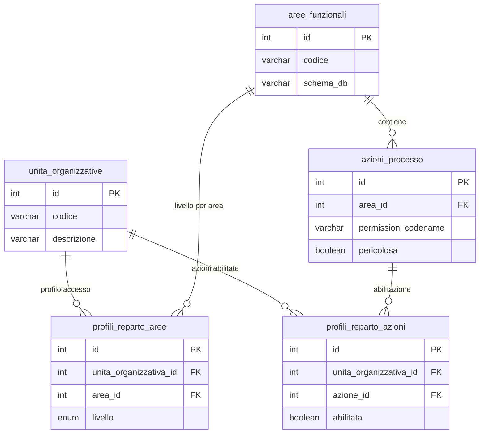
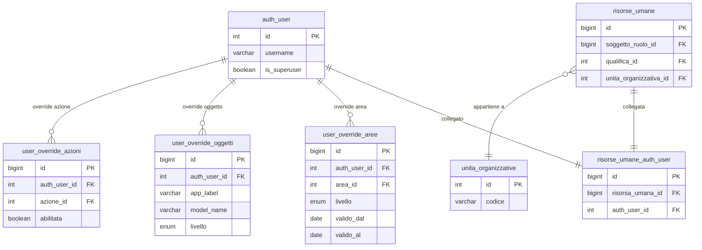
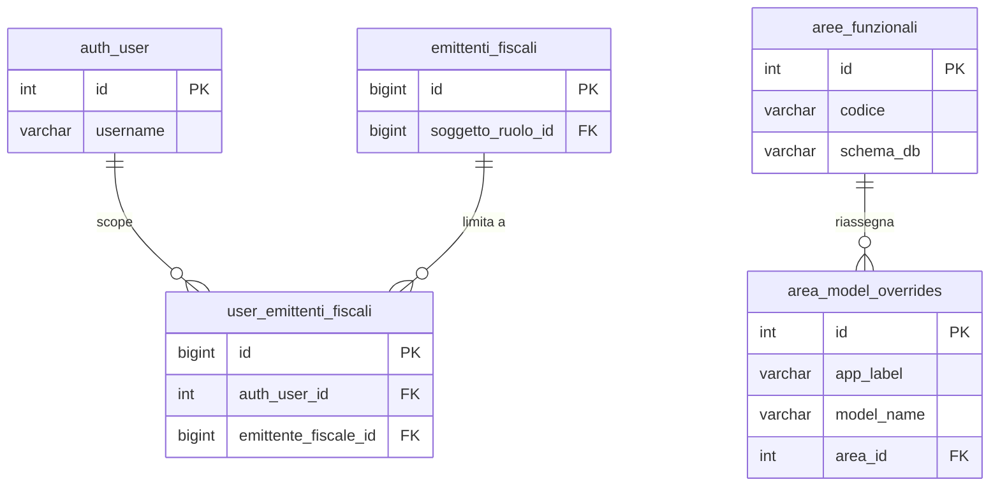

# Guida Tecnica – Architettura Permessi e Autorizzazioni

> **Destinatari:** sviluppatori database, backend e analisti funzionali
>
> **Prerequisiti:** [Guida Soggetti & Ruoli](/guide/soggetti-e-ruoli-anagrafici), [risorse_umane_auth_user](/dbzero/anagrafiche/tabelle/risorse_umane_auth_user)
>
> **Stato:** Proposta architetturale – v2.0

---

## 1. Obiettivo

Definire un sistema di permessi per Zero ERP che sia:

- **scalabile** — nuovi moduli e azioni senza modifiche strutturali,
- **granulare** — controllo fino al singolo utente e singolo oggetto,
- **Circoscritto** — operativita' limitabile per emittente fiscale,
- **semplice da gestire** — pochi click per configurare un operatore,
- **coerente** — integrato con il modello soggetti/ruoli e schemi DB esistenti.

---

## 2. Concetti chiave

### 2.1 Area funzionale = Schema DB

Ogni schema del database corrisponde automaticamente a un'**area funzionale**.
Le API Django ereditano l'area dallo schema del model che servono.

| Schema DB     | Area funzionale | Esempi di oggetti                      |
| ------------- | --------------- | -------------------------------------- |
| `anagrafiche` | Anagrafiche     | soggetti, clienti, contatti, emittenti |
| `vendite`     | Vendite         | fatture, ordini, lotti                 |
| `acquisti`    | Acquisti        | ordini acquisto, DDT in ingresso       |
| `catalogo`    | Catalogo        | articoli, listini                      |
| `config`      | Configurazione  | parametri, tipi ruoli, qualifiche      |
| `contabilita` | Contabilita'    | movimenti, piano conti                 |
| `magazzino`   | Magazzino       | giacenze, movimenti magazzino          |
| `pagamenti`   | Pagamenti       | rimesse, incassi, scadenze             |
| `storico`     | Storico         | log, archivi                           |
| `core`        | Core            | funzioni dbops/scripts                 |

Questo mapping e' **automatico**: Django conosce lo schema di ogni model
dalla `Meta.db_table`. Nessuna configurazione manuale per il caso standard.

Un model puo' essere **riassegnato** a un'area diversa dal suo schema tramite
la tabella `config.area_model_overrides` (vedi sezione 4.3), ma si tratta
di un'eccezione rara.

### 2.2 Tre livelli di accesso per area

| Livello      | Significato                                   |
| ------------ | --------------------------------------------- |
| **TUTTO**    | CRUD completo su tutti gli oggetti dell'area  |
| **LETTURA**  | Solo visualizzazione (`view_*`)               |
| **BLOCCATO** | Nessun accesso, l'area non e' nemmeno visibile |

Questi tre livelli coprono il **90% delle esigenze quotidiane** e rendono
la configurazione di un operatore immediata: una riga per area, un radio button.

### 2.3 Azioni di processo (permessi puntuali)

Oltre al CRUD esistono azioni che richiedono abilitazione esplicita,
indipendentemente dal livello sull'area. Anche avendo TUTTO su vendite,
un operatore potrebbe non poter eseguire azioni critiche.

Esempi:

| Azione                         | Area      | Descrizione                 |
| ------------------------------ | --------- | --------------------------- |
| `vendite.genera_fatture_lotti` | vendite   | Generazione massiva fatture |
| `vendite.genera_fattura`       | vendite   | Generazione singola fattura |
| `vendite.approva_fattura`      | vendite   | Approvazione fattura        |
| `vendite.emetti_fattura`       | vendite   | Emissione fattura           |
| `pagamenti.approva_rimessa`    | pagamenti | Approvazione rimessa        |

Le azioni nascono nel codice Django (`Meta.permissions`) e vengono registrate
automaticamente in `auth_permission`. La tabella `config.azioni_processo`
le elenca per renderle visibili e gestibili nell'interfaccia admin.

### 2.4 Ereditarieta' dal reparto

L'unita' organizzativa (reparto) definisce un **profilo di accesso di default**
che tutti gli operatori del reparto ereditano automaticamente.

**Scelta architetturale: ereditarieta', non template.**

Questo significa che:

- Modificando il profilo del reparto, **tutti gli operatori** del reparto
  vengono aggiornati automaticamente.
- Le eccezioni individuali (override per utente) hanno **sempre priorita'**
  sul profilo ereditato.
- Non serve manutenzione individuale quando cambia una policy aziendale.

> **ATTENZIONE:** modificare il profilo di un reparto ha impatto immediato
> su tutti gli operatori associati. Prima di cambiare il livello di un'area
> su un reparto con molti operatori, verificare che non ci siano conseguenze
> indesiderate. L'interfaccia di gestione dovrebbe mostrare il numero di
> operatori impattati prima di confermare la modifica.

---

## 3. Regola di risoluzione permessi

Quando un operatore tenta un'azione, il sistema risolve i permessi
seguendo questa catena di priorita':

```
1. Override utente su SINGOLO OGGETTO?
   -> SI': applica il livello dell'override
   -> NO: continua

2. Override utente su AREA?
   -> SI': applica il livello dell'override
   -> NO: continua

3. Profilo del reparto per quell'area?
   -> SI': applica il livello del reparto
   -> NO: BLOCCATO (default sicuro)
```

Per le **azioni di processo** la risoluzione e' separata e binaria:

```
1. Override utente sull'azione? (GRANT/DENY)
   -> SI': applica
   -> NO: continua

2. Azione abilitata nel profilo reparto?
   -> SI': concessa
   -> NO: negata
```

> Il default e' sempre il piu' restrittivo: se non c'e' configurazione,
> l'accesso e' negato.

---

## 4. Modello dati

### 4.1 Tabella `config.aree_funzionali`

> Struttura completa: [aree_funzionali](/dbzero/config/tabelle/aree_funzionali)

Catalogo delle aree funzionali del sistema. Ogni riga mappa uno schema DB
a un'area logica con codice, descrizione e ordinamento per l'interfaccia.

**A cosa serve:** e' la tabella di riferimento per tutte le regole di accesso.
Quando si aggiunge un nuovo schema al sistema, basta inserire una riga qui
perche' l'area diventi configurabile nei profili reparto e negli override utente.

**Esempio — verifica aree attive:**

```sql
SELECT codice, descrizione, schema_db
FROM config.aree_funzionali
WHERE attivo = TRUE
ORDER BY ordinamento;
```

### 4.2 Tabella `config.azioni_processo`

> Struttura completa: [azioni_processo](/dbzero/config/tabelle/azioni_processo)

Registro delle azioni di processo gestibili nell'interfaccia permessi.
Ogni azione e' collegata a un'area funzionale e al `codename` del permesso
Django corrispondente (`auth_permission`).

**A cosa serve:** rende visibili all'interfaccia di gestione le azioni definite
nel codice Django (`Meta.permissions`). Il flag `pericolosa` segnala le azioni
che richiedono conferma aggiuntiva (es. generazione massiva fatture).

**Esempio — elenco azioni pericolose per area:**

```sql
SELECT af.descrizione AS area, ap.descrizione AS azione
FROM config.azioni_processo ap
JOIN config.aree_funzionali af ON af.id = ap.area_id
WHERE ap.pericolosa = TRUE AND ap.attivo = TRUE
ORDER BY af.ordinamento, ap.descrizione;
```

### 4.3 Tabella `config.area_model_overrides`

> Struttura completa: [area_model_overrides](/dbzero/config/tabelle/area_model_overrides)

Override opzionale per riassegnare un model Django a un'area diversa dal suo
schema DB. Uso raro — serve solo quando la convenzione automatica
(schema = area) non e' corretta per un model specifico.

**Esempio — riassegnare un model:**

Se il model `core.parametri_globali` deve essere gestito sotto l'area
Configurazione anziche' Core:

```sql
INSERT INTO config.area_model_overrides (app_label, model_name, area_id)
VALUES ('core', 'parametri_globali',
        (SELECT id FROM config.aree_funzionali WHERE codice = 'config'));
```

### 4.4 Tabella `config.profili_reparto_aree`

> Struttura completa: [profili_reparto_aree](/dbzero/config/tabelle/profili_reparto_aree)

Cuore dell'ereditarieta': definisce il livello di accesso (`TUTTO`, `LETTURA`,
`BLOCCATO`) che ogni reparto ha su ciascuna area funzionale.
Tutti gli operatori del reparto ereditano questo profilo automaticamente.

**Esempio — configurare il profilo del reparto Amministrazione:**

```sql
-- Il reparto Amministrazione (id=1) ha accesso TUTTO su vendite, LETTURA su acquisti
INSERT INTO config.profili_reparto_aree (unita_organizzativa_id, area_id, livello)
VALUES
    (1, (SELECT id FROM config.aree_funzionali WHERE codice = 'vendite'),   'TUTTO'),
    (1, (SELECT id FROM config.aree_funzionali WHERE codice = 'acquisti'),  'LETTURA');
```

**Esempio — verifica profilo completo di un reparto:**

```sql
SELECT af.descrizione AS area, pra.livello
FROM config.profili_reparto_aree pra
JOIN config.aree_funzionali af ON af.id = pra.area_id
WHERE pra.unita_organizzativa_id = 1
ORDER BY af.ordinamento;
```

### 4.5 Tabella `config.profili_reparto_azioni`

> Struttura completa: [profili_reparto_azioni](/dbzero/config/tabelle/profili_reparto_azioni)

Azioni di processo abilitate a livello di reparto. Funziona in coppia con
`profili_reparto_aree`: il livello area controlla il CRUD, questa tabella
controlla le azioni puntuali.

**Esempio — abilitare la generazione fatture per il reparto Amministrazione:**

```sql
INSERT INTO config.profili_reparto_azioni (unita_organizzativa_id, azione_id, abilitata)
VALUES (1, (SELECT id FROM config.azioni_processo
            WHERE permission_codename = 'genera_fattura'), TRUE);
```

### 4.6 Tabella `config.user_override_aree`

> Struttura completa: [user_override_aree](/dbzero/config/tabelle/user_override_aree)

Override individuale per utente su un'area funzionale. Sovrascrive il profilo
ereditato dal reparto. Supporta validita' temporale (`valido_dal`, `valido_al`)
per deleghe o restrizioni temporanee.

**Esempio — delega temporanea: utente 42 puo' operare su acquisti per un mese:**

```sql
INSERT INTO config.user_override_aree (auth_user_id, area_id, livello, motivo, valido_dal, valido_al)
VALUES (42,
        (SELECT id FROM config.aree_funzionali WHERE codice = 'acquisti'),
        'TUTTO',
        'Delega sostituzione ferie responsabile acquisti',
        '2026-03-01', '2026-03-31');
```

### 4.7 Tabella `config.user_override_oggetti`

> Struttura completa: [user_override_oggetti](/dbzero/config/tabelle/user_override_oggetti)

Override individuale per utente su un singolo model/oggetto. Sovrascrive sia
il profilo del reparto che l'override su area, offrendo il massimo livello
di granularita'.

**Esempio — utente ha TUTTO su anagrafiche ma solo LETTURA su clienti:**

```sql
INSERT INTO config.user_override_oggetti
    (auth_user_id, app_label, model_name, livello, motivo)
VALUES (42, 'anagrafiche', 'clienti', 'LETTURA',
        'Operatore junior: puo'' vedere i clienti ma non modificarli');
```

### 4.8 Tabella `config.user_override_azioni`

> Struttura completa: [user_override_azioni](/dbzero/config/tabelle/user_override_azioni)

Override individuale per azioni di processo. Sovrascrive l'abilitazione
ereditata dal reparto. Utile per concedere o negare azioni specifiche
a singoli operatori.

**Esempio — concedere l'approvazione fattura a un utente specifico:**

```sql
INSERT INTO config.user_override_azioni (auth_user_id, azione_id, abilitata, motivo)
VALUES (42,
        (SELECT id FROM config.azioni_processo
         WHERE permission_codename = 'approva_fattura'),
        TRUE,
        'Autorizzato dal responsabile vendite');
```

### 4.9 Tabella `config.user_emittenti_fiscali`

> Struttura completa: [user_emittenti_fiscali](/dbzero/config/tabelle/user_emittenti_fiscali)

Ambito operativo: whitelist opzionale degli emittenti fiscali su cui l'utente
puo' operare. Se l'utente non ha righe in questa tabella, puo' operare su
**tutti** gli emittenti. Se ha almeno una riga, e' limitato a quelli elencati.

**Esempio — limitare un utente a due emittenti:**

```sql
INSERT INTO config.user_emittenti_fiscali (auth_user_id, emittente_fiscale_id)
VALUES (42, 1), (42, 3);
-- L'utente 42 puo' operare solo sugli emittenti 1 e 3
```

**Esempio — verificare l'ambito di un utente:**

```sql
SELECT ef.denominazione
FROM config.user_emittenti_fiscali uef
JOIN anagrafiche.emittenti_fiscali ef ON ef.id = uef.emittente_fiscale_id
WHERE uef.auth_user_id = 42;
-- Se nessuna riga: l'utente opera su tutti gli emittenti
```

---

## 5. Separazione delle responsabilita'

| Livello            | Responsabilita'                                                    | Dove                            |
| ------------------ | ------------------------------------------------------------------ | ------------------------------- |
| **Django/DRF**     | Autenticazione, enforcement permessi sulle API, filtering queryset | Permission classes, Mixins      |
| **DB (config.\*)** | Source of truth per profili, aree, override, ambito emittente      | Tabelle config, ENUM, funzioni  |
| **DB (trigger)**   | Defense-in-depth: vincoli di coerenza, guard su ambito emittente   | Trigger sulle tabelle operative |

Il flusso di una richiesta:

```
Request
  -> DRF Authentication
    -> ZeroERPPermission (risolve livello accesso: reparto -> override area -> override oggetto)
      -> ZeroERPActionPermission (per azioni di processo: reparto -> override azione)
        -> EmittenteFiscaleScopeMixin (filtra queryset per emittente)
          -> View/Serializer
            -> DB Trigger (defense-in-depth su perimetro emittente)
```

---

## 6. Enforcement Django

### 6.1 Funzione di risoluzione permessi (cuore del sistema)

Il `PermissionResolver` implementa la catena di risoluzione (sez. 3)
interrogando le tabelle config in ordine di priorita'.

```python
# core/permissions_resolver.py

from django.utils import timezone
from django.db.models import Q


class PermissionResolver:
    """
    Risolve il livello di accesso effettivo per un utente,
    seguendo la catena: override oggetto -> override area -> profilo reparto.
    """

    LIVELLO_MAP = {
        'TUTTO': {'view', 'add', 'change', 'delete'},
        'LETTURA': {'view'},
        'BLOCCATO': set(),
    }

    @classmethod
    def get_livello_area(cls, user, area_codice):
        """
        Restituisce il livello effettivo per un'area funzionale.
        Catena: override utente area -> profilo reparto -> BLOCCATO.
        """
        today = timezone.now().date()

        # 1. Override utente su area
        from config.models import UserOverrideArea
        override = UserOverrideArea.objects.filter(
            auth_user=user,
            area__codice=area_codice,
            valido_dal__lte=today,
        ).filter(
            Q(valido_al__isnull=True) | Q(valido_al__gte=today)
        ).first()

        if override:
            return override.livello

        # 2. Profilo reparto
        livello = cls._get_livello_reparto(user, area_codice)
        if livello:
            return livello

        # 3. Default sicuro
        return 'BLOCCATO'

    @classmethod
    def get_livello_oggetto(cls, user, app_label, model_name, area_codice):
        """
        Restituisce il livello effettivo per un singolo model.
        Catena: override oggetto -> override area -> profilo reparto -> BLOCCATO.
        """
        today = timezone.now().date()

        # 1. Override utente su oggetto
        from config.models import UserOverrideOggetto
        override = UserOverrideOggetto.objects.filter(
            auth_user=user,
            app_label=app_label,
            model_name=model_name,
            valido_dal__lte=today,
        ).filter(
            Q(valido_al__isnull=True) | Q(valido_al__gte=today)
        ).first()

        if override:
            return override.livello

        # 2. Risale alla catena area
        return cls.get_livello_area(user, area_codice)

    @classmethod
    def check_azione(cls, user, permission_codename):
        """
        Verifica se un'azione di processo e' abilitata.
        Catena: override utente -> profilo reparto -> negata.
        """
        today = timezone.now().date()

        # 1. Override utente su azione
        from config.models import UserOverrideAzione
        override = UserOverrideAzione.objects.filter(
            auth_user=user,
            azione__permission_codename=permission_codename,
            valido_dal__lte=today,
        ).filter(
            Q(valido_al__isnull=True) | Q(valido_al__gte=today)
        ).first()

        if override:
            return override.abilitata

        # 2. Profilo reparto
        return cls._check_azione_reparto(user, permission_codename)

    @classmethod
    def _get_livello_reparto(cls, user, area_codice):
        """Recupera il livello dal profilo del reparto dell'utente."""
        from config.models import ProfiloRepartoArea

        # Risale: auth_user -> risorse_umane_auth_user -> risorse_umane -> unita_organizzativa
        try:
            from anagrafiche.models import RisorseUmaneAuthUser
            bridge = RisorseUmaneAuthUser.objects.select_related(
                'risorsa_umana'
            ).get(auth_user=user)

            uo_id = bridge.risorsa_umana.unita_organizzativa_id
            if uo_id is None:
                return None

            profilo = ProfiloRepartoArea.objects.filter(
                unita_organizzativa_id=uo_id,
                area__codice=area_codice,
            ).first()

            return profilo.livello if profilo else None

        except RisorseUmaneAuthUser.DoesNotExist:
            return None

    @classmethod
    def _check_azione_reparto(cls, user, permission_codename):
        """Verifica l'azione dal profilo del reparto."""
        from config.models import ProfiloRepartoAzione

        try:
            from anagrafiche.models import RisorseUmaneAuthUser
            bridge = RisorseUmaneAuthUser.objects.select_related(
                'risorsa_umana'
            ).get(auth_user=user)

            uo_id = bridge.risorsa_umana.unita_organizzativa_id
            if uo_id is None:
                return False

            profilo = ProfiloRepartoAzione.objects.filter(
                unita_organizzativa_id=uo_id,
                azione__permission_codename=permission_codename,
            ).first()

            return profilo.abilitata if profilo else False

        except RisorseUmaneAuthUser.DoesNotExist:
            return False
```

### 6.2 Permission class DRF

```python
# core/permissions.py

from rest_framework.permissions import BasePermission
from core.permissions_resolver import PermissionResolver


class ZeroERPPermission(BasePermission):
    """
    Permission class centrale di Zero ERP.

    Risolve automaticamente l'area funzionale dallo schema del model
    e verifica il livello di accesso tramite PermissionResolver.
    """

    # Mapping azione DRF -> tipo di accesso richiesto
    ACTION_REQUIRES = {
        'list': 'view',
        'retrieve': 'view',
        'create': 'add',
        'update': 'change',
        'partial_update': 'change',
        'destroy': 'delete',
    }

    def has_permission(self, request, view):
        user = request.user
        if not user or not user.is_authenticated:
            return False
        if user.is_superuser:
            return True

        # Determina il model e l'azione
        action = getattr(view, 'action', None)
        if action is None:
            return True

        # Azione custom con permesso esplicito
        action_perm = getattr(view, f'{action}_permission', None)
        if action_perm:
            return PermissionResolver.check_azione(user, action_perm)

        # CRUD standard
        required = self.ACTION_REQUIRES.get(action)
        if required is None:
            return True

        model = getattr(view, 'queryset', None)
        if model is None:
            return True
        model = model.model

        app_label = model._meta.app_label
        model_name = model._meta.model_name
        area_codice = self._get_area_codice(app_label, model_name)

        livello = PermissionResolver.get_livello_oggetto(
            user, app_label, model_name, area_codice
        )
        allowed_actions = PermissionResolver.LIVELLO_MAP.get(livello, set())
        return required in allowed_actions

    def _get_area_codice(self, app_label, model_name):
        """
        Determina l'area funzionale di un model.
        1. Controlla override in config.area_model_overrides
        2. Altrimenti usa app_label (che corrisponde allo schema)
        """
        from config.models import AreaModelOverride
        override = AreaModelOverride.objects.filter(
            app_label=app_label,
            model_name=model_name,
        ).select_related('area').first()

        if override:
            return override.area.codice

        return app_label
```

### 6.3 Mixin per ambito emittente fiscale

```python
# core/mixins.py

class EmittenteFiscaleScopeMixin:
    """
    Filtra il queryset in base agli emittenti fiscali dell'utente.
    Se l'utente non ha righe in user_emittenti_fiscali, vede tutto.
    Se ha almeno una riga, vede solo gli emittenti autorizzati.

    Uso: impostare `emittente_field` nella view con il path
    al campo emittente (es. 'emittente_fiscale',
    'billing_account__emittente_fiscale').
    """

    emittente_field = None

    def get_queryset(self):
        qs = super().get_queryset()
        user = self.request.user

        if user.is_superuser or self.emittente_field is None:
            return qs

        from config.models import UserEmittenteFiscale
        user_emittenti = UserEmittenteFiscale.objects.filter(
            auth_user=user
        ).values_list('emittente_fiscale_id', flat=True)

        if not user_emittenti.exists():
            return qs

        filter_kwarg = {f'{self.emittente_field}__in': user_emittenti}
        return qs.filter(**filter_kwarg)
```

### 6.4 Middleware sessione PostgreSQL

Il middleware `PgSessionMiddleware` propaga l'identita' dell'utente Django
nella sessione PostgreSQL tramite GUC `app.current_user_id`, consentendo
ai trigger DB di verificare l'ambito emittente (defense-in-depth).

```python
# core/middleware.py

class PgSessionMiddleware:
    """
    Imposta variabili di sessione PostgreSQL per consentire
    al DB di conoscere l'utente corrente (defense-in-depth).
    """

    def __init__(self, get_response):
        self.get_response = get_response

    def __call__(self, request):
        response = self.get_response(request)
        return response

    def process_view(self, request, view_func, view_args, view_kwargs):
        if request.user and request.user.is_authenticated:
            from django.db import connection
            with connection.cursor() as cursor:
                cursor.execute(
                    "SELECT set_config('app.current_user_id', %s, true)",
                    [str(request.user.id)]
                )
        return None
```

---

## 7. Defense-in-depth DB

Il database non replica l'enforcement di Django ma aggiunge guardie
che il backend non puo' garantire.

### 7.1 Funzione di verifica ambito emittente

> Struttura completa: [fn_check_user_emittente_scope](/dbzero/config/funzioni/fn_check_user_emittente_scope)

La funzione `config.fn_check_user_emittente_scope(p_auth_user_id, p_emittente_id)`
verifica se un utente e' autorizzato a operare su un dato emittente fiscale.
Segue la logica whitelist: se l'utente non ha righe in `user_emittenti_fiscali`,
restituisce `TRUE` (nessun vincolo); altrimenti verifica che l'emittente sia
nella lista.

**Esempio d'uso in una query:**

```sql
-- Verifica se l'utente 42 puo' operare sull'emittente 3
SELECT config.fn_check_user_emittente_scope(42, 3);
```

### 7.2 Trigger guard per ambito emittente

> Struttura completa: [trgfn_guard_emittente_scope](/dbzero/config/funzioni/trgfn_guard_emittente_scope)

I trigger guard sulle tabelle operative (es. fatture, ordini) utilizzano
la funzione di verifica per impedire operazioni su emittenti non autorizzati.
Il trigger legge l'`auth_user_id` dalla GUC di sessione (`app.current_user_id`,
impostata dal middleware Django) e blocca l'operazione se l'utente non e'
nell'ambito.

**Esempio — cosa succede in pratica:**

```
1. Utente 42 (limitato agli emittenti 1, 3) tenta INSERT su fattura con emittente 5
2. Il middleware Django ha gia' impostato: SET app.current_user_id = '42'
3. Il trigger BEFORE INSERT legge la GUC e chiama fn_check_user_emittente_scope(42, 5)
4. La funzione restituisce FALSE -> il trigger blocca con RAISE EXCEPTION
5. Risultato: operazione negata anche se il backend avesse un bug
```

### 7.3 Funzioni di risoluzione permessi lato DB

Per scenari in cui il DB deve risolvere i permessi autonomamente (trigger guard,
funzioni di validazione), esistono funzioni SQL che replicano la catena di
risoluzione:

> [fn_resolve_livello_area](/dbzero/config/funzioni/fn_resolve_livello_area) — risolve il livello effettivo di un utente su un'area (override area -> profilo reparto -> BLOCCATO)

> [fn_resolve_livello_oggetto](/dbzero/config/funzioni/fn_resolve_livello_oggetto) — risolve il livello per un singolo model (override oggetto -> override area -> profilo reparto)

> [fn_check_azione_processo](/dbzero/config/funzioni/fn_check_azione_processo) — verifica se un'azione di processo e' abilitata per un utente

**Esempio — verifica permessi da SQL:**

```sql
-- Quale livello ha l'utente 42 sull'area vendite?
SELECT config.fn_resolve_livello_area(42, 'vendite');
-- Risultato: 'TUTTO', 'LETTURA' o 'BLOCCATO'

-- Puo' l'utente 42 approvare fatture?
SELECT config.fn_check_azione_processo(42, 'approva_fattura');
-- Risultato: TRUE o FALSE
```

---

## 8. Interfaccia di gestione (mockup concettuale)

### 8.1 Configurazione reparto

```
+==============================================================+
|  Profilo reparto: Amministrazione (AMM)                      |
|  Operatori associati: 5                                      |
+==============================================================+
|                                                              |
|  AREE FUNZIONALI                                             |
|  +------------------+--------+----------+----------+         |
|  | Area             | TUTTO  | LETTURA  | BLOCCATO |         |
|  +------------------+--------+----------+----------+         |
|  | Anagrafiche      |   *    |          |          |         |
|  | Vendite          |   *    |          |          |         |
|  | Acquisti         |        |    *     |          |         |
|  | Catalogo         |        |    *     |          |         |
|  | Configurazione   |        |          |    *     |         |
|  | Contabilita'     |        |    *     |          |         |
|  | Magazzino        |        |          |    *     |         |
|  | Pagamenti        |   *    |          |          |         |
|  | Storico          |        |    *     |          |         |
|  | Core             |        |          |    *     |         |
|  +------------------+--------+----------+----------+         |
|                                                              |
|  AZIONI DI PROCESSO                                          |
|  +----------------------------------+--------+               |
|  | Azione                           | Abilit.|               |
|  +----------------------------------+--------+               |
|  | ! Genera fatture da lotti        |   no   |               |
|  | Genera singola fattura           |   si   |               |
|  | Approva fattura                  |   no   |               |
|  | Emetti fattura                   |   si   |               |
|  | Approva rimessa                  |   no   |               |
|  +----------------------------------+--------+               |
|                                                              |
|  [Salva]  ! Impatta 5 operatori                             |
+==============================================================+
```

### 8.2 Configurazione utente

```
+==============================================================+
|  Utente: Mario Rossi                                         |
|  Reparto: Amministrazione (AMM)                              |
|  Emittenti: ACME S.r.l., Beta S.r.l.                        |
+==============================================================+
|                                                              |
|  AREE (ereditato dal reparto, override con [o])              |
|  +------------------+--------+----------+----------+---+    |
|  | Area             | TUTTO  | LETTURA  | BLOCCATO |   |    |
|  +------------------+--------+----------+----------+---+    |
|  | Anagrafiche      |   *    |          |          |[o]|    |
|  | Vendite          |   *    |          |          |   |    |
|  | Acquisti         |        |    *     |          |   |    |
|  | Pagamenti        |   *    |          |          |   |    |
|  | ...              |        |          |          |   |    |
|  +------------------+--------+----------+----------+---+    |
|                   * = ereditato  * = override utente         |
|                                                              |
|  ECCEZIONI OGGETTO (opzionale)                 [+ Aggiungi] |
|  +----------------------------+--------+----------+--------+ |
|  | Oggetto                    | TUTTO  | LETTURA  |BLOCCATO| |
|  +----------------------------+--------+----------+--------+ |
|  | anagrafiche.clienti        |        |    *     |        | |
|  +----------------------------+--------+----------+--------+ |
|                                                              |
|  AZIONI (ereditato dal reparto, override con [o])            |
|  +----------------------------------+--------+---+          |
|  | Azione                           | Abilit.|   |          |
|  +----------------------------------+--------+---+          |
|  | Genera singola fattura           |   si   |   |          |
|  | Emetti fattura                   |   si   |   |          |
|  | Approva fattura                  |   si   |[o]| override |
|  +----------------------------------+--------+---+          |
|                                                              |
|  [Salva]                                                     |
+==============================================================+
```

---

## 9. Diagrammi ER

Il modello dati e' suddiviso in tre diagrammi per leggibilita'.

### 9.1 Profilo reparto — ereditarieta'

Il cuore del sistema: ogni reparto (`unita_organizzative`) ha un profilo
che definisce il livello di accesso per area e le azioni di processo abilitate.
Tutti gli operatori del reparto ereditano questo profilo automaticamente.



### 9.2 Catena identita' e override utente

Collega l'utente Django alla risorsa umana (e quindi al reparto)
tramite il bridge `risorse_umane_auth_user`. Le tabelle di override
permettono eccezioni individuali che sovrascrivono il profilo ereditato.



> **Lettura:** `auth_user` -> `risorse_umane_auth_user` -> `risorse_umane` ->
> `unita_organizzative` — da qui il sistema risale al profilo reparto
> (diagramma 9.1). Se esistono override, hanno sempre priorita'.

### 9.3 Ambito emittente fiscale e override model

Due meccanismi ortogonali: la whitelist emittenti fiscali limita
l'**ambito operativo** dell'utente, mentre `area_model_overrides`
riassegna un model a un'area diversa dal suo schema DB.



> **Nota:** `user_emittenti_fiscali` e' una whitelist opzionale —
> se l'utente non ha righe, puo' operare su tutti gli emittenti.
> `area_model_overrides` e' usata raramente, solo quando un model
> deve appartenere a un'area diversa dal suo schema.

---

## 10. Riepilogo architettura

| Cosa                        | Dove                                                       | Come                                        |
| --------------------------- | ---------------------------------------------------------- | ------------------------------------------- |
| **Aree funzionali**         | `config.aree_funzionali`                                   | Schema DB = area (automatico)               |
| **Livello accesso area**    | `config.profili_reparto_aree`                              | TUTTO / LETTURA / BLOCCATO per reparto      |
| **Azioni di processo**      | `config.azioni_processo` + `config.profili_reparto_azioni` | Abilitate per reparto                       |
| **Ereditarieta'**           | Via `risorse_umane.unita_organizzativa_id`                 | User -> risorsa umana -> reparto -> profilo  |
| **Override utente area**    | `config.user_override_aree`                                | Sovrascrive reparto, con validita' temporale |
| **Override utente oggetto** | `config.user_override_oggetti`                             | Sovrascrive area, per singolo model         |
| **Override utente azione**  | `config.user_override_azioni`                              | Sovrascrive reparto, per singola azione     |
| **Ambito emittente**        | `config.user_emittenti_fiscali`                            | Whitelist opzionale                         |
| **Enforcement API**         | `ZeroERPPermission`                                        | DRF permission class                        |
| **Ambito queryset**         | `EmittenteFiscaleScopeMixin`                               | Mixin su ViewSet                            |
| **Defense-in-depth**        | Trigger + `fn_check_user_emittente_scope`                  | Setting sessione PG                         |

---

## 11. Nota sulla scelta architetturale: ereditarieta'

Il sistema adotta il modello a **ereditarieta'** per i profili reparto.
Questa scelta:

**Semplifica la manutenzione:** un cambio di policy aziendale si applica
modificando il profilo del reparto, senza toccare i singoli utenti.

**Richiede attenzione:** modificare il profilo di un reparto ha impatto
immediato su tutti gli operatori associati. L'interfaccia deve sempre
mostrare il numero di operatori impattati prima di confermare modifiche.

**Preserva la flessibilita':** le eccezioni individuali (override) hanno
sempre priorita' sul profilo ereditato, permettendo personalizzazioni
puntuali senza compromettere il modello generale.

Questo pattern e' analogo al fallback per contesto gia' adottato nella
gestione contatti (default soggetto -> ruolo -> utility) e risulta
coerente con la filosofia di Zero ERP.

---

## 12. Evoluzioni future

- **Row-Level Security (RLS):** le tabelle di ambito sono gia' pronte per alimentare policy RLS.
- **Ambito per unita' organizzativa su dati:** limitare la visibilita' dati per reparto.
- **Workflow permissions:** stati avanzati (es. transizione BOZZA -> EMESSA) come azioni di processo.
- **Audit trail permessi:** log storico delle modifiche ai profili e override — vedi [proposta-8.2-audit-trail-permessi](/dev/work-in-progress/proposta-8.2-audit-trail-permessi).
- **Dashboard permessi:** vista riepilogativa "cosa puo' fare questo utente" con risoluzione completa.

---

## 13. Classificazione utente (`tipo_utente`)

Per gestire correttamente l'onboarding — specialmente nelle PMI dove chi attiva
un utente non e' un sistemista — serve una classificazione a livello di bridge
[risorse_umane_auth_user](/dbzero/anagrafiche/tabelle/risorse_umane_auth_user)
che determini il **comportamento di risoluzione**, non i permessi stessi.

La colonna `tipo_utente` (ENUM `config.tipo_utente`) definisce tre
classificazioni:

| Tipo           | Comportamento                                                                   | Caso d'uso                    |
| -------------- | ------------------------------------------------------------------------------- | ----------------------------- |
| `ADMIN`        | Bypass completo della catena permessi                                           | Titolare, responsabile IT     |
| `OPERATIVO`    | Eredita dal reparto + override individuali. Se reparto senza profilo -> BLOCCATO | Dipendente standard           |
| `DISABILITATO` | Nessun accesso, nemmeno login                                                   | Ex-dipendente, utente sospeso |

La catena di risoluzione diventa:

```text
1. tipo_utente = DISABILITATO?  -> accesso negato, stop
2. tipo_utente = ADMIN?         -> accesso completo, stop
3. tipo_utente = OPERATIVO?     -> catena standard:
   3a. Override utente su oggetto
   3b. Override utente su area
   3c. Profilo reparto
   3d. Default -> BLOCCATO
```

> **Nota diagnostica:** quando un OPERATIVO risulta BLOCCATO perche' il reparto
> non ha profili configurati, il sistema deve restituire un messaggio chiaro
> (es. *"Il reparto X non ha ancora un profilo permessi configurato"*).
> Un endpoint diagnostico `/api/users/{id}/permessi-effettivi/` e' previsto
> per rendere trasparente la risoluzione completa.

---


