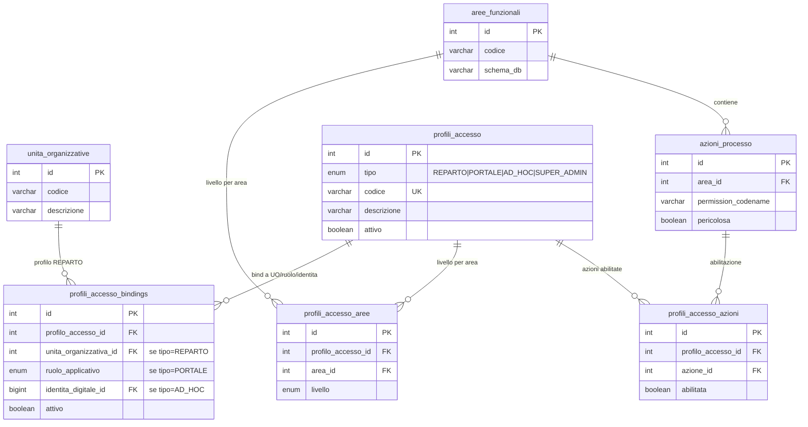
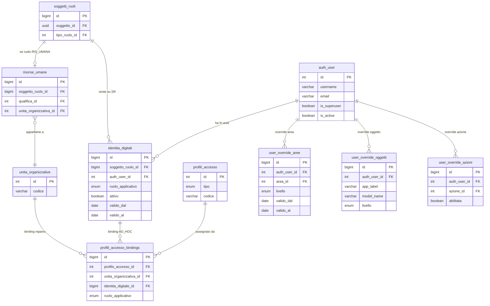
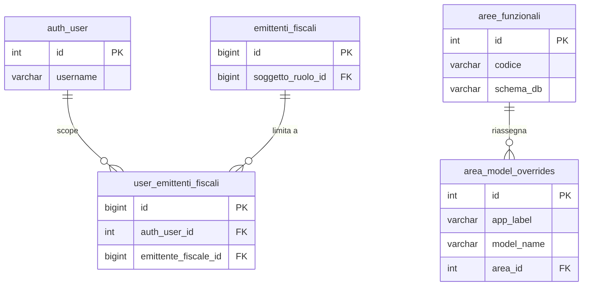

# Guida Tecnica – Architettura Permessi e Autorizzazioni

> **Destinatari:** sviluppatori database, backend e analisti funzionali
>
> **Prerequisiti:** [Guida Soggetti & Ruoli](/guide/soggetti-e-ruoli-anagrafici), [identita_digitali](/dbzero/anagrafiche/tabelle/identita_digitali)
>
> **Stato:** Architettura in produzione – v3.0 post-cutover multi-face-auth

---

> **Multi-Face Auth — stato post-cutover (aprile 2026)**
>
> L'architettura e' stata estesa per supportare **portali clienti/fornitori**
> e **shop online** oltre agli **operatori interni**. Componenti chiave
> (tutti attivi in produzione dal 19-04-2026, PR-A completata):
>
> * **Bridge generalizzato** — la tabella
>   [anagrafiche.identita_digitali](/dbzero/anagrafiche/tabelle/identita_digitali)
>   collega `soggetti_ruoli` a `auth_user` per 5 ruoli applicativi
>   (`OPERATORE`, `CLIENTE_PORTALE`, `FORNITORE_PORTALE`, `SHOP_CUSTOMER`,
>   `API_CLIENT`) + stato `DISABILITATO`. La ex tabella bridge
>   `risorse_umane_auth_user` e' ora una vista read-only di compatibilita'.
> * **Profili accesso generalizzati** — `config.profili_accesso` con tipo
>   `REPARTO` / `PORTALE` / `AD_HOC` / `SUPER_ADMIN`, binding via
>   `config.profili_accesso_bindings` verso reparto, identita o ruolo.
> * **Scope policy** — `config.scope_policy` (EF_WHITELIST,
>   BA_OWNERSHIP, FORNITORE_OWNERSHIP) + `identita_scope_bindings`.
>   Le tre funzioni `script.fn_scope_*` (`ba_ownership`,
>   `fornitore_ownership`, `ef_whitelist`) sono `LANGUAGE sql STABLE`
>   inlineable. `SELF_OWNERSHIP` unificato con `BA_OWNERSHIP` (il
>   ruolo anagrafico CL e' condiviso tra CLIENTE_PORTALE e SHOP_CUSTOMER).
> * **Row Level Security** — **due velocità (giugno 2026)**: la branch
>   **scope emittente OPERATORI** è **ATTIVA (`ENABLE`)** su
>   fatture/fatture_scadenze/fatturazione_lotti/ordini/preventivi/contratti/
>   offerte_commerciali/documenti_generati/pratiche/billing_account (Ondata
>   1+2, no `FORCE`; vedi `dev/work-done/analisi-attivazione-rls-operatori.md`);
>   le branch **portale/shop** (`BA_OWNERSHIP`, CLIENTE_PORTALE/SHOP_CUSTOMER)
>   restano **dry-run** in attesa delle API portale/shop. GUC
>   `app.current_identita_id`, `app.ruolo_applicativo`,
>   `app.soggetto_ruolo_id` popolati da `JwtAuditAuthentication`.
> * **SUPER_ADMIN** — profilo dedicato id=9100 (ex `ruolo_sistema=ADMIN`)
>   bindato via `profili_accesso_bindings` AD_HOC a singole identita.
>   Guard anti-lockout (`trgfn_..._guard_ultimo_super_admin`) impedisce
>   di lasciare il sistema senza amministratori raggiungibili.
> * **Namespace API separati**: `/api/admin/*`, `/api/portale/*`,
>   `/api/shop/*` (Stage C PR-B in sviluppo).
>
> Dettagli architetturali completi:
>
> * [architettura-multi-face-auth](/guide/architettura-multi-face-auth)
> * Piano di sviluppo: roadmap storica multi-face auth consolidata

---

## 1. Obiettivo

Definire un sistema di permessi per Zero ERP che sia:

- **scalabile** — nuovi moduli e azioni senza modifiche strutturali,
- **granulare** — controllo fino al singolo utente e singolo oggetto,
- **Circoscritto** — operativita' limitabile per emittente fiscale,
- **semplice da gestire** — pochi click per configurare un operatore,
- **coerente** — integrato con il modello soggetti/ruoli e schemi DB esistenti.

---

## 2. Concetti chiave

### 2.1 Area funzionale = Schema DB

Ogni schema del database corrisponde automaticamente a un'**area funzionale**.
Le API Django ereditano l'area dallo schema del model che servono.

| Schema DB     | Area funzionale | Esempi di oggetti                      |
| ------------- | --------------- | -------------------------------------- |
| `anagrafiche` | Anagrafiche     | soggetti, clienti, contatti, emittenti |
| `vendite`     | Vendite         | fatture, ordini, lotti                 |
| `acquisti`    | Acquisti        | ordini acquisto, DDT in ingresso       |
| `catalogo`    | Catalogo        | articoli, listini                      |
| `config`      | Configurazione  | parametri, tipi ruoli, qualifiche      |
| `contabilita` | Contabilita'    | movimenti, piano conti                 |
| `magazzino`   | Magazzino       | giacenze, movimenti magazzino          |
| `pagamenti`   | Pagamenti       | rimesse, incassi, scadenze             |
| `storico`     | Storico         | log, archivi                           |
| `core`        | Core            | funzioni dbops/scripts                 |

Questo mapping e' **automatico**: Django conosce lo schema di ogni model
dalla `Meta.db_table`. Nessuna configurazione manuale per il caso standard.

Un model puo' essere **riassegnato** a un'area diversa dal suo schema tramite
la tabella `config.area_model_overrides` (vedi sezione 4.3), ma si tratta
di un'eccezione rara.

### 2.2 Tre livelli di accesso per area

| Livello      | Significato                                   |
| ------------ | --------------------------------------------- |
| **TUTTO**    | CRUD completo su tutti gli oggetti dell'area  |
| **LETTURA**  | Solo visualizzazione (`view_*`)               |
| **BLOCCATO** | Nessun accesso, l'area non e' nemmeno visibile |

Questi tre livelli coprono il **90% delle esigenze quotidiane** e rendono
la configurazione di un operatore immediata: una riga per area, un radio button.

### 2.3 Azioni di processo (permessi puntuali)

Oltre al CRUD esistono azioni che richiedono abilitazione esplicita,
indipendentemente dal livello sull'area. Anche avendo TUTTO su vendite,
un operatore potrebbe non poter eseguire azioni critiche.

Esempi:

| Azione                         | Area      | Descrizione                 |
| ------------------------------ | --------- | --------------------------- |
| `vendite.genera_fatture_lotti` | vendite   | Generazione massiva fatture |
| `vendite.genera_fattura`       | vendite   | Generazione singola fattura |
| `vendite.approva_fattura`      | vendite   | Approvazione fattura        |
| `vendite.emetti_fattura`       | vendite   | Emissione fattura           |
| `pagamenti.approva_rimessa`    | pagamenti | Approvazione rimessa        |

Le azioni nascono nel codice Django (`Meta.permissions`) e vengono registrate
automaticamente in `auth_permission`. La tabella `config.azioni_processo`
le elenca per renderle visibili e gestibili nell'interfaccia admin.

### 2.4 Ereditarieta' dal reparto

L'unita' organizzativa (reparto) definisce un **profilo di accesso di default**
che tutti gli operatori del reparto ereditano automaticamente.

**Scelta architetturale: ereditarieta', non template.**

Questo significa che:

- Modificando il profilo del reparto, **tutti gli operatori** del reparto
  vengono aggiornati automaticamente.
- Le eccezioni individuali (override per utente) hanno **sempre priorita'**
  sul profilo ereditato.
- Non serve manutenzione individuale quando cambia una policy aziendale.

> **ATTENZIONE:** modificare il profilo di un reparto ha impatto immediato
> su tutti gli operatori associati. Prima di cambiare il livello di un'area
> su un reparto con molti operatori, verificare che non ci siano conseguenze
> indesiderate. L'interfaccia di gestione dovrebbe mostrare il numero di
> operatori impattati prima di confermare la modifica.

---

## 3. Regola di risoluzione permessi

Quando un operatore tenta un'azione, il sistema risolve i permessi
seguendo una catena di priorita' a cascata. La regola generale e'
che il **livello piu' specifico prevale sempre su quello piu'
generale**, e in assenza di configurazione il default e' restrittivo.

Per l'accesso a un'area o a un singolo oggetto la catena e':

1. **Override individuale su singolo oggetto/model** — se esiste, il
   suo livello (`TUTTO`, `LETTURA` o `BLOCCATO`) vale e la risoluzione
   si ferma qui. E' la forma piu' fine ma anche la piu' rara, usata
   solo per eccezioni puntuali.
2. **Override individuale sull'area** — in assenza di override sul
   singolo oggetto, si applica l'eventuale override sull'area.
3. **Profilo del reparto** — se nemmeno l'area ha un override
   individuale, si applica il livello che il reparto di appartenenza
   ha per quell'area.
4. **Default sicuro** — se nessuna delle regole precedenti applica,
   l'accesso e' `BLOCCATO`.

Per le **azioni di processo** la risoluzione segue lo stesso principio
ma e' binaria (l'azione puo' essere solo concessa o negata):

1. **Override individuale sull'azione** — se esiste, il suo valore
   (grant o deny) vale.
2. **Profilo del reparto** — altrimenti si applica l'abilitazione
   dichiarata a livello di reparto.
3. **Default** — in assenza di configurazioni, l'azione e' negata.

> Il default e' sempre il piu' restrittivo: se non c'e' configurazione,
> l'accesso e' negato.

---

## 4. Modello dati

### 4.1 Tabella `config.aree_funzionali`

> Struttura completa: [aree_funzionali](/dbzero/config/tabelle/aree_funzionali)

Catalogo delle aree funzionali del sistema. Ogni riga mappa uno schema DB
a un'area logica con codice, descrizione e ordinamento per l'interfaccia.

**A cosa serve:** e' la tabella di riferimento per tutte le regole di accesso.
Quando si aggiunge un nuovo schema al sistema, basta inserire una riga qui
perche' l'area diventi configurabile nei profili reparto e negli override utente.

**Esempio di uso:** per ottenere l'elenco delle aree attive utilizzabili
nell'interfaccia di configurazione, si filtra per quelle contrassegnate come
attive e si ordina in base al campo di ordinamento per mantenere la
presentazione coerente fra maschere e menu.

### 4.2 Tabella `config.azioni_processo`

> Struttura completa: [azioni_processo](/dbzero/config/tabelle/azioni_processo)

Registro delle azioni di processo gestibili nell'interfaccia permessi.
Ogni azione e' collegata a un'area funzionale e al `codename` del permesso
Django corrispondente (`auth_permission`).

**A cosa serve:** rende visibili all'interfaccia di gestione le azioni definite
nel codice Django (`Meta.permissions`). Il flag `pericolosa` segnala le azioni
che richiedono conferma aggiuntiva (es. generazione massiva fatture).

**Esempio di uso:** per popolare una maschera di sole azioni pericolose
raggruppate per area, si interroga la tabella incrociata con
`aree_funzionali` e si filtra sul flag di pericolosita' oltre a quello
di attivazione. Il risultato tipico e' una lista ordinata per area e poi
per descrizione dell'azione.

### 4.3 Tabella `config.area_model_overrides`

> Struttura completa: [area_model_overrides](/dbzero/config/tabelle/area_model_overrides)

Override opzionale per riassegnare un model Django a un'area diversa dal suo
schema DB. Uso raro — serve solo quando la convenzione automatica
(schema = area) non e' corretta per un model specifico.

**Esempio di uso:** si supponga che il model `core.parametri_globali`,
per convenzione automatica mappato sull'area Core, debba essere
amministrato sotto l'area Configurazione. Si registra un override
indicando app label, nome del model e area di destinazione scelta dal
catalogo delle aree funzionali. Da quel momento la risoluzione permessi
per quel model usera' la nuova area.

### 4.4 Tabella `config.profili_accesso_aree`

> Struttura completa: [profili_accesso_aree](/dbzero/config/tabelle/profili_accesso_aree)
>
> *(Storico: ha rimpiazzato `config.profili_reparto_aree`, dismessa il
> 2026-05-04 con il changeSet `20260505-02-drop-profili-reparto`. Il
> backfill `20260418-42` ha migrato i dati nel modello generalizzato
> `profili_accesso` + `profili_accesso_bindings`.)*

Cuore dell'ereditarieta': definisce il livello di accesso (`TUTTO`, `LETTURA`,
`BLOCCATO`) che ogni profilo (REPARTO, PORTALE, AD_HOC) ha su ciascuna
area funzionale. Per i profili di tipo REPARTO, tutti gli operatori del
reparto bound al profilo via `profili_accesso_bindings` ereditano
questi livelli automaticamente.

**Esempio di uso:** per il reparto Amministrazione, la configurazione
tipica prevede livello `TUTTO` sull'area Vendite (gli amministrativi
emettono fatture) e livello `LETTURA` sull'area Acquisti (possono
consultare ordini e DDT di ingresso ma non modificarli). Il profilo
REPARTO `REPARTO_AMM` (collegato all'unita organizzativa via
`profili_accesso_bindings.unita_organizzativa_id`) registra una riga
in `profili_accesso_aree` per ciascuna coppia profilo/area, e tutti gli
operatori del reparto ereditano automaticamente questi livelli senza
ulteriori configurazioni.

Quando serve rivedere il profilo completo di un reparto, si consulta
questa tabella filtrata per `profilo_accesso_id` e ordinata per area:
il risultato e' la "scheda permessi" del profilo, pronta per essere
mostrata in interfaccia o esportata in audit.

### 4.5 Tabella `config.profili_accesso_azioni`

> Struttura completa: [profili_accesso_azioni](/dbzero/config/tabelle/profili_accesso_azioni)
>
> *(Storico: ha rimpiazzato `config.profili_reparto_azioni`, dismessa
> il 2026-05-04.)*

Azioni di processo abilitate a livello di profilo. Funziona in coppia con
`profili_accesso_aree`: il livello area controlla il CRUD, questa tabella
controlla le azioni puntuali.

**Esempio di uso:** per abilitare la generazione fatture al reparto
Amministrazione, si registra il profilo con riferimento al
`profilo_accesso_id` (REPARTO_AMM), all'azione identificata dal suo
codename Django (es. `genera_fattura`) e al flag di abilitazione. Da
quel momento tutti gli operatori del reparto vedranno il pulsante di
generazione attivo senza ulteriori override individuali.

### 4.6 Tabella `config.user_override_aree`

> Struttura completa: [user_override_aree](/dbzero/config/tabelle/user_override_aree)

Override individuale per utente su un'area funzionale. Sovrascrive il profilo
ereditato dal reparto. Supporta validita' temporale (`valido_dal`, `valido_al`)
per deleghe o restrizioni temporanee.

**Esempio di uso:** una delega temporanea per sostituire il responsabile
acquisti in ferie si registra come override individuale sull'area
Acquisti, livello `TUTTO`, con motivo esplicito (es. "Delega
sostituzione ferie responsabile acquisti") e validita' limitata al
periodo di assenza (es. dall'1 al 31 marzo). Superata la data di fine,
l'override decade automaticamente e l'utente torna al livello ereditato
dal reparto.

### 4.7 Tabella `config.user_override_oggetti`

> Struttura completa: [user_override_oggetti](/dbzero/config/tabelle/user_override_oggetti)

Override individuale per utente su un singolo model/oggetto. Sovrascrive sia
il profilo del reparto che l'override su area, offrendo il massimo livello
di granularita'.

**Esempio di uso:** un operatore junior dell'area Anagrafiche con
livello `TUTTO` generale, ma che non deve poter modificare i clienti,
riceve un override individuale sul model specifico `anagrafiche.clienti`
a livello `LETTURA`, con motivo descrittivo (es. "Operatore junior:
puo' vedere i clienti ma non modificarli"). L'override vale solo per
quel model: tutti gli altri model dell'area restano con il livello del
profilo del reparto.

### 4.8 Tabella `config.user_override_azioni`

> Struttura completa: [user_override_azioni](/dbzero/config/tabelle/user_override_azioni)

Override individuale per azioni di processo. Sovrascrive l'abilitazione
ereditata dal reparto. Utile per concedere o negare azioni specifiche
a singoli operatori.

**Esempio di uso:** se un operatore di un reparto a cui l'azione non e'
stata abilitata deve comunque poter approvare fatture, si registra un
override individuale sull'azione (identificata dal suo codename Django),
con abilitazione positiva e motivo (es. "Autorizzato dal responsabile
vendite"). Il motivo e' obbligatorio per audit: consente di tracciare
perche' e da chi l'eccezione e' stata concessa.

### 4.9 Tabella `config.user_emittenti_fiscali`

> Struttura completa: [user_emittenti_fiscali](/dbzero/config/tabelle/user_emittenti_fiscali)

Ambito operativo: whitelist opzionale degli emittenti fiscali su cui l'utente
puo' operare. Se l'utente non ha righe in questa tabella, puo' operare su
**tutti** gli emittenti. Se ha almeno una riga, e' limitato a quelli elencati.

**Esempio di uso:** per limitare un operatore a due specifiche aziende
fatturanti (es. emittenti con id 1 e 3), si registrano due righe nella
whitelist con l'auth_user_id dell'operatore. Dal momento in cui compare
almeno una riga, il sistema presume che l'operatore sia "ristretto":
qualsiasi tentativo di operare su un emittente non in lista viene
bloccato a livello di policy e, per difesa in profondita', anche dai
trigger DB.

Per verificare l'ambito di un operatore, si consulta la whitelist
incrociata con l'anagrafica emittenti fiscali: se il risultato e'
vuoto, l'operatore puo' operare su tutti gli emittenti; se contiene
righe, solo su quelli elencati.

---

## 5. Separazione delle responsabilita'

| Livello                | Responsabilita'                                                    | Dove                                  |
| ---------------------- | ------------------------------------------------------------------ | ------------------------------------- |
| **Django/DRF**         | Autenticazione, enforcement permessi sulle API, filtering queryset | Permission classes, Mixins            |
| **DB (config/script)** | Source of truth per profili, aree, override, ambito emittente      | Tabelle config, ENUM, funzioni script |
| **DB (trigger)**       | Defense-in-depth: vincoli di coerenza, guard su ambito emittente   | Trigger sulle tabelle operative       |

Il flusso di una richiesta attraversa, nell'ordine, cinque passaggi:

1. **Autenticazione DRF** — validazione del token JWT e identificazione
   dell'utente.
2. **Permission class principale** — risolve il livello di accesso
   sull'area/oggetto richiesto consultando nell'ordine profilo del
   reparto, override sull'area e override sull'oggetto specifico.
3. **Permission class delle azioni** — per le azioni di processo,
   verifica l'abilitazione considerando reparto ed eventuali override
   individuali.
4. **Mixin di ambito emittente** — applica il filtro sul queryset in
   base alla whitelist `user_emittenti_fiscali`.
5. **View/Serializer** — esegue la logica applicativa; ogni eventuale
   tentativo di operare fuori perimetro viene intercettato come
   ulteriore difesa dai trigger DB al momento di INSERT/UPDATE.

---

## 6. Enforcement Django

> **Nota (20-04-2026):** dopo il refactor multi-face auth, l'enforcement
> Django non piu' assume "un utente = un operatore interno". Il sistema
> riconosce cinque vesti applicative (operatore, cliente portale,
> fornitore portale, cliente shop, api client) e determina la veste
> corrente dalla **sessione JWT** (claim `identita_id`). La risoluzione
> dei permessi e' la stessa per tutte le vesti, ma la **sorgente** del
> profilo di accesso cambia (reparto per operatori, profilo preset per
> portale/shop). Riferimento: [Architettura Multi-Face Auth](/guide/architettura-multi-face-auth).

### 6.1 Funzione di risoluzione permessi (cuore del sistema)

Il `PermissionResolver` e' il componente centrale lato backend che, dato
un utente autenticato (con identita attiva) e una richiesta, calcola il
livello di accesso effettivo seguendo la catena descritta in sezione 3.

**Ingressi del resolver:**

* `auth_user_id` (dalla richiesta autenticata)
* `identita_id` (dal JWT claim custom `identita_id`)
* `ruolo_applicativo` (dalla riga `identita_digitali` corrente)
* `area` o `azione` oggetto della verifica

La tripla `(auth_user_id, identita_id, ruolo_applicativo)` e' necessaria
perche' un `auth_user` puo' avere piu' identita attive in vesti diverse:
il resolver deve sapere per conto di **quale veste** si sta risolvendo.

**Cosa fa, in pratica:**

* **Mappa livello → verbi HTTP.** `TUTTO` ammette view/add/change/delete;
  `LETTURA` ammette solo view; `BLOCCATO` non ammette nulla. E' il
  traduttore fra la terminologia di business (livello di accesso) e i
  permessi tecnici Django.
* **Risoluzione del profilo di accesso.** Il resolver interroga l'helper
  DB `script.fn_get_profili_accesso_applicabili(auth_user_id)` che
  restituisce l'elenco dei `profili_accesso` applicabili, uniti da tre
  sorgenti in ordine di priorita':
  1. **Binding AD_HOC**: un profilo agganciato direttamente alla
     specifica `identita_digitale` (override massima priorita')
  2. **Binding per ruolo applicativo**: profilo preset standard per la
     veste (es. `CLIENTE_PORTALE`, `FORNITORE_PORTALE`, `SHOP_CUSTOMER`)
  3. **Binding per reparto**: profilo ereditato dall'unita' organizzativa
     (solo per OPERATORE; richiede catena `identita → risorsa_umana → UO`)
* **Risoluzione livello su area.** Prende il livello dal profilo piu'
  specifico applicabile (tabella `profili_accesso_aree`). Se esistono
  override individuali sull'area (`user_override_aree`), questi prevalgono
  rispettando la finestra temporale `valido_dal`/`valido_al`. Default
  sicuro: `BLOCCATO`.
* **Risoluzione livello su oggetto (model).** L'override sul singolo
  model (`user_override_oggetti`) prevale su quello sull'area: un
  operatore puo' avere `TUTTO` sull'area Anagrafiche ma `LETTURA` solo
  sul model `clienti`. Se non esiste override sul model, delega alla
  risoluzione sull'area.
* **Verifica azione di processo.** Prima gli override individuali
  sull'azione (`user_override_azioni`), poi la configurazione dal
  profilo (`profili_accesso_azioni`); in assenza di entrambi l'azione
  e' negata.
* **SUPER_ADMIN bypass.** Se l'identita dell'utente ha un binding al
  profilo `SUPER_ADMIN` (id 9100), la risoluzione restituisce `TUTTO`
  su ogni area e ogni azione senza consultare il resto della catena.
  L'helper `script.fn_is_super_admin(auth_user_id)` espone il check in
  un'unica query STABLE.

**Punti di attenzione:**

* Il resolver non distingue fra vesti nel meccanismo: la catena "override →
  profilo → default" e' identica per operatore e portale. Cio' che cambia
  e' la **sorgente del profilo** (reparto vs preset per ruolo applicativo
  vs ad-hoc).
* Ogni lettura rispetta la finestra temporale degli override: un
  override scaduto non viene applicato, e un override futuro non ha
  effetto fino alla sua data di inizio.
* Il resolver e' di sola lettura: non modifica mai le tabelle config.
  E' invocato ad ogni richiesta API; per questo le query sono ottimizzate
  con indici mirati, l'helper `fn_get_profili_accesso_applicabili`
  restituisce un set unificato, e la mappa finale permessi viene
  calcolata una sola volta per richiesta (cache per-request).

### 6.2 Permission class DRF

Sono previste tre permission class, una per ciascun namespace API, tutte
delegate allo stesso `PermissionResolver`:

* **`ZeroERPPermission`** — per `/api/admin/*` (operatori interni)
* **`PortaleBasePermission`** — per `/api/portale/*` (clienti, fornitori)
* **`ShopPermission`** — per `/api/shop/*` (shop customer + endpoint pubblici)

Nessuna contiene logica di business: delegano tutto al resolver e si
occupano solo di:

1. verificare che la **veste corrente** sia compatibile col namespace
   (es. `PortaleBasePermission` rifiuta un JWT con `ruolo_applicativo =
   OPERATORE`)
2. tradurre l'azione DRF in una richiesta di verifica area/azione

**Come funziona (comune a tutte e tre):**

* **Mapping azione DRF → verbo.** `list` e `retrieve` richiedono `view`,
  `create` richiede `add`, `update` e `partial_update` richiedono
  `change`, `destroy` richiede `delete`. Questo tipo di accesso e' poi
  confrontato con i verbi ammessi dal livello (TUTTO/LETTURA/BLOCCATO).
* **Superuser Django.** Se l'utente e' superuser Django (`is_superuser =
  true`), viene ammesso direttamente senza consultare le tabelle config.
  Comportamento di sicurezza a monte, usato in pratica solo per
  amministrazione tecnica. **Nota:** `is_superuser` e' il flag Django,
  non il profilo `SUPER_ADMIN` di ZeroErp — sono concetti distinti.
* **Azioni custom.** Se la view dichiara un permesso esplicito per
  l'azione (es. route "genera-fatture" con `genera_fatture_permission
  = 'genera_fattura'`), la permission class chiama direttamente la
  verifica azione di processo.
* **Azioni CRUD standard.** Per le azioni CRUD si risale al model del
  queryset, si determina l'area funzionale (tramite `app_label`/
  `model_name`) e si consulta il livello effettivo. Il livello viene
  quindi tradotto in insieme dei verbi ammessi: se il verbo richiesto
  non e' nell'insieme, l'accesso e' negato.

**Determinazione dell'area di un model.** Per default, l'area coincide
con lo schema DB (uguale a `app_label` Django). Se per quel model
esiste un override in `area_model_overrides`, si usa l'area dichiarata
dall'override; questo copre i rari casi in cui la convenzione
automatica non e' corretta.

### 6.3 Ambito dati: whitelist EF per operatori, RLS per portale/shop

Il filtro "quali righe l'utente vede tra quelle dell'area" e' implementato
in modo **diverso per veste**, ma tramite un meccanismo unificato (scope
policy):

**Operatori interni.** `EmittenteFiscaleScopeMixin` applica la scope
policy `EF_WHITELIST` al queryset: la view dichiara il percorso del campo
emittente (es. `billing_account__emittente_fiscale`), il mixin legge
`user_emittenti_fiscali` e filtra. Se la whitelist e' vuota, nessun
filtro (accesso su tutti gli emittenti). Pattern invariato dall'originale.

**Clienti portale.** Applica la scope policy `BA_OWNERSHIP` (il cliente
vede solo i propri billing account) oppure `CLIENTE_OWNERSHIP` (per dati
legati al SR-CL direttamente). Il filtro non e' nel mixin: e' **nel DB
tramite Row Level Security** (cfr. §7.1 e §7.2 per la difesa DB e [Multi-Face
Auth §6](/guide/architettura-multi-face-auth#6-row-level-security-la-difesa-al-livello-giusto)
per il dettaglio). Il backend non filtra a mano: la policy RLS lo fa per
tutte le query.

**Fornitori portale.** Scope policy `FORNITORE_OWNERSHIP`, stesso
meccanismo RLS.

**Shop customer.** Scope policy `CLIENTE_OWNERSHIP` + filtro aggiuntivo
`canale_origine = 'SHOP'` dentro la policy RLS, cosi' il consumer B2C
non vede gli acquisti B2B della sua azienda.

**Superuser Django.** Non filtrato: vede sempre tutto, a tutela della
manutenzione tecnica.

L'effetto e' trasparente: la view non deve sapere dello scope — gli
basta (per operatori) dichiarare il campo emittente, e per portale/shop
non deve fare **nulla**, la RLS applica i filtri automaticamente a
ogni SELECT.

### 6.4 Propagazione identita al DB: JWT + GUC

Il middleware `JwtAuditAuthentication` propaga l'identita della sessione
JWT ai parametri di sessione PostgreSQL (GUC), in modo che i trigger DB
e le policy RLS possano sapere per conto di chi stanno eseguendo
un'operazione. Il middleware e' la "spia" che rende possibile
l'enforcement al livello piu' basso dello stack.

**GUC propagati (tripla post multi-face auth):**

| GUC | Popolato da | Usato da |
| --- | --- | --- |
| `app.current_user_id` | `auth_user.id` del JWT | Trigger audit, retrocompatibilita' |
| `app.current_identita_id` | Claim JWT `identita_id` | Policy RLS, scope policy |
| `app.ruolo_applicativo` | `identita_digitali.ruolo_applicativo` della riga | Gate policy RLS, discriminazione portale/shop |
| `app.soggetto_ruolo_id` | `identita_digitali.soggetto_ruolo_id` della riga | Helper scope (quando serve il SR dell'utente) |
| `app.jwt_user` | Username Django | Audit log legacy |

**Invariante tutto-o-niente.** I 3 GUC del multi-face
(`current_identita_id`, `ruolo_applicativo`, `soggetto_ruolo_id`) sono
popolati insieme o **nessuno**. Il middleware fail-closed con 401 se la
lettura da `identita_digitali` tramite `identita_id` del JWT fallisce.
Le policy RLS assumono tripla coerente o fail-closed. L'helper
`script.fn_current_identita_context()` esegue lettura fail-soft con
`NULLIF(current_setting(..., true), '')::tipo` e restituisce NULL-tuple
se la tripla non e' coerente.

**Come funziona, in pratica:**

* Ad ogni richiesta autenticata, prima dell'esecuzione della view, il
  middleware: (1) valida il JWT, (2) legge `identita_id` dal claim custom,
  (3) interroga `identita_digitali` per ricavare `ruolo_applicativo` e
  `soggetto_ruolo_id`, (4) imposta i 4 GUC sulla connessione corrente.
  Gli `SET LOCAL` sono scoperati a fine transazione — no pool pollution.
* Il JWT legacy (pre multi-face) senza claim `identita_id` e' tollerato
  per una grace window post-deploy: il middleware lo riconosce e deriva
  l'identita da `auth_user_id` 1:1 (caso operatore unico). Scade con il
  refresh del token.
* I trigger DB e le policy RLS leggono i GUC per risalire all'utente,
  alla sua veste e al suo SR. Il contratto dei GUC e' centralizzato in
  una scheda dedicata: [Contratto GUC app.*](/guide/contratto-guc-app).

---

## 7. Defense-in-depth DB

Il database non replica l'enforcement di Django ma aggiunge guardie
che il backend non puo' garantire.

### 7.1 Funzione di verifica ambito emittente

> Struttura completa: [fn_check_user_emittente_scope](/dbzero/script/funzioni/fn_check_user_emittente_scope)

La funzione `script.fn_check_user_emittente_scope(p_auth_user_id, p_emittente_id)`
verifica se un utente e' autorizzato a operare su un dato emittente fiscale.
Segue la logica whitelist: se l'utente non ha righe in `user_emittenti_fiscali`,
restituisce `TRUE` (nessun vincolo); altrimenti verifica che l'emittente sia
nella lista.

**Esempio di uso:** chiamando la funzione con l'identificativo
dell'utente e quello dell'emittente, si ottiene `TRUE` se l'utente
puo' operare su quell'emittente (o perche' non ha whitelist configurata
o perche' l'emittente e' nella sua lista), altrimenti `FALSE`. Questo
check e' riutilizzabile da viste, report e altre funzioni DB che
devono filtrare dati in base all'ambito dell'utente corrente.

### 7.2 Trigger guard per ambito emittente

> Struttura completa: [trgfn_guard_emittente_scope](/dbzero/script/funzioni/trgfn_guard_emittente_scope)

I trigger guard sulle tabelle operative (es. fatture, ordini) utilizzano
la funzione di verifica per impedire operazioni su emittenti non autorizzati.
Il trigger legge l'identificativo dell'utente corrente dal parametro di
sessione impostato dal middleware Django e blocca l'operazione se
l'utente non e' nell'ambito consentito.

**Esempio di uso — cosa succede in pratica:**

Si immagini un utente limitato agli emittenti 1 e 3 che tenti di
inserire una fattura per l'emittente 5, aggirando per errore il filtro
applicativo. Al momento della scrittura su `vendite.fatture`:

1. Il middleware Django ha gia' propagato nella sessione PostgreSQL
   l'identificativo dell'utente.
2. Il trigger guard `BEFORE INSERT` sulla tabella fatture legge quel
   parametro di sessione e chiama la funzione di verifica emittente
   con l'utente corrente e l'emittente richiesto.
3. La funzione risponde "non autorizzato".
4. Il trigger solleva un errore di autorizzazione e annulla la scrittura.

L'operazione viene quindi negata anche se il backend avesse un bug che
l'ha lasciata passare ai livelli superiori.

### 7.3 Funzioni di risoluzione permessi lato DB

Per scenari in cui il DB deve risolvere i permessi autonomamente (trigger guard,
funzioni di validazione), esistono funzioni SQL che replicano la catena di
risoluzione:

> [fn_resolve_livello_area](/dbzero/script/funzioni/fn_resolve_livello_area) — risolve il livello effettivo di un utente su un'area (override area -> profilo reparto -> BLOCCATO)

> [fn_resolve_livello_oggetto](/dbzero/script/funzioni/fn_resolve_livello_oggetto) — risolve il livello per un singolo model (override oggetto -> override area -> profilo reparto)

> [fn_check_azione_processo](/dbzero/script/funzioni/fn_check_azione_processo) — verifica se un'azione di processo e' abilitata per un utente

**Esempio di uso:** le funzioni si invocano passando l'identificativo
dell'utente e l'area o il codename dell'azione. La prima restituisce
la stringa del livello effettivo (`TUTTO`, `LETTURA`, `BLOCCATO`),
utile per stampe di audit o decisioni condizionali in altre
funzioni/trigger; la seconda restituisce un booleano per verificare
l'abilitazione di un'azione di processo. Entrambe applicano la stessa
catena del backend (override individuale → profilo reparto → default
sicuro), cosi' la regola resta unica indipendentemente dal livello
che la consulta.

---

## 8. Interfaccia di gestione (mockup concettuale)

### 8.1 Configurazione reparto

La schermata di configurazione di un reparto mostra in un'unica
maschera tutto cio' che gli operatori del reparto erediteranno.

L'intestazione indica il reparto (es. "Amministrazione") e il numero
di operatori attualmente associati, cosi' l'amministratore sa in
partenza l'impatto di ogni modifica.

Nella prima sezione viene mostrata la matrice **Aree funzionali x
Livello**: per ogni area (Anagrafiche, Vendite, Acquisti, Catalogo,
Configurazione, Contabilita', Magazzino, Pagamenti, Storico, Core)
l'amministratore seleziona uno tra `TUTTO`, `LETTURA` o `BLOCCATO`.
Una configurazione tipica del reparto Amministrazione puo' essere
`TUTTO` su Anagrafiche, Vendite e Pagamenti; `LETTURA` su Acquisti,
Catalogo, Contabilita' e Storico; `BLOCCATO` su Configurazione,
Magazzino e Core.

Nella seconda sezione compare l'elenco delle **Azioni di processo**
disponibili, ciascuna con un flag di abilitazione. Le azioni marcate
come pericolose (es. "Genera fatture da lotti") sono evidenziate
graficamente perche' meritano attenzione specifica: tipicamente
restano disabilitate a livello di reparto e vengono concesse solo
puntualmente come override a singoli operatori.

Al salvataggio viene mostrato esplicitamente il numero di operatori
che subiranno l'effetto della modifica (es. "Impatta 5 operatori"),
cosi' l'amministratore conferma consapevolmente una variazione che
ridistribuisce permessi a piu' persone.

### 8.2 Configurazione utente

La schermata di configurazione di un singolo operatore mostra sia cio'
che **eredita** dal reparto sia cio' che il reparto ha modificato
specificamente per lui.

L'intestazione riporta nome dell'utente, reparto di appartenenza e
ambito degli emittenti fiscali su cui puo' operare (es. "ACME S.r.l.,
Beta S.r.l." oppure "tutti" se la whitelist e' vuota).

La prima sezione e' la matrice **Aree x Livello**, identica per forma
a quella di reparto, ma con una distinzione visiva tra livello
ereditato e livello forzato da override. Ogni riga ha un pulsante
"override" che, attivato, consente di alzare o abbassare il livello
solo per quell'utente.

La sezione **Eccezioni oggetto** (opzionale) elenca gli override
individuali su singoli model. E' la forma di controllo piu' fine:
puo' lasciare un operatore con `TUTTO` sull'area Anagrafiche ma
riportarlo a `LETTURA` solo sul model `clienti`. Questa lista resta
vuota di default e cresce solo per casi giustificati.

La sezione **Azioni** ricalca la stessa logica: mostra le azioni
abilitate dal profilo del reparto e consente all'amministratore di
forzare eccezioni puntuali con pulsante "override" e motivo
descrittivo (obbligatorio per tracciabilita' audit).

---

## 9. Diagrammi ER

Il modello dati e' suddiviso in tre diagrammi per leggibilita'.

### 9.1 Profilo reparto — ereditarieta'

Il cuore del sistema: ogni reparto (`unita_organizzative`) ha un profilo
che definisce il livello di accesso per area e le azioni di processo abilitate.
Tutti gli operatori del reparto ereditano questo profilo automaticamente.

### 9.2 Catena identita' e profilo di accesso (post multi-face auth)

Post refactor multi-face auth (19-20 aprile 2026), `auth_user` e' collegato
al resto del modello tramite il bridge **generico** `identita_digitali`:
un `auth_user` puo' avere N identita attive, una per `ruolo_applicativo`.
Ogni identita si aggancia a un `soggetti_ruoli` (dipendente, cliente,
fornitore, shop customer). Il profilo di accesso si ottiene tramite
`profili_accesso_bindings`, che ammette tre modalita' di aggancio:
diretta all'identita (AD_HOC), per ruolo applicativo (preset portale/shop),
per unita' organizzativa (ereditarieta' reparto per operatori).

La tabella legacy `risorse_umane_auth_user` non esiste piu' come tabella:
e' una **vista read-only** costruita sopra `identita_digitali` filtrando
`ruolo_applicativo = 'OPERATORE'`, mantenuta per retrocompatibilita' del
codice Python che non e' ancora stato migrato.

> **Lettura.** Per un operatore: `auth_user` → `identita_digitali(OPERATORE)`
> → `soggetti_ruoli(RIS_UMANA)` → `risorse_umane` → `unita_organizzative` →
> `profili_accesso_bindings(per UO)` → profilo reparto (diagramma 9.1). Se
> esistono override individuali sull'`auth_user`, hanno priorita' massima.
>
> Per un cliente portale: `auth_user` → `identita_digitali(CLIENTE_PORTALE)`
> → `profili_accesso_bindings(per ruolo_applicativo=CLIENTE_PORTALE)` →
> profilo preset `CLIENTE_PORTALE`. Nessuna catena verso `risorse_umane` ne'
> `unita_organizzative`: il portale non ha reparto.
>
> Per SUPER_ADMIN: `auth_user` → `identita_digitali(OPERATORE)` →
> `profili_accesso_bindings(AD_HOC, identita_digitale_id=X, profilo=9100)`.
> La presenza di questo binding scatena il bypass totale nel resolver
> (cfr. §6.1, helper `script.fn_is_super_admin`).

### 9.3 Ambito emittente fiscale e override model

Due meccanismi ortogonali: la whitelist emittenti fiscali limita
l'**ambito operativo** dell'utente, mentre `area_model_overrides`
riassegna un model a un'area diversa dal suo schema DB.

> **Nota:** `user_emittenti_fiscali` e' una whitelist opzionale —
> se l'utente non ha righe, puo' operare su tutti gli emittenti.
> `area_model_overrides` e' usata raramente, solo quando un model
> deve appartenere a un'area diversa dal suo schema.

---

## 10. Riepilogo architettura

**Modello capability:**

* **Aree funzionali** → `config.aree_funzionali` (schema DB = area, automatico)
* **Profili di accesso** → `config.profili_accesso` (tipo REPARTO / PORTALE / AD_HOC), contenitore capability generalizzato
* **Livello accesso area** → `config.profili_accesso_aree` (TUTTO / LETTURA / BLOCCATO per profilo)
* **Azioni di processo** → `config.azioni_processo` + `config.profili_accesso_azioni` (abilitate per profilo)
* **Assegnazione profilo** → `config.profili_accesso_bindings` con tre modalita' (AD_HOC / ruolo_applicativo / unita_organizzativa), priorita' AD_HOC > ruolo_applicativo > reparto

**Modello identita:**

* **Bridge identita** → `anagrafiche.identita_digitali` (1 auth_user ↔ N vesti attive), con `ruolo_applicativo` per ogni identita
* **Bypass SUPER_ADMIN** → binding AD_HOC al profilo `SUPER_ADMIN` (id 9100) + helper `script.fn_is_super_admin`; il resolver ritorna TUTTO su ogni area/azione
* **Propagazione identita** → `JwtAuditAuthentication` + JWT claim `identita_id`; popola GUC `app.current_identita_id`, `app.ruolo_applicativo`, `app.soggetto_ruolo_id` (tripla tutto-o-niente)

**Override individuali (invariati):**

* **Override utente area** → `config.user_override_aree`, sovrascrive profilo con validita' temporale
* **Override utente oggetto** → `config.user_override_oggetti`, sovrascrive area per singolo model
* **Override utente azione** → `config.user_override_azioni`, sovrascrive profilo per singola azione

**Scope dati:**

* **Ambito operatore** → `config.user_emittenti_fiscali` + scope policy `EF_WHITELIST` (whitelist opzionale)
* **Ambito portale/shop** → `config.scope_policy` + policy `BA_OWNERSHIP` / `CLIENTE_OWNERSHIP` / `FORNITORE_OWNERSHIP` (RLS nativa PostgreSQL, no filtro manuale lato BE)

**Enforcement:**

* **Permission class API** → `ZeroERPPermission` (admin) / `PortaleBasePermission` (portale) / `ShopPermission` (shop), una per namespace
* **Ambito queryset operatore** → `EmittenteFiscaleScopeMixin` (mixin su ViewSet, applica EF_WHITELIST)
* **Defense-in-depth** → trigger DB + RLS policy + scope functions `script.fn_scope_*`; fail-closed su tripla GUC incoerente

---

## 11. Nota sulla scelta architetturale: ereditarieta'

Il sistema adotta il modello a **ereditarieta'** per i profili reparto.
Questa scelta:

**Semplifica la manutenzione:** un cambio di policy aziendale si applica
modificando il profilo del reparto, senza toccare i singoli utenti.

**Richiede attenzione:** modificare il profilo di un reparto ha impatto
immediato su tutti gli operatori associati. L'interfaccia deve sempre
mostrare il numero di operatori impattati prima di confermare modifiche.

**Preserva la flessibilita':** le eccezioni individuali (override) hanno
sempre priorita' sul profilo ereditato, permettendo personalizzazioni
puntuali senza compromettere il modello generale.

Questo pattern e' analogo al fallback per contesto gia' adottato nella
gestione contatti (default soggetto -> ruolo -> utility) e risulta
coerente con la filosofia di Zero ERP.

---

## 12. Evoluzioni future

- **Row-Level Security (RLS):** ✅ **scope emittente OPERATORI ATTIVO** (giugno 2026, Ondata 1+2 su fatture/scadenze/lotti/ordini/preventivi/contratti/offerte/documenti_generati/pratiche/billing_account — vedi `dev/work-done/analisi-attivazione-rls-operatori.md`). Resta **dry-run** la branch **portale/shop**, differita a quando le relative API di dominio saranno sviluppate.
- **Permessi sotto-oggetti (v3):** oggi i model sono flat. La v3 aggiunge gerarchia padre/figlio (es. "TUTTO su cliente, BLOCCATO sugli indirizzi del cliente") con UX ad albero. Evoluzione prevista ma non ancora rilasciata.
- **Ambito per unita' organizzativa su dati:** limitare la visibilita' dati per reparto.
- **Workflow permissions:** stati avanzati (es. transizione BOZZA -> EMESSA) come azioni di processo.
- **Audit trail permessi:** log storico delle modifiche ai profili e override — completato.
- **Dashboard permessi operatore:** vista riepilogativa "cosa puo' fare questo utente" con risoluzione completa — parzialmente coperta dall'endpoint `permessi-effettivi` (§13.3); UX admin gerarchica in v3.

---

## 13. Classificazione utente — evoluzione post multi-face auth

> **Nota (20-04-2026):** questa sezione documentava un ENUM
> `config.tipo_utente` (ADMIN / OPERATIVO / DISABILITATO) modellato come
> colonna sul bridge `risorse_umane_auth_user`. Il refactor multi-face
> auth **ha superato quell'ENUM**: le tre classificazioni sono ora tre
> meccanismi distinti, ciascuno al livello architettonico corretto.

### 13.1 Mappatura legacy → modello corrente

| Classificazione legacy | Come si realizza oggi | Dove vive |
| --- | --- | --- |
| `ADMIN` | Binding al profilo **`SUPER_ADMIN`** (id 9100) sull'identita | `config.profili_accesso_bindings (tipo=AD_HOC, profilo_accesso_id=9100)` |
| `OPERATIVO` | Identita con `ruolo_applicativo = 'OPERATORE'` e risoluzione standard della catena | `anagrafiche.identita_digitali.ruolo_applicativo` + `profili_accesso_bindings` per UO |
| `DISABILITATO` | Identita con `ruolo_applicativo = 'DISABILITATO'` oppure `attivo = false` | `anagrafiche.identita_digitali.ruolo_applicativo` / `attivo` |

La differenza non e' cosmetica:

* **Meccanismi al livello giusto.** SUPER_ADMIN e' un **profilo**
  (non un flag): riusa l'infrastruttura `profili_accesso` + bindings, ed
  e' coerente con il resto del modello permessi. DISABILITATO e' una
  **veste** applicativa fail-closed, non una colonna trasversale.
* **Piu' vesti coesistenti.** Un `auth_user` puo' avere
  contemporaneamente identita `OPERATORE` attiva e `CLIENTE_PORTALE`
  attiva (es. un dipendente che e' anche cliente B2B della sua azienda).
  Con l'ENUM vecchio questo scenario era impossibile.
* **Anti-lockout ultimo SUPER_ADMIN.** Un trigger DB
  (`trgfn_profili_accesso_bindings_guard_ultimo_super_admin`) impedisce
  di disattivare/eliminare l'ultimo binding SUPER_ADMIN attivo; errore
  `E_PROFILO_ULTIMO_SUPER_ADMIN`. Difesa non presente con l'ENUM vecchio.

### 13.2 Catena di risoluzione effettiva

La catena di risoluzione e' adesso coerente per ogni veste (vedi §6.1):

1. **Identita non attiva o `ruolo_applicativo = DISABILITATO`** → accesso
   negato al login, il flag `auth_user.is_active` risulta `false` se non
   esiste alcun'altra identita utilizzabile (OR).
2. **Identita con binding SUPER_ADMIN attivo** → bypass totale
   (`script.fn_is_super_admin(auth_user_id)` restituisce `true`).
3. **Altrimenti** — applicazione catena standard: override individuali
   (oggetto/area/azione) → profilo applicabile dalla catena AD_HOC /
   ruolo_applicativo / reparto → default sicuro `BLOCCATO`.

### 13.3 Diagnostica

L'endpoint diagnostico `/api/v1/core/users/{id}/permessi-effettivi/`
e' operativo (22-04-2026). Restituisce:

* `aree` — livello effettivo per ogni area funzionale attiva, con
  `livello`, `azioni_consentite`, `has_profilo_reparto` e
* `modelli` — per ogni area, lista dei model registrati in
  `config.area_model_overrides` con il livello oggetto risolto
  (`fn_resolve_livello_oggetto`: override esplicito o fallback area).

Utile quando un operatore risulta BLOCCATO su un model specifico e
serve distinguere se e' per override oggetto, profilo area, o assenza
di configurazione. L'endpoint `/permessi-audit/` traccia la timeline
degli override (7 tabelle storico, inclusa `storico.user_override_oggetti`).

### 13.4 Riferimenti di riga auto-gen

Per i dettagli operativi sulla tabella e sui trigger coinvolti:

* [anagrafiche.identita_digitali](/dbzero/anagrafiche/tabelle/identita_digitali) — il bridge multi-veste
* [config.profili_accesso](/dbzero/config/tabelle/profili_accesso) — profili generalizzati
* [config.profili_accesso_bindings](/dbzero/config/tabelle/profili_accesso_bindings) — tre modalita' di aggancio
* [script.fn_is_super_admin](/dbzero/script/funzioni/fn_is_super_admin) — check bypass SUPER_ADMIN
* [script.fn_get_profili_accesso_applicabili](/dbzero/script/funzioni/fn_get_profili_accesso_applicabili) — helper resolver

Guida tecnica complessiva: [Architettura Multi-Face Auth](/guide/architettura-multi-face-auth).

---


