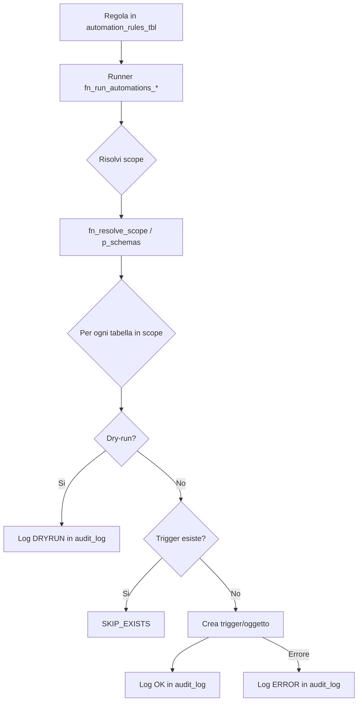
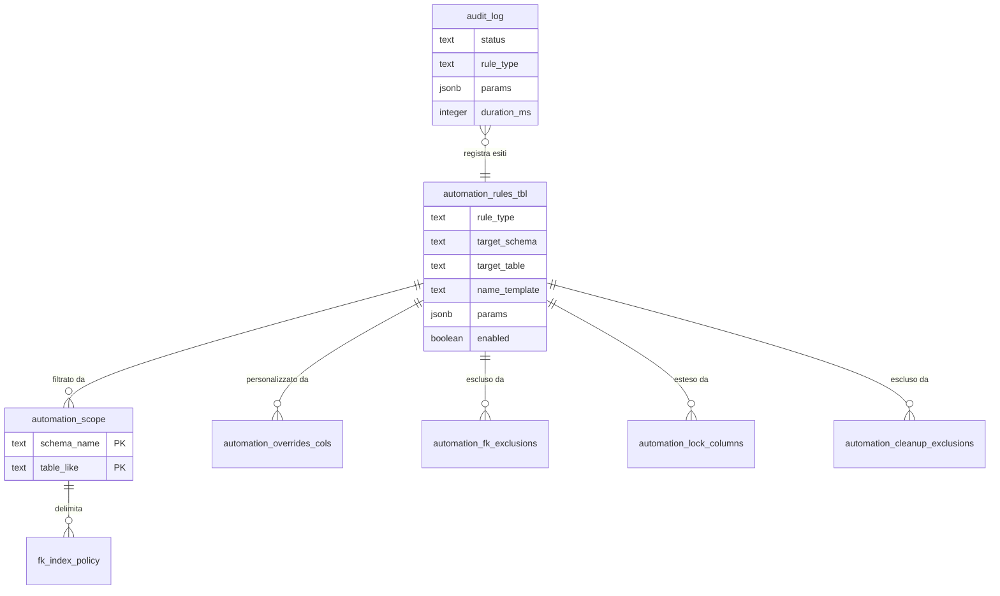

# Guida – Framework di Automazione DB

> (latest review 02-03-26)
>
> Destinatari: sviluppatori database, backend e analisti funzionali
>
> Vedi anche
>
> * [Linee guida SQL](/linee-guida-sql) — convenzioni di naming obbligatorie per il corretto funzionamento del framework
> * [Guida Storicizzazione Tabelle](/guide/storicizzazione-tabelle)
> * [Guida tx_id](/guide/tx_id_implementation_guide)
> * [Guida Tracciamento Processi e Job](/guide/Analisi-tracciamento-processi-e-job)

---

## Introduzione

In Zero ERP ogni tabella deve avere campi di audit, storicizzazione, tracciabilita transazionale e vincoli di coerenza. Fare tutto a mano significherebbe scrivere centinaia di trigger con logica ripetitiva, rischiando errori e dimenticanze.

Il **framework di automazione DB** risolve questo problema: invece di scrivere trigger uno per uno, si **dichiarano regole** in tabelle di configurazione. Il framework legge le regole, risolve su quali tabelle applicarle e genera automaticamente i trigger e gli oggetti necessari — in modo **idempotente** (puo essere rieseguito senza effetti collaterali), con **dry-run** (anteprima senza modifiche reali) e **audit** completo (ogni azione e registrata).

**Cosa troverai in questa guida:**

* Il concetto di base: come il framework trasforma regole dichiarative in trigger
* L'architettura: ambito, rules, orchestratori e audit
* Le regole disponibili, divise in **core** (usate su ogni tabella) e **specializzate** (per casi specifici)
* La configurazione pratica e gli esempi SQL
* La governance degli indici FK
* La generazione automatica di codici/numeri
* La checklist operativa per il deploy

### In 3 passi: come portare una nuova tabella nel framework

Se hai appena creato una tabella e vuoi che il framework la gestisca:

1. **Verifica l'ambito**: la tabella e in uno schema gia presente in `automation_scope`? Se si, il framework la vede gia. Se no, aggiungi lo schema all'ambito.
2. **Verifica le rules**: esistono regole con `target_schema='*all'`? Se si, la tabella e gia coperta per TX_ID, AUDIT, STORICO ecc. Se serve una regola specifica (es. LOCK_COLUMNS), aggiungila.
3. **Esegui il runner**: prima in dry-run (`p_dry_run=true`), poi in apply (`p_dry_run=false`). Verifica i trigger generati.

Per la procedura dettagliata passo-passo, vedi il [Tutorial – Aggiungere una tabella al framework](/tutorial/framework-automazione-db).

---

## 1. Architettura

Il framework e composto da quattro livelli che collaborano tra loro. Ognuno ha un ruolo preciso.

### 1.1 Ambito (dove applicare)

L'**ambito** definisce il perimetro: su quali schemi e tabelle il framework opera. E configurato nella tabella `dbops.automation_scope`.

Ogni riga indica uno schema e un pattern di tabelle. Il sentinel `'*all'` significa "tutte le tabelle dello schema".

Il runner usa due funzioni per risolvere l'ambito:

* `fn_resolve_scope(p_schemas)` — se il parametro e NULL o vuoto, legge `automation_scope`; se anche quello e vuoto, usa tutti gli schemi utente **escluso `storico`**
* `fn_table_in_scope(schema, table)` — verifica se una singola tabella rientra nell'ambito

### 1.2 Rules (cosa applicare)

Le **regole** (`dbops.automation_rules_tbl`) dichiarano quale automazione applicare, a quale schema/tabella, e con quali parametri. Ogni regola ha:

| Campo                | Significato                                                                |
| -------------------- | -------------------------------------------------------------------------- |
| `rule_type`          | Tipo di automazione (TX_ID, AUDIT_UPDATE, STORICO, ecc.)                   |
| `target_schema`      | Schema target — `'*all'` per tutti gli schemi nell'ambito                  |
| `target_table`       | Pattern LIKE per le tabelle (es. `foo_%`) oppure NULL per tutte            |
| `name_template`      | Template per il nome del trigger/oggetto generato                          |
| `existence_strategy` | Come verificare se l'oggetto esiste gia: `BY_NAME`, `BY_FUNCTION` o `BOTH` |
| `params`             | Parametri JSON specifici per la regola                                     |
| `exec_mode`          | Quando eseguire: `AUTO`, `CI`, `SCHEDULED`                                 |
| `enabled`            | Flag per attivare/disattivare la regola                                    |

**Precedenza ambito/rules**: una regola con `target_schema='*all'` si applica **solo** alle tabelle che rientrano nell'ambito risolto. Se l'ambito include solo `anagrafiche` e `vendite`, la regola `*all` tocchera solo quei due schemi. L'ambito delimita dove, le rules definiscono cosa.

### 1.3 Overrides e exclusions (eccezioni)

Non tutte le tabelle seguono le convenzioni standard. Le tabelle di override permettono di gestire i casi speciali:

* `automation_overrides_cols` — nomi colonna non standard (es. `attivo_flag` invece di `attivo`, FK storico diverse)
* `automation_fk_exclusions` — coppie parent/child da escludere per la regola ATTIVO. ⚠️ **Attualmente inerte**: il filtro è stato disattivato in `20260113-01` ("non più utilizzato") e non re-introdotto; `fn_run_automations_attivo` non consulta la tabella. Per ritirare config senza toccare il guard si usa il pattern `obsoleto_dal` (vedi `brief-db-deprecabilita-catalogo-vs-istanze.md`). Riabilitarlo richiede re-inserire il `NOT EXISTS` nel cursor FK
* `automation_cleanup_exclusions` — tabelle da escludere dal cleanup automatico
* `automation_lock_columns` — colonne extra da bloccare per singola tabella

### 1.4 Orchestratori (chi esegue)

Gli **orchestratori** sono funzioni SQL che leggono rules e ambito, risolvono le tabelle target e creano i trigger. Ogni area ha il proprio orchestratore:

| Orchestratore                                                                               | Regola gestita                                     |
| ------------------------------------------------------------------------------------------- | -------------------------------------------------- |
| [fn_run_automations](/dbzero/dbops/funzioni/fn_run_automations)                             | Orchestratore principale (chiama i singoli runner) |
| [fn_run_automations_tx_id](/dbzero/dbops/funzioni/fn_run_automations_tx_id)                 | TX_ID                                              |
| [fn_run_automations_audit_update](/dbzero/dbops/funzioni/fn_run_automations_audit_update)   | AUDIT_UPDATE                                       |
| [fn_run_automations_storico](/dbzero/dbops/funzioni/fn_run_automations_storico)             | STORICO + STORICO_PROVISION                        |
| [fn_run_automations_lock_columns](/dbzero/dbops/funzioni/fn_run_automations_lock_columns)   | LOCK_COLUMNS                                       |
| [fn_run_automations_attivo](/dbzero/dbops/funzioni/fn_run_automations_attivo)               | ATTIVO                                             |
| [fn_run_automations_delete_block](/dbzero/dbops/funzioni/fn_run_automations_delete_block)   | DELETE_BLOCK                                       |
| [fn_run_automations_cleanup](/dbzero/dbops/funzioni/fn_run_automations_cleanup)             | CLEANUP                                            |
| [fn_run_automations_drop_lock_trg](/dbzero/dbops/funzioni/fn_run_automations_drop_lock_trg) | Cleanup trigger LOCK obsoleti                      |

Tutti i runner accettano il parametro `p_dry_run`:

* `true` — simula l'esecuzione e logga con stato `DRYRUN` (nessuna modifica)
* `false` — esegue realmente e logga con stato `OK` o `ERROR`

### 1.5 Audit (cosa e successo)

Ogni azione del framework viene registrata in `dbops.audit_log` con:

* `status` — `DRYRUN`, `OK`, `ERROR`, `SKIP_EXISTS`
* `rule_type` — quale regola
* `params` — dettagli strutturati (tabella, trigger, azione)
* `duration_ms` — tempo di esecuzione
* `sqlstate` / `error_context` — in caso di errore

Opzionalmente, il log puo avvenire **fuori transazione** via dblink (`logconn`), utile quando si vuole conservare il log anche se la transazione fa rollback. Si attiva con il GUC `myapp.log_with_dblink='on'`.

---

## 2. Le regole: panoramica

Le regole si dividono in due gruppi per importanza e frequenza d'uso.

### Regole core

Sono le regole fondamentali, applicate a **tutte** (o quasi) le tabelle del sistema. Ogni progetto le usa fin dall'inizio.

| Regola                | Cosa fa                                                          | Trigger generato                |
| --------------------- | ---------------------------------------------------------------- | ------------------------------- |
| **TX_ID**             | Assegna un UUID di transazione a ogni riga inserita/modificata   | `BEFORE INSERT OR UPDATE`       |
| **AUDIT_UPDATE**      | Aggiorna i campi `data_update` e `user_update` a ogni modifica   | `BEFORE UPDATE`                 |
| **STORICO**           | Salva uno snapshot del record prima di modificarlo o cancellarlo | `BEFORE UPDATE OR DELETE`       |
| **STORICO_PROVISION** | Crea la tabella `storico.<tabella>` se non esiste                | Nessun trigger (crea struttura) |

### Regole specializzate

Sono regole per casi specifici. Non tutte le tabelle le richiedono.

| Regola                       | Cosa fa                                                       | Quando serve                                           |
| ---------------------------- | ------------------------------------------------------------- | ------------------------------------------------------ |
| **LOCK_COLUMNS**             | Blocca la modifica di colonne critiche (es. `codice_interno`) | Tabelle con codici che non devono cambiare             |
| **ATTIVO**                   | Impedisce la disattivazione di un padre se ha figli FK attivi | Tabelle con soft-delete e relazioni padre/figlio       |
| **OVERLAP**                  | Previene sovrapposizioni temporali con vincoli EXCLUDE GiST   | Tabelle versionate con `valido_dal`/`valido_al`        |
| **DELETE_BLOCK**             | Blocca la DELETE su tabelle sensibili (bypass via GUC)        | Tabelle di configurazione critica (es. ruoli)          |
| **CLEANUP**                  | Calcola `cleanup_at` e purge dei record scaduti               | Tabelle con dati temporanei (log, sessioni)            |
| **GUARD utility/tipo_ruolo** | Verifica coerenza tra utility e tipo ruolo del soggetto       | Tabelle con colonne `utility_id` + `soggetto_ruolo_id` |

---

## 3. Regole core – dettaglio

### 3.1 TX_ID (tracciabilita transazionale)

Ogni operazione di insert o update riceve un **UUID di transazione** (`tx_id`). Questo permette di collegare tutte le modifiche fatte nella stessa transazione, utile per debugging e audit.

**Come funziona:**

* Trigger `BEFORE INSERT OR UPDATE` che chiama `dbops.trgfn_tx_id_managed()`
* Il `tx_id` viene generato una volta per transazione e riutilizzato per tutte le righe toccate nella stessa transazione
* La colonna `tx_id` deve esistere sulla tabella (tipo UUID)

**Template naming:** `trg_{table}_ins_upd_gen_tx_id`

### 3.2 AUDIT_UPDATE (campi audit)

Ogni modifica a un record aggiorna automaticamente **chi** ha fatto la modifica e **quando**.

**Come funziona:**

* Trigger `BEFORE UPDATE` che chiama `script.trgfn_upd_audit_data_user_generic()`
* Aggiorna `data_update` (timestamp) e `user_update` (utente corrente)
* Le colonne devono esistere sulla tabella (i nomi possono essere personalizzati via override)

**Template naming:** `trg_upd_{table}_audit_data_user`

### 3.3 STORICO (storicizzazione)

Prima di ogni modifica o cancellazione, il framework salva una **copia del record** nella tabella corrispondente dello schema `storico`. Questo crea un audit trail completo e immutabile.

**Come funziona:**

* Trigger **unico** `BEFORE UPDATE OR DELETE` che chiama `script.trgfn_upd_dlt_storico_generic(fk)`
* Scrive su `storico.<stesso_nome_tabella>` (senza suffisso `_storico`)
* Lo snapshot del record viene salvato in un campo JSONB

**Template naming:** `trgx_z90_{table}_upd_dlt_storico`

**Nota**: il prefisso `trgx_z90_` garantisce che questo trigger venga eseguito **per ultimo** (fase finale), dopo tutti gli altri trigger sulla tabella.

### 3.4 STORICO_PROVISION (creazione tabelle storico)

Complementare a STORICO: crea automaticamente la tabella `storico.<tabella>` se non esiste, con la struttura standard:

* FK verso la PK della tabella padre
* Campo `snapshot` JSONB con il contenuto del record
* Campi `change_type`, `tipo_operazione`, metadati

**Parametro opzionale:** `create_gin_index` — se `true`, crea un indice GIN sul campo `snapshot` per ricerche rapide nel JSON.

**Guard**: i runner STORICO e STORICO_PROVISION **non processano** tabelle nello schema `storico` (per evitare ricorsione).

---

## 4. Regole specializzate – dettaglio

### 4.1 LOCK_COLUMNS (blocco colonne critiche)

Alcune colonne non devono essere modificate dopo la creazione del record (es. `codice_interno`). Questa automazione genera un trigger che **impedisce la modifica** di queste colonne.

**Come funziona:**

* Trigger `BEFORE UPDATE OF <colonne>` che chiama `script.trgfn_lock_columns(...)`
* La colonna `codice_interno` e **implicita**: se esiste sulla tabella, viene sempre inclusa
* Colonne extra si configurano in `dbops.automation_lock_columns`
* Se una colonna configurata non esiste fisicamente sulla tabella, il runner la ignora

**Cleanup trigger obsoleti:**
Quando non esistono piu colonne da bloccare (ne `codice_interno` ne colonne extra attive), i trigger possono restare orfani. La funzione `dbops.fn_run_automations_drop_lock_trg` li rimuove.

### 4.2 ATTIVO (soft-delete – policy BLOCK-ONLY)

Molte tabelle hanno una colonna `attivo` per il soft-delete (disattivare un record invece di cancellarlo). L'automazione ATTIVO garantisce la **coerenza tra padre e figli**: un record padre non puo essere disattivato se ha ancora figli collegati tramite FK.

**Regola applicata:**

* La disattivazione (`attivo = false`) di un record **padre** e consentita **solo se non esistono record figli** collegati
* **Nessuna cascata automatica** sui figli
* La regola si applica solo se il padre possiede la colonna `attivo`
* Le FK considerate sono `RESTRICT` e `NO ACTION` (anche `DEFERRABLE`)
* Solo FK con colonna che termina in `_id` (esclude riferimenti a codici testuali)

**Trigger generato:**

* Tabella: PADRE
* Evento: `BEFORE UPDATE OF attivo`
* Funzione: `dbops.trgfn_prevent_deactivate_if_children(child_schema, child_table, fk_col [, pk_col])`

**Effetto:** se `OLD.attivo = true` e `NEW.attivo = false` e esistono figli FK → operazione **bloccata con errore**.

### 4.3 OVERLAP (anti-sovrapposizione temporale)

Per tabelle **versionate** (con colonne `valido_dal`/`valido_al` o `valid_from`/`valid_to`), questa automazione crea vincoli `EXCLUDE GiST` che impediscono sovrapposizioni temporali sulle stesse chiavi logiche.

**Componenti:**

* **Config**: `dbops.automazione_overlap` — definisce chiavi logiche (`key_columns` + `key_expressions`), colonne periodo, flag `active` e (opzionale) `where_predicate` per vincoli parziali
* **Seed**: `dbops.fn_seed_automazione_overlap()` — rileva tabelle eleggibili e imposta `active=true` solo se versionate
* **Apply**: `dbops.fn_apply_automazione_overlap()` — crea i vincoli EXCLUDE (totali o parziali)
* **Runner schedulato**: `maintenance.proc_automations_overlap_job()` + job pgAgent `automations_overlap` (ogni giorno alle 21:00) — esegue l'apply periodicamente

**Vincoli parziali (`where_predicate`):** dalla rev 2026-06-02 il framework
supporta anche EXCLUDE **parziali**, cioè con una clausola `WHERE` (es. "niente
sovrapposizioni **solo tra le righe attive**"). Basta valorizzare la colonna
`where_predicate` in config (es. `attivo IS TRUE`, `stato = 'ATTIVA'`, oppure una
colonna booleana/generata come `partecipa_overlap_snapshot` su `vendite.contratti`,
che combina `NOT abortito AND NOT draft` → esclusività solo all'attivazione);
`NULL` = vincolo totale come prima.

**Chiavi su espressione (`key_expressions`):** oltre alle colonne semplici
(`key_columns`), una chiave può essere un'espressione (es.
`COALESCE(classe_utenza_id, -1)` per trattare i NULL come uguali). Si valorizza la
colonna `key_expressions`; le due liste si combinano nella chiave del constraint.

> ⚠️ `where_predicate` e `key_expressions` sono **frammenti DDL di fiducia**:
> iniettati as-is nel constraint (espressioni, non quotabili). Vanno scritti **solo
> da un DBA**, mai da input applicativo/utente.

**Schedulazione e auto-guarigione:** l'apply non gira solo al setup ma ogni notte
(job `automations_overlap`). Essendo idempotente, a regime non fa nulla; ma se un
EXCLUDE viene droppato per errore (es. da un refactor), la passata notturna lo
**ricrea**. È la difesa contro le regressioni silenziose (vedi
`dev/work-done/refactor-overlap.md`).

**Note operative:**

* Se `key_columns` non e valorizzato, il vincolo non viene creato
* Per chiavi UUID e richiesta l'estensione `btree_gist`
* Le tabelle non versionate restano `active=false`
* L'apply è idempotente: salta se esiste già un EXCLUDE sul periodo. **Cambiare** un
  `where_predicate` richiede prima il `DROP CONSTRAINT` manuale (il framework non fa `ALTER`)

### 4.4 DELETE_BLOCK (blocco DELETE con GUC)

Per tabelle sensibili (es. tabelle ruoli, configurazioni critiche) dove la DELETE deve essere **bloccata per default** e consentita solo tramite bypass esplicito.

**Come funziona:**

* Config in `dbops.automation_delete_block` con schema, tabella, chiave GUC e flag `enabled`
* Trigger `script.trgfn_delete_block_by_guc(guc_key)` — blocca la DELETE a meno che il GUC specificato non sia impostato a `'on'`
* Apply con `dbops.fn_run_automations_delete_block()`

### 4.5 CLEANUP (pulizia record scaduti)

Per tabelle con dati temporanei che devono essere rimossi dopo un certo periodo (log, sessioni, cache).

**Due regole in `automation_rules_tbl`:**

* `CLEANUP_AT` — calcola `cleanup_at` con un TTL fisso a partire da un timestamp base
* `CLEANUP_PURGE` — elimina i record scaduti (in batch)

**Parametri JSON tipici:**

* `CLEANUP_AT`: `ttl_days`, `cleanup_column`, `base_ts_column`, `apply_on_update`
* `CLEANUP_PURGE`: `cleanup_column`, `batch_limit`

**Esclusioni:** `dbops.automation_cleanup_exclusions`

### 4.6 GUARD utility/tipo_ruolo

Per tabelle che espongono sia una colonna utility (`utility_id`) sia una colonna ruolo (`soggetto_ruolo_id`). Il trigger verifica che il tipo di ruolo del soggetto sia coerente con la utility indicata, consultando la matrice `config.utilities_tipi_ruolo`.

**Componenti:**

* Config: `dbops.automazione_guard_utility_tipo_ruolo`
* Seed: `dbops.fn_seed_automazione_guard_utility_tipo_ruolo()` — autodetect tabelle candidate
* Apply: `dbops.fn_apply_automazione_guard_utility_tipo_ruolo()`
* Trigger function: `script.trgfn_guard_utility_tipo_ruolo_by_cols()`

**Comportamento:** se la matrice non e configurata per la utility in questione, il trigger adotta un comportamento fail-open (non blocca).

---

## 5. Configurazione pratica

### 5.1 Configurare le rules

Le regole si inseriscono in `dbops.automation_rules_tbl`. Usa `target_schema='*all'` per applicare globalmente, altrimenti specifica lo schema.

**Consigli:**

* `existence_strategy='BOTH'` minimizza i conflitti (verifica sia per nome che per funzione)
* Per STORICO, preferisci il template **senza** `{op}` (trigger unico UPDATE+DELETE)
* Se mantieni un template con `{op}`, passa `'upd_dlt'` all'helper di naming

### 5.2 Configurare l'ambito

Inserisci righe in `dbops.automation_scope`:

```sql
-- Tutti le tabelle dello schema anagrafiche
INSERT INTO dbops.automation_scope (schema_name, table_like)
VALUES ('anagrafiche', '*all');

-- Solo tabelle con prefisso fattur_ nello schema vendite
INSERT INTO dbops.automation_scope (schema_name, table_like)
VALUES ('vendite', 'fattur_%');
```

`table_like` non e mai NULL: usa `'*all'` per indicare tutte le tabelle.

### 5.3 Configurare gli overrides

La tabella `automation_overrides_cols` permette di definire nomi colonna diversi dallo standard per singola tabella.

```sql
-- Usa "attivo_flag" invece di "attivo"
INSERT INTO dbops.automation_overrides_cols
  (schema_name, table_name, override_key, column_name)
VALUES ('vendite', 'ordini', 'ATTIVO_COL', 'attivo_flag');

-- Per storico: FK diversa dal default
INSERT INTO dbops.automation_overrides_cols
  (schema_name, table_name, override_key, column_name)
VALUES ('catalogo', 'articoli_componenti', 'STORICO_FK', 'articoli_componenti_id');
```

Override disponibili: `ATTIVO_COL`, `AUDIT_TS`, `AUDIT_USER`, `STORICO_FK`, `STORICIZZA_COL`.

### 5.4 Naming e limiti

I template supportano i placeholder: `{schema}`, `{table}`, `{parent}`, `{child}`, `{fk}`, `{op}`.

PostgreSQL impone un limite di **63 caratteri** per i nomi degli oggetti. L'helper `fn_name_from_template` gestisce automaticamente abbreviazioni e hash quando il nome risultante e troppo lungo.

---

## 6. Esempi SQL di configurazione

Di seguito insert **idempotenti** (usano `WHERE NOT EXISTS`) per le regole piu comuni.

### 6.1 TX_ID

```sql
INSERT INTO dbops.automation_rules_tbl
(enabled, rule_type, target_schema, target_table, exec_mode,
 name_template, existence_strategy, params, priority, note)
SELECT true, 'TX_ID', '*all', NULL, 'AUTO',
       'trg_{table}_ins_upd_gen_tx_id', 'BOTH', '{}'::jsonb,
       100, 'tx_id globale'
WHERE NOT EXISTS (
  SELECT 1 FROM dbops.automation_rules_tbl
  WHERE rule_type = 'TX_ID' AND target_schema = '*all'
);
```

### 6.2 AUDIT_UPDATE

```sql
INSERT INTO dbops.automation_rules_tbl
(enabled, rule_type, target_schema, target_table, exec_mode,
 name_template, existence_strategy, params, priority, note)
SELECT true, 'AUDIT_UPDATE', '*all', NULL, 'AUTO',
       'trg_upd_{table}_audit_data_user', 'BOTH',
       '{"audit_ts":"data_update","audit_user":"user_update"}'::jsonb,
       100, 'audit update globale'
WHERE NOT EXISTS (
  SELECT 1 FROM dbops.automation_rules_tbl
  WHERE rule_type = 'AUDIT_UPDATE' AND target_schema = '*all'
);
```

### 6.3 STORICO (trigger unico UPDATE+DELETE)

```sql
INSERT INTO dbops.automation_rules_tbl
(enabled, rule_type, target_schema, target_table, exec_mode,
 name_template, existence_strategy, params, priority, note)
SELECT true, 'STORICO', '*all', NULL, 'AUTO',
       'trgx_z90_{table}_upd_dlt_storico', 'BOTH',
       '{"apply_triggers": true, "drop_legacy_ud": true}'::jsonb,
       100, 'storico: trigger unificato'
WHERE NOT EXISTS (
  SELECT 1 FROM dbops.automation_rules_tbl
  WHERE rule_type = 'STORICO' AND target_schema = '*all'
);
```

La tabella di destinazione deve esistere in `storico.<stesso_nome_tabella>` (creata da STORICO_PROVISION).

### 6.4 STORICO_PROVISION

```sql
INSERT INTO dbops.automation_rules_tbl
(enabled, rule_type, target_schema, target_table, exec_mode,
 name_template, existence_strategy, params, priority, note)
SELECT true, 'STORICO_PROVISION', '*all', NULL, 'AUTO',
       NULL, 'BOTH', '{"create_gin_index": false}'::jsonb,
       100, 'storico: provisioning tabelle'
WHERE NOT EXISTS (
  SELECT 1 FROM dbops.automation_rules_tbl
  WHERE rule_type = 'STORICO_PROVISION' AND target_schema = '*all'
);
```

Esempio piu mirato (solo schema `catalogo`, tabelle `articoli_%`):

```sql
INSERT INTO dbops.automation_rules_tbl
(enabled, rule_type, target_schema, target_table, exec_mode,
 name_template, existence_strategy, params, priority, note)
VALUES (true, 'STORICO_PROVISION', 'catalogo', 'articoli_%', 'AUTO',
        NULL, 'BOTH', '{"create_gin_index": true}'::jsonb,
        100, 'storico: prov catalogo');
```

### 6.5 ATTIVO (BLOCK-ONLY)

```sql
INSERT INTO dbops.automation_rules_tbl
(enabled, rule_type, target_schema, target_table, exec_mode,
 name_template, existence_strategy, params, priority, note)
SELECT true, 'ATTIVO', '*all', NULL, 'AUTO',
       '{"block":"trg_{parent}_a10_{child}_block_deact_upd",
         "require":"trg_{child}_a10_{parent}_require_attivo_ins_upd"}',
       'BOTH', '{}'::jsonb,
       100, 'attivo: blocco disattivazione padre se esistono figli'
WHERE NOT EXISTS (
  SELECT 1 FROM dbops.automation_rules_tbl
  WHERE rule_type = 'ATTIVO' AND target_schema = '*all'
);
```

Comportamento: crea **solo** trigger di BLOCCO sul PADRE; nessuna cascata; nessun trigger REQUIRE sul figlio.

---

## 7. Policy indici FK

Gli indici sulle chiavi esterne sono fondamentali per le performance. Il framework centralizza la governance degli indici FK nella tabella `dbops.fk_index_policy`, evitando la creazione manuale e garantendo naming coerente.

### 7.1 Componenti

**Tabella policy:** [dbops.fk_index_policy](/dbzero/dbops/tabelle/fk_index_policy)
Ogni riga rappresenta una FK con un flag `consentito` (l'indice deve esistere?) e il `ddl_command` per crearlo/rimuoverlo.

**View di supporto:**

| View                                                                                   | Cosa mostra                                     |
| -------------------------------------------------------------------------------------- | ----------------------------------------------- |
| [vw_fk_con_indice_missing_policy](/dbzero/dbops/views/vw_fk_con_indice_missing_policy) | FK con indice esistente ma senza riga in policy |
| [vw_fk_senza_indice](/dbzero/dbops/views/vw_fk_senza_indice)                           | FK senza indice (considerando anche UNIQUE)     |
| [vw_duplicate_indexes](/dbzero/dbops/views/vw_duplicate_indexes)                       | Indici duplicati per schema/tabella             |

Tutte le view lavorano solo sugli schemi presenti in `dbops.automation_scope`.

**Funzioni e procedure:**

| Nome                                                                              | Tipo      | Cosa fa                                                       |
| --------------------------------------------------------------------------------- | --------- | ------------------------------------------------------------- |
| [fn_seed_fk_index_policy](/dbzero/dbops/funzioni/fn_seed_fk_index_policy)         | Funzione  | Registra in policy le FK gia indicizzate (`consentito=true`)  |
| [fn_populate_fk_index_policy](/dbzero/dbops/funzioni/fn_populate_fk_index_policy) | Funzione  | Registra in policy le FK senza indice (`consentito=false`)    |
| [apply_fk_index_policy](/dbzero/dbops/funzioni/apply_fk_index_policy)             | Procedura | Crea/rimuove indici in base alla policy (invocata con `CALL`) |

### 7.2 Flusso operativo

```text
1. Seed     → registra le FK gia indicizzate
2. Populate → registra le FK mancanti
3. Apply    → crea/rimuove indici secondo la policy
```

```sql
-- 1. Seed (indici gia presenti)
SELECT dbops.fn_seed_fk_index_policy();

-- 2. Populate (indici mancanti)
SELECT dbops.fn_populate_fk_index_policy();

-- 3. Apply
CALL dbops.apply_fk_index_policy();
```

**Job schedulabile:** `maintenance.proc_apply_fk_index_policy_job()` (con logging e lock).

**Regola operativa:** non creare indici FK manualmente. Se servono, usa la policy e il naming coerente, poi registra in `fk_index_policy`.

---

## 8. Generazione automatica codici/numeri

Questa parte del framework gestisce la **generazione automatica di codici o numeri** sulle tabelle applicative. Quando una tabella ha bisogno di un codice progressivo (es. numero fattura, codice articolo), il framework lo genera tramite configurazione dichiarativa e trigger.

### 8.1 Componenti

* **Tabella di configurazione**: [config.sistema_codici](/dbzero/config/manual/sistema_codici)
* **Generatore**: [script.fn_generate_codice](/dbzero/script/funzioni/fn_generate_codice) — genera il codice usando una sequenza pre-provisionata
* **Sincronizzatore**: [script.trgfn_config_sistema_codici_sync_gen_codice](/dbzero/script/funzioni/trgfn_config_sistema_codici_sync_gen_codice) — mantiene allineati i trigger sulle tabelle target

### 8.2 Come funziona

La generazione avviene **solo** se `usa_sequenza = TRUE` nella configurazione.

Il trigger viene applicato alla tabella target come `BEFORE INSERT OR UPDATE OF <colonna>`. La generazione scatta solo se il campo e **nullo o vuoto**:

* Campi numerici: `NULL` o `0`
* Campi alfanumerici: `NULL` o stringa vuota

Il nome della sequenza e **sempre derivato** come `<schema>.<tabella>_<colonna>_seq`.

### 8.3 Naming oggetti generati

* **Trigger**: `trg_<tabella>_a10_gen_codice_ins_upd`
* **Trigger function**: `trgfn_<tabella>_gen_codice` (creata nello stesso schema della tabella target)

### 8.4 Flusso di sincronizzazione

```text
1. Inserimento/aggiornamento/cancellazione in config.sistema_codici
2. Il trigger sulla tabella config chiama il sincronizzatore
3. Il sincronizzatore crea/aggiorna/rimuove trigger e function sulla tabella target
```

### 8.5 Checklist

* Verificare che esista la riga in `config.sistema_codici` per il codice desiderato
* Popolare `schema_tabella`, `nome_tabella`, `nome_colonna`
* Impostare `usa_sequenza = TRUE` per attivare la generazione

---

## 9. Troubleshooting

### Il runner va in errore a meta esecuzione

Se il runner ha creato trigger su alcune tabelle ma fallisce su altre, i trigger gia creati restano in piedi (le operazioni DDL in PostgreSQL non sono tutte transazionali allo stesso modo per i trigger creati via `EXECUTE`).

**Cosa fare:**

1. Controlla `dbops.audit_log` con `status='ERROR'` per identificare la tabella problematica
2. Correggi il problema (es. colonna mancante, conflitto naming)
3. Riesegui il runner — e idempotente, non ricrea trigger gia esistenti

### Trigger generato confligge con un trigger manuale

Se hai un trigger manuale che fa la stessa cosa (es. audit) e il framework ne crea uno automatico, avrai una doppia esecuzione.

**Cosa fare:**

* Se il trigger manuale e obsoleto, rimuovilo e lascia quello del framework
* Se il trigger manuale ha logica specifica, aggiungi la tabella in `automation_fk_exclusions` o disabilita la regola per quella tabella specifica

### Il dry-run non mostra modifiche attese

Verifica in ordine:

1. La tabella e nell'ambito? → controlla `automation_scope` o passa lo schema nel parametro `p_schemas`
2. La regola e abilitata? → controlla `enabled = true` in `automation_rules_tbl`
3. Il trigger esiste gia? → il runner lo salta con `SKIP_EXISTS`
4. La tabella ha le colonne necessarie? → es. `tx_id` per TX_ID, `attivo` per ATTIVO

### Lo schema storico non e escluso

I runner STORICO e STORICO_PROVISION escludono automaticamente lo schema `storico`. Se vedi trigger storici su tabelle dello schema `storico`, e probabilmente un trigger manuale — non del framework.

---

## Diagramma – Flusso di esecuzione



## Diagramma – Relazioni tra tabelle di configurazione



---

## Checklist operativa (deploy)

Questa checklist e pensata per essere usata prima, durante e dopo il rollout delle automazioni.

### Pre-flight

- [ ] **DB corretto**: `SELECT lower(current_database());` deve restituire `zero` o `zeroerp`
- [ ] **Permessi**: l'utente ha `CREATE TRIGGER` sugli schemi target
- [ ] **Ambito**: definito uno tra `p_schemas`, `dbops.automation_scope` oppure fallback accettato
- [ ] **Contesto Liquibase**: conferma che in CI non passi `--contexts=test` (solo locale)
- [ ] **Estensioni**: se vuoi audit out-of-tx → `dblink` installata e GUC configurato

### Dry-run

- [ ] Esegui il dry-run sugli schemi target:

  ```sql
  SELECT dbops.fn_run_automations(
    'CI', ARRAY['anagrafiche','vendite'], true,
    ARRAY['TX_ID','AUDIT_UPDATE','STORICO','ATTIVO']
  );
  ```

- [ ] Verifica il log:

  ```sql
  SELECT executed_at, rule_type,
         params->>'table' AS tabella,
         params->>'trigger' AS trigger
  FROM dbops.audit_log
  WHERE status = 'DRYRUN'
  ORDER BY executed_at DESC
  LIMIT 50;
  ```

### Apply

- [ ] Esegui l'apply un modulo alla volta:

  ```sql
  SELECT dbops.fn_run_automations('CI', ARRAY['anagrafiche'], false, ARRAY['TX_ID']);
  ```

- [ ] Se usi LOCK_COLUMNS e hai disattivato colonne, valuta il cleanup:

  ```sql
  SELECT dbops.fn_run_automations_drop_lock_trg('AUTO', NULL, false);
  ```

### Verifica post-apply

- [ ] Trigger presenti:

  ```sql
  SELECT n.nspname, c.relname, t.tgname
  FROM pg_trigger t
  JOIN pg_class c ON c.oid = t.tgrelid
  JOIN pg_namespace n ON n.oid = c.relnamespace
  WHERE n.nspname IN ('anagrafiche')
    AND NOT t.tgisinternal
  ORDER BY 1, 2, 3;
  ```

- [ ] Test funzionali minimi:
    * **TX_ID**: insert/update → `tx_id` non nullo
    * **AUDIT_UPDATE**: update → `data_update`/`user_update` aggiornati
    * **STORICO**: update/delete → riga presente in `storico.<tabella>`
    * **ATTIVO**: set padre `attivo=false` con figli → errore bloccante

### Osservabilita

- [ ] Audit esiti:

  ```sql
  SELECT executed_at, status, rule_type, message, duration_ms
  FROM dbops.audit_log
  WHERE function_name = 'run_automations'
  ORDER BY executed_at DESC LIMIT 50;
  ```

- [ ] In caso di errore:

  ```sql
  SELECT executed_at, rule_type, sqlstate, error_context, params
  FROM dbops.audit_log
  WHERE status = 'ERROR'
  ORDER BY executed_at DESC LIMIT 20;
  ```

### Config e naming

- [ ] Template rispettano limite **63 char**
- [ ] Override definiti in `automation_overrides_cols` dove necessario
- [ ] Esclusioni FK in `automation_fk_exclusions` dove necessario
- [ ] `existence_strategy` coerente (`BY_NAME` / `BY_FUNCTION` / `BOTH`)

### CI/CD

- [ ] Pipeline CI usa `update` senza contexts di test
- [ ] `tests/changelog.yaml` eseguito solo con context di test

---

## Tabelle di riferimento

| Tabella                                                                                            | Schema | Scopo                          |
| -------------------------------------------------------------------------------------------------- | ------ | ------------------------------ |
| [automation_rules_tbl](/dbzero/dbops/tabelle/automation_rules_tbl)                                 | dbops  | Regole di automazione          |
| [automation_scope](/dbzero/dbops/tabelle/automation_scope)                                         | dbops  | Ambito schemi/tabelle          |
| [automation_overrides_cols](/dbzero/dbops/tabelle/automation_overrides_cols)                       | dbops  | Override colonne non standard  |
| [automation_fk_exclusions](/dbzero/dbops/tabelle/automation_fk_exclusions)                         | dbops  | Esclusioni FK per ATTIVO       |
| [automation_lock_columns](/dbzero/dbops/tabelle/automation_lock_columns)                           | dbops  | Colonne extra per LOCK_COLUMNS |
| [automation_cleanup_exclusions](/dbzero/dbops/tabelle/automation_cleanup_exclusions)               | dbops  | Esclusioni cleanup             |
| [automation_delete_block](/dbzero/dbops/tabelle/automation_delete_block)                           | dbops  | Config DELETE_BLOCK            |
| [automazione_overlap](/dbzero/dbops/tabelle/automazione_overlap)                                   | dbops  | Config OVERLAP                 |
| [automazione_guard_utility_tipo_ruolo](/dbzero/dbops/tabelle/automazione_guard_utility_tipo_ruolo) | dbops  | Config GUARD utility/ruolo     |
| [audit_log](/dbzero/dbops/tabelle/audit_log)                                                       | dbops  | Log audit delle automazioni    |
| [fk_index_policy](/dbzero/dbops/tabelle/fk_index_policy)                                           | dbops  | Policy indici FK               |
| [sistema_codici](/dbzero/config/manual/sistema_codici)                                             | config | Config generazione codici      |

---


