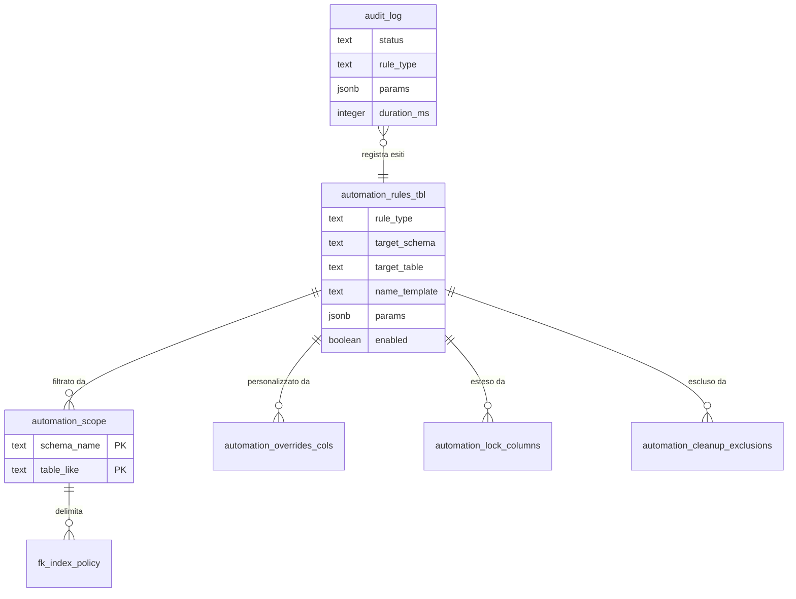

# Guida — Framework di Automazione DB

> **Ultimo aggiornamento**: 4 novembre 2026
>
> **Destinatari**: sviluppatori database, backend e analisti funzionali; chi amministra un'installazione (§9)
>
> **Vedi anche** — schemi DB:
>
> * [dbops.processi](/dbzero/dbops/tabelle/processi) — il catalogo dei processi: i giri delle automazioni, il loro ordine in CI, la loro accensione
> * [dbops.vw_processi_programmazione](/dbzero/dbops/views/vw_processi_programmazione) — il panorama: per ogni processo, se gira come dovrebbe
> * [maintenance.job_run_log](/dbzero/maintenance/tabelle/job_run_log) — il giornale delle corse
> * [dbops.automation_rules_tbl](/dbzero/dbops/tabelle/automation_rules_tbl) — le regole di automazione
> * [dbops.automation_scope](/dbzero/dbops/tabelle/automation_scope) — l'ambito: gli schemi e le tabelle a cui applicarle
> * [dbops.automation_overrides_cols](/dbzero/dbops/tabelle/automation_overrides_cols) — le colonne non standard
> * [dbops.automation_lock_columns](/dbzero/dbops/tabelle/automation_lock_columns) — le colonne extra per LOCK_COLUMNS
> * [dbops.automazione_codice_eccezioni](/dbzero/dbops/tabelle/automazione_codice_eccezioni) — le colonne `codice` escluse da CODICE_MAIUSCOLO
> * [dbops.automation_cleanup_exclusions](/dbzero/dbops/tabelle/automation_cleanup_exclusions) — le esclusioni del cleanup
> * [dbops.automation_delete_block](/dbzero/dbops/tabelle/automation_delete_block) — la configurazione di DELETE_BLOCK
> * [dbops.automazione_overlap](/dbzero/dbops/tabelle/automazione_overlap) — la configurazione di OVERLAP
> * [dbops.automazione_guard_utility_tipo_ruolo](/dbzero/dbops/tabelle/automazione_guard_utility_tipo_ruolo) — la configurazione del GUARD utility/tipo ruolo
> * [dbops.automazione_chiusura_scadenze](/dbzero/dbops/tabelle/automazione_chiusura_scadenze) — la configurazione della chiusura scadenze
> * [dbops.fk_index_policy](/dbzero/dbops/tabelle/fk_index_policy) — la policy degli indici sulle chiavi esterne
> * [dbops.audit_log](/dbzero/dbops/tabelle/audit_log) — dove le automazioni registrano cosa hanno fatto
> * [config.sistema_codici](/dbzero/config/tabelle/sistema_codici) — la generazione automatica di codici e numeri
>
> **Vedi anche** — funzioni e trigger DB:
>
> * [dbops.fn_lock_columns_divergenze](/dbzero/dbops/funzioni/fn_lock_columns_divergenze) — i lock di colonna vivi confrontati con il registro
> * [dbops.fn_apply_cleanup_at](/dbzero/dbops/funzioni/fn_apply_cleanup_at) — il motore della regola CLEANUP
> * [dbops.fn_apply_automazione_overlap](/dbzero/dbops/funzioni/fn_apply_automazione_overlap) — crea i vincoli EXCLUDE di OVERLAP
> * [dbops.fn_apply_delete_block_trigger](/dbzero/dbops/funzioni/fn_apply_delete_block_trigger) — monta il blocco DELETE con bypass via GUC
> * [dbops.fn_apply_automazione_guard_utility_tipo_ruolo](/dbzero/dbops/funzioni/fn_apply_automazione_guard_utility_tipo_ruolo) — monta la verifica utility/tipo ruolo
> * [dbops.apply_fk_index_policy](/dbzero/dbops/funzioni/apply_fk_index_policy) — crea e rimuove gli indici sulle FK secondo la policy
> * [script.fn_generate_codice](/dbzero/script/funzioni/fn_generate_codice) — genera codici e numeri da `config.sistema_codici`
> * [maintenance.fn_sveglia_accesa](/dbzero/maintenance/funzioni/fn_sveglia_accesa) — il cancello che fa partire un giro notturno solo se il processo è acceso
>
> **Vedi anche** — API e service backend:
>
> * [API Amministrazione software, §6](/backend/amm-software/manual/api_amm_software) — i processi automatici dall'interfaccia: presidi, accensione, «Esegui ora»
>
> **Vedi anche** — guide correlate:
>
> * [Tutorial — Portare una tabella nuova nel framework](/tutorial/framework-automazione-db) — la procedura passo passo
> * [Linee guida SQL](/linee-guida-sql) — le convenzioni di naming: il framework **legge i nomi**, quindi qui non sono stilistiche; i divieti dei changeSet (§11)
> * [Storicizzazione delle tabelle](/guide/storicizzazione-tabelle)
> * [Gestione del Transaction ID](/guide/tx_id_implementation_guide)
> * [Tracciamento Processi e Job](/guide/analisi-tracciamento-processi-e-job)
> * [I lavori automatici: che natura hanno e per conto di chi girano](/guide/processi-automatici-classe-e-identita) — le automazioni sono lavori di **manutenzione**: qui c'è il registro che le elenca

---

## Introduzione

In Zero ERP ogni tabella deve avere campi di audit, storicizzazione, tracciabilità transazionale e vincoli di coerenza. Fare tutto a mano significherebbe scrivere centinaia di trigger con logica ripetitiva, rischiando errori e dimenticanze.

Il **framework di automazione DB** risolve questo problema: invece di scrivere trigger uno per uno, si **dichiarano regole** in tabelle di configurazione. Il framework legge le regole, risolve su quali tabelle applicarle e genera automaticamente i trigger e gli oggetti necessari — in modo **idempotente** (può essere rieseguito senza effetti collaterali), con **dry-run** (anteprima senza modifiche reali) e **audit** completo (ogni azione è registrata).

**Cosa troverai in questa guida:**

* Il concetto di base: come il framework trasforma regole dichiarative in trigger
* L'architettura: ambito, rules, runner e audit
* Le regole disponibili, divise in **core** (usate su ogni tabella) e **specializzate** (per casi specifici)
* La configurazione pratica, e in coda gli esempi da copiare
* La governance degli indici FK
* La generazione automatica di codici/numeri
* Quando girano le automazioni: la convergenza del rilascio e i giri notturni (§9)
* Come si vedono e si governano dall'interfaccia di Zero ERP (§10)
* La checklist operativa per il deploy

### In 3 passi: come portare una nuova tabella nel framework

Se hai appena creato una tabella e vuoi che il framework la gestisca:

1. **Dagli le colonne giuste**: il framework legge la **struttura**. `tx_id`, `data_update`/`user_update`, `storicizza`, `attivo`, `codice_interno`, `valido_dal`/`valido_al` decidono da sole che cosa la tabella riceve. Gli schemi di dominio sono già tutti nell'ambito.
2. **Scrivi nei registri ciò che la struttura non dice**: da dove si congela l'azienda nello storico (`storico_scope_policy`, obbligatorio se la tabella si storicizza), colonne extra da bloccare, eccezioni ATTIVO, indici FK. Sempre dal **CSV** in `80_data`, mai con un `INSERT` a parte.
3. **Lascia convergere**: i trigger li monta il giro delle automazioni — da zero nella passata `ci_apply` della migrazione, su sviluppo dentro ogni update, altrimenti di notte (§9). Non si scrivono a mano.

Per la procedura dettagliata passo passo, vedi il [Tutorial — Portare una tabella nuova nel framework](/tutorial/framework-automazione-db).

---

## 1. Architettura

Il framework è composto da quattro livelli che collaborano tra loro. Ognuno ha un ruolo preciso.

### 1.1 Ambito (dove applicare)

L'**ambito** definisce il perimetro: su quali schemi e tabelle il framework opera. È configurato nella tabella `dbops.automation_scope`, seminata dal CSV `80_data/sql/dbops/automation_scope.csv`.

Ogni riga indica uno schema e un pattern di tabelle. Il sentinel `'*all'` significa "tutte le tabelle dello schema". Tutti gli schemi di dominio ci sono con `*all`; `dbops` è nell'ambito tabella per tabella.

Il runner usa due funzioni per risolvere l'ambito:

* `fn_resolve_scope(p_schemas)` — se il parametro è NULL o vuoto, legge `automation_scope`; se anche quello è vuoto, usa tutti gli schemi utente **escluso `storico`**
* `fn_table_in_scope(schema, table)` — verifica se una singola tabella rientra nell'ambito

### 1.2 Rules (cosa applicare)

Le **regole** (`dbops.automation_rules_tbl`, seminata dal CSV `80_data/sql/dbops/automation_rules_tbl.csv`) dichiarano quale automazione applicare, a quale schema/tabella, e con quali parametri. Il CSV è anche la fonte dei template di nome dei trigger. Ogni regola ha:

| Campo                | Significato                                                                |
| -------------------- | -------------------------------------------------------------------------- |
| `rule_type`          | Tipo di automazione (TX_ID, AUDIT_UPDATE, STORICO, ecc.)                   |
| `target_schema`      | Schema target — `'*all'` per tutti gli schemi nell'ambito                  |
| `target_table`       | Pattern LIKE per le tabelle (es. `foo_%`) oppure NULL per tutte            |
| `name_template`      | Template per il nome del trigger/oggetto generato                          |
| `existence_strategy` | Come verificare se l'oggetto esiste già: `BY_NAME`, `BY_FUNCTION` o `BOTH` |
| `params`             | Parametri JSON specifici per la regola                                     |
| `exec_mode`          | Quando eseguire: `AUTO`, `CI`, `SCHEDULED`                                 |
| `enabled`            | Flag per attivare/disattivare la regola                                    |

**Precedenza ambito/rules**: una regola con `target_schema='*all'` si applica **solo** alle tabelle che rientrano nell'ambito risolto. Se l'ambito include solo `anagrafiche` e `vendite`, la regola `*all` toccherà solo quei due schemi. L'ambito delimita dove, le rules definiscono cosa.

### 1.3 Overrides e exclusions (eccezioni)

Non tutte le tabelle seguono le convenzioni standard. Le tabelle di override permettono di gestire i casi speciali:

* `automation_overrides_cols` — nomi colonna non standard (es. `attivo_flag` invece di `attivo`, FK storico diverse)
* `automazione_attivo_eccezioni` — le **FK** che la regola ATTIVO non lega: per una riga (schema, tabella **figlia**, colonna FK) il motore non genera né il block sul padre né il require sul figlio, e ritira quelli già generati. Ogni riga porta il suo **motivo**, obbligatorio: un'eccezione senza perché è un buco nel framework. È **per FK, non per tabella**: le altre coppie della stessa figlia restano legate. Dettaglio in §4.2, «Le eccezioni».
  ⚠️ Per ritirare configurazione senza toccare il guard, invece, resta `obsoleto_dal` (vedi [Mandare in pensione una voce di catalogo](/guide/uso-di-obsoleto)).
* `automation_cleanup_exclusions` — tabelle da escludere dal cleanup automatico
* `automation_lock_columns` — colonne extra da bloccare per singola tabella
* `storico_scope_policy` — per ogni tabella storicizzata, da dove si prende l'azienda emittente da congelare nella sua storia (vedi §3.4)

Tutti questi registri si cambiano dal loro CSV in `80_data/sql/dbops/`, mai con un `INSERT` o un `UPDATE` a parte ([linee-guida-sql §11.2](/linee-guida-sql)).

### 1.4 Runner (chi esegue)

I **runner** sono funzioni SQL che leggono rules e ambito, risolvono le tabelle target e creano i trigger. Ogni regola ha il proprio runner, e non c'è una funzione che li chiami tutti: il giro lo fanno le procedure dei processi, nell'ordine di `dbops.processi.ci_ordine` (§9).

| Runner                                                                                      | Regola gestita                                     |
| ------------------------------------------------------------------------------------------- | -------------------------------------------------- |
| [fn_run_automations_tx_id](/dbzero/dbops/funzioni/fn_run_automations_tx_id)                 | TX_ID                                              |
| [fn_run_automations_audit_update](/dbzero/dbops/funzioni/fn_run_automations_audit_update)   | AUDIT_UPDATE                                       |
| [fn_run_automations_storico_provision](/dbzero/dbops/funzioni/fn_run_automations_storico_provision) | STORICO_PROVISION (crea le tabelle di storico) |
| [fn_run_automations_storico](/dbzero/dbops/funzioni/fn_run_automations_storico)             | STORICO (monta il trigger dove la tabella di storico c'è) |
| [fn_run_automations_lock_columns](/dbzero/dbops/funzioni/fn_run_automations_lock_columns)   | LOCK_COLUMNS (converge: crea, rigenera, toglie)    |
| [fn_run_automations_date_validita](/dbzero/dbops/funzioni/fn_run_automations_date_validita) | DATE_VALIDITA                                      |
| [fn_run_automations_codice_maiuscolo](/dbzero/dbops/funzioni/fn_run_automations_codice_maiuscolo) | CODICE_MAIUSCOLO (converge: crea, rigenera, toglie) |
| [fn_run_automations_attivo](/dbzero/dbops/funzioni/fn_run_automations_attivo)               | ATTIVO                                             |
| [fn_run_automations_delete_block](/dbzero/dbops/funzioni/fn_run_automations_delete_block)   | DELETE_BLOCK                                       |
| [fn_run_automations_cleanup](/dbzero/dbops/funzioni/fn_run_automations_cleanup)             | CLEANUP                                            |

Tutti i runner accettano gli stessi tre parametri — modo di esecuzione, schemi (NULL = l'ambito), `p_dry_run`:

* `true` — simula l'esecuzione e logga con stato `DRYRUN` (nessuna modifica)
* `false` — esegue realmente e logga con stato `OK` o `ERROR`

Nell'uso normale nessuno chiama i runner a mano: li chiamano le procedure dei processi `maintenance.proc_automations_*_job()`, dalla convergenza di ogni migrate e dai job pgAgent (§9). Per una simulazione si chiama il runner della regola che interessa, con `p_dry_run` vero.

### 1.5 Audit (cosa è successo)

Ogni azione del framework viene registrata in `dbops.audit_log` con:

* `status` — `DRYRUN`, `OK`, `ERROR`, `WARN` (un salto, per esempio un trigger già presente: l'azione `SKIP_EXISTS` sta in `params`)
* `rule_type` — quale regola
* `params` — dettagli strutturati (tabella, trigger, azione)
* `duration_ms` — tempo di esecuzione
* `sqlstate` / `error_context` — in caso di errore

Opzionalmente, il log può avvenire **fuori transazione** via dblink (`logconn`), utile quando si vuole conservare il log anche se la transazione fa rollback. Si attiva con il GUC `myapp.log_with_dblink='on'`.

---

## 2. Le regole: panoramica

Le regole si dividono in due gruppi per importanza e frequenza d'uso.

### Regole core

Sono le regole fondamentali, applicate a **tutte** (o quasi) le tabelle del sistema. Ogni progetto le usa fin dall'inizio.

| Regola                | Cosa fa                                                          | Scatta se la tabella ha…         | Trigger generato                |
| --------------------- | ---------------------------------------------------------------- | -------------------------------- | ------------------------------- |
| **TX_ID**             | Assegna un UUID di transazione a ogni riga inserita/modificata   | `tx_id uuid`                     | `BEFORE INSERT OR UPDATE`       |
| **AUDIT_UPDATE**      | Aggiorna i campi `data_update` e `user_update` a ogni modifica   | le due colonne di audit          | `BEFORE INSERT OR UPDATE`       |
| **STORICO**           | Salva uno snapshot del record prima di modificarlo o cancellarlo | la tabella `storico.<tabella>`   | `BEFORE UPDATE OR DELETE`       |
| **STORICO_PROVISION** | Crea la tabella `storico.<tabella>` se non esiste                | la colonna `storicizza`          | Nessun trigger (crea struttura) |

Le regole scattano sulla **presenza** delle colonne: una tabella che non le ha viene saltata, senza errore.

### Regole specializzate

Sono regole per casi specifici. Non tutte le tabelle le richiedono.

| Regola                       | Cosa fa                                                       | Quando serve                                           |
| ---------------------------- | ------------------------------------------------------------- | ------------------------------------------------------ |
| **LOCK_COLUMNS**             | Blocca la modifica di colonne critiche (es. `codice_interno`) | Tabelle con codici che non devono cambiare             |
| **ATTIVO**                   | Impedisce la disattivazione di un padre se ha figli FK attivi | Tabelle con soft-delete e relazioni padre/figlio       |
| **OVERLAP**                  | Previene sovrapposizioni temporali con vincoli EXCLUDE GiST   | Tabelle versionate con `valido_dal`/`valido_al`        |
| **DELETE_BLOCK**             | Blocca la DELETE su tabelle sensibili (bypass via GUC)        | Tabelle di configurazione critica (es. ruoli)          |
| **CLEANUP**                  | Calcola `cleanup_at` e purge dei record scaduti               | Tabelle con dati temporanei (log, sessioni)            |
| **GUARD utility/tipo_ruolo** | Verifica coerenza tra utility e tipo ruolo del soggetto       | Tabelle con colonne `utility_id` + `soggetto_ruolo_id` |
| **DATE_VALIDITA**            | Impedisce che `valido_al` preceda `valido_dal`, con un errore che l'operatore capisce | Ogni tabella con `valido_dal` + `valido_al`: basta la presenza delle due colonne |
| **CODICE_MAIUSCOLO**         | Salva il `codice` in maiuscolo e senza spazi ai bordi: l'unicità non distingue le maiuscole | Ogni tabella con la colonna `codice`, tranne le eccezioni dichiarate |

---

## 3. Regole core – dettaglio

### 3.1 TX_ID (tracciabilità transazionale)

Ogni operazione di insert o update riceve un **UUID di transazione** (`tx_id`). Questo permette di collegare tutte le modifiche fatte nella stessa transazione, utile per debugging e audit.

**Come funziona:**

* Trigger `BEFORE INSERT OR UPDATE` che chiama `dbops.trgfn_tx_id_managed()`
* Il `tx_id` viene generato una volta per transazione e riutilizzato per tutte le righe toccate nella stessa transazione
* La colonna `tx_id` deve esistere sulla tabella (tipo UUID)

**Template naming:** `trg_{table}_gen_tx_id_ins_upd`

### 3.2 AUDIT_UPDATE (campi audit)

Ogni modifica a un record aggiorna automaticamente **chi** ha fatto la modifica e **quando**.

**Come funziona:**

* Trigger `BEFORE INSERT OR UPDATE` che chiama `script.trgfn_audit_data_user_generic()`
* Aggiorna `data_update` (timestamp) e `user_update` (utente corrente)
* Le colonne devono esistere sulla tabella (i nomi possono essere personalizzati via override)

**Template naming:** `trg_{table}_audit_data_user_upd`

### 3.3 STORICO (storicizzazione)

Prima di ogni modifica o cancellazione, il framework salva una **copia del record** nella tabella corrispondente dello schema `storico`. Questo crea un audit trail completo e immutabile.

**Come funziona:**

* Trigger **unico** `BEFORE UPDATE OR DELETE` che chiama `script.trgfn_storico_generic(fk_col)`
* Scrive su `storico.<stesso_nome_tabella>` (senza suffisso `_storico` e senza lo schema: tabelle omonime di schemi diversi condividono la tabella di storico e si distinguono per `origine_schema`)
* Lo snapshot del record viene salvato in un campo JSONB
* Si monta solo dove la tabella di storico **esiste già**, e la colonna verso la madre è `<tabella>_id` (override `STORICO_FK`); se manca, il runner si ferma con `E_STORICO_FK_COL_ASSENTE`
* Il comportamento della colonna `storicizza` (storicizzazione permanente o una tantum) è nella guida [Storicizzazione delle tabelle](/guide/storicizzazione-tabelle#la-colonna-storicizza)

**Template naming:** `trg_{table}_z90_storico_upd_dlt`

**Nota**: l'infisso `_z90_` garantisce che questo trigger venga eseguito **per ultimo** (fase finale), dopo tutti gli altri trigger sulla tabella.

> ⚠️ **La forma del nome è `trg_<tabella>_z90_storico_upd_dlt`.** Nel database non esiste **nessun** trigger che cominci per `trgx_`: chi lo trova in un documento — o in un vecchio appunto — sta leggendo un nome che non è mai esistito.

### 3.4 STORICO_PROVISION (creazione tabelle storico)

Complementare a STORICO: crea automaticamente la tabella `storico.<tabella>` se non esiste, con la struttura standard:

* FK verso la PK della tabella padre
* Campo `snapshot` JSONB con il contenuto del record
* Campi `change_type`, `tipo_operazione`, metadati

* Campi `origine_schema` e `scope_emittente_fiscale_id`: l'azienda emittente **congelata** al momento della fotografia

**Parametro opzionale:** `create_gin_index` — se `true`, crea un indice GIN sul campo `snapshot` per ricerche rapide nel JSON.

**Si applica** solo alle tabelle che hanno la colonna `storicizza` (override `STORICIZZA_COL`): senza, la tabella non riceve né la tabella di storico né, di conseguenza, il trigger.

⛔ **Ogni tabella storicizzata dichiara il suo scope** in `dbops.storico_scope_policy` (CSV `80_data/sql/dbops/storico_scope_policy.csv`): da dove si prende l'azienda emittente da congelare (`EF`, `SR`, `PADRE`, `BA`, `COPPIA`) oppure `NESSUNO` con la ragione. La tabella di storico nasce già armata secondo quella riga; se la riga manca, il presidio `db/pgtap/dbops/test-storico-scope-policy-v1.sql` è rosso. I modi sono spiegati nella scheda [dbops.storico_scope_policy](/dbzero/dbops/tabelle/storico_scope_policy).

**Guard**: i runner STORICO e STORICO_PROVISION **non processano** tabelle nello schema `storico` (per evitare ricorsione).

⚠️ **L'ordine conta**: STORICO trova la tabella solo dopo che STORICO_PROVISION l'ha creata. Nella convergenza del rilascio l'ordine è garantito; nei giri notturni no (§9).

---

## 4. Regole specializzate – dettaglio

### 4.1 LOCK_COLUMNS (blocco colonne critiche)

Alcune colonne non devono essere modificate dopo la creazione del record (es. `codice_interno`). Questa automazione genera un trigger che **impedisce la modifica** di queste colonne.

**Come funziona:**

* Trigger `BEFORE UPDATE OF <colonne>` che chiama `script.trgfn_lock_columns(...)`
* La colonna `codice_interno` è **implicita**: se esiste sulla tabella, viene sempre inclusa
* Colonne extra si configurano in `dbops.automation_lock_columns`
* Se una colonna configurata non esiste fisicamente sulla tabella, il runner la ignora
* Il runner **converge**: a ogni giro porta il lock vivo a quello che il registro dichiara (crea, rigenera, toglie). Una colonna disattivata nel registro (`enabled = false`) si toglie da sola
* ⛔ Un lock di colonna **non si scrive a mano**: si dichiara nel registro. Se un trigger vivo blocca una colonna che il registro non nomina, il runner si ferma e la nomina

Il comportamento completo, con le azioni e il caso in cui si ferma, sta nella pagina di
[fn_run_automations_lock_columns](/dbzero/dbops/funzioni/fn_run_automations_lock_columns).

### 4.2 ATTIVO (soft-delete: blocco sul padre, requisito sul figlio)

Molte tabelle hanno una colonna `attivo` per il soft-delete (disattivare un record invece di cancellarlo). L'automazione ATTIVO garantisce la **coerenza tra padre e figli** in due direzioni: un padre non si spegne se ha figli collegati, e un figlio non si attacca a un padre spento.

**Regola applicata:**

* La disattivazione (`attivo = false`) di un record **padre** è consentita **solo se non ha figli attivi** collegati; se la figlia non ha la colonna `attivo`, conta qualunque figlio
* Un figlio **attivo** non si inserisce né si sposta su un padre con `attivo = false`
* **Nessuna cascata automatica** sui figli
* La regola si applica solo se il padre possiede la colonna `attivo`
* Il tipo di azione della FK (`RESTRICT`, `NO ACTION`, `CASCADE`…) non conta: il motore non lo guarda
* Solo FK a **una colonna**, con colonna che termina in `_id` (esclude le FK composte e i riferimenti a codici testuali)

**Trigger generati:**

| Dove   | Evento                         | Funzione                                         | Nome                                                   |
| ------ | ------------------------------ | ------------------------------------------------ | ------------------------------------------------------ |
| PADRE  | `BEFORE UPDATE OF attivo`      | `dbops.trgfn_prevent_deactivate_if_children(...)` | `trg_{parent}_a10_{child}_block_deact_upd_…`           |
| FIGLIO | constraint trigger `AFTER INSERT OR UPDATE OF <colonna FK>` (e della colonna `attivo` del figlio, se c'è), differito al commit | `dbops.trgfn_child_requires_active_parent(...)`  | `trg_{child}_a10_{parent}_require_attivo_ins_upd_…`    |

Il suffisso finale è un hash corto della FK, aggiunto solo quando il nome supererebbe i 63 caratteri. ⚠️ Due FK dalla stessa figlia allo stesso padre danno quindi lo stesso nome, se è corto: la seconda risulta «già presente» e resta senza trigger (vedi [dbops.fn_run_automations_attivo](/dbzero/dbops/funzioni/fn_run_automations_attivo)).

**Effetto:** se `OLD.attivo = true` e `NEW.attivo = false` e il padre ha figli attivi → operazione **bloccata con errore**; un figlio attivo che punta a un padre spento → **rifiutato** al commit.

**Le eccezioni: quando padre e figlio NON si legano sull'attivo.** Ci sono coppie in cui `attivo` sul padre e `attivo` sul figlio rispondono a due domande diverse, e legarle rende impossibile uno stato legittimo. Si dichiarano in [`dbops.automazione_attivo_eccezioni`](/dbzero/dbops/tabelle/automazione_attivo_eccezioni), una FK per riga col suo motivo (seed da `80_data`, CSV `dbops/automazione_attivo_eccezioni.csv`). Per quelle FK il motore non genera né il block né il require, e in testa a ogni giro chiama [`dbops.fn_ritira_attivo_eccezioni`](/dbzero/dbops/funzioni/fn_ritira_attivo_eccezioni), che toglie i trigger già generati riconoscendoli per **funzione e argomenti** (il nome può portare un hash, oltre i 63 caratteri). Il presidio è `db/pgtap/dbops/test-automazione-attivo-eccezioni-v1.sql`.

| Figlia · FK | Perché |
| --- | --- |
| `config.profili_accesso_bindings.identita_digitale_id` | **porta e profili**: la veste attiva dice se la porta è aperta, il binding cosa si può fare una volta dentro. La veste OPERATORE nasce spenta (regola unica dell'invito) e deve poter avere i suoi profili prima di essere accesa; i lettori dei permessi chiedono già entrambe le cose |
| `vendite.fatture_stampa_coda.tipo_documento_output_id` | la coda di stampa è un **outbox**: il worker aggiorna la riga a ogni passaggio, e il require scatterebbe su ogni aggiornamento; con un tipo di documento spento si fermerebbe il lotto intero, e il block impedirebbe di spegnere un tipo finché una riga storica lo nomina. Se un tipo può stampare lo decide la risoluzione del modello al drenaggio |

**Gli orfani: quando la figlia non c'è più.** Il trigger nomina la figlia per testo, e PostgreSQL non lo collega alla tabella: eliminare la figlia toglie la FK ma lascia il block sul padre, che da quel momento rifiuta ogni disattivazione (`E_ATTIVO_BLOCK_FKCOL_NOT_FOUND`). Non serve ricordarsene quando si elimina una tabella: in testa a ogni giro il motore chiama anche [`dbops.fn_ritira_attivo_orfani`](/dbzero/dbops/funzioni/fn_ritira_attivo_orfani), che toglie i trigger ATTIVO che nominano una tabella o una colonna che non esiste più. Orfano vuol dire **nome morto**, non «FK assente»: i require scritti a mano su chiavi polimorfe non hanno FK e restano. L'elenco lo dà [`dbops.fn_trigger_attivo_orfani`](/dbzero/dbops/funzioni/fn_trigger_attivo_orfani); il presidio è `db/pgtap/dbops/test-trigger-attivo-orfani-v1.sql`.

### 4.3 OVERLAP (anti-sovrapposizione temporale)

Per tabelle **versionate** (con colonne `valido_dal`/`valido_al` o `valid_from`/`valid_to`), questa automazione crea vincoli `EXCLUDE GiST` che impediscono sovrapposizioni temporali sulle stesse chiavi logiche.

**Componenti:**

* **Config**: `dbops.automazione_overlap` — definisce chiavi logiche (`key_columns` + `key_expressions`), colonne periodo, flag `active` e (opzionale) `where_predicate` per vincoli parziali
* **Righe**: le scrive a mano chi migra, con changeSet di `80_data`, quando un vincolo nasce o cambia forma: è l'unica sorgente del registro, non c'è una rilevazione automatica dallo schema (vedi [dbops.automazione_overlap](/dbzero/dbops/tabelle/automazione_overlap))
* **Apply**: `dbops.fn_apply_automazione_overlap()` — crea i vincoli EXCLUDE (totali o parziali)
* **Runner schedulato**: `maintenance.proc_automations_overlap_job()` + job pgAgent `automations_overlap` (ogni giorno alle 21:00) — esegue l'apply periodicamente

**Vincoli parziali (`where_predicate`):** il framework
supporta anche EXCLUDE **parziali**, cioè con una clausola `WHERE` (es. "niente
sovrapposizioni **solo tra le righe attive**"). Basta valorizzare la colonna
`where_predicate` in config (es. `attivo IS TRUE`, `stato = 'ATTIVA'`, oppure una
colonna booleana/generata come `partecipa_overlap_snapshot` su `vendite.contratti`,
che combina `NOT abortito AND NOT draft` → esclusività solo all'attivazione);
`NULL` = vincolo totale come prima.

**Chiavi su espressione (`key_expressions`):** oltre alle colonne semplici
(`key_columns`), una chiave può essere un'espressione (es.
`COALESCE(classe_utenza_id, -1)` per trattare i NULL come uguali). Si valorizza la
colonna `key_expressions`; le due liste si combinano nella chiave del constraint.

> ⚠️ `where_predicate` e `key_expressions` sono **frammenti DDL di fiducia**:
> iniettati as-is nel constraint (espressioni, non quotabili). Vanno scritti **solo
> da un DBA**, mai da input applicativo/utente.

**Schedulazione e auto-guarigione:** l'apply non gira solo al setup ma ogni notte
(job `automations_overlap`). Essendo idempotente, a regime non fa nulla; ma se un
EXCLUDE viene droppato per errore (es. da un refactor), la passata notturna lo
**ricrea**. È la difesa contro le regressioni silenziose.

**Note operative:**

* Se `key_columns` non è valorizzato, il vincolo non viene creato
* Per chiavi UUID è richiesta l'estensione `btree_gist`
* Le tabelle non versionate restano `active=false`
* L'apply è idempotente: salta se esiste già un EXCLUDE sul periodo. **Cambiare** un
  `where_predicate` richiede prima il `DROP CONSTRAINT` manuale (il framework non fa `ALTER`)

### 4.4 DELETE_BLOCK (blocco DELETE con GUC)

Per tabelle sensibili (es. tabelle ruoli, configurazioni critiche) dove la DELETE deve essere **bloccata per default** e consentita solo tramite bypass esplicito.

**Come funziona:**

* Config in `dbops.automation_delete_block` con schema, tabella, chiave GUC e flag `enabled`
* Trigger `script.trgfn_delete_block_by_guc(guc_key)` — blocca la DELETE a meno che il GUC specificato non sia impostato a `'on'`
* Apply con `dbops.fn_run_automations_delete_block()`, nella convergenza del rilascio e nel giro notturno `automations_delete_block` (§9)

### 4.5 CLEANUP (pulizia record scaduti)

Per tabelle con dati temporanei che devono essere rimossi dopo un certo periodo (log, sessioni, cache).

**Due regole in `automation_rules_tbl`:**

* `CLEANUP_AT` — calcola `cleanup_at` con un TTL fisso a partire da un timestamp base
* `CLEANUP_PURGE` — elimina i record scaduti (in batch)

**Parametri JSON tipici:**

* `CLEANUP_AT`: `ttl_days`, `cleanup_column`, `base_ts_column`, `apply_on_update`
* `CLEANUP_PURGE`: `cleanup_column`, `batch_limit`

⚠️ **`base_ts_column` si dichiara solo dove serve.** È una proprietà **per
tabella**, mentre `params` è **per riga di regola**: sulla riga `*all`/`*all` un
valore unico sarebbe sbagliato per costruzione. Se manca, il motore la deduce a
catena (`data_insert` → `executed_at` → `occurred_at` → `created_at`) e, se non
trova nulla, **salta la tabella** con un audit `WARN`
(`skip_reason = MISSING_BASE_TS_COLUMN`).
⭐ L'eccezione oggi è **`vendite.event_log`** (`base_ts_column: "event_time"`):
quella tabella ha sia `data_insert` sia `event_time`, il
fallback prenderebbe la prima, ma il trigger che scrive `cleanup_at` calcola
dalla seconda — due modi di derivare la stessa grandezza che non concordavano.

⭐ **E le altre regole dichiarano poco o niente, di proposito**:

| Regola                  | `params`                        | Perché                                   |
| ----------------------- | ------------------------------- | ---------------------------------------- |
| `ATTIVO`                | `{"reconcile_on_change": true}` | è l'**unica** chiave che il motore legge |
| `STORICO`               | `{}`                            | il motore non legge nessuna chiave       |
| `TX_ID`, `LOCK_COLUMNS` | `{}`                            | idem                                     |

⛔ **Regola di casa, e costa poco rispettarla:** in `params` si dichiara ciò che
il motore **legge davvero**, né più né meno. È il difetto trovato due volte: la
riga `ATTIVO` dichiarava **cinque** chiavi che nessuno leggeva e **nascondeva**
l'unica letta, `STORICO` ne dichiarava una mai letta e ne leggeva una mai
dichiarata. Una
chiave dichiarata e non letta è **una leva finta**: prima o poi qualcuno la
gira. Una letta e non dichiarata è peggio — non si scopre affatto.
⇒ La misura si fa sulla **lettura**, non sulla parola:
`regexp_matches(prosrc, 'params\s*->>?\s*''([a-z_]+)''','g')`.

**Esclusioni:** `dbops.automation_cleanup_exclusions`

### 4.6 GUARD utility/tipo_ruolo

Per tabelle che espongono sia una colonna utility (`utility_id`) sia una colonna ruolo della forma `<prefisso>_soggetto_ruolo_id` (per esempio `emittente_soggetto_ruolo_id`). ⚠️ Una riga di catalogo con la colonna `soggetto_ruolo_id` senza prefisso viene scartata dall'apply in silenzio, anche se accesa. Il trigger verifica che il tipo di ruolo del soggetto sia coerente con la utility indicata, consultando la matrice `config.utilities_tipi_ruolo`.

**Componenti:**

* Config: [dbops.automazione_guard_utility_tipo_ruolo](/dbzero/dbops/tabelle/automazione_guard_utility_tipo_ruolo) — mirror del CSV `80_data/sql/dbops/automazione_guard_utility_tipo_ruolo.csv`: una tabella entra o esce dal CSV, opt-in esplicito
* Diagnosi: `dbops.fn_seed_automazione_guard_utility_tipo_ruolo()` — nonostante il nome **non scrive** nel catalogo: elenca in un `NOTICE` le tabelle che qualificano e mancano dal CSV (la chiama `ci_apply`, prima dell'apply)
* Apply: `dbops.fn_apply_automazione_guard_utility_tipo_ruolo()`
* Trigger function: `script.trgfn_guard_utility_tipo_ruolo_by_cols()`

**Comportamento:** se la matrice non è configurata per la utility in questione, il trigger adotta un comportamento fail-open (non blocca).

### 4.7 DATE_VALIDITA (la regola del periodo)

Dove una riga ha un periodo — `valido_dal` e `valido_al` — il periodo non si
capovolge: la data di fine non precede quella di inizio. Questa automazione
monta su **ogni** tabella che porta le due colonne un guard che lo verifica e,
se non è così, risponde con `E_DATA_AL_MINORE_DAL` e accende il campo
`valido_al`.

**Perché serve un guard, se ci sono già i vincoli.** Sulle tabelle con la
colonna `validita` generata, PostgreSQL calcola quella colonna *prima* dei
`CHECK`, e con le date invertite a rifiutare era il calcolo dell'intervallo, con
una frase tecnica. Il guard è un `BEFORE ROW`, e i `BEFORE` girano prima del
calcolo: parla lui. I `CHECK` sulle date restano come ultima difesa.

**Come funziona:**

* la regola è della **coppia di colonne**, non della tabella: non c'è niente da
  configurare per tabella, la sola presenza di `valido_dal` e `valido_al` basta —
  come `codice_interno` per il lock (§4.1);
* si giudica solo quando le due date ci sono entrambe: un periodo aperto
  (`valido_al` vuoto) non ha niente da verificare;
* lo schema `storico` è escluso: le tabelle ombra ricordano, non si giudicano;
* il guard gira a **ogni migrate** (una rete in `90_end`, che si ferma se una
  tabella con le due colonne ne resta senza) e nel giro notturno del lock.

**Componenti:**

* Regola: `DATE_VALIDITA` in `dbops.automation_rules_tbl`
* Runner: `dbops.fn_run_automations_date_validita()`
* Trigger function: `script.trgfn_guard_date_validita()`

⚠️ Il nome del trigger, su una tabella dal nome lungo, supera i 63 caratteri e
PostgreSQL lo tronca: il trigger si riconosce dalla funzione, non dal nome.

---

### 4.8 CODICE_MAIUSCOLO (il codice non distingue le maiuscole)

Un codice che l'operatore digita è un identificativo: `VITE-M8` e `vite-m8` sono lo stesso
articolo, non due. Questa automazione monta su **ogni** tabella con la colonna `codice` un trigger
che lo salva in maiuscolo e senza spazi ai bordi, nella forma di `script.fn_codice_normalizzato`: il
maiuscolo completo dello standard Unicode, uguale su ogni server (`straße` diventa `STRASSE`, come
lo mostra il browser). Con il valore normalizzato, l'indice `UNIQUE` che
la colonna ha già diventa un'unicità senza distinzione di maiuscole, e ricerche e indici restano
quelli di sempre.

**Come funziona:**

* la regola è **per esclusione**: vale per ogni colonna `codice` dell'ambito, e una tabella nuova
  nasce presidiata. Le colonne che non sono un codice dell'operatore — una chiave tecnica letta per
  nome, un codice esterno dove il maiuscolo conta — stanno in `dbops.automazione_codice_eccezioni`,
  col motivo obbligatorio;
* `codice_interno` non è nel perimetro: lo scrive la migrazione, non l'operatore;
* il trigger scatta su `INSERT` e su ogni `UPDATE` (anche i generatori del codice lo scrivono), in
  fase `a15`, dopo di loro; un `UPDATE` che non cambia il codice non lo tocca;
* in maiuscolo un codice può **allungarsi** (`ß` → `SS`): se su una colonna `varchar(n)` non ci sta
  più, il trigger lo rifiuta con `E_CODICE_TROPPO_LUNGO_IN_MAIUSCOLO`, che dice come diventa e
  quanti caratteri ammette il campo. Le colonne non si allungano: la lunghezza è un limite della
  tabella;
* converge nei due sensi: crea dove manca, toglie dove una tabella entra fra le eccezioni o perde la
  colonna. Gira a **ogni migrate** (una rete in `90_end`, che si ferma se resta un'azione) e nel
  giro notturno del lock;
* chi scrive un codice e poi lo ricerca per valore deve ricomporlo in maiuscolo, o rileggere quello
  salvato.

**Per il backend:**

* il valore salvato può non essere quello inviato: dopo una scrittura il codice si rilegge dal DB
  (`RETURNING codice` o il dettaglio), non si rimanda quello del payload;
* una ricerca **esatta** per codice su un input dell'utente confronta con
  `script.fn_codice_normalizzato(input)`, la stessa forma che salva il trigger, senza ricopiarne la
  formula; le ricerche `ILIKE` non cambiano;
* in scrittura il codice si passa com'è: lo normalizza il trigger, che dice anche se in maiuscolo
  non ci sta più nel campo (`E_CODICE_TROPPO_LUNGO_IN_MAIUSCOLO`, classe `DATO_ERRATO`, `campo` =
  `codice`);
* il duplicato è senza maiuscole: `vite-m8` accanto a `VITE-M8` è la stessa violazione di unicità
  del codice identico;
* un test che crea un codice con un suffisso esadecimale (`uuid4().hex`, `md5`) e poi lo cerca per
  valore mette `.upper()` sul generatore;
* `E_CODICE_MAIUSCOLO` (classe `TECNICO`) nasce solo dal motore, in un migrate o nel job notturno;
* le tabelle in eccezione e gli schemi fuori ambito (`ui`, `dbops`) non cambiano; l'elenco delle
  tabelle normalizzate lo dà `dbops.fn_codice_maiuscolo_perimetro(NULL)` (`nel_perimetro AND NOT
  in_eccezione`).

**Componenti:**

* Regola: `CODICE_MAIUSCOLO` in `dbops.automation_rules_tbl` (interruttore e template del nome)
* Forma del codice: `script.fn_codice_normalizzato()` — la usano il trigger, le funzioni che cercano
  per codice e il backend
* Perimetro: `dbops.fn_codice_maiuscolo_perimetro()` — dovuto, vivo, azione
* Runner: `dbops.fn_run_automations_codice_maiuscolo()`
* Trigger function: `script.trgfn_codice_maiuscolo()`
* Eccezioni: `dbops.automazione_codice_eccezioni`

---

## 5. Configurazione pratica

### 5.1 Configurare le rules

Le regole si dichiarano nel CSV `80_data/sql/dbops/automation_rules_tbl.csv`, caricato in `dbops.automation_rules_tbl` dal suo changeSet di `80_data` (con `id` esplicito, la chiave del caricamento). Usa `target_schema='*all'` per applicare globalmente, altrimenti specifica lo schema. Le regole globali di ogni tipo ci sono già: una regola nuova serve solo per un'eccezione (per esempio un TTL di CLEANUP diverso per una tabella).

**Consigli:**

* `existence_strategy='BOTH'` minimizza i conflitti (verifica sia per nome che per funzione). ⚠️ Per `LOCK_COLUMNS` non si legge: il lock vivo si riconosce sempre dalla funzione
* Per STORICO, preferisci il template **senza** `{op}` (trigger unico UPDATE+DELETE)
* Se mantieni un template con `{op}`, passa `'upd_dlt'` all'helper di naming

### 5.2 Configurare l'ambito

Aggiungi righe al CSV `80_data/sql/dbops/automation_scope.csv`: una riga per schema, con `table_like` che dice quali tabelle (esempi in coda, in [Area tecnica — esempi](#area-tecnica-esempi)). Serve solo per uno schema nuovo o per una tabella nuova di `dbops`: gli schemi di dominio ci sono già con `*all`.

`table_like` non è mai NULL: usa `'*all'` per indicare tutte le tabelle.

### 5.3 Configurare gli overrides

La tabella `automation_overrides_cols` (CSV `80_data/sql/dbops/automation_overrides_cols.csv`) permette di definire nomi colonna diversi dallo standard per singola tabella: si dichiara `(schema, tabella, chiave di override, nome reale della colonna)`.

Override disponibili: `ATTIVO_COL`, `AUDIT_TS`, `AUDIT_USER`, `STORICO_FK`, `STORICIZZA_COL`. Due esempi — una colonna di stato con un altro nome, e una FK storico diversa dal default — sono in coda, in [Area tecnica — esempi](#area-tecnica-esempi).

### 5.4 Naming e limiti

I template supportano i placeholder: `{schema}`, `{table}`, `{parent}`, `{child}`, `{fk}`, `{op}`, più `{fkhash6}` (sei caratteri ricavati dal nome della FK, sempre) e `{fkhash6_if_long}` (gli stessi, **solo se** senza di loro il nome supererebbe i 63 caratteri).

PostgreSQL impone un limite di **63 caratteri** per i nomi degli oggetti. L'helper [dbops.fn_name_from_template](/dbzero/dbops/funzioni/fn_name_from_template) non abbrevia: un nome entro i 63 caratteri esce così com'è, senza hash. Solo se il nome supera ancora i 63 caratteri viene troncato e completato con un'impronta di sei caratteri: il risultato è stabile, ma non è il nome che si legge nel template, e un trigger così si cerca per funzione e argomenti.

---

## 6. Policy indici FK

Gli indici sulle chiavi esterne sono fondamentali per le performance. Il framework centralizza la governance degli indici FK nella tabella `dbops.fk_index_policy`, evitando la creazione manuale e garantendo naming coerente.

### 6.1 Componenti

**Tabella policy:** [dbops.fk_index_policy](/dbzero/dbops/tabelle/fk_index_policy)
Ogni riga rappresenta una FK con un flag `consentito` (l'indice deve esistere?) e il `dll_command` per crearlo/rimuoverlo.

**View di supporto:**

| View                                                                                   | Cosa mostra                                            |
| -------------------------------------------------------------------------------------- | ------------------------------------------------------ |
| [vw_fk_senza_indice](/dbzero/dbops/views/vw_fk_senza_indice)                           | FK realmente prive di copertura (vedi 7.2)             |
| [vw_fk_con_indice_missing_policy](/dbzero/dbops/views/vw_fk_con_indice_missing_policy) | FK con un indice **dedicato** ma senza riga in policy  |
| [vw_duplicate_indexes](/dbzero/dbops/views/vw_duplicate_indexes)                       | Indici duplicati esatti (stessa firma completa)        |
| [vw_indici_ridondanti_prefisso](/dbzero/dbops/views/vw_indici_ridondanti_prefisso)     | Indici le cui colonne sono la testa di un altro indice |

Tutte le view lavorano solo sugli schemi presenti in `dbops.automation_scope`.

**Funzioni e procedure:**

| Nome                                                                              | Tipo      | Cosa fa                                                       |
| --------------------------------------------------------------------------------- | --------- | ------------------------------------------------------------- |
| [fn_seed_fk_index_policy](/dbzero/dbops/funzioni/fn_seed_fk_index_policy)         | Funzione  | Registra in policy le FK già indicizzate (`consentito=true`)  |
| [fn_populate_fk_index_policy](/dbzero/dbops/funzioni/fn_populate_fk_index_policy) | Funzione  | Registra in policy le FK senza indice (`consentito=false`)    |
| [apply_fk_index_policy](/dbzero/dbops/funzioni/apply_fk_index_policy)             | Procedura | Crea/rimuove indici in base alla policy (invocata con `CALL`) |

### 6.2 Quando una FK si considera coperta

Non serve un indice **dedicato**. Il controllo di integrità referenziale esegue `WHERE fkcol = $1`, e qualsiasi btree che sappia servire quella ricerca va bene. La FK è quindi coperta quando esiste un btree valido tale che:

* le colonne della FK coincidono, **come insieme**, con le sue prime N colonne chiave — cioè per **prefisso**. Un indice su `(contratto_id, riga_nr)` copre la FK su `contratto_id`;
* il predicato è assente, **oppure** è una congiunzione di soli `<colonna della FK> IS NOT NULL`. Quest'ultimo caso vale perché `$1` non è mai nullo — una riga con FK nulla non ha padre da verificare — quindi `fkcol = $1` implica `fkcol IS NOT NULL`, e il planner lo dimostra. Su una FK nullabile un parziale così è **migliore** di un indice totale, non peggiore.

Ogni altro predicato viene rifiutato, anche quando di fatto coprirebbe: l'errore possibile è segnalare come scoperta una FK coperta, mai il contrario.

> ⚠️ **La copertura si valuta per prefisso, non per uguaglianza.** Pretendendo
> l'elenco di colonne **identico**, una FK già servita da una UNIQUE più larga
> risulta scoperta e l'automazione ci pianta sopra un indice gemello: è l'origine
> di buona parte degli indici ridondanti censiti.

### 6.3 La policy è OPT-IN

`fn_populate_fk_index_policy()` registra le FK nuove con `consentito=false`. **Perché l'indice nasca serve un seed esplicito** che porti il flag a `true`: senza, l'automazione non crea nulla. Il seed va in `80_data` come CSV più `loadUpdateData`, mai come SQL inline.

### 6.4 Flusso operativo

```text
1. Seed     → registra le FK già indicizzate
2. Populate → registra le FK mancanti
3. Apply    → crea/rimuove indici secondo la policy
```

I tre comandi corrispondenti (`fn_seed_fk_index_policy()`, `fn_populate_fk_index_policy()`, `CALL apply_fk_index_policy()`) sono in coda, in [Area tecnica — esempi](#area-tecnica-esempi).

`apply` è invocata a ogni `migrate` da `90_end` (`runAlways: true`) e dal job settimanale.

**Job schedulabile:** `maintenance.proc_apply_fk_index_policy_job()` (con logging e lock). Invocata con `true` esegue anche il `populate`.

### 6.5 Le due guardie di `apply_fk_index_policy()`

La policy poggia su un flag booleano, e un flag può essere girato per errore. Le guardie servono a rendere innocuo l'errore, non a impedirlo.

1. **Con `consentito=true` crea solo se la FK figura ancora in `vw_fk_senza_indice`.** Una FK già coperta non riceve un indice dedicato nemmeno a flag `true`: un `true` rimesso per sbaglio non può rigenerare ridondanze già bonificate. L'auto-riparazione resta intatta — se l'indice viene cancellato a mano, la FK ricompare nella view e al giro dopo viene ricreato.
2. **Con `consentito=false` rifiuta il `DROP`**, con `RAISE WARNING`, se il nome estratto dal comando appartiene a un UNIQUE, a una PK, a un indice a supporto di un constraint o alla `REPLICA IDENTITY`. Un flag non deve poter togliere un vincolo di integrità.

Si sceglie il warning e non l'eccezione perché la procedura gira a ogni `migrate`: un errore bloccherebbe la pipeline, e un indice di troppo costa incomparabilmente meno. A fine ciclo viene emesso un `RAISE NOTICE` con creati / saltati / droppati / rifiutati.

### 6.6 Il `dll_command` deve nominare l'indice che esiste

`fn_seed_fk_index_policy()` porta sotto governo le FK che hanno già un indice, leggendo `vw_fk_con_indice_missing_policy`. Due regole rendono l'operazione sicura:

* il comando registrato punta al **nome reale** dell'indice trovato. Se ne sintetizza uno diverso, `apply` crea un secondo indice gemello sotto quel nome — è esattamente così che un indice già rimosso è ricomparso mesi dopo senza alcun changeSet;
* si registrano **solo indici dedicati** alla FK: colonne uguali a quelle della FK, non UNIQUE, non PK, non `REPLICA IDENTITY`, non a supporto di un constraint, totali. Il ramo `consentito=false` esegue `DROP INDEX` su quel nome, e deve poter togliere solo un acceleratore. Le FK coperte da un indice più largo non si registrano: non c'è nulla da governare.

### 6.7 Indici ridondanti

Vedi `docs/it/linee-guida-sql.md` §8.6 per il dettaglio. In sintesi, due viste per due nozioni distinte: `vw_duplicate_indexes` mostra i **duplicati esatti**, `vw_indici_ridondanti_prefisso` i **ridondanti per prefisso** (le due query sono in coda, in [Area tecnica — esempi](#area-tecnica-esempi)).

La colonna `origine` della seconda dice **come** si rimuove: `AUTOMAZIONE_FK` richiede `consentito=false` più il `DROP` esplicito, `MANUALE` un `DROP INDEX` in changeSet.

**Regola operativa:** non creare né droppare indici FK manualmente. Si agisce sulla policy e ci pensa `apply_fk_index_policy()`. Un `DROP` senza flag verrebbe annullato al primo `migrate` successivo.

---

## 7. Generazione automatica codici/numeri

Questa parte del framework gestisce la **generazione automatica di codici o numeri** sulle tabelle applicative. Quando una tabella ha bisogno di un codice progressivo (es. codice cliente, codice pratica, numero preventivo), il framework lo genera tramite configurazione dichiarativa e trigger.

⛔ **Non copre i documenti di vendita.** Fatture, documenti di trasporto, ordini, commesse e resi si numerano su un motore diverso — `vendite.registri_fatturazione` — perché hanno bisogno di tre cose che qui non ci sono: una progressione **per azienda emittente**, il **reset annuale** e un momento di assegnazione che non è l'inserimento. Il criterio per riconoscere quale dei due serve sta nella guida [Numerazione dei documenti e codici automatici](/guide/numerazione-documenti-e-codici).

### 7.1 Componenti

* **Tabella di configurazione**: [config.sistema_codici](/dbzero/config/tabelle/sistema_codici)
* **Generatore**: [script.fn_generate_codice](/dbzero/script/funzioni/fn_generate_codice) — genera il codice usando una sequenza pre-provisionata
* **Sincronizzatore**: [script.trgfn_config_sistema_codici_sync_gen_codice](/dbzero/script/funzioni/trgfn_config_sistema_codici_sync_gen_codice) — mantiene allineati i trigger sulle tabelle target

### 7.2 Come funziona

La generazione avviene **solo** se `usa_sequenza = TRUE` nella configurazione.

Il trigger viene applicato alla tabella target come `BEFORE INSERT OR UPDATE OF <colonna>`. La generazione scatta solo se il campo è **nullo o vuoto**:

* Campi numerici: `NULL` o `0`
* Campi alfanumerici: `NULL` o stringa vuota

Il nome della sequenza è **sempre derivato** come `<schema>.<tabella>_<colonna>_seq`.

### 7.3 Naming oggetti generati

* **Trigger**: `trg_<tabella>_a10_gen_codice_ins_upd`
* **Trigger function**: `trgfn_<tabella>_gen_codice` (creata nello stesso schema della tabella target)

### 7.4 Flusso di sincronizzazione

```text
1. Inserimento/aggiornamento/cancellazione in config.sistema_codici
2. Il trigger sulla tabella config chiama il sincronizzatore
3. Il sincronizzatore crea/aggiorna/rimuove trigger e function sulla tabella target
```

### 7.5 Checklist

* Verificare che esista la riga in `config.sistema_codici` per il codice desiderato
* Popolare `schema_tabella`, `nome_tabella`, `nome_colonna`
* Impostare `usa_sequenza = TRUE` per attivare la generazione

---

## 8. Troubleshooting

### Il runner va in errore a metà esecuzione

Una chiamata a un runner (`SELECT dbops.fn_run_automations_<regola>(...)`) **è una transazione**, e in PostgreSQL il DDL è transazionale: se un errore risale fino alla chiamata, tutto ciò che quella chiamata aveva creato viene annullato. Non resta un sistema a metà — resta quello che le chiamate precedenti avevano già committato.

⚠️ Il caso da conoscere è l'altro: **alcuni runner catturano l'errore per tabella** e proseguono. `storico` intercetta il trigger che esiste già, `cleanup` salta la tabella che si oppone e scrive una riga `ERROR` con `skip_reason = BLOCKED_BY_TABLE`; il giro arriva in fondo e **committa**. Il runner `tx_id`, invece, logga **e risolleva**: lì la chiamata muore, e con lei la transazione. Un errore del primo tipo non si vede dal risultato: si vede solo dall'audit log.

**Cosa fare:**

* Guarda `dbops.audit_log` con `status='ERROR'`: la tabella e lo `sqlstate` sono lì
* Correggi la causa (colonna mancante, conflitto di nome, trigger già presente)
* Riesegui il runner — è idempotente, non ricrea quello che c'è già

### Trigger generato confligge con un trigger manuale

Se hai un trigger manuale che fa la stessa cosa (es. audit) e il framework ne crea uno automatico, avrai una doppia esecuzione.

**Cosa fare:**

* Se il trigger manuale è obsoleto, rimuovilo e lascia quello del framework
* Se il trigger manuale ha logica specifica, **disabilita la regola** per quella tabella, o restringi l'`automation_scope`

### Un trigger scritto a mano che *sembra* generato dal framework

È il caso opposto al precedente, ed è peggio perché non si vede.

Si scrive un trigger a mano usando la **stessa funzione** del framework e lo
**stesso stile di nome**, ma senza registrare la riga nella tabella di
configurazione. Il risultato funziona: il trigger c'è e fa il suo lavoro.

⛔ Ma il framework **non sa che esiste**. Quindi:

* non lo ricrea, se sparisce;
* alla passata successiva ne trova uno con quel nome e non tocca niente.

⇒ È un oggetto che **sembra governato e non lo è**. Il giorno in cui viene tolto
— da una pulizia, da una ricostruzione, da chiunque — nessuno lo rimette, e non
c'è nessun controllo che se ne accorga.

**È successo davvero**: il blocco che rendeva immutabile l'importo di un fondo
fattura era stato montato così. Quando è sparito, quell'importo è tornato
modificabile e in nessun registro è comparso niente. Se n'è accorto un test,
mesi dopo.

**Cosa fare:** registrare la riga nella tabella di configurazione (dal suo CSV) e
lasciare che sia il framework a creare il trigger. Se serve subito senza
aspettare il giro notturno, si lancia la migrazione, che la comprende (§9.2) —
non si scrive il trigger a mano.

### Il dry-run non mostra modifiche attese

Verifica in ordine:

1. La tabella è nell'ambito? → controlla `automation_scope` o passa lo schema nel parametro `p_schemas`
2. La regola è abilitata? → controlla `enabled = true` in `automation_rules_tbl`
3. Il trigger esiste già? → il runner lo salta; se il nome era preso da un altro trigger, lo dice in `audit_log` con status `WARN` e azione `SKIP_EXISTS`
4. La tabella ha le colonne necessarie? → es. `tx_id` per TX_ID, `attivo` per ATTIVO, `storicizza` per lo storico
5. Per STORICO: la tabella di storico esiste? → finché STORICO_PROVISION non l'ha creata, il trigger non compare nemmeno in dry-run

### C'è la tabella di storico ma non il trigger

Su sviluppo, nei giri notturni, `automations_storico` può partire prima di
`automations_storico_provision` (stesso minuto, nessun ordine): la tabella di
storico nasce la prima notte e il trigger la notte dopo. Non è un guasto; se
serve subito, l'update di sviluppo (o `ci-local.sh --ci-apply` sullo scratch) fa tutto nell'ordine giusto (§9.2).

### La migrazione si ferma con `PROCESSI_CI: …`

La convergenza del rilascio pretende, dopo ogni procedura, una corsa riuscita nel
giornale. Il messaggio nomina il processo: la causa sta nelle sue righe di
`maintenance.job_run_log` e, se è un runner che cattura gli errori per tabella,
nelle righe `status = 'ERROR'` di `dbops.audit_log`.

### Lo schema storico non è escluso

I runner STORICO e STORICO_PROVISION escludono automaticamente lo schema `storico`. Se vedi trigger storici su tabelle dello schema `storico`, è probabilmente un trigger manuale — non del framework.

---

## 9. Quando girano le automazioni

I runner non si lanciano a mano: li chiamano le **procedure dei processi**
`maintenance.proc_automations_*_job()` (una per regola, più `proc_apply_fk_index_policy_job`,
`proc_apply_storicizza_defaults_job`, `proc_sync_storico_set_storicizza_job`). Ogni processo è una
riga del catalogo [dbops.processi](/dbzero/dbops/tabelle/processi), e ogni procedura registra la sua
corsa in [maintenance.job_run_log](/dbzero/maintenance/tabelle/job_run_log) attraverso
`maintenance.fn_run_and_log` (con un advisory lock che impedisce due corse insieme).

Le stesse procedure vengono chiamate in tre momenti.

### 9.1 La convergenza del rilascio — CI, installazione, database da zero

La pipeline invoca Liquibase due volte. Nella seconda passata (`--contexts=ci_apply`) il changeSet
`90_end/ci_apply/20260926-10-run-processi-strutturali-in-ordine` (`runAlways`) chiama le procedure di
tutti i processi strutturali **nell'ordine** dichiarato da `dbops.processi.ci_ordine`:

```text
audit_update → storico_provision → storico → tx_id → attivo → lock_columns
→ delete_block → overlap → cleanup → sync_storico_set_storicizza
→ apply_storicizza → analyze_statistiche (ultimo)
```

Dopo ogni chiamata pretende una riga riuscita, e non di salto, nel giornale; altrimenti la
migrazione si ferma nominando il processo. Un database ricostruito da zero esce così con tutti i
trigger al primo rilascio. L'elenco non sta nel changeSet: un processo strutturale nuovo dichiara
`ci_ordine` e `ci_procedura` nel CSV di `dbops.processi`, e il presidio
`db/pgtap/dbops/test-processi-convergenza-ci` è rosso se un job pgAgent non dichiara né posizione
né esclusione.

⛔ Un changeSet di `00_schema`/`20_code` non fa DDL né `preCondition` sui trigger che nascono qui: da
zero non esistono ancora ([linee-guida-sql §11.5](/linee-guida-sql)).

### 9.2 Su sviluppo, dopo una migrazione

Il database di sviluppo non si ricostruisce. La sua migrazione (`cd db && ../scripts/liquibase5.sh
update`) gira **senza filtro di contesti**, quindi esegue anche i changeSet `ci_apply`: la convergenza
del §9.1 è dentro ogni update, e le automazioni si riallineano senza una seconda passata. Per provare
un lotto su un database ricostruito da zero c'è `scripts/ci-local.sh --ci-apply`. I due comandi sono
spiegati in [Liquibase — struttura e workflow, §6](/liquibase-setup-workflow).

Sono migrazioni e li ferma l'hook `guardrail_no_db_migrate.py`: si lanciano solo con la conferma
esplicita di chi ne ha la responsabilità.

### 9.3 Di notte, da pgAgent

Dove pgAgent c'è, i job di `85_pgagent` rieseguono le stesse procedure:

| Quando              | Job                                                                                                                   |
| ------------------- | --------------------------------------------------------------------------------------------------------------------- |
| ogni giorno, 21:00  | `automations_audit_update`, `automations_storico_provision`, `automations_storico`, `automations_tx_id`, `automations_attivo`, `automations_overlap` |
| ogni giorno, 21:10  | `automations_lock_columns` (con DATE_VALIDITA e CODICE_MAIUSCOLO), `automations_delete_block`                          |
| sabato, 07:00       | `sync_storico_set_storicizza`                                                                                          |
| sabato, 07:05       | `apply_storicizza_weekly`: dopo il sync, nello stesso ordine della convergenza                                         |
| domenica, 23:00     | `automations_cleanup_weekly`, `automations_apply_fk_indexes_policy`                                                   |

* Ogni passo è avvolto nel cancello [maintenance.fn_sveglia_accesa](/dbzero/maintenance/funzioni/fn_sveglia_accesa): un processo **spento** non si sveglia, e non lascia righe nel giornale. La convergenza del rilascio invece gira sempre: spegnere ferma la sveglia, non l'aggiornamento.
* ⚠️ I job delle 21:00 partono nello stesso minuto, **senza ordine fra loro**: una tabella nuova riceve la tabella di storico la prima notte e il trigger di storico la seconda (§8).
* ⚠️ In CI su GitHub `85_pgagent` è `MARK_RAN`: i job non esistono, e il loro lavoro lo fa la convergenza del §9.1.

Gli orari stanno nei changeSet di `85_pgagent`; il programma vero di un'installazione si legge
dal panorama dei processi (§10).

---

## 10. Dall'interfaccia: i processi automatici

Chi amministra un'installazione non ha bisogno del database per sapere se le automazioni girano: in
Zero ERP la schermata **Strumenti → Diagnostica → Processi automatici** mostra ogni processo del
catalogo, comprese le automazioni (`automations_*`, `apply_fk_index_policy`,
`apply_storicizza_weekly`, `sync_storico_set_storicizza`). La schermata è riservata a `SUPER_ADMIN`.

| Che cosa si vede o si fa                                   | Da dove viene                                                                                                         |
| ---------------------------------------------------------- | --------------------------------------------------------------------------------------------------------------------- |
| lo **stato** di ogni processo: `OK`, `IN_ATTESA`, `IN_RITARDO`, `MUTO`, `MAI_PARTITO`, `JOB_SPENTO`, `JOB_ASSENTE`, `SPENTO`… | il panorama [dbops.vw_processi_programmazione](/dbzero/dbops/views/vw_processi_programmazione) |
| le ultime **corse** di un processo, con esito e messaggio  | `maintenance.job_run_log`                                                                                             |
| i **presidi**: i controlli che devono restare vuoti, con il rimedio e a chi tocca | il catalogo `dbops.presidi`; API in [Amministrazione software §6.1](/backend/amm-software/manual/api_amm_software) |
| **accendere, spegnere** o riportare al default un processo, con il motivo | `dbops.fn_imposta_accensione_processo`; regole in [dbops.processi_accensione](/dbzero/dbops/tabelle/processi_accensione); API §6.4 |

⚠️ **«Esegui ora» non vale per le automazioni.** Il pulsante lancia una sveglia del backend
(systemd), ed esiste solo sulle sveglie che lo dichiarano (`avvio_manuale` in
`backend/deploy/sveglie.json`, API §6.2). Le automazioni sono job pgAgent: si rieseguono con la
convergenza (§9.1-9.2) o aspettando il giro notturno.

⚠️ **Spegnere un'automazione** ferma il suo giro notturno, non la convergenza del rilascio: una
tabella nuova la riceve comunque alla migrazione successiva. Su un processo che il catalogo
dichiara non spegnibile, il pulsante è spento.

⚠️ Il **registro delle azioni** delle automazioni (`dbops.audit_log`: che cosa ha creato, saltato o
sbagliato ogni giro) non ha una schermata: si legge dal database (query in coda). La schermata
**Strumenti → Diagnostica → Audit Log** mostra un'altra cosa, le modifiche alle righe delle tabelle
storicizzate.

Il modello dei processi — nature, identità, sveglie — è nella guida
[I lavori automatici](/guide/processi-automatici-classe-e-identita); le sveglie del backend e i loro
comandi in [Servizi ZeroERP — i comandi](/dev/backend/servizi-zeroerp-comandi).

---

## Diagramma – Flusso di esecuzione


## Diagramma – Relazioni tra tabelle di configurazione



---

## Checklist operativa (rilascio)

Questa checklist accompagna un lotto che crea o cambia tabelle governate dal framework.

### Prima della migrazione

* [ ] Le tabelle nuove hanno le colonne standard che servono (§2, [linee-guida-sql §7](/linee-guida-sql))
* [ ] Schema nuovo o tabella nuova di `dbops` → riga in `automation_scope.csv`
* [ ] Tabella storicizzata → riga in `storico_scope_policy.csv`
* [ ] Colonne extra da bloccare, eccezioni ATTIVO, override, indici FK → righe nei rispettivi CSV
* [ ] Nessun changeSet scrive, rinomina o conta i trigger generati (§9.1)

### Simulazione (facoltativa)

* [ ] Dry-run sugli schemi toccati, con STORICO_PROVISION chiesto al suo runner — query in coda
* [ ] Se cambiano i lucchetti, che cosa farebbe la convergenza: `dbops.fn_lock_columns_divergenze` — query in coda

### Convergenza

* [ ] In CI: la passata `ci_apply` chiude senza `PROCESSI_CI` (§9.1)
* [ ] Su sviluppo: l'update senza contesti, che comprende la convergenza; da zero `scripts/ci-local.sh --ci-apply`; con la conferma per quei comandi (§9.2)

### Verifica

* [ ] Trigger presenti con i nomi dei template, esclusi gli interni (`NOT tgisinternal`) — query in coda
* [ ] `storico.<tabella>` esiste per ogni tabella con `storicizza`
* [ ] Nessuna riga `status = 'ERROR'` in `dbops.audit_log` del giro — query in coda
* [ ] Il comportamento (`tx_id`, audit, storico, ATTIVO, lucchetto) è presidiato da un pgTAP che si costruisce le righe ([pgTAP — come si scrive un test](/guide/pgtap-come-si-scrive-un-test))
* [ ] Su un'installazione: in **Processi automatici** le automazioni sono `OK` o `IN_ATTESA` dopo la notte (§10)

---

## Area tecnica — esempi

Gli esempi stanno tutti qui: nel corpo della guida restano le regole, qui il testo da copiare.

### Regole: le righe globali del seed

Le regole vivono nel CSV `80_data/sql/dbops/automation_rules_tbl.csv`. Le righe globali di oggi
(colonne `id,enabled,rule_type,target_schema,target_table,exec_mode,name_template,existence_strategy,params,priority,note`):

```text
1,t,TX_ID,*all,*all,AUTO,trg_{table}_gen_tx_id_ins_upd,BOTH,{},100,txid
2,t,AUDIT_UPDATE,*all,*all,AUTO,trg_{table}_audit_data_user_upd,BOTH,"{""audit_ts"": ""data_update"", ""audit_user"": ""user_update""}",100,audit
6,t,STORICO_PROVISION,*all,*all,AUTO,"",BOTH,"{""create_gin_index"": false}",100,storico: provisioning
7,t,STORICO,*all,*all,AUTO,trg_{table}_z90_storico_upd_dlt,BOTH,"{}",100,storico: trigger UPDATE/DELETE
```

Una regola mirata è una riga in più, con `target_schema`/`target_table` valorizzati e un `id` nuovo.
Esempio: la tabella di storico con indice GIN per le sole tabelle `articoli_%` di `catalogo`:

```text
<id nuovo>,t,STORICO_PROVISION,catalogo,articoli_%,AUTO,"",BOTH,"{""create_gin_index"": true}",100,storico: prov catalogo con GIN
```

### Regole: ATTIVO

```text
4,t,ATTIVO,*all,*all,AUTO,"{""block"": ""trg_{parent}_a10_{child}_block_deact_upd_{fkhash6_if_long}"", ""require"": ""trg_{child}_a10_{parent}_require_attivo_ins_upd_{fkhash6_if_long}""}",BOTH,"{""reconcile_on_change"": true}",100,lab attivo
```

Il `name_template` di ATTIVO è un JSON con i due nomi: il block sul padre e il require sul figlio.

### Ambito: quali tabelle

Righe del CSV `80_data/sql/dbops/automation_scope.csv` (`schema_name,table_like`):

```text
anagrafiche,*all
vendite,fattur_%
dbops,sessioni_utente
```

### Overrides: nomi di colonna non standard

Righe del CSV `80_data/sql/dbops/automation_overrides_cols.csv` (`schema_name,table_name,override_key,column_name`):

```text
vendite,ordini,ATTIVO_COL,attivo_flag
catalogo,articoli_componenti,STORICO_FK,articoli_componenti_id
```

### Policy indici FK: seed, populate, apply

```sql
-- 1. Seed (indici già presenti)
SELECT dbops.fn_seed_fk_index_policy();

-- 2. Populate (indici mancanti)
SELECT dbops.fn_populate_fk_index_policy();

-- 3. Apply
CALL dbops.apply_fk_index_policy();
```

### Indici ridondanti: le due viste

```sql
SELECT * FROM dbops.vw_duplicate_indexes;            -- duplicati esatti
SELECT * FROM dbops.vw_indici_ridondanti_prefisso;   -- ridondanti per prefisso
```

### Simulazione e verifica di un rilascio

```sql
-- Dry-run sugli schemi toccati: un runner per regola, nell'ordine della convergenza
SELECT dbops.fn_run_automations_audit_update('AUTO', ARRAY['anagrafiche','vendite'], true);
SELECT dbops.fn_run_automations_storico_provision('AUTO', ARRAY['anagrafiche','vendite'], true);
SELECT dbops.fn_run_automations_storico('AUTO', ARRAY['anagrafiche','vendite'], true);
SELECT dbops.fn_run_automations_tx_id('AUTO', ARRAY['anagrafiche','vendite'], true);
SELECT dbops.fn_run_automations_attivo('AUTO', ARRAY['anagrafiche','vendite'], true);
SELECT dbops.fn_run_automations_lock_columns('AUTO', ARRAY['anagrafiche','vendite'], true);
SELECT dbops.fn_run_automations_date_validita('AUTO', ARRAY['anagrafiche','vendite'], true);

-- LOCK_COLUMNS: che cosa farebbe la convergenza, e le colonne che la fermerebbero
SELECT schema_name, table_name, azione, colonne_perse
  FROM dbops.fn_lock_columns_divergenze('AUTO', NULL);

-- Trigger presenti (esclusi quelli interni)
SELECT n.nspname, c.relname, t.tgname
FROM pg_trigger t
JOIN pg_class c ON c.oid = t.tgrelid
JOIN pg_namespace n ON n.oid = c.relnamespace
WHERE n.nspname IN ('anagrafiche')
  AND NOT t.tgisinternal
ORDER BY 1, 2, 3;
```

### Processi: l'ordine della convergenza e le ultime corse

```sql
-- L'ordine in cui la convergenza del rilascio chiama le procedure
SELECT ci_ordine, codice, ci_procedura
  FROM dbops.processi
 WHERE ci_ordine IS NOT NULL AND attivo
 ORDER BY ci_ordine;

-- Le ultime corse delle automazioni, con chi le ha fatte girare
SELECT jobname, started_at, ok, saltata, rows_affected, ruolo_sessione, message
  FROM maintenance.job_run_log
 WHERE jobname LIKE 'automations_%'
 ORDER BY started_at DESC
 LIMIT 20;
```

### Diagnostica: cosa ha fatto la manutenzione

```sql
-- Dry-run: cosa sarebbe cambiato
SELECT executed_at, rule_type, params->>'table' AS tabella, params->>'trigger' AS trigger
FROM dbops.audit_log WHERE status = 'DRYRUN' ORDER BY executed_at DESC LIMIT 50;

-- Esiti dell'ultimo giro
SELECT executed_at, status, rule_type, message, duration_ms
FROM dbops.audit_log WHERE function_name = 'run_automations'
ORDER BY executed_at DESC LIMIT 50;

-- Errori
SELECT executed_at, rule_type, sqlstate, error_context, params
FROM dbops.audit_log WHERE status = 'ERROR' ORDER BY executed_at DESC LIMIT 20;
```

---


