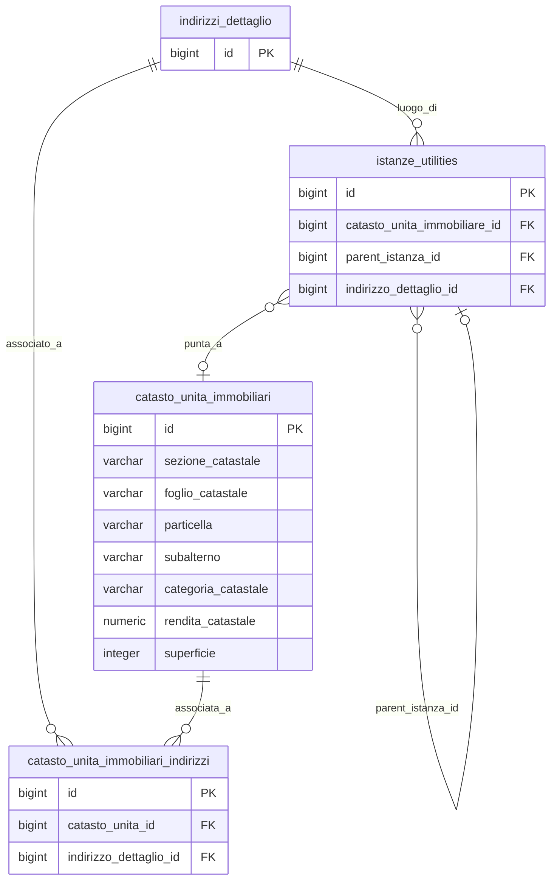

# Guida — Il catasto delle istanze

> **Ultimo aggiornamento**: 22 novembre 2026
>
> **Destinatari**: sviluppatori database, backend e analisti funzionali
>
> **Vedi anche** — schemi DB:
>
> * [anagrafiche.catasto_unita_immobiliari](/dbzero/anagrafiche/tabelle/catasto_unita_immobiliari) — l'unità catastale
> * [anagrafiche.catasto_unita_immobiliari_indirizzi](/dbzero/anagrafiche/tabelle/catasto_unita_immobiliari_indirizzi) — la ponte fra unità e civici
> * [anagrafiche.istanze_utilities](/dbzero/anagrafiche/tabelle/istanze_utilities) — l'istanza, che nomina la sua unità e la sua precedente
> * [anagrafiche.indirizzi_dettaglio](/dbzero/anagrafiche/tabelle/indirizzi_dettaglio) — il civico
> * [anagrafiche.clienti](/dbzero/anagrafiche/tabelle/clienti) — la scrittura del cliente, da cui parte la catena
> * [storico.catasto_unita_immobiliari](/dbzero/storico/tabelle/catasto_unita_immobiliari) — le versioni storiche dell'unità
>
> **Vedi anche** — funzioni e trigger DB:
>
> * [anagrafiche.trgfn_clienti_set_parent_istanza](/dbzero/anagrafiche/funzioni/trgfn_clienti_set_parent_istanza) — scrive la catena `parent_istanza_id`
> * [anagrafiche.trgfn_iu_clone_catasto_from_parent](/dbzero/anagrafiche/funzioni/trgfn_iu_clone_catasto_from_parent) — fa scattare il clone
> * [script.fn_clone_catasto_from_parent_by_istanza](/dbzero/script/funzioni/fn_clone_catasto_from_parent_by_istanza) — il clone
> * [script.fn_get_catasto_source_by_istanza](/dbzero/script/funzioni/fn_get_catasto_source_by_istanza) — l'unità da copiare
> * [anagrafiche.trgfn_iu_sync_catasto_unita_indirizzo](/dbzero/anagrafiche/funzioni/trgfn_iu_sync_catasto_unita_indirizzo) — il legame unità-civico
> * [script.fn_subentro_cliente](/dbzero/script/funzioni/fn_subentro_cliente) — chiude il cliente uscente
>
> **Vedi anche** — guide correlate:
>
> * [Generazione di un cliente](/guide/generazione-cliente) — dove il catasto entra nella nascita del cliente
> * [Gestione delle istanze utility](/guide/gestione-delle-istanze-utility) — l'istanza e la sua catena
> * [Gestione degli indirizzi](/guide/gestione-degli-indirizzi) — il civico
> * [Glossario termini utility](/glossario/glossario-utility) — i termini del settore

---

## Introduzione

Questa guida racconta il catasto delle istanze nel suo insieme: tre tabelle, due trigger sulle istanze e due
funzioni di `script`, che insieme danno a ogni istanza la sua unità catastale, la legano al civico e la copiano al
subentro.

I dati catastali (foglio, particella, subalterno, categoria, rendita) descrivono l'unità immobiliare in cui si
eroga il servizio: servono alla fatturazione e agli adempimenti del settore.

---

## L'unità catastale non sa di chi è

La riga di `catasto_unita_immobiliari` non dipende né dal cliente né dal contratto, e non ha colonne verso
l'istanza o verso il civico. I legami stanno fuori:

* **l'istanza punta alla sua unità** con `istanze_utilities.catasto_unita_immobiliare_id`;
* **l'unità e il civico** sono legati dalla tabella ponte `catasto_unita_immobiliari_indirizzi`, molti a molti: la
  stessa unità può stare su più civici, e lo stesso civico avere più unità.



---

## Un'unità per istanza: la copia al subentro

Il modello vuole che ogni istanza abbia la sua unità, mai condivisa con un'altra. Al subentro l'unità
dell'istanza precedente si **clona**: l'istanza nuova riceve una riga nuova con gli stessi dati, e una rettifica
del catasto di chi subentra non tocca quello di chi è uscito. Le istanze chiuse tengono il catasto che avevano.

La regola la garantisce la strada della clonazione, che crea sempre una riga nuova; non c'è un vincolo che la
imponga a chi scrive l'istanza direttamente (vedi [Che cosa oggi non copre](#che-cosa-oggi-non-copre)).

---

## Il flusso del subentro

Il subentro sullo stesso PDP lo fa l'applicazione in una transazione: `script.fn_subentro_cliente` chiude il
cliente uscente, poi l'applicazione crea l'istanza nuova, col PDP e il civico, e il cliente nuovo. Da lì il
database fa il resto da sé.

```text
scrittura del cliente nuovo (INSERT, o UPDATE di pdp_id o data_attivazione, con la data di attivazione)
  │
  ▼
trgfn_clienti_set_parent_istanza          BEFORE, su clienti
  → trova il cliente precedente sullo stesso PDP
  → UPDATE istanze_utilities: parent_istanza_id = istanza del precedente
  │
  ▼
trgfn_iu_clone_catasto_from_parent        AFTER UPDATE OF parent_istanza_id, su istanze_utilities
  (solo se l'istanza ha una precedente, ha un civico e non ha ancora un'unità)
  → fn_clone_catasto_from_parent_by_istanza
      → l'unità della precedente (fn_get_catasto_source_by_istanza); se non c'è, fine
      → INSERT della copia in catasto_unita_immobiliari
      → UPDATE istanze_utilities: catasto_unita_immobiliare_id = copia
  │
  ▼
trgfn_iu_sync_catasto_unita_indirizzo     AFTER UPDATE OF catasto_unita_immobiliare_id, su istanze_utilities
  → INSERT idempotente della coppia (copia, civico dell'istanza) nella ponte
```

La catena la scrive anche il ramo delle istanze fittizie, senza PDP: lì la precedente è l'ultimo cliente con la
stessa chiave soggetto, utility e azienda. Il clone scatta allo stesso modo, se la fittizia ha un civico.

### Le regole del clone

* **Sorgente unica**: la precedente diretta, da `parent_istanza_id`. Non si risale la catena.
* **Idempotente**: un'istanza che ha già un'unità la tiene.
* **Nessun errore senza sorgente**: se la precedente non ha un'unità, il clone non fa niente e il cliente nasce lo
  stesso.
* **Copia l'unità, non i suoi civici**: la copia si lega al solo civico dell'istanza nuova.
* **Contro la concorrenza**: la riga dell'istanza è bloccata durante il clone, così non nascono due copie.

---

## Il resto del ciclo di vita

* **Nascita fuori dal subentro**: l'applicazione inserisce l'unità e la aggancia all'istanza; l'aggancio fa
  scattare il legame col civico, come al subentro.
* **Modifica**: `catasto_unita_immobiliari` è registrata in `config.storico_set_storicizza`, quindi ogni modifica e
  ogni cancellazione lasciano la versione di prima in `storico.catasto_unita_immobiliari`.
* **Il civico**: un legame nella ponte chiede un civico attivo, e un civico che ha legami non si spegne.
* **Cancellazione**: un'unità nominata da un'istanza non si cancella; un'unità cancellata porta via i suoi legami
  coi civici.

---

## Che cosa oggi non copre

* **Nessun vincolo unico su `istanze_utilities.catasto_unita_immobiliare_id`.** «Un'istanza, un'unità» vale per la
  strada del clone: un'istanza agganciata a mano all'unità di un'altra la condivide.
* **Il clone avviene una volta.** Una catena che cambia dopo il clone, o che si svuota per un cliente annullato,
  lascia l'unità copiata dalla precedente di allora; un'unità arrivata dopo sulla precedente si copia solo alla
  prossima scrittura della catena.
* **La ponte non si pulisce.** Un cambio di civico o di unità dell'istanza aggiunge la coppia nuova e lascia la
  vecchia, che continua a impedire lo spegnimento del civico.
* **Le unità orfane restano.** Un'istanza che passa a un'altra unità lascia la prima senza nessuno che la nomini.

---

## I test

* `db/pgtap/anagrafiche/test-simula-subentro.sql` — il subentro completo sullo stesso PDP: catena, clone con id
  diverso e dati uguali, legame della copia col civico, duplicato nella ponte rifiutato.
* `db/pgtap/anagrafiche/test-catasto-unita-immobiliare.sql` — scritto sul modello di prima, cerca colonne che non
  ci sono più; è fra i test rossi conosciuti.

---


