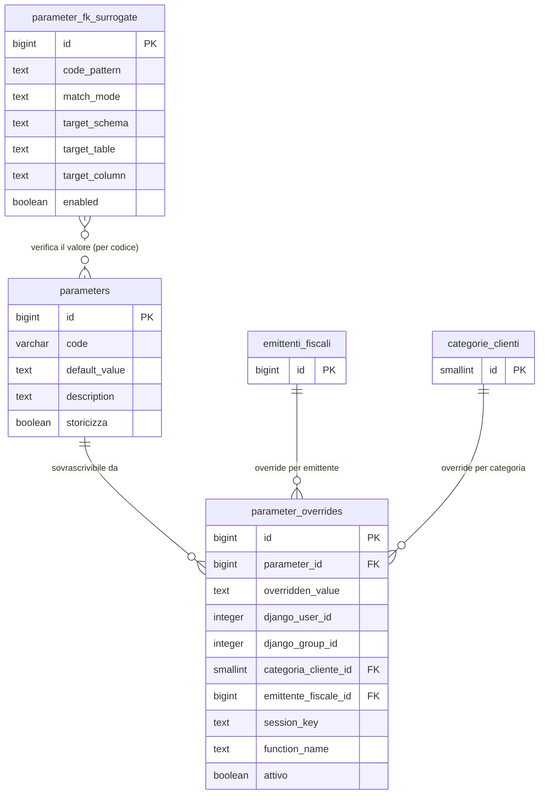

# Guida — Configurazione e Gestione Parametri

> **Ultimo aggiornamento**: 26 ottobre 2026
>
> **Destinatari**: sviluppatori database e backend
>
> **Vedi anche** — schemi DB:
>
> * [config.parameters](/dbzero/config/tabelle/parameters) — il catalogo dei parametri, con il valore di default
> * [config.parameter_overrides](/dbzero/config/tabelle/parameter_overrides) — gli override contestuali, su sei dimensioni di ambito
> * [config.parameter_fk_surrogate](/dbzero/config/tabelle/parameter_fk_surrogate) — il registro dei parametri il cui valore è il codice di una riga di un'altra tabella
> * [anagrafiche.emittenti_fiscali](/dbzero/anagrafiche/tabelle/emittenti_fiscali) · [anagrafiche.categorie_clienti](/dbzero/anagrafiche/tabelle/categorie_clienti) — i due ambiti "di dominio" verso cui un override può puntare
>
> **Vedi anche** — funzioni e trigger DB:
>
> * [script.fn_get_parameter_full](/dbzero/script/funzioni/fn_get_parameter_full) — la lettura di un parametro con la cascata degli override
> * [script.fn_get_parameter_di_sessione](/dbzero/script/funzioni/fn_get_parameter_di_sessione) — la stessa cascata, con utente, gruppi, emittente e sessione presi dal contesto della sessione
> * [script.fn_intero_positivo_da_testo](/dbzero/script/funzioni/fn_intero_positivo_da_testo) — la regola «intero positivo» del valore di un parametro di sistema
> * [script.fn_list_parameters_for_user](/dbzero/script/funzioni/fn_list_parameters_for_user) — la lista per la UI admin: default, override di ogni livello, valore risolto, famiglia
> * [config.trgfn_parameters_fk_surrogate_dispatch](/dbzero/config/funzioni/trgfn_parameters_fk_surrogate_dispatch) · [config.trgfn_parameter_overrides_fk_surrogate_dispatch](/dbzero/config/funzioni/trgfn_parameter_overrides_fk_surrogate_dispatch) — il controllo sul *valore* scritto nel default e in un override
> * [script.fn_check_parameter_fk_surrogate](/dbzero/script/funzioni/fn_check_parameter_fk_surrogate) — la regola condivisa dai due trigger
> * [config.trgfn_parameter_overrides_guard_ammette_override](/dbzero/config/funzioni/trgfn_parameter_overrides_guard_ammette_override) · [config.trgfn_parameters_guard_ammette_override](/dbzero/config/funzioni/trgfn_parameters_guard_ammette_override) — il rispetto della famiglia: nessun override su un parametro che vale per tutti
>
> **Vedi anche** — guide correlate:
>
> * [Contratto GUC `app.*`](/guide/contratto-guc-app) — i GUC dell'identità di sessione
> * [Parametri Personalizzati (GUC)](/postgresql/parametri-personalizzati-(GUC)) — riferimento completo sui GUC
> * [Messaggi di Errore e Generazione Log](/guide/Messaggi-di-Errore-e-Generazione-Log) — usa i GUC per lingua e connessione dblink
> * [Framework di Automazione DB](/guide/automazione-db) — usa i GUC per il controllo del log

---

## Introduzione

Un sistema gestionale ha bisogno di parametri configurabili: la lingua di default delle note, il
limite di sconto, il fuso orario dell'azienda, la soglia dei tentativi di login. Alcuni devono
poter cambiare per un singolo utente, un gruppo o un'azienda; altri devono valere **uguali per
tutti**, perché un valore diverso a seconda di chi lavora sarebbe un difetto.

Zero ERP offre due meccanismi distinti:

* **Parametri tabellari** (`config.parameters`, con `config.parameter_overrides` per chi ammette
  override) — per parametri di business e di sistema, con audit trail e storicizzazione;
* **Parametri GUC** (Grand Unified Configuration di PostgreSQL) — per parametri infrastrutturali e
  di sessione, gestiti a livello di database, ruolo o sessione.

**Cosa troverai in questa guida:**

* Quando usare parametri tabellari e quando GUC
* Le due famiglie di parametri tabellari: con override e senza
* Il modello tabellare: catalogo, override, cascata di priorità
* I parametri il cui valore punta a una riga di un'altra tabella
* I GUC usati nel sistema
* Gli esempi pronti, in coda, in [Area tecnica](#area-tecnica-esempi)

---

## Quando usare parametri tabellari o GUC

| Aspetto                    | Parametri tabellari                                                          | GUC                                                                  |
| -------------------------- | ---------------------------------------------------------------------------- | -------------------------------------------------------------------- |
| **Ambito**                 | Per record: utente, categoria cliente, gruppo, emittente, sessione, funzione | Per cluster, database, ruolo o sessione                              |
| **Audit**                  | Sì (campi audit, storicizzazione, `tx_id`)                                   | No                                                                   |
| **Override multi-livello** | Sì, per i parametri che lo ammettono (cascata a 6 livelli + default)         | Limitato (database → ruolo → sessione)                               |
| **Modifica runtime**       | Sì (INSERT/UPDATE nelle tabelle)                                             | Sì (`SET`, `ALTER DATABASE`)                                         |
| **Uso tipico**             | Parametri di business e di sistema (default, limiti, soglie)                 | Identità di sessione, connessione dblink, ambiente                   |

**Regola pratica:**

* Se il parametro deve variare per utente, gruppo o azienda → **tabellare con override**
* Se il parametro deve valere uguale per tutti, ma essere configurabile → **tabellare senza override**
* Se serve audit trail → **tabellare**
* Se il valore descrive la sessione o l'infrastruttura → **GUC**

---

## Due famiglie di parametri tabellari

Tutti i parametri stanno in `config.parameters`. Si dividono in due famiglie, e la differenza
non è tecnica: è una regola di business.

| Famiglia | `ammette_override` | Che cosa vuol dire | Come si legge |
| --- | :---: | --- | --- |
| **Con override** | `true` | il valore può cambiare per utente, categoria cliente, gruppo, emittente, sessione o funzione | con `script.fn_get_parameter_full`, che applica la cascata |
| **Senza override** | `false` | il valore deve essere **uguale per tutti**: un override per utente o per azienda darebbe allo stesso documento valori diversi a seconda di chi lo genera | dal valore di default, direttamente, dalla funzione che possiede la regola |

La famiglia la dichiara la colonna `config.parameters.ammette_override`. Non ha valore di default:
chi aggiunge un parametro decide a quale famiglia appartiene, come ne decide il valore. Quali
parametri valgano per tutti si legge dalla colonna, non da un elenco: la descrizione di ciascuno
dice **perché** (per esempio il fuso dell'azienda, i limiti di data dei documenti fiscali, le
soglie del login).

Il database fa rispettare la famiglia in due versi:

* un override su un parametro che vale per tutti si rifiuta, anche se spento, con
  `E_PARAMETER_OVERRIDE_NON_AMMESSO` («Il parametro … vale per tutti e non si personalizza»). Il
  valore lo stabilisce la configurazione del sistema, cioè il CSV di `80_data`: l'applicazione non
  scrive il default, e chi riceve l'errore si rivolge all'amministratore del sistema;
* un parametro con override non diventa «per tutti» finché ne ha, accesi o spenti:
  `E_PARAMETER_OVERRIDE_PRESENTI`. Prima si tolgono gli override, poi si cambia la famiglia.

Un valore che il database **propone** a chi compila (per esempio socio unico e liquidazione dei
dati societari) è di norma un parametro con override: ogni azienda propone il suo. Chi lo legge
dentro il database, senza ricevere utente ed emittente dal chiamante, usa
`script.fn_get_parameter_di_sessione`.

Un parametro senza override che deve essere un **intero positivo** (le soglie, i tentativi e le
attese del login) si valida con `script.fn_intero_positivo_da_testo`: dal testo all'intero,
oppure `E_CONFIG_MANCANTE` col nome del parametro. La regola sta lì sola; chi legge il parametro
la chiama invece di riscriverla.

---

## Componenti del modello

### 1. Il catalogo parametri: `config.parameters`

Il punto unico in cui si definiscono i parametri. Ogni parametro ha un codice univoco e un
valore di default, usato quando nessun override è applicabile, o sempre per i parametri senza
override. La colonna `ammette_override` dice la famiglia; la descrizione dice chi lo legge e
perché.

| Colonna         | Tipo                 | Nullable | Descrizione                                                         |
| --------------- | -------------------- | :------: | ------------------------------------------------------------------- |
| `id`            | BIGINT, PK           |    no    | Chiave primaria                                                     |
| `code`          | VARCHAR(100), UNIQUE |    no    | Codice identificativo (es. `NOTE_DEFAULT_LINGUA`)                   |
| `default_value` | TEXT                 |    no    | Valore di default                                                   |
| `description`   | TEXT                 |    sì    | Descrizione: significato, chi lo legge, perché ha la sua famiglia   |
| `ammette_override` | BOOLEAN           |    no    | La famiglia: `true` con override, `false` uguale per tutti. Senza default |
| `storicizza`    | BOOLEAN              |    sì    | Flag storicizzazione (default: true)                                |
| Campi audit     | —                    |    —     | `data_insert`, `user_insert`, `data_update`, `user_update`, `tx_id` |

I parametri si seminano da un CSV solo, `80_data/sql/config/parameters.csv`. Fanno eccezione i
parametri di sistema (`parameters_sistema.csv`), caricati da `70_dati_sistema`: il codice li legge
già mentre girano i seed, e su un database nuovo devono esistere prima.

> Documentazione dettagliata: [config.parameters](/dbzero/config/tabelle/parameters)

---

### 2. Gli override contestuali: `config.parameter_overrides`

Un override sostituisce il default di un parametro in un contesto. Le dimensioni di ambito sono
**sei**, ognuna con una colonna sua:

| Colonna                | Livello nella cascata |
| ---------------------- | :-------------------: |
| `django_user_id`       |      1 — utente       |
| `categoria_cliente_id` | 2 — categoria cliente |
| `django_group_id`      |      3 — gruppo       |
| `emittente_fiscale_id` |     4 — emittente     |
| `session_key`          |     5 — sessione      |
| `function_name`        |     6 — funzione      |

**Un override vale per un ambito solo** (vincolo `chk_parameter_overrides_un_ambito`): utente,
oppure categoria cliente, oppure gruppo, oppure emittente, oppure sessione, oppure funzione — mai
due insieme, mai nessuno. Gli override di livelli diversi non si combinano: la cascata sceglie il
primo che trova.

**Un solo override per parametro e ambito** (vincolo `uq_overrides_full_scope_v5`, `NULLS NOT
DISTINCT`): non possono esistere due override personali dello stesso utente sullo stesso
parametro.

**I riferimenti degli ambiti:**

* `emittente_fiscale_id` e `categoria_cliente_id` sono FK verso `anagrafiche.emittenti_fiscali` e
  `anagrafiche.categorie_clienti`, con un guard: non si crea un override verso un emittente o una
  categoria **disattivati**;
* `django_user_id` e `django_group_id` puntano a `auth_user` e `auth_group` di Django. ⚠️ Le FK
  esistono solo dove Django c'era già quando sono state create: su un database costruito da zero
  Liquibase gira **prima** delle migrazioni Django, e le due FK non ci sono.

⚠️ **`tenant_id` non esiste.** L'ambito multi-company è l'**emittente fiscale**.

| Colonna                | Tipo         | Nullable | Descrizione                           |
| ---------------------- | ------------ | :------: | ------------------------------------- |
| `id`                   | BIGINT, PK   |    no    | Chiave primaria                       |
| `parameter_id`         | BIGINT, FK   |    no    | Riferimento a `config.parameters`     |
| `overridden_value`     | TEXT         |    no    | Valore sovrascritto                   |
| `django_user_id`       | INTEGER      |    sì    | Utente Django                         |
| `django_group_id`      | INTEGER      |    sì    | Gruppo Django                         |
| `categoria_cliente_id` | SMALLINT, FK |    sì    | Categoria cliente                     |
| `emittente_fiscale_id` | BIGINT, FK   |    sì    | Emittente fiscale                     |
| `session_key`          | TEXT         |    sì    | Chiave di sessione                    |
| `function_name`        | TEXT         |    sì    | Nome funzione                         |
| `attivo`               | BOOLEAN      |    sì    | Flag attivo/disattivo (default: true) |
| `storicizza`           | BOOLEAN      |    sì    | Flag storicizzazione (default: true)  |
| Campi audit            | —            |    —     | come `config.parameters`              |

**Indici** sui livelli più interrogati: `ix_overrides_param_user`,
`ix_overrides_param_categoria_cliente`, `ix_overrides_param_group`. Il livello emittente usa il
vincolo univoco, che comincia con `(parameter_id, emittente_fiscale_id)`.

> Documentazione dettagliata: [config.parameter_overrides](/dbzero/config/tabelle/parameter_overrides)

---

### 3. La lettura con la cascata: `script.fn_get_parameter_full`

È il punto unico di lettura dei parametri **con override**. Riceve il codice e gli ambiti
opzionali, e restituisce il valore del livello più alto che trova; se nessun override vale,
restituisce il default. Un codice che non esiste è un errore (`E_ERRORE_PARAMETRI_TABELLA`),
mai un `NULL`.

| Priorità | Ambito                | Colonna                           |
| :------: | --------------------- | --------------------------------- |
|    1     | **Utente**            | `django_user_id`                  |
|    2     | **Categoria cliente** | `categoria_cliente_id`            |
|    3     | **Gruppo**            | `django_group_id`                 |
|    4     | **Emittente**         | `emittente_fiscale_id`            |
|    5     | **Sessione**          | `session_key`                     |
|    6     | **Funzione**          | `function_name`                   |
|    7     | **Default**           | `config.parameters.default_value` |

Un override personale prevale su una regola di categoria, che prevale su una del gruppo
dell'operatore, e così via. La categoria sta **sopra** il gruppo per una ragione dichiarata: una
regola commerciale (es. «PREMIUM, sconto massimo 5%») deve vincere sulla seniority dell'operatore
(es. «gruppo SENIOR, sconto massimo 20%»); l'eccezione individuale si configura al livello utente.

| Parametro                | Tipo      | Default | Descrizione                     |
| ------------------------ | --------- | ------- | ------------------------------- |
| `p_code`                 | TEXT      | —       | Codice parametro (obbligatorio) |
| `p_emittente_fiscale_id` | BIGINT    | NULL    | Emittente fiscale               |
| `p_django_user_id`       | INTEGER   | NULL    | Utente Django                   |
| `p_group_ids`            | INTEGER[] | NULL    | Gruppi Django dell'utente       |
| `p_session_key`          | TEXT      | NULL    | Chiave di sessione              |
| `p_function_name`        | TEXT      | NULL    | Nome funzione                   |
| `p_categoria_cliente_id` | SMALLINT  | NULL    | Categoria cliente               |

**Restituisce:** `TEXT` — il valore effettivo.

* Un ambito passato a `NULL` salta il suo livello: chi non conosce la categoria del cliente non
  la passa, e la cascata va avanti.
* La funzione è `STABLE` e si ferma al primo livello che trova un valore.
* Se l'utente appartiene a **più gruppi** con override diversi, vince quello con l'`id` più
  basso: non è una scelta di merito, è il tie-break dichiarato.
* Considera solo gli override con `attivo = true`.

Chi gira dentro una richiesta dell'applicazione può usare `script.fn_get_parameter_di_sessione`:
applica la stessa cascata e prende utente, gruppi, emittente e sessione dai GUC `app.*` della
sessione, invece di riceverli come parametri. Un GUC vuoto salta il suo livello; i gruppi si
leggono solo se la tabella di Django c'è ed è leggibile.

La lista per la UI admin, `script.fn_list_parameters_for_user`, mostra per ogni parametro il
default, l'override di ciascun livello e il valore risolto, che chiede a questa funzione senza
ricopiare la cascata. Dice anche la famiglia (`ammette_override`): dove è `false` la UI non offre
l'override, e il valore risolto è il default.

> Documentazione dettagliata: [script.fn_get_parameter_full](/dbzero/script/funzioni/fn_get_parameter_full)

---

## Parametri che puntano a una riga di un'altra tabella

### Il problema

Alcuni parametri indicano una riga di un'altra tabella: l'aliquota IVA di default, la lingua di
default delle note, l'utility di default. Scrivere l'id numerico (es. `16`) rende il parametro
non portabile: in un altro ambiente la stessa riga può avere un id diverso, e nessuno controlla
che quel numero punti a qualcosa.

### La soluzione

Il valore del parametro è un **codice stabile** della riga (un `codice_interno`, un codice ISO),
mai l'id. Il codice si traduce in id quando serve, con un lookup sulla tabella di destinazione.

Il **framework FK-surrogata** controlla il codice già alla **scrittura**:

* il registro `config.parameter_fk_surrogate` dice, per un codice di parametro (esatto o per
  pattern `LIKE`), in quale tabella e colonna deve esistere il valore;
* un trigger su `config.parameters` e uno su `config.parameter_overrides` verificano ogni valore
  scritto, con la regola condivisa `script.fn_check_parameter_fk_surrogate`;
* un codice che non esiste è rifiutato: `E_PARAMETER_DEFAULT_VALUE_INVALID` sul default,
  `E_PARAMETER_OVERRIDE_VALUE_INVALID` su un override.

Un parametro nuovo di questo tipo si aggiunge con una riga del registro, accanto al parametro.

---

## Best practice

* **Codici stabili, mai id numerici**, nei parametri che puntano a una riga; e la riga del
  registro FK-surrogata, perché il valore sia verificato alla scrittura.
* **Parametri con override**: si leggono **sempre** con `fn_get_parameter_full`, mai con una
  query diretta sugli override.
* **Parametri senza override**: `ammette_override = false`, e si legge il default nella funzione
  che possiede la regola. La descrizione dice il motivo.
* **Un lookup per codice si fa su una chiave univoca.** Se il codice non lo è (per esempio
  `config.stati.codice_iso2`, che ha righe storiche dello stesso paese), si usa la funzione che
  gestisce l'ambiguità (`script.fn_stato_id_da_iso2`), non un `SELECT … INTO`.
* **Separare parametri di business e infrastrutturali**: business → tabellari, sessione e
  infrastruttura → GUC.
* **Non creare GUC per parametri che richiedono override per utente**: il meccanismo GUC non ha
  granularità per utente.
* **Disattivare un override con `attivo = false`** invece di cancellarlo, per poterlo riattivare.
  ⚠️ Un override disattivato occupa ancora il suo ambito: per lo stesso parametro e ambito non se
  ne può creare un altro finché esiste.

---

## Parametri GUC

I GUC di PostgreSQL sono parametri configurabili a livello di cluster, database, ruolo o
sessione. Zero ERP li usa per ciò che descrive la sessione o l'infrastruttura, dove non servono
override per record né audit.

### Le famiglie

| Prefisso  | Che cosa porta                                          | Dove è descritto                                                       |
| --------- | ------------------------------------------------------- | ---------------------------------------------------------------------- |
| `app.*`   | l'identità della sessione HTTP: utente, emittente, ruolo applicativo, identità; li popola il backend a ogni richiesta e li leggono le policy RLS e i trigger di audit | [Contratto GUC `app.*`](/guide/contratto-guc-app)                      |
| `myapp.*` | configurazione applicativa: lingua dei messaggi, logging via dblink, ambiente | qui sotto                                                              |
| `dbops.*` | variabili della transazione corrente                    | qui sotto                                                              |

### GUC `myapp.*` e `dbops.*`

| GUC                           | Descrizione                                                                                          |
| ----------------------------- | ---------------------------------------------------------------------------------------------------- |
| `myapp.user_language`         | Lingua corrente per i messaggi (usata da `fn_get_messaggio`)                                         |
| `myapp.dblink_log_connection` | Connessione dblink per il logging persistente                                                        |
| `myapp.logconn`               | Connessione (DSN) per il logging via dblink: se valorizzato, vince su `myapp.dblink_log_connection`  |
| `myapp.log_with_dblink`       | Attiva il logging fuori transazione via dblink (`on`/`off`)                                          |
| `myapp.bypass_tx_id_check`    | Bypass della validazione `tx_id` (debug)                                                             |
| `myapp.env`                   | Nome dell'ambiente (`ci`, …): serve ai changeSet e ai gate che devono comportarsi diversamente in CI |
| `dbops.tx_id`                 | UUID della transazione corrente (gestito dal trigger `trgfn_tx_id_managed`)                          |

### Configurazione

I GUC si impostano a livelli diversi — database e ruolo in modo persistente, sessione in modo
temporaneo ([esempio](#area-tecnica-esempi)). Il secondo parametro `true` in `current_setting`
restituisce `NULL` se il GUC non esiste, invece di sollevare errore.

Per i dettagli completi, vedi [Parametri Personalizzati (GUC)](/postgresql/parametri-personalizzati-(GUC)).

---

## Diagramma ER



---

## Area tecnica — esempi

**Un override personale sulla lingua delle note** — il default vale per tutti, l'override per un
solo utente:

```sql
-- Override per l'utente 42: note in inglese
INSERT INTO config.parameter_overrides (parameter_id, overridden_value, django_user_id)
VALUES (
  (SELECT id FROM config.parameters WHERE code = 'NOTE_DEFAULT_LINGUA'),
  'en',
  42
);

-- Lettura: 'en' per l'utente 42, il default per tutti gli altri
SELECT script.fn_get_parameter_full('NOTE_DEFAULT_LINGUA', p_django_user_id := 42);
SELECT script.fn_get_parameter_full('NOTE_DEFAULT_LINGUA');
```

**Una regola di emittente, con l'eccezione di categoria che vince su di lei** — l'ordine dei
livelli decide: la categoria sta sopra il gruppo e l'emittente, l'utente sopra a tutti.

```sql
-- Emittente 1: sconto massimo 20%
INSERT INTO config.parameter_overrides (parameter_id, overridden_value, emittente_fiscale_id)
VALUES (
  (SELECT id FROM config.parameters WHERE code = 'VENDITE_MAX_SCONTO_PCT'),
  '20',
  1
);

-- Categoria PREMIUM (id 7): sconto massimo 5%, su ogni emittente
INSERT INTO config.parameter_overrides (parameter_id, overridden_value, categoria_cliente_id)
VALUES (
  (SELECT id FROM config.parameters WHERE code = 'VENDITE_MAX_SCONTO_PCT'),
  '5',
  7
);

-- cliente PREMIUM → '5': la categoria batte l'emittente
SELECT script.fn_get_parameter_full(
  'VENDITE_MAX_SCONTO_PCT',
  p_emittente_fiscale_id := 1,
  p_django_user_id       := 99,
  p_categoria_cliente_id := 7
);

-- cliente senza categoria → '20': resta la regola dell'emittente
SELECT script.fn_get_parameter_full(
  'VENDITE_MAX_SCONTO_PCT',
  p_emittente_fiscale_id := 1,
  p_django_user_id       := 200
);
```

**Tradurre in id un parametro che punta a una riga** — il valore è il codice stabile della riga;
il registro FK-surrogata l'ha verificato alla scrittura, il lookup lo traduce:

```sql
DECLARE
  v_iva_id config.iva.id%TYPE;
BEGIN
  SELECT i.id INTO v_iva_id
    FROM config.iva i
   WHERE i.codice_interno = script.fn_get_parameter_full('DEFAULT_IVA');

  IF v_iva_id IS NULL THEN
    PERFORM script.fn_log_and_raise_error(
      'catalogo',
      'fn_esempio',
      'E_PARAMETRO_INVALIDO',
      jsonb_build_object('param_code', 'DEFAULT_IVA'),
      NULL::uuid,
      'DEFAULT_IVA'
    );
  END IF;
END;
```

**Registrare un parametro nuovo che punta a una riga** — una riga del registro accanto al
parametro (nel CSV `parameter_fk_surrogate.csv`, mai con un `UPDATE` a mano; qui le colonne che
contano, le colonne di audit seguono come nelle altre righe):

```text
id,code_pattern,match_mode,target_schema,target_table,target_column,enabled,note
6,MIO_PARAMETRO_DEFAULT,EXACT,config,mia_tabella,codice_interno,t,"Che cosa indica e chi lo legge"
```

**Impostare e leggere un GUC ai tre livelli** — database e ruolo sono persistenti, la sessione è
temporanea:

```sql
-- A livello database (persistente)
ALTER DATABASE zeroerp SET myapp.user_language = 'it';

-- A livello ruolo (persistente per il ruolo)
ALTER ROLE zeroerp_app IN DATABASE zeroerp SET myapp.dblink_log_connection = 'service=zeroerp_log';

-- A livello sessione (temporaneo)
SET myapp.user_language = 'en';

-- Lettura
SHOW myapp.user_language;
SELECT current_setting('myapp.user_language', true);   -- NULL se non è definito
```

---


