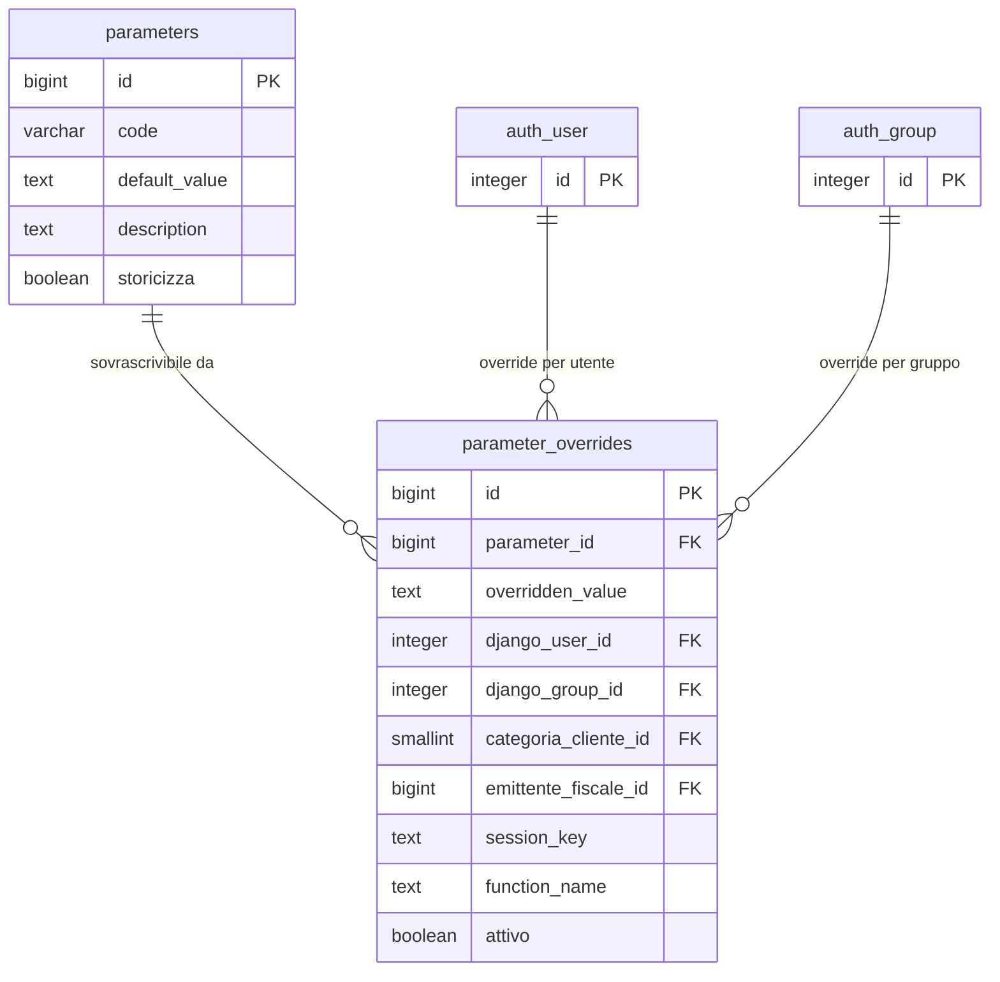

# Guida — Configurazione e Gestione Parametri

> **Ultimo aggiornamento**: 19 settembre 2026
>
> **Destinatari**: sviluppatori database e backend
>
> **Vedi anche** — schemi DB:
>
> * [config.parameters](/dbzero/config/tabelle/parameters) — il catalogo dei parametri, con il valore di default
> * [config.parameter_overrides](/dbzero/config/tabelle/parameter_overrides) — gli override contestuali, su sei dimensioni di ambito
> * [anagrafiche.emittenti_fiscali](/dbzero/anagrafiche/tabelle/emittenti_fiscali) · [anagrafiche.categorie_clienti](/dbzero/anagrafiche/tabelle/categorie_clienti) — i due ambiti "di dominio" verso cui un override può puntare
>
> **Vedi anche** — funzioni e trigger DB:
>
> * [script.fn_get_parameter_full](/dbzero/script/funzioni/fn_get_parameter_full) — il punto unico di lettura di un parametro
> * [config.trgfn_parameter_overrides_fk_surrogate_dispatch](/dbzero/config/funzioni/trgfn_parameter_overrides_fk_surrogate_dispatch) — il controllo sul *valore* scritto in un override
>
> **Vedi anche** — guide correlate:
>
> * [Parametri Personalizzati (GUC)](/postgresql/parametri-personalizzati-(GUC)) — riferimento completo sui GUC
> * [Messaggi di Errore e Generazione Log](/guide/Messaggi-di-Errore-e-Generazione-Log) — usa i GUC per lingua e connessione dblink
> * [Framework di Automazione DB](/guide/automazione-db) — usa i GUC per il controllo del log

---

## Introduzione

Un sistema gestionale ha bisogno di parametri configurabili a piu livelli: la lingua predefinita, lo stato di default per un nuovo soggetto, la connessione per il logging remoto. Alcuni parametri devono valere per tutto il sistema, altri devono poter essere sovrascritti per un singolo utente, un gruppo o una funzione specifica.

Zero ERP offre due meccanismi distinti per questo scopo:

* **Parametri tabellari** (`config.parameters` + `config.parameter_overrides`) — per parametri di business con override contestuali a piu livelli, audit trail, storicizzazione e integrazione con il modello utenti Django
* **Parametri GUC** (Grand Unified Configuration di PostgreSQL) — per parametri infrastrutturali e di sessione, gestiti a livello di database/ruolo/sessione con `SET` e `ALTER DATABASE`

La scelta tra i due dipende dal tipo di parametro e dal livello di flessibilita richiesto.

**Cosa troverai in questa guida:**

* Quando usare parametri tabellari e quando usare GUC
* Il modello tabellare: definizione, override, gerarchia di priorita
* La funzione di recupero e la risoluzione degli override
* I GUC usati nel sistema e le convenzioni di naming
* La gestione dei parametri con riferimento a foreign key
* Gli esempi pronti — parametro e override, risoluzione di una chiave, i tre livelli di un GUC — in coda, in [Area tecnica](#area-tecnica-esempi)

---

## Quando usare parametri tabellari o GUC

La scelta non e arbitraria. I due meccanismi coprono esigenze diverse.

| Aspetto                    | Parametri tabellari                                                          | GUC                                                                  |
| -------------------------- | ---------------------------------------------------------------------------- | -------------------------------------------------------------------- |
| **Ambito**                 | Per record: utente, categoria cliente, gruppo, emittente, sessione, funzione | Per cluster, database, ruolo o sessione                              |
| **Audit**                  | Si (campi audit, storicizzazione, `tx_id`)                                   | No                                                                   |
| **Override multi-livello** | Si (gerarchia a 6 livelli + default)                                         | Limitato (database → ruolo → sessione)                               |
| **Modifica runtime**       | Si (INSERT/UPDATE nelle tabelle)                                             | Si (`SET`, `ALTER DATABASE`)                                         |
| **Integrazione Django**    | Si (FK verso `auth_user` e `auth_group`)                                     | No                                                                   |
| **Uso tipico**             | Parametri di business (lingua, stato default, valuta)                        | Parametri infrastrutturali (connessione dblink, bypass di sicurezza) |

**Regola pratica:**

* Se il parametro deve variare per utente o gruppo → **tabellare**
* Se il parametro e infrastrutturale o di debug → **GUC**
* Se serve audit trail → **tabellare**
* Se serve configurazione rapida senza toccare tabelle → **GUC**

---

## Componenti del modello

### 1. Il catalogo parametri: `config.parameters`

La tabella `parameters` e il punto unico in cui si definiscono i parametri configurabili del sistema. Ogni parametro ha un codice univoco e un valore di default. Il valore di default viene usato quando nessun override contestuale e applicabile.

Da un punto di vista tecnico:

| Colonna         | Tipo            | Nullable | Descrizione                                                         |
| --------------- | --------------- | :------: | ------------------------------------------------------------------- |
| `id`            | BIGINT, PK      |    no    | Chiave primaria                                                     |
| `code`          | VARCHAR, UNIQUE |    no    | Codice identificativo (es. `lingua`, `stato_def`)                   |
| `default_value` | TEXT            |    no    | Valore di default                                                   |
| `description`   | TEXT            |    si    | Descrizione del parametro                                           |
| `storicizza`    | BOOLEAN         |    si    | Flag storicizzazione (default: true)                                |
| Campi audit     | —               |    —     | `data_insert`, `user_insert`, `data_update`, `user_update`, `tx_id` |

> Documentazione dettagliata: [config.parameters](/dbzero/config/tabelle/parameters)

---

### 2. Gli override contestuali: `config.parameter_overrides`

La tabella `parameter_overrides` permette di sovrascrivere il valore di default di un parametro in base al contesto. Le dimensioni di ambito sono **sei**, e ognuna ha una colonna sua — non c'è un `scope_type`/`scope_id` generico:

| Colonna                | Livello nella cascata |
| ---------------------- | :-------------------: |
| `django_user_id`       |      1 — utente       |
| `categoria_cliente_id` | 2 — categoria cliente |
| `django_group_id`      |      3 — gruppo       |
| `emittente_fiscale_id` |     4 — emittente     |
| `session_key`          |     5 — sessione      |
| `function_name`        |     6 — funzione      |

**Regola pratica:** una riga dovrebbe avere **una sola** dimensione valorizzata e le altre a `NULL`. Non è un vincolo del database: la cascata di risoluzione ragiona così, perché un parametro di ambito `NULL` fa fallire il confronto e salta il livello.

Il modello è integrato col sistema utenti di Django: `django_user_id` e `django_group_id` sono FK verso `auth_user` e `auth_group` (via trigger surrogato), mentre gli altri due ambiti sono FK verso `anagrafiche.emittenti_fiscali` e `anagrafiche.categorie_clienti`. Entrambi hanno un guard: non si può creare un override verso un emittente o una categoria **disattivati**.

⚠️ **`tenant_id` non esiste.** L'ambito multi-company è l'**emittente fiscale**: chi trova una colonna `tenant_id` in un documento o in un vecchio changelog sta leggendo la versione precedente del modello.

Da un punto di vista tecnico:

| Colonna                | Tipo         | Nullable | Descrizione                                                         |
| ---------------------- | ------------ | :------: | ------------------------------------------------------------------- |
| `id`                   | BIGINT, PK   |    no    | Chiave primaria                                                     |
| `parameter_id`         | BIGINT, FK   |    no    | Riferimento a `config.parameters`                                   |
| `overridden_value`     | TEXT         |    no    | Valore sovrascritto                                                 |
| `django_user_id`       | INTEGER, FK  |    si    | Utente Django specifico                                             |
| `django_group_id`      | INTEGER, FK  |    si    | Gruppo Django                                                       |
| `categoria_cliente_id` | SMALLINT, FK |    si    | Categoria cliente (priorità 2 nella cascata)                        |
| `emittente_fiscale_id` | BIGINT, FK   |    si    | Emittente fiscale (priorità 4 nella cascata)                        |
| `session_key`          | TEXT         |    si    | Chiave di sessione                                                  |
| `function_name`        | TEXT         |    si    | Nome funzione specifica                                             |
| `attivo`               | BOOLEAN      |    si    | Flag attivo/disattivo (default: true)                               |
| `storicizza`           | BOOLEAN      |    si    | Flag storicizzazione (default: true)                                |
| Campi audit            | —            |    —     | `data_insert`, `user_insert`, `data_update`, `user_update`, `tx_id` |

**Vincolo UNIQUE** `uq_overrides_full_scope_v5` su `(parameter_id, emittente_fiscale_id, django_user_id, django_group_id, categoria_cliente_id, session_key, function_name)`, `NULLS NOT DISTINCT` — un solo override per combinazione completa di ambito, contando le dimensioni vuote come uguali fra loro: non possono esistere due override personali dello stesso utente sullo stesso parametro.

**Un override vale per un ambito solo** (vincolo `chk_parameter_overrides_un_ambito`): utente, oppure categoria cliente, oppure gruppo, oppure emittente, oppure sessione, oppure funzione — mai due insieme, mai nessuno. Gli sconti di livelli diversi non si combinano: la cascata sceglie il primo che trova.

**Indici dedicati**, sui quattro livelli più interrogati:

* `ix_overrides_param_user` su `(parameter_id, django_user_id)`
* `ix_overrides_param_categoria_cliente` su `(parameter_id, categoria_cliente_id)`
* `ix_overrides_param_group` su `(parameter_id, django_group_id)`
* `ix_parameter_overrides_emittente` su `(parameter_id, emittente_fiscale_id)`

> Documentazione dettagliata: [config.parameter_overrides](/dbzero/config/tabelle/parameter_overrides)

---

### 3. Funzione di recupero: `script.fn_get_parameter_full`

La funzione `fn_get_parameter_full` è il punto d'ingresso unico per leggere il valore effettivo di un parametro. Riceve il codice del parametro e gli ambiti opzionali, interroga gli override e restituisce il valore con la priorità più alta; se nessun override è applicabile, restituisce il valore di default.

La gerarchia di priorità, dalla più alta alla più bassa:

| Priorità | Ambito                | Colonna                           |
| :------: | --------------------- | --------------------------------- |
|    1     | **Utente**            | `django_user_id`                  |
|    2     | **Categoria cliente** | `categoria_cliente_id`            |
|    3     | **Gruppo**            | `django_group_id`                 |
|    4     | **Emittente**         | `emittente_fiscale_id`            |
|    5     | **Sessione**          | `session_key`                     |
|    6     | **Funzione**          | `function_name`                   |
|    7     | **Default**           | `config.parameters.default_value` |

In pratica: un override personale prevale su una regola di categoria, che prevale su una del gruppo dell'operatore, e così via. La categoria sta **sopra** il gruppo per una ragione dichiarata: una regola commerciale (es. «PREMIUM, sconto massimo 5%») deve vincere sulla seniority dell'operatore (es. «gruppo SENIOR, sconto massimo 20%»); l'eccezione individuale si configura al livello utente, che sta sopra a tutto.

⚠️ **Ci sono due overload, e non risolvono allo stesso modo.** Il livello *categoria cliente* esiste solo nella versione a **7 parametri**: chi chiama la funzione con 6 argomenti posizionali usa la versione precedente, la cui cascata è `utente → gruppo → emittente → sessione → funzione → default`. Per avere il livello categoria bisogna passare `p_categoria_cliente_id` (anche per nome: `p_categoria_cliente_id => …`).

Da un punto di vista tecnico:

| Parametro                | Tipo      | Default | Descrizione                                              |
| ------------------------ | --------- | ------- | -------------------------------------------------------- |
| `p_code`                 | TEXT      | —       | Codice parametro (obbligatorio)                          |
| `p_emittente_fiscale_id` | BIGINT    | NULL    | Emittente fiscale                                        |
| `p_django_user_id`       | INTEGER   | NULL    | Utente Django                                            |
| `p_group_ids`            | INTEGER[] | NULL    | Array di gruppi Django                                   |
| `p_session_key`          | TEXT      | NULL    | Chiave di sessione                                       |
| `p_function_name`        | TEXT      | NULL    | Nome funzione                                            |
| `p_categoria_cliente_id` | SMALLINT  | NULL    | Categoria cliente — **solo nell'overload a 7 parametri** |

**Restituisce:** `TEXT` — il valore effettivo del parametro.

⚠️ La funzione è `STABLE` e usa un `COALESCE` su subquery indipendenti: si ferma al primo livello che trova un valore, e i livelli successivi non vengono eseguiti. Se l'utente appartiene a **più gruppi** con override diversi, vince quello con l'`id` più basso: non è una scelta di merito, è il tie-break dichiarato.

> Documentazione dettagliata: [script.fn_get_parameter_full](/dbzero/script/funzioni/fn_get_parameter_full)

---

## Parametri GUC

I GUC (Grand Unified Configuration) di PostgreSQL sono parametri configurabili a livello di cluster, database, ruolo o sessione. Zero ERP li usa per configurazioni infrastrutturali che non richiedono override multi-livello ne audit trail.

### Convenzioni di naming

| Prefisso  | Stabilità             | Ambito tipico                      | Uso                                              |
| --------- | --------------------- | ---------------------------------- | ------------------------------------------------ |
| `myapp.*` | Persistente (conf/db) | Cluster, database, ruolo, sessione | Parametri applicativi                            |
| `dbops.*` | Temporaneo            | Locale alla **transazione**        | Variabili di contesto della transazione corrente |

### GUC principali del sistema

| GUC                           | Tipo | Descrizione                                                                                          |
| ----------------------------- | ---- | ---------------------------------------------------------------------------------------------------- |
| `myapp.user_language`         | TEXT | Lingua corrente per i messaggi (usata da `fn_get_messaggio`)                                         |
| `myapp.dblink_log_connection` | TEXT | Connessione dblink per il logging persistente                                                        |
| `myapp.log_with_dblink`       | TEXT | Attiva il logging fuori transazione via dblink (`on`/`off`)                                          |
| `myapp.bypass_tx_id_check`    | TEXT | Bypass della validazione `tx_id` (debug)                                                             |
| `myapp.env`                   | TEXT | Nome dell'ambiente (`ci`, …): serve ai changeSet e ai gate che devono comportarsi diversamente in CI |
| `dbops.tx_id`                 | UUID | UUID della transazione corrente (gestito dal trigger `trgfn_tx_id_managed`)                          |

### Configurazione

I GUC si impostano a livelli diversi — database e ruolo in modo persistente, sessione in modo
temporaneo ([esempio](#area-tecnica-esempi)). Il secondo parametro `true` in `current_setting`
indica di restituire `NULL` se il GUC non esiste, invece di sollevare errore.

Per i dettagli completi sui GUC, vedi [Parametri Personalizzati (GUC)](/postgresql/parametri-personalizzati-(GUC)).

---

## Gestione parametri con riferimento a foreign key

### Il problema

Alcuni parametri fanno riferimento a entita con chiave numerica (es. lo stato di default per un nuovo soggetto). Usare direttamente l'ID numerico (es. `42`) rende il parametro non portabile: in un altro ambiente lo stesso stato potrebbe avere un ID diverso.

### La soluzione

Usare sempre **identificativi simbolici** (codici ISO, codici interni) come valore del parametro, e risolverli a runtime tramite lookup sulla tabella di riferimento.

Esempio: il parametro `stato_def` contiene `IT` (codice ISO), non `42` (ID numerico). Il parametro si
legge, si risolve con un lookup sulla tabella di riferimento e — se il codice non corrisponde a
niente — si solleva un errore parlante invece di scrivere `NULL` ([esempio](#area-tecnica-esempi)).

Questo approccio garantisce portabilità tra ambienti (sviluppo, staging, produzione) senza dipendere da ID che possono variare.

---

## Best practice

* **Usare simboli stabili** (codici ISO, codici interni) come valori dei parametri tabellari — mai ID numerici diretti
* **Risolvere a runtime** i riferimenti FK tramite lookup sulla tabella di destinazione, con guard esplicita se il codice non e trovato
* **Usare sempre `fn_get_parameter_full`** per leggere i parametri tabellari — non fare query dirette sulle tabelle
* **Separare parametri di business e infrastrutturali**: business → tabellari, infrastruttura → GUC
* **Non creare GUC per parametri che richiedono override per utente** — il meccanismo GUC non supporta granularita per utente
* **Disattivare override con `attivo = false`** invece di cancellarli — permette di riattivare senza ricreare

---

## Diagramma ER



---

## Area tecnica — esempi

**Definire un parametro e un override personale** — il default vale per tutti, l'override per un solo
utente:

```sql
-- Definizione parametro globale
INSERT INTO config.parameters (code, default_value, description)
VALUES ('lingua', 'it', 'Lingua predefinita del sistema');

-- Override per un utente specifico (preferisce inglese)
INSERT INTO config.parameter_overrides (parameter_id, overridden_value, django_user_id)
VALUES (
  (SELECT id FROM config.parameters WHERE code = 'lingua'),
  'en',
  42  -- django user id
);

-- Recupero: 'en' per l'utente 42, 'it' per tutti gli altri
SELECT script.fn_get_parameter_full('lingua', p_django_user_id := 42);
SELECT script.fn_get_parameter_full('lingua');
```

**Un override di emittente, con l'eccezione di categoria che vince su di lui** — l'ordine dei livelli
è quello che decide: la categoria sta sopra il gruppo, l'emittente sotto, l'utente sopra a tutti.

```sql
-- Regola dell'emittente 1: gli utenti di quell'azienda usano EUR
INSERT INTO config.parameter_overrides (parameter_id, overridden_value, emittente_fiscale_id)
VALUES (
  (SELECT id FROM config.parameters WHERE code = 'valuta_default'),
  'EUR',
  1
);

-- Eccezione per la categoria PREMIUM, che vale su ogni emittente
INSERT INTO config.parameter_overrides (parameter_id, overridden_value, categoria_cliente_id)
VALUES (
  (SELECT id FROM config.parameters WHERE code = 'valuta_default'),
  'GBP',
  7   -- categoria PREMIUM
);

-- utente 99 (categoria PREMIUM) → 'GBP': la categoria batte l'emittente
SELECT script.fn_get_parameter_full(
  'valuta_default',
  p_emittente_fiscale_id   := 1,
  p_django_user_id         := 99,
  p_categoria_cliente_id   := 7
);

-- utente 200 (categoria ordinaria) → 'EUR': resta la regola dell'emittente
SELECT script.fn_get_parameter_full(
  'valuta_default',
  p_emittente_fiscale_id   := 1,
  p_django_user_id         := 200
);
```

**Impostare e leggere un GUC ai tre livelli** — database e ruolo sono persistenti, la sessione è
temporanea:

```sql
-- A livello database (persistente)
ALTER DATABASE zeroerp SET myapp.user_language = 'it';

-- A livello ruolo (persistente per il ruolo)
ALTER ROLE zeroerp_app IN DATABASE zeroerp SET myapp.dblink_log_connection = 'service=zeroerp_log';

-- A livello sessione (temporaneo)
SET myapp.user_language = 'en';

-- Lettura: le funzioni come fn_get_messaggio leggono il GUC da sole
SHOW myapp.user_language;
SELECT script.fn_get_messaggio('E_GENERICO');
SELECT current_setting('myapp.user_language', true);   -- NULL se non è definito
```

**Risolvere un parametro che punta a una chiave numerica** — si legge il codice simbolico dal
parametro e lo si traduce con un lookup, con il guard che scatta se il codice non esiste:

```sql
DECLARE
  v_stato_id INTEGER;
BEGIN
  -- Recupero parametro e risoluzione FK
  SELECT id INTO v_stato_id
  FROM config.stati
  WHERE codice_iso2 = script.fn_get_parameter_full('stato_def');

  -- Guard se il codice non corrisponde a nessun record
  IF v_stato_id IS NULL THEN
    PERFORM script.fn_log_and_raise_error(
      'anagrafiche',
      'fn_crea_soggetto',
      'E_PARAMETRO_INVALIDO',
      jsonb_build_object('param_code', 'stato_def'),
      NULL::uuid,
      'stato_def'
    );
  END IF;

  -- Uso del valore risolto
  INSERT INTO anagrafiche.soggetti (nome, stato_id)
  VALUES ('Nuovo Soggetto', v_stato_id);
END;
```

---


