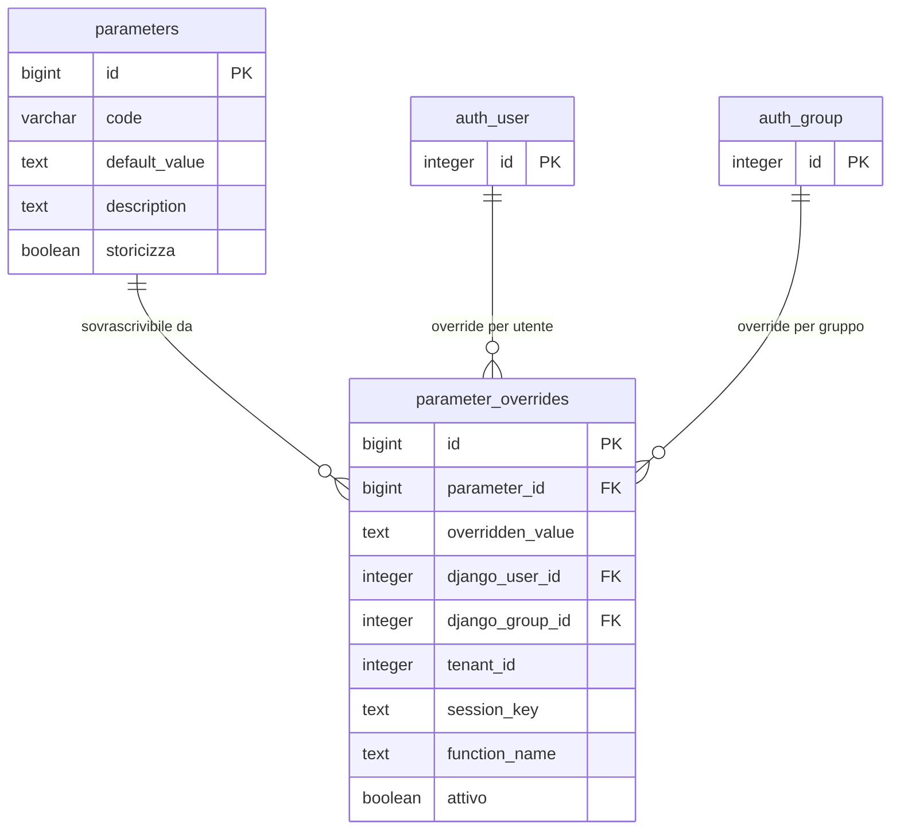

# Guida – Configurazione e Gestione Parametri

> (latest review 04-03-26)
>
> Destinatari: sviluppatori database e backend
>
> Questa guida descrive i due meccanismi di configurazione disponibili in Zero ERP:
> parametri tabellari con override contestuali e parametri GUC di PostgreSQL.
>
> Vedi anche
>
> * [Parametri Personalizzati (GUC)](/postgresql/parametri-personalizzati-(GUC)) — riferimento completo sui GUC
> * [Guida Messaggi di Errore](/guide/Messaggi-di-Errore-e-Generazione-Log) — usa GUC per lingua e connessione dblink
> * [Guida Framework di Automazione DB](/guide/automazione-db) — usa GUC per il controllo del log

---

## Introduzione

Un sistema gestionale ha bisogno di parametri configurabili a piu livelli: la lingua predefinita, lo stato di default per un nuovo soggetto, la connessione per il logging remoto. Alcuni parametri devono valere per tutto il sistema, altri devono poter essere sovrascritti per un singolo utente, un gruppo o una funzione specifica.

Zero ERP offre due meccanismi distinti per questo scopo:

* **Parametri tabellari** (`config.parameters` + `config.parameter_overrides`) — per parametri di business con override contestuali a piu livelli, audit trail, storicizzazione e integrazione con il modello utenti Django
* **Parametri GUC** (Grand Unified Configuration di PostgreSQL) — per parametri infrastrutturali e di sessione, gestiti a livello di database/ruolo/sessione con `SET` e `ALTER DATABASE`

La scelta tra i due dipende dal tipo di parametro e dal livello di flessibilita richiesto.

**Cosa troverai in questa guida:**

* Quando usare parametri tabellari e quando usare GUC
* Il modello tabellare: definizione, override, gerarchia di priorita
* La funzione di recupero e la risoluzione degli override
* I GUC usati nel sistema e le convenzioni di naming
* La gestione dei parametri con riferimento a foreign key
* Esempi pratici per entrambi i meccanismi

---

## Tabelle coinvolte

**Configurazione:**

* [config.parameters](/dbzero/config/tabelle/parameters) — catalogo parametri con valori di default
* [config.parameter_overrides](/dbzero/config/tabelle/parameter_overrides) — override contestuali per utente, gruppo, tenant, sessione, funzione

**Funzioni:**

* [script.fn_get_parameter_full](/dbzero/script/funzioni/fn_get_parameter_full) — recupero parametro con risoluzione override

---

## Quando usare parametri tabellari o GUC

La scelta non e arbitraria. I due meccanismi coprono esigenze diverse.

| Aspetto | Parametri tabellari | GUC |
| --- | --- | --- |
| **Scope** | Per record: utente, gruppo, tenant, sessione, funzione | Per cluster, database, ruolo o sessione |
| **Audit** | Si (campi audit, storicizzazione, `tx_id`) | No |
| **Override multi-livello** | Si (gerarchia a 5 livelli + default) | Limitato (database → ruolo → sessione) |
| **Modifica runtime** | Si (INSERT/UPDATE nelle tabelle) | Si (`SET`, `ALTER DATABASE`) |
| **Integrazione Django** | Si (FK verso `auth_user` e `auth_group`) | No |
| **Uso tipico** | Parametri di business (lingua, stato default, valuta) | Parametri infrastrutturali (connessione dblink, bypass di sicurezza) |

**Regola pratica:**

* Se il parametro deve variare per utente o gruppo → **tabellare**
* Se il parametro e infrastrutturale o di debug → **GUC**
* Se serve audit trail → **tabellare**
* Se serve configurazione rapida senza toccare tabelle → **GUC**

---

## Componenti del modello

### 1. Il catalogo parametri: `config.parameters`

La tabella `parameters` e il punto unico in cui si definiscono i parametri configurabili del sistema. Ogni parametro ha un codice univoco e un valore di default. Il valore di default viene usato quando nessun override contestuale e applicabile.

Da un punto di vista tecnico:

| Colonna | Tipo | Nullable | Descrizione |
| --- | --- | :---: | --- |
| `id` | BIGINT, PK | no | Chiave primaria |
| `code` | VARCHAR, UNIQUE | no | Codice identificativo (es. `lingua`, `stato_def`) |
| `default_value` | TEXT | no | Valore di default |
| `description` | TEXT | si | Descrizione del parametro |
| `storicizza` | BOOLEAN | si | Flag storicizzazione (default: true) |
| Campi audit | — | — | `data_insert`, `user_insert`, `data_update`, `user_update`, `tx_id` |

> Documentazione dettagliata: [config.parameters](/dbzero/config/tabelle/parameters)

---

### 2. Gli override contestuali: `config.parameter_overrides`

La tabella `parameter_overrides` permette di sovrascrivere il valore di default di un parametro in base al contesto: utente Django, gruppo Django, tenant, sessione o funzione. Piu livelli possono coesistere per lo stesso parametro.

Il modello e integrato direttamente con il sistema utenti di Django: le colonne `django_user_id` e `django_group_id` sono FK verso `auth_user` e `auth_group`. Questo significa che un override puo essere associato a un utente specifico o a un gruppo di utenti senza logica intermedia.

Il vincolo CHECK `chk_overrides_has_scope` garantisce che ogni override abbia almeno uno scope definito — non possono esistere override "vuoti" senza contesto.

Da un punto di vista tecnico:

| Colonna | Tipo | Nullable | Descrizione |
| --- | --- | :---: | --- |
| `id` | BIGINT, PK | no | Chiave primaria |
| `parameter_id` | BIGINT, FK | no | Riferimento a `config.parameters` |
| `overridden_value` | TEXT | no | Valore sovrascritto |
| `django_user_id` | INTEGER, FK | si | Utente Django specifico |
| `django_group_id` | INTEGER, FK | si | Gruppo Django |
| `tenant_id` | INTEGER | si | Tenant |
| `session_key` | TEXT | si | Chiave di sessione |
| `function_name` | TEXT | si | Nome funzione specifica |
| `attivo` | BOOLEAN | si | Flag attivo/disattivo (default: true) |
| `storicizza` | BOOLEAN | si | Flag storicizzazione (default: true) |
| Campi audit | — | — | `data_insert`, `user_insert`, `data_update`, `user_update`, `tx_id` |

**Vincolo UNIQUE:** `(parameter_id, tenant_id, django_user_id, django_group_id, session_key, function_name)` — un solo override per combinazione completa di scope.

**Indici dedicati:**

* `ix_overrides_param_tenant` su `(parameter_id, tenant_id)`
* `ix_overrides_param_user` su `(parameter_id, django_user_id)`
* `ix_overrides_param_group` su `(parameter_id, django_group_id)`

> Documentazione dettagliata: [config.parameter_overrides](/dbzero/config/tabelle/parameter_overrides)

---

### 3. Funzione di recupero: `script.fn_get_parameter_full`

La funzione `fn_get_parameter_full` e il punto d'ingresso unico per leggere il valore effettivo di un parametro. Riceve il codice del parametro e i contesti opzionali, interroga la tabella degli override e restituisce il valore con la priorita piu alta. Se nessun override e applicabile, restituisce il valore di default.

La gerarchia di priorita (dalla piu alta alla piu bassa) e:

| Priorita | Scope | Descrizione |
| :---: | --- | --- |
| 1 | **Utente Django** | Override per `django_user_id` |
| 2 | **Gruppo Django** | Override per `django_group_id` |
| 3 | **Tenant** | Override per `tenant_id` |
| 4 | **Sessione** | Override per `session_key` |
| 5 | **Funzione** | Override per `function_name` |
| 6 | **Default** | `config.parameters.default_value` |

In pratica: un override per utente prevale su uno per gruppo, che prevale su uno per tenant, e cosi via. Questo permette configurazioni generali a livello tenant con personalizzazioni puntuali per singoli utenti.

Da un punto di vista tecnico:

| Parametro | Tipo | Default | Descrizione |
| --- | --- | --- | --- |
| `p_code` | TEXT | — | Codice parametro (obbligatorio) |
| `p_tenant_id` | INTEGER | NULL | Tenant |
| `p_django_user_id` | INTEGER | NULL | Utente Django |
| `p_group_ids` | INTEGER[] | NULL | Array di gruppi Django |
| `p_session_key` | TEXT | NULL | Chiave di sessione |
| `p_function_name` | TEXT | NULL | Nome funzione |

**Restituisce:** `TEXT` — il valore effettivo del parametro.

> Documentazione dettagliata: [script.fn_get_parameter_full](/dbzero/script/funzioni/fn_get_parameter_full)

---

## Parametri GUC

I GUC (Grand Unified Configuration) di PostgreSQL sono parametri configurabili a livello di cluster, database, ruolo o sessione. Zero ERP li usa per configurazioni infrastrutturali che non richiedono override multi-livello ne audit trail.

### Convenzioni di naming

| Prefisso | Stabilita | Scope tipico | Uso |
| --- | --- | --- | --- |
| `myapp.*` | Persistente (conf/db) | Cluster, database, ruolo, sessione | Parametri applicativi |
| `dbops.*` | Temporaneo (locale) | Solo sessione | Variabili di transazione |

### GUC principali del sistema

| GUC | Tipo | Descrizione |
| --- | --- | --- |
| `myapp.user_language` | TEXT | Lingua corrente per i messaggi (usata da `fn_get_messaggio`) |
| `myapp.dblink_log_connection` | TEXT | Connessione dblink per il logging persistente |
| `myapp.log_with_dblink` | TEXT | Attiva il logging fuori transazione via dblink (`on`/`off`) |
| `myapp.bypass_tx_id_check` | TEXT | Bypass della validazione `tx_id` (debug) |
| `dbops.tx_id` | UUID | UUID della transazione corrente (gestito dal trigger `trgfn_tx_id_managed`) |

### Configurazione

I GUC possono essere impostati a diversi livelli:

```sql
-- A livello database (persistente)
ALTER DATABASE zeroerp SET myapp.user_language = 'it';

-- A livello ruolo (persistente per il ruolo)
ALTER ROLE zeroerp_app IN DATABASE zeroerp SET myapp.dblink_log_connection = 'service=zeroerp_log';

-- A livello sessione (temporaneo)
SET myapp.user_language = 'en';

-- Lettura
SHOW myapp.user_language;
SELECT current_setting('myapp.user_language', true);
```

Il secondo parametro `true` in `current_setting` indica di restituire NULL se il GUC non esiste, invece di sollevare errore.

Per i dettagli completi sui GUC, vedi [Parametri Personalizzati (GUC)](/postgresql/parametri-personalizzati-(GUC)).

---

## Gestione parametri con riferimento a foreign key

### Il problema

Alcuni parametri fanno riferimento a entita con chiave numerica (es. lo stato di default per un nuovo soggetto). Usare direttamente l'ID numerico (es. `42`) rende il parametro non portabile: in un altro ambiente lo stesso stato potrebbe avere un ID diverso.

### La soluzione

Usare sempre **identificativi simbolici** (codici ISO, codici interni) come valore del parametro, e risolverli a runtime tramite lookup sulla tabella di riferimento.

Esempio: il parametro `stato_def` contiene `IT` (codice ISO), non `42` (ID numerico).

```sql
DECLARE
  v_stato_id INTEGER;
BEGIN
  -- Recupero parametro e risoluzione FK
  SELECT id INTO v_stato_id
  FROM config.stati
  WHERE codice_iso2 = script.fn_get_parameter_full('stato_def');

  -- Guard se il codice non corrisponde a nessun record
  IF v_stato_id IS NULL THEN
    PERFORM script.fn_log_and_raise_error(
      'anagrafiche',
      'fn_crea_soggetto',
      'E_PARAMETRO_FK_NON_TROVATO',
      jsonb_build_object('param_code', 'stato_def'),
      NULL::uuid,
      'stato_def'
    );
  END IF;

  -- Uso del valore risolto
  INSERT INTO anagrafiche.soggetti (nome, stato_id)
  VALUES ('Nuovo Soggetto', v_stato_id);
END;
```

Questo approccio garantisce portabilita tra ambienti (sviluppo, staging, produzione) senza dipendere da ID che possono variare.

---

## Esempi pratici

### Caso 1 — Parametro con override per utente

```sql
-- Definizione parametro globale
INSERT INTO config.parameters (code, default_value, description)
VALUES ('lingua', 'it', 'Lingua predefinita del sistema');

-- Override per un utente specifico (preferisce inglese)
INSERT INTO config.parameter_overrides (parameter_id, overridden_value, django_user_id)
VALUES (
  (SELECT id FROM config.parameters WHERE code = 'lingua'),
  'en',
  42  -- django user id
);

-- Recupero: restituisce 'en' per l'utente 42, 'it' per tutti gli altri
SELECT script.fn_get_parameter_full('lingua', p_django_user_id := 42);
-- → 'en'

SELECT script.fn_get_parameter_full('lingua');
-- → 'it'
```

### Caso 2 — Override per tenant con personalizzazione utente

```sql
-- Override per tenant (tutti gli utenti del tenant 1 usano EUR)
INSERT INTO config.parameter_overrides (parameter_id, overridden_value, tenant_id)
VALUES (
  (SELECT id FROM config.parameters WHERE code = 'valuta_default'),
  'EUR',
  1
);

-- Override per utente specifico nel tenant 1 (usa GBP)
INSERT INTO config.parameter_overrides (parameter_id, overridden_value, django_user_id)
VALUES (
  (SELECT id FROM config.parameters WHERE code = 'valuta_default'),
  'GBP',
  99
);

-- Per l'utente 99: restituisce 'GBP' (priorita utente > tenant)
SELECT script.fn_get_parameter_full('valuta_default', p_tenant_id := 1, p_django_user_id := 99);
-- → 'GBP'

-- Per un altro utente del tenant 1: restituisce 'EUR'
SELECT script.fn_get_parameter_full('valuta_default', p_tenant_id := 1, p_django_user_id := 200);
-- → 'EUR'
```

### Caso 3 — Lettura parametro GUC nel codice PL/pgSQL

```sql
-- Impostare la lingua per la sessione corrente
SET myapp.user_language = 'en';

-- Le funzioni come fn_get_messaggio leggono automaticamente il GUC
SELECT script.fn_get_messaggio('E_GENERICO');
-- → restituisce il messaggio in inglese (se definito nel catalogo)

-- Lettura sicura (NULL se il GUC non e definito)
SELECT current_setting('myapp.user_language', true);
```

---

## Best practice

* **Usare simboli stabili** (codici ISO, codici interni) come valori dei parametri tabellari — mai ID numerici diretti
* **Risolvere a runtime** i riferimenti FK tramite lookup sulla tabella di destinazione, con guard esplicita se il codice non e trovato
* **Usare sempre `fn_get_parameter_full`** per leggere i parametri tabellari — non fare query dirette sulle tabelle
* **Separare parametri di business e infrastrutturali**: business → tabellari, infrastruttura → GUC
* **Non creare GUC per parametri che richiedono override per utente** — il meccanismo GUC non supporta granularita per utente
* **Disattivare override con `attivo = false`** invece di cancellarli — permette di riattivare senza ricreare

---

## Diagramma ER



---

## Note finali

Questa guida copre la gestione dei parametri in Zero ERP. Per i contesti specifici in cui i parametri vengono usati:

* [Parametri Personalizzati (GUC)](/postgresql/parametri-personalizzati-(GUC)) — riferimento completo sui GUC PostgreSQL
* [Guida Messaggi di Errore](/guide/Messaggi-di-Errore-e-Generazione-Log) — usa `myapp.user_language` e `myapp.dblink_log_connection`
* [Guida Framework di Automazione DB](/guide/automazione-db) — usa `myapp.log_with_dblink` per il logging fuori transazione

---


