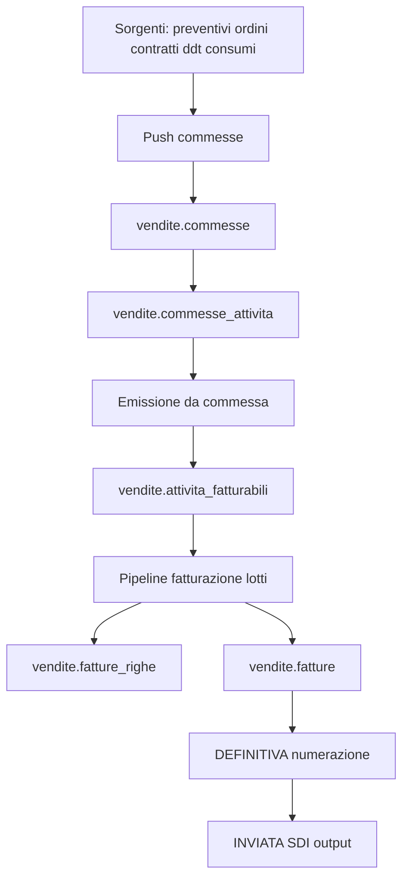
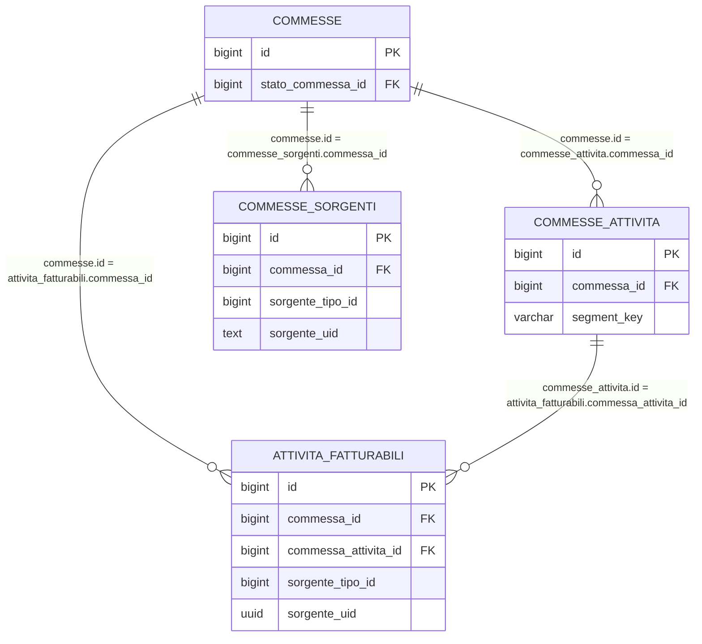
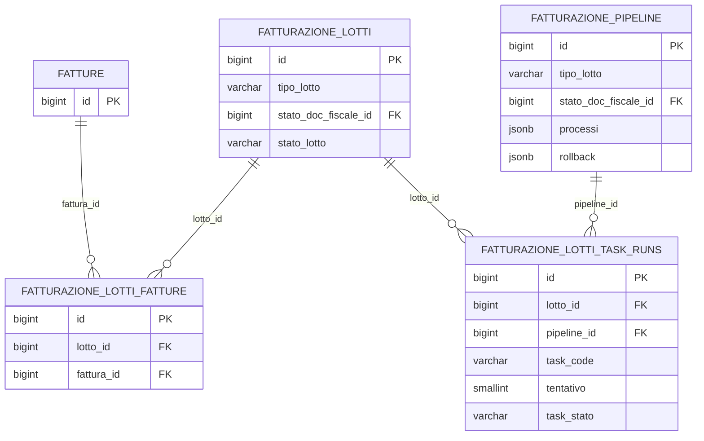

# Guida Tecnica - Fatturazione (processo end-to-end)

> Destinatari: analisti funzionali, sviluppatori backend e database di Zero ERP
>
> Vedi anche:
>
> * [Guida API Commesse](/guide/gestione-commesse)
> * [vendite.commesse](/dbzero/vendite/tabelle/commesse)
> * [vendite.stati_commessa](/dbzero/vendite/tabelle/stati_commessa)
> * [vendite.commesse_attivita](/dbzero/vendite/tabelle/commesse_attivita)
> * [vendite.fn_emit_attivita_fatturabili_da_commessa](/dbzero/vendite/funzioni/fn_emit_attivita_fatturabili_da_commessa)
> * [vendite.fatture](/dbzero/vendite/tabelle/fatture)
> * [vendite.fatture_righe](/dbzero/vendite/tabelle/fatture_righe)
> * [Messaggi di errore e log](/guide/Messaggi-di-Errore-e-Generazione-Log)

---

## Introduzione

Il processo di fatturazione e` stato ristrutturato.

Modello attuale:

1. Le sorgenti business NON alimentano direttamente `attivita_fatturabili`.
2. Tutte le sorgenti passano da `commesse` / `commesse_attivita`.
3. Le righe commessa idonee vengono emesse in `attivita_fatturabili` tramite funzioni dedicate.
4. La pipeline fatturazione a lotti opera poi su `attivita_fatturabili` per produrre ed emettere le fatture.

In sintesi: la commessa e` il livello di governo operativo prima della fatturazione fiscale.

---

## Architettura logica



---

## Schema ER (minimale)



---

## Tabelle core

### Livello commessa

* [vendite.commesse](/dbzero/vendite/tabelle/commesse)
* [vendite.stati_commessa](/dbzero/vendite/tabelle/stati_commessa)
* [vendite.commesse_attivita](/dbzero/vendite/tabelle/commesse_attivita)
* [vendite.commesse_sorgenti](/dbzero/vendite/tabelle/commesse_sorgenti)
* [vendite.commesse_push_log](/dbzero/vendite/tabelle/commesse_push_log)

### Livello fatturazione

* [vendite.attivita_fatturabili](/dbzero/vendite/tabelle/attivita_fatturabili)
* [vendite.fatturazione_lotti](/dbzero/vendite/tabelle/fatturazione_lotti)
* [vendite.fatture](/dbzero/vendite/tabelle/fatture)
* [vendite.fatture_righe](/dbzero/vendite/tabelle/fatture_righe)
* [vendite.fatture_riepiloghi_iva](/dbzero/vendite/tabelle/fatture_riepiloghi_iva)
* [vendite.fatture_scadenze](/dbzero/vendite/tabelle/fatture_scadenze)

---

## Fase 1 - Push sorgenti su commesse

Scopo: costruire/aggiornare le commesse e le relative righe tecniche da emettere.

Funzioni e API principali:

* [vendite.fn_get_or_create_commessa](/dbzero/vendite/funzioni/fn_get_or_create_commessa)
* [vendite.fn_upsert_commessa_attivita](/dbzero/vendite/funzioni/fn_upsert_commessa_attivita)
* [vendite.fn_link_commessa_sorgente](/dbzero/vendite/funzioni/fn_link_commessa_sorgente)
* [API run_commesse_push](/backend/vendite/manual/api_run_commesse_push)

Regole principali:

* match/creazione commessa su perimetro BA/utility/policy/emittente/competenza;
* idempotenza riga su `(commessa_id, segment_key)`;
* validazioni forti su quantita`, prezzo e stato commessa modificabile;
* nessun bypass diretto sorgente -> `attivita_fatturabili`.

---

## Fase 2 - Governo stato commessa

Le operazioni sono governate da `vendite.stati_commessa`:

* `modificabile`: abilita upsert su `commesse_attivita`;
* `emittibile`: abilita discovery per emissione verso AF;
* `chiude_commessa`: impedisce riuso della commessa.

Funzioni di supporto:

* [vendite.fn_get_commessa_stato](/dbzero/vendite/funzioni/fn_get_commessa_stato)
* [vendite.fn_list_commessa_attivita](/dbzero/vendite/funzioni/fn_list_commessa_attivita)
* [vendite.fn_list_commesse_emittibili](/dbzero/vendite/funzioni/fn_list_commesse_emittibili)

---

## Fase 3 - Emissione da commessa a attivita_fatturabili

Scopo: trasferire le righe `commesse_attivita` idonee in `attivita_fatturabili`.

Funzione principale:

* [vendite.fn_emit_attivita_fatturabili_da_commessa](/dbzero/vendite/funzioni/fn_emit_attivita_fatturabili_da_commessa)

Regole principali:

* sorgente AF forzata a tipo `COMMESSA`;
* mapping deterministico di `segment_key` su identificativo sorgente AF;
* idempotenza su chiave sorgente in AF;
* blocco aggiornamento se la riga AF risulta gia` fatturata;
* aggiornamento stato righe commessa emesse (`stato_emissione = EMESSA`).

---

## Fase 4 - Pipeline fatturazione a lotti

Dopo la fase commesse, la fatturazione resta governata dal dominio lotti.

### Modello lotti (visione sintetica)

1. Un lotto (`fatturazione_lotti`) definisce perimetro operativo (competenza, utility, tipo documento, BA/emittente).
2. Gli step sono configurati in `fatturazione_pipeline` e risolti con fallback su `tipo_lotto`, `utility_id`, `tipo_doc_fiscale_id`.
3. Il runner esegue i task di step e traccia i tentativi in `fatturazione_lotti_task_runs`.
4. Le fatture generate sono collegate al lotto tramite `fatturazione_lotti_fatture`.

### Schema ER (pipeline lotti)



### Tabelle core del modello lotti

* [vendite.fatturazione_lotti](/dbzero/vendite/tabelle/fatturazione_lotti)
* [vendite.fatturazione_pipeline](/dbzero/vendite/tabelle/fatturazione_pipeline)
* [vendite.fatturazione_lotti_task_runs](/dbzero/vendite/tabelle/fatturazione_lotti_task_runs)
* [vendite.fatturazione_pipeline_task_policy](/dbzero/vendite/tabelle/fatturazione_pipeline_task_policy)
* [vendite.fatturazione_lotti_fatture](/dbzero/vendite/tabelle/fatturazione_lotti_fatture)

### Funzioni chiave pipeline lotti

* [vendite.fn_resolve_fatturazione_pipeline_step](/dbzero/vendite/funzioni/fn_resolve_fatturazione_pipeline_step)
* [vendite.fn_list_fatturazione_pipeline_steps](/dbzero/vendite/funzioni/fn_list_fatturazione_pipeline_steps)
* [vendite.fn_set_fatturazione_lotto_stato](/dbzero/vendite/funzioni/fn_set_fatturazione_lotto_stato)
* [vendite.pr_run_lotto_pipeline](/dbzero/vendite/funzioni/pr_run_lotto_pipeline)
* [vendite.fn_execute_pipeline_step](/dbzero/vendite/funzioni/fn_execute_pipeline_step)
* [vendite.fn_start_lotto_task_run](/dbzero/vendite/funzioni/fn_start_lotto_task_run)
* [vendite.fn_complete_lotto_task_run](/dbzero/vendite/funzioni/fn_complete_lotto_task_run)
* [vendite.fn_fail_lotto_task_run](/dbzero/vendite/funzioni/fn_fail_lotto_task_run)
* [vendite.fn_cancel_lotto_task_run](/dbzero/vendite/funzioni/fn_cancel_lotto_task_run)
* [vendite.fn_list_lotto_task_runs](/dbzero/vendite/funzioni/fn_list_lotto_task_runs)

### Step operativi tipici (massivo)

1. DRAFT: selezione/preparazione delle attivita` da fatturare.
2. EMESSA: generazione documento e task pre-fiscali.
3. DEFINITIVA: numerazione documento.
4. INVIATA: preparazione/invio su canale esterno (es. SDI).

### Regole operative del modello lotti

1. Lo step effettivo viene risolto con fallback configurativo (`utility + tipo_doc`, `utility`, `tipo_doc`, globale).
2. Le transizioni tecniche del lotto sono governate da `fn_set_fatturazione_lotto_stato`.
3. Ogni task-run deve essere tracciato con `tentativo` ed esito (`IN_ESECUZIONE`, `COMPLETATO`, `ERRORE`, `ANNULLATO`).
4. Le policy runtime task (resume/reset/annullabilita`) sono esterne alla sequenza step e risiedono in `fatturazione_pipeline_task_policy`.
5. I task devono lavorare con input centrato sul `lotto_id`, recuperando il resto dal contesto lotto.

---

## Dashboard operative

Vista funzionale consigliata (anche in singola UI a sezioni):

1. Input/Push Commesse: ingestione sorgenti e verifica errori push.
2. Gestione Commesse: stato testata, righe, approvazioni e anomalie.
3. Emissione da Commesse: pull verso `attivita_fatturabili`.
4. Emissione Fatture: gestione lotti, numerazione, invio.

---

## Gestione errori e osservabilita`

Obiettivo: garantire diagnosi rapida e riesecuzione sicura senza perdita di coerenza.

Regole operative:

1. Le funzioni DB devono alzare errori strutturati tramite `script.fn_log_and_raise_error`.
2. Gli errori di validazione input devono essere distinti da errori runtime/transazionali.
3. Ogni run push/emissione deve produrre log di esito con contatori (`created`, `updated`, `skipped`, `errors`).
4. I servizi backend devono propagare un envelope errore coerente verso API.

Riferimenti:

* [Messaggi di errore e log](/guide/Messaggi-di-Errore-e-Generazione-Log)
* [vendite.commesse_push_log](/dbzero/vendite/tabelle/commesse_push_log)
* [API run_commesse_push](/backend/vendite/manual/api_run_commesse_push)

---

## Concorrenza e idempotenza

Obiettivo: evitare duplicazioni o race condition su push ed emissione.

Regole tecniche:

1. Creazione/riuso commessa serializzata con advisory lock in `fn_get_or_create_commessa`.
2. Upsert righe commessa idempotente su `(commessa_id, segment_key)`.
3. Emissione verso AF idempotente su chiave sorgente (`sorgente_tipo_id`, `sorgente_uid`).
4. Se una riga AF risulta gia` fatturata, l'update deve essere bloccato.
5. Endpoint di orchestrazione protetti da `Idempotency-Key`.

---

## Scheduling e orchestrazione

Il flusso e` pensato per esecuzione schedulata e on-demand.

Pattern consigliato:

1. Job push commesse (frequenza alta, perimetro sorgenti configurabile).
2. Job emissione da commesse (frequenza media, con filtri per competenza/perimetro).
3. Job pipeline lotti fatturazione (finestre batch controllate).

Guardrail operativi:

* evitare sovrapposizione di job sullo stesso perimetro BA/utility/competenza;
* usare lock applicativi/DB e run marker;
* prevedere retry controllato solo su step idempotenti.

---

## Volumetrie e performance

Per ambienti ad alto volume, adottare queste linee guida:

1. Eseguire push/emissione in chunk (`limit/offset` o finestre per ID).
2. Limitare il perimetro per competenza, BA, utility, emittente.
3. Monitorare tempi medi per fase e cardinalita` righe processate.
4. Verificare periodicamente piani query e indici su tabelle `commesse_*` e `attivita_fatturabili`.
5. Definire soglie operative per split automatico dei lotti massivi.

KPI minimi:

* righe push/minuto
* righe emesse/minuto
* percentuale scarti/errori
* tempo medio run per fase

---

## Checklist pre-esecuzione

1. Sorgenti attive e coerenti in `config.sorgenti` (scope push commessa).
2. Funzioni commessa installate/allineate:
   * `fn_get_or_create_commessa`
   * `fn_upsert_commessa_attivita`
   * `fn_list_commesse_emittibili`
   * `fn_emit_attivita_fatturabili_da_commessa`
3. Seed/lookup stati commessa coerente (`vendite.stati_commessa`).
4. Pipeline lotti fatturazione configurata (`vendite.fatturazione_pipeline`).
5. Transizioni stati documento configurate in `config.stati_doc_fiscale_transizioni`.
6. Task registry DBOps coerente con i task fatturazione effettivamente abilitati.

---

## Query rapide di controllo

```sql
-- Commesse emittibili nel mese
SELECT *
FROM vendite.fn_list_commesse_emittibili(
  p_competenza_mese => DATE '2026-02-01',
  p_limit => 100
);

-- Righe di una commessa non ancora emesse
SELECT *
FROM vendite.fn_list_commessa_attivita(
  p_commessa_id => 12345,
  p_stato_emissione => 'NON_EMESSA',
  p_limit => 200,
  p_offset => 0
);

-- Step pipeline lotto per tipo MASSIVO
SELECT stato_doc_fiscale_id, descrizione, ordine
FROM vendite.fn_list_fatturazione_pipeline_steps('MASSIVO', 1, 20);
```

---

## Risultato atteso

Il processo risulta separato in due livelli chiari:

* livello business-operativo: sorgenti -> commesse -> commesse_attivita;
* livello fiscale-documentale: attivita_fatturabili -> lotti -> fatture.

Questa separazione migliora controllo, idempotenza e tracciabilita` dei flussi.
