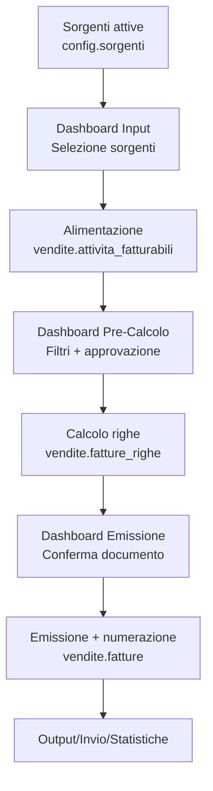
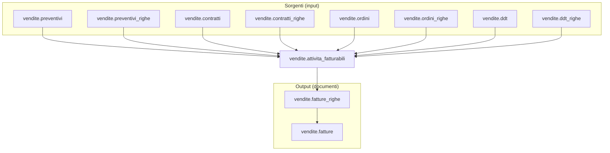

# 📘 Guida Tecnica – Fatturazione (processo end‑to‑end)

> 🎯 **Destinatari:** analisti funzionali, sviluppatori backend e database di Zero ERP
>
> 👀 **Vedi anche**
>
> * [`Documentazione attivita_fatturabili`](/dbzero/vendite/manual/attivita_fatturabili)  
> * [`Documentazione fatture`](/dbzero/vendite/manual/fatture)  
> * [`Documentazione fatture_righe`](/dbzero/vendite/manual/fatture_righe)  
> * [`Documentazione note (partizionata)`](/dbzero/vendite/manual/note)  
> * [`Messaggi di errore e log`](/guide/Messaggi-di-Errore-e-Generazione-Log)  

---

## ✅ Introduzione

La fatturazione in Zero ERP e` progettata come **pipeline in piu` fasi**:

1. **Alimentazione** di `vendite.attivita_fatturabili` a partire dalle sorgenti.
2. **Calcolo** e generazione delle righe di fattura (`vendite.fatture_righe`).
3. **Emissione** e numerazione del documento (`vendite.fatture`).

Questa separazione garantisce **idempotenza**, **controllo** e **revisionabilita`** prima dell’emissione fiscale.

---

## 🧱 Tabelle coinvolte (core)

* [vendite.attivita_fatturabili](/dbzero/vendite/tabelle/attivita_fatturabili)
* [vendite.fatture](/dbzero/vendite/tabelle/fatture)
* [vendite.fatture_righe](/dbzero/vendite/tabelle/fatture_righe)
* [vendite.fatture_riepiloghi_iva](/dbzero/vendite/tabelle/fatture_riepiloghi_iva)
* [vendite.fatture_scadenze](/dbzero/vendite/tabelle/fatture_scadenze)
* [vendite.note](/dbzero/vendite/tabelle/note) + partizioni (es. `note_attivita_fatturabili`)
* [config.sorgenti](/dbzero/config/tabelle/sorgenti)

### 📥 Tabelle sorgenti (alimentazione `attivita_fatturabili`)

* [vendite.preventivi](/dbzero/vendite/tabelle/preventivi)
* [vendite.preventivi_righe](/dbzero/vendite/tabelle/preventivi_righe)
* [vendite.contratti](/dbzero/vendite/tabelle/contratti)
* [vendite.contratti_righe](/dbzero/vendite/tabelle/contratti_righe)
* [vendite.ordini](/dbzero/vendite/tabelle/ordini)
* [vendite.ordini_righe](/dbzero/vendite/tabelle/ordini_righe)
* [vendite.ddt](/dbzero/vendite/tabelle/ddt)
* [vendite.ddt_righe](/dbzero/vendite/tabelle/ddt_righe)

---

## 🧭 Flusso logico (overview)

---

## 1) Processo di alimentazione `attivita_fatturabili`

### 🎯 Scopo
Creare le righe pre‑documentali che rappresentano **tutto cio` che potra` essere fatturato**.

### 🔌 Sorgenti (macro‑tipi)
Le sorgenti sono definite in `config.sorgenti` e rappresentano **origini dati** eterogenee. Esempio:

1. ATTIVITA (RIGA)  
2. PREVENTIVO (DOCUMENTO)  
3. PREVENTIVO_RIGA (RIGA)  
4. CONTRATTO (DOCUMENTO)  
5. CONTRATTO_RIGA (RIGA)  
6. ORDINE_VENDITA (DOCUMENTO)  
7. ORDINE_VENDITA_RIGA (RIGA)  
8. DDT_VENDITA (DOCUMENTO)  
9. DDT_VENDITA_RIGA (RIGA)  
10. FATTURA (DOCUMENTO)  
11. FATTURA_RIGA (RIGA)

### 🧩 Logica di alimentazione
* Ogni sorgente genera righe in `vendite.attivita_fatturabili` con:
  `sorgente_tipo_id`, `sorgente_uid`/`sorgente_riga`, `articolo_id`, `istanza_utility_id`, `quantita`, `competenza_*`.
* L’idempotenza e` garantita dalla coppia `(sorgente_tipo_id, sorgente_uid)` con indice unico parziale.
* Le righe nascono **in bozza** (`approvato = false`) e vengono validate/approvate nel passaggio successivo.

### 🖥️ Dashboard “Input Fatturazione”
* Selezione sorgenti e intervalli (periodo, BA, istanza, utility).
* Visualizzazione righe candidate e preview dei conteggi.
* Avvio del processo di alimentazione (batch o manuale).

---

## 2) Processo operativo di calcolo (pre‑emissione)

### 🎯 Scopo
Trasformare attivita` approvate e fatturabili in **righe economiche** di fattura.

### 🔎 Selezione
* `approvato = true`
* `fatturato = false`
* `sospesa = false`
* `posticipa_al` in regola con la data fatturazione
* competenza mensile/puntuale in regola

### 🔒 Isolamento batch
* `lock_in_fatturazione` e `lock_batch_id` garantiscono coerenza di selezione.
* Evita doppie estrazioni concorrenti.

### 🧮 Output
* Generazione `vendite.fatture_righe` con snapshot economici (prezzo, IVA, UoM, importi).
* Aggancio a `vendite.attivita_fatturabili` (`fattura_riga_id`, `fatturato = true`).

### 🖥️ Dashboard “Pre‑Calcolo”
* Visualizzazione delle righe eleggibili e motivi di esclusione.
* Azioni: approva/sospendi/posticipa.
* Lancio calcolo batch con log esiti e anomalie.

---

## 3) Processo di emissione documento (output)

### 🎯 Scopo
Convertire il risultato del calcolo in **documento fiscale numerato**.

### ✅ Separazione dal calcolo
Il **calcolo** produce righe; l’**emissione** produce la testata, la numerazione e gli output fiscali.

### 🔢 Numerazione
* Assegnata **solo** in fase di emissione (cambio di stato).
* Regole gestite da `vendite.registri_fatturazione`.

### 📦 Output correlati
* `vendite.fatture_riepiloghi_iva`
* `vendite.fatture_scadenze`
* `vendite.note` (e partizioni dedicate)
* `vendite.fatture_indirizzi` (se previsto)

### 🖥️ Dashboard “Emissione”
* Preview del documento, controlli finali e numerazione.
* Conferma emissione con log degli esiti.

---

## 4) Dashboard e varianti operative

### ✅ Dashboard standard
* **Input Fatturazione** → alimenta `attivita_fatturabili`
* **Pre‑Calcolo** → selezione, approvazione, calcolo righe
* **Emissione** → numerazione e creazione documento

### 🔁 Variante: invio SDI (Italia)
* **Estrazione** del documento in formato fiscale (es. XML FatturaPA).
* **Invio** a canali SDI e registrazione esiti (accettato/scartato).
* **Nota di variante**: in altri paesi si sostituisce il canale SDI con sistemi locali o e‑invoicing alternativi.

### 📊 Variante: controlli e statistiche
* **Pre‑emissione**: controlli di anomalia (importi negativi, IVA mancante, competenze fuori periodo, mismatch BA/istanza).
* **Post‑emissione**: riepiloghi fiscali e gestionali:
  * per gruppi voce / articoli
  * per utility / BA / periodo
  * per stato documento (bozza, emessa, annullata)

---

## 🧠 Linee guida di progettazione

1. **Separare sempre calcolo vs emissione**  
   Il calcolo e` idempotente e ripetibile; l’emissione e` un’azione fiscale “finale”.

2. **Dashboard come orchestratore**  
   Il motore batch deve essere avviato da contesto visibile e controllato (input + pre‑calcolo + emissione).

3. **Idempotenza garantita dalle sorgenti**  
   Le sorgenti alimentano `attivita_fatturabili` evitando duplicazioni con chiavi uniche parziali.

4. **Audit e log sempre presenti**  
   Ogni fase deve loggare esiti, scarti, errori e motivi di esclusione.

---

## ✅ Risultato atteso

Un processo fatturazione **modulare**, verificabile e scalabile:

* sorgenti ingegnerizzate → `attivita_fatturabili`
* calcolo controllato → `fatture_righe`
* emissione separata → `fatture` numerate
* dashboard e output fiscali governati

---

## 🧩 Collegamenti tabellari (visione sintetica)

