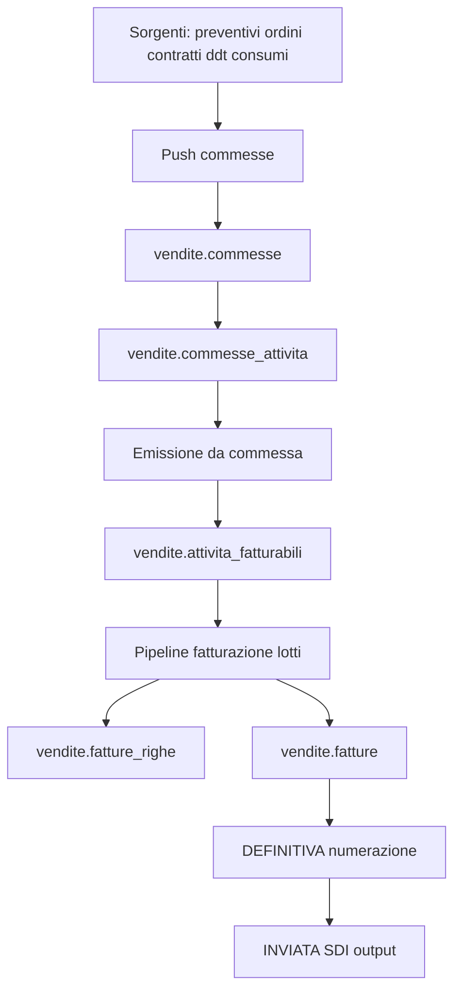
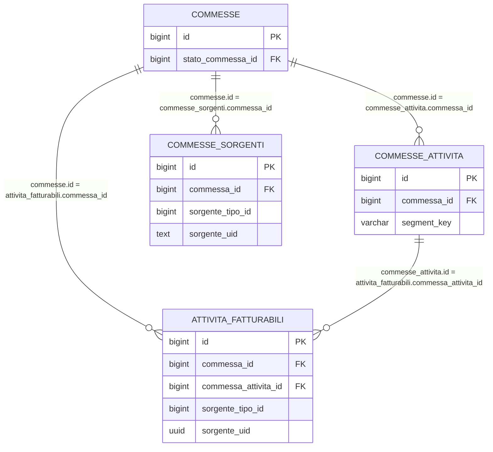
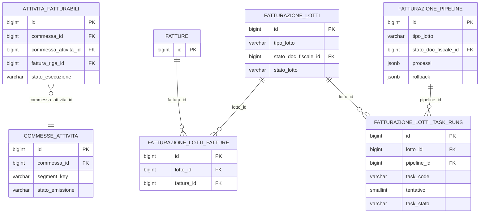

# Guida — Fatturazione (processo end-to-end)

> **Ultimo aggiornamento**: 3 novembre 2026
>
> **Destinatari**: analisti funzionali, sviluppatori backend e database
>
> **Vedi anche** — schemi DB:
>
> * [vendite.commesse](/dbzero/vendite/tabelle/commesse) · [vendite.stati_commessa](/dbzero/vendite/tabelle/stati_commessa) · [vendite.commesse_attivita](/dbzero/vendite/tabelle/commesse_attivita) — il livello commessa
> * [vendite.attivita_fatturabili](/dbzero/vendite/tabelle/attivita_fatturabili) — il lavoro fatturabile, riga per riga
> * [vendite.fatture](/dbzero/vendite/tabelle/fatture) · [vendite.fatture_righe](/dbzero/vendite/tabelle/fatture_righe) · [vendite.fatture_scadenze](/dbzero/vendite/tabelle/fatture_scadenze) — il documento
> * [vendite.fatturazione_pipeline](/dbzero/vendite/tabelle/fatturazione_pipeline) — gli step e i task della pipeline a lotti
> * [vendite.event_log](/dbzero/vendite/tabelle/event_log) — la timeline unificata degli eventi
>
> **Vedi anche** — funzioni e trigger DB:
>
> * [vendite.fn_emit_attivita_fatturabili_da_commessa](/dbzero/vendite/funzioni/fn_emit_attivita_fatturabili_da_commessa) — l'emissione da commessa
> * [vendite.fn_get_or_create_commessa](/dbzero/vendite/funzioni/fn_get_or_create_commessa) — match o creazione della commessa
> * [vendite.fn_assign_numero_fattura](/dbzero/vendite/funzioni/fn_assign_numero_fattura) — il punto unico in cui si assegna il progressivo
>
> **Vedi anche** — API e service backend:
>
> * [API fatturazione](/backend/vendite/manual/api_fatturazione) · [API lineage passaggi](/backend/vendite/manual/api_lineage_passaggi)
>
> **Vedi anche** — guide correlate:
>
> * [Il modello del documento di vendita](/guide/modello-documento-di-vendita) — **le regole comuni a tutti i documenti**: nascita, cambio di stato, permesso sul passaggio, emissione, annullo
> * [Gestione commesse](/guide/gestione-commesse) — il livello a monte, e i presidi dell'emittente
> * [Messaggi di errore e log](/guide/Messaggi-di-Errore-e-Generazione-Log)
> * [Termini di pagamento](/guide/termini-di-pagamento) — il piano rate della fattura
> * [Cruscotti fatturazione](/guide/cruscotti-fatturazione) — le stesse operazioni viste dall'operatore
> * [Numerazione dei documenti e codici](/guide/numerazione-documenti-e-codici) — **il motore dei registri**: la numerazione fiscale non è un meccanismo della fattura, è quello condiviso con ordini, DDT, resi e commesse
> * [Il risolutore IVA di riga](/guide/iva-risolutore-di-riga) — **la sede unica** che decide il codice IVA di una riga, e dove il plafond di un titolo si consuma davvero

---

## Introduzione

Il processo di fatturazione è stato ristrutturato.

Modello attuale:

1. Le sorgenti business NON alimentano direttamente `attivita_fatturabili`.
2. Tutte le sorgenti passano da `commesse` / `commesse_attivita`.
3. Le righe commessa idonee vengono emesse in `attivita_fatturabili` tramite funzioni dedicate.
4. La pipeline fatturazione a lotti opera poi su `attivita_fatturabili` per produrre ed emettere le fatture.

In sintesi: la commessa è il livello di governo operativo prima della fatturazione fiscale.

---

## Architettura logica



### Ruolo dei layer

Il processo è suddiviso su tre layer con responsabilità distinte:

| Layer             | Responsabile                                                   | Esempi                                                                              |
| ----------------- | -------------------------------------------------------------- | ----------------------------------------------------------------------------------- |
| **PostgreSQL**    | Stato, regole di dominio, vincoli, log funzionali              | `fn_get_or_create_commessa`, `fn_lotto_proietta_stato_step`, trigger append-only    |
| **Python/Django** | Orchestrazione, sequencing, fan-out, gestione errori, API REST | `CommessaPushOrchestrator`, `LottoPipelineRunner`, `PipelineStepExecutor`           |
| **API REST**      | Esposizione endpoint, validazione input, idempotenza request   | `/api/v1/vendite/pipeline/run/`, `/api/v1/vendite/commesse/push/run/`               |

Principio generale: il database è l'autorità su stato e regole; Python orchestra il flusso e gestisce le eccezioni; l'API espone e protegge.

### Componenti Python principali

```text
apps/vendite/
  api/views.py                         # Endpoint REST
  services/
    pipeline_service.py                # Entrypoint facade (run_lotto_pipeline)
    pipeline_runner.py                 # LottoPipelineRunner — orchestratore pipeline lotti
    pipeline_step_executor.py          # PipelineStepExecutor — esecuzione singolo step
    pipeline_error_logger.py           # PipelineErrorLogger — dual-log (error_log + dominio)
    commesse_push_orchestrator.py      # CommessaPushOrchestrator — fan-out push sorgenti
    commesse_source_handlers.py        # BaseSourceHandler + handler concreti per sorgente
    lotto_segnalazioni_service.py      # Valutazione segnalazioni blocco lotto
  db/
    pipeline_repository.py             # Repository DB pipeline (stato, log, event_log)
    commesse_repository.py             # Repository DB commesse (CRUD, push log, event_log)
```

---

## Schema ER (minimale)



---

## Tabelle core

### Livello commessa

* [vendite.commesse](/dbzero/vendite/tabelle/commesse)
* [vendite.stati_commessa](/dbzero/vendite/tabelle/stati_commessa)
* [vendite.commesse_attivita](/dbzero/vendite/tabelle/commesse_attivita)
* [vendite.commesse_sorgenti](/dbzero/vendite/tabelle/commesse_sorgenti)
* [vendite.commesse_push_log](/dbzero/vendite/tabelle/commesse_push_log)

### Livello fatturazione

* [vendite.attivita_fatturabili](/dbzero/vendite/tabelle/attivita_fatturabili)
* [vendite.fatturazione_lotti](/dbzero/vendite/tabelle/fatturazione_lotti)
* [vendite.fatture](/dbzero/vendite/tabelle/fatture)
* [vendite.fatture_righe](/dbzero/vendite/tabelle/fatture_righe)
* [vendite.fatture_riepiloghi_iva](/dbzero/vendite/tabelle/fatture_riepiloghi_iva)
* [vendite.fatture_scadenze](/dbzero/vendite/tabelle/fatture_scadenze)

---

## Fase 1 - Push sorgenti su commesse

Scopo: costruire/aggiornare le commesse e le relative righe tecniche da emettere.

### Orchestrazione push (Python)

L'ingestione è gestita da `CommessaPushOrchestrator` che:

1. Acquisisce un advisory lock PostgreSQL per evitare run concorrenti.
2. Esegue in sequenza gli handler registrati (uno per sorgente: preventivi, ordini, consumi, ...).
3. Isola gli errori per handler: un fallimento non blocca gli altri.
4. Scrive il log in `commesse_push_log` e emette eventi su `event_log` (`PUSH_STARTED`, `PUSH_COMPLETED`).

Ogni handler (`BaseSourceHandler`) implementa:

* `fetch_pushable_rows()` — recupera righe sorgente da sincronizzare
* `_expand_rows()` — trasforma una riga sorgente in una o più righe commessa
* `_process_rows()` — risolve/crea commessa, linka sorgente, batch upsert righe

### Funzioni DB

* [vendite.fn_get_or_create_commessa](/dbzero/vendite/funzioni/fn_get_or_create_commessa)
* [vendite.fn_upsert_commessa_attivita](/dbzero/vendite/funzioni/fn_upsert_commessa_attivita)
* [vendite.fn_batch_upsert_commessa_attivita](/dbzero/vendite/funzioni/fn_batch_upsert_commessa_attivita)
* [vendite.fn_link_commessa_sorgente](/dbzero/vendite/funzioni/fn_link_commessa_sorgente)
* [API run_commesse_push](/backend/vendite/manual/api_run_commesse_push)

### Regole principali

* match/creazione commessa su perimetro BA/utility/policy/emittente/competenza;
* idempotenza riga su `(commessa_id, segment_key)`;
* batch upsert: N righe in una singola chiamata DB per performance;
* validazioni forti su quantità, prezzo e stato commessa modificabile;
* nessun bypass diretto sorgente -> `attivita_fatturabili`.

### ⭐ L'emittente della commessa non si passa: si deriva

L'emittente della commessa **si ricava dal cliente**, sempre, e da nessun'altra
parte. Chi spinge un documento non lo dichiara: se lo dichiarasse uguale sarebbe
ridondante, se lo dichiarasse diverso verrebbe respinto — e per questo il
parametro è stato **tolto dalla firma** di `fn_get_or_create_commessa`.

⛔ **Non è un dettaglio di comodo.** Quella colonna è la chiave con cui il
sistema decide chi vede la commessa: la row security della tabella, il filtro
del cruscotto competenza e il giornale degli eventi ci si appoggiano tutti.
Con l'emittente sbagliato — o vuoto — la commessa non compariva sbagliata:
**spariva**. Il lavoro restava nel database, non lo vedeva nessuno e non veniva
mai fatturato.

⚠️ E una commessa **non può aggregare due emittenti**: è l'emittente a decidere
su quale registro la fattura verrà numerata, quindi documenti di emittenti
diversi nella stessa commessa renderebbero falsa quella scelta per una parte
delle righe. Il controllo sta sul collegamento della sorgente.

⇒ Dettaglio completo, con i tre presidi:
[gestione commesse § Di chi è una commessa](/guide/gestione-commesse).

### ⚠️ E a monte: il cliente non cambia emittente dopo aver fatturato

La fattura **congela** chi l'ha emessa (`emittente_soggetto_ruolo_id` e
`emittente_snapshot`) e non lo cambia mai. Spostare il cliente su un altro
emittente non riscriverebbe i documenti già emessi: li lascerebbe **orfani** —
visibili a chi li ha emessi, ma senza più il cliente a cui si riferiscono.

Per questo il legame cliente → emittente si corregge solo **finché non c'è
storia**; dopo, la strada è una fornitura nuova presso l'altro emittente. Vedi
[generazione cliente § L'emittente del cliente](/guide/generazione-cliente).

---

## Fase 2 - Governo stato commessa

Le operazioni sono governate da `vendite.stati_commessa`:

* `modificabile`: abilita upsert su `commesse_attivita`;
* `emittibile`: abilita discovery per emissione verso AF;
* `chiude_commessa`: impedisce riuso della commessa.

Funzioni di supporto:

* [vendite.fn_get_commessa_stato](/dbzero/vendite/funzioni/fn_get_commessa_stato)
* [vendite.fn_list_commessa_attivita](/dbzero/vendite/funzioni/fn_list_commessa_attivita)
* [vendite.fn_list_commesse_emittibili](/dbzero/vendite/funzioni/fn_list_commesse_emittibili)

---

## Snapshot pricing su commessa e propagazione ad AF

Le righe `commesse_attivita` portano con sé lo **snapshot del prezzo** calcolato al push dal resolver v5. Questa sezione copre la parte prezzi del modello fatturazione; per il dettaglio del calcolo, dei 3 stadi (promo/contratto/categoria) e delle autorizzazioni L1/L2/L3 vedere la [guida Gestione Listini e Pricing](/guide/gestione-listini).

### Campi pricing rilevanti

Oltre a quantità, UOM e competenza, la riga `vendite.commesse_attivita` include:

Snapshot resolver (calcolato al push):

* `prezzo_snapshot` — prezzo corrente della riga
* `prezzo_base_snapshot` — prezzo base di listino prima della variazione
* `origine_prezzo` — `PROMO`, `CONTRATTO_OVERRIDE`, `CONTRATTO_LISTINO`, `CATEGORIA`, `MANUALE`
* `tipo_variazione_applicata` + `valore_variazione_applicata`
* `listino_versione_id`, `listino_riga_id` — FK alla riga di listino usata
* `promo_id`, `contratto_id`, `categoria_cliente_id_snapshot`, `classe_utenza_id_snapshot` — FK congelate al momento del calcolo

Flag operativi post-resolver:

* `prezzo_bloccato` — se `TRUE`, il prezzo è bloccato da override manuale e il riallineamento automatico lo salta
* `prezzo_da_riallineare` — flag di segnalazione per dashboard "prezzi da riallineare"
* `pricing_mode` — predisposizione futura (`FIXED`, `FORMULA`, `SCAGLIONI`); oggi solo `FIXED` è operativo

### Ciclo di vita post-push

Una volta sulla riga commessa, il prezzo può essere **ricalcolato, bloccato o sbloccato** tramite le operazioni dedicate del servizio vendite (vedi [guida listini §7](/guide/gestione-listini#7-ciclo-di-vita-del-prezzo-sulla-riga-commessa)):

* `POST .../attivita/<id>/riallinea-prezzo/` — ricalcola dal resolver; guardia su cambio versione listino; errore se `prezzo_bloccato=TRUE`
* `POST .../attivita/<id>/variazione-prezzo-eccezionale/` — override manuale con motivo obbligatorio; imposta `prezzo_bloccato=TRUE`
* `POST .../attivita/<id>/sblocca-prezzo/` — rimuove il blocco e ricalcola dal resolver

Tutte queste operazioni sono ammesse solo su commesse `modificabile` e righe non ancora fatturate.

### Propagazione a `attivita_fatturabili`

All'emissione (`fn_emit_attivita_fatturabili_da_commessa`) i campi snapshot e `prezzo_bloccato` vengono propagati sulla riga AF. Conseguenze operative:

* i task pipeline fatturazione **rispettano** `prezzo_bloccato=TRUE`: un prezzo da override manuale non viene riscritto da eventuali ricalcoli massivi in fase di lotto;
* lo snapshot resolver resta tracciabile fino a `fatture_righe`, utile per audit e contestazioni (origine prezzo, FK listino/contratto/promo, variazione applicata).

---

## Fase 3 - Emissione da commessa a attivita_fatturabili

Scopo: trasferire le righe `commesse_attivita` idonee in `attivita_fatturabili`.

### Orchestrazione emissione (Python)

L'emissione non è un job autonomo: è un **task pipeline** eseguito come primo
step del lotto (tipicamente DRAFT), gestito da `PipelineStepExecutor`:

1. Il task `pull_attivita_da_commessa_default` viene invocato dal runner.
2. L'executor chiama `commesse_repository.list_commesse_emittibili()` per scoprire
   le commesse pronte nel perimetro del lotto (competenza, utility, BA, emittente).
3. Per ogni commessa trovata chiama `commesse_repository.emit_attivita_fatturabili()`.
4. La funzione SQL sottostante trasferisce le righe e restituisce contatori
   (`inserted_rows`, `updated_rows`, `skipped_rows`).

Componenti Python:

| Componente   | File                                                                   | Ruolo                                              |
| ------------ | ---------------------------------------------------------------------- | -------------------------------------------------- |
| Task handler | `pipeline_step_executor.py` (`_handle_pull_attivita_da_commessa_task`) | Orchestrazione discovery + emit per lotto          |
| Discovery    | `commesse_repository.py` (`list_commesse_emittibili`)                  | Trova commesse pronte per emissione                |
| Emit wrapper | `commesse_repository.py` (`emit_attivita_fatturabili`)                 | Wrappa la fn SQL, restituisce `CommessaEmitResult` |

### Funzioni DB emissione

* [vendite.fn_emit_attivita_fatturabili_da_commessa](/dbzero/vendite/funzioni/fn_emit_attivita_fatturabili_da_commessa)
* [vendite.fn_list_commesse_emittibili](/dbzero/vendite/funzioni/fn_list_commesse_emittibili)

### Regole emissione

* sorgente AF forzata a tipo `COMMESSA`;
* mapping deterministico di `segment_key` su identificativo sorgente AF (`md5 → UUID`);
* idempotenza su chiave sorgente in AF (`sorgente_tipo_id`, `sorgente_uid`);
* blocco aggiornamento se la riga AF risulta già fatturata;
* aggiornamento stato righe commessa emesse (`stato_emissione = EMESSA`);
* supporto `dry_run` e filtro `only_approved` sulla funzione SQL.

---

## Fase 4 - Pipeline fatturazione a lotti

Dopo la fase commesse, la fatturazione resta governata dal dominio lotti.

### Orchestrazione pipeline (Python)

Il flusso è orchestrato da `LottoPipelineRunner`:

1. Risolve o crea il lotto (`get_or_create_lotto`).
2. Verifica precondizioni: lotto non già in esecuzione, nessuna segnalazione critica attiva.
3. Imposta stato `IN_ESECUZIONE` e emette `PIPELINE_STARTED` su `event_log`.
4. Esegue un singolo step per run (modalità operativa: avanzamento incrementale).
5. Per ogni step: aggiorna stato doc, logga fase, delega a `PipelineStepExecutor`, emette `STEP_COMPLETED`.
6. Se tutti gli step completano: stato `COMPLETATO`, emette `PIPELINE_COMPLETED`.
7. In caso di errore: stato `ERRORE`, dual-log (`error_log` tecnico + `event_log` di dominio), emette `PIPELINE_ERROR`.

Componenti:

* `LottoPipelineRunner` — orchestra il flusso, gestisce retry/rerun su lotti in errore.
* `PipelineStepExecutor` — esegue il singolo step con risoluzione task da registry.
* `PipelineErrorLogger` — dual-log: errore tecnico su `dbops.error_log` + log funzionale su tabelle dominio.
* `LottoSegnalazioniService` — valuta se il lotto ha segnalazioni bloccanti prima dell'avanzamento.

### Modello lotti (visione sintetica)

1. Un lotto (`fatturazione_lotti`) definisce perimetro operativo (competenza, utility, tipo documento, BA/emittente).
2. Gli step sono configurati in `fatturazione_pipeline` e risolti con fallback su `tipo_lotto`, `utility_id`, `tipo_doc_fiscale_id`.
3. Il runner esegue i task di step e traccia i tentativi in `fatturazione_lotti_task_runs`.
4. Le fatture generate sono collegate al lotto tramite `fatturazione_lotti_fatture`.

### Schema ER (pipeline lotti)

> ℹ️ Il sotto-sistema **lotto-attività** (`attivita_fatturabili_lotti` +
> `attivita_fatturabili.lotto_attivita_id`) è stato **rimosso** dal changeset
> `20260227-16`: le attività fatturabili non hanno più un lotto-attività proprio,
> il raggruppamento avviene solo a livello `fatturazione_lotti`.



### Tabelle core del modello lotti

* [vendite.fatturazione_lotti](/dbzero/vendite/tabelle/fatturazione_lotti)
* [vendite.fatturazione_pipeline](/dbzero/vendite/tabelle/fatturazione_pipeline)
* [vendite.fatturazione_lotti_task_runs](/dbzero/vendite/tabelle/fatturazione_lotti_task_runs)
* [vendite.fatturazione_pipeline_task_policy](/dbzero/vendite/tabelle/fatturazione_pipeline_task_policy)
* [vendite.fatturazione_lotti_fatture](/dbzero/vendite/tabelle/fatturazione_lotti_fatture)

### Funzioni chiave pipeline lotti

* [vendite.fn_resolve_fatturazione_pipeline_step](/dbzero/vendite/funzioni/fn_resolve_fatturazione_pipeline_step)
* [vendite.fn_list_fatturazione_pipeline_steps](/dbzero/vendite/funzioni/fn_list_fatturazione_pipeline_steps)
* [vendite.fn_lotto_proietta_stato_step](/dbzero/vendite/funzioni/fn_lotto_proietta_stato_step)
* [vendite.fn_cambia_stato_lotto](/dbzero/vendite/funzioni/fn_cambia_stato_lotto)
* [vendite.fn_fattura_proietta_stato](/dbzero/vendite/funzioni/fn_fattura_proietta_stato)
* [backend.execute_pipeline_step](/backend/vendite/funzioni/fn_execute_pipeline_step)
* [backend.run_lotto_pipeline](/backend/vendite/funzioni/run_lotto_pipeline)
* [vendite.fn_start_lotto_task_run](/dbzero/vendite/funzioni/fn_start_lotto_task_run)
* [vendite.fn_complete_lotto_task_run](/dbzero/vendite/funzioni/fn_complete_lotto_task_run)
* [vendite.fn_fail_lotto_task_run](/dbzero/vendite/funzioni/fn_fail_lotto_task_run)
* [vendite.fn_cancel_lotto_task_run](/dbzero/vendite/funzioni/fn_cancel_lotto_task_run)
* [vendite.fn_list_lotto_task_runs](/dbzero/vendite/funzioni/fn_list_lotto_task_runs)

### Step operativi tipici (massivo)

1. DRAFT: selezione/preparazione delle attività da fatturare.
2. EMESSA: generazione documento e task pre-fiscali.
3. DEFINITIVA: numerazione documento.
4. INVIATA: preparazione/invio su canale esterno (es. SDI).

### Stato documentale della fattura: segue lo step (invariante)

⭐ Le regole comuni a tutti i documenti — in che stato si nasce, chi cambia lo stato, quale permesso chiede un passaggio, l'emissione, l'annullo — stanno nel [modello del documento di vendita](/guide/modello-documento-di-vendita), che al §10 dice anche a che punto è la fattura rispetto al modello. Qui ci sono gli stati e i passaggi che sono suoi.

Lotto **e** fatture condividono `config.stati_doc_fiscale` ma con **macchine a stati
distinte** (`config.stati_doc_fiscale_transizioni`, colonne `solo_lotto` / `solo_fattura`).
Lo stato della **fattura** segue lo `stato_doc_fiscale_id` dello **step** di pipeline: a ogni
avanzamento di step le fatture del lotto vengono allineate (`fn_sync_lotto_fatture_stato`).

**Invariante (imposto dalla matrice + `trgfn_fatture_guard_stato`)**: la fattura deve passare
per **EMESSA(2) prima di DEFINITIVA(8)** — `1→2→8`, **mai** `1→8`. Semantica: non si assegna
un numero fiscale (DEFINITIVA) a una fattura di cui non si è certificata l'IVA (EMESSA).

* **MASSIVO**: la fattura fa `1→2→8→3`. Lo step EMESSA prepara il documento pre-fiscale
  (rifacibile: ha rollback `reset_lotto_draft`), poi DEFINITIVA numera.
* **GIORNALIERO**: stessa sequenza `1→2→8→3` a livello sia di lotto sia di fattura, **con gli
  stessi task** della corsia massiva. Cambia solo il rollback: la corsia immediata non ne ha,
  perché arriva da sola fino alla numerazione e una fattura numerata non si resetta.

> ⚠️ **Le due corsie EMESSA devono restare allineate, ed è un invariante presidiato.** Lo step EMESSA
> non può essere vuoto su una corsia: nessun trigger ricalcola IVA e totali dopo la nascita del
> documento, quindi una corsia attiva senza `processi` emetterebbe documenti numerati, stampati e
> inviati allo SDI **senza riepilogo IVA né totali**. Non sarebbe una corsia che calcola meno: sarebbe
> una corsia che emette documenti invalidi. Il presidio è
> `test-pipeline-processi-invariante-v1.sql`: fallisce se una tappa qualsiasi ha corsie con
> `processi` divergenti, o se una corsia attiva resta vuota.

### I task dello step DRAFT (entrambe le corsie)

| #   | Task                        | Cosa fa                                                                                                                                                                                      |
| --- | --------------------------- | -------------------------------------------------------------------------------------------------------------------------------------------------------------------------------------------- |
| 1   | `pull_attivita_da_commessa` | porta sulle attività fatturabili il lavoro maturato sulle commesse                                                                                                                           |
| 2   | `select_attivita`           | seleziona e **blocca** le attività che finiranno nel lotto                                                                                                                                   |
| 3   | `generate_fatture_righe`    | crea testate e righe delle fatture                                                                                                                                                           |
| 4   | `snapshot_indirizzi_lotto`  | **congela** sulla fattura ciò che il documento stamperà: gli indirizzi (`vendite.fatture_indirizzi`) e l'**intestazione fiscale** delle due parti (`emittente_snapshot`, `cliente_snapshot`) |

Sul quarto task vale la pena fermarsi, perché è ciò che rende la **ristampa
conforme**: da lì in avanti la fattura non legge più l'anagrafica: porta la
fotografia dei dati com'erano quando è nata. Cambiare l'indirizzo di un cliente
non cambia i documenti già emessi, e ristampare un PDF vecchio produce lo stesso
PDF. Il dettaglio della catena di risoluzione è in
[Gestione degli indirizzi — Gli indirizzi congelati sui documenti](/guide/gestione-degli-indirizzi).

⚠️ **Il congelamento è anche un cancello**: `trgfn_fatture_guard_uscita_draft`
impedisce a una fattura di lasciare lo stato DRAFT se le manca un indirizzo
dichiarato obbligatorio per l'ambito `FATTURE` (oggi `FATT`) o l'intestazione
fiscale di una delle due parti. Una fattura incompleta **non avanza**, invece di
arrivare alla numerazione con dei trattini al posto dell'intestazione.

⚠️ **Il task non fa fallire il lotto per una fattura difettosa**: le altre
ricevono il loro lavoro per intero, la fattura in errore resta marcata e il lotto
**non avanza** allo step successivo. Le vie d'uscita sono correggere a monte e
**rilanciare lo stesso step**, oppure togliere il documento dal lotto — vedi
*Rollback di step* più avanti in questa pagina.

### I task dello step EMESSA (entrambe le corsie)

| #   | Task                        | Cosa fa                                                                                                                                                                                                                    |
| --- | --------------------------- | -------------------------------------------------------------------------------------------------------------------------------------------------------------------------------------------------------------------------- |
| 1   | `genera_fondi_source_lotto` | genera i source di fondi/minimi                                                                                                                                                                                            |
| 2   | `applica_fondi_lotto`       | applica i fondi alle fatture del lotto                                                                                                                                                                                     |
| 3   | `ricalcola_iva_lotto`       | ricalcola riepiloghi IVA e totali — **produce `totale_a_pagare`**                                                                                                                                                          |
| 4   | `genera_scadenze_lotto`     | genera il **piano rate** di ogni fattura (`vendite.fatture_scadenze`), applicando il termine risolto dalla catena documento → commessa → cliente → *unica rata* — vedi [Termini di pagamento](/guide/termini-di-pagamento) |

⚠️ **L'ordine 3 → 4 non è negoziabile**: la base di ripartizione delle rate è `totale_a_pagare`,
che prima del ricalcolo non esiste. Invertirli farebbe sollevare `E_SCADENZE_BASE_NON_PRONTA` su
**ogni** fattura del lotto — un giro interamente rosso che sembra un difetto dei dati mentre è
una riga di configurazione girata. L'ordine è sorvegliato due volte: da
`_TASK_ORDER_DEPENDENCIES` in `pipeline_step_executor.py` (che rifiuta la sequenza invertita
prima che il primo task scriva) e dal pgTAP sull'invariante (che impedisce al seed sbagliato di
nascere).

> Rollback: ammesso solo da stati **pre-fiscali** (DRAFT/EMESSA). `fn_annulla_lotto_da_draft`
> **cancella** le fatture pre-fiscali del lotto (non numerate); le fiscali (DEFINITIVA in poi)
> sono rifiutate.

### Rollback di step (`fatturazione_pipeline.rollback`)

Ogni riga di `fatturazione_pipeline` ha due array JSONB paralleli:

* **`processi`** — task da eseguire in avanzamento (forward);
* **`rollback`** — task da eseguire quando il lotto torna a questo step (cleanup).

La fn SQL `fn_resolve_fatturazione_pipeline_step(p_rollback => true)` restituisce
i task di rollback al posto di quelli forward. Il `PipelineStepExecutor` chiama
`get_step_processes(rollback=True)` e li esegue con lo stesso meccanismo dei task normali.

**Quando scatta il rollback:**

Il rollback è manuale (richiesto dall'operatore o dall'API `reset_lotto`) oppure
automatico se la pipeline ha `meta.auto_step_rollback = true`. Non scatta mai
spontaneamente su errore: un errore lascia il lotto in stato `ERRORE` e serve
un rerun esplicito.

**Il seed di oggi (corsia MASSIVO):**

| Step   | `processi`                                                                                           | `rollback`          |
| ------ | ---------------------------------------------------------------------------------------------------- | ------------------- |
| DRAFT  | `pull_attivita_da_commessa`, `select_attivita`, `generate_fatture_righe`, `snapshot_indirizzi_lotto` | `[]` (nessuno)      |
| EMESSA | `genera_fondi_source_lotto`, `applica_fondi_lotto`, `ricalcola_iva_lotto`, `genera_scadenze_lotto`   | `reset_lotto_draft` |

In questo caso, se un lotto MASSIVO in stato EMESSA deve tornare a DRAFT, il sistema
esegue il task `reset_lotto_draft`, che ripristina i fondi delle fatture sorgente,
cancella le righe IVA e i totali generati dallo step forward — **e poi cancella le
fatture e chiude il lotto**. Non è un rollback reversibile: è una demolizione.

> ⚠️ **`reset_lotto_draft` non riporta il lotto a DRAFT: lo ANNULLA.**
> Il nome inganna. Cosa fa davvero, nell'ordine:
>
> 1. **pretende il lotto già in DRAFT** (guard *«rollback solo se DRAFT»*): il ritorno
>    EMESSA→DRAFT lo fa il rerun dello step, *prima*; il task non lo esegue.
> 2. **ripristina i fondi** delle fatture sorgente (`fn_reset_fondi_fattura`) — vedi
>    il caveat sotto.
> 3. **cancella fisicamente** riepiloghi IVA, righe, log, note e **le fatture stesse**.
> 4. **sblocca le righe** di `attivita_fatturabili` (`fattura_riga_id` → NULL,
>    `fatturato` → false, lock rimosso): sopravvivono e restano pronte.
> 5. **chiude il lotto**: `stato_doc_fiscale` = ANNULLATA (dal verbo del lotto,
>    `fn_cambia_stato_lotto`), `stato_operativo` = CHIUSO. ⛔ **`stato_lotto` non si
>    tocca**: è lo stato del job e racconta **com'è andata la corsa**, non dov'è il
>    documento. Un lotto andato in ERRORE e poi annullato resta ERRORE *e* ANNULLATA:
>    due fatti veri, non una contraddizione. Scrivergli COMPLETATO direbbe «la corsa è
>    andata bene» di un giro fallito o interrotto, e la matrice del job
>    (`config.transizioni_stati_lotto_job`) quel passaggio da ERRORE non lo ammette.
>
> **Quel lotto è morto.** Per rifatturare serve un **lotto nuovo**, che ripescherà le
> stesse righe `attivita_fatturabili` rimaste libere. Con **questo** verbo il lotto non
> si "riapre e si corregge": si demolisce e si rifà — per riaprirlo c'è la sorella
> descritta qui sotto.
>
> ⚠️ **E il «ripristino» dei fondi non è integrale — né è un ripristino.**
> `fn_reset_fondi_fattura` **cancella** l'atto di fondo che non è stato eseguito,
> invece di riaprirlo: un atto mai eseguito è una *proposta*, e il giro successivo
> ne fa una nuova, letta sul residuo di adesso.
> Restano fuori **quattro** casi, tutti
> segnalati nel diario della fattura (`vendite.fatture_log`) e **nessuno
> bloccante**: il reset riesce comunque, quindi il log va **letto**, non dato per
> pulito.
>
> | Che cosa trova | Che cosa fa | Avviso |
> | --- | --- | --- |
> | il trasferimento è **già stato registrato** (l'atto è `ESEGUITO`) | non lo tocca | `W_FONDO_ESEGUITO_NON_RESETTABILE` |
> | la riga sta in una distinta contabile **chiusa** (denaro mai registrato) | marca l'atto `ANNULLATO` con la ragione sul dato | `W_FONDO_MINIMO_NON_RIPRISTINABILE` |
> | ⭐ la fattura che ha **ricevuto** il fondo ha superato la soglia di congelamento fiscale | non lo tocca: cancellarlo cambierebbe un documento ormai definitivo | `W_FONDO_FIGLIA_CONGELATA` |
> | ⭐ l'atto è nato da una **sistemazione**, che lo trattiene | lo salta: si disfa annullando quella sistemazione, non da qui | `W_FONDO_TRATTENUTO_DA_SISTEMAZIONE` |
>
> ⭐ **E i quattro motivi non sono scritti dentro il reset**: stanno in
> `vendite.fn_check_fondo_cancellabile`, il predicato che il reset e il gesto
> manuale dell'operatore **condividono**. È il motivo per cui le due strade non
> possono divergere: *un fondo che il reset non tocca è lo stesso fondo che una
> persona non può cancellare, e per la stessa ragione.*
>
> ⚠️ **I due messaggi non dicono la stessa cosa**: quello del secondo avvisa «già
> postato», cioè proprio ciò che nel suo caso *non* è successo.
>
> ⭐ **La sorella che il nome vecchio prometteva** è `fn_riporta_lotto_a_draft`
> (verbo «Riporta in lavorazione»). Fa la stessa
> demolizione delle fatture pre-fiscali, ma **non chiude il lotto**: lo riporta a
> DRAFT con `stato_operativo` APERTO e `riaperto_il` valorizzato, e al giro
> successivo le fatture si **rigenerano** nello stesso lotto. Vale per MASSIVO
> **e** GIORNALIERO, su lotti DRAFT o EMESSA, e rifiuta se anche una sola fattura
> è già numerata.
>
> ⚠️ **Chiude ad ANNULLATO tutti i task-run attivi del lotto**, e non è un
> dettaglio di pulizia: `fn_resolve_lotto_task_execution_mode` legge l'ultimo
> task-run e su COMPLETATO risponde SKIP — senza quel passo il lotto riaperto
> rilancerebbe **a vuoto**, senza errori e senza corse nuove. Le corse non si
> cancellano: si chiudono con esito, e il giro nuovo apre `tentativo = MAX+1`.
>
> **Le tre vie d'uscita, in una riga**: *riporta in lavorazione* (il lotto resta e
> si rifà), *annulla lotto* (il lotto muore, serve un lotto nuovo), *elimina
> fattura dal lotto* (una sola fattura, il lotto prosegue). Lato operatore:
> [Cruscotti fatturazione §7.6](/guide/cruscotti-fatturazione).

**Vincoli:**

* Il rollback pretende il lotto già in **DRAFT**; le **fatture** del lotto possono
  essere DRAFT o EMESSA (pre-fiscali), altrimenti la fn rifiuta.
  ⚠️ Il vincolo **vale per entrambe le corsie**: anche un giro GIORNALIERO
  interrotto deve poter tornare indietro. Chi trova documentazione che lo dà per
  vivo solo sul MASSIVO sta leggendo una versione precedente.
* Dopo la DEFINITIVA (numerazione fiscale) il rollback globale non è più possibile;
  il sistema usa resume per fattura.
* Le **fatture non tornano mai a DRAFT**: nella matrice `config.stati_doc_fiscale_transizioni`
  la transizione EMESSA→DRAFT ha `solo_lotto = true`, quindi vale per il **lotto**, non per
  il documento. Una fattura EMESSA si può solo **cancellare** (dal reset), mai retrocedere.
* L'auto-rollback **esclude** questo task: il `PipelineStepExecutor` non lo esegue mai in
  auto-run, proprio perché distruttivo. Serve una richiesta esplicita
  (`POST /lotti/<id>/reset-draft/`).
* Per una singola fattura esiste l'alternativa che **non** annulla il lotto:
  `fn_elimina_fattura_da_lotto`. Il perimetro è **pre-fiscale su
  entrambi i fronti**: sia il lotto sia la fattura devono essere in DRAFT o
  EMESSA, cioè non ancora numerati. Pretendere il lotto in **bozza** sarebbe di
  troppo: il caso che motiva l'azione è proprio la fattura difettosa dentro un
  lotto **emesso**.
  ⚠️ Togliere una fattura vuol dire **cancellarla**, testata compresa, e dopo non
  è più possibile sapere cosa diceva: resta solo la registrazione storica del suo
  passaggio nel lotto. È la stessa cosa che il ritorno in bozza fa su tutte le
  fatture del lotto insieme — qui la si fa su una sola.
* Se `rollback` è `[]` (array vuoto), lo step non prevede operazioni di pulizia.

### Regole operative del modello lotti

1. Lo step effettivo viene risolto con fallback configurativo (`utility + tipo_doc`, `utility`, `tipo_doc`, globale).
2. Lo stato del job del lotto (`IN_ESECUZIONE`, `COMPLETATO`, `ERRORE`) ha i passaggi nella matrice `config.transizioni_stati_lotto_job`, applicata dal suo guard a ogni scrittura; lo stato fiscale del lotto lo scrivono i suoi verbi (il giro della pipeline, «riporta in bozza», l'annullo), e quello della fattura il verbo della fattura. Il modello sta nella [guida del modello del documento di vendita](/guide/modello-documento-di-vendita).
3. Ogni task-run deve essere tracciato con `tentativo` ed esito (`IN_ESECUZIONE`, `COMPLETATO`, `ERRORE`, `ANNULLATO`).
4. Le policy runtime task (resume/reset/annullabilità) sono esterne alla sequenza step e risiedono in `fatturazione_pipeline_task_policy`.
5. I task devono lavorare con input centrato sul `lotto_id`, recuperando il resto dal contesto lotto.
6. **Un lotto fermo non diventa definitivo.** Se una fattura del lotto è in errore, nessun'altra
   passa a uno stato definitivo: prima le fatture non conformi si correggono (e si rilancia lo
   step) o si tolgono dal lotto. Il verdetto «fermo» ha una sede sola,
   [`vendite.vw_lotti_segnalazioni_summary`](/dbzero/vendite/views/vw_lotti_segnalazioni_summary),
   letta dal runner prima di avanzare e dal
   [guard dello stato del lotto](/dbzero/vendite/manual/trgfn_fatturazione_lotti_guard_stato), che
   rifiuta con `E_PIPELINE_LOTTO_CRITICAL` (lo stesso codice del runner); l'annullo del lotto resta
   ammesso. Per la stessa ragione una fattura non è mai congelata davanti al suo lotto: l'invariante
   lotto ↔ fatture sta in [`vendite.vw_lotti_fatture_incoerenti`](/dbzero/vendite/views/vw_lotti_fatture_incoerenti),
   e solo una fattura in errore può restare **indietro**.

### Naming runtime (Python)

Per evitare ambiguità tra SQL legacy e runtime applicativo:

* nel runtime Python usare naming senza prefissi DB (`run_lotto_pipeline`, `execute_pipeline_step`, `run_commesse_push`);

* la semantica operativa corrente è governata dai service Django.

---

## La riga di fattura: aggregazione, importo, esposizione

### Tre livelli, non due

| Livello          | Tabella                            | Cosa contiene                                                                |
| ---------------- | ---------------------------------- | ---------------------------------------------------------------------------- |
| Dettaglio        | `vendite.attivita_fatturabili`     | il lavoro fatturabile, riga per riga: quantità, prezzo, competenza, sorgente |
| Sintesi          | `vendite.fatture_righe`            | **una riga per gruppo**: aggrega 1..n attività                               |
| Rappresentazione | `vendite.vw_fattura_righe_esposte` | come il documento va **mostrato**: PDF, XML SDI, portale                     |

Il legame fra i primi due è `attivita_fatturabili.fattura_riga_id`. Non esiste
una tabella di dettaglio *sotto* la riga di fattura: **il dettaglio sono le
attività**.

### Come si aggrega

L'aggregazione la fa il **backend**, non il database: il servizio
`FattureRigheService` (`apps/vendite/services/fatture_righe_service.py`),
invocato dal task `generate_fatture_righe` della pipeline. Raggruppa le attività
del lotto per la chiave che costruisce `_build_group_key`:

> articolo · billing account destinatario · unità di misura · **prezzo unitario**
> · IVA · competenza dal/al · **istanza di kit**

e produce **una riga per gruppo**, con `qta` = somma **esatta** delle quantità.

Il fatto che il **prezzo stia nella chiave** non è un dettaglio: rende
`Σ(qᵢ × p) = p × Σqᵢ` un'identità, quindi la riga aggregata rappresenta
esattamente la somma dei suoi dettagli. Se un giorno il prezzo uscisse dalla
chiave, quella proprietà cadrebbe.

⚠️ Sulle righe aggregate le colonne `sorgente_*` sono **NULL**: con *n* attività
di sorgenti diverse non esiste una sorgente singola. La tracciabilità è il
puntatore delle attività.

#### La rettifica non si aggrega con nient'altro

`fattura_riga_rettificata_id` **fa parte della chiave di gruppo**. Ne segue che
una riga di rettifica sta da sola: due accrediti che rettificano righe di
fattura diverse non si fondono mai, nemmeno con articolo, prezzo e competenza
identici. È la condizione per cui il legame riga↔riga resta 1:1 e la nota di
credito può dire *quale* riga corregge.

E su una rettifica **prezzo, sconto e IVA non vengono dall'attività**: si
leggono dalla **riga di fattura rettificata** e non si ricalcolano mai (una nota
di credito non può differire da quanto è stato fatturato).

> ⚠️ **Oggi i due valori coincidono per costruzione**, ed è precisamente il
> motivo per cui prendere quello dell'attività non darebbe **nessun sintomo**:
> si vedrebbe solo il giorno in cui divergono, su documenti già emessi. Lo
> sconto poi sull'attività non c'è affatto — la catena
> `commesse_attivita`/`attivita_fatturabili` non ha la colonna.

Il cartellino `tipo_movimento = RETTIFICA` e il puntatore
`fattura_riga_rettificata_id` sono una **coppia**, e il guard in
`FattureRigheService` è simmetrico sui due versi: cartellino senza puntatore →
la riga nascerebbe gemella di nessuna, con prezzo e sconto presi da un'attività
che non li ha; puntatore senza cartellino → il prezzo verrebbe copiato dal
documento su una riga che si dichiara normale, e nessuno saprebbe perché quel
prezzo non è quello dell'attività.

### Come si calcola l'importo

Lo calcola il **database**, con un trigger, a ogni scrittura:

```text
imponibile_riga = arrotonda(qta × prezzo × (1 − sconto/100), decimali, metodo)
```

dove decimali e metodo vengono da `vendite.articolo_regole_fatturazione`
**dell'articolo** (default 2 / HALF_UP), applicati da
`script.fn_arrotonda_importo` — unico punto in cui vive la regola.

**Due arrotondamenti diversi, da non confondere**:

| Cosa                | Configurazione                                        | Chi lo applica                                                   |
| ------------------- | ----------------------------------------------------- | ---------------------------------------------------------------- |
| Importo di **riga** | `articolo_regole_fatturazione` (per articolo)         | trigger sulla riga                                               |
| **Totale a pagare** | `emittenti_fiscali_utilities` (per emittente-utility) | `fn_ricalcola_totali_fattura`, con saldo riportato fra documenti |

⚠️ `arrotondamento_quantita_dec` si applica alla quantità della **singola
attività**, mai alla quantità aggregata di una riga: arrotondare la somma
perderebbe precisione a monte dell'importo, dove nessuno la cerca.

### Come si espone un kit

Un articolo composito **non arriva in fattura come riga unica**: il push lo
espande e in commessa entrano **solo i componenti**, mai il padre. È il modello
unificato dei componenti BoM, ed è voluto.

Come si vede ogni componente lo decide la **distinta base** dell'articolo, per
singolo componente: è l'**esposizione in fattura**, una scelta fra tre modi.
Viene congelata sulla riga di fattura alla generazione, insieme all'identità del
kit e all'articolo padre, e la applica la vista di rappresentazione
`vw_fattura_righe_esposte`. In fattura il cliente vede **la riga del kit** e,
sotto, i componenti secondo il loro modo:

| Modo | Cosa vede il cliente | Dove sta il valore del componente |
| --- | --- | --- |
| **Nascosto** | niente: il componente non compare | dentro il prezzo del kit |
| **Descrittivo** | una riga sotto il kit, con descrizione e quantità ma **senza prezzo né importo** | dentro il prezzo del kit |
| **Valorizzato** | una riga sotto il kit **con quantità, prezzo e importo suoi** | sulla sua riga, **fuori** dal prezzo del kit |

Un esempio: una postazione d'ufficio composta da scrivania e sedia
(valorizzate) e da una lampada (nascosta).

```text
Postazione ufficio ............ 100 €   ← il valore della lampada
  Scrivania ................... 600 €   ← valorizzata, resta sotto il kit
  Sedia ....................... 300 €   ← valorizzata, resta sotto il kit
                        totale  1.000 €
```

* Un componente resta **sempre legato al suo kit**, anche quando è valorizzato:
  compare sotto la riga del kit, mai come un articolo venduto da solo.
* Se **tutti** i componenti sono valorizzati, la riga del kit resta come
  intestazione **senza importo** (vuoto, non zero: zero direbbe «omaggio»). Il
  cliente ha comprato il kit, e la fattura continua a dirlo.
* **Il totale del documento non cambia mai al variare dell'esposizione**: ogni
  componente è contato una volta sola, o nel prezzo del kit o sulla sua riga.

ℹ️ Fino al 2026-10-01 i modi erano due (il flag «esposto in fattura»: spento =
nascosto, acceso = descrittivo); il modo valorizzato è nato quel giorno. Il
dettaglio tecnico è nella pagina della vista
[vendite.vw_fattura_righe_esposte](/dbzero/vendite/views/vw_fattura_righe_esposte).

⚠️ **Non è "la vista di stampa"**: PDF, XML SDI e portale devono leggere **la
stessa** rappresentazione. Altrimenti si producono due uscite dello stesso
documento con dettagli diversi — totali uguali, quindi nulla di irregolare, ma
una divergenza che nessuno ha deciso.

### Quando il documento si congela

Superata la soglia `DRAFT`/`EMESSA`, sulle righe non si può più fare **nulla**:
né `UPDATE`, né `DELETE`, né `INSERT` di righe nuove. Il presidio agisce sugli
**input** (quantità, prezzo, sconto, IVA) e non sull'importo: congelare il solo
importo lascerebbe passare una riga con `qta=999` e `imponibile=500`, incoerente
e indistinguibile da un dato buono.

Ne segue, senza bisogno di altri meccanismi, che **una fattura emessa non cambia
aspetto nel tempo**: cambiare la distinta o le regole dell'articolo non tocca i
documenti già emessi. Rigenerare una fattura passa invece dal reset del lotto,
che riscrive le righe leggendo le regole correnti.

### Non si numera un documento incoerente

`fn_assign_numero_fattura` è il **punto unico** in cui il progressivo viene
assegnato — `fn_numera_fattura_opz_emessa` delega qui — quindi i controlli messi
lì valgono per qualunque percorso, senza doverli enumerare.

> ⭐ **«Punto unico» vale per i controlli, non per il meccanismo.** Il progressivo
> lo produce il **motore dei registri** (`vendite.registri_fatturazione`), che è lo
> stesso di ordini, DDT, resi e commesse: la fattura non ha una numerazione sua, ha
> il *proprio registro* su un motore condiviso — con la progressione per azienda
> emittente, il reset annuale e la forma del numero prese da lì. Il meccanismo, e
> il criterio per distinguerlo dal catalogo dei formati usato per i codici cliente,
> sta nella guida
> [Numerazione dei documenti e codici](/guide/numerazione-documenti-e-codici).

Rifiuta in due casi, entrambi **prima** di consumare il progressivo:

| Codice                                          | Quando                                                |
| ----------------------------------------------- | ----------------------------------------------------- |
| `E_FATTURA_SENZA_RIGHE`                         | il documento non ha righe                             |
| `E_FATTURA_NON_NUMERABILE_INCOERENTE` (**574**) | il documento è incoerente — sei condizioni, qui sotto |

A questi si aggiunge un terzo rifiuto che **non** vive in
`fn_assign_numero_fattura` ma un gradino sopra, in
`fn_numera_fattura_opz_emessa` — e la differenza di sede è voluta: gli altri due
guardano il documento *in sé*, questo guarda il suo **rapporto con un altro
documento**.

| Codice                                         | Quando                                                                      |
| ---------------------------------------------- | --------------------------------------------------------------------------- |
| `E_FATTURA_RETTIFICATA_SENZA_NUMERO` (**937**) | il documento rettifica righe di una fattura che **non ha ancora un numero** |

Una nota di credito deve citare numero e data del documento corretto nel blocco
`DatiFattureCollegate` della **TD04**: con il padre senza numero quel blocco non
è compilabile, e la nota nascerebbe già inadatta a partire verso lo SDI. Non è
quindi una questione di ordine cronologico, è una condizione di validità.

Tre proprietà non ovvie del guard:

* **il predicato non guarda la natura, guarda le RIGHE.** Una nota di *debito*
  che rettifica ha lo stesso identico problema e con un predicato sulla natura
  passerebbe; una fattura ordinaria non ha righe con `riga_rettificata_id` e
  quindi non viene mai bloccata. È anche **per riga**: una nota può rettificare
  righe di fatture diverse, e ne basta una senza numero;
* **non usa `vendite.fatture_rettifiche`.** Quel ponte documentale lo popola un
  task della fase DEFINITIVA, che gira *dopo* la numerazione: qui sarebbe sempre
  vuoto. Il legame di riga invece esiste dalla generazione delle righe;
* ⛔ **è fail-closed sulla visibilità.** `fatture` e `fatture_righe` hanno la RLS
  e la funzione è `SECURITY INVOKER`: i JOIN sono `LEFT` e una riga il cui padre
  non è **visibile** conta come bloccante. Il predicato è «non posso dimostrare
  che sia numerata», non «risulta non numerata» — con dei JOIN interni uno zero
  avrebbe voluto dire «via libera» proprio nel caso in cui non si sa.

> ⚠️ **Un difetto reale che era mascherato da un controllo che parla d'altro.**
> Sui dati veri la nota di credito, oggi, non si numera comunque: la ferma prima
> `E_FATTURA_NON_NUMERABILE_INCOERENTE` (piano rate assente). Ma un controllo che
> protegge *per caso* non è un presidio: il giorno in cui il piano rate c'è, la
> nota passa. È il motivo per cui la guardia si scrive lo stesso.

**Il lotto numera in id crescente**, e da questo guard in poi non è più una
comodità: il giro è fail-fast, quindi una nota incontrata prima della sua
fattura fermerebbe l'intero step. L'id crescente *è* l'ordine di dipendenza —
perché un accredito sia possibile la merce dev'essere già stata fatturata — ed è
ora esplicito nel task (`sorted()` in `_handle_numera_fatture_task`), non
ereditato dall'`ORDER BY` del repository. ⛔ Il caso **cross-lotto** invece deve
fermarsi: è la ragione per cui la guardia esiste.

Le sei condizioni del secondo (guard **D-K**) non sono un elenco
di controlli scelti a gusto: verificano una **catena continua**, senza anelli
scoperti, fra ciò che il documento dichiara e ciò che lo compone.

```text
riepiloghi IVA ──(5)──► totale_doc ──(6)──► totale_a_pagare ──(3/4)──► rate
```

1. `totale_a_pagare` è `NULL` — i totali non sono mai stati calcolati;
2. ci sono righe ma **nessun riepilogo IVA**;
3. `totale_a_pagare > 0` e **nessuna rata**, oppure Σ rate ≠ `totale_a_pagare`;
4. `totale_a_pagare <= 0` ma **esistono rate** (un documento non positivo non si
   rateizza);
5. i riepiloghi IVA **non quadrano** con i totali di testata;
6. `totale_a_pagare` **non è la somma dei suoi addendi**
   (`totale_doc` + fondi + arrotondamenti).

L'errore arriva con **tutti** i motivi insieme, non uno per volta: un solo
rilancio dice all'operatore tutto ciò che manca al documento.

> ⚠️ **Perché prima del progressivo — e una motivazione da non ripetere.** La
> spiegazione comoda è «`nextval` non fa rollback, fallire dopo lascerebbe un buco
> nella numerazione». **In questo modello non è vero**:
> `fn_get_next_progressivo` non usa alcuna sequence — è
> `pg_advisory_xact_lock` + `UPDATE last_numero` su
> `registri_fatturazione_progressivi` — quindi è transazionale e il numero fa
> rollback insieme al documento.
>
> Le ragioni vere sono altre: non si scrive prima di aver validato; un documento
> già rotto non deve entrare in contesa sull'advisory lock del registro; e non si
> dipende dal fatto che il chiamante ripulisca.
>
> **Il danno che il guard evita è l'opposto, ed è irreversibile**: un numero
> fiscale valido su un documento invalido. Una volta numerato il documento è
> DEFINITIVA, i satelliti sono congelati, e **le rate mancanti non si possono più
> aggiungere** — si ripara solo con una nota di variazione, quando il documento è
> già in mano al cliente e magari già allo SDI. Un salto nella sequenza è
> un'anomalia di registro che si spiega; una fattura sbagliata no.

---

## Il documento che torna indietro: la nota di credito

Il flusso dell'andata è sorgente → commessa → fattura → SDI. La nota di credito è
il **ritorno del valore**, e sta al valore come il reso sta alla merce.

### Natura e canale sono due assi, non uno

La nota di credito **non è un tipo documento fiscale nuovo**: è una **natura**.

| Asse   | Tabella                     | Dice                                                              |
| ------ | --------------------------- | ----------------------------------------------------------------- |
| Canale | `vendite.tipi_doc_fiscale`  | come il documento viaggia (immediata, differita, …)               |
| Natura | `config.nature_doc_fiscale` | cosa il documento **è**: `FATTURA`, `NOTA_CREDITO`, `NOTA_DEBITO` |

Metterla in `tipi_doc_fiscale` avrebbe moltiplicato le righe (ogni canale × ogni
natura) su una colonna che il canale già lo tiene. La fattura porta quindi
`natura_doc_id`, e **il tipo sorgente resta `FATTURA` per entrambe**: è la
ragione per cui, dove le due compaiono insieme, serve la natura per
distinguerle.

⛔ **E non esistono stati `RETTIFICATA`/`NOTA_CREDITO_EMESSA`** sulla fattura
originale: sarebbero una seconda verità accanto al legame di riga, che è il
fatto. La fattura corretta resta nel suo stato.

### La natura la dà il segno del documento

**Un documento che somma negativo è una nota di credito**, comunque siano nate le
sue righe e da qualunque sorgente vengano. Il caso tipico è lo storno di un canone
anticipato già fatturato, quando il contratto cessa a metà periodo
([guida dei contratti §4-bis.4](/guide/gestione-contratti#4-bis4-la-cessazione-e-gli-storni)).

* Il segno si guarda sul **documento**, cioè sul gruppo di attività che diventa una
  testata, non sulla commessa: una commessa può dare più documenti.
* Le attività di natura `FATTURA` di un gruppo a totale negativo diventano
  `NOTA_CREDITO`, e la testata nasce nota di credito con il suo registro e la sua
  serie. Il **documento misto** a totale negativo (uno storno di −300 e una una
  tantum di +50) è **una** nota di credito da −250, con dentro la riga positiva. A
  totale zero o positivo resta una fattura, con la riga negativa.
* Le attività nate già `NOTA_CREDITO` (l'accredito di un reso) restano un gruppo a
  sé: una nota di credito che cita la riga che rettifica, mai compensata in una
  fattura.
* La decisione si prende **una volta per lotto**, prima delle testate, ed è
  reversibile: l'attività battezzata dal segno porta la marca `natura_dal_segno`, e
  quando torna libera (lotto annullato o riportato in bozza, fattura ripulita)
  riprende la natura `FATTURA`. La composizione successiva decide di nuovo.

La nota di credito nata dal segno **cita le fatture** dei periodi che storna:
dallo storno si risale al pezzo addebitato, alla sua riga di fattura e alla fattura,
e da lì esce `DatiFattureCollegate`. Le righe dello storno restano righe normali, non
rettifiche di riga. Se il pezzo stornato non era ancora fatturato, lo storno si
compensa nella stessa fattura e non c'è niente da citare.

La regola sta in
[vendite.fn_lotto_natura_dal_segno](/dbzero/vendite/manual/fn_lotto_natura_dal_segno),
che il giro del backend chiama fra «in lavorazione» e la creazione delle testate; la
citazione in [vendite.fn_popola_fatture_rettifiche](/dbzero/vendite/manual/fn_popola_fatture_rettifiche).

### Il legame è di riga, e l'indice documentale è una proiezione

| Dove                                | Cosa                                      | Quando esiste                                                     |
| ----------------------------------- | ----------------------------------------- | ----------------------------------------------------------------- |
| `fatture_righe.riga_rettificata_id` | il **fatto**: questa riga corregge quella | dalla generazione delle righe                                     |
| `vendite.fatture_rettifiche`        | l'**indice** documento↔documento          | dopo la numerazione, scritto dal task `popola_fatture_rettifiche` |

Non sono due verità: la seconda è la proiezione della prima, idempotente e mai
distruttiva. La differenza che conta è **quando** sono disponibili — ed è il
motivo per cui chi ha bisogno del legame *prima* della numerazione (il guard
`E_FATTURA_RETTIFICATA_SENZA_NUMERO`, il grafo dei passaggi) legge le righe e
non il ponte.

### Nel grafo dei passaggi è un ramo di ritorno

L'**arco N** (fattura rettificata → nota di credito) sta accanto all'arco R
(DDT → Reso) e come quello porta `is_ramo_inverso = true`: compare nel pannello
«Passaggi», ed è **escluso dal grafo forward** che alimenta le liste.

> Nel reso torna la merce, qui torna il valore. Nessuno dei due è un
> avanzamento del flusso.

⛔ **Se fosse entrato nel forward**: la regola della frontiera sceglie l'attivo
più profondo, quindi la nota avrebbe vinto sulla fattura stessa e **ogni riga di
lista avrebbe cambiato frontiera** — senza errori e senza log, solo con un
valore diverso.

La nota che accredita un reso ha anche un secondo genitore: l'**arco S** (reso →
nota di credito), letto dalle righe accreditate del reso
(`resi_righe_accrediti` → attività fatturabile → riga della nota). N e S sono a
grana di **riga**: la nota discende dalla fattura e dal reso che corregge, non
dalla commessa intera.

Per lo stesso motivo la nota **cita** come origini la fattura che corregge e il
reso, e risalendo dal reso la sua bolla e il suo ordine: la regola delle origini,
una per tutte le fatture, sta nella
[guida del modello del documento di vendita](/guide/modello-documento-di-vendita) §7.

⚠️ **La nota di credito può però essere legittimamente la frontiera** di un
ordine o di una commessa: ci si arriva con l'arco **G** (commessa → documento),
che ramo di ritorno non è. È l'ultimo documento nato da quel lavoro. Per questo
il pannello e le celle-lista portano la **natura** della frontiera, non solo il
tipo: senza, etichetterebbero «Fattura» un accredito.

📌 Dettagli d'API: [api_lineage_passaggi.md](../backend/vendite/manual/api_lineage_passaggi.md).

### Le due strade, complementari

La metà **pre**-numerazione — il ritorno di un lotto a DRAFT — è l'altra strada,
complementare a questa: la nota di credito copre ciò che è già uscito, il ritorno
in bozza ciò che non è ancora numerato. Il verbo è `fn_riporta_lotto_a_draft`,
descritto in §«Rollback di step» di questa guida.

---

## Dashboard operative

> Guida operativa per l'utente finale:
> [Cruscotti fatturazione](/guide/cruscotti-fatturazione) — §7 per i verbi.

### Le superfici

| Rotta                           | Cosa                                                                                                 | Read/Write                 |
| ------------------------------- | ---------------------------------------------------------------------------------------------------- | -------------------------- |
| `/vendite/situazione-aperta`    | Serbatoio **pre-commessa** per fase (preventivi, offerte, ordini, contratti)                         | sola lettura               |
| `/vendite/dashboard-competenza` | **Lente 1** — funnel commessa → fattura per mese di competenza. È il **cockpit**: qui vivono i verbi | lettura + **azioni**       |
| `/vendite/dashboard-backlog`    | **Lente 2** — solo il non-verde, per anzianità                                                       | sola lettura               |
| `/vendite/lotti`                | Registro lotti + drawer diagnostico (fatture, task-run, segnalazioni, stampa/ristampa)               | lettura + azioni per-lotto |
| `/strumenti/code-lavoro`        | Code asincrone: lavori generici e outbox stampa                                                      | lettura + governo job      |

Il read-side delle tre lenti poggia sulle viste `vendite.vw_dash_*` esposte da
endpoint GET sottili: nessuna logica di dominio nel frontend.

### I verbi del cockpit (Lente 1)

Tre azioni, sulle card del funnel, ciascuna con permesso dedicato. **Non esistono
implementazioni «da interfaccia»**: chiamano lo stesso core del batch notturno.

| Verbo                | Endpoint                                         | Permesso                    | Semantica                                                                               |
| -------------------- | ------------------------------------------------ | --------------------------- | --------------------------------------------------------------------------------------- |
| **Approva**          | `POST /vendite/fatturazione/approva-competenza/` | `approva_attivita_commessa` | approva le attività `DA_APPROVARE` del mese (all-or-nothing, idempotente)               |
| **Fattura adesso**   | `POST /vendite/fatturazione/run/`                | `genera_fatture_lotti`      | giro on-demand, corsia differita, **cumulativo su competenza ≤ M**, si ferma a `EMESSA` |
| **Rendi definitive** | `POST /vendite/fatturazione/numera/`             | `numera_fatture_lotti`      | step `DEFINITIVA` sui lotti `EMESSA` del mese: numera **e** accoda la stampa            |

Esiste anche la variante per-lotto `POST /vendite/fatturazione/lotti/<id>/numera/`
(dal drawer lotto) e la ristampa massiva `.../<id>/ristampa/`.

⚠️ **L'invio SDI non è esposto dalla dashboard**: il percorso coperto è
approvazione → fattura → numerazione → stampa.

### Gate fiscale: perché fatturazione e numerazione sono separate

Invariante I-7 del cockpit. `EMESSA` è uno stato **reversibile** (importi
calcolati, nessun numero); `DEFINITIVA` assegna il progressivo dal registro ed è
**irreversibile**. I due verbi hanno quindi **endpoint e permessi distinti**: chi
prepara le fatture non è necessariamente chi si assume la numerazione. Un solo
comando «fattura e numera» eliminerebbe il punto di controllo dove serve.

Corollario sul modello: lo stato della **fattura segue lo stato del lotto**
(`DRAFT → EMESSA → DEFINITIVA`); il salto `DRAFT → DEFINITIVA` **non esiste** per la
fattura nella matrice transizioni. Un constraint trigger DEFERRED
impedisce che lotto e fatture restino disallineati a fine transazione
(`E_LOTTO_FATTURE_STATO_INCOERENTE`).

### Esecuzione asincrona

I verbi di perimetro **non eseguono in-request**: accodano un job in
`dbops.coda_lavori` e rispondono con l'handle. Criterio (invariante I-3):
**1 documento → sincrono, 2+ → background**. La pagina non resta mai bloccata.

| Processo                 | Cadenza     | Ruolo                                                                    |
| ------------------------ | ----------- | ------------------------------------------------------------------------ |
| `run_fatturazione_batch` | notturno    | giro automatico; la corsia **GIORNALIERO** arriva fino alla `DEFINITIVA` |
| `draina_coda_lavori`     | ogni minuto | esegue i job accodati dalla UI, con l'identità dell'operatore (RLS)      |
| `draina_coda_stampa`     | ogni minuto | renderizza i PDF **fuori** dalla transazione fiscale (invariante I-4b)   |

I verbi della dashboard **non sostituiscono** il batch notturno: lo anticipano, e
coprono ciò che il batch lascia all'umano — in primo luogo la numerazione della
fatturazione massiva.

### Su quale corsia finisce il lavoro: `fatturazione_immediata`

Ogni documento porta un flag che decide su quale delle due corsie viene
instradato il lavoro che ne deriva:

| Flag                | Corsia    | `tipo_lotto`  | Arriva a                                             |
| ------------------- | --------- | ------------- | ---------------------------------------------------- |
| `true`              | immediata | `GIORNALIERO` | **`DEFINITIVA`** — numera da sola                    |
| `false` *(default)* | differita | `MASSIVO`     | **`EMESSA`** — la numerazione resta un atto separato |

**Dove si trova** *(dal 27-07-2026)*: `vendite.preventivi`, `vendite.ordini`,
`vendite.contratti`, `vendite.ddt`. Prima esisteva **solo sui preventivi**: le
altre sorgenti esponevano il campo ma con valore costante `false`, quindi solo
un preventivo poteva essere fatturato subito — non per una scelta di dominio,
ma per un buco di modello.

**I consumi non hanno il flag**, ed è deliberato: un consumo è una *misura*,
non un accordo commerciale. La corsia la decide il **contratto** che governa la
fornitura; un flag sulla singola lettura creerebbe lo stesso interruttore in
due posti.

#### Si decide prima del push, e poi non si cambia

Il flag viene letto **una sola volta**, quando il documento entra in commessa, e
propagato alla commessa dove è **parte della chiave di dedup**: è così che le
due corsie restano fisicamente separate (commesse distinte → lotti distinti).

Dopo il push il valore è **inerte** — cambiarlo non sposta il lavoro già
pushato, e il documento è legato a una sola commessa per sempre. Per questo la
modifica è **respinta** dal DB (`E_FATT_IMMEDIATA_NON_MODIFICABILE`): un campo
editabile che non produce effetti sarebbe peggio di un campo bloccato, perché
sembra funzionare.

> **«E se cambio idea dopo?»** Non serve il flag: si usa l'**emissione mirata
> per gruppo fatturabile**, che fattura esattamente le righe di quel documento
> senza toccare il resto della commessa. Due strumenti distinti — il flag è
> *instradamento automatico* deciso a monte, l'emissione mirata è un *atto
> puntuale* dell'operatore, usabile in qualsiasi momento.

⚠️ Il flag **non governa il blocco del prezzo**. L'accoppiamento
`prezzo_bloccato = fatturazione_immediata` esiste **solo sui preventivi**: sulle
altre sorgenti i due valori sono indipendenti.

### Fatturare un documento preciso: l'emissione mirata

Il giro di fatturazione, schedulato o lanciato a mano, pesca **tutto**
l'emittibile di un perimetro. Serviva poter dire: «fattura **questo** preventivo,
adesso, senza trascinare dentro il resto».

#### L'unità di decisione: il gruppo fatturabile

Non è la commessa e non è sempre un documento:

* **non la commessa**, perché è multi-sorgente. Un preventivo e un contratto
  dello stesso cliente, stesso mese, stesso perimetro commerciale finiscono
  nella **stessa** commessa: selezionarla non isola niente;
* **non sempre un documento**, perché le righe della *porta oneri* sono senza
  documento per costruzione.

Un **gruppo fatturabile** è quindi *un documento sorgente* **oppure** *gli oneri
di una commessa*:

```text
Card «Da emettere» (29 attività)
 ├─ PRV-0012              Rossi    5 righe   1.000 €   [Fattura]
 ├─ CTR-0007              Rossi    3 righe     500 €   [Fattura]
 ├─ ORD-0033              Bianchi  8 righe   2.300 €   [Fattura]
 └─ Oneri · commessa #42  Rossi    1 riga      500 €   [Fattura]
```

La seconda forma non è un dettaglio: senza, gli oneri sarebbero **contati** nel
numero della card ma irraggiungibili da qualunque azione mirata — lavoro
invisibile, recuperabile solo dal giro schedulato.

⚠️ **Gli oneri di commessa sono solo quelli senza documento.** Un onere scritto su un
ordine o su una bolla (il trasporto di quell'ordine: vedi
[Gestione Ordini](/guide/gestione-ordini) §3.6 e [Gestione DDT](/guide/gestione-ddt) §3.6)
arriva in commessa **con il suo documento**, ed è nel gruppo di quel documento:
fatturando `ORD-0033` si fattura anche il suo trasporto. Il gruppo «Oneri · commessa»
raccoglie gli addebiti aggiunti dalla commessa, che non riguardano nessun documento.

#### Cosa garantisce

|                                               |                                                                  |
| --------------------------------------------- | ---------------------------------------------------------------- |
| Si fattura **solo** ciò che si è chiesto      | anche se la commessa contiene altro lavoro idoneo                |
| Ciò che non si è chiesto **resta come prima** | stesso stato, ancora fatturabile: nessun effetto collaterale     |
| Si può ripetere                               | prima il preventivo, domani il contratto: due giri che convivono |
| Si ferma a **EMESSA**                         | la numerazione resta l'atto separato «Rendi definitive»          |

#### Il rapporto col flag di corsia

Sono due strumenti distinti, e non vanno sovrapposti:

| Serve a                                         | Strumento                     | Quando                                                          |
| ----------------------------------------------- | ----------------------------- | --------------------------------------------------------------- |
| «questo cliente va **sempre** fatturato subito» | flag `fatturazione_immediata` | **prima** del push, alla creazione o accettazione del documento |
| «fattura **questo**, adesso»                    | emissione mirata              | in qualsiasi momento, anche a lavoro già in commessa            |

Il flag è *instradamento automatico*, deciso a monte e poi immutabile.
L'emissione mirata è un *atto puntuale dell'operatore*. Il caso «cambio idea
dopo» è coperto interamente dalla seconda: nessun intervento sul modello della
commessa.

#### Un documento può produrre più fatture

Il tipo di documento fiscale sta sulla **riga**, non sulla testata: un gruppo con
righe di tipo diverso finisce in **lotti diversi**, quindi in fatture diverse. È
corretto e voluto — l'esito dell'operazione restituisce l'elenco dei lotti
prodotti, non uno solo.

> **Dettaglio tecnico**: il perimetro scelto è **persistito sul lotto**
> (`vendite.fatturazione_lotti_gruppi`), non passato come parametro. È ciò che
> garantisce che un *Rerun* o un *Avanza step* dal drawer del lotto non allarghi
> silenziosamente il perimetro. Nessuna riga per un lotto = nessuna restrizione =
> comportamento del giro schedulato.

### Monitoraggio

* **Badge top bar**: conteggio dei processi vivi dell'operatore + liveness dei
  worker (rosso = drainer fermi). Apre un drawer di riepilogo.
* **Strumenti → Code di lavoro**: due schede — coda lavori (scope per **utente**)
  e coda stampa (scope per **emittente**, via JOIN a `fatture`). Da qui si annulla
  un job `PENDING` o si rimette in coda un job in `ERRORE`/bloccato.
* **Pannello errori della Lente 1**: errori vivi del mese, col codice lotto
  cliccabile che porta al lotto interessato (stesso aggancio dal drill-down).
* Livelli di log: vedi §«Gestione errori e osservabilità».

---

## Gestione errori e osservabilità

Obiettivo: garantire diagnosi rapida e riesecuzione sicura senza perdita di coerenza.

### Tre livelli di log

Il sistema utilizza tre livelli di logging complementari, ciascuno con finalità distinta:

| Log                | Scopo                                    | Risponde a                           | Tabella                                                      |
| ------------------ | ---------------------------------------- | ------------------------------------ | ------------------------------------------------------------ |
| **Error log**      | Eccezioni tecniche con catalogo messaggi | "Cosa non ha funzionato"             | `dbops.error_log`                                            |
| **Event log**      | Timeline eventi di dominio per entità    | "Cosa è successo al lotto/commessa?" | `vendite.event_log`                                          |
| **Log funzionali** | Dettaglio operativo fase/fattura/push    | "Come sta andando questa fase?"      | `fatturazione_lotti_log`, `fatture_log`, `commesse_push_log` |

### vendite.event_log — timeline unificata

Tabella append-only (UPDATE/DELETE bloccati da trigger) che registra tutti gli eventi di dominio:

* **Domini**: `PIPELINE`, `COMMESSE`, `SDI`, `FATTURE`
* **Entità**: `LOTTO`, `FATTURA`, `COMMESSA`, `TASK_RUN`
* **Severità**: `INFO`, `WARN`, `ERROR`
* **Correlazione**: `correlation_id` (UUID) lega eventi dello stesso batch/job

### Come funziona il correlation_id

Il `correlation_id` consente di ricostruire la timeline completa di un singolo
run pipeline, collegando tutti gli eventi (start, step, completamento, errore)
in un'unica traccia.

**Ciclo di vita:**

1. Il chiamante (API o scheduler) passa un `lock_batch_id` (UUID) nella request.
2. `LottoPipelineRunner` lo estrae dal contesto lotto e lo usa come `correlation_id`.
3. Ogni chiamata a `fn_log_event()` lo riceve e lo persiste in `event_log`.
4. Se non fornito dal chiamante, il campo resta `NULL` (eventi non correlati).

**Query di debug:** la timeline si ricostruisce tutta da `correlation_id`
([esempio](#area-tecnica-esempi)).

**Stato attuale e limiti:**

* Il runner propaga il correlation_id a tutti e 4 gli eventi pipeline
  (`PIPELINE_STARTED`, `STEP_COMPLETED`, `PIPELINE_COMPLETED`, `PIPELINE_ERROR`).
* Il `PipelineStepExecutor` e i singoli `task_run` non ricevono ancora il
  correlation_id — la correlazione a livello task va ricostruita tramite
  `lotto_id` + `event_time`.
* Il push commesse (`CommessaPushOrchestrator`) non popola il correlation_id.

Eventi emessi dal backend:

| Dominio  | event_code           | Emesso da                  | Quando                                    |
| -------- | -------------------- | -------------------------- | ----------------------------------------- |
| PIPELINE | `PIPELINE_STARTED`   | `LottoPipelineRunner`      | Avvio pipeline lotto                      |
| PIPELINE | `STEP_COMPLETED`     | `LottoPipelineRunner`      | Completamento singolo step                |
| PIPELINE | `PIPELINE_COMPLETED` | `LottoPipelineRunner`      | Pipeline lotto completata                 |
| PIPELINE | `PIPELINE_ERROR`     | `LottoPipelineRunner`      | Errore pipeline (severity ERROR)          |
| COMMESSE | `PUSH_STARTED`       | `CommessaPushOrchestrator` | Avvio push sorgenti                       |
| COMMESSE | `PUSH_COMPLETED`     | `CommessaPushOrchestrator` | Push completato (WARN se parziale/errore) |

Funzione DB: `vendite.fn_log_event()` — interfaccia unificata chiamata dai repository Python.

### Regole operative

1. Le funzioni DB devono alzare errori strutturati tramite `script.fn_log_and_raise_error`.
2. Gli errori di validazione input devono essere distinti da errori runtime/transazionali.
3. Ogni run push/emissione deve produrre log di esito con contatori (`created`, `updated`, `skipped`, `errors`).
4. I servizi backend devono propagare un envelope errore coerente verso API.
5. I servizi Python emettono eventi di dominio su `event_log` nei punti chiave di inizio/fine/errore.

### Riferimenti

* [vendite.event_log](/dbzero/vendite/tabelle/event_log)
* [vendite.fn_log_event](/dbzero/vendite/funzioni/fn_log_event)
* [Messaggi di errore e log](/guide/Messaggi-di-Errore-e-Generazione-Log)
* [vendite.commesse_push_log](/dbzero/vendite/tabelle/commesse_push_log)
* [API run_commesse_push](/backend/vendite/manual/api_run_commesse_push)

---

## Concorrenza e idempotenza

Obiettivo: evitare duplicazioni o race condition su push ed emissione.

Regole tecniche:

1. Creazione/riuso commessa serializzata con advisory lock in `fn_get_or_create_commessa`.
2. Upsert righe commessa idempotente su `(commessa_id, segment_key)`.
3. Emissione verso AF idempotente su chiave sorgente (`sorgente_tipo_id`, `sorgente_uid`).
4. Se una riga AF risulta già fatturata, l'update deve essere bloccato.
5. Endpoint di orchestrazione protetti da `Idempotency-Key`.

---

## Scheduling e orchestrazione

Il flusso è pensato per esecuzione schedulata e on-demand.

L'orchestrazione runtime è applicativa (Python/Django): il database mantiene stato, regole e log di dominio.

### Job e classi orchestranti

| Job                   | Classe Python                                                     | Protezione concorrenza              | Frequenza tipica            |
| --------------------- | ----------------------------------------------------------------- | ----------------------------------- | --------------------------- |
| Push commesse         | `CommessaPushOrchestrator`                                        | Advisory lock PostgreSQL            | Alta (minuti)               |
| Emissione da commesse | `PipelineStepExecutor` (task `pull_attivita_da_commessa_default`) | Stato lotto `IN_ESECUZIONE` + guard | Integrata in pipeline lotto |
| Pipeline lotti        | `LottoPipelineRunner`                                             | Stato lotto `IN_ESECUZIONE` + guard | Batch controllato           |

### Guardrail operativi

* evitare sovrapposizione di job sullo stesso perimetro BA/utility/competenza;
* `CommessaPushOrchestrator`: advisory lock impedisce run concorrenti (stato `SKIPPED` se lock non acquisito);
* `LottoPipelineRunner`: lotto in `IN_ESECUZIONE` rifiuta nuovo avvio (`E_PIPELINE_LOTTO_IN_ESECUZIONE`);
* prevedere retry controllato solo su step idempotenti;
* mantenere la policy di retry/backoff nel layer orchestratore Python (non nelle funzioni SQL);
* monitorare timeline `event_log` per identificare run bloccati o anomali.

---

## Volumetrie e performance

Per ambienti ad alto volume, adottare queste linee guida:

1. Eseguire push/emissione in chunk (`limit/offset` o finestre per ID).
2. Limitare il perimetro per competenza, BA, utility, emittente.
3. Monitorare tempi medi per fase e cardinalità righe processate.
4. Verificare periodicamente piani query e indici su tabelle `commesse_*` e `attivita_fatturabili`.
5. Definire soglie operative per split automatico dei lotti massivi.

KPI minimi:

* righe push/minuto
* righe emesse/minuto
* percentuale scarti/errori
* tempo medio run per fase

---

## Checklist pre-esecuzione

1. Sorgenti attive e coerenti in `config.sorgenti` (ambito push commessa).
2. Funzioni commessa installate/allineate:
   * `fn_get_or_create_commessa`
   * `fn_upsert_commessa_attivita`
   * `fn_list_commesse_emittibili`
   * `fn_emit_attivita_fatturabili_da_commessa`
3. Seed/lookup stati commessa coerente (`vendite.stati_commessa`).
4. Pipeline lotti fatturazione configurata (`vendite.fatturazione_pipeline`).
5. Transizioni stati documento configurate in `config.stati_doc_fiscale_transizioni`.
6. Task registry DBOps coerente con i task fatturazione effettivamente abilitati.

---

## Area tecnica — esempi

**La timeline di un run pipeline** — un solo `correlation_id` (il `lock_batch_id`) tiene insieme
start, step, completamento ed errore:

```sql
SELECT event_time, domain, event_code, severity, entity_type, entity_id, payload
FROM vendite.event_log
WHERE correlation_id = '<uuid-del-lock-batch>'
ORDER BY event_time;
```

**Le tre domande di controllo prima di un giro** — cosa è emettibile nel mese, cosa è rimasto non
emesso su una commessa, e com'è fatta la pipeline di una corsia:

```sql
-- Commesse emittibili nel mese
SELECT *
FROM vendite.fn_list_commesse_emittibili(
  p_competenza_mese => DATE '2026-02-01',
  p_limit => 100
);

-- Righe di una commessa non ancora emesse
SELECT *
FROM vendite.fn_list_commessa_attivita(
  p_commessa_id => 12345,
  p_stato_emissione => 'NON_EMESSA',
  p_limit => 200,
  p_offset => 0
);

-- Step pipeline lotto per tipo MASSIVO
SELECT stato_doc_fiscale_id, descrizione, ordine
FROM vendite.fn_list_fatturazione_pipeline_steps('MASSIVO', 1, 20);
```

---

## Risultato atteso

Il processo risulta separato in due livelli chiari:

* livello business-operativo: sorgenti -> commesse -> commesse_attivita;
* livello fiscale-documentale: attivita_fatturabili -> lotti -> fatture.

Questa separazione migliora controllo, idempotenza e tracciabilità dei flussi.

---

