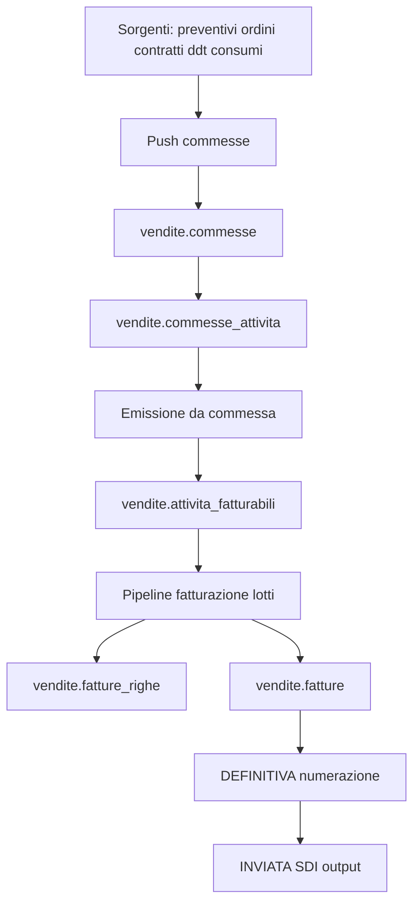
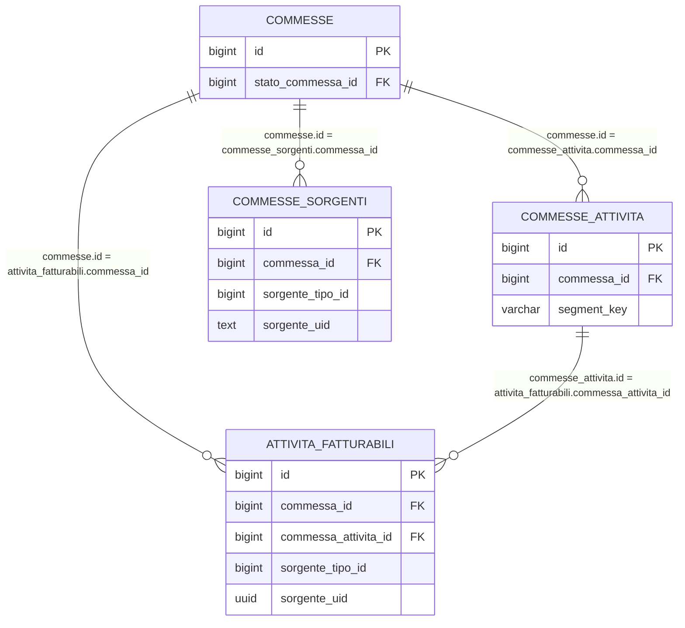
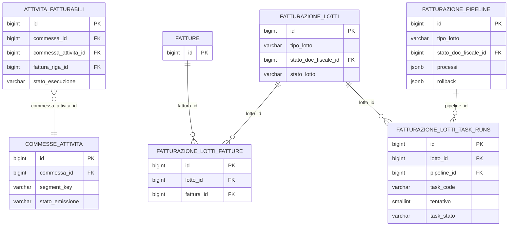

# Guida Tecnica - Fatturazione (processo end-to-end)

> Destinatari: analisti funzionali, sviluppatori backend e database di Zero ERP
>
> Vedi anche:
>
> * [Guida API Commesse](/guide/gestione-commesse)
> * [vendite.commesse](/dbzero/vendite/tabelle/commesse)
> * [vendite.stati_commessa](/dbzero/vendite/tabelle/stati_commessa)
> * [vendite.commesse_attivita](/dbzero/vendite/tabelle/commesse_attivita)
> * [vendite.fn_emit_attivita_fatturabili_da_commessa](/dbzero/vendite/funzioni/fn_emit_attivita_fatturabili_da_commessa)
> * [vendite.fatture](/dbzero/vendite/tabelle/fatture)
> * [vendite.fatture_righe](/dbzero/vendite/tabelle/fatture_righe)
> * [vendite.event_log](/dbzero/vendite/tabelle/event_log)
> * [Messaggi di errore e log](/guide/Messaggi-di-Errore-e-Generazione-Log)

---

## Introduzione

Il processo di fatturazione e` stato ristrutturato.

Modello attuale:

1. Le sorgenti business NON alimentano direttamente `attivita_fatturabili`.
2. Tutte le sorgenti passano da `commesse` / `commesse_attivita`.
3. Le righe commessa idonee vengono emesse in `attivita_fatturabili` tramite funzioni dedicate.
4. La pipeline fatturazione a lotti opera poi su `attivita_fatturabili` per produrre ed emettere le fatture.

In sintesi: la commessa e` il livello di governo operativo prima della fatturazione fiscale.

---

## Architettura logica



### Ruolo dei layer

Il processo e` suddiviso su tre layer con responsabilita` distinte:

| Layer             | Responsabilita`                                                | Esempi                                                                              |
| ----------------- | -------------------------------------------------------------- | ----------------------------------------------------------------------------------- |
| **PostgreSQL**    | Stato, regole di dominio, vincoli, log funzionali              | `fn_get_or_create_commessa`, `fn_set_fatturazione_lotto_stato`, trigger append-only |
| **Python/Django** | Orchestrazione, sequencing, fan-out, gestione errori, API REST | `CommessaPushOrchestrator`, `LottoPipelineRunner`, `PipelineStepExecutor`           |
| **API REST**      | Esposizione endpoint, validazione input, idempotenza request   | `/api/v1/vendite/pipeline/run/`, `/api/v1/vendite/commesse/push/run/`               |

Principio generale: il database e` l'autorita` su stato e regole; Python orchestra il flusso e gestisce le eccezioni; l'API espone e protegge.

### Componenti Python principali

```text
apps/vendite/
  api/views.py                         # Endpoint REST
  services/
    pipeline_service.py                # Entrypoint facade (run_lotto_pipeline)
    pipeline_runner.py                 # LottoPipelineRunner — orchestratore pipeline lotti
    pipeline_step_executor.py          # PipelineStepExecutor — esecuzione singolo step
    pipeline_error_logger.py           # PipelineErrorLogger — dual-log (error_log + dominio)
    commesse_push_orchestrator.py      # CommessaPushOrchestrator — fan-out push sorgenti
    commesse_source_handlers.py        # BaseSourceHandler + handler concreti per sorgente
    lotto_segnalazioni_service.py      # Valutazione segnalazioni blocco lotto
  db/
    pipeline_repository.py             # Repository DB pipeline (stato, log, event_log)
    commesse_repository.py             # Repository DB commesse (CRUD, push log, event_log)
```

---

## Schema ER (minimale)



---

## Tabelle core

### Livello commessa

* [vendite.commesse](/dbzero/vendite/tabelle/commesse)
* [vendite.stati_commessa](/dbzero/vendite/tabelle/stati_commessa)
* [vendite.commesse_attivita](/dbzero/vendite/tabelle/commesse_attivita)
* [vendite.commesse_sorgenti](/dbzero/vendite/tabelle/commesse_sorgenti)
* [vendite.commesse_push_log](/dbzero/vendite/tabelle/commesse_push_log)

### Livello fatturazione

* [vendite.attivita_fatturabili](/dbzero/vendite/tabelle/attivita_fatturabili)
* [vendite.fatturazione_lotti](/dbzero/vendite/tabelle/fatturazione_lotti)
* [vendite.fatture](/dbzero/vendite/tabelle/fatture)
* [vendite.fatture_righe](/dbzero/vendite/tabelle/fatture_righe)
* [vendite.fatture_riepiloghi_iva](/dbzero/vendite/tabelle/fatture_riepiloghi_iva)
* [vendite.fatture_scadenze](/dbzero/vendite/tabelle/fatture_scadenze)

---

## Fase 1 - Push sorgenti su commesse

Scopo: costruire/aggiornare le commesse e le relative righe tecniche da emettere.

### Orchestrazione push (Python)

L'ingestione e` gestita da `CommessaPushOrchestrator` che:

1. Acquisisce un advisory lock PostgreSQL per evitare run concorrenti.
2. Esegue in sequenza gli handler registrati (uno per sorgente: preventivi, ordini, consumi, ...).
3. Isola gli errori per handler: un fallimento non blocca gli altri.
4. Scrive il log in `commesse_push_log` e emette eventi su `event_log` (`PUSH_STARTED`, `PUSH_COMPLETED`).

Ogni handler (`BaseSourceHandler`) implementa:

* `fetch_pushable_rows()` — recupera righe sorgente da sincronizzare
* `_expand_rows()` — trasforma una riga sorgente in una o piu` righe commessa
* `_process_rows()` — risolve/crea commessa, linka sorgente, batch upsert righe

### Funzioni DB

* [vendite.fn_get_or_create_commessa](/dbzero/vendite/funzioni/fn_get_or_create_commessa)
* [vendite.fn_upsert_commessa_attivita](/dbzero/vendite/funzioni/fn_upsert_commessa_attivita)
* [vendite.fn_batch_upsert_commessa_attivita](/dbzero/vendite/funzioni/fn_batch_upsert_commessa_attivita)
* [vendite.fn_link_commessa_sorgente](/dbzero/vendite/funzioni/fn_link_commessa_sorgente)
* [API run_commesse_push](/backend/vendite/manual/api_run_commesse_push)

### Regole principali

* match/creazione commessa su perimetro BA/utility/policy/emittente/competenza;
* idempotenza riga su `(commessa_id, segment_key)`;
* batch upsert: N righe in una singola chiamata DB per performance;
* validazioni forti su quantita`, prezzo e stato commessa modificabile;
* nessun bypass diretto sorgente -> `attivita_fatturabili`.

---

## Fase 2 - Governo stato commessa

Le operazioni sono governate da `vendite.stati_commessa`:

* `modificabile`: abilita upsert su `commesse_attivita`;
* `emittibile`: abilita discovery per emissione verso AF;
* `chiude_commessa`: impedisce riuso della commessa.

Funzioni di supporto:

* [vendite.fn_get_commessa_stato](/dbzero/vendite/funzioni/fn_get_commessa_stato)
* [vendite.fn_list_commessa_attivita](/dbzero/vendite/funzioni/fn_list_commessa_attivita)
* [vendite.fn_list_commesse_emittibili](/dbzero/vendite/funzioni/fn_list_commesse_emittibili)

---

## Snapshot pricing su commessa e propagazione ad AF

Le righe `commesse_attivita` portano con sé lo **snapshot del prezzo** calcolato al push dal resolver v5. Questa sezione copre la parte prezzi del modello fatturazione; per il dettaglio del calcolo, dei 3 stadi (promo/contratto/categoria) e delle autorizzazioni L1/L2/L3 vedere la [guida Gestione Listini e Pricing](/guide/gestione-listini).

### Campi pricing rilevanti

Oltre a quantità, UOM e competenza, la riga `vendite.commesse_attivita` include:

Snapshot resolver (calcolato al push):

* `prezzo_snapshot` — prezzo corrente della riga
* `prezzo_base_snapshot` — prezzo base di listino prima della variazione
* `origine_prezzo` — `PROMO`, `CONTRATTO_OVERRIDE`, `CONTRATTO_LISTINO`, `CATEGORIA`, `MANUALE`
* `tipo_variazione_applicata` + `valore_variazione_applicata`
* `listino_versione_id`, `listino_riga_id` — FK alla riga di listino usata
* `promo_id`, `contratto_id`, `categoria_cliente_id_snapshot`, `classe_utenza_id_snapshot` — FK congelate al momento del calcolo

Flag operativi post-resolver:

* `prezzo_bloccato` — se `TRUE`, il prezzo è bloccato da override manuale e il riallineamento automatico lo salta
* `prezzo_da_riallineare` — flag di segnalazione per dashboard "prezzi da riallineare"
* `pricing_mode` — predisposizione futura (`FIXED`, `FORMULA`, `SCAGLIONI`); oggi solo `FIXED` è operativo

### Ciclo di vita post-push

Una volta sulla riga commessa, il prezzo può essere **ricalcolato, bloccato o sbloccato** tramite le operazioni dedicate del servizio vendite (vedi [guida listini §7](/guide/gestione-listini#7-ciclo-di-vita-del-prezzo-sulla-riga-commessa)):

* `POST .../attivita/<id>/riallinea-prezzo/` — ricalcola dal resolver; guardia su cambio versione listino; errore se `prezzo_bloccato=TRUE`
* `POST .../attivita/<id>/variazione-prezzo-eccezionale/` — override manuale con motivo obbligatorio; imposta `prezzo_bloccato=TRUE`
* `POST .../attivita/<id>/sblocca-prezzo/` — rimuove il blocco e ricalcola dal resolver

Tutte queste operazioni sono ammesse solo su commesse `modificabile` e righe non ancora fatturate.

### Propagazione a `attivita_fatturabili`

All'emissione (`fn_emit_attivita_fatturabili_da_commessa`) i campi snapshot e `prezzo_bloccato` vengono propagati sulla riga AF. Conseguenze operative:

* i task pipeline fatturazione **rispettano** `prezzo_bloccato=TRUE`: un prezzo da override manuale non viene riscritto da eventuali ricalcoli massivi in fase di lotto;
* lo snapshot resolver resta tracciabile fino a `fatture_righe`, utile per audit e contestazioni (origine prezzo, FK listino/contratto/promo, variazione applicata).

---

## Fase 3 - Emissione da commessa a attivita_fatturabili

Scopo: trasferire le righe `commesse_attivita` idonee in `attivita_fatturabili`.

### Orchestrazione emissione (Python)

L'emissione non e` un job autonomo: e` un **task pipeline** eseguito come primo
step del lotto (tipicamente DRAFT), gestito da `PipelineStepExecutor`:

1. Il task `pull_attivita_da_commessa_default` viene invocato dal runner.
2. L'executor chiama `commesse_repository.list_commesse_emittibili()` per scoprire
   le commesse pronte nel perimetro del lotto (competenza, utility, BA, emittente).
3. Per ogni commessa trovata chiama `commesse_repository.emit_attivita_fatturabili()`.
4. La funzione SQL sottostante trasferisce le righe e restituisce contatori
   (`inserted_rows`, `updated_rows`, `skipped_rows`).

Componenti Python:

| Componente | File | Ruolo |
| --- | --- | --- |
| Task handler | `pipeline_step_executor.py` (`_handle_pull_attivita_da_commessa_task`) | Orchestrazione discovery + emit per lotto |
| Discovery | `commesse_repository.py` (`list_commesse_emittibili`) | Trova commesse pronte per emissione |
| Emit wrapper | `commesse_repository.py` (`emit_attivita_fatturabili`) | Wrappa la fn SQL, restituisce `CommessaEmitResult` |

### Funzioni DB emissione

* [vendite.fn_emit_attivita_fatturabili_da_commessa](/dbzero/vendite/funzioni/fn_emit_attivita_fatturabili_da_commessa)
* [vendite.fn_list_commesse_emittibili](/dbzero/vendite/funzioni/fn_list_commesse_emittibili)

### Regole emissione

* sorgente AF forzata a tipo `COMMESSA`;
* mapping deterministico di `segment_key` su identificativo sorgente AF (`md5 → UUID`);
* idempotenza su chiave sorgente in AF (`sorgente_tipo_id`, `sorgente_uid`);
* blocco aggiornamento se la riga AF risulta gia` fatturata;
* aggiornamento stato righe commessa emesse (`stato_emissione = EMESSA`);
* supporto `dry_run` e filtro `only_approved` sulla funzione SQL.

---

## Fase 4 - Pipeline fatturazione a lotti

Dopo la fase commesse, la fatturazione resta governata dal dominio lotti.

### Orchestrazione pipeline (Python)

Il flusso e` orchestrato da `LottoPipelineRunner`:

1. Risolve o crea il lotto (`get_or_create_lotto`).
2. Verifica precondizioni: lotto non gia` in esecuzione, nessuna segnalazione critica attiva.
3. Imposta stato `IN_ESECUZIONE` e emette `PIPELINE_STARTED` su `event_log`.
4. Esegue un singolo step per run (modalita` operativa: avanzamento incrementale).
5. Per ogni step: aggiorna stato doc, logga fase, delega a `PipelineStepExecutor`, emette `STEP_COMPLETED`.
6. Se tutti gli step completano: stato `COMPLETATO`, emette `PIPELINE_COMPLETED`.
7. In caso di errore: stato `ERRORE`, dual-log (`error_log` tecnico + `event_log` di dominio), emette `PIPELINE_ERROR`.

Componenti:

* `LottoPipelineRunner` — orchestra il flusso, gestisce retry/rerun su lotti in errore.
* `PipelineStepExecutor` — esegue il singolo step con risoluzione task da registry.
* `PipelineErrorLogger` — dual-log: errore tecnico su `dbops.error_log` + log funzionale su tabelle dominio.
* `LottoSegnalazioniService` — valuta se il lotto ha segnalazioni bloccanti prima dell'avanzamento.

### Modello lotti (visione sintetica)

1. Un lotto (`fatturazione_lotti`) definisce perimetro operativo (competenza, utility, tipo documento, BA/emittente).
2. Gli step sono configurati in `fatturazione_pipeline` e risolti con fallback su `tipo_lotto`, `utility_id`, `tipo_doc_fiscale_id`.
3. Il runner esegue i task di step e traccia i tentativi in `fatturazione_lotti_task_runs`.
4. Le fatture generate sono collegate al lotto tramite `fatturazione_lotti_fatture`.

### Schema ER (pipeline lotti)

> ℹ️ Il sotto-sistema **lotto-attività** (`attivita_fatturabili_lotti` +
> `attivita_fatturabili.lotto_attivita_id`) è stato **rimosso** dal changeset
> `20260227-16`: le attività fatturabili non hanno più un lotto-attività proprio,
> il raggruppamento avviene solo a livello `fatturazione_lotti`.



### Tabelle core del modello lotti

* [vendite.fatturazione_lotti](/dbzero/vendite/tabelle/fatturazione_lotti)
* [vendite.fatturazione_pipeline](/dbzero/vendite/tabelle/fatturazione_pipeline)
* [vendite.fatturazione_lotti_task_runs](/dbzero/vendite/tabelle/fatturazione_lotti_task_runs)
* [vendite.fatturazione_pipeline_task_policy](/dbzero/vendite/tabelle/fatturazione_pipeline_task_policy)
* [vendite.fatturazione_lotti_fatture](/dbzero/vendite/tabelle/fatturazione_lotti_fatture)

### Funzioni chiave pipeline lotti

* [vendite.fn_resolve_fatturazione_pipeline_step](/dbzero/vendite/funzioni/fn_resolve_fatturazione_pipeline_step)
* [vendite.fn_list_fatturazione_pipeline_steps](/dbzero/vendite/funzioni/fn_list_fatturazione_pipeline_steps)
* [vendite.fn_set_fatturazione_lotto_stato](/dbzero/vendite/funzioni/fn_set_fatturazione_lotto_stato)
* [backend.execute_pipeline_step](/backend/vendite/funzioni/fn_execute_pipeline_step)
* [backend.run_lotto_pipeline](/backend/vendite/funzioni/run_lotto_pipeline)
* [vendite.fn_start_lotto_task_run](/dbzero/vendite/funzioni/fn_start_lotto_task_run)
* [vendite.fn_complete_lotto_task_run](/dbzero/vendite/funzioni/fn_complete_lotto_task_run)
* [vendite.fn_fail_lotto_task_run](/dbzero/vendite/funzioni/fn_fail_lotto_task_run)
* [vendite.fn_cancel_lotto_task_run](/dbzero/vendite/funzioni/fn_cancel_lotto_task_run)
* [vendite.fn_list_lotto_task_runs](/dbzero/vendite/funzioni/fn_list_lotto_task_runs)

### Step operativi tipici (massivo)

1. DRAFT: selezione/preparazione delle attivita` da fatturare.
2. EMESSA: generazione documento e task pre-fiscali.
3. DEFINITIVA: numerazione documento.
4. INVIATA: preparazione/invio su canale esterno (es. SDI).

### Stato documentale della fattura: segue lo step (invariante)

Lotto **e** fatture condividono `config.stati_doc_fiscale` ma con **macchine a stati
distinte** (`config.stati_doc_fiscale_transizioni`, colonne `solo_lotto` / `solo_fattura`).
Lo stato della **fattura** segue lo `stato_doc_fiscale_id` dello **step** di pipeline: a ogni
avanzamento di step le fatture del lotto vengono allineate (`fn_sync_lotto_fatture_stato`).

**Invariante (imposto dalla matrice + `trgfn_fatture_guard_stato`)**: la fattura deve passare
per **EMESSA(2) prima di DEFINITIVA(8)** — `1→2→8`, **mai** `1→8`. Semantica: non si assegna
un numero fiscale (DEFINITIVA) a una fattura di cui non si è certificata l'IVA (EMESSA).

* **MASSIVO**: la fattura fa `1→2→8→3`. Lo step EMESSA calcola l'IVA (rifacibile: ha rollback
  `reset_lotto_draft`), poi DEFINITIVA numera.
* **GIORNALIERO**: stessa sequenza `1→2→8→3` a livello sia di lotto sia di fattura. L'IVA è già
  calcolata alla nascita del documento, quindi lo step EMESSA giornaliero non ha task
  (`processi=[]`): serve solo a portare lotto e fattura a EMESSA prima della numerazione,
  garantendo lo stesso invariante.

> Rollback: ammesso solo da stati **pre-fiscali** (DRAFT/EMESSA). `fn_reset_lotto_draft`
> **cancella** le fatture pre-fiscali del lotto (non numerate); le fiscali (DEFINITIVA in poi)
> sono rifiutate.

### Rollback di step (`fatturazione_pipeline.rollback`)

Ogni riga di `fatturazione_pipeline` ha due array JSONB paralleli:

* **`processi`** — task da eseguire in avanzamento (forward);
* **`rollback`** — task da eseguire quando il lotto torna a questo step (cleanup).

La fn SQL `fn_resolve_fatturazione_pipeline_step(p_rollback => true)` restituisce
i task di rollback al posto di quelli forward. Il `PipelineStepExecutor` chiama
`get_step_processes(rollback=True)` e li esegue con lo stesso meccanismo dei task normali.

**Quando scatta il rollback:**

Il rollback e` manuale (richiesto dall'operatore o dall'API `reset_lotto`) oppure
automatico se la pipeline ha `meta.auto_step_rollback = true`. Non scatta mai
spontaneamente su errore: un errore lascia il lotto in stato `ERRORE` e serve
un rerun esplicito.

**Esempio concreto (seed):**

| Step   | `processi`                                               | `rollback`           |
| ------ | -------------------------------------------------------- | -------------------- |
| DRAFT  | `select_attivita`, `generate_fatture_righe`              | `[]` (nessuno)       |
| EMESSA | `genera_fondi`, `applica_fondi`, `ricalcola_iva`         | `reset_lotto_draft`  |

In questo caso, se un lotto MASSIVO in stato EMESSA deve tornare a DRAFT, il sistema
esegue il task `reset_lotto_draft`, che ripristina i fondi delle fatture sorgente,
cancella le righe IVA e i totali generati dallo step forward — **e poi cancella le
fatture e chiude il lotto**. Non è un rollback reversibile: è una demolizione.

> ⚠️ **`reset_lotto_draft` non riporta il lotto a DRAFT: lo ANNULLA.**
> Il nome inganna. Cosa fa davvero, nell'ordine:
>
> 1. **pretende il lotto già in DRAFT** (guard *«rollback solo se DRAFT»*): il ritorno
>    EMESSA→DRAFT lo fa il rerun dello step, *prima*; il task non lo esegue.
> 2. **ripristina i fondi** delle fatture sorgente (`fn_reset_fondi_fattura`) — vedi
>    il caveat sotto.
> 3. **cancella fisicamente** riepiloghi IVA, righe, log, note e **le fatture stesse**.
> 4. **sblocca le righe** di `attivita_fatturabili` (`fattura_riga_id` → NULL,
>    `fatturato` → false, lock rimosso): sopravvivono e restano pronte.
> 5. **chiude il lotto**: `stato_doc_fiscale` = ANNULLATA, `stato_operativo` = CHIUSO,
>    `stato_lotto` = COMPLETATO.
>
> **Quel lotto è morto.** Per rifatturare serve un **lotto nuovo**, che ripescherà le
> stesse righe `attivita_fatturabili` rimaste libere. Non si "riapre e si corregge" il
> lotto: si demolisce e si rifà.
>
> ⚠️ **E il ripristino dei fondi non è integrale.** Un fondo già **postato su una
> contabile CHIUSA** non viene ripristinato: `fn_reset_fondi_fattura` non lo tocca,
> scrive un warning in `vendite.fatture_log` (*«Minimo non ripristinabile: gia postato
> (fattura X del Y)»*) e marca la riga source come ANNULLATO. Il reset **riesce
> comunque**: controllare il log, non darlo per pulito.

**Vincoli:**

* Il rollback è ammesso solo per lotti **MASSIVO** e solo se il lotto è già in **DRAFT**;
  le **fatture** del lotto possono essere DRAFT o EMESSA (pre-fiscali), altrimenti la fn
  rifiuta.
* Dopo la DEFINITIVA (numerazione fiscale) il rollback globale non è più possibile;
  il sistema usa resume per fattura.
* Le **fatture non tornano mai a DRAFT**: nella matrice `config.stati_doc_fiscale_transizioni`
  la transizione EMESSA→DRAFT ha `solo_lotto = true`, quindi vale per il **lotto**, non per
  il documento. Una fattura EMESSA si può solo **cancellare** (dal reset), mai retrocedere.
* L'auto-rollback **esclude** questo task: il `PipelineStepExecutor` non lo esegue mai in
  auto-run, proprio perché distruttivo. Serve una richiesta esplicita
  (`POST /lotti/<id>/reset-draft/`).
* Per una singola fattura esiste l'alternativa che **non** annulla il lotto:
  `fn_reset_lotto_fattura_draft` (richiede la fattura **strettamente DRAFT**).
* Se `rollback` è `[]` (array vuoto), lo step non prevede operazioni di pulizia.

### Regole operative del modello lotti

1. Lo step effettivo viene risolto con fallback configurativo (`utility + tipo_doc`, `utility`, `tipo_doc`, globale).
2. Le transizioni tecniche del lotto sono governate da `fn_set_fatturazione_lotto_stato`.
3. Ogni task-run deve essere tracciato con `tentativo` ed esito (`IN_ESECUZIONE`, `COMPLETATO`, `ERRORE`, `ANNULLATO`).
4. Le policy runtime task (resume/reset/annullabilita`) sono esterne alla sequenza step e risiedono in `fatturazione_pipeline_task_policy`.
5. I task devono lavorare con input centrato sul `lotto_id`, recuperando il resto dal contesto lotto.

### Naming runtime (Python)

Per evitare ambiguita` tra SQL legacy e runtime applicativo:

* nel runtime Python usare naming senza prefissi DB (`run_lotto_pipeline`, `execute_pipeline_step`, `run_commesse_push`);

* la semantica operativa corrente e` governata dai service Django.

---

## La riga di fattura: aggregazione, importo, esposizione

> Sezione aggiunta il **2026-07-28**. Fino a quella data queste regole non erano
> scritte da nessuna parte, e ricostruirle è costato una sessione intera di
> indagine sul codice e sui dati. Riferimento:
> `brief-fix-importi-riga-fattura-zero.md`.

### Tre livelli, non due

| Livello | Tabella | Cosa contiene |
|---|---|---|
| Dettaglio | `vendite.attivita_fatturabili` | il lavoro fatturabile, riga per riga: quantità, prezzo, competenza, sorgente |
| Sintesi | `vendite.fatture_righe` | **una riga per gruppo**: aggrega 1..n attività |
| Rappresentazione | `vendite.vw_fattura_righe_esposte` | come il documento va **mostrato**: PDF, XML SDI, portale |

Il legame fra i primi due è `attivita_fatturabili.fattura_riga_id`. Non esiste
una tabella di dettaglio *sotto* la riga di fattura: **il dettaglio sono le
attività**.

### Come si aggrega

L'aggregazione la fa il **backend**, non il database: il servizio
`FattureRigheService` (`apps/vendite/services/fatture_righe_service.py`),
invocato dal task `generate_fatture_righe` della pipeline. Raggruppa le attività
del lotto per la chiave che costruisce `_build_group_key`:

> articolo · billing account destinatario · unità di misura · **prezzo unitario**
> · IVA · competenza dal/al · **istanza di kit**

e produce **una riga per gruppo**, con `qta` = somma **esatta** delle quantità.

Il fatto che il **prezzo stia nella chiave** non è un dettaglio: rende
`Σ(qᵢ × p) = p × Σqᵢ` un'identità, quindi la riga aggregata rappresenta
esattamente la somma dei suoi dettagli. Se un giorno il prezzo uscisse dalla
chiave, quella proprietà cadrebbe.

⚠️ Sulle righe aggregate le colonne `sorgente_*` sono **NULL**: con *n* attività
di sorgenti diverse non esiste una sorgente singola. La tracciabilità è il
puntatore delle attività.

### Come si calcola l'importo

Lo calcola il **database**, con un trigger, a ogni scrittura:

```
imponibile_riga = arrotonda(qta × prezzo × (1 − sconto/100), decimali, metodo)
```

dove decimali e metodo vengono da `vendite.articolo_regole_fatturazione`
**dell'articolo** (default 2 / HALF_UP), applicati da
`script.fn_arrotonda_importo` — unico punto in cui vive la regola.

**Due arrotondamenti diversi, da non confondere**:

| Cosa | Configurazione | Chi lo applica |
|---|---|---|
| Importo di **riga** | `articolo_regole_fatturazione` (per articolo) | trigger sulla riga |
| **Totale a pagare** | `emittenti_fiscali_utilities` (per emittente-utility) | `fn_ricalcola_totali_fattura`, con saldo riportato fra documenti |

⚠️ `arrotondamento_quantita_dec` si applica alla quantità della **singola
attività**, mai alla quantità aggregata di una riga: arrotondare la somma
perderebbe precisione a monte dell'importo, dove nessuno la cerca.

### Come si espone un kit

Un articolo composito **non arriva in fattura come riga unica**: il push lo
espande e in commessa entrano **solo i componenti**, mai il padre. È il modello
unificato componenti BoM del 2026-05-13, ed è voluto.

La regola di esposizione è
**`catalogo.articoli_componenti.esposto_in_fattura`**, per singolo componente.
Viene congelata sulla riga di fattura alla generazione, insieme all'identità del
kit e all'articolo padre. La vista `vw_fattura_righe_esposte` produce poi:

- **una riga padre** con il totale del kit;
- sotto, i soli componenti con il flag a `true`, come righe **descrittive** senza
  importo.

I componenti non esposti non compaiono, ma il loro valore è nel totale del padre:
**il totale del documento non cambia mai al variare dell'esposizione**.

⚠️ **Non è "la vista di stampa"**: PDF, XML SDI e portale devono leggere **la
stessa** rappresentazione. Altrimenti si producono due uscite dello stesso
documento con dettagli diversi — totali uguali, quindi nulla di irregolare, ma
una divergenza che nessuno ha deciso.

### Quando il documento si congela

Superata la soglia `DRAFT`/`EMESSA`, sulle righe non si può più fare **nulla**:
né `UPDATE`, né `DELETE`, né `INSERT` di righe nuove. Il presidio agisce sugli
**input** (quantità, prezzo, sconto, IVA) e non sull'importo: congelare il solo
importo lascerebbe passare una riga con `qta=999` e `imponibile=500`, incoerente
e indistinguibile da un dato buono.

Ne segue, senza bisogno di altri meccanismi, che **una fattura emessa non cambia
aspetto nel tempo**: cambiare la distinta o le regole dell'articolo non tocca i
documenti già emessi. Rigenerare una fattura passa invece dal reset del lotto,
che riscrive le righe leggendo le regole correnti.

E **non si numera un documento vuoto**: `fn_assign_numero_fattura` rifiuta una
fattura senza righe, prima che il progressivo venga consumato — `nextval` non fa
rollback, quindi fallire dopo lascerebbe comunque un buco nella numerazione.

---

## Dashboard operative

> Questa sezione descrive l'**assetto realmente implementato** (aggiornata
> 2026-07-22). Guida operativa per l'utente finale:
> [cruscotti-fatturazione.md](cruscotti-fatturazione.md) — §7 per i verbi.

### Le superfici

| Rotta | Cosa | Read/Write |
| --- | --- | --- |
| `/vendite/situazione-aperta` | Serbatoio **pre-commessa** per fase (preventivi, offerte, ordini, contratti) | sola lettura |
| `/vendite/dashboard-competenza` | **Lente 1** — funnel commessa → fattura per mese di competenza. È il **cockpit**: qui vivono i verbi | lettura + **azioni** |
| `/vendite/dashboard-backlog` | **Lente 2** — solo il non-verde, per anzianità | sola lettura |
| `/vendite/lotti` | Registro lotti + drawer diagnostico (fatture, task-run, segnalazioni, stampa/ristampa) | lettura + azioni per-lotto |
| `/strumenti/code-lavoro` | Code asincrone: lavori generici e outbox stampa | lettura + governo job |

Il read-side delle tre lenti poggia sulle viste `vendite.vw_dash_*` esposte da
endpoint GET sottili: nessuna logica di dominio nel frontend.

### I verbi del cockpit (Lente 1)

Tre azioni, sulle card del funnel, ciascuna con permesso dedicato. **Non esistono
implementazioni «da interfaccia»**: chiamano lo stesso core del batch notturno.

| Verbo | Endpoint | Permesso | Semantica |
| --- | --- | --- | --- |
| **Approva** | `POST /vendite/fatturazione/approva-competenza/` | `approva_attivita_commessa` | approva le attività `DA_APPROVARE` del mese (all-or-nothing, idempotente) |
| **Fattura adesso** | `POST /vendite/fatturazione/run/` | `genera_fatture_lotti` | giro on-demand, corsia differita, **cumulativo su competenza ≤ M**, si ferma a `EMESSA` |
| **Rendi definitive** | `POST /vendite/fatturazione/numera/` | `numera_fatture_lotti` | step `DEFINITIVA` sui lotti `EMESSA` del mese: numera **e** accoda la stampa |

Esiste anche la variante per-lotto `POST /vendite/fatturazione/lotti/<id>/numera/`
(dal drawer lotto) e la ristampa massiva `.../<id>/ristampa/`.

⚠️ **L'invio SDI non è esposto dalla dashboard**: il percorso coperto è
approvazione → fattura → numerazione → stampa.

### Gate fiscale: perché fatturazione e numerazione sono separate

Invariante I-7 del cockpit. `EMESSA` è uno stato **reversibile** (importi
calcolati, nessun numero); `DEFINITIVA` assegna il progressivo dal registro ed è
**irreversibile**. I due verbi hanno quindi **endpoint e permessi distinti**: chi
prepara le fatture non è necessariamente chi si assume la numerazione. Un solo
comando «fattura e numera» eliminerebbe il punto di controllo dove serve.

Corollario sul modello: lo stato della **fattura segue lo stato del lotto**
(`DRAFT → EMESSA → DEFINITIVA`); il salto `DRAFT → DEFINITIVA` **non esiste** per la
fattura nella matrice transizioni. Dal 2026-07-22 un constraint trigger DEFERRED
impedisce che lotto e fatture restino disallineati a fine transazione
(`E_LOTTO_FATTURE_STATO_INCOERENTE`).

### Esecuzione asincrona

I verbi di perimetro **non eseguono in-request**: accodano un job in
`dbops.coda_lavori` e rispondono con l'handle. Criterio (invariante I-3):
**1 documento → sincrono, 2+ → background**. La pagina non resta mai bloccata.

| Processo | Cadenza | Ruolo |
| --- | --- | --- |
| `run_fatturazione_batch` | notturno | giro automatico; la corsia **GIORNALIERO** arriva fino alla `DEFINITIVA` |
| `draina_coda_lavori` | ogni minuto | esegue i job accodati dalla UI, con l'identità dell'operatore (RLS) |
| `draina_coda_stampa` | ogni minuto | renderizza i PDF **fuori** dalla transazione fiscale (invariante I-4b) |

I verbi della dashboard **non sostituiscono** il batch notturno: lo anticipano, e
coprono ciò che il batch lascia all'umano — in primo luogo la numerazione della
fatturazione massiva.

### Su quale corsia finisce il lavoro: `fatturazione_immediata`

Ogni documento porta un flag che decide su quale delle due corsie viene
instradato il lavoro che ne deriva:

| Flag | Corsia | `tipo_lotto` | Arriva a |
| --- | --- | --- | --- |
| `true` | immediata | `GIORNALIERO` | **`DEFINITIVA`** — numera da sola |
| `false` *(default)* | differita | `MASSIVO` | **`EMESSA`** — la numerazione resta un atto separato |

**Dove si trova** *(dal 27-07-2026)*: `vendite.preventivi`, `vendite.ordini`,
`vendite.contratti`, `vendite.ddt`. Prima esisteva **solo sui preventivi**: le
altre sorgenti esponevano il campo ma con valore costante `false`, quindi solo
un preventivo poteva essere fatturato subito — non per una scelta di dominio,
ma per un buco di modello.

**I consumi non hanno il flag**, ed è deliberato: un consumo è una *misura*,
non un accordo commerciale. La corsia la decide il **contratto** che governa la
fornitura; un flag sulla singola lettura creerebbe lo stesso interruttore in
due posti.

#### Si decide prima del push, e poi non si cambia

Il flag viene letto **una sola volta**, quando il documento entra in commessa, e
propagato alla commessa dove è **parte della chiave di dedup**: è così che le
due corsie restano fisicamente separate (commesse distinte → lotti distinti).

Dopo il push il valore è **inerte** — cambiarlo non sposta il lavoro già
pushato, e il documento è legato a una sola commessa per sempre. Per questo la
modifica è **respinta** dal DB (`E_FATT_IMMEDIATA_NON_MODIFICABILE`): un campo
editabile che non produce effetti sarebbe peggio di un campo bloccato, perché
sembra funzionare.

> **«E se cambio idea dopo?»** Non serve il flag: si usa l'**emissione mirata
> per gruppo fatturabile**, che fattura esattamente le righe di quel documento
> senza toccare il resto della commessa. Due strumenti distinti — il flag è
> *instradamento automatico* deciso a monte, l'emissione mirata è un *atto
> puntuale* dell'operatore, usabile in qualsiasi momento.

⚠️ Il flag **non governa il blocco del prezzo**. L'accoppiamento
`prezzo_bloccato = fatturazione_immediata` esiste **solo sui preventivi**: sulle
altre sorgenti i due valori sono indipendenti.

### Fatturare un documento preciso: l'emissione mirata

*(dal 27-07-2026)*

Il giro di fatturazione, schedulato o lanciato a mano, pesca **tutto**
l'emittibile di un perimetro. Serviva poter dire: «fattura **questo** preventivo,
adesso, senza trascinare dentro il resto».

#### L'unità di decisione: il gruppo fatturabile

Non è la commessa e non è sempre un documento:

- **non la commessa**, perché è multi-sorgente. Un preventivo e un contratto
  dello stesso cliente, stesso mese, stesso perimetro commerciale finiscono
  nella **stessa** commessa: selezionarla non isola niente;
- **non sempre un documento**, perché le righe della *porta oneri* sono senza
  documento per costruzione.

Un **gruppo fatturabile** è quindi *un documento sorgente* **oppure** *gli oneri
di una commessa*:

```text
Card «Da emettere» (29 attività)
 ├─ PRV-0012              Rossi    5 righe   1.000 €   [Fattura]
 ├─ CTR-0007              Rossi    3 righe     500 €   [Fattura]
 ├─ ORD-0033              Bianchi  8 righe   2.300 €   [Fattura]
 └─ Oneri · commessa #42  Rossi    1 riga      500 €   [Fattura]
```

La seconda forma non è un dettaglio: senza, gli oneri sarebbero **contati** nel
numero della card ma irraggiungibili da qualunque azione mirata — lavoro
invisibile, recuperabile solo dal giro schedulato.

#### Cosa garantisce

| | |
|---|---|
| Si fattura **solo** ciò che si è chiesto | anche se la commessa contiene altro lavoro idoneo |
| Ciò che non si è chiesto **resta come prima** | stesso stato, ancora fatturabile: nessun effetto collaterale |
| Si può ripetere | prima il preventivo, domani il contratto: due giri che convivono |
| Si ferma a **EMESSA** | la numerazione resta l'atto separato «Rendi definitive» |

#### Il rapporto col flag di corsia

Sono due strumenti distinti, e non vanno sovrapposti:

| Serve a | Strumento | Quando |
|---|---|---|
| «questo cliente va **sempre** fatturato subito» | flag `fatturazione_immediata` | **prima** del push, alla creazione o accettazione del documento |
| «fattura **questo**, adesso» | emissione mirata | in qualsiasi momento, anche a lavoro già in commessa |

Il flag è *instradamento automatico*, deciso a monte e poi immutabile.
L'emissione mirata è un *atto puntuale dell'operatore*. Il caso «cambio idea
dopo» è coperto interamente dalla seconda: nessun intervento sul modello della
commessa.

#### Un documento può produrre più fatture

Il tipo di documento fiscale sta sulla **riga**, non sulla testata: un gruppo con
righe di tipo diverso finisce in **lotti diversi**, quindi in fatture diverse. È
corretto e voluto — l'esito dell'operazione restituisce l'elenco dei lotti
prodotti, non uno solo.

> **Dettaglio tecnico**: il perimetro scelto è **persistito sul lotto**
> (`vendite.fatturazione_lotti_gruppi`), non passato come parametro. È ciò che
> garantisce che un *Rerun* o un *Avanza step* dal drawer del lotto non allarghi
> silenziosamente il perimetro. Nessuna riga per un lotto = nessuna restrizione =
> comportamento del giro schedulato.

### Monitoraggio

- **Badge top bar**: conteggio dei processi vivi dell'operatore + liveness dei
  worker (rosso = drainer fermi). Apre un drawer di riepilogo.
- **Strumenti → Code di lavoro**: due schede — coda lavori (scope per **utente**)
  e coda stampa (scope per **emittente**, via JOIN a `fatture`). Da qui si annulla
  un job `PENDING` o si rimette in coda un job in `ERRORE`/bloccato.
- **Pannello errori della Lente 1**: errori vivi del mese, col codice lotto
  cliccabile che porta al lotto interessato (stesso aggancio dal drill-down).
- Livelli di log: vedi §«Gestione errori e osservabilità».

---

## Gestione errori e osservabilita`

Obiettivo: garantire diagnosi rapida e riesecuzione sicura senza perdita di coerenza.

### Tre livelli di log

Il sistema utilizza tre livelli di logging complementari, ciascuno con finalita` distinta:

| Log                | Scopo                                    | Risponde a                            | Tabella                                                      |
| ------------------ | ---------------------------------------- | ------------------------------------- | ------------------------------------------------------------ |
| **Error log**      | Eccezioni tecniche con catalogo messaggi | "Cosa e` andato storto?"              | `dbops.error_log`                                            |
| **Event log**      | Timeline eventi di dominio per entita`   | "Cosa e` successo al lotto/commessa?" | `vendite.event_log`                                          |
| **Log funzionali** | Dettaglio operativo fase/fattura/push    | "Qual e` l'esito di questa fase?"     | `fatturazione_lotti_log`, `fatture_log`, `commesse_push_log` |

### vendite.event_log — timeline unificata

Tabella append-only (UPDATE/DELETE bloccati da trigger) che registra tutti gli eventi di dominio:

* **Domini**: `PIPELINE`, `COMMESSE`, `SDI`, `FATTURE`
* **Entita`**: `LOTTO`, `FATTURA`, `COMMESSA`, `TASK_RUN`
* **Severita`**: `INFO`, `WARN`, `ERROR`
* **Correlazione**: `correlation_id` (UUID) lega eventi dello stesso batch/job

### Come funziona il correlation_id

Il `correlation_id` consente di ricostruire la timeline completa di un singolo
run pipeline, collegando tutti gli eventi (start, step, completamento, errore)
in un'unica traccia.

**Ciclo di vita:**

1. Il chiamante (API o scheduler) passa un `lock_batch_id` (UUID) nella request.
2. `LottoPipelineRunner` lo estrae dal contesto lotto e lo usa come `correlation_id`.
3. Ogni chiamata a `fn_log_event()` lo riceve e lo persiste in `event_log`.
4. Se non fornito dal chiamante, il campo resta `NULL` (eventi non correlati).

**Query di debug:**

```sql
-- Timeline completa di un run pipeline
SELECT event_time, domain, event_code, severity, entity_type, entity_id, payload
FROM vendite.event_log
WHERE correlation_id = '<uuid-del-lock-batch>'
ORDER BY event_time;
```

**Stato attuale e limiti:**

* Il runner propaga il correlation_id a tutti e 4 gli eventi pipeline
  (`PIPELINE_STARTED`, `STEP_COMPLETED`, `PIPELINE_COMPLETED`, `PIPELINE_ERROR`).
* Il `PipelineStepExecutor` e i singoli `task_run` non ricevono ancora il
  correlation_id — la correlazione a livello task va ricostruita tramite
  `lotto_id` + `event_time`.
* Il push commesse (`CommessaPushOrchestrator`) non popola il correlation_id.

Eventi emessi dal backend:

| Dominio  | event_code           | Emesso da                  | Quando                                    |
| -------- | -------------------- | -------------------------- | ----------------------------------------- |
| PIPELINE | `PIPELINE_STARTED`   | `LottoPipelineRunner`      | Avvio pipeline lotto                      |
| PIPELINE | `STEP_COMPLETED`     | `LottoPipelineRunner`      | Completamento singolo step                |
| PIPELINE | `PIPELINE_COMPLETED` | `LottoPipelineRunner`      | Pipeline lotto completata                 |
| PIPELINE | `PIPELINE_ERROR`     | `LottoPipelineRunner`      | Errore pipeline (severity ERROR)          |
| COMMESSE | `PUSH_STARTED`       | `CommessaPushOrchestrator` | Avvio push sorgenti                       |
| COMMESSE | `PUSH_COMPLETED`     | `CommessaPushOrchestrator` | Push completato (WARN se parziale/errore) |

Funzione DB: `vendite.fn_log_event()` — interfaccia unificata chiamata dai repository Python.

### Regole operative

1. Le funzioni DB devono alzare errori strutturati tramite `script.fn_log_and_raise_error`.
2. Gli errori di validazione input devono essere distinti da errori runtime/transazionali.
3. Ogni run push/emissione deve produrre log di esito con contatori (`created`, `updated`, `skipped`, `errors`).
4. I servizi backend devono propagare un envelope errore coerente verso API.
5. I servizi Python emettono eventi di dominio su `event_log` nei punti chiave di inizio/fine/errore.

### Riferimenti

* [vendite.event_log](/dbzero/vendite/tabelle/event_log)
* [vendite.fn_log_event](/dbzero/vendite/funzioni/fn_log_event)
* [Messaggi di errore e log](/guide/Messaggi-di-Errore-e-Generazione-Log)
* [vendite.commesse_push_log](/dbzero/vendite/tabelle/commesse_push_log)
* [API run_commesse_push](/backend/vendite/manual/api_run_commesse_push)

---

## Concorrenza e idempotenza

Obiettivo: evitare duplicazioni o race condition su push ed emissione.

Regole tecniche:

1. Creazione/riuso commessa serializzata con advisory lock in `fn_get_or_create_commessa`.
2. Upsert righe commessa idempotente su `(commessa_id, segment_key)`.
3. Emissione verso AF idempotente su chiave sorgente (`sorgente_tipo_id`, `sorgente_uid`).
4. Se una riga AF risulta gia` fatturata, l'update deve essere bloccato.
5. Endpoint di orchestrazione protetti da `Idempotency-Key`.

---

## Scheduling e orchestrazione

Il flusso e` pensato per esecuzione schedulata e on-demand.

L'orchestrazione runtime e` applicativa (Python/Django): il database mantiene stato, regole e log di dominio.

### Job e classi orchestranti

| Job                   | Classe Python                                                     | Protezione concorrenza              | Frequenza tipica            |
| --------------------- | ----------------------------------------------------------------- | ----------------------------------- | --------------------------- |
| Push commesse         | `CommessaPushOrchestrator`                                        | Advisory lock PostgreSQL            | Alta (minuti)               |
| Emissione da commesse | `PipelineStepExecutor` (task `pull_attivita_da_commessa_default`) | Stato lotto `IN_ESECUZIONE` + guard | Integrata in pipeline lotto |
| Pipeline lotti        | `LottoPipelineRunner`                                             | Stato lotto `IN_ESECUZIONE` + guard | Batch controllato           |

### Guardrail operativi

* evitare sovrapposizione di job sullo stesso perimetro BA/utility/competenza;
* `CommessaPushOrchestrator`: advisory lock impedisce run concorrenti (stato `SKIPPED` se lock non acquisito);
* `LottoPipelineRunner`: lotto in `IN_ESECUZIONE` rifiuta nuovo avvio (`E_PIPELINE_LOTTO_IN_ESECUZIONE`);
* prevedere retry controllato solo su step idempotenti;
* mantenere la policy di retry/backoff nel layer orchestratore Python (non nelle funzioni SQL);
* monitorare timeline `event_log` per identificare run bloccati o anomali.

---

## Volumetrie e performance

Per ambienti ad alto volume, adottare queste linee guida:

1. Eseguire push/emissione in chunk (`limit/offset` o finestre per ID).
2. Limitare il perimetro per competenza, BA, utility, emittente.
3. Monitorare tempi medi per fase e cardinalita` righe processate.
4. Verificare periodicamente piani query e indici su tabelle `commesse_*` e `attivita_fatturabili`.
5. Definire soglie operative per split automatico dei lotti massivi.

KPI minimi:

* righe push/minuto
* righe emesse/minuto
* percentuale scarti/errori
* tempo medio run per fase

---

## Checklist pre-esecuzione

1. Sorgenti attive e coerenti in `config.sorgenti` (ambito push commessa).
2. Funzioni commessa installate/allineate:
   * `fn_get_or_create_commessa`
   * `fn_upsert_commessa_attivita`
   * `fn_list_commesse_emittibili`
   * `fn_emit_attivita_fatturabili_da_commessa`
3. Seed/lookup stati commessa coerente (`vendite.stati_commessa`).
4. Pipeline lotti fatturazione configurata (`vendite.fatturazione_pipeline`).
5. Transizioni stati documento configurate in `config.stati_doc_fiscale_transizioni`.
6. Task registry DBOps coerente con i task fatturazione effettivamente abilitati.

---

## Query rapide di controllo

```sql
-- Commesse emittibili nel mese
SELECT *
FROM vendite.fn_list_commesse_emittibili(
  p_competenza_mese => DATE '2026-02-01',
  p_limit => 100
);

-- Righe di una commessa non ancora emesse
SELECT *
FROM vendite.fn_list_commessa_attivita(
  p_commessa_id => 12345,
  p_stato_emissione => 'NON_EMESSA',
  p_limit => 200,
  p_offset => 0
);

-- Step pipeline lotto per tipo MASSIVO
SELECT stato_doc_fiscale_id, descrizione, ordine
FROM vendite.fn_list_fatturazione_pipeline_steps('MASSIVO', 1, 20);
```

---

## Risultato atteso

Il processo risulta separato in due livelli chiari:

* livello business-operativo: sorgenti -> commesse -> commesse_attivita;
* livello fiscale-documentale: attivita_fatturabili -> lotti -> fatture.

Questa separazione migliora controllo, idempotenza e tracciabilita` dei flussi.
