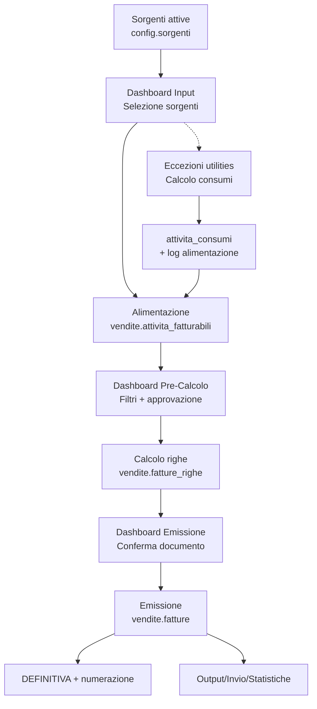
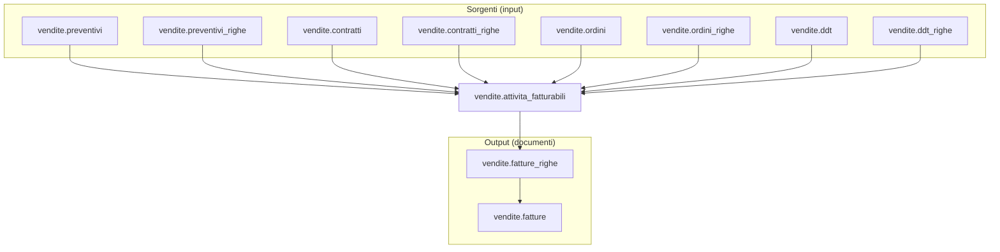

# 📘 Guida Tecnica – Fatturazione (processo end‑to‑end)

> 🎯 **Destinatari:** analisti funzionali, sviluppatori backend e database di Zero ERP
>
> 👀 **Vedi anche**
>
> * [`Documentazione attivita_fatturabili`](/dbzero/vendite/manual/attivita_fatturabili)  
> * [`Documentazione fatture`](/dbzero/vendite/manual/fatture)  
> * [`Documentazione fatture_righe`](/dbzero/vendite/manual/fatture_righe)  
> * [`Documentazione note (partizionata)`](/dbzero/vendite/manual/note)  
> * [`Messaggi di errore e log`](/guide/Messaggi-di-Errore-e-Generazione-Log)  
> * [`Piano migrazione DB → Django`](/guide/fatturazione-migrazione-django)  

---

## ✅ Introduzione

La fatturazione in Zero ERP e` progettata come **pipeline in piu` fasi**:

1. **Alimentazione** di `vendite.attivita_fatturabili` a partire dalle sorgenti.
2. **Calcolo** e generazione delle righe di fattura (`vendite.fatture_righe`).
3. **Emissione** del documento (`vendite.fatture`) e numerazione nello step **DEFINITIVA**.

Questa separazione garantisce **idempotenza**, **controllo** e **revisionabilita`** prima dell’emissione fiscale.

### Stato migrazione DB -> Django (07 Febbraio 2026)

- Orchestrazione pipeline (`pr_run_lotto_pipeline`, `fn_execute_pipeline_step`) gestita in Django.
- Refactor logiche righe/aggregazione gia` avviato in servizi Python.
- Primitive atomiche e vincoli di consistenza restano in DB.

### Modello pipeline e registry task (allineamento)

* La pipeline di fatturazione resta **specifica di dominio** (`vendite.fatturazione_pipeline`).
* Il dispatch dei task usa un **registry multi-dominio** in `dbops`:
  * `dbops.domini_task`
  * `dbops.pipeline_task_registry`
  * `dbops.pipeline_task_registry_impl`
* Nei task JSON e` previsto `implementation_key` con fallback a `default`.
* Il binding tra task e handler e` **controllato**:
  risoluzione via DB (`dbops.fn_get_pipeline_task_implementation`)
  e mapping statico lato Django, senza import dinamici.

---

## 🔎 Analisi – Lotto “giornaliero” vs massivo

Per esigenze front‑office puo` essere necessario **emettere fatture immediate** (numerate)
senza attendere il ciclo massivo. Per mantenere coerenza con il modello a lotti,
introduciamo due concetti:

* **`tipo_lotto`**: `MASSIVO` | `GIORNALIERO`
* **`stato_operativo`**: `APERTO` | `CHIUSO` | `ERRORE`

Regola chiave:
* Il **lotto giornaliero** può restare **APERTO** anche se le fatture sono **EMESSE**.
* Si chiude **solo** quando il lotto passa a **INVIATA**.
* Le fatture giornaliere **non sono retrocedibili** (no ritorno a BOZZA).

Questo consente di **accorpare più fatture** nello stesso lotto giornaliero,
senza perdere la governance documentale.

---

## 🧱 Tabelle coinvolte (core)

* [vendite.attivita_fatturabili](/dbzero/vendite/tabelle/attivita_fatturabili)
* [vendite.fatture](/dbzero/vendite/tabelle/fatture)
* [vendite.fatture_righe](/dbzero/vendite/tabelle/fatture_righe)
* [vendite.fatture_riepiloghi_iva](/dbzero/vendite/tabelle/fatture_riepiloghi_iva)
* [vendite.fatture_scadenze](/dbzero/vendite/tabelle/fatture_scadenze)
* [vendite.note](/dbzero/vendite/tabelle/note) + partizioni (es. `note_attivita_fatturabili`)
* [config.sorgenti](/dbzero/config/tabelle/sorgenti)

### 📥 Tabelle sorgenti (alimentazione `attivita_fatturabili`)

* [vendite.preventivi](/dbzero/vendite/tabelle/preventivi)
* [vendite.preventivi_righe](/dbzero/vendite/tabelle/preventivi_righe)
* [vendite.contratti](/dbzero/vendite/tabelle/contratti)
* [vendite.contratti_righe](/dbzero/vendite/tabelle/contratti_righe)
* [vendite.ordini](/dbzero/vendite/tabelle/ordini)
* [vendite.ordini_righe](/dbzero/vendite/tabelle/ordini_righe)
* [vendite.ddt](/dbzero/vendite/tabelle/ddt)
* [vendite.ddt_righe](/dbzero/vendite/tabelle/ddt_righe)

---

## 🧭 Flusso logico (overview)



---

> Nota: la dashboard e` concepita come **unica** con sezioni dedicate (input, eccezioni utilities, pre‑calcolo, emissione).

---

## 1) Processo di alimentazione `attivita_fatturabili`

### 🎯 Scopo
Creare le righe pre‑documentali che rappresentano **tutto cio` che potra` essere fatturato**.

### 🔌 Sorgenti (macro‑tipi)
Le sorgenti sono definite in `config.sorgenti` e rappresentano **origini dati** eterogenee. Esempio:

1. ATTIVITA (RIGA)  
2. PREVENTIVO (DOCUMENTO)  
3. PREVENTIVO_RIGA (RIGA)  
4. CONTRATTO (DOCUMENTO)  
5. CONTRATTO_RIGA (RIGA)  
6. ORDINE_VENDITA (DOCUMENTO)  
7. ORDINE_VENDITA_RIGA (RIGA)  
8. DDT_VENDITA (DOCUMENTO)  
9. DDT_VENDITA_RIGA (RIGA)  
10. FATTURA (DOCUMENTO)  
11. FATTURA_RIGA (RIGA)

### 🧩 Logica di alimentazione
* Ogni sorgente genera righe in `vendite.attivita_fatturabili` con:
  `sorgente_tipo_id`, `sorgente_uid`/`sorgente_riga`, `articolo_id`, `istanza_utility_id`, `quantita`, `competenza_*`.
* L’idempotenza e` garantita dalla coppia `(sorgente_tipo_id, sorgente_uid)` con indice unico parziale.
* Le righe nascono **in bozza** (`approvato = false`) e vengono validate/approvate nel passaggio successivo.

### 🖥️ Dashboard “Input Fatturazione”
* Selezione sorgenti e intervalli (periodo, BA, istanza, utility).
* Visualizzazione righe candidate e preview dei conteggi.
* Avvio del processo di alimentazione (batch o manuale).

**Integrazione utilities (gas/energia/acqua)**  
Non tutte le sorgenti possono alimentare direttamente `attivita_fatturabili`:
nei casi utilities serve un **processo di calcolo preliminare** dei consumi.
La dashboard “Input” deve quindi gestire due flussi:

1) **Alimentazione diretta** → inserimento righe `attivita_fatturabili` da sorgenti semplici.  
2) **Alimentazione con calcolo** → generazione di `attivita_consumi` (testata consumi),
   log dedicato e successiva produzione di righe `attivita_fatturabili`.

Il processo di alimentazione avviene **prima** del lotto fatture e mantiene tracciabilita`
tramite `attivita_fatturabili_lotti`.

---

## 2) Processo operativo di calcolo (pre‑emissione)

### 🎯 Scopo
Trasformare attivita` approvate e fatturabili in **righe economiche** di fattura.

### 🔎 Selezione
* `approvato = true`
* `fatturato = false`
* `sospesa = false`
* `posticipa_al` in regola con la data fatturazione
* competenza mensile/puntuale in regola

### 🔒 Isolamento batch
* `lock_in_fatturazione` e `lock_batch_id` garantiscono coerenza di selezione.
* Evita doppie estrazioni concorrenti.

### 🧮 Output
* Generazione `vendite.fatture_righe` con snapshot economici (prezzo, IVA, UoM, importi).
* Aggancio a `vendite.attivita_fatturabili` (`fattura_riga_id`, `fatturato = true`).

### 🖥️ Dashboard “Pre‑Calcolo”
* Visualizzazione delle righe eleggibili e motivi di esclusione.
* Azioni: approva/sospendi/posticipa.
* Lancio calcolo batch con log esiti e anomalie.

---

## 3) Processo di emissione documento (output)

### 🎯 Scopo
Convertire il risultato del calcolo in **documento fiscale numerato**.

### ✅ Separazione dal calcolo
Il **calcolo** produce righe; l’**emissione** produce la testata.
La **numerazione** avviene nello step **DEFINITIVA**.

### 🔢 Numerazione
* Assegnata **solo** nello step **DEFINITIVA** (non in `EMESSA`).
* Regole gestite da `vendite.registri_fatturazione`.
* In caso di errore in `DEFINITIVA`, la riesecuzione deve ripartire dalle sole fatture non numerate/in errore, senza reset globale del lotto.

### ⚙️ Step `EMESSA` (massivo)
Nello step `EMESSA` del lotto massivo sono previsti i task pre-fiscali:

* generazione source minimi/fondi
* applicazione fondi alle fatture del lotto
* ricalcolo IVA lotto (con aggiornamento totali testata)

### ⚙️ Step `INVIATA` (massivo)
Nello step `INVIATA` del lotto massivo e` previsto il task di preparazione payload SDI:

* apertura/riuso tentativi in `vendite.fatture_sdi`
* registrazione eventi `PREPARED` in `vendite.fatture_sdi_eventi`
* dataset pronto per generazione file di invio

Prerequisito operativo:
* Le transizioni in `config.stati_doc_fiscale_transizioni` devono essere configurate (es. `DRAFT -> EMESSA` con `solo_fattura=false`), altrimenti il trigger lotto blocca l'avanzamento step.

### 📦 Output correlati
* `vendite.fatture_riepiloghi_iva`
* `vendite.fatture_scadenze`
* `vendite.note` (e partizioni dedicate)
* `vendite.fatture_indirizzi` (se previsto)

### ✅ IVA (processo dedicato)
La generazione dei riepiloghi IVA e` un processo separato:
prima si eliminano i riepiloghi esistenti e poi si ricalcola. Il processo puo`
essere inserito in qualsiasi step della pipeline o eseguito da servizio dedicato.

Nota: il ricalcolo assume che `iva_id` sia gia` valorizzato sulle righe fattura;
questa parte e` demandata al processo di generazione righe (Python).

### ✅ Minimi e fondi fattura (processo dedicato)
La gestione dei minimi e` costruita su due tabelle con ruoli distinti:

* `vendite.fatture_fondi_fattura_source`:
  * contiene le sorgenti dei fondi da applicare (minimi non ancora assorbiti,
    residui da compensazione, ecc.);
  * viene aggiornata in fase di fatturazione per allineare importo e stato
    (`DISPONIBILE` / `ASSEGNATO` / `ANNULLATO`);
  * funziona come backlog tecnico dei fondi ancora applicabili.
* `vendite.fatture_fondi_fattura`:
  * contiene i fondi effettivamente applicati alla fattura figlia;
  * raccoglie tipologie che influenzano il `totale_a_pagare` ma non il
    `totale_doc` (es. minimi, canone RAI, altre totalizzazioni dedicate).

Scelta progettuale:

* separare **source** da **applicato** semplifica idempotenza, reset e ricalcolo;
* i processi di fatturazione aggiornano entrambe le tabelle a ogni run, mantenendo
  coerenza tra stato sorgente e righe applicate in documento.

Regola di controllo operativa:

* per decidere se una source e` ancora applicabile si usa il saldo effettivo
  del documento (residuo fattura al netto delle componenti contabili postabili),
  cosi` si evita di riincludere importi gia` in lavorazione.

### 🔁 Riesecuzione e reset (stato attuale)
* `MASSIVO`: gli step `DRAFT` e `EMESSA` sono rieseguibili con reset tecnico di step.
* `GIORNALIERO`: niente reset lotto su `EMESSA` (emissione fuori lotto).
* Runner Django:
  * su lotto `MASSIVO` in `ERRORE`, la riesecuzione riparte dallo step corrente (resume) per evitare transizioni retroattive non ammesse;
  * il rollback step (`rollback=true`) e` supportato in modo opzionale tramite `meta.auto_step_rollback=true`, con guard applicativa che evita rollback distruttivi (`reset_lotto_draft`) in auto-run.

### 🖥️ Dashboard “Emissione”
* Preview del documento e controlli finali pre-fiscali.
* Conferma emissione con log degli esiti.

---

## 4) Dashboard e varianti operative

### ✅ Dashboard standard
* **Input Fatturazione** → alimenta `attivita_fatturabili`
* **Pre‑Calcolo** → selezione, approvazione, calcolo righe
* **Emissione** → creazione/validazione documento (pre-fiscale)
* **Definitiva** → numerazione documento

### 🔁 Variante: invio SDI (Italia)
* **Estrazione** del documento in formato fiscale (es. XML FatturaPA).
* **Invio** a canali SDI e registrazione esiti (accettato/scartato).
* **Nota di variante**: in altri paesi si sostituisce il canale SDI con sistemi locali o e‑invoicing alternativi.

### 📊 Variante: controlli e statistiche
* **Pre‑emissione**: controlli di anomalia (importi negativi, IVA mancante, competenze fuori periodo, mismatch BA/istanza).
* **Post‑emissione**: riepiloghi fiscali e gestionali:
  * per gruppi voce / articoli
  * per utility / BA / periodo
  * per stato documento (bozza, emessa, annullata)

---

## 🧠 Linee guida di progettazione

1. **Separare sempre calcolo vs emissione**  
   Il calcolo e` idempotente e ripetibile; l’emissione e` un’azione fiscale “finale”.

2. **Dashboard come orchestratore**  
   Il motore batch deve essere avviato da contesto visibile e controllato (input + pre‑calcolo + emissione).

3. **Idempotenza garantita dalle sorgenti**  
   Le sorgenti alimentano `attivita_fatturabili` evitando duplicazioni con chiavi uniche parziali.

4. **Audit e log sempre presenti**  
   Ogni fase deve loggare esiti, scarti, errori e motivi di esclusione.

---

## ✅ Risultato atteso

Un processo fatturazione **modulare**, verificabile e scalabile:

* sorgenti ingegnerizzate → `attivita_fatturabili`
* calcolo controllato → `fatture_righe`
* emissione separata → `fatture` numerate
* dashboard e output fiscali governati

---

## ✅ Checklist prima esecuzione pipeline

Usare questa checklist prima di lanciare i primi run su un ambiente.

1. Verificare che gli step pipeline siano presenti per il dominio/tipo lotto:
   * `vendite.fatturazione_pipeline` popolata per `MASSIVO` e (se usato) `GIORNALIERO`.
2. Verificare task registry e implementazioni:
   * `dbops.pipeline_task_registry` e `dbops.pipeline_task_registry_impl` allineate con i task JSON.
3. Verificare transizioni stati documento lotto:
   * `config.stati_doc_fiscale_transizioni` deve consentire i passaggi richiesti dagli step (es. `DRAFT -> EMESSA` con `solo_fattura=false`).
   * Se la stessa transizione vale per piu` `tipo_lotto` (es. `DEFINITIVA -> INVIATA`),
     usare **una sola riga** con `meta = {}` (senza `meta.tipo_lotto`) per evitare conflitti sul vincolo unico.
4. Verificare prerequisiti dati per task EMESSA:
   * tipo fondo attivo (`vendite.tipi_fondi_fattura.codice_interno`)
   * scope fatture lotto completo (utility/tipo_doc/emittente/valuta valorizzati).
5. Verificare policy riesecuzione:
   * `MASSIVO` step `DRAFT/EMESSA` rieseguibili con reset tecnico step.
   * `DEFINITIVA` in resume per fattura (no reset globale).
   * `GIORNALIERO` senza reset lotto su emissione.

Query di controllo rapido:

```sql
-- Step risolti per tipo lotto
SELECT stato_doc_fiscale_id, descrizione, ordine
FROM vendite.fn_list_fatturazione_pipeline_steps('MASSIVO', 1, 2);

-- Transizioni stato lotto critiche
SELECT stato_from_id, stato_to_id, ammesso, solo_fattura
FROM config.stati_doc_fiscale_transizioni
WHERE stato_from_id = 1;

-- Task registrati dominio FATTURAZIONE
SELECT r.task_code, i.implementation_key, i.handler_code, i.is_default
FROM dbops.pipeline_task_registry r
JOIN dbops.pipeline_task_registry_impl i ON i.task_registry_id = r.id
JOIN dbops.domini_task d ON d.id = r.dominio_id
WHERE d.codice = 'FATTURAZIONE' AND r.attivo AND i.attivo
ORDER BY r.task_code, i.implementation_key;
```

---

## 🧩 Collegamenti tabellari (visione sintetica)



---

## 📎 Appendice – Lotto, raggruppamenti e stati (design operativo)

> **Nota importante (evidenza):**
> `area_geografica_id` restera` **solo** un filtro geografico.
> In futuro i raggruppamenti multi‑criterio (comuni + tipologia utenza + contratti, ecc.)
> saranno gestiti con un **nuovo livello** (`gruppo_fatturazione_id`), per evitare
> ambiguita` semantiche e mantenere la compatibilita` con l’attuale modello.

### 1) Lotto di fatturazione

Il **lotto** diventa l’elemento centrale per:

* ricalcolo controllato,
* tracciabilita` dei job,
* orchestrazione dei processi successivi (emissione, invio, statistiche).

**Campi proposti (minimi)**:

* `id` (bigint, PK)
* `uuid` (lock_batch_id)
* `codice` (es. LOT-YYYYMM-NN)
* `competenza_mese` (date, YYYY-MM-01)
* `utility_id` (opzionale, derivabile da BA)
* `tipo_doc_fiscale_id` (**obbligatorio**)
* `billing_account_id` (opzionale)
* `stato_lotto` (IN_ESECUZIONE | COMPLETATO | ERRORE)
* `stato_doc_fiscale_id` (FK -> `config.stati_doc_fiscale`)
* audit + `meta`

> Nota: `tipo_doc_fiscale_id` e` obbligatorio; `utility_id` puo` essere derivato da `billing_account_id`.
> Lo stato del lotto segue un **ordine** e supporta `stato_precedente_ammesso` per eventuali rollback.

**Rollback DRAFT (lotto MASSIVO)**  
Il rollback tecnico del lotto e` consentito **solo** in stato **DRAFT** e **tipo_lotto = MASSIVO**.  
La procedura elimina documenti generati (fatture/righe/riepiloghi/log) e ripristina le
`attivita_fatturabili` (unlock + reset flag). Il lotto viene marcato come:
`stato_doc_fiscale = ANNULLATA`, `stato_operativo = CHIUSO`, `stato_lotto = COMPLETATO`.

---

### 1.1) Processo di alimentazione attivita_fatturabili (necessita`)

In ambito utilities (gas/energia/acqua) la **generazione** di `attivita_fatturabili`
non e` un semplice import ma un **calcolo complesso** (consumi, conguagli, minimi, fasce).
Questo richiede:

* **tracciabilita` batch** (quando e` stato eseguito il calcolo, con quali parametri);
* **log dedicato** (warning/critical specifici del calcolo consumi);
* **testata di calcolo** con totali e periodi per BA/competenza;
* separazione chiara tra **alimentazione** e **fatturazione**.

Per questo si introduce un **processo di alimentazione** separato dal lotto fatture,
ma collegabile in dashboard.

> Nota: le validazioni/normalizzazioni su `attivita_fatturabili` sono gestite da
> trigger dedicati (es. `trgfn_attivita_fatturabili_guard_ba_coerenza`,
> `trgfn_attivita_fatturabili_guard_fonte`, `trgfn_attivita_norm_competenza_mese`).

---

### 1.2) Lotto alimentazione + attivita_consumi (design)

**Lotto alimentazione** (`vendite.attivita_fatturabili_lotti`):
* batch di generazione `attivita_fatturabili` con parametri di calcolo (competenza, utility, BA);
* stato lotto (IN_ESECUZIONE | COMPLETATO | ERRORE);
* riferimento per dashboard e audit.

**Testata consumi** (`vendite.attivita_consumi`):
* totalizzatori per BA/periodo (consumo_totale, uom, periodo);
* punto di aggregazione per i dettagli futuri (fasce, minimi, ecc.);
* collegabile a `fattura_id` quando il documento e` emesso.

**Log dedicato** (`vendite.attivita_fatturabili_log`):
* messaggi W/C riferiti al lotto o alla testata consumi.

---

### 1.3) Area geografica (analisi)

Per esigenze di fatturazione (es. raggruppamenti per **comuni**), e` necessario
introdurre una **area geografica** dedicata.  
Questa area e` un filtro **specifico** e non va confusa con i futuri gruppi
multi‑criterio (che useranno un livello distinto).

> Nota: i BA senza area restano **fatturabili**. L’area geografica puo` essere
> NULL e le attivita vengono comunque generate, per non penalizzare chi non
> usa questa funzionalita`.

Le righe `attivita_fatturabili` generate da processi automatici
mantengono un riferimento al **lotto alimentazione** e, se disponibile,
alla **testata consumi**.

---
