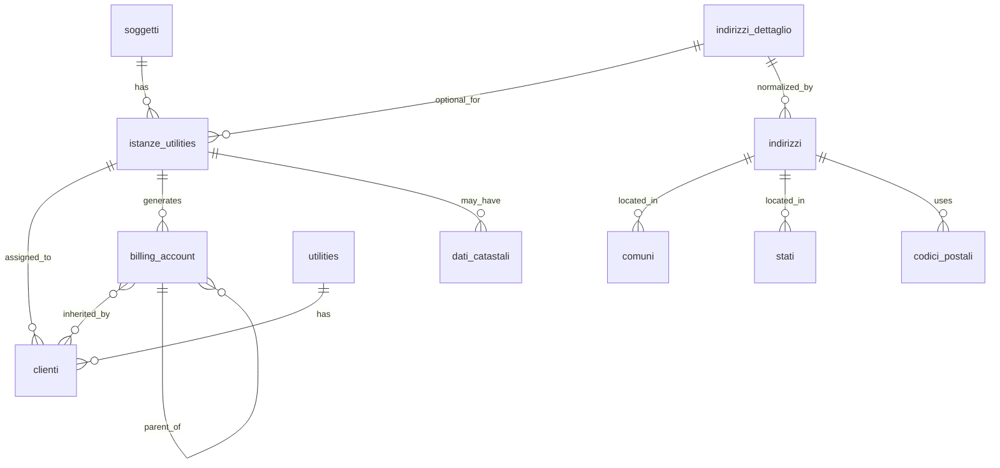
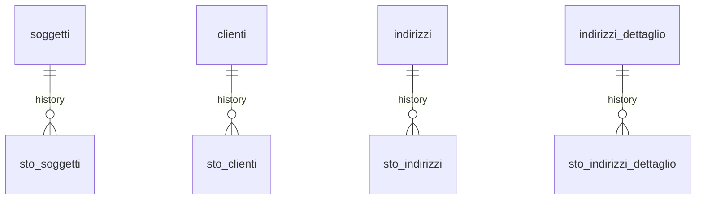

# 📘 Guida Tecnica – Generazione di un Cliente in Zero ERP

> 📋 **Destinatari:** sviluppatori database, backend e analisti funzionali

---

## ✅ Introduzione e scopo

Questa guida descrive in dettaglio il processo di **generazione di un cliente** all'interno del sistema Zero ERP, includendo tutte le **tabelle coinvolte**, le **logiche di normalizzazione**, i **vincoli di coerenza**, e il flusso **step-by-step** dalla creazione dell'istanza fino all'associazione dell'account di fatturazione. Vengono anche evidenziate le **scelte progettuali** che motivano l'attuale struttura, differenziando ruoli, istanze, indirizzi e dati catastali.

---

## 🧩 Tabelle coinvolte

* [anagrafiche.istanze_utilities](/dbzero/anagrafiche/tabelle/istanze_utilities)
* [anagrafiche.clienti](/dbzero/anagrafiche/tabelle/clienti)
* [anagrafiche.billing_account](/dbzero/anagrafiche/tabelle/billing_account)
* [anagrafiche.dati_catastali](/dbzero/anagrafiche/tabelle/dati_catastali)
* [anagrafiche.soggetti](/dbzero/anagrafiche/tabelle/soggetti)
* [anagrafiche.indirizzi_dettaglio](/dbzero/anagrafiche/tabelle/indirizzi_dettaglio)
* [anagrafiche.indirizzi](/dbzero/anagrafiche/tabelle/indirizzi)
* [config.utilities](/dbzero/config/tabelle/utilities)

---

## 🔄 Flusso operativo per la generazione di un cliente

1. **Creazione dell'istanza (istanze_utilities)**:

   * Ogni cliente viene generato a partire da una **istanza di servizio**.
   * L’istanza può essere associata a un indirizzo reale (`indirizzi_dettaglio_id`) oppure essere **fittizia** (quando non è obbligatorio un indirizzo).
   * L’istanza genera il proprio **billing_account** se necessario.

2. **Creazione dell'account di fatturazione (billing_account)**:

   * Può essere creato **indipendentemente** dal cliente, anche in fase precontrattuale.
   * Viene sempre associato all'istanza (`istanza_utilities_id` NOT NULL).
   * Il campo utility_id deve ora essere coerente con quello che verrà utilizzato in clienti.

3. **Creazione del cliente (clienti)**:

   * Avviene successivamente, con associazione all'istanza (`istanza_utilities_id` NOT NULL) e ora deve riferirsi al billing_account generato per l’istanza.
   * Il cliente **eredita** l’account generato in fase di istanza, mantenendo coerenza tra fase precontrattuale e operativa.
   * utility_id rimane presente per motivi operativi ma deve corrispondere a quello del billing_account. Un trigger lo tiene coerente con quello del billing account

4. **Dati catastali**:

   * Legati all’indirizzo tramite `indirizzo_dettaglio_id`.
   * Possibilità di associare opzionalmente un `istanza_utilities_id` per versioning nel tempo.
   * Ogni record è univocamente identificato da `(indirizzo_dettaglio_id, istanza_utilities_id)`.

---

## 🧠 Concetti chiave e scelte progettuali

* **Istanze ≠ Ruoli**:

  * L’istanza non rappresenta un ruolo anagrafico, ma un **punto di erogazione** del servizio (esempio PdR/PdP) ed è legata ad un indirizzo.
  * Di conseguenza, **non è presente nella tabella `anagrafiche.indirizzi`**, ma direttamente in `indirizzi_dettaglio`.
  * Sarà il cliente associato a determinare la chiusura o meno dell’istanza.
  
* **Istanze fittizie**:

  * Possono essere associate **fittizie** agli indirizzi, in quanto non neccessarie per la generazione di un cliente.
  * In questi casi, `indirizzo_dettaglio_id` può essere NULL.

* **Dati catastali**:

  * Collegati all’indirizzo per evitare **ridondanza** tra più istanze nello stesso luogo.
  * È comunque possibile una **versione legata all’istanza**, utile per tracciabilità storica o variazioni temporali.

* **Clienti e billingo_account**:

* Aggiornamento: è stato introdotto un vincolo concettuale  per garantire che:
   clienti.utility_id = billing_account.utility_id entrambi coerenti con istanze_utilities.
---

## 📌 Best practice

* Le colonne `istanza_utilities_id` in `clienti` e `billing_account` devono essere sempre **NOT NULL**.
* Utilizzare valori `fittizia = true` per permettere indirizzi non associati a un cliente.
* Normalizzare sempre gli indirizzi in `indirizzi_dettaglio`.
* Non duplicare i dati catastali: sfruttare la FK all’indirizzo e, se serve, anche all’istanza.

---

## ⚠️ Vincoli e logiche di validazione

* Se `fittizia = false`, allora `indirizzo_dettaglio_id` **deve essere NOT NULL** (vincolo da validare via trigger).
* Nessuna istanza può essere attiva contemporaneamente sullo stesso `indirizzo_dettaglio_id`.
* Un cliente non può esistere senza istanza (`istanza_utilities_id` obbligatorio).
* `billing_account` richiede sempre un'istanza valida.
* `utility_id` su clienti deve essere coerente con billing_account.utility_id.

---

## 🛠️ Trigger e funzioni coinvolte

* `dbops.trgfn_tx_id_managed()` → genera `tx_id` su `istanze_utilities`, `dati_catastali`, etc.
* `script.trgfn_upd_audit_data_user_generic()` → aggiorna i metadati di auditing.
* `script.trgfn_upd_dlt_storico_generic()` → snapshot storico in caso di update/delete.
* Funzione di fallback `script.fn_get_dati_catastali_by_istanza(p_istanza_utilities_id)` per ottenere i dati catastali via `istanza_utilities_id`, oppure solo per indirizzo.

---

## ✅ Controlli di coerenza

* La creazione di un cliente **non è possibile** senza `istanza_utilities_id` valido.
* Le istanze devono avere **un solo billing_account associato**.
* I dati catastali devono essere univoci su combinazione `indirizzo_dettaglio_id + istanza_utilities_id`.
* L’indirizzo è opzionale solo per istanze **fittizie**.

---

## 🧾 Note finali

> Il processo di generazione può essere **eseguito per step**:
>
> * Si parte dalla creazione di `istanze_utilities`, eventualmente con `billing_account` anche in assenza di un cliente (es. per **fatturazione precontrattuale**).
> * Il cliente viene creato in un secondo momento, tipicamente al momento della firma del contratto.
> * Il cliente **assume lo stesso account** dell’istanza, mantenendo **continuità nei legami** tra fase pre e post contrattuale.

---

## 📊 Diagramma ER

---

## 📊 Diagramma ER tabelle storicizzate

---
