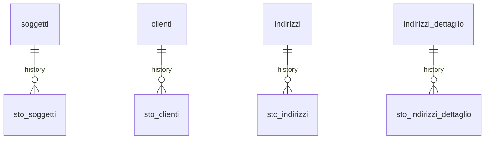

# 🌱 Guida Tecnica – Generazione di un Cliente in Zero ERP
> (latest review 16-12-25)

> 🧩 **Destinatari:** sviluppatori database, backend e analisti funzionali
>
>
> 👀 **Vedi anche**
>
> * [`Guida Soggetti & Ruoli`](/guide/soggetti-e-ruoli-anagrafici)  

>
> **All'interno si trova l'appendice per le funzionalità subentro cliente,chiusura e attivazione** 

---

## ✅ Introduzione e scopo

Questa guida descrive in dettaglio il processo di **generazione di un cliente** all'interno del sistema Zero ERP, includendo tutte le **tabelle coinvolte**, le **logiche di normalizzazione**, i **vincoli di coerenza**, e il flusso **step-by-step** dalla creazione dell'istanza fino all'associazione dell'account di fatturazione. Vengono anche evidenziate le **scelte progettuali** che motivano l'attuale struttura, differenziando ruoli, istanze, indirizzi e dati catastali.

---

## 🧱 Tabelle coinvolte

* [anagrafiche.istanze_utilities](/dbzero/anagrafiche/tabelle/istanze_utilities)
* [anagrafiche.clienti](/dbzero/anagrafiche/tabelle/clienti)
* [anagrafiche.billing_account](/dbzero/anagrafiche/tabelle/billing_account)
* [anagrafiche.dati_catastali](/dbzero/anagrafiche/tabelle/dati_catastali)
* [anagrafiche.soggetti](/dbzero/anagrafiche/tabelle/soggetti)
* [anagrafiche.soggetti_ruoli](/dbzero/anagrafiche/tabelle/soggetti_ruoli)
* [anagrafiche.indirizzi_dettaglio](/dbzero/anagrafiche/tabelle/indirizzi_dettaglio)
* [anagrafiche.indirizzi](/dbzero/anagrafiche/tabelle/indirizzi)
* [config.utilities](/dbzero/config/tabelle/utilities)

---

## 🔄 Flusso operativo per la generazione di un cliente

1. **Creazione dell'istanza (istanze_utilities)**:

   * Ogni cliente viene generato a partire da una **istanza di servizio**.
   * L’istanza può essere associata a un indirizzo reale (`indirizzi_dettaglio_id`) oppure essere **fittizia** (quando non è obbligatorio un indirizzo).
   * L’istanza genera il proprio **billing_account** se necessario.

2. **Creazione dell'account di fatturazione (billing_account)**:

   * Può essere creato **indipendentemente** dal cliente, anche in fase precontrattuale.
   * Viene sempre associato all'istanza (`istanza_utilities_id` NOT NULL).
   * Il campo `utility_id` deve ora essere coerente con quello che verrà utilizzato in `clienti`.

3. **Creazione del cliente (clienti)**:

   * Avviene successivamente, con associazione all'istanza (`istanza_utilities_id` NOT NULL) e ora deve riferirsi al `billing_account` generato per l’istanza.
   * Il cliente **eredita** l’account generato in fase di istanza, mantenendo coerenza tra fase precontrattuale e operativa.
   * `utility_id` rimane presente per motivi operativi ma deve corrispondere a quello del `billing_account`. Un trigger lo tiene coerente con quello del billing account.

4. **Dati catastali**:

   * Legati all’indirizzo tramite `indirizzo_dettaglio_id`.
   * Possibilità di associare opzionalmente un `istanza_utilities_id` per versioning nel tempo.
   * Ogni record è univocamente identificato da `(indirizzo_dettaglio_id, istanza_utilities_id)`.

---

## 🧠 Concetti chiave e scelte progettuali

* **Istanze ≠ Ruoli**:

  * L’istanza non rappresenta un ruolo anagrafico, ma un **punto di erogazione** del servizio (esempio PdR/PdP) ed è legata ad un indirizzo.
  * Di conseguenza, **non è presente nella tabella `anagrafiche.indirizzi`**, ma direttamente in `indirizzi_dettaglio`.
  * Sarà il cliente associato a determinare la chiusura o meno dell’istanza.

* **Istanze fittizie**:

  * Possono essere associate **fittizie** agli indirizzi, in quanto non necessarie per la generazione di un cliente.
  * In questi casi, `indirizzo_dettaglio_id` può essere NULL.

* **Dati catastali**:

  * Collegati all’indirizzo per evitare **ridondanza** tra più istanze nello stesso luogo.
  * È comunque possibile una **versione legata all’istanza**, utile per tracciabilità storica o variazioni temporali.

* **Ruolo CLIENTE e `anagrafiche.soggetti_ruoli`**:

  * Un cliente **non è solo un record nella tabella `anagrafiche.clienti`**, ma la specializzazione di un **ruolo** assegnato ad un soggetto.
  * Prima (o contestualmente) alla creazione del record in `clienti` è necessario che esista:

    * un `soggetto` in `anagrafiche.soggetti`;
    * un record in `anagrafiche.soggetti_ruoli` con `tipo_ruolo_id` = CLIENTE.
  * La tabella `clienti` utilizza l'`id` di `soggetti_ruoli` (`soggetto_ruolo_id`) come FK, permettendo di risalire **in un solo join** all’identità del soggetto e agli altri ruoli eventualmente collegati.
  * Questo rende naturale collegare al ruolo CLIENTE indirizzi, contatti, conti bancari e altre informazioni di dominio.

* **Clienti e billing_account**:

  * Aggiornamento: è stato introdotto un vincolo concettuale per garantire che:

    ```text
    clienti.utility_id = billing_account.utility_id
    ```

    Entrambi coerenti con `istanze_utilities`.

---

## 📌 Best practice

* Le colonne `istanza_utilities_id` in `clienti` e `billing_account` devono essere sempre **NOT NULL**.
* Utilizzare valori `fittizia = true` per permettere indirizzi non associati a un cliente.
* Normalizzare sempre gli indirizzi in `indirizzi_dettaglio`.
* Non duplicare i dati catastali: sfruttare la FK all’indirizzo e, se serve, anche all’istanza.

---

## ⚠️ Vincoli e logiche di validazione

* Se `fittizia = false`, allora `indirizzo_dettaglio_id` **deve essere NOT NULL** (vincolo da validare via trigger).
* Nessuna istanza può essere attiva contemporaneamente sullo stesso `indirizzo_dettaglio_id`.
* Un cliente non può esistere senza istanza (`istanza_utilities_id` obbligatorio).
* `billing_account` richiede sempre un'istanza valida.
* `utility_id` su `clienti` deve essere coerente con `billing_account.utility_id`.

---

## 🛠️ Trigger e funzioni coinvolte

* `dbops.trgfn_tx_id_managed()` → genera `tx_id` su `istanze_utilities`, `dati_catastali`, etc.
* `script.trgfn_audit_data_user_generic()` → aggiorna i metadati di auditing.
* `script.trgfn_storico_generic()` → snapshot storico in caso di update/delete.
* Funzione di fallback `script.fn_get_dati_catastali_by_istanza(p_istanza_utilities_id)` per ottenere i dati catastali via `istanza_utilities_id`, oppure solo per indirizzo.

---

## ✅ Controlli di coerenza

* La creazione di un cliente **non è possibile** senza `istanza_utilities_id` valido.
* Le istanze devono avere **un solo billing_account associato**.
* I dati catastali devono essere univoci su combinazione `indirizzo_dettaglio_id + istanza_utilities_id`.
* L’indirizzo è opzionale solo per istanze **fittizie**.

---

## ☕ Note finali

> Il processo di generazione può essere **eseguito per step**:
>
> * Si parte dalla creazione di `istanze_utilities`, eventualmente con `billing_account` anche in assenza di un cliente (es. per **fatturazione precontrattuale**).
> * Il cliente viene creato in un secondo momento, tipicamente al momento della firma del contratto.
> * Il cliente **assume lo stesso account** dell’istanza, mantenendo **continuità nei legami** tra fase pre e post contrattuale.

---

## 🧬 Diagramma ER

````mermaid
%%{init: {'er': {'layoutDirection': 'TB'}}}%%
erDiagram

%% Relazioni principali per la generazione di un cliente

    soggetti               ||--o{ soggetti_ruoli            : has
    tipi_ruoli             ||--o{ soggetti_ruoli            : classifies

    soggetti_ruoli         ||--o{ clienti                   : as_cliente

    soggetti               ||--o{ istanze_utilities         : has

    istanze_utilities      ||--o{ clienti                   : assigned_to
    istanze_utilities      ||--o{ billing_account           : generates
    istanze_utilities      ||--o{ dati_catastali            : may_have

    utilities              ||--o{ clienti                   : has

    billing_account        }o--o{ clienti                   : inherited_by
    billing_account        ||--o{ billing_account           : parent_of

    indirizzi              ||--o{ comuni                    : located_in
    indirizzi              ||--o{ stati                     : located_in
    indirizzi              ||--o{ codici_postali            : uses
    indirizzi_dettaglio    ||--o{ istanze_utilities         : optional_for
    indirizzi_dettaglio    ||--o{ indirizzi                 : normalized_by
````

---

## 🧬 Diagramma ER tabelle storicizzate



---

# 📎 Appendice – Gestione del Subentro Cliente (continuità tecnica e commerciale)

## 🎯 Obiettivo

Garantire il passaggio da un **cliente uscente** a un **cliente entrante** sullo stesso **PDP / indirizzo**, assicurando:

* ❌ assenza di overlap commerciale tra clienti
* 🔗 corretta catena tecnica delle istanze (`parent_istanza_id`)
* 🧱 continuità dei dati **catastali** tramite clone controllato
* 🗺️ allineamento automatico tra **catasto** e **indirizzo** (tabella ponte)

---

## 🔄 Flusso operativo sintetico

### 1️⃣ Chiusura preventiva del cliente precedente

Prima di creare il nuovo cliente, viene sempre eseguita la funzione:

```sql
SELECT script.fn_subentro_cliente(p_pdp_id, p_data_attivazione_nuovo);
```

Effetti:

* individua il **cliente attivo** più recente sul PDP
* imposta:

  * `data_chiusura = p_data_attivazione_nuovo - 1 giorno`
  * `stato_cliente = CH`
* se non esiste alcun cliente precedente → ritorna `NULL`

👉 Questo step rende sicura la creazione del nuovo cliente rispetto ai vincoli di periodo.

---

### 2️⃣ Creazione della nuova istanza tecnica

Viene creata una nuova riga in `anagrafiche.istanze_utilities`:

* stesso `pdp_id`
* stesso `indirizzo_dettaglio_id`
* soggetto differente (nuovo intestatario)

Successivamente, il trigger:

* `anagrafiche.trgfn_clienti_set_parent_istanza`

calcola e valorizza automaticamente:

* `istanze_utilities.parent_istanza_id`

➡️ **Questa è la fonte ufficiale** della catena tecnica di subentro.

---

### 3️⃣ Clone dei dati catastali dalla parent istanza

Quando `parent_istanza_id` viene impostato e la nuova istanza non ha ancora un catasto:

* scatta il trigger:

  * `trg_iu_z50_clone_catasto_from_parent_aft_upd`

che esegue:

* `anagrafiche.trgfn_iu_clone_catasto_from_parent()`

Logica interna:

1. individua il **catasto sorgente** tramite `script.fn_get_catasto_source_by_istanza`
2. crea un **nuovo record** in `anagrafiche.catasto_unita_immobiliari`
3. collega il nuovo catasto alla nuova istanza (`catasto_unita_immobiliare_id`)

➡️ Il clone garantisce **continuità storica** senza condividere lo stesso record.

---

### 4️⃣ Sincronizzazione catasto ↔ indirizzo

Quando l’istanza possiede entrambi:

* `catasto_unita_immobiliare_id`
* `indirizzo_dettaglio_id`

il trigger:

* `anagrafiche.trgfn_iu_sync_catasto_unita_indirizzo`

assicura l’inserimento **idempotente** nella tabella ponte:

* `anagrafiche.catasto_unita_immobiliari_indirizzi`

(con vincolo `uq_catunitaindir`).

---

### 5️⃣ Creazione del nuovo cliente

A valle della messa in sicurezza:

* viene creato il `billing_account` della nuova istanza
* viene inserito il nuovo record in `anagrafiche.clienti` con:

  * `data_attivazione = p_data_attivazione_nuovo`
  * stato iniziale **ATTIVO**

Eventuali trigger su `clienti` completano:

* normalizzazione periodo
* aggiornamento stato PDP
* storicizzazione

---

## 🧠 Principi chiave

* Il **subentro è sempre guidato dal PDP**, non dall’indirizzo diretto
* La **parent istanza** è l’unica fonte per il recupero del catasto sorgente
* Il **catasto non è mai condiviso** tra istanze: viene sempre clonato
* La tabella ponte gestisce esclusivamente il legame territoriale

---

## 🔎 Funzioni e trigger coinvolti

* [`anagrafiche.trgfn_clienti_set_parent_istanza`](/dbzero/anagrafiche/funzioni/trgfn_clienti_set_parent_istanza)   
* [`anagrafiche.trgfn_iu_clone_catasto_from_parent`](/dbzero/anagrafiche/funzioni/trgfn_iu_clone_catasto_from_parent)   
* [`anagrafiche.trgfn_iu_sync_catasto_unita_indirizzo`](/dbzero/anagrafiche/funzioni/trgfn_iu_sync_catasto_unita_indirizzo)   

* [`script.fn_subentro_cliente`](/dbzero/script/funzioni/fn_subentro_cliente)   
* [`script.fn_get_catasto_source_by_istanza`](/dbzero/script/funzioni/fn_get_catasto_source_by_istanza)   
* [`script.fn_clone_catasto_from_parent_by_istanza`](/dbzero/script/funzioni/fn_clone_catasto_from_parent_by_istanza)   

---

## 🧭 Nota finale

> Questo flusso è progettato per essere **deterministico, idempotente e auditabile**,
> ed è compatibile con subentri multipli nel tempo sullo stesso punto di erogazione.


