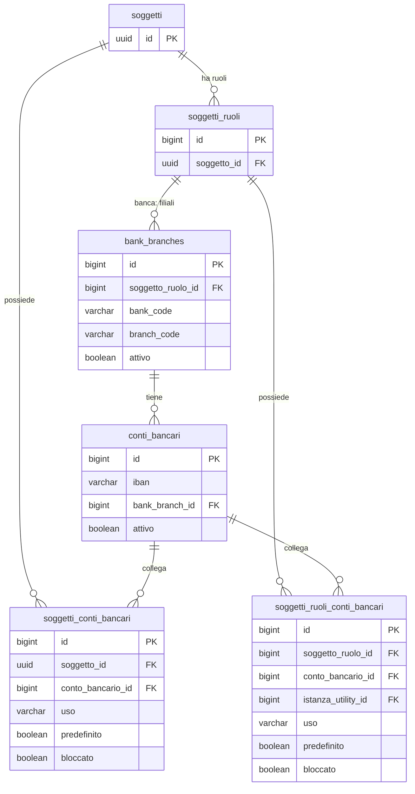
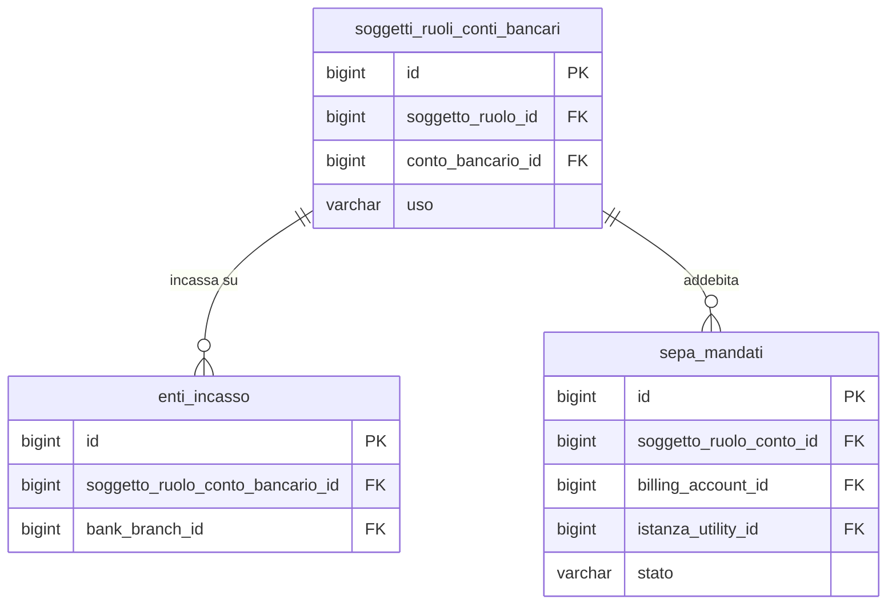

# Guida — Gestione dei Conti Bancari

> **Ultimo aggiornamento**: 27 novembre 2026
>
> **Destinatari**: sviluppatori database, backend e analisti funzionali
>
> **Vedi anche** — schemi DB:
>
> * [anagrafiche.conti_bancari](/dbzero/anagrafiche/tabelle/conti_bancari) — il registro unico degli IBAN
> * [anagrafiche.bank_branches](/dbzero/anagrafiche/tabelle/bank_branches) — le filiali delle banche, che tengono i conti
> * [anagrafiche.soggetti_conti_bancari](/dbzero/anagrafiche/tabelle/soggetti_conti_bancari) — il legame soggetto ↔ conto, il livello di base
> * [anagrafiche.soggetti_ruoli_conti_bancari](/dbzero/anagrafiche/tabelle/soggetti_ruoli_conti_bancari) — il legame ruolo ↔ conto, con l'istanza facoltativa
> * [anagrafiche.vw_conti_bancari_per_ruolo](/dbzero/anagrafiche/views/vw_conti_bancari_per_ruolo) — le candidate di ogni ruolo, con la fonte e la priorità
> * [pagamenti.enti_incasso](/dbzero/pagamenti/tabelle/enti_incasso) — i canali di incasso, che poggiano su un legame d'incasso
> * [pagamenti.sepa_mandati](/dbzero/pagamenti/tabelle/sepa_mandati) — i mandati SEPA, agganciati al legame ruolo ↔ conto
>
> **Vedi anche** — funzioni e trigger DB:
>
> * [script.fn_get_conto_bancario_predefinito](/dbzero/script/funzioni/fn_get_conto_bancario_predefinito) — zero o un conto: quello da usare
> * [script.fn_normalizza_codice_bancario](/dbzero/script/funzioni/fn_normalizza_codice_bancario) — la forma di confronto di IBAN, BIC e codici di banca e filiale
> * [anagrafiche.trgfn_conti_bancari_normalize](/dbzero/anagrafiche/funzioni/trgfn_conti_bancari_normalize) — il conto normalizzato, il paese sempre dall'IBAN
> * [anagrafiche.trgfn_bank_branches_normalize](/dbzero/anagrafiche/funzioni/trgfn_bank_branches_normalize) — la filiale normalizzata
> * [anagrafiche.fn_iban_coerente_con_filiale](/dbzero/anagrafiche/funzioni/fn_iban_coerente_con_filiale) — l'IBAN porta banca e filiale della filiale del conto
> * [anagrafiche.trgfn_conti_bancari_guard_iban_filiale](/dbzero/anagrafiche/funzioni/trgfn_conti_bancari_guard_iban_filiale) e [anagrafiche.trgfn_bank_branches_guard_iban_conti](/dbzero/anagrafiche/funzioni/trgfn_bank_branches_guard_iban_conti) — la stessa regola, dal conto e dalla filiale
> * [anagrafiche.fn_filiale_stessi_codici](/dbzero/anagrafiche/funzioni/fn_filiale_stessi_codici) — lo sportello esiste una volta per paese
> * [anagrafiche.trgfn_bank_branches_guard_unica_per_paese](/dbzero/anagrafiche/funzioni/trgfn_bank_branches_guard_unica_per_paese) e [anagrafiche.trgfn_soggetti_guard_filiali_unica_per_paese](/dbzero/anagrafiche/funzioni/trgfn_soggetti_guard_filiali_unica_per_paese) — la stessa regola, dalla filiale e dal soggetto della banca
> * [anagrafiche.trgfn_conti_legami_guard_predefinito](/dbzero/anagrafiche/funzioni/trgfn_conti_legami_guard_predefinito) — il predefinito: uno per periodo, mai bloccato
> * [anagrafiche.trgfn_bank_guard_ruolo_bank_branches](/dbzero/anagrafiche/funzioni/trgfn_bank_guard_ruolo_bank_branches) — la filiale è di una banca
> * [anagrafiche.trgfn_sepa_mandati_guard](/dbzero/anagrafiche/funzioni/trgfn_sepa_mandati_guard) — l'IBAN del mandato è quello del conto
> * [dbops.trgfn_prevent_deactivate_if_children](/dbzero/dbops/funzioni/trgfn_prevent_deactivate_if_children) — un conto o una filiale usati non si spengono
> * [dbops.trgfn_child_requires_active_parent](/dbzero/dbops/funzioni/trgfn_child_requires_active_parent) — il conto di un legame è attivo, al COMMIT
> * [config.stati](/dbzero/config/tabelle/stati) — dove l'IBAN di uno stato porta banca e filiale
> * [script.fn_data_operativa](/dbzero/script/funzioni/fn_data_operativa) — il giorno operativo su cui si misura la validità
>
> **Vedi anche** — guide correlate:
>
> * [Soggetti e Ruoli](/guide/soggetti-e-ruoli-anagrafici) — prerequisito: il modello soggetto/ruolo
> * [Gestione dei Contatti](/guide/gestione-dei-contatti) — un altro modello a due livelli, soggetto e ruolo
> * [Gestione degli Indirizzi](/guide/gestione-degli-indirizzi) — idem, per gli indirizzi
> * [Gestione dei Pagamenti](/guide/gestione-dei-pagamenti) — dove i conti si usano: incassi, SEPA, distinte

---

## Introduzione

Un soggetto può avere più conti bancari, e lo stesso conto può servire a scopi diversi: incassare da un cliente,
pagare un fornitore, rimborsare. Il modello evita di duplicare gli IBAN, permette conti diversi per ruoli diversi
dello stesso soggetto e per forniture diverse dello stesso ruolo, e trova da sé il conto da usare quando un processo
ne ha bisogno.

Zero ERP lo fa con un **registro unico** degli IBAN e **due legami**: col soggetto, che vale per tutti i suoi ruoli, e
col ruolo, che ha la precedenza. Una vista elenca le candidate, una funzione sceglie.

**Cosa troverai in questa guida:**

* il registro degli IBAN e le filiali che tengono i conti;
* i due legami: uso, predefinito, validità, blocco, istanza;
* la regola «un conto d'incasso, un solo padrone», su cui poggiano gli incassi;
* che cosa si spegne e che cosa no;
* come si sceglie il conto da usare;
* il legame coi mandati SEPA;
* gli esempi, in coda, nell'[Area tecnica](#area-tecnica-esempi).

---

## Il modello in sintesi

```text
soggetti_ruoli (BANK_B: la banca)
    └── bank_branches (le filiali)
            └── conti_bancari (registro unico degli IBAN, ogni conto su una filiale)
                    │
                    ├── soggetti_conti_bancari         il conto del soggetto, per un uso
                    │                                  vale per tutti i suoi ruoli
                    │
                    └── soggetti_ruoli_conti_bancari   il conto del ruolo, per un uso,
                            │                          in generale o per un'istanza
                            ├── pagamenti.enti_incasso     (solo legami d'incasso)
                            └── pagamenti.sepa_mandati

vw_conti_bancari_per_ruolo           tutte le candidate di oggi, per ruolo e uso
fn_get_conto_bancario_predefinito    zero o un conto: ruolo con istanza → ruolo → soggetto,
                                     poi lo stesso sull'uso GENERICO
```

* **Registro** = l'IBAN esiste una volta sola, normalizzato, e non cambia.
* **Legame** = chi usa il conto e per che cosa: `INCASSO`, `PAGAMENTO`, `RIMBORSO`, `GENERICO`.
* **Predefinito** = al più uno per soggetto e uso, e per ruolo, istanza e uso, in ogni giorno; mai bloccato.
* **Candidata** = un legame valido nel giorno operativo, non bloccato, su un conto attivo.

---

## Il registro degli IBAN

[anagrafiche.conti_bancari](/dbzero/anagrafiche/tabelle/conti_bancari) dice che cos'è il conto, non di chi è: l'IBAN,
il BIC, l'intestatario da mostrare, il paese e la filiale che lo tiene. Chi lo usa lo dicono i legami.

* **Unico e normalizzato.** Prima di ogni altro controllo un trigger toglie spazi, trattini e ogni altro separatore
  da IBAN e BIC e li porta in maiuscolo; poi lucchetto, unicità e formati giudicano il valore normalizzato, lunghezza
  compresa. L'IBAN si scrive come lo si legge dal documento, spazi compresi. La cifra di controllo non è verificata.
* **Il paese è quello dell'IBAN**, sempre: le sue prime due lettere. Un paese diverso scritto da fuori si sovrascrive.
* **L'IBAN non si modifica** (`E_CONTO_BANCARIO_IBAN_IMMUTABILE`). Un IBAN sbagliato è un altro conto: si registra
  quello giusto, lo si lega, e si chiudono i legami del conto sbagliato. Riscrivere lo stesso IBAN con gli spazi non
  è un cambio.
* **Su una filiale.** Ogni conto nomina la sua filiale, obbligatoriamente, e la filiale si corregge. Dove l'IBAN porta
  il codice della banca e quello dello sportello (in Italia e a San Marino l'ABI e il CAB), sono quelli della filiale
  del conto (`E_CONTO_IBAN_FILIALE_INCOERENTE`). Dove stanno lo dichiara lo stato, in
  [config.stati](/dbzero/config/tabelle/stati), trovato dalle prime due lettere dell'IBAN.
* **`verificato`** è l'esito di una verifica che il database non fa: lo scrive chi l'ha fatta.

### Le banche e le filiali

Una banca è un soggetto col ruolo `BANK_B` («istituti di credito»). Le sue filiali stanno in
[anagrafiche.bank_branches](/dbzero/anagrafiche/tabelle/bank_branches), una riga per sportello sotto il ruolo della
banca, identificata dal codice banca e dal codice filiale (in Italia l'ABI e il CAB). Un guard rifiuta una filiale
su un ruolo che non è una banca.

* **I codici si normalizzano** come l'IBAN: senza separatori, in maiuscolo; gli zeri restano, sono parte del codice.
* **Lo sportello esiste una volta per paese**: due filiali con lo stesso codice banca e lo stesso codice filiale nel
  paese del soggetto della banca sono rifiutate (`E_FILIALE_DUPLICATA`), dalla filiale e dal soggetto, quando cambia
  il suo stato. In due paesi diversi gli stessi codici sono due sportelli.
* **I codici di una filiale con conti** cambiano solo se gli IBAN dei suoi conti continuano a portarli
  (`E_FILIALE_CODICI_CONTI_INCOERENTI`).
* Una filiale non si cancella: si spegne, e solo quando nessun conto attivo e nessun canale di incasso attivo la
  nomina.

---

## I due legami

[anagrafiche.soggetti_conti_bancari](/dbzero/anagrafiche/tabelle/soggetti_conti_bancari) lega il conto a un soggetto;
[anagrafiche.soggetti_ruoli_conti_bancari](/dbzero/anagrafiche/tabelle/soggetti_ruoli_conti_bancari) a un suo ruolo, e
se serve a un'istanza di servizio di quel ruolo: due forniture dello stesso cliente possono incassare su conti
diversi. Le due tabelle hanno la stessa forma; il legame del ruolo ha la precedenza.

* **L'identità del legame non si sposta.** Il conto, l'uso e il possessore (il soggetto; il ruolo e la sua istanza)
  non si modificano (`E_CONTO_LEGAME_IMMUTABILE`): canali d'incasso e mandati nominano il legame per quello che è. Un
  legame sbagliato si chiude con la sua data di fine e se ne apre uno nuovo.
* **L'uso.** Lo stesso conto sta sullo stesso soggetto (o ruolo) con usi diversi, una riga per uso.
* **Il predefinito.** Al più uno per soggetto e uso, e per ruolo, istanza e uso, **in ogni giorno**
  (`E_CONTO_PREDEFINITO_SOVRAPPOSTO`): due predefiniti dello stesso possessore e uso non hanno periodi che si
  sovrappongono, date comprese. Un cambio di conto programmato marca il nuovo legame dal suo primo giorno. Il legame
  di tutto il ruolo e quello di un'istanza stanno in gradini diversi e non si incontrano.
* **La validità.** `valido_dal` e `valido_al` sono facoltativi; la fine non precede l'inizio
  (`E_DATA_AL_MINORE_DAL`, dal controllo comune delle date, non dai guard dei legami).
* **Il blocco.** `bloccato` toglie il legame dalla scelta senza cancellarlo. Un predefinito non si blocca
  (`E_CONTO_PREDEFINITO_BLOCCATO`): prima si toglie il segno.
* **L'istanza** di un legame del ruolo è del soggetto del ruolo (`E_ISTANZA_ALTRO_SOGGETTO`).

---

## ⭐ Un conto d'incasso, un solo padrone

Quando i soldi arrivano su un IBAN non hanno ancora una fattura: di chi sono lo dice il conto. Per questo lo stesso
conto con uso `INCASSO` non sta su due padroni diversi, e la regola è un vincolo di esclusione su ciascuno dei due
legami:

* sul legame del soggetto, due **soggetti** diversi;
* sul legame del ruolo, due **ruoli** diversi. È più stretto del suo nome: lo stesso IBAN d'incasso su due ruoli dello
  stesso soggetto è rifiutato.

È un'esclusione, non un indice unico: lo stesso conto d'incasso sullo stesso ruolo, in generale e per un'istanza, è
ammesso. La validità non entra: un IBAN non passa di mano. I due vincoli non si incrociano, e un conto d'incasso sul
soggetto A e sul ruolo di B non si incontrano: è voluto, perché il perimetro degli incassi legge solo il legame del
ruolo. Un canale di incasso ([pagamenti.enti_incasso](/dbzero/pagamenti/tabelle/enti_incasso)) nomina un legame del
ruolo, e il suo guard pretende che sia d'incasso: è lì che l'esclusione diventa il perimetro.

---

## Che cosa si spegne, e che cosa no

* **Un conto legato non si spegne.** I legami non hanno un loro `attivo`: basta che **esistano**, di qualunque
  validità, e lo spegnimento è rifiutato (`E_ATTIVO_BLOCK_CHILDREN_EXIST`). Prima si tolgono i legami.
* **Il conto di un legame è attivo**, controllato al COMMIT (`E_ATTIVO_PADRE_NON_ATTIVO`).
* **Un conto attivo sta su una filiale attiva**, controllato al COMMIT; una filiale con conti attivi non si spegne.
* **Il soggetto di un legame del soggetto è attivo**, controllato al COMMIT; un soggetto con legami non si spegne.

La cancellazione di un conto legato, e di un legame del ruolo che un canale di incasso o un mandato nomina, la
rifiutano le chiavi esterne.

---

## La scelta del conto

### La vista: tutte le candidate

[anagrafiche.vw_conti_bancari_per_ruolo](/dbzero/anagrafiche/views/vw_conti_bancari_per_ruolo) elenca, per ogni ruolo e
uso, i legami del ruolo e quelli del suo soggetto (ripetuti per ogni ruolo del soggetto), con la fonte, `RUOLO` o
`SOGGETTO`. Tiene solo i legami validi nel **giorno operativo** (la data di oggi nel fuso dell'azienda, non quella
della sessione), non bloccati, su un conto attivo. Ordina le righe per gradino (ruolo con istanza, ruolo, soggetto),
poi predefinito, poi recenza; non ne sceglie una.

### La funzione: zero o un conto

[script.fn_get_conto_bancario_predefinito](/dbzero/script/funzioni/fn_get_conto_bancario_predefinito) riceve il ruolo,
l'uso e, se c'è, l'istanza, e restituisce il conto che vince la cascata, o niente:

1. il legame del ruolo per l'istanza chiesta;
2. il legame del ruolo senza istanza;
3. il legame del soggetto;
4. gli stessi tre gradini sull'uso `GENERICO`, se l'uso chiesto era un altro.

Dentro un gradino vince il predefinito, poi il legame modificato più di recente. È la funzione che si interroga
quando serve «il» conto; la vista serve a vedere il ventaglio e a capire perché ha vinto quello.

---

## I mandati SEPA

I mandati vivono in `pagamenti` e nominano il **legame del ruolo** del conto addebitato, con il perimetro (un billing
account o un'istanza). L'IBAN del mandato è sempre quello del conto del legame: lo scrive il database a ogni
scrittura, e un valore mandato da fuori si sovrascrive. Poiché l'IBAN del conto e il conto del legame non cambiano,
resta quello con cui il mandato è nato. L'intestatario del mandato resta il dato scritto da chi lo crea. Un mandato
attivo ha la sua data di attivazione, e c'è al più un mandato attivo per perimetro e schema. Vedi
[pagamenti.sepa_mandati](/dbzero/pagamenti/tabelle/sepa_mandati).

---

## ⚠️ Che cosa il database non tiene

* **L'IBAN di un paese che non dichiara dove stanno banca e filiale** non si confronta con la filiale. Oggi lo
  dichiarano l'Italia e San Marino; un paese si aggiunge con una riga di [config.stati](/dbzero/config/tabelle/stati).
* **Un conto con legami chiusi non si spegne**, e così un soggetto con un conto storico: lo spegnimento conta i legami
  di qualunque validità.

---

## Buone pratiche

* Scrivere l'IBAN come lo si legge: lo normalizza il database. Mai duplicarlo, anche se lo usano soggetti diversi.
* Tenere **un solo conto in uso per ogni uso**: gli altri legami sono storici (`valido_al` passato), programmati
  (`valido_dal` futuro) o bloccati.
* Per cambiare conto, uso o possessore di un legame, chiuderlo e aprirne uno nuovo: non si modifica.
* Leggere il conto con `fn_get_conto_bancario_predefinito`, non con query sui legami.
* Per gli incassi, legare il conto al **ruolo**: è il legame che i canali di incasso leggono.
* Non cancellare un legame scaduto: resta con la sua data di fine, e lo storico lo conserva.

---

## Diagrammi ER

### Registro e legami



### Chi poggia sul legame del ruolo



---

## Area tecnica — esempi

**Registrare un IBAN e legarlo al soggetto** — il registro prima, il legame poi; l'IBAN si scrive come lo si legge,
perché a normalizzarlo è il trigger:

```sql
INSERT INTO anagrafiche.conti_bancari (iban, bic_swift, bank_branch_id)
VALUES ('IT60 X054 2811 1010 0000 0123 456', 'BPPIITRRXXX', 1);

INSERT INTO anagrafiche.soggetti_conti_bancari (soggetto_id, conto_bancario_id, uso, predefinito)
VALUES ('UUID-SOGGETTO',
        (SELECT id FROM anagrafiche.conti_bancari WHERE iban = 'IT60X0542811101000000123456'),
        'INCASSO', TRUE);
```

**Il conto del ruolo** — lo stesso soggetto, un conto diverso per i pagamenti al ruolo fornitore: da qui la funzione
sceglie questo, non quello del soggetto:

```sql
INSERT INTO anagrafiche.soggetti_ruoli_conti_bancari (soggetto_ruolo_id, conto_bancario_id, uso, predefinito)
VALUES (10,  -- il ruolo fornitore
        (SELECT id FROM anagrafiche.conti_bancari WHERE iban = 'IT60X0542811101000000789012'),
        'PAGAMENTO', TRUE);
```

**Una sostituzione programmata** — il predefinito è uno per periodo: il vecchio legame finisce il giorno prima, il
nuovo comincia quel giorno già col segno, e dal primo aprile è lui a vincere:

```sql
UPDATE anagrafiche.soggetti_conti_bancari
   SET valido_al = DATE '2026-03-31'
 WHERE soggetto_id = 'UUID-SOGGETTO' AND uso = 'INCASSO' AND predefinito;

INSERT INTO anagrafiche.soggetti_conti_bancari (soggetto_id, conto_bancario_id, uso, predefinito, valido_dal)
VALUES ('UUID-SOGGETTO',
        (SELECT id FROM anagrafiche.conti_bancari WHERE iban = 'IT60X0542811101000000999888'),
        'INCASSO', TRUE, DATE '2026-04-01');
```

**Le due letture** — la vista per vedere le candidate e da dove vengono, la funzione per avere il conto:

```sql
SELECT *
  FROM anagrafiche.vw_conti_bancari_per_ruolo
 WHERE soggetto_ruolo_id = 10 AND uso = 'INCASSO';

SELECT (f).*
  FROM script.fn_get_conto_bancario_predefinito(10, 'PAGAMENTO') AS f;
```

---


