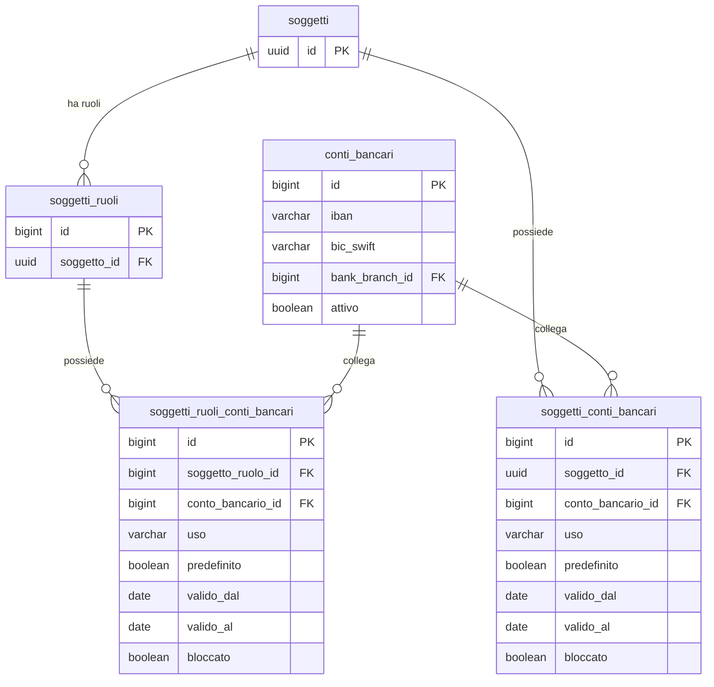
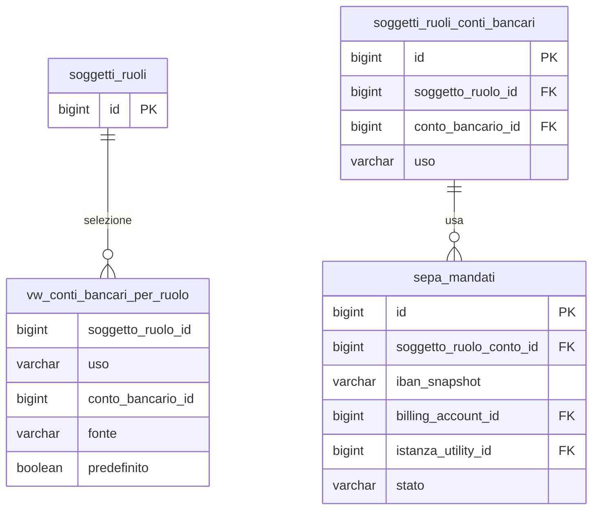

# Guida – Gestione dei Conti Bancari

> (latest review 25-03-26)
>
> Destinatari: sviluppatori database, backend e analisti funzionali
>
> Questa guida descrive il modello centralizzato per la gestione dei conti bancari (IBAN)
> e la loro associazione a soggetti e ruoli, con override per ruolo e fallback automatico.
>
> Vedi anche
>
> * [Guida Soggetti & Ruoli](/guide/soggetti-e-ruoli-anagrafici) — prerequisito: il modello soggetto/ruolo
> * [Guida Gestione dei Contatti](/guide/gestione-dei-contatti) — modello analogo per i contatti
> * [Guida Gestione degli Indirizzi](/guide/gestione-degli-indirizzi) — modello analogo per gli indirizzi

---

## Introduzione

In un sistema gestionale ogni soggetto puo avere uno o piu conti bancari, e lo stesso conto puo servire a scopi diversi: incassare da un cliente, pagare un fornitore, gestire un rimborso. Il modello deve evitare la duplicazione degli IBAN, permettere di assegnare conti diversi per ruoli diversi dello stesso soggetto, e risolvere automaticamente il conto corretto quando un processo ne ha bisogno.

Zero ERP risolve questo con un'architettura a **tre livelli**:

* Un **registro unico** degli IBAN (`conti_bancari`) — nessuna duplicazione, normalizzazione automatica
* Un **legame soggetto ↔ conto** (`soggetti_conti_bancari`) — il livello base, con uso e predefinito
* Un **legame ruolo ↔ conto** (`soggetti_ruoli_conti_bancari`) — il livello di override per ruolo

Quando un processo (fatturazione, pagamenti, rimborsi) cerca il conto da usare, la logica di selezione e semplice: se esiste un legame a livello ruolo, usa quello; altrimenti ricade sul legame a livello soggetto. Tutto questo e incapsulato in una view e una funzione.

**Cosa troverai in questa guida:**

* Il modello dati e la logica dei tre livelli
* I concetti di uso, predefinito, validita e blocco
* La view e la funzione per il recupero del conto
* I vincoli, i trigger e le regole di dominio
* L'integrazione con i mandati SEPA
* Esempi pratici e best practice

---

## Tabelle coinvolte

**Anagrafiche (chi/cosa):**

* [anagrafiche.conti_bancari](/dbzero/anagrafiche/tabelle/conti_bancari) — registro unico degli IBAN
* [anagrafiche.soggetti_conti_bancari](/dbzero/anagrafiche/tabelle/soggetti_conti_bancari) — legame soggetto ↔ conto (fallback)
* [anagrafiche.soggetti_ruoli_conti_bancari](/dbzero/anagrafiche/tabelle/soggetti_ruoli_conti_bancari) — legame ruolo ↔ conto (override)

**Pagamenti (come/quando):**

* [pagamenti.sepa_mandati](/dbzero/pagamenti/tabelle/sepa_mandati) — mandati SEPA collegati al conto effettivo

**Artefatti di selezione:**

* [anagrafiche.vw_conti_bancari_per_ruolo](/dbzero/anagrafiche/views/vw_conti_bancari_per_ruolo) — view con fallback ruolo → soggetto
* [script.fn_get_conto_bancario_predefinito](/dbzero/script/funzioni/fn_get_conto_bancario_predefinito) — funzione helper (restituisce 0 o 1 riga)

---

## Il modello in sintesi

```text
conti_bancari (registro unico IBAN)
    │
    ├── soggetti_conti_bancari (livello soggetto — fallback finale)
    │       soggetto_id + conto_bancario_id + uso + predefinito
    │       un predefinito per (soggetto, uso)
    │
    └── soggetti_ruoli_conti_bancari (livello ruolo — con istanza opzionale)
            soggetto_ruolo_id + istanza_utility_id + conto_bancario_id + uso + predefinito
            un predefinito per (ruolo, istanza, uso)
            istanza_utility_id nullable: NULL = generico ruolo, valorizzato = specifico istanza

vw_conti_bancari_per_ruolo (vista flat — espone tutte le righe candidate)
    unisce ruolo + soggetto, espone istanza_utility_id
    filtra: valido oggi, non bloccato, conto attivo
    la selezione del "vincente" e nella funzione, non nella vista

fn_get_conto_bancario_predefinito(ruolo, uso, istanza_utility_id DEFAULT NULL)
    cascata 7 livelli:
    1. ruolo + istanza + uso richiesto
    2. ruolo + uso richiesto (istanza NULL)
    3. soggetto + uso richiesto
    4. ruolo + istanza + uso GENERICO
    5. ruolo + uso GENERICO (istanza NULL)
    6. soggetto + uso GENERICO
    7. NULL
    restituisce 0 o 1 riga
```

* **Registro** = l'IBAN esiste una sola volta, normalizzato e validato
* **Legame soggetto** = il livello base, usato come fallback finale
* **Legame ruolo** = l'override specifico per un ruolo, con `istanza_utility_id` opzionale per differenziare per istanza di servizio
* **Predefinito** = un solo conto predefinito per ogni combinazione (ruolo, istanza, uso)
* **Regola predefinito/bloccato** = non e possibile bloccare un conto predefinito; il service backend impedisce la combinazione

---

## Componenti del modello

### 1. Il registro IBAN: `anagrafiche.conti_bancari`

Il registro e l'anagrafe unica degli IBAN nel sistema. Ogni IBAN esiste una sola volta, indipendentemente da quanti soggetti o ruoli lo utilizzano. Un trigger normalizza automaticamente l'IBAN (uppercase, senza spazi) e il BIC/SWIFT al momento dell'inserimento.

Il registro non contiene informazioni su chi usa il conto o per quale scopo — questo e responsabilita delle tabelle di legame. Il registro contiene solo i dati intrinseci del conto: IBAN, BIC, intestatario, stato.

Da un punto di vista tecnico:

| Colonna | Tipo | Nullable | Descrizione |
| --- | --- | :---: | --- |
| `id` | BIGINT, PK | no | Chiave primaria |
| `iban` | VARCHAR, UNIQUE | no | IBAN normalizzato (uppercase, no spazi) |
| `bic_swift` | VARCHAR | si | Codice BIC/SWIFT (normalizzato) |
| `intestatario_predefinito` | VARCHAR | si | Intestatario di default |
| `paese` | CHAR | si | Codice paese (auto-derivato dai primi 2 char IBAN) |
| `bank_branch_id` | BIGINT, FK | no | Filiale bancaria di riferimento |
| `attivo` | BOOLEAN | no | Flag attivo (default: true) |
| `verificato` | BOOLEAN | no | Flag di verifica (default: false) |
| `meta` | JSONB | si | Estensione libera |
| Campi audit | — | — | `data_insert`, `user_insert`, `data_update`, `user_update`, `tx_id`, `storicizza` |

**Vincoli:**

* `uq_conti_bancari_iban` — IBAN univoco
* `chk_conti_bancari_iban_fmt`, `chk_conti_bancari_bic_fmt`, `chk_conti_bancari_paese_fmt` — validazione formato
* FK verso `bank_branches` — la filiale deve essere attiva

**Trigger principali:**

| Trigger | Evento | Cosa fa |
| --- | --- | --- |
| `trgfn_conti_bancari_normalize` | BEFORE INSERT/UPDATE | Normalizza IBAN e BIC (uppercase, strip spazi), deriva `paese` |
| `trgfn_prevent_deactivate_if_children` | BEFORE UPDATE | Impedisce disattivazione se esistono legami soggetto o ruolo attivi |

> Documentazione dettagliata: [anagrafiche.conti_bancari](/dbzero/anagrafiche/tabelle/conti_bancari)

---

### 2. Il legame soggetto ↔ conto: `anagrafiche.soggetti_conti_bancari`

Questo e il livello base: associa un conto a un soggetto con un **uso** specifico (`INCASSO`, `PAGAMENTO`, `RIMBORSO`, `GENERICO`). Ogni soggetto puo avere piu conti, anche per lo stesso uso, ma **un solo predefinito per uso**.

Il legame supporta validita temporale (`valido_dal`, `valido_al`) per gestire sostituzioni pianificate, e un flag `bloccato` per sospendere l'uso di un conto (es. per motivi AML) senza cancellarlo.

Questo livello funge da **fallback**: se non esiste un legame specifico a livello ruolo, la view e la funzione usano il conto del soggetto.

Da un punto di vista tecnico:

| Colonna | Tipo | Nullable | Descrizione |
| --- | --- | :---: | --- |
| `id` | BIGINT, PK | no | Chiave primaria |
| `soggetto_id` | UUID, FK | no | Soggetto proprietario |
| `conto_bancario_id` | BIGINT, FK | no | Conto associato |
| `uso` | VARCHAR | no | Tipo d'uso: `INCASSO`, `PAGAMENTO`, `RIMBORSO`, `GENERICO` (default: `GENERICO`) |
| `predefinito` | BOOLEAN | no | Flag predefinito per l'uso (default: false) |
| `valido_dal` | DATE | si | Inizio validita |
| `valido_al` | DATE | si | Fine validita |
| `intestazione_dichiarata` | VARCHAR | si | Intestazione dichiarata dal soggetto |
| `verificato` | BOOLEAN | no | Flag di verifica (default: false) |
| `bloccato` | BOOLEAN | no | Flag di blocco operativo (default: false) |
| `meta` | JSONB | si | Estensione libera |
| Campi audit | — | — | `data_insert`, `user_insert`, `data_update`, `user_update`, `tx_id`, `storicizza` |

**Vincoli:**

* `UNIQUE (soggetto_id, conto_bancario_id, uso)` — un legame per combinazione
* `UNIQUE PARTIAL (soggetto_id, uso) WHERE predefinito=true` — un solo predefinito per uso
* `CHECK chk_soggetti_conti_bancari_uso` — valori ammessi per `uso`
* `CHECK chk_soggetti_conti_bancari_validita` — `valido_al >= valido_dal` se entrambi valorizzati

**Trigger principali:**

| Trigger | Evento | Cosa fa |
| --- | --- | --- |
| `trgfn_soggetti_conti_bancari_guard` | BEFORE INSERT/UPDATE | Verifica conto attivo, coerenza date |
| `trgfn_child_requires_active_parent` | AFTER INSERT/UPDATE | Verifica soggetto e conto attivi |

> Documentazione dettagliata: [anagrafiche.soggetti_conti_bancari](/dbzero/anagrafiche/tabelle/soggetti_conti_bancari)

---

### 3. Il legame ruolo ↔ conto: `anagrafiche.soggetti_ruoli_conti_bancari`

Questo e il livello di **override**: associa un conto a uno specifico ruolo del soggetto. Quando esiste un legame a questo livello, ha **priorita** rispetto al legame soggetto.

La struttura e identica al legame soggetto, ma il riferimento e a `soggetti_ruoli.id` invece che a `soggetti.id`. Questo permette di avere un conto d'incasso per il ruolo CLIENTE e un conto di pagamento per il ruolo FORNITORE, anche se il soggetto e lo stesso.

Da un punto di vista tecnico:

| Colonna | Tipo | Nullable | Descrizione |
| --- | --- | :---: | --- |
| `id` | BIGINT, PK | no | Chiave primaria |
| `soggetto_ruolo_id` | BIGINT, FK | no | Ruolo del soggetto |
| `conto_bancario_id` | BIGINT, FK | no | Conto associato |
| `uso` | VARCHAR | no | Tipo d'uso (default: `GENERICO`) |
| `predefinito` | BOOLEAN | no | Flag predefinito per l'uso (default: false) |
| `valido_dal` | DATE | si | Inizio validita |
| `valido_al` | DATE | si | Fine validita |
| `intestazione_dichiarata` | VARCHAR | si | Intestazione dichiarata |
| `verificato` | BOOLEAN | no | Flag verifica (default: false) |
| `bloccato` | BOOLEAN | no | Flag blocco (default: false) |
| `meta` | JSONB | si | Estensione libera |
| Campi audit | — | — | `data_insert`, `user_insert`, `data_update`, `user_update`, `tx_id`, `storicizza` |

**Vincoli:**

* 4 partial unique index per gestire NULL su `istanza_utility_id`:
  * `uq_src_bancari_ruolo_istanza_conto_uso` — un legame per (ruolo, istanza, conto, uso) con istanza
  * `uq_src_bancari_ruolo_conto_uso_no_istanza` — un legame per (ruolo, conto, uso) senza istanza
  * `uq_src_bancari_predefinito_istanza` — un predefinito per (ruolo, istanza, uso) con istanza
  * `uq_src_bancari_predefinito_no_istanza` — un predefinito per (ruolo, uso) senza istanza
* `CHECK chk_soggetti_ruoli_conti_bancari_uso` — valori ammessi
* `CHECK chk_soggetti_ruoli_conti_bancari_validita` — coerenza date

**Trigger principali:**

| Trigger | Evento | Cosa fa |
| --- | --- | --- |
| `trgfn_soggetti_ruoli_conti_bancari_guard` | BEFORE INSERT/UPDATE | Verifica conto attivo, coerenza date |
| `trgfn_child_requires_active_parent` | AFTER INSERT/UPDATE | Verifica conto attivo |

> Documentazione dettagliata: [anagrafiche.soggetti_ruoli_conti_bancari](/dbzero/anagrafiche/tabelle/soggetti_ruoli_conti_bancari)

---

### 4. Recupero del conto: view e funzione

Il sistema offre due artefatti per recuperare il conto bancario corretto, entrambi con la stessa logica: priorita al legame ruolo, fallback al legame soggetto, solo conti validi oggi, non bloccati e attivi.

#### `anagrafiche.vw_conti_bancari_per_ruolo`

La view e **flat**: unisce le candidate di entrambi i livelli e restituisce **tutte le righe candidate**, ordinate per priorita (ruolo+istanza > ruolo generico > soggetto, poi predefinito, poi recenza). La **selezione singola** con cascata istanza e uso e delegata alla funzione `fn_get_conto_bancario_predefinito`.

La view espone:

| Colonna | Tipo | Descrizione |
| --- | --- | --- |
| `soggetto_ruolo_id` | BIGINT | Ruolo di riferimento |
| `uso` | VARCHAR | Tipo d'uso |
| `conto_bancario_id` | BIGINT | Conto selezionato |
| `soggetto_ruolo_conto_id` | BIGINT | ID legame ruolo (se fonte=RUOLO) |
| `soggetto_conto_id` | BIGINT | ID legame soggetto (se fonte=SOGGETTO) |
| `fonte` | VARCHAR | `RUOLO` o `SOGGETTO` |
| `predefinito` | BOOLEAN | Flag predefinito del legame selezionato |
| `valido_dal` / `valido_al` | DATE | Periodo di validita |
| `data_update` | TIMESTAMPTZ | Ultimo aggiornamento del legame |

**Filtri applicati:** `valido_dal <= oggi` (o NULL), `valido_al >= oggi` (o NULL), `bloccato = false`, `conti_bancari.attivo = true`.

> Documentazione dettagliata: [anagrafiche.vw_conti_bancari_per_ruolo](/dbzero/anagrafiche/views/vw_conti_bancari_per_ruolo)

#### `script.fn_get_conto_bancario_predefinito`

La funzione e il punto d'ingresso consigliato quando serve **un singolo conto** per un'operazione specifica. Interroga la view con cascata a **7 livelli** combinando istanza e uso.

Da un punto di vista tecnico:

| Parametro | Tipo | Descrizione |
| --- | --- | --- |
| `p_soggetto_ruolo_id` | BIGINT | Ruolo del soggetto (obbligatorio) |
| `p_uso` | VARCHAR | Uso richiesto, normalizzato a UPPER(TRIM()) |
| `p_istanza_utility_id` | BIGINT | ID istanza (`anagrafiche.istanze_utilities.id`). Opzionale — se NULL parte dal livello ruolo generico |

**Restituisce:** un record di tipo `anagrafiche.vw_conti_bancari_per_ruolo` o NULL.

**Catena di fallback completa (7 livelli):**

1. Ruolo + istanza specifica + uso richiesto
2. Ruolo + istanza NULL + uso richiesto
3. Soggetto + uso richiesto
4. Ruolo + istanza specifica + uso GENERICO
5. Ruolo + istanza NULL + uso GENERICO
6. Soggetto + uso GENERICO
7. NULL (nessun conto disponibile)

> Documentazione dettagliata: [script.fn_get_conto_bancario_predefinito](/dbzero/script/funzioni/fn_get_conto_bancario_predefinito)

---

## Integrazione con i mandati SEPA

I mandati SEPA vivono nello schema `pagamenti` e si agganciano al **legame ruolo ↔ conto** selezionato. La separazione e netta: le anagrafiche gestiscono **chi possiede quale conto**, i pagamenti gestiscono **come e quando si usa**.

Il mandato contiene anche uno **snapshot dell'IBAN** (`iban_snapshot`) al momento della creazione, per conservare il riferimento anche se il conto viene successivamente modificato o disattivato.

Il collegamento:

```text
pagamenti.sepa_mandati
    │
    ├── soggetto_ruolo_conto_id → soggetti_ruoli_conti_bancari.id
    │       il conto effettivo usato dal mandato
    │
    ├── billing_account_id → (opzionale) perimetro di fatturazione
    │
    └── istanza_utility_id → (opzionale) perimetro di servizio
```

Vincoli parziali garantiscono **un solo mandato ATTIVO per perimetro** (billing_account o istanza_utility) per schema.

---

## Regole di dominio

### R1 — IBAN unico

Il vincolo UNIQUE `uq_conti_bancari_iban` garantisce che ogni IBAN esista una sola volta nel registro. La normalizzazione (uppercase, strip spazi) e applicata dal trigger prima della verifica di unicita.

### R2 — Un solo predefinito per uso

I vincoli UNIQUE parziali `WHERE predefinito=true` su entrambe le tabelle di legame garantiscono che per ogni combinazione `(soggetto, uso)` o `(ruolo, uso)` esista al massimo un conto predefinito. Non serve gestire questa esclusivita manualmente.

### R3 — Validita e blocco

I check constraint verificano la coerenza delle date (`valido_al >= valido_dal`). I trigger guard verificano che il conto referenziato sia attivo. La view filtra automaticamente per validita odierna e `bloccato=false`.

### R4 — Priorita ruolo > soggetto

La view `vw_conti_bancari_per_ruolo` ordina le candidate con priorita 1 per il legame ruolo e priorita 2 per il legame soggetto. A parita di priorita, preferisce il conto predefinito e poi il piu recente.

### R5 — Conto attivo non disattivabile con legami

Il trigger `trgfn_prevent_deactivate_if_children` su `conti_bancari` impedisce di disattivare un conto se esistono legami attivi (soggetto o ruolo). Prima di disattivare un conto, vanno rimossi o aggiornati i legami.

### R6 — Fallback a GENERICO

La funzione `fn_get_conto_bancario_predefinito` tenta prima l'uso specifico, poi ricade su `GENERICO`. Questo permette di configurare un conto "tuttofare" a livello soggetto e sovrascriverlo solo per gli usi che richiedono un conto specifico.

---

## Nota operativa

Il modello consente piu conti per lo stesso uso, ma in esercizio e raccomandato avere **un solo conto corrente operativo per uso** (attivo, valido oggi, non bloccato). Gli altri conti per lo stesso uso devono rappresentare casi particolari:

* **Storico**: `valido_al < oggi`
* **Sostituzione pianificata**: `valido_dal > oggi`
* **Escluso dall'uso**: `bloccato = true`

La view e la funzione restituiscono sempre una sola riga, quindi la logica operativa funziona correttamente. L'interfaccia utente (UI/API) dovrebbe guidare l'utente a disattivare o chiudere il conto precedente quando ne inserisce uno nuovo per lo stesso uso.

---

## Esempi pratici

### Caso 1 — Conto a livello soggetto

Registrazione dell'IBAN e associazione al soggetto per incassi:

```sql
-- 1. Registra l'IBAN (il trigger normalizza)
INSERT INTO anagrafiche.conti_bancari (iban, bic_swift, bank_branch_id)
VALUES ('IT60 X054 2811 1010 0000 0123 456', 'BPPIITRRXXX', 1);

-- 2. Associa al soggetto per uso INCASSO
INSERT INTO anagrafiche.soggetti_conti_bancari (
  soggetto_id, conto_bancario_id, uso, predefinito
) VALUES (
  'UUID-SOGGETTO',
  (SELECT id FROM anagrafiche.conti_bancari WHERE iban = 'IT60X0542811101000000123456'),
  'INCASSO',
  TRUE
);
```

### Caso 2 — Override per ruolo FORNITORE

Lo stesso soggetto ha un conto diverso per i pagamenti al ruolo FORNITORE:

```sql
INSERT INTO anagrafiche.soggetti_ruoli_conti_bancari (
  soggetto_ruolo_id, conto_bancario_id, uso, predefinito
) VALUES (
  10,  -- ruolo FORNITORE
  (SELECT id FROM anagrafiche.conti_bancari WHERE iban = 'IT60X0542811101000000789012'),
  'PAGAMENTO',
  TRUE
);
```

La view restituira questo conto per `(soggetto_ruolo_id=10, uso='PAGAMENTO')` con `fonte='RUOLO'`.

### Caso 3 — Cambio IBAN pianificato

```sql
-- Nuovo legame con validita futura
INSERT INTO anagrafiche.soggetti_conti_bancari (
  soggetto_id, conto_bancario_id, uso, predefinito, valido_dal
) VALUES (
  'UUID-SOGGETTO',
  (SELECT id FROM anagrafiche.conti_bancari WHERE iban = 'IT60X0542811101000000999888'),
  'INCASSO',
  TRUE,
  '2026-04-01'  -- attivo dal 1 aprile
);
```

Al cambio data, la view selezionera automaticamente il nuovo conto.

### Caso 4 — Recupero conto per la fatturazione

```sql
-- View: tutti i conti disponibili per un ruolo
SELECT *
FROM anagrafiche.vw_conti_bancari_per_ruolo
WHERE soggetto_ruolo_id = 10 AND uso = 'INCASSO';

-- Funzione: il conto predefinito (1 riga o NULL)
SELECT (f).*
FROM script.fn_get_conto_bancario_predefinito(10, 'PAGAMENTO') AS f;
```

---

## Best practice

* **Normalizzare IBAN e BIC** non e responsabilita del chiamante — il trigger lo fa automaticamente. Inserire il dato cosi com'e
* **Usare `conti_bancari` come registro globale** — mai duplicare un IBAN, anche se usato da soggetti diversi
* **Mantenere un solo predefinito per uso** — il vincolo parziale lo impone, ma l'UI dovrebbe guidare l'utente
* **Usare sempre la funzione** `fn_get_conto_bancario_predefinito` per il recupero — non fare query dirette sulle tabelle di legame
* **Per SEPA**: collegare i mandati al legame ruolo ↔ conto (non al registro IBAN direttamente) e al perimetro appropriato (billing_account o istanza_utility)
* **Limitare la visibilita** dei dati sensibili (IBAN) con GRANT mirati e mascheramenti dove serve (log → hash IBAN)
* **Non cancellare legami scaduti** — lasciarli con `valido_al` nel passato per conservare lo storico

---

## Diagrammi ER

Il modello e suddiviso in due diagrammi per leggibilita.

### Registro e legami

La struttura centrale: il registro IBAN con i due livelli di legame (soggetto e ruolo).



### Selezione e mandati SEPA

La view di selezione e il collegamento con i mandati SEPA nello schema pagamenti.



---

## Note finali

Questa guida assume come gia compreso il modello soggetto/ruolo descritto nella [guida soggetti e ruoli](/guide/soggetti-e-ruoli-anagrafici).

Per approfondire:

* [Guida Gestione dei Contatti](/guide/gestione-dei-contatti) — modello analogo con fallback multi-contesto
* [Guida Gestione degli Indirizzi](/guide/gestione-degli-indirizzi) — modello indirizzi con policy master/fallback

---


