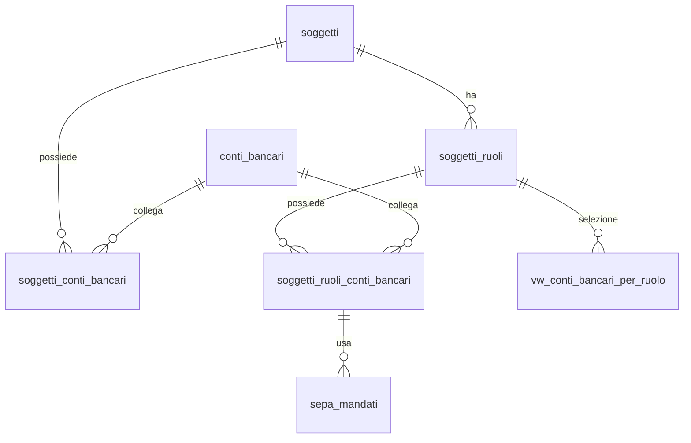

# 📘 Guida Tecnica – Gestione dei **Conti Bancari** 

> (latest review 16-12-25)
> 
> 📋 **Destinatari:** sviluppatori database, backend e analisti funzionali

>
> 👀 **Vedi anche**
>
> * [`Guida Soggetti & Ruoli`](/guide/soggetti-e-ruoli-anagrafici)  

---

## ✅ Introduzione e scopo

Questa guida descrive l’architettura per la **gestione centralizzata dei conti bancari (IBAN)** e la loro associazione a **soggetti** e **ruoli**. L’obiettivo è fornire un modello **senza duplicazioni**, con **override per ruolo** e **fallback automatico** a livello soggetto, così da reperire il conto corretto per **incassi, pagamenti e rimborsi** con una semplice **VIEW** e una **FUNCTION**.

**Perché questa scelta semplifica:**

* **Deduplicazione** degli IBAN: un’unica anagrafe (`anagrafiche.conti_bancari`).
* **Flessibilità**: lo stesso conto può essere riusato su più soggetti/ruoli.
* **Override mirato**: si può specificare un conto diverso per uno specifico **ruolo** (es. Cliente, Fornitore, Gestore) senza duplicare dati.
* **Fallback trasparente**: se manca un legame a livello **ruolo**, viene usato il **predefinito** di **soggetto**.
* **Separazione dei domini**: i **mandati SEPA** e i movimenti vivono nello schema **`pagamenti`**, mentre le anagrafiche stanno in **`anagrafiche`**.

---

## ⚠️ RACCOMANDAZIONE (nota del 25/11/2025):

❌ Nessuna modifica al modello DB: l'attuale struttura è corretta e coerente con la guida.

  il modello consente più conti per lo stesso uso, ma
  in esercizio è raccomandato avere un solo conto "corrente" per uso (attivo, valido oggi, non bloccato),
  gli altri conti per lo stesso uso devono rappresentare casi particolari:

  *  storico (valido_al < oggi),
  *  sostituzione pianificata (valido_dal > oggi),
  *  esclusi dall’uso operativo (bloccato = true).

⚙️ La VIEW e la FUNCTION restituiscono sempre una sola riga, quindi la logica operativa funziona comunque correttamente.

**La regola applicativa (UI/API) deve eventualmente guidare l’utente a disattivare il conto precedente quando ne inserisce uno nuovo per lo stesso uso.**

---

## 🧩 Tabelle coinvolte

* **Anagrafiche (dati “chi/cosa”)**

  * [`anagrafiche.conti_bancari`](/dbzero/anagrafiche/tabelle/conti_bancari) – anagrafe IBAN deduplicata
  * [`anagrafiche.soggetti`](/dbzero/anagrafiche/tabelle/soggetti) – soggetto fiscale
  * [`anagrafiche.soggetti_ruoli`](/dbzero/anagrafiche/tabelle/soggetti_ruoli) – ruolo del soggetto (CLIENTE, FORNITORE, GESTORE…)
  * [`anagrafiche.soggetti_conti_bancari`](/dbzero/anagrafiche/tabelle/soggetti_conti_bancari) – legame **SOGGETTO ↔ CONTO** (fallback)
  * [`anagrafiche.soggetti_ruoli_conti_bancari`](/dbzero/anagrafiche/tabelle/soggetti_ruoli_conti_bancari) – legame **RUOLO ↔ CONTO** (override)

* **Pagamenti (dati “come/quando”)**

  * [`pagamenti.sepa_mandati`](/dbzero/pagamenti/tabelle/manmdati) – mandate SEPA collegati al **conto effettivo** e al perimetro (es. `billing_account` o `istanza_utility`)

* **Artefatti di selezione**

  * [`anagrafiche.vw_conti_bancari_per_ruolo`](/dbzero/anagrafiche/funzioni/vw_conti_bancari_per_ruolo)  – vista con **fallback RUOLO → SOGGETTO**
  * [`script.fn_get_conto_bancario_predefinito(soggetto_ruolo_id, uso)`](/dbzero/script/funzioni/fn_get_conto_bancario_predefinito) – funzione helper per ottenere 1 riga (o nessuna) del conto selezionato

---

## 🔄 Flusso operativo (alto livello)

1. **Crea/normalizza** il conto in `anagrafiche.conti_bancari` (uppercase, no spazi; validazioni, stato `attivo`).
2. **Associa** il conto al **soggetto** in `anagrafiche.soggetti_conti_bancari`, marcando **predefinito** per l’**uso** (`INCASSO|PAGAMENTO|RIMBORSO|GENERICO`).
3. **(Se necessario)** aggiungi un override **per ruolo** in `anagrafiche.soggetti_ruoli_conti_bancari` per lo stesso uso.
4. Le applicazioni (fatturazione, pagamenti, rimborsi) recuperano il conto con la **VIEW** o la **FUNCTION** (priorità **RUOLO**, fallback **SOGGETTO**, preferendo il **predefinito** e solo legami **validi oggi** e **non bloccati**).
5. Per domiciliazione, crea/gestisci un **mandato SEPA** in `pagamenti.sepa_mandati` agganciato al **conto di ruolo** selezionato, e al perimetro pertinente (`billing_account`/`istanza_utility`).

---

## 🧠 Concetti chiave

* **Uso del conto**: campo tipizzato (`INCASSO`, `PAGAMENTO`, `RIMBORSO`, `GENERICO`) che consente **un predefinito per uso**.
* **Predefinito unico**: unique parziale che garantisce **un solo predefinito** per `(soggetto, uso)` e per `(ruolo, uso)`.
* **Validità**: `valido_dal`/`valido_al` per gestire sostituzioni pianificate; query operative selezionano solo i legami **correnti**.
* **Sicurezza**: flag `bloccato` su legame (es. AML) e `attivo` su conto; la VIEW filtra entrambi.
* **Override vs fallback**: l’override a livello **ruolo** ha **priorità**, altrimenti si usa il default del **soggetto** senza replicare nulla.

---

## 🔗 Relazioni tra le tabelle

* `anagrafiche.conti_bancari (1) ←→ (N) anagrafiche.soggetti_conti_bancari (N) ←→ (1) anagrafiche.soggetti`
* `anagrafiche.conti_bancari (1) ←→ (N) anagrafiche.soggetti_ruoli_conti_bancari (N) ←→ (1) anagrafiche.soggetti_ruoli`
* `pagamenti.sepa_mandati (N)` → `anagrafiche.soggetti_ruoli_conti_bancari (1)` e → *(opz.)* `billing_account` / `istanza_utility`

---

## 🔎 Recupero del conto: VIEW & FUNCTION

**VIEW – `anagrafiche.vw_conti_bancari_per_ruolo`**

* Unisce **candidate di ruolo** e **candidate di soggetto**.
* Filtra per **validità odierna**, `bloccato=false`, `conti_bancari.attivo=true`.
* Ordina per **priorità** (RUOLO prima di SOGGETTO), poi **predefinito** e **recenza**.

**FUNCTION – `script.fn_get_conto_bancario_predefinito(soggetto_ruolo_id, uso)`**

* Restituisce **al massimo una riga** (il conto selezionato), facendo fallback a `GENERICO` se non trova l’uso richiesto.
* Ideale per join applicative e per incapsulare la logica di selezione.

**Esempi d’uso**

```sql
-- Vista: ottenere il conto d'incasso oggi valido per un ruolo
SELECT *
FROM anagrafiche.vw_conti_bancari_per_ruolo
WHERE soggetto_ruolo_id = :srid AND uso = 'INCASSO';

-- Funzione: ottenere direttamente il conto (1 riga)
SELECT (f).*
FROM script.fn_get_conto_bancario_predefinito(:srid, 'PAGAMENTO') AS f;
```

---

## 📌 Best practice

* **Normalizza** sempre IBAN/BIC (uppercase, senza spazi) all’ingresso; valida il formato.
* Usa **`conti_bancari`** come registro **globale**: **no duplicazioni** di IBAN.
* Mantieni **un solo predefinito per uso** per soggetto e per ruolo (unique parziali).
* Limita la visibilità dei dati sensibili (IBAN) con **GRANT** mirati e mascheramenti dove serve (log → hash IBAN).
* Per SEPA: collega i mandati al **conto effettivo** selezionato e al **perimetro di fatturazione** appropriato (BA/istanza).

---

## ⚠️ Vincoli e controlli suggeriti

* `uq_conti_bancari_iban` su `anagrafiche.conti_bancari(iban)`.
* `uq_soggetti_conti_bancari_soggetto_conto_uso` e unique parziale **predefinito per uso** a livello **soggetto**.
* `uq_soggetti_ruoli_conti_bancari_ruolo_conto_uso` e unique parziale **predefinito per uso** a livello **ruolo**.
* Check su **validità date**, valori ammessi di **uso**, coerenza con `conti_bancari.attivo`.

---

## 🛠️ Trigger e funzioni utili

* **Normalizzazione/Audit**:

  * `anagrafiche.trgfn_conti_bancari_normalize()` su `conti_bancari`.
  * `anagrafiche.trgfn_soggetti_conti_banacari_guard()` / `anagrafiche.trgfn_soggetti_ruoli_conti_bancari_guard()` per coerenza legami.
  * `dbops.trgfn_tx_id_managed()` e `script.trgfn_audit_data_user_generic()` per audit/tx.
* **Storico**:

  * `script.trgfn_storico_generic()` per snapshot su UPDATE/DELETE quando `storicizza=true`.

---

## 🧭 Casi d’uso tipici

* **Cliente con domiciliazione**: il modulo pagamenti consulta la **FUNCTION** per l’uso `INCASSO`, aggancia il risultato a `pagamenti.sepa_mandati` con perimetro `billing_account`.
* **Fornitore con conto dedicato ai rimborsi**: si definisce un legame di **ruolo** con `uso='RIMBORSO'` e `predefinito=true`; tutte le procedure utilizzeranno quello, ignorando il fallback del soggetto.
* **Cambio IBAN pianificato**: inserisci un nuovo legame con `valido_dal` futuro e imposta `predefinito=true`; al cambio data, la VIEW selezionerà il nuovo conto.

---


## 📊 Diagramma ER (semplificato)



---

## ✅ Riepilogo

* Un’unica **anagrafe conti** + legami **soggetto** e **ruolo** → nessuna ridondanza.
* **Override** a livello ruolo e **fallback** a soggetto tramite **VIEW** e **FUNCTION** → recupero del conto semplice, consistente e sicuro.
* **Pagamenti** gestisce i **mandati** e i movimenti, riusando lo stesso conto selezionato senza replicare informazioni.

---


