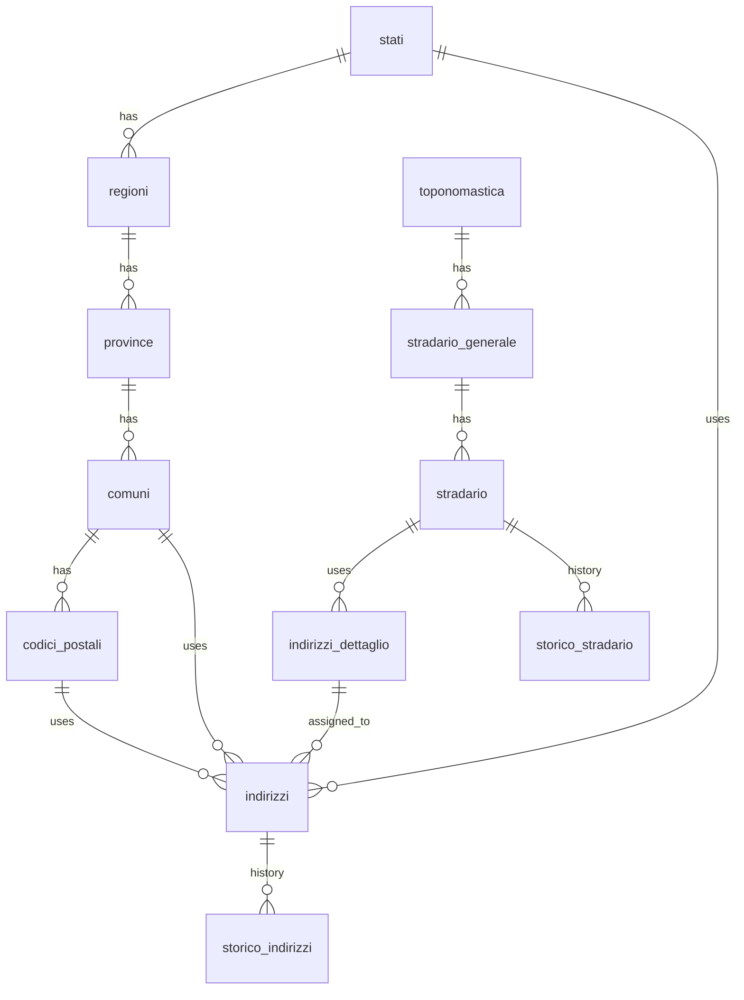
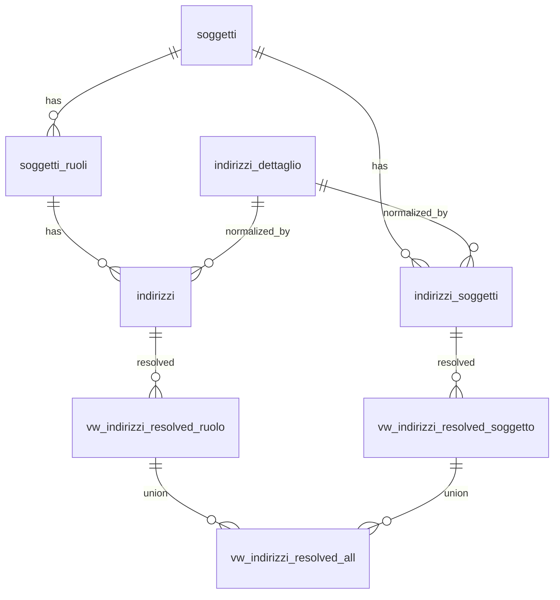

# 🌱 Guida alla Gestione degli Indirizzi
Questa guida illustra l’architettura, le scelte progettuali e i componenti coinvolti nella gestione degli indirizzi in Zero ERP.

> (latest review 23-12-25)
>
> 👀 **Vedi anche**
>
> * [`Guida Soggetti & Ruoli`](/guide/soggetti-e-ruoli-anagrafici)  
> **All'interno si trova l'appendice per le funzionalità indirizzo ruolo/soggetto** 

---
 
## 1. Principi Progettuali

1. **Unicità e non duplicazione**

   * Il dettaglio civico [`anagrafiche.indirizzi_dettaglio`](/dbzero/anagrafiche/tabelle/indirizzi_dettaglio) è unico: vincolo `UNIQUE(via_norm, civico_norm, interno, piano, palazzina)` impedisce duplicati.

2. **Centralizzazione dei dati geografici**

   * Stati, regioni, province, comuni, CAP, toponomastica e stradario risiedono nello schema **`config`**, con le chiavi esterne in **`anagrafiche`**.

3. **Storicizzazione trasparente**

   * Tutte le modifiche a `config.stradario` e `anagrafiche.indirizzi` sono salvate in **`storico.*`** con snapshot JSONB, tipi operazione (A/U/D) e transazione **tx_id**, tramite la trigger-function generica [`script.trgfn_storico_generic()`](/dbzero/script/funzioni/trgfn_storico_generic).

4. **Clean & Default centralizzati**

   * Ogni tabella con normalizzazioni o default ha un trigger `trg_<tabella>_clean_fields_ins_upd` che richiama `trgfn_<tabella>_clean_fields()`. Esempio per `soggetti`:

     * Imposta `stato_id` di default (`script.state_iso_code3()`).
     * Genera `codice(soggetto)` se mancante [`script.fn_generate_codice('soggetto')`](/dbzero/script/funzioni/fn_generate_codice).
     * Pulisce campi testo (`TRIM`/`UPPER`).

5. **Fallback storico/originario**

   * Le helper [`script.fn_get_snapshot_as_of()`](/dbzero/script/funzioni/fn_get_snapshot_as_of) e [`script.fn_get_record_id_as_of()`](/dbzero/script/funzioni/fn_get_record_id_as_of) permettono di leggere il JSONB di un record “as of” una data, utile per audit e rendicontazione.

6. **Supporto indirizzi “liberi”**

   * In importazioni o migrazioni, [`anagrafiche.indirizzi`](/dbzero/anagrafiche/tabelle/indirizzi) accetta `indirizzo_libero` senza FK, con check constraint che evita mix errati di campi.

---

## 2. Schema Tabellare

### 2.1. Configurazione Geografica (`config`)

* **[config.stati](/dbzero/config/tabelle/stati)** : Stati con `iso_code2`, `iso_code3`.
* **[config.regioni](/dbzero/config/tabelle/regioni)**, **[config.province](/dbzero/config/tabelle/province)**, **[config.comuni](/dbzero/config/tabelle/comuni)**: gerarchia geografica.
* **[config.codici_postali](/dbzero/config/tabelle/codici_postali)**: CAP per comune.
* **[config.toponomastica](/dbzero/config/tabelle/toponomastica`)**: tipologie di toponimo (via, strada, etc.).
* **[config.stradario_generale](/dbzero/config/tabelle/stradario_generale)**: anagrafica delle vie (toponomastica + nome.).
* **[config.stradario](/dbzero/config/tabelle/stradario)**: stradario per via di un luogo (comune + stradario_generale).
* **[config.tipi_indirizzi](/dbzero/config/tabelle/tipi_indirizzi)**: classi di indirizzo(residenza, posta, etc.).

### 2.2. Dettaglio Civico e Associazione (`anagrafiche`)

* **[anagrafiche.indirizzi_dettaglio](/dbzero/anagrafiche/tabelle/indirizzi_dettaglio)**: via_norm, civico_norm, interno, piano, palazzina, geoloc.
* **[anagrafiche.indirizzi](/dbzero/anagrafiche/tabelle/indirizzi)**: associa soggetto/ruolo a indirizzo normalizzato (`indirizzi_dettaglio_id`) o libero (`indirizzo_libero`, `comune_id`, ecc.).

### 2.3. Storico (`storico`)

* **[storico.stradario](/dbzero/storico/tabelle/stradario)**, **[storico.indirizzi](/dbzero/storico/tabelle/indirizzi)**, **[storico.indirizzi_dettaglio](/dbzero/storico/tabelle/indirizzi_dettaglio)**: snapshot JSONB con periodi di validità e tx_id.

---

## 3. Funzioni e Trigger Coinvolti

| **Oggetto**                                                                                                                                         | **Tipo**         | **Descrizione**                                                   |
| --------------------------------------------------------------------------------------------------------------------------------------------------- | ---------------- | ----------------------------------------------------------------- |
| [script.fn_get_parameter_full(...)](/dbzero/script/funzioni/fn_get_parameter_full)                                                                  | helper           | Parametri e override (tenant, user, session, funzione)            |
| [script.fn_get_default_by_param(...)](/dbzero/script/funzioni/fn_get_default_by_param)                                                              | helper           | Default generico da lookup table + parametro                      |
| [script.fn_get_snapshot_as_of(...)](/dbzero/script/funzioni/fn_get_snapshot_as_of)                                                                  | helper           | JSONB snapshot “as of” data                                       |
| [script.fn_get_record_id_as_of(...)](/dbzero/script/funzioni/fn_get_record_as_of)                                                                   | helper           | ID record “as of” data, solo storico                              |
| [script.fn_generate_codice(tipo)](/dbzero/script/funzioni/fn_generate_codice)                                                                       | helper           | Genera codici progressivi da `sistema_codici`                     |
| [script.trgfn_storico_generic()](/dbzero/script/funzioni/trgfn_storico_generic)                                                                     | trigger function | Storicizzazione generica con JSONB snapshot                       |
| [script.trgfn_sync_stato_iso2()](/dbzero/script/funzioni/trgfn_sync_stato_iso2)                                                                     | trigger function | Sincronizza `stato_iso2` da `config.stati`                        |
| [script.trgfn_generate_codice_generic()](/dbzero/script/funzioni/trgfn_generate_codice_generic)                                                     | trigger function | Generica per `codice_<entità>`, usa `fn_generate_codice`          |
| [anagrafiche.trgfn_indirizzi_dettaglio_norm_indirizzi_dettaglio()](/dbzero/anagrafiche/funzioni/trgfn_indirizzi_dettaglio_norm_indirizzi_dettaglio) | trigger function | Normalizza `via_norm`, `civico_norm`                              |
| [anagrafiche.trgfn_soggetti_clean_fields()](/dbzero/script/funzioni/fn_get_snapshot_as_of)                                                          | trigger function | Default `stato_id`, generazione `codice(soggetto)`, pulizia testo |
---

## 4. Flusso di Vita di un Indirizzo

1. **Inserimento**: normalizzazione via trigger su `indirizzi_dettaglio` o inserimento di `indirizzo_libero`.
2. **Associazione**: `anagrafiche.indirizzi` collega soggetto/ruolo a riga di dettaglio o a indirizzo libero.
3. **Clean & Default**: `clean_fields` imposta `stato_id`, genera codici, pulisce testo.
4. **Storicizzazione**: `trgfn_storico_generic('indirizzi_id')` registra snapshot.
5. **Lettura storica**: `fn_get_snapshot_as_of()`/`fn_get_record_id_as_of()` ricostruiscono lo stato di un record a una data.

---

## 5. Importazioni e Indirizzi Liberi

* Durante migrazioni di massa, si popola `indirizzo_libero` senza forzare FK a `indirizzi_dettaglio`.
* Check constraints assicurano che non si mischino dati normalizzati e liberi.
* Il flag `storicizza` (booleano) permette di disabilitare temporaneamente la storicizzazione per carichi massivi.

---

## 6. Riclassificazione Vie (Caso A/B)

Questa sezione descrive una **policy unica** per gestire variazioni di vie/comuni mantenendo coerenza dei dati e storicizzazione completa.

### ✅ Policy operativa unica

Per tutte le casistiche (rinomina parziale, rinomina totale, fusione vie, variazioni comuni) si adotta la stessa logica:

1. **Creare il nuovo riferimento in configurazione**
   * Vie: nuova riga in `config.stradario_generale` e relativo record in `config.stradario`.
   * Comuni: nuovo riferimento in `config.comuni` (o aggiornamento coerente con le regole di dominio).
2. **Allineare gli indirizzi coinvolti**
   * Aggiornare **solo** le righe di `anagrafiche.indirizzi_dettaglio` interessate, puntandole al nuovo riferimento.
3. **Rinormalizzare**
   * I trigger di normalizzazione aggiornano `via_norm` e `indirizzo_normalizzato`.
4. **Storico garantito**
   * Le modifiche sono tracciate in `storico.stradario` e in `storico.indirizzi_dettaglio` (e, se rilevante, nello storico dei comuni).

### Esempi applicativi

* **Rinomina totale via**: nuova via + riallineamento di tutti i civici collegati al vecchio `stradario_id`.
* **Rinomina parziale via**: nuova via + riallineamento solo dei civici del tratto interessato.
* **Fusione vie**: riallineamento dei civici su un unico `stradario_id`.

---

*Questa guida copre l’intero ciclo di vita e le componenti software per la gestione degli indirizzi in Zero ERP: dalla tabella geografica di base, al dettaglio civico, fino alle funzioni di audit e storicizzazione.*

---
##

### 7. Diagramma ER

---
## 8. Appendice – Indirizzi per Ruolo e per Soggetto

Questa appendice descrive la separazione tra indirizzi **per ruolo** e **per soggetto**, le motivazioni e gli oggetti tecnici introdotti per la consultazione coerente.

### 8.1. Motivazioni e funzionamento

* **Indirizzi per ruolo (`anagrafiche.indirizzi`)**
  - Rappresentano indirizzi operativi legati a un ruolo (cliente, fornitore, gestore, ecc.).
  - Sono usati per documenti, processi e flussi specifici di ruolo.

* **Indirizzi per soggetto (`anagrafiche.indirizzi_soggetti`)**
  - Rappresentano indirizzi identitari del soggetto (es. residenza, sede legale primaria).
  - Sono indipendenti dai ruoli e possono essere usati come fallback.

* **Regole di coerenza (indirizzi liberi)**
  - La modalità normalizzata è sempre preferibile.
  - Gli indirizzi liberi sono ammessi solo quando `indirizzo_dettaglio_id` è `NULL`,
    con obbligo di `indirizzo_libero`, `stato_id` e una struttura minima:
    **(comune + CAP)** oppure **(locality + postal_box)** con almeno uno tra
    `administrative_area` e `sublocality`.

### 8.2. Viste “resolved”

Le viste resolved centralizzano la composizione dell’indirizzo human‑readable e i campi territoriali:

* [`anagrafiche.vw_indirizzi_resolved_base`](/dbzero/anagrafiche/views/vw_indirizzi_resolved_base)
* [`anagrafiche.vw_indirizzi_resolved_ruolo`](/dbzero/anagrafiche/views/vw_indirizzi_resolved_ruolo)
* [`anagrafiche.vw_indirizzi_resolved_soggetto`](/dbzero/anagrafiche/views/vw_indirizzi_resolved_soggetto)
* [`anagrafiche.vw_indirizzi_resolved_all`](/dbzero/anagrafiche/views/vw_indirizzi_resolved_all)
* [`anagrafiche.vw_indirizzi_dettaglio`](/dbzero/anagrafiche/views/vw_indirizzi_dettaglio)

### 8.3. Funzioni di lettura

* [`script.fn_get_indirizzi_by_ruolo`](/dbzero/script/funzioni/vw_fn_get_indirizzi_by_ruolo)
* [`script.fn_get_indirizzo`](/dbzero/script/funzioni/vw_fn_get_indirizzo)
* [`script.fn_get_indirizzi_by_soggetto`](/dbzero/script/funzioni/vw_fn_get_indirizzi_by_soggetto)
* [`script.fn_get_indirizzo_by_soggetto`](/dbzero/script/funzioni/vw_fn_get_indirizzo_by_soggetto)

### 8.4. Diagramma logico (ruolo vs soggetto)

---

