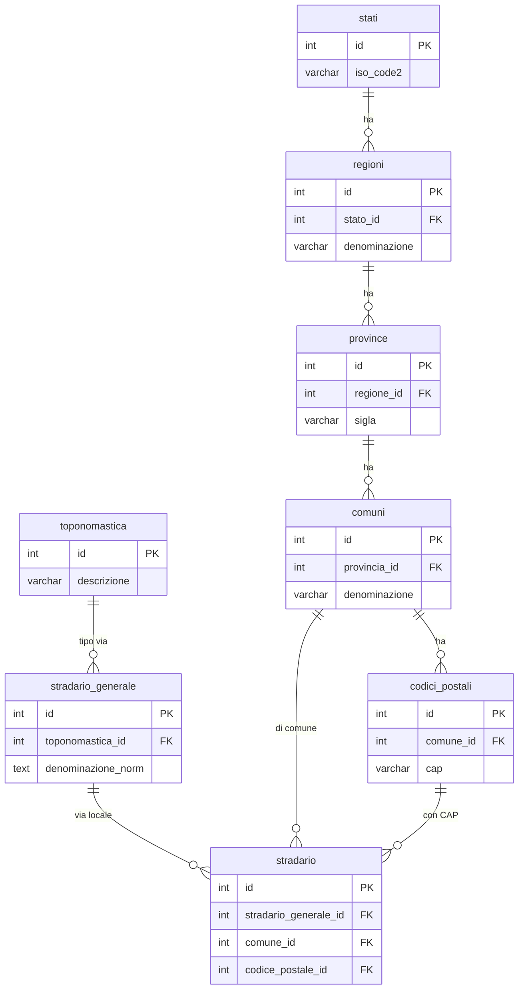
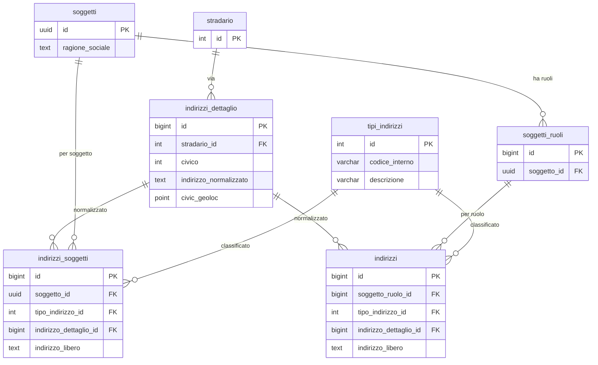
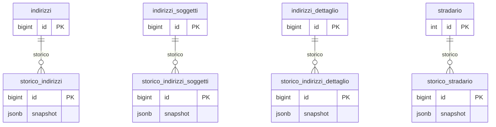

# Guida — Gestione degli Indirizzi

> **Ultimo aggiornamento**: 24 novembre 2026
>
> **Destinatari**: sviluppatori database, backend, integratori e analisti funzionali
>
> **Vedi anche** — schemi DB:
>
> * [anagrafiche.indirizzi](/dbzero/anagrafiche/tabelle/indirizzi) — indirizzi per ruolo (layer operativo)
> * [anagrafiche.indirizzi_soggetti](/dbzero/anagrafiche/tabelle/indirizzi_soggetti) — indirizzi per soggetto (layer identitario)
> * [anagrafiche.indirizzi_dettaglio](/dbzero/anagrafiche/tabelle/indirizzi_dettaglio) — il civico normalizzato
> * [config.stradario](/dbzero/config/tabelle/stradario) — lo stradario locale (via + comune + CAP)
> * [config.stradario_generale](/dbzero/config/tabelle/stradario_generale) — anagrafica delle vie (toponimo + nome)
> * [config.toponomastica](/dbzero/config/tabelle/toponomastica) — tipologie di toponimo (Via, Piazza, Corso...)
> * [config.stati](/dbzero/config/tabelle/stati), [config.regioni](/dbzero/config/tabelle/regioni), [config.province](/dbzero/config/tabelle/province), [config.comuni](/dbzero/config/tabelle/comuni) — gerarchia geografica
> * [config.codici_postali](/dbzero/config/tabelle/codici_postali) — CAP per comune
> * [config.tipi_indirizzi](/dbzero/config/tabelle/tipi_indirizzi) — classificazione degli indirizzi (RES, SEDELEG, FATT...)
> * [storico.indirizzi](/dbzero/storico/tabelle/indirizzi), [storico.indirizzi_soggetti](/dbzero/storico/tabelle/indirizzi_soggetti), [storico.indirizzi_dettaglio](/dbzero/storico/tabelle/indirizzi_dettaglio), [storico.stradario](/dbzero/storico/tabelle/stradario) — le versioni storiche
>
> **Vedi anche** — funzioni e trigger DB:
>
> * [script.fn_get_indirizzo](/dbzero/script/funzioni/fn_get_indirizzo) — la risoluzione master/fallback: ruolo → soggetto
> * [anagrafiche.trgfn_indirizzi_dettaglio_normalize](/dbzero/anagrafiche/funzioni/trgfn_indirizzi_dettaglio_normalize) — i campi normalizzati del civico
> * [anagrafiche.fn_build_indirizzo_normalizzato](/dbzero/anagrafiche/funzioni/fn_build_indirizzo_normalizzato) — la regola di normalizzazione del civico, in un posto solo
> * [anagrafiche.trgfn_indirizzi_base_normalize](/dbzero/anagrafiche/funzioni/trgfn_indirizzi_base_normalize) — normalizzazione e default sui due layer
> * [anagrafiche.trgfn_indirizzi_guard_tipo_ruolo_tipi_indirizzo](/dbzero/anagrafiche/funzioni/trgfn_indirizzi_guard_tipo_ruolo_tipi_indirizzo) — la matrice tipo/ruolo (R5)
> * [anagrafiche.trgfn_indirizzi_soggetti_guard_tipo_indirizzo](/dbzero/anagrafiche/funzioni/trgfn_indirizzi_soggetti_guard_tipo_indirizzo) — la matrice tipo/soggetto (R6)
> * [anagrafiche.trgfn_indirizzi_guard_forma_libera](/dbzero/anagrafiche/funzioni/trgfn_indirizzi_guard_forma_libera) — le due forme dell'indirizzo libero (R3)
> * [anagrafiche.fn_crea_indirizzo_soggetto](/dbzero/anagrafiche/funzioni/fn_crea_indirizzo_soggetto) e [anagrafiche.fn_crea_indirizzi_ruolo](/dbzero/anagrafiche/funzioni/fn_crea_indirizzi_ruolo) — le madri che scrivono gli indirizzi, sui due layer
> * [anagrafiche.fn_tipo_indirizzo_obbligatorio_per_natura](/dbzero/anagrafiche/funzioni/fn_tipo_indirizzo_obbligatorio_per_natura) — quali tipi la natura chiede (R9)
> * [anagrafiche.fn_create_indirizzo](/dbzero/anagrafiche/funzioni/fn_create_indirizzo) — la via e il civico, trovati o creati, con la via nuova validata (R3)
> * [script.fn_stato_proposto_id](/dbzero/script/funzioni/fn_stato_proposto_id) — lo stato proposto quando chi scrive non lo dice (R8)
> * [maintenance.proc_bump_indirizzi_dettaglio](/dbzero/maintenance/funzioni/proc_bump_indirizzi_dettaglio) — rinormalizza i civici di una via, senza spostarli
> * [dbops.fn_admin_merge_stradario](/dbzero/dbops/funzioni/fn_admin_merge_stradario) — fonde due vie e sposta i civici sulla via che resta (R4)
>
> **Vedi anche** — guide correlate:
>
> * [Soggetti & Ruoli](/guide/soggetti-e-ruoli-anagrafici)
> * [Gestione dei contatti](/guide/gestione-dei-contatti)
> * [Generazione di un cliente](/guide/generazione-cliente)

---

## Introduzione

In Zero ERP un **indirizzo** non è un semplice campo di testo: è un dato strutturato che collega una persona (o un'azienda) a un luogo fisico preciso, con geolocalizzazione, gerarchia geografica completa e storico delle modifiche.

Il problema che il modulo risolve è duplice. Da un lato serve **normalizzare** gli indirizzi — evitare che "Via Roma 1" e "V. Roma, 1" diventino due record diversi. Dall'altro serve distinguere tra indirizzi che appartengono alla **persona** (residenza, domicilio fiscale — dati identitari che non cambiano al cambiare del ruolo) e indirizzi che appartengono a un **ruolo** (sede operativa del cliente, indirizzo di spedizione del fornitore — dati operativi legati a cio che la persona fa nel sistema).

Questa distinzione — **indirizzo per soggetto** e **indirizzo per ruolo** — è il cuore architetturale del modulo. Le due tabelle condividono la stessa struttura e lo stesso livello di normalizzazione, ma rispondono a domande diverse:

* **Indirizzo per soggetto:** dove abita questa persona? Qual è la sede legale di questa azienda?
* **Indirizzo per ruolo:** dove spediamo la merce a questo cliente? Qual è la sede operativa di questo fornitore?

Il sistema sa come mettere insieme i due livelli: quando un processo ha bisogno di un indirizzo (fatturazione, spedizione, comunicazione), cerca prima nel layer **ruolo** (master) e, se non trova il tipo richiesto, cade sul layer **soggetto** (fallback).

**Cosa troverai in questa guida:**

* Le entità coinvolte e il loro significato nel modello
* Come funziona la normalizzazione e perché è importante
* La distinzione ruolo/soggetto e la policy di risoluzione master/fallback
* Le regole di dominio numerate (vincoli, guard, matrici)
* Il ciclo di vita degli indirizzi con scenari concreti
* Trigger e funzioni coinvolte
* I diagrammi ER del modulo

---

## Le entità e il loro significato

### Indirizzo dettaglio (il civico)

E il livello più basso: il singolo numero civico su una via. La tabella `anagrafiche.indirizzi_dettaglio` contiene il riferimento allo stradario, il civico, l'eventuale estensione (A, B...), la palazzina, la scala, il piano, l'interno e la geolocalizzazione puntuale.

Il campo `indirizzo_normalizzato` viene calcolato automaticamente dal trigger di normalizzazione e produce una stringa leggibile tipo `VIA ROMA, 1/B, Pal.A, Int.3`: la via in maiuscolo, il civico con la sua estensione (`SNC` se manca), poi palazzina, scala, piano e interno quando ci sono. La regola sta in [`fn_build_indirizzo_normalizzato`](/dbzero/anagrafiche/funzioni/fn_build_indirizzo_normalizzato). Questo è il dato che appare nelle viste e nei documenti.

Ogni indirizzo fisico è **una riga sola**, condivisa da tutti i soggetti, i punti di fornitura e i magazzini che lo usano: non possono esistere due righe con la stessa combinazione (stradario, civico, estensione, palazzina, scala, piano, interno), nemmeno quando il civico manca ([R7](#r7-unicita-del-civico)).

### Indirizzo per ruolo (`anagrafiche.indirizzi`)

E l'indirizzo **operativo**, legato a un ruolo del soggetto (`soggetto_ruolo_id`). Esempi: l'indirizzo di spedizione di un cliente, la sede operativa di un fornitore, l'indirizzo di fatturazione.

La colonna `istanza_utility_id` (nullable, `bigint`, FK verso `anagrafiche.istanze_utilities`) consente
di differenziare indirizzi per **istanza di servizio**: ad esempio il cliente Titini può avere un
indirizzo di fatturazione per il contratto GAS di Corridonia è uno diverso per il contratto GAS di
Civitanova (stessa utility, istanze diverse). Con `istanza_utility_id = NULL` l'indirizzo è generico
del ruolo e fa da fallback per tutte le istanze che non hanno un override specifico.

I tipi di indirizzo ammessi dipendono dal tipo di ruolo e dalla natura del soggetto: la matrice `config.tipi_ruolo_tipi_indirizzo` definisce quali tipi sono consentiti per ciascun tipo di ruolo, e un tipo che la natura del soggetto non ammette non si scrive nemmeno sul ruolo ([R5](#r5-validazione-tipo-indirizzo-per-ruolo)). Un privato fornitore, per esempio, non ha una sede legale né sul soggetto né sul ruolo.

Vincolo di unicità: un solo indirizzo per combinazione `(soggetto_ruolo_id, istanza_utility_id, tipo_indirizzo_id)`,
gestito con due partial unique index per il trattamento NULL di PostgreSQL ([R2](#r2-unicita-per-tipo)).

### Indirizzo per soggetto (`anagrafiche.indirizzi_soggetti`)

E l'indirizzo **identitario**, legato direttamente al soggetto (`soggetto_id`). Esempi: la residenza di una persona fisica, la sede legale di un'azienda, il domicilio fiscale.

Questi indirizzi sono indipendenti dai ruoli: se una persona è sia cliente che fornitore, la sua residenza esiste una sola volta a livello soggetto.

I tipi ammessi dipendono dalla natura del soggetto (persona fisica, persona giuridica...): la matrice `config.tipi_soggetto_dettaglio_tipi_indirizzo` definisce le regole ([R6](#r6-validazione-tipo-indirizzo-per-soggetto)).

Vincolo di unicità: un solo indirizzo per tipo per soggetto (`UNIQUE (soggetto_id, tipo_indirizzo_id)` — [R2](#r2-unicita-per-tipo)).

### Modalità normalizzata vs libera

Entrambe le tabelle indirizzo (ruolo e soggetto) supportano due modalità:

* **Normalizzata** (preferita): il campo `indirizzo_dettaglio_id` punta a un civico in `indirizzi_dettaglio`. Si ottiene geolocalizzazione, gerarchia completa e deduplicazione.
* **Libera** (eccezione): il campo `indirizzo_libero` contiene la via scritta a mano, con lo stato e, secondo lo stato, il comune e il CAP scelti dall'elenco oppure la località e il codice postale (`postal_code`). Serve per gli indirizzi esteri, per le vie che lo stradario non ha ancora e per le importazioni da altri sistemi. Le due forme sono in [R3](#r3-completezza-indirizzo-libero).

Le due modalità sono **mutualmente esclusive**: un indirizzo è normalizzato oppure libero, mai entrambi ([R1](#r1-xor-normalizzatolibero)).

### Tipi indirizzo

La tabella `config.tipi_indirizzi` cataloga le tipologie: RES (residenza), SEDELEG (sede legale), SEDEOP (sede operativa), FATT (fatturazione), DOMFISC (domicilio fiscale), CORR (corrispondenza), e altre.

Ogni tipo può essere associato a un layer (soggetto) o all'altro (ruolo) o a entrambi, secondo le matrici di configurazione.

### Gerarchia geografica

Lo stradario si appoggia a una catena di configurazione completa:

```text
config.toponomastica → config.stradario_generale → config.stradario
                                                         ↓
                                                   config.comuni
                                                         ↓
                                                   config.province
                                                         ↓
                                                   config.regioni
                                                         ↓
                                                   config.stati
```

Dallo `stradario_id` di un civico si risale all'intera gerarchia senza duplicare dati.

### Viste resolved

Le viste resolved centralizzano la composizione dell'indirizzo leggibile (human-readable) con tutti i campi territoriali:

* [anagrafiche.vw_indirizzi_resolved_base](/dbzero/anagrafiche/views/vw_indirizzi_resolved_base) — unifica RUOLO e SOGGETTO con gerarchia geografica completa
* [anagrafiche.vw_indirizzi_resolved_ruolo](/dbzero/anagrafiche/views/vw_indirizzi_resolved_ruolo) — solo layer RUOLO
* [anagrafiche.vw_indirizzi_resolved_soggetto](/dbzero/anagrafiche/views/vw_indirizzi_resolved_soggetto) — solo layer SOGGETTO
* [anagrafiche.vw_indirizzi_resolved_all](/dbzero/anagrafiche/views/vw_indirizzi_resolved_all) — unione completa di entrambi i layer
* [anagrafiche.vw_indirizzi_dettaglio](/dbzero/anagrafiche/views/vw_indirizzi_dettaglio) — dettaglio civico con descrizione comune

Le viste espongono anche la **provenienza** (`source`: `RUOLO` / `SOGGETTO`) come campo derivato, utile per audit e debug.

---

## Policy di risoluzione (master/fallback)

Quando un processo ha bisogno di un indirizzo — per fatturare, per spedire, per comunicare — il sistema non chiede al chiamante di sapere se l'indirizzo sta a livello istanza, ruolo o soggetto. La risoluzione avviene automaticamente con una **cascata a 3 livelli**:

1. **Istanza** — cerco nel layer **ruolo** il tipo richiesto con l'istanza specifica (`istanza_utility_id = X`). Se il tipo esatto non esiste, la matrice `config.tipi_ruolo_tipi_indirizzo` definisce una catena di fallback tra tipi.
2. **Ruolo generico** — se il livello istanza non risolve, cerco nello stesso layer ruolo con `istanza_utility_id IS NULL` (indirizzo generico, valido per tutte le istanze).
3. **Soggetto** — se il layer ruolo non risolve, cerco nel layer **soggetto** (`anagrafiche.indirizzi_soggetti`) con la stessa logica di fallback tra tipi.

| Priorità | istanza_utility_id | soggetto_ruolo_id | Significato                 | Editabile     |
| -------- | ------------------ | ----------------- | --------------------------- | ------------- |
| 1        | valorizzato        | valorizzato       | Indirizzo specifico istanza | Si            |
| 2        | NULL               | valorizzato       | Indirizzo generico ruolo    | Si            |
| 3        | —                  | —                 | Indirizzo soggetto          | No (readonly) |

La funzione [`script.fn_get_indirizzo(p_soggetto_ruolo_id, p_tipo_codice, p_istanza_utility_id DEFAULT NULL)`](/dbzero/script/funzioni/fn_get_indirizzo) implementa questa catena e restituisce una riga ricca: indirizzo completo, `istanza_utility_id`, geolocalizzazione, gerarchia geografica (le colonne sono nella scheda). Il parametro `p_istanza_utility_id` è opzionale — senza di esso la cascata parte dal livello 2.

Per letture dirette senza fallback:

* [`script.fn_get_indirizzi_by_ruolo(p_soggetto_ruolo_id, p_istanza_utility_id DEFAULT NULL)`](/dbzero/script/funzioni/fn_get_indirizzi_by_ruolo) — solo layer ruolo, con filtro istanza opzionale
* [`script.fn_get_indirizzi_by_soggetto(p_soggetto_id)`](/dbzero/script/funzioni/fn_get_indirizzi_by_soggetto) — solo layer soggetto
* [`script.fn_get_indirizzo_by_soggetto(p_soggetto_id, p_tipo_codice)`](/dbzero/script/funzioni/fn_get_indirizzo_by_soggetto) — layer soggetto con fallback tra tipi

---

## Gli indirizzi congelati sui documenti

Un documento non **legge** l'indirizzo del cliente ogni volta che lo stampa: se
lo **copia addosso** quando nasce, e da quel momento porta la propria fotografia.
Ogni documento del ciclo attivo ha la sua tabella satellite —
`vendite.preventivi_indirizzi`, `ordini_indirizzi`, `ddt_indirizzi`,
`contratti_indirizzi`, `offerte_commerciali_indirizzi`, `fatture_indirizzi` — con
una riga per tipo di indirizzo: lo `snapshot` (JSONB, coi campi già composti per
la stampa) e il riferimento a **da dove è stato preso** (`origine_indirizzo_id` /
`origine_soggetto_ruolo_id`).

**Perché**: un documento emesso deve continuare a dire quello che diceva. Se il
cliente trasloca, le fatture di sei mesi fa non devono cambiare indirizzo alla
prima ristampa.

### Chi risolve e chi copia

| Documento                                        | Come ottiene i suoi indirizzi                                                              |
| ------------------------------------------------ | ------------------------------------------------------------------------------------------ |
| Preventivo, offerta (la **radice** della catena) | **Risolve dall'anagrafica** con la cascata qui sopra                                       |
| Ordine, DDT, contratto (documenti **derivati**)  | **Copiano 1:1** lo snapshot del documento padre, filtrato sui tipi ammessi nel loro ambito |
| **Fattura**                                      | **Risolve dall'anagrafica**, come la radice                                                |

La fattura è l'unica eccezione, e non è una svista: **aggrega N sorgenti**, e una
parte di ciò che fattura non ha alcun documento padre da cui copiare (oneri di
commessa, consumi, rettifiche). Risolvere dall'anagrafica è l'unica regola che
copre tutti i casi. La conseguenza va conosciuta: se l'anagrafica è cambiata dopo
il DDT, la fattura può stampare un indirizzo **diverso** da quello del DDT che
sta fatturando. È voluto — vince il dato corrente al momento in cui la fattura
nasce — non un difetto.

### La fattura risolve **per istanza**

Un soggetto-ruolo può avere legittimamente più indirizzi dello stesso tipo: uno
per istanza utility, più uno generico (§Policy di risoluzione). Perciò la
risoluzione della fattura parte dall'**istanza del billing account** e scende sul
generico solo se lì non trova nulla. Cercare per solo ruolo darebbe fino a N
righe, cioè un risultato non deterministico — ed è il motivo per cui i tipi
legati al punto di fornitura si trovano solo passando dall'istanza.

Due dettagli che sembrano anomalie e non lo sono:

* **Solo `FATT` è obbligatorio** nell'ambito `FATTURE`. Gli altri tipi previsti
  (`CON`, `FORNITURA`, `RES`) se mancano non generano né riga né errore.
* **Quando il billing account ha un padre, la fattura è del padre**, quindi porta
  gli indirizzi del padre. Su un BA padre l'indirizzo di fornitura quasi non
  esiste mai, perché la sua istanza è di servizio e non descrive un punto di
  fornitura reale: è il caso normale.

### Dopo il pre-fiscale non si tocca più

Finché la fattura è in bozza o emessa i suoi satelliti si possono riscrivere — è
quello che fa il ri-lancio dello step, e infatti correggere l'anagrafica e
rifare il giro è il modo previsto di sistemare un indirizzo sbagliato. Superata
quella soglia un trigger di congelamento li blocca in scrittura **e** in
cancellazione: da lì in avanti sono la storia del documento.

⚠️ **Un indirizzo congelato da un documento non è più cancellabile.** Il
riferimento `origine_indirizzo_id` è una chiave esterna: finché un documento la
punta, la riga di `anagrafiche.indirizzi` non si cancella. Non è un problema da
aggirare — è la garanzia che la provenienza resti ricostruibile — ma va saputo
prima di provare a fare pulizia in anagrafica.

---

## Azioni UI per contesto e livello

Il drawer `IndirizziSoggettoDrawer` viene riusato in context **soggetto** e **ruolo**.
Le azioni disponibili su ogni indirizzo dipendono dal contesto di apertura e dal livello
(`fonte`) dell'indirizzo nella cascata.

### Context soggetto

Aperto da: lista soggetti, SoggettoDrawer (edit mode).

| Fonte                   | Pennino (cambia) | Cestino (elimina) | Note                                                                                                                                                                                       |
| ----------------------- | :--------------: | :---------------: | ------------------------------------------------------------------------------------------------------------------------------------------------------------------------------------------ |
| *(tutti gli indirizzi)* |        Si        |        No         | L'azione "cambia" è un replace (delete + create). Il delete diretto non è esposto perché un indirizzo soggetto è ereditato da tutti i ruoli — rimuoverlo potrebbe avere impatto a cascata. |

### Context ruolo

Aperto da: ClienteDrawer (edit mode), FornitoreDrawer, lista clienti/fornitori, SoggettoPreviewBadges.

| Fonte      | Pennino (cambia) | Cestino (elimina) | Note                                                                                      |
| ---------- | :--------------: | :---------------: | ----------------------------------------------------------------------------------------- |
| `soggetto` |        No        |        No         | Indirizzo ereditato, readonly. Per modificarlo l'utente deve accedere al drawer soggetto. |
| `ruolo`    |        Si        |        Si         | Indirizzo generico del ruolo (istanza_utility_id = NULL). Override del livello soggetto.  |
| `istanza`  |        Si        |        Si         | Indirizzo specifico dell'istanza. Override del livello ruolo.                             |

### Matrice tipi indirizzo ammessi

In context soggetto i tipi ammessi vengono dalla matrice `config.tipi_soggetto_dettaglio_tipi_indirizzo`
(filtrata per tipo soggetto dettaglio: PF, PG, ENTE).

In context ruolo i tipi ammessi vengono dalla matrice `config.tipi_ruolo_tipi_indirizzo`
(filtrata per tipo ruolo: CLIENTE, FORNITORE, ecc.) e dalla matrice della natura del
soggetto del ruolo. Il trigger guard `trgfn_indirizzi_guard_tipo_ruolo_tipi_indirizzo`
valida al salvataggio, con tutte e due.

I tipi già creati per l'istanza corrente sono disabilitati nella barra tab del form
(icona lucchetto, non selezionabili) per evitare errori di duplicazione.

### Ordinamento lista

* **Context soggetto:** alfabetico per tipo indirizzo descrizione.
* **Context ruolo:** prima per fonte (soggetto → ruolo → istanza), poi alfabetico per tipo indirizzo.

La funzione `sortByFonte()` (`core/utils/string.js`) gestisce l'ordinamento per tutti e tre
i drawer (indirizzi, contatti, conti bancari).

---

## Regole di dominio

### R1 — XOR normalizzato/libero

Un indirizzo e **normalizzato** oppure **libero**, mai entrambi. I check constraint `chk_indirizzi_xor_norm_libero` e `chk_indirizzi_soggetti_xor_norm_libero` lo garantiscono su entrambe le tabelle.

### R2 — Unicità per tipo

Un solo indirizzo per tipo per entità:

* Layer ruolo: `UNIQUE (soggetto_ruolo_id, istanza_utility_id, tipo_indirizzo_id)` — implementato con due partial unique index per gestire NULL (`uq_indirizzi_ruolo_tipo_no_istanza` per `istanza_utility_id IS NULL`, `uq_indirizzi_ruolo_istanza_tipo` per `istanza_utility_id IS NOT NULL`)
* Layer soggetto: `UNIQUE (soggetto_id, tipo_indirizzo_id)`

Un indirizzo si può anche **copiare** in altri tipi: «la sede legale è anche spedizione e fatturazione». Più tipi in un gesto e tutto o niente: ogni riga nuova passa dalle stesse regole di un indirizzo scritto a mano. Un indirizzo con il dettaglio condivide il dettaglio; uno libero copia i suoi campi. La copia va **dove lavora l'operatore**, cioè sulla chiave aperta:

* sul **soggetto**, la copia resta sul soggetto ([`fn_copia_indirizzo_soggetto`](/dbzero/anagrafiche/funzioni/fn_copia_indirizzo_soggetto)). L'azione si spegne, col motivo, quando non resta un tipo in cui copiarlo ([`vw_indirizzi_soggetti_azioni`](/dbzero/anagrafiche/views/vw_indirizzi_soggetti_azioni));
* sul **ruolo** o su una sua **istanza**, la copia va su quella chiave, qualunque sia la chiave da cui viene la riga: un'altra istanza, il ruolo, o il soggetto del ruolo che la cascata mostra ([`fn_copia_indirizzo_ruolo`](/dbzero/anagrafiche/funzioni/fn_copia_indirizzo_ruolo), [`fn_copia_indirizzo_soggetto_su_ruolo`](/dbzero/anagrafiche/funzioni/fn_copia_indirizzo_soggetto_su_ruolo)). Un tipo già presente si giudica sulla chiave di destinazione, non su quella della riga copiata. Quali tipi si possono ancora aggiungere lo dice il picker di quella chiave ([`fn_tipi_indirizzo_proponibili_ruolo`](/dbzero/anagrafiche/funzioni/fn_tipi_indirizzo_proponibili_ruolo)): quando non ne resta nessuno, «Aggiungi» e «Copia come…» si spengono insieme. L'istanza deve essere del soggetto del ruolo, come per ogni indirizzo del ruolo.

Chi scrive un indirizzo dalle madri ([`fn_crea_indirizzo_soggetto`](/dbzero/anagrafiche/funzioni/fn_crea_indirizzo_soggetto), [`fn_crea_indirizzo_ruolo`](/dbzero/anagrafiche/funzioni/fn_crea_indirizzo_ruolo)) riceve il rifiuto con un codice e il tipo: `E_INDIRIZZO_SOGGETTO_TIPO_GIA_PRESENTE` o `E_INDIRIZZO_RUOLO_TIPO_GIA_PRESENTE`, sul campo del tipo. Lo dice la check del tipo ([`fn_check_tipo_indirizzo_soggetto`](/dbzero/anagrafiche/funzioni/fn_check_tipo_indirizzo_soggetto), [`fn_check_tipo_indirizzo_ruolo`](/dbzero/anagrafiche/funzioni/fn_check_tipo_indirizzo_ruolo)) prima di scrivere; gli indici restano per due scritture concorrenti.

### R3 — Completezza indirizzo libero

Se `indirizzo_dettaglio_id` è NULL (modalità libera), servono sempre la via (`indirizzo_libero`) e lo stato (`stato_id`; se non lo si dice, lo propone il sistema, [R8](#r8-normalizzazione-automatica)). Il resto dipende dallo **stato**, cioè da una sua proprietà: il catalogo dei suoi comuni è completo oppure no (`config.stati.catalogo_comuni_completo`). Oggi è completo per l'Italia.

| Forma | Quando | Cosa serve | Cosa resta vuoto |
| --- | --- | --- | --- |
| **del catalogo** | lo stato ha il catalogo completo | il comune e il CAP scelti dall'elenco (`comune_id`, `codice_postale_id`), coerenti fra loro e con lo stato | località, codice postale libero, regione: li dice già l'elenco. La sotto-località (frazione, quartiere) si può scrivere |
| **estera** | lo stato non ha il catalogo completo | la località (`locality`) | comune e CAP dell'elenco. Il codice postale (`postal_code`), la regione e la sotto-località sono **facoltativi**: ci sono paesi senza codice postale |

Uno stato con il catalogo **ancora incompleto** (per esempio durante la conversione dei dati di un'azienda) accetta anche la forma del catalogo, se chi scrive sceglie un comune o un CAP. Il catalogo si accende quando è completo: le righe già scritte nella forma estera restano valide finché qualcuno non tocca il loro indirizzo; a quel punto vale la forma del catalogo.

Il rifiuto lo dà il guard [`trgfn_indirizzi_guard_forma_libera`](/dbzero/anagrafiche/funzioni/trgfn_indirizzi_guard_forma_libera), con un codice e il nome del campo da correggere: `E_INDIRIZZO_LIBERO_INCOMPLETO` (manca un campo), `E_INDIRIZZO_CAMPO_ALTRA_FORMA` (un campo dell'altra forma è compilato), `E_INDIRIZZO_COMUNE_ALTRO_STATO` (il comune non è dello stato), `E_INDIRIZZO_CAP_ALTRO_COMUNE` (il CAP non è del comune). I check constraint `chk_indirizzi_free_requirements` e `chk_indirizzi_soggetti_free_requirements` restano come rete per le scritture che non passano dai trigger.

La forma la decide il database da ciò che arriva: un indirizzo senza civico e senza una via (né `stradario_id`, né toponimo e nome di una via nuova) è libero, anche se il testo è vuoto, e il rifiuto è quello della forma libera, sul campo che manca. Una via nuova a cui manca il toponimo, il nome, il comune o il CAP si rifiuta col suo codice, `E_INDIRIZZO_VIA_NUOVA_INCOMPLETA`, e col campo ([`fn_create_indirizzo`](/dbzero/anagrafiche/funzioni/fn_create_indirizzo)). Una via che esiste già si ritrova, senza riscriverla.

⚠️ Il form legge la stessa proprietà dello stato per scegliere quale variante mostrare: la regola sta in un posto solo.

### R4 — Protezione stradario_id

Il campo `stradario_id` su `indirizzi_dettaglio` non può essere modificato manualmente. Il guard `trgfn_indirizzi_dettaglio_protect_update` blocca l'operazione con errore `E_COLONNA_NON_MODIFICABILE`, salvo che la scrittura passi dalla porta di manutenzione: il flag `zeroerp.maintenance_indirizzi_dettaglio` acceso **e** chi scrive proprietario della tabella. Il flag da solo non apre, perché l'applicazione lo potrebbe accendere. La porta la apre solo [`dbops.fn_admin_merge_stradario`](/dbzero/dbops/funzioni/fn_admin_merge_stradario), lo strumento DBA che fonde due vie, lanciato come `zeroerp_owner` e solo attorno allo spostamento dei civici. L'applicazione non lo può eseguire (vedi [Riclassificazione vie](/guide/riclassificazione-vie)).

### R5 — Validazione tipo indirizzo per ruolo

Il trigger `trgfn_indirizzi_guard_tipo_ruolo_tipi_indirizzo` verifica che il `tipo_indirizzo_id` sia ammesso per il tipo di ruolo del soggetto, consultando la matrice `config.tipi_ruolo_tipi_indirizzo`. La regola sta in [`fn_tipo_indirizzo_ammesso_per_ruolo`](/dbzero/anagrafiche/funzioni/fn_tipo_indirizzo_ammesso_per_ruolo), che leggono anche la check del tipo e la copia degli indirizzi obbligatori.

Regola: se la matrice non ha righe per quel tipo di ruolo, tutti i tipi sono ammessi (adozione progressiva). Se ha almeno una riga, sono ammessi solo quelli elencati come attivi e in periodo di validità.

Lo stesso trigger guarda poi la **natura del soggetto** del ruolo, con la regola di [R6](#r6-validazione-tipo-indirizzo-per-soggetto) e lo stesso codice (`E_TIPO_INDIRIZZO_TIPO_SOGGETTO_NON_PERMESSO`): un indirizzo che il soggetto non potrebbe avere non lo può avere nemmeno un suo ruolo. Gli indirizzi **obbligatori** di un ruolo dipendono anche dalla natura del soggetto: la regola è in [R9](#r9-gli-indirizzi-obbligatori). Il cliente e il fornitore chiedono sul ruolo la sola fatturazione: l'indirizzo fiscale (sede legale per una società, domicilio fiscale per una persona fisica) è un dato del soggetto, dove la natura lo rende obbligatorio, e un documento lo trova con la [cascata](#policy-di-risoluzione-masterfallback).

Quando un soggetto cambia natura, un indirizzo di un suo ruolo che la natura nuova non ammette ferma il cambio, come un indirizzo del soggetto: l'operatore lo elimina e riprova ([`fn_check_cambio_natura_soggetto`](/dbzero/anagrafiche/funzioni/fn_check_cambio_natura_soggetto)).

### R6 — Validazione tipo indirizzo per soggetto

Il trigger `trgfn_indirizzi_soggetti_guard_tipo_indirizzo` verifica che il `tipo_indirizzo_id` sia ammesso per il tipo di soggetto dettaglio, consultando la matrice `config.tipi_soggetto_dettaglio_tipi_indirizzo`.

Stessa logica di R5: senza righe nella matrice, nessuna restrizione; con righe, whitelist attiva.

I tipi che un form propone li dà il database, con la stessa regola che poi giudica il salvataggio: una riga per tipo, ammesso oppure spento col suo motivo (già presente, non previsto). Sul soggetto [`fn_tipi_indirizzo_proponibili_soggetto`](/dbzero/anagrafiche/funzioni/fn_tipi_indirizzo_proponibili_soggetto) e, in creazione, [`fn_tipi_indirizzo_proponibili_natura`](/dbzero/anagrafiche/funzioni/fn_tipi_indirizzo_proponibili_natura); sul ruolo [`fn_tipi_indirizzo_proponibili_ruolo`](/dbzero/anagrafiche/funzioni/fn_tipi_indirizzo_proponibili_ruolo) e, all'assegnazione, [`fn_tipi_indirizzo_proponibili_tipo_ruolo`](/dbzero/anagrafiche/funzioni/fn_tipi_indirizzo_proponibili_tipo_ruolo).

### R7 — Unicità del civico

L'indice `uq_indirizzi_dettaglio_norm_v2` su `indirizzi_dettaglio` garantisce che non esistano duplicati dello stesso civico: la combinazione (`stradario_id`, `civico`, `estensione_civico`, `palazzina`, `scala`, `piano`, `interno`) deve essere unica. L'indice è `NULLS NOT DISTINCT`: un campo vuoto è un valore della chiave, quindi due indirizzi senza numero civico (SNC) con lo stesso dettaglio sono lo stesso indirizzo ([linee guida SQL §8.4-bis](/linee-guida-sql#84-bis-indici-unique-con-colonne-nullable)).

La chiave si confronta sui valori **come li salva** la normalizzazione ([R8](#r8-normalizzazione-automatica)): `a` e `A`, un interno con o senza spazi, un'estensione con o senza `/` sono la stessa cosa.

* **Senza numero civico** si dice lasciando vuoto il civico: è l'unico modo. Un civico `0` o negativo è rifiutato.
* **Estensione, palazzina, scala, piano e interno** devono contenere almeno una lettera o una cifra: un valore fatto solo di segni (`/`, `-`, `.`) è rifiutato. `-1` (piano interrato) o `BIS` vanno bene.
* **Il «trova o crea»** ([`fn_get_or_create_indirizzo_dettaglio`](/dbzero/anagrafiche/funzioni/fn_get_or_create_indirizzo_dettaglio)) restituisce sempre un id: l'indirizzo esistente oppure quello appena creato. Se l'indirizzo esisteva ma era disattivato, lo riattiva. Se la via scelta non è completa nell'elenco delle vie (per esempio un comune senza provincia), si ferma con un errore che lo dice. Lo stesso errore arriva da ogni strada che scrive un civico, non solo da questa: lo dà il guard della chiave.
* **Modificare** un indirizzo esistente vuol dire correggerlo **per tutti** quelli che lo usano. Se dopo la modifica coincide con un altro indirizzo che c'è già, la modifica è rifiutata e l'errore nomina quello esistente.

Le regole le applica il guard [`trgfn_indirizzi_dettaglio_guard_chiave`](/dbzero/anagrafiche/funzioni/trgfn_indirizzi_dettaglio_guard_chiave), con un codice e il campo da correggere; i vincoli `CHECK` della tabella e l'indice restano come rete.

### R8 — Normalizzazione automatica

I trigger di normalizzazione (`trgfn_indirizzi_dettaglio_normalize` e `trgfn_indirizzi_base_normalize`) calcolano automaticamente i campi derivati:

* `via_norm`, `civico_norm`: forme normalizzate per confronti e deduplicazione (`civico_norm` vale `SNC` quando il civico è vuoto)
* Sul civico, le colonne del dettaglio vanno in maiuscolo senza spazi ai lati, un testo vuoto diventa NULL e l'estensione prende il prefisso `/` (`A` → `/A`)
* `indirizzo_normalizzato`: stringa leggibile completa
* In modalità normalizzata, i campi fallback (comune, stato...) e la posizione vengono azzerati: li dice il civico, e la riga non ne tiene una copia
* In modalità libera, i testi vuoti diventano NULL (una località di soli spazi non è una località) e lo `stato_id` non detto diventa lo **stato proposto**: il parametro `STATO_PROPOSTO_ISO2`, letto da [`script.fn_stato_proposto_id`](/dbzero/script/funzioni/fn_stato_proposto_id). È una proposta (si può cambiare per utente, per gruppo, per azienda attiva o per sessione); se manca, o indica più di uno stato, il sistema si ferma invece di indovinare

---

### R9 — Gli indirizzi obbligatori

La matrice di un tipo di ruolo (`config.tipi_ruolo_tipi_indirizzo`) e quella di una natura
(`config.tipi_soggetto_dettaglio_tipi_indirizzo`) dicono quali tipi sono **obbligatori**, ognuno con un eventuale
**ripiego**: un altro tipo che lo sostituisce. Un ruolo o un soggetto deve avere, per ogni riga obbligatoria
attiva e valida oggi, un indirizzo del tipo o del ripiego.

Sul **ruolo** conta anche la natura del soggetto, perché un ruolo non può avere un tipo che il suo soggetto non
potrebbe avere ([R5](#r5-validazione-tipo-indirizzo-per-ruolo)):

| La natura del soggetto… | Il ruolo deve avere |
| --- | --- |
| ammette il tipo della riga | il tipo, oppure il suo ripiego (se il ruolo e la natura lo ammettono) |
| non ammette il tipo, ammette il ripiego | il ripiego |
| non ammette né il tipo né il ripiego | niente, per quella riga |

Esempio: se il ruolo fornitore chiedesse la sede legale col ripiego del domicilio fiscale, a un fornitore privato
si chiederebbe il domicilio fiscale.

Il requisito del ruolo sta in un posto solo,
[`fn_indirizzi_obbligatori_ruolo`](/dbzero/anagrafiche/funzioni/fn_indirizzi_obbligatori_ruolo), e lo leggono
tutti: la copia degli obbligatori quando il ruolo nasce, la colonna «obbligatorio» dei picker del ruolo
([`fn_tipo_indirizzo_obbligatorio_per_ruolo`](/dbzero/anagrafiche/funzioni/fn_tipo_indirizzo_obbligatorio_per_ruolo))
e il controllo. Ciò che il form propone come obbligatorio è ciò che il salvataggio pretende.

**Quando si controlla.** A fine transazione, ogni volta che il requisito può smettere di essere rispettato:

* quando nasce il ruolo o il soggetto;
* quando si cancella un indirizzo, o se ne cambia il tipo: si giudica il ruolo o il soggetto da cui l'indirizzo è
  uscito, e solo per ciò che quell'indirizzo dava. Se era l'unico del tipo richiesto (o del suo ripiego), il
  rifiuto; se nessuna riga obbligatoria lo chiedeva, passa (il titolare non si cambia,
  [R10](#r10-un-indirizzo-resta-del-suo-titolare); lo stesso controllo vale per la porta di manutenzione, l'unica
  che lo sposta);
* quando cambia la natura del soggetto: si giudicano il soggetto e tutti i suoi ruoli, perché la natura nuova
  può chiedere un tipo che quella di prima non chiedeva.

Sostituire un indirizzo obbligatorio (cancellarlo e scriverne un altro) passa, se le due operazioni stanno nella
stessa transazione; cancellare un ruolo o un soggetto insieme ai suoi indirizzi passa. Cancellare l'unica
fatturazione di un cliente, da sola, no: l'errore dice che cosa manca, per nome
(«Il ruolo Cliente richiede l'indirizzo «Fatturazione» / «Domicilio Fiscale».»).

| Layer | Controllo | Codice |
| --- | --- | --- |
| ruolo | [`fn_guard_indirizzi_obbligatori_ruolo`](/dbzero/anagrafiche/funzioni/fn_guard_indirizzi_obbligatori_ruolo) | `E_INDIRIZZO_OBBLIGATORIO_MANCANTE` |
| soggetto | [`fn_guard_indirizzi_obbligatori_soggetto`](/dbzero/anagrafiche/funzioni/fn_guard_indirizzi_obbligatori_soggetto) | `E_INDIRIZZO_OBBLIGATORIO_MANCANTE_TIPO_SOGGETTO` |

**Il cambio di natura porta con sé gli indirizzi.** Una natura nuova può chiedere un indirizzo che quella di prima
vietava: l'operatore non lo può aggiungere prima del cambio, e il cambio da solo sarebbe rifiutato. Per questo gli
indirizzi che la natura nuova chiede si danno **nello stesso salvataggio** del cambio, e si scrivono dopo la natura.
Quali sono lo dice [`fn_indirizzi_obbligatori_mancanti_soggetto_e_ruoli`](/dbzero/anagrafiche/funzioni/fn_indirizzi_obbligatori_mancanti_soggetto_e_ruoli):
dato il soggetto e la natura proposta, gli indirizzi obbligatori che mancherebbero, prima sul soggetto e poi su ogni
suo ruolo, ognuno col suo ripiego. È la stessa domanda che si fanno i due controlli
([`fn_indirizzi_obbligatori_mancanti_soggetto`](/dbzero/anagrafiche/funzioni/fn_indirizzi_obbligatori_mancanti_soggetto),
[`fn_indirizzi_obbligatori_mancanti_ruolo`](/dbzero/anagrafiche/funzioni/fn_indirizzi_obbligatori_mancanti_ruolo)):
ciò che il form chiede è ciò che il salvataggio pretende. Gli indirizzi che la natura nuova **vieta**, invece, si
tolgono prima del cambio (sono motivi di
[`fn_check_cambio_natura_soggetto`](/dbzero/anagrafiche/funzioni/fn_check_cambio_natura_soggetto)).

Un cambio della matrice non rigiudica i ruoli e i soggetti già scritti, come per i tipi ammessi: la riga nuova
vale per chi nasce dopo e per chi cambia natura. Un titolare a cui la matrice nuova chiede un indirizzo che non ha
resta modificabile, e può perdere gli indirizzi che nessuno chiede; il form vede che cosa gli manca dalla stessa
funzione del cambio di natura,
[`fn_indirizzi_obbligatori_mancanti_soggetto_e_ruoli`](/dbzero/anagrafiche/funzioni/fn_indirizzi_obbligatori_mancanti_soggetto_e_ruoli).

Sul **soggetto** il ripiego vale solo se la natura lo ammette, come sul ruolo. Quali tipi la natura chiede lo dice
una funzione sola,
[`fn_tipo_indirizzo_obbligatorio_per_natura`](/dbzero/anagrafiche/funzioni/fn_tipo_indirizzo_obbligatorio_per_natura),
gemella di quella del ruolo. La copia degli obbligatori, sui due layer, copia solo i tipi che mancano davvero: non
un tipo di cui il titolare, o l'elenco che si sta salvando, ha già il ripiego.

### R10 — Un indirizzo resta del suo titolare

Un indirizzo di ruolo appartiene al ruolo su cui è nato, e un indirizzo del soggetto al suo soggetto: il titolare
non si cambia. I tipi ammessi e gli obbligatori (R5, R6, R9) si giudicano sul titolare; un indirizzo spostato su
un altro sfuggirebbe a quei controlli, e il titolare di partenza perderebbe un indirizzo senza che nessuno lo
verifichi. Un indirizzo creato sul titolare sbagliato **si elimina e si ricrea** su quello giusto: la cancellazione
passa dal controllo degli obbligatori (R9).

Lo impediscono due lucchetti di colonna del
[framework di automazione](/guide/automazione-db), con un codice per livello:
`E_INDIRIZZO_RUOLO_TITOLARE_IMMUTABILE` e `E_INDIRIZZO_SOGGETTO_TITOLARE_IMMUTABILE`. Quando l'indirizzo di ruolo
porta un'istanza di fornitura, a rifiutare lo spostamento verso il ruolo di un altro soggetto è prima il controllo
dell'istanza (`E_ISTANZA_ALTRO_SOGGETTO`).

## Ciclo di vita

### Inserimento di un indirizzo normalizzato

La sequenza tipica per un nuovo indirizzo strutturato:

1. Verificare (o creare) il civico in `anagrafiche.indirizzi_dettaglio` — il vincolo di unicità R7 impedisce duplicati: se il civico esiste già, si usa quello esistente
2. Inserire in `anagrafiche.indirizzi` (layer ruolo) o `anagrafiche.indirizzi_soggetti` (layer soggetto) con `indirizzo_dettaglio_id` valorizzato
3. I trigger si occupano di: validare il tipo (R5/R6), normalizzare i campi (R8), generare `tx_id` e i campi di audit. La posizione la dice il civico: la riga non ne tiene una copia

### Inserimento di un indirizzo libero (importazione)

Per dati non normalizzabili (migrazioni, indirizzi esteri):

1. Scrivere l'indirizzo con la madre del suo layer — [`fn_crea_indirizzo_soggetto`](/dbzero/anagrafiche/funzioni/fn_crea_indirizzo_soggetto) (un indirizzo) o [`fn_crea_indirizzi_ruolo`](/dbzero/anagrafiche/funzioni/fn_crea_indirizzi_ruolo) (un elenco). Le due madri parlano la stessa lingua: un oggetto jsonb col tipo e l'indirizzo, libero, già normalizzato o da via da risolvere
2. Fornire i campi della forma che lo stato richiede (R3)
3. Il trigger di normalizzazione porta a NULL i testi vuoti e propone lo stato; il guard della forma rifiuta, col campo, ciò che manca o non torna

La modalità libera è pensata come **eccezione**: la normalizzazione successiva è sempre auspicabile.

### Cambio residenza

Quando una persona cambia residenza:

1. UPDATE di `anagrafiche.indirizzi_soggetti` per il tipo `RES`, puntando al nuovo `indirizzo_dettaglio_id`
2. Il trigger di storicizzazione salva automaticamente lo snapshot del vecchio indirizzo in `storico.indirizzi_soggetti`
3. Se la persona ha anche un indirizzo di ruolo legato alla vecchia residenza, questo **non cambia automaticamente**: i due layer sono indipendenti. L'aggiornamento del layer ruolo è un'azione esplicita

### Disattivazione di un ruolo

Quando un ruolo viene disattivato (es. un cliente cessa), gli indirizzi del layer ruolo **restano nel database**: non vengono eliminati né disattivati, e restano leggibili com'erano.

Gli indirizzi del layer soggetto non sono toccati: la persona mantiene la sua residenza e i suoi indirizzi identitari indipendentemente dai ruoli.

### Import massivo con normalizzazione successiva

Per carichi massivi:

1. Caricare i dati in modalità libera: l'inserimento non scrive storico
2. Normalizzare in batch: creare i civici in `indirizzi_dettaglio`, poi aggiornare `indirizzo_dettaglio_id` sugli indirizzi
3. Decidere se la normalizzazione va ricordata ([Storicizzazione](#storicizzazione)): di default ogni UPDATE lascia una versione; per non lasciarla le UPDATE passano `storicizza = false`, e il flag va poi riacceso, altrimenti la riga resta senza storico

### Riclassificazione vie

Quando la toponomastica ufficiale cambia, i civici seguono la via in due modi diversi:

* **La via cambia nome, toponimo o comune**: i civici restano sulla stessa via e vanno solo rinormalizzati. Lo fa [`maintenance.proc_bump_indirizzi_dettaglio`](/dbzero/maintenance/funzioni/proc_bump_indirizzi_dettaglio), con un aggiornamento neutro (riscrive lo stesso `stradario_id`) che fa ricalcolare al trigger di normalizzazione `via_norm`, `civico_norm` e `indirizzo_normalizzato`. Non apre la porta di manutenzione, perché `stradario_id` non cambia.
* **Due vie si fondono**: i civici passano sull'altra via. `stradario_id` è protetto (R4), e lo cambia solo [`dbops.fn_admin_merge_stradario`](/dbzero/dbops/funzioni/fn_admin_merge_stradario).

Per la procedura completa: vedi [Riclassificazione vie e toponomastica](/guide/riclassificazione-vie).

---

## Storicizzazione

Ogni modifica e ogni cancellazione di un indirizzo, di un civico o di una via lascia una versione nella sua tabella `storico.*`: lo snapshot JSONB della riga, il tipo di operazione (`1` la versione di partenza, `2` modifica, `3` cancellazione) e il periodo di validità. L'inserimento non scrive storico: la prima modifica registrata salva anche la versione di partenza.

La scrive il trigger generico [`script.trgfn_storico_generic()`](/dbzero/script/funzioni/trgfn_storico_generic), prima di ogni UPDATE e DELETE, su:

* `anagrafiche.indirizzi` → `storico.indirizzi`
* `anagrafiche.indirizzi_dettaglio` → `storico.indirizzi_dettaglio`
* `anagrafiche.indirizzi_soggetti` → `storico.indirizzi_soggetti`
* `config.stradario` → `storico.stradario`

Le quattro tabelle seguono la stessa regola, la **memoria continua**: `storicizza` nasce `true`, e le tabelle sono in `config.storico_set_storicizza`, quindi il trigger non spegne il flag dopo la modifica. La garanzia sta nel database, non in chi scrive: vale per il pannello, per le madri, per i verbi di copia, per la riattivazione di un civico dentro il «trova o crea», per la fusione di due vie e per la rinormalizzazione di una via. Anche la cancellazione lascia la sua versione, perché il trigger guarda il flag **salvato** sulla riga, che resta acceso.

Una scrittura che porta il flag a `false` non lascia traccia, e la riga resta senza storico finché qualcuno non lo riaccende: è il modo di chi scrive di dire «questa no», per esempio in un carico massivo.

⚠️ La rinormalizzazione di una via riscrive tutti i suoi civici con un aggiornamento neutro: ognuno lascia una versione, anche quando il testo normalizzato non cambia.

Le helper di lettura storica:

* [`script.fn_get_snapshot_as_of()`](/dbzero/script/funzioni/fn_get_snapshot_as_of) — restituisce lo snapshot JSONB di un record a una data
* [`script.fn_get_record_id_as_of()`](/dbzero/script/funzioni/fn_get_record_id_as_of) — restituisce l'ID del record valido a una data

---

## Trigger e funzioni coinvolte

### Normalizzazione

| Funzione / Trigger                                                                                        | Su quale tabella                  | Cosa fa                                                                     |
| --------------------------------------------------------------------------------------------------------- | --------------------------------- | --------------------------------------------------------------------------- |
| [`trgfn_indirizzi_dettaglio_normalize`](/dbzero/anagrafiche/funzioni/trgfn_indirizzi_dettaglio_normalize) | `indirizzi_dettaglio`             | Calcola `via_norm`, `civico_norm`, `indirizzo_normalizzato`                 |
| [`trgfn_indirizzi_base_normalize`](/dbzero/anagrafiche/funzioni/trgfn_indirizzi_base_normalize)           | `indirizzi`, `indirizzi_soggetti` | Azzera i campi liberi e la posizione in modalità normalizzata (li dice il civico); in modalità libera porta a NULL i testi vuoti e propone lo stato |

### Guard e vincoli

| Funzione / Trigger                                                                                                                | Su quale tabella                  | Cosa fa                                                      |
| --------------------------------------------------------------------------------------------------------------------------------- | --------------------------------- | ------------------------------------------------------------ |
| [`trgfn_indirizzi_guard_tipo_ruolo_tipi_indirizzo`](/dbzero/anagrafiche/funzioni/trgfn_indirizzi_guard_tipo_ruolo_tipi_indirizzo) | `indirizzi`                       | Valida tipo indirizzo contro matrice ruolo (R5)              |
| [`trgfn_indirizzi_soggetti_guard_tipo_indirizzo`](/dbzero/anagrafiche/funzioni/trgfn_indirizzi_soggetti_guard_tipo_indirizzo)     | `indirizzi_soggetti`              | Valida tipo indirizzo contro matrice soggetto (R6)           |
| [`trgfn_soggetti_ruoli_guard_indirizzi_required`](/dbzero/anagrafiche/funzioni/trgfn_soggetti_ruoli_guard_indirizzi_required) | `soggetti_ruoli` | Il ruolo scritto ha i suoi obbligatori, a fine transazione (R9) |
| [`trgfn_soggetti_guard_indirizzi_required`](/dbzero/anagrafiche/funzioni/trgfn_soggetti_guard_indirizzi_required) | `soggetti` | Il soggetto scritto ha i suoi obbligatori, a fine transazione (R9) |
| [`trgfn_indirizzi_guard_obbligatori_ruolo`](/dbzero/anagrafiche/funzioni/trgfn_indirizzi_guard_obbligatori_ruolo) | `indirizzi` | Cancellato o cambiato un indirizzo, il ruolo di prima ha ancora i suoi obbligatori (R9) |
| [`trgfn_indirizzi_soggetti_guard_obbligatori_soggetto`](/dbzero/anagrafiche/funzioni/trgfn_indirizzi_soggetti_guard_obbligatori_soggetto) | `indirizzi_soggetti` | Cancellato o cambiato un indirizzo, il soggetto di prima ha ancora i suoi obbligatori (R9) |
| [`trgfn_soggetti_guard_obbligatori_ruoli`](/dbzero/anagrafiche/funzioni/trgfn_soggetti_guard_obbligatori_ruoli) | `soggetti` | Cambiata la natura, ogni ruolo del soggetto ha i suoi obbligatori (R9) |
| `script.trgfn_lock_columns` (lucchetto di colonna, dal registro) | `indirizzi`, `indirizzi_soggetti` | Il titolare dell'indirizzo non cambia (R10) |
| [`trgfn_indirizzi_guard_forma_libera`](/dbzero/anagrafiche/funzioni/trgfn_indirizzi_guard_forma_libera)                           | `indirizzi`, `indirizzi_soggetti` | La forma dell'indirizzo libero, decisa dallo stato (R3). Gira dopo la normalizzazione |
| [`trgfn_indirizzi_dettaglio_protect_update`](/dbzero/anagrafiche/funzioni/trgfn_indirizzi_dettaglio_protect_update)               | `indirizzi_dettaglio`             | Blocca modifica manuale di `stradario_id` (R4)               |
| [`trgfn_indirizzi_dettaglio_guard_chiave`](/dbzero/anagrafiche/funzioni/trgfn_indirizzi_dettaglio_guard_chiave)                   | `indirizzi_dettaglio`             | La chiave del civico: civico > 0, dettaglio con lettere o cifre, nessun doppione in modifica (R7). Gira dopo la normalizzazione |
| [`trgfn_guard_istanza_del_ruolo`](/dbzero/anagrafiche/funzioni/trgfn_guard_istanza_del_ruolo)                                     | `indirizzi`                       | L'istanza dell'indirizzo è del soggetto del suo ruolo (`E_ISTANZA_ALTRO_SOGGETTO`) |
| `trgfn_child_requires_active_parent`                                                                                              | `indirizzi`, `indirizzi_soggetti` | Verifica che `indirizzi_dettaglio` e `soggetti` siano attivi |
| [`trgfn_child_requires_non_obsolete_parent`](/dbzero/dbops/funzioni/trgfn_child_requires_non_obsolete_parent)                     | `indirizzi_dettaglio`             | Un civico nuovo, o che cambia via, non si collega a una via soppressa |
| `trgfn_prevent_deactivate_if_children`                                                                                            | `indirizzi_dettaglio`             | Blocca disattivazione se ci sono figli attivi                |

### Lettura e risoluzione

| Funzione                                                                               | Cosa fa                                                            |
| -------------------------------------------------------------------------------------- | ------------------------------------------------------------------ |
| [`fn_get_indirizzo`](/dbzero/script/funzioni/fn_get_indirizzo)                         | Risoluzione master/fallback: ruolo → soggetto, con catena tra tipi |
| [`fn_get_indirizzi_by_ruolo`](/dbzero/script/funzioni/fn_get_indirizzi_by_ruolo)       | Tutti gli indirizzi del layer ruolo                                |
| [`fn_get_indirizzi_by_soggetto`](/dbzero/script/funzioni/fn_get_indirizzi_by_soggetto) | Tutti gli indirizzi del layer soggetto                             |
| [`fn_get_indirizzo_by_soggetto`](/dbzero/script/funzioni/fn_get_indirizzo_by_soggetto) | Indirizzo soggetto con fallback tra tipi                           |

### Storicizzazione e audit

| Funzione / Trigger                                                       | Cosa fa                                        |
| ------------------------------------------------------------------------ | ---------------------------------------------- |
| [`trgfn_storico_generic`](/dbzero/script/funzioni/trgfn_storico_generic) | Snapshot JSONB in tabelle `storico.*`          |
| `trgfn_audit_data_user_generic`                                          | Aggiorna `data_update`, `user_update`          |
| `trgfn_tx_id_managed`                                                    | Genera `tx_id` per tracciabilità transazionale |

### Manutenzione

| Procedura                                                                                     | Cosa fa                                                   |
| --------------------------------------------------------------------------------------------- | --------------------------------------------------------- |
| [`proc_bump_indirizzi_dettaglio`](/dbzero/maintenance/funzioni/proc_bump_indirizzi_dettaglio) | Rinormalizza i civici di una via dopo un cambio di nome, toponimo o comune: aggiornamento neutro, `stradario_id` non cambia |
| [`proc_bump_toponomastica`](/dbzero/maintenance/funzioni/proc_bump_toponomastica)             | Corregge un toponimo in uso, riallinea `stradario_generale` e rinormalizza i civici delle vie che lo usano |
| [`dbops.fn_admin_merge_stradario`](/dbzero/dbops/funzioni/fn_admin_merge_stradario)           | Fonde due vie: sposta i civici sulla via che resta, unica porta su `stradario_id` (R4) |

---

## Diagrammi ER

Il modello è suddiviso in tre diagrammi per leggibilita.

### Gerarchia geografica (configurazione)

La catena che parte dal toponimo e arriva allo stato, passando per lo stradario e i comuni.



### Indirizzi ruolo e soggetto (modello core)

Il cuore del modulo: il civico normalizzato condiviso dai due layer (ruolo e soggetto).



> **Nota:** le due tabelle `indirizzi` e `indirizzi_soggetti` hanno la stessa struttura
> ma puntano a entità diverse (`soggetto_ruolo_id` vs `soggetto_id`).
> Entrambe possono essere normalizzate (via `indirizzi_dettaglio`) o libere.

### Tabelle storico

Le tabelle storico conservano le versioni con snapshot JSONB, secondo la regola di [Storicizzazione](#storicizzazione).



---

## Best practice

* La modalità **normalizzata** è sempre preferibile. L'indirizzo libero è un'eccezione per migrazioni e casi non normalizzabili.
* Per la lettura di indirizzi nei processi (fatturazione, spedizione), usa `fn_get_indirizzo` — gestisce automaticamente la catena master/fallback senza che il chiamante debba conoscere i due layer.
* Per letture dirette (es. visualizzazione profilo), usa le viste resolved (`vw_indirizzi_resolved_ruolo`, `vw_indirizzi_resolved_soggetto`).
* Non creare civici duplicati: `indirizzi_dettaglio` ha il vincolo di unicità R7. Usa un pattern upsert o verifica l'esistenza prima dell'INSERT.
* Non modificare `stradario_id` manualmente: una via rinominata si rinormalizza con `proc_bump_indirizzi_dettaglio`, due vie si fondono con `fn_admin_merge_stradario`.
* In import massivi, carica in modalità libera e normalizza in batch dopo il caricamento, decidendo con `storicizza` se la normalizzazione va ricordata.
* I layer ruolo e soggetto sono **indipendenti**: un cambio di residenza (soggetto) non propaga automaticamente al layer ruolo. Se serve aggiornare entrambi, farlo esplicitamente.

---

## Validazione pgTAP

Il modulo è coperto dal test `db/pgtap/anagrafiche/test-indirizzi-fallback.sql` (14 assert) che verifica:

* Policy di risoluzione con fallback tra tipi
* Guard su tipi indirizzo (blocco RES su Gestore)
* Coerenza tra funzioni di lettura e viste resolved
* Correttezza del campo `source` (RUOLO/SOGGETTO) in `vw_indirizzi_resolved_all`
* Cardinalita: `vw_indirizzi_resolved_all` = `vw_indirizzi_resolved_ruolo` + `vw_indirizzi_resolved_soggetto`

Gli indirizzi obbligatori (R9) li prova `db/pgtap/anagrafiche/test-indirizzi-obbligatori-ripiego-e-cancellazione-v1.sql`:
il requisito sulla natura col ripiego, il rifiuto alla cancellazione e al cambio di tipo sui due layer, la
sostituzione nella stessa transazione, il cambio di natura.
Gli indirizzi che una natura proposta chiede li prova `db/pgtap/anagrafiche/test-indirizzi-obbligatori-mancanti-v1.sql`,
fino al salvataggio che cambia la natura e scrive gli indirizzi nella stessa transazione.
Il titolare che non cambia (R10) lo prova `db/pgtap/anagrafiche/test-indirizzi-titolare-immutabile-v1.sql`.
Una riga obbligatoria nata dopo il titolare, il ripiego che la natura vieta e la copia che non duplica il ripiego li
prova `db/pgtap/anagrafiche/test-indirizzi-obbligatori-requisito-nuovo-v1.sql`. La vista resolved con una riga per
indirizzo, la via non risolta su ogni strada, l'elemento senza forma, la posizione e le FK geografiche li prova
`db/pgtap/anagrafiche/test-indirizzi-viste-forma-e-vincoli-v1.sql`.

---


