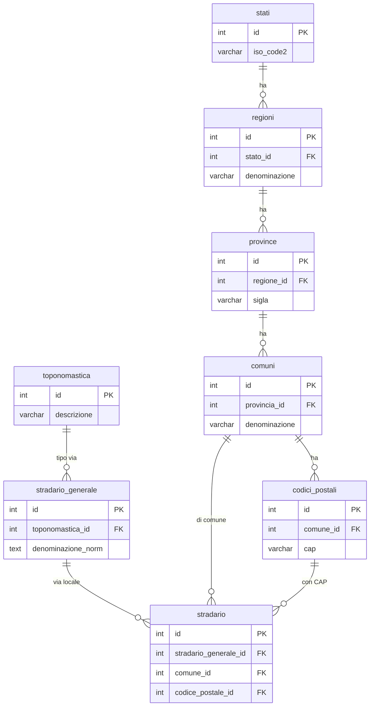
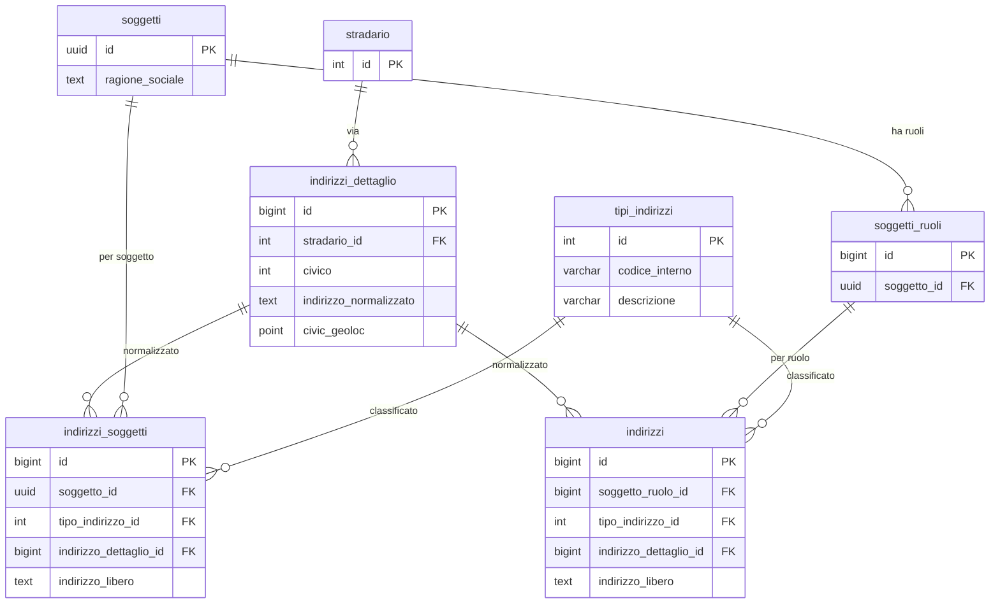
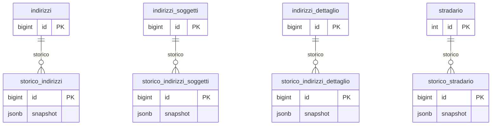

# Guida — Gestione degli Indirizzi

> **Ultimo aggiornamento**: 25 ottobre 2026
>
> **Destinatari**: sviluppatori database, backend, integratori e analisti funzionali
>
> **Vedi anche** — schemi DB:
>
> * [anagrafiche.indirizzi](/dbzero/anagrafiche/tabelle/indirizzi) — indirizzi per ruolo (layer operativo)
> * [anagrafiche.indirizzi_soggetti](/dbzero/anagrafiche/tabelle/indirizzi_soggetti) — indirizzi per soggetto (layer identitario)
> * [anagrafiche.indirizzi_dettaglio](/dbzero/anagrafiche/tabelle/indirizzi_dettaglio) — il civico normalizzato
> * [config.stradario](/dbzero/config/tabelle/stradario) — lo stradario locale (via + comune + CAP)
> * [config.stradario_generale](/dbzero/config/tabelle/stradario_generale) — anagrafica delle vie (toponimo + nome)
> * [config.toponomastica](/dbzero/config/tabelle/toponomastica) — tipologie di toponimo (Via, Piazza, Corso...)
> * [config.stati](/dbzero/config/tabelle/stati), [config.regioni](/dbzero/config/tabelle/regioni), [config.province](/dbzero/config/tabelle/province), [config.comuni](/dbzero/config/tabelle/comuni) — gerarchia geografica
> * [config.codici_postali](/dbzero/config/tabelle/codici_postali) — CAP per comune
> * [config.tipi_indirizzi](/dbzero/config/tabelle/tipi_indirizzi) — classificazione degli indirizzi (RES, SEDELEG, FATT...)
> * [storico.indirizzi](/dbzero/storico/tabelle/indirizzi), [storico.indirizzi_dettaglio](/dbzero/storico/tabelle/indirizzi_dettaglio), [storico.stradario](/dbzero/storico/tabelle/stradario) — snapshot storici
>
> **Vedi anche** — funzioni e trigger DB:
>
> * [script.fn_get_indirizzo](/dbzero/script/funzioni/fn_get_indirizzo) — la risoluzione master/fallback: ruolo → soggetto
> * [anagrafiche.trgfn_indirizzi_dettaglio_normalize](/dbzero/anagrafiche/funzioni/trgfn_indirizzi_dettaglio_normalize) — i campi normalizzati del civico
> * [anagrafiche.trgfn_indirizzi_base_normalize](/dbzero/anagrafiche/funzioni/trgfn_indirizzi_base_normalize) — normalizzazione e default sui due layer
> * [anagrafiche.trgfn_indirizzi_guard_tipo_ruolo_tipi_indirizzo](/dbzero/anagrafiche/funzioni/trgfn_indirizzi_guard_tipo_ruolo_tipi_indirizzo) — la matrice tipo/ruolo (R5)
> * [anagrafiche.trgfn_indirizzi_soggetti_guard_tipo_indirizzo](/dbzero/anagrafiche/funzioni/trgfn_indirizzi_soggetti_guard_tipo_indirizzo) — la matrice tipo/soggetto (R6)
> * [anagrafiche.trgfn_indirizzi_guard_forma_libera](/dbzero/anagrafiche/funzioni/trgfn_indirizzi_guard_forma_libera) — le due forme dell'indirizzo libero (R3)
> * [anagrafiche.fn_crea_indirizzo_soggetto](/dbzero/anagrafiche/funzioni/fn_crea_indirizzo_soggetto) e [anagrafiche.fn_crea_indirizzi_ruolo](/dbzero/anagrafiche/funzioni/fn_crea_indirizzi_ruolo) — le madri che scrivono gli indirizzi, sui due layer
> * [script.fn_stato_proposto_id](/dbzero/script/funzioni/fn_stato_proposto_id) — lo stato proposto quando chi scrive non lo dice (R8)
> * [maintenance.proc_bump_indirizzi_dettaglio](/dbzero/maintenance/funzioni/proc_bump_indirizzi_dettaglio) — riclassificazione dei civici
>
> **Vedi anche** — guide correlate:
>
> * [Soggetti & Ruoli](/guide/soggetti-e-ruoli-anagrafici)
> * [Gestione dei contatti](/guide/gestione-dei-contatti)
> * [Generazione di un cliente](/guide/generazione-cliente)

---

## Introduzione

In Zero ERP un **indirizzo** non è un semplice campo di testo: è un dato strutturato che collega una persona (o un'azienda) a un luogo fisico preciso, con geolocalizzazione, gerarchia geografica completa e storico delle modifiche.

Il problema che il modulo risolve è duplice. Da un lato serve **normalizzare** gli indirizzi — evitare che "Via Roma 1" e "V. Roma, 1" diventino due record diversi. Dall'altro serve distinguere tra indirizzi che appartengono alla **persona** (residenza, domicilio fiscale — dati identitari che non cambiano al cambiare del ruolo) e indirizzi che appartengono a un **ruolo** (sede operativa del cliente, indirizzo di spedizione del fornitore — dati operativi legati a cio che la persona fa nel sistema).

Questa distinzione — **indirizzo per soggetto** e **indirizzo per ruolo** — è il cuore architetturale del modulo. Le due tabelle condividono la stessa struttura e lo stesso livello di normalizzazione, ma rispondono a domande diverse:

* **Indirizzo per soggetto:** dove abita questa persona? Qual è la sede legale di questa azienda?
* **Indirizzo per ruolo:** dove spediamo la merce a questo cliente? Qual è la sede operativa di questo fornitore?

Il sistema sa come mettere insieme i due livelli: quando un processo ha bisogno di un indirizzo (fatturazione, spedizione, comunicazione), cerca prima nel layer **ruolo** (master) e, se non trova il tipo richiesto, cade sul layer **soggetto** (fallback).

**Cosa troverai in questa guida:**

* Le entità coinvolte e il loro significato nel modello
* Come funziona la normalizzazione e perché è importante
* La distinzione ruolo/soggetto e la policy di risoluzione master/fallback
* Le regole di dominio numerate (vincoli, guard, matrici)
* Il ciclo di vita degli indirizzi con scenari concreti
* Trigger e funzioni coinvolte
* I diagrammi ER del modulo

---

## Le entità e il loro significato

### Indirizzo dettaglio (il civico)

E il livello più basso: il singolo numero civico su una via. La tabella `anagrafiche.indirizzi_dettaglio` contiene il riferimento allo stradario, il civico, l'eventuale estensione (A, B...), la palazzina, la scala, il piano, l'interno e la geolocalizzazione puntuale.

Il campo `indirizzo_normalizzato` viene calcolato automaticamente dal trigger di normalizzazione e produce una stringa leggibile tipo "Via Roma 1, Palazzina A, Int. 3". Questo è il dato che appare nelle viste e nei documenti.

Ogni indirizzo fisico è **una riga sola**, condivisa da tutti i soggetti, i punti di fornitura e i magazzini che lo usano: non possono esistere due righe con la stessa combinazione (stradario, civico, estensione, palazzina, scala, piano, interno), nemmeno quando il civico manca ([R7](#r7--unicita-del-civico)).

### Indirizzo per ruolo (`anagrafiche.indirizzi`)

E l'indirizzo **operativo**, legato a un ruolo del soggetto (`soggetto_ruolo_id`). Esempi: l'indirizzo di spedizione di un cliente, la sede operativa di un fornitore, l'indirizzo di fatturazione.

La colonna `istanza_utility_id` (nullable, `bigint`, FK verso `anagrafiche.istanze_utilities`) consente
di differenziare indirizzi per **istanza di servizio**: ad esempio il cliente Titini può avere un
indirizzo di fatturazione per il contratto GAS di Corridonia è uno diverso per il contratto GAS di
Civitanova (stessa utility, istanze diverse). Con `istanza_utility_id = NULL` l'indirizzo è generico
del ruolo e fa da fallback per tutte le istanze che non hanno un override specifico.

I tipi di indirizzo ammessi dipendono dal tipo di ruolo: la matrice `config.tipi_ruolo_tipi_indirizzo` definisce quali tipi sono consentiti per ciascun tipo di ruolo ([R5](#r5--validazione-tipo-indirizzo-per-ruolo)).

Vincolo di unicità: un solo indirizzo per combinazione `(soggetto_ruolo_id, istanza_utility_id, tipo_indirizzo_id)`,
gestito con due partial unique index per il trattamento NULL di PostgreSQL ([R2](#r2--unicita-per-tipo)).

### Indirizzo per soggetto (`anagrafiche.indirizzi_soggetti`)

E l'indirizzo **identitario**, legato direttamente al soggetto (`soggetto_id`). Esempi: la residenza di una persona fisica, la sede legale di un'azienda, il domicilio fiscale.

Questi indirizzi sono indipendenti dai ruoli: se una persona è sia cliente che fornitore, la sua residenza esiste una sola volta a livello soggetto.

I tipi ammessi dipendono dalla natura del soggetto (persona fisica, persona giuridica...): la matrice `config.tipi_soggetto_dettaglio_tipi_indirizzo` definisce le regole ([R6](#r6--validazione-tipo-indirizzo-per-soggetto)).

Vincolo di unicità: un solo indirizzo per tipo per soggetto (`UNIQUE (soggetto_id, tipo_indirizzo_id)` — [R2](#r2--unicita-per-tipo)).

### Modalità normalizzata vs libera

Entrambe le tabelle indirizzo (ruolo e soggetto) supportano due modalità:

* **Normalizzata** (preferita): il campo `indirizzo_dettaglio_id` punta a un civico in `indirizzi_dettaglio`. Si ottiene geolocalizzazione, gerarchia completa e deduplicazione.
* **Libera** (eccezione): il campo `indirizzo_libero` contiene la via scritta a mano, con lo stato e, secondo lo stato, il comune e il CAP scelti dall'elenco oppure la località e il codice postale (`postal_code`). Serve per gli indirizzi esteri, per le vie che lo stradario non ha ancora e per le importazioni da altri sistemi. Le due forme sono in [R3](#r3--completezza-indirizzo-libero).

Le due modalità sono **mutualmente esclusive**: un indirizzo è normalizzato oppure libero, mai entrambi ([R1](#r1--xor-normalizzatolibero)).

### Tipi indirizzo

La tabella `config.tipi_indirizzi` cataloga le tipologie: RES (residenza), SEDELEG (sede legale), SEDEOP (sede operativa), FATT (fatturazione), DOMFISC (domicilio fiscale), CORR (corrispondenza), e altre.

Ogni tipo può essere associato a un layer (soggetto) o all'altro (ruolo) o a entrambi, secondo le matrici di configurazione.

### Gerarchia geografica

Lo stradario si appoggia a una catena di configurazione completa:

```text
config.toponomastica → config.stradario_generale → config.stradario
                                                         ↓
                                                   config.comuni
                                                         ↓
                                                   config.province
                                                         ↓
                                                   config.regioni
                                                         ↓
                                                   config.stati
```

Dallo `stradario_id` di un civico si risale all'intera gerarchia senza duplicare dati.

### Viste resolved

Le viste resolved centralizzano la composizione dell'indirizzo leggibile (human-readable) con tutti i campi territoriali:

* [anagrafiche.vw_indirizzi_resolved_base](/dbzero/anagrafiche/views/vw_indirizzi_resolved_base) — unifica RUOLO e SOGGETTO con gerarchia geografica completa
* [anagrafiche.vw_indirizzi_resolved_ruolo](/dbzero/anagrafiche/views/vw_indirizzi_resolved_ruolo) — solo layer RUOLO
* [anagrafiche.vw_indirizzi_resolved_soggetto](/dbzero/anagrafiche/views/vw_indirizzi_resolved_soggetto) — solo layer SOGGETTO
* [anagrafiche.vw_indirizzi_resolved_all](/dbzero/anagrafiche/views/vw_indirizzi_resolved_all) — unione completa di entrambi i layer
* [anagrafiche.vw_indirizzi_dettaglio](/dbzero/anagrafiche/views/vw_indirizzi_dettaglio) — dettaglio civico con descrizione comune

Le viste espongono anche la **provenienza** (`source`: `RUOLO` / `SOGGETTO`) come campo derivato, utile per audit e debug.

---

## Policy di risoluzione (master/fallback)

Quando un processo ha bisogno di un indirizzo — per fatturare, per spedire, per comunicare — il sistema non chiede al chiamante di sapere se l'indirizzo sta a livello istanza, ruolo o soggetto. La risoluzione avviene automaticamente con una **cascata a 3 livelli**:

1. **Istanza** — cerco nel layer **ruolo** il tipo richiesto con l'istanza specifica (`istanza_utility_id = X`). Se il tipo esatto non esiste, la matrice `config.tipi_ruolo_tipi_indirizzo` definisce una catena di fallback tra tipi.
2. **Ruolo generico** — se il livello istanza non risolve, cerco nello stesso layer ruolo con `istanza_utility_id IS NULL` (indirizzo generico, valido per tutte le istanze).
3. **Soggetto** — se il layer ruolo non risolve, cerco nel layer **soggetto** (`anagrafiche.indirizzi_soggetti`) con la stessa logica di fallback tra tipi.

| Priorità | istanza_utility_id | soggetto_ruolo_id | Significato                 | Editabile     |
| -------- | ------------------ | ----------------- | --------------------------- | ------------- |
| 1        | valorizzato        | valorizzato       | Indirizzo specifico istanza | Si            |
| 2        | NULL               | valorizzato       | Indirizzo generico ruolo    | Si            |
| 3        | —                  | —                 | Indirizzo soggetto          | No (readonly) |

La funzione [`script.fn_get_indirizzo(p_soggetto_ruolo_id, p_tipo_codice, p_istanza_utility_id DEFAULT NULL)`](/dbzero/script/funzioni/fn_get_indirizzo) implementa questa catena e restituisce un set ricco con 27 colonne (indirizzo completo, istanza_utility_id, geolocalizzazione, gerarchia geografica). Il parametro `p_istanza_utility_id` è opzionale — senza di esso la cascata parte dal livello 2.

Per letture dirette senza fallback:

* [`script.fn_get_indirizzi_by_ruolo(p_soggetto_ruolo_id, p_istanza_utility_id DEFAULT NULL)`](/dbzero/script/funzioni/fn_get_indirizzi_by_ruolo) — solo layer ruolo, con filtro istanza opzionale
* [`script.fn_get_indirizzi_by_soggetto(p_soggetto_id)`](/dbzero/script/funzioni/fn_get_indirizzi_by_soggetto) — solo layer soggetto
* [`script.fn_get_indirizzo_by_soggetto(p_soggetto_id, p_tipo_codice)`](/dbzero/script/funzioni/fn_get_indirizzo_by_soggetto) — layer soggetto con fallback tra tipi

---

## Gli indirizzi congelati sui documenti

Un documento non **legge** l'indirizzo del cliente ogni volta che lo stampa: se
lo **copia addosso** quando nasce, e da quel momento porta la propria fotografia.
Ogni documento del ciclo attivo ha la sua tabella satellite —
`vendite.preventivi_indirizzi`, `ordini_indirizzi`, `ddt_indirizzi`,
`contratti_indirizzi`, `offerte_commerciali_indirizzi`, `fatture_indirizzi` — con
una riga per tipo di indirizzo: lo `snapshot` (JSONB, coi campi già composti per
la stampa) e il riferimento a **da dove è stato preso** (`origine_indirizzo_id` /
`origine_soggetto_ruolo_id`).

**Perché**: un documento emesso deve continuare a dire quello che diceva. Se il
cliente trasloca, le fatture di sei mesi fa non devono cambiare indirizzo alla
prima ristampa.

### Chi risolve e chi copia

| Documento                                        | Come ottiene i suoi indirizzi                                                              |
| ------------------------------------------------ | ------------------------------------------------------------------------------------------ |
| Preventivo, offerta (la **radice** della catena) | **Risolve dall'anagrafica** con la cascata qui sopra                                       |
| Ordine, DDT, contratto (documenti **derivati**)  | **Copiano 1:1** lo snapshot del documento padre, filtrato sui tipi ammessi nel loro ambito |
| **Fattura**                                      | **Risolve dall'anagrafica**, come la radice                                                |

La fattura è l'unica eccezione, e non è una svista: **aggrega N sorgenti**, e una
parte di ciò che fattura non ha alcun documento padre da cui copiare (oneri di
commessa, consumi, rettifiche). Risolvere dall'anagrafica è l'unica regola che
copre tutti i casi. La conseguenza va conosciuta: se l'anagrafica è cambiata dopo
il DDT, la fattura può stampare un indirizzo **diverso** da quello del DDT che
sta fatturando. È voluto — vince il dato corrente al momento in cui la fattura
nasce — non un difetto.

### La fattura risolve **per istanza**

Un soggetto-ruolo può avere legittimamente più indirizzi dello stesso tipo: uno
per istanza utility, più uno generico (§Policy di risoluzione). Perciò la
risoluzione della fattura parte dall'**istanza del billing account** e scende sul
generico solo se lì non trova nulla. Cercare per solo ruolo darebbe fino a N
righe, cioè un risultato non deterministico — ed è il motivo per cui i tipi
legati al punto di fornitura si trovano solo passando dall'istanza.

Due dettagli che sembrano anomalie e non lo sono:

* **Solo `FATT` è obbligatorio** nell'ambito `FATTURE`. Gli altri tipi previsti
  (`CON`, `FORNITURA`, `RES`) se mancano non generano né riga né errore.
* **Quando il billing account ha un padre, la fattura è del padre**, quindi porta
  gli indirizzi del padre. Su un BA padre l'indirizzo di fornitura quasi non
  esiste mai, perché la sua istanza è di servizio e non descrive un punto di
  fornitura reale: è il caso normale.

### Dopo il pre-fiscale non si tocca più

Finché la fattura è in bozza o emessa i suoi satelliti si possono riscrivere — è
quello che fa il ri-lancio dello step, e infatti correggere l'anagrafica e
rifare il giro è il modo previsto di sistemare un indirizzo sbagliato. Superata
quella soglia un trigger di congelamento li blocca in scrittura **e** in
cancellazione: da lì in avanti sono la storia del documento.

⚠️ **Un indirizzo congelato da un documento non è più cancellabile.** Il
riferimento `origine_indirizzo_id` è una chiave esterna: finché un documento la
punta, la riga di `anagrafiche.indirizzi` non si cancella. Non è un problema da
aggirare — è la garanzia che la provenienza resti ricostruibile — ma va saputo
prima di provare a fare pulizia in anagrafica.

---

## Azioni UI per contesto e livello

Il drawer `IndirizziSoggettoDrawer` viene riusato in context **soggetto** e **ruolo**.
Le azioni disponibili su ogni indirizzo dipendono dal contesto di apertura e dal livello
(`fonte`) dell'indirizzo nella cascata.

### Context soggetto

Aperto da: lista soggetti, SoggettoDrawer (edit mode).

| Fonte                   | Pennino (cambia) | Cestino (elimina) | Note                                                                                                                                                                                       |
| ----------------------- | :--------------: | :---------------: | ------------------------------------------------------------------------------------------------------------------------------------------------------------------------------------------ |
| *(tutti gli indirizzi)* |        Si        |        No         | L'azione "cambia" è un replace (delete + create). Il delete diretto non è esposto perché un indirizzo soggetto è ereditato da tutti i ruoli — rimuoverlo potrebbe avere impatto a cascata. |

### Context ruolo

Aperto da: ClienteDrawer (edit mode), FornitoreDrawer, lista clienti/fornitori, SoggettoPreviewBadges.

| Fonte      | Pennino (cambia) | Cestino (elimina) | Note                                                                                      |
| ---------- | :--------------: | :---------------: | ----------------------------------------------------------------------------------------- |
| `soggetto` |        No        |        No         | Indirizzo ereditato, readonly. Per modificarlo l'utente deve accedere al drawer soggetto. |
| `ruolo`    |        Si        |        Si         | Indirizzo generico del ruolo (istanza_utility_id = NULL). Override del livello soggetto.  |
| `istanza`  |        Si        |        Si         | Indirizzo specifico dell'istanza. Override del livello ruolo.                             |

### Matrice tipi indirizzo ammessi

In context soggetto i tipi ammessi vengono dalla matrice `config.tipi_soggetto_dettaglio_tipi_indirizzo`
(filtrata per tipo soggetto dettaglio: PF, PG, ENTE).

In context ruolo i tipi ammessi vengono dalla matrice `config.tipi_ruolo_tipi_indirizzo`
(filtrata per tipo ruolo: CLIENTE, FORNITORE, ecc.). Il trigger guard
`trgfn_indirizzi_guard_tipo_ruolo_tipi_indirizzo` valida al salvataggio.

I tipi già creati per l'istanza corrente sono disabilitati nella barra tab del form
(icona lucchetto, non selezionabili) per evitare errori di duplicazione.

### Ordinamento lista

* **Context soggetto:** alfabetico per tipo indirizzo descrizione.
* **Context ruolo:** prima per fonte (soggetto → ruolo → istanza), poi alfabetico per tipo indirizzo.

La funzione `sortByFonte()` (`core/utils/string.js`) gestisce l'ordinamento per tutti e tre
i drawer (indirizzi, contatti, conti bancari).

---

## Regole di dominio

### R1 — XOR normalizzato/libero

Un indirizzo e **normalizzato** oppure **libero**, mai entrambi. I check constraint `chk_indirizzi_xor_norm_libero` e `chk_indirizzi_soggetti_xor_norm_libero` lo garantiscono su entrambe le tabelle.

### R2 — Unicità per tipo

Un solo indirizzo per tipo per entità:

* Layer ruolo: `UNIQUE (soggetto_ruolo_id, istanza_utility_id, tipo_indirizzo_id)` — implementato con due partial unique index per gestire NULL (`uq_indirizzi_ruolo_tipo_no_istanza` per `istanza_utility_id IS NULL`, `uq_indirizzi_ruolo_istanza_tipo` per `istanza_utility_id IS NOT NULL`)
* Layer soggetto: `UNIQUE (soggetto_id, tipo_indirizzo_id)`

### R3 — Completezza indirizzo libero

Se `indirizzo_dettaglio_id` è NULL (modalità libera), servono sempre la via (`indirizzo_libero`) e lo stato (`stato_id`; se non lo si dice, lo propone il sistema, [R8](#r8-normalizzazione-automatica)). Il resto dipende dallo **stato**, cioè da una sua proprietà: il catalogo dei suoi comuni è completo oppure no (`config.stati.catalogo_comuni_completo`). Oggi è completo per l'Italia.

| Forma | Quando | Cosa serve | Cosa resta vuoto |
| --- | --- | --- | --- |
| **del catalogo** | lo stato ha il catalogo completo | il comune e il CAP scelti dall'elenco (`comune_id`, `codice_postale_id`), coerenti fra loro e con lo stato | località, codice postale libero, regione: li dice già l'elenco. La sotto-località (frazione, quartiere) si può scrivere |
| **estera** | lo stato non ha il catalogo completo | la località (`locality`) | comune e CAP dell'elenco. Il codice postale (`postal_code`), la regione e la sotto-località sono **facoltativi**: ci sono paesi senza codice postale |

Uno stato con il catalogo **ancora incompleto** (per esempio durante la conversione dei dati di un'azienda) accetta anche la forma del catalogo, se chi scrive sceglie un comune o un CAP. Il catalogo si accende quando è completo: le righe già scritte nella forma estera restano valide finché qualcuno non tocca il loro indirizzo; a quel punto vale la forma del catalogo.

Il rifiuto lo dà il guard [`trgfn_indirizzi_guard_forma_libera`](/dbzero/anagrafiche/funzioni/trgfn_indirizzi_guard_forma_libera), con un codice e il nome del campo da correggere: `E_INDIRIZZO_LIBERO_INCOMPLETO` (manca un campo), `E_INDIRIZZO_CAMPO_ALTRA_FORMA` (un campo dell'altra forma è compilato), `E_INDIRIZZO_COMUNE_ALTRO_STATO` (il comune non è dello stato), `E_INDIRIZZO_CAP_ALTRO_COMUNE` (il CAP non è del comune). I check constraint `chk_indirizzi_free_requirements` e `chk_indirizzi_soggetti_free_requirements` restano come rete per le scritture che non passano dai trigger.

⚠️ Il form legge la stessa proprietà dello stato per scegliere quale variante mostrare: la regola sta in un posto solo.

### R4 — Protezione stradario_id

Il campo `stradario_id` su `indirizzi_dettaglio` non può essere modificato manualmente. Il guard `trgfn_indirizzi_dettaglio_protect_update` blocca l'operazione con errore `E_COLONNA_NON_MODIFICABILE`. La riclassificazione va eseguita tramite la procedura di manutenzione dedicata (vedi [Riclassificazione vie](/guide/riclassificazione-vie)).

### R5 — Validazione tipo indirizzo per ruolo

Il trigger `trgfn_indirizzi_guard_tipo_ruolo_tipi_indirizzo` verifica che il `tipo_indirizzo_id` sia ammesso per il tipo di ruolo del soggetto, consultando la matrice `config.tipi_ruolo_tipi_indirizzo`.

Regola: se la matrice non ha righe per quel tipo di ruolo, tutti i tipi sono ammessi (adozione progressiva). Se ha almeno una riga, sono ammessi solo quelli elencati come attivi e in periodo di validità.

### R6 — Validazione tipo indirizzo per soggetto

Il trigger `trgfn_indirizzi_soggetti_guard_tipo_indirizzo` verifica che il `tipo_indirizzo_id` sia ammesso per il tipo di soggetto dettaglio, consultando la matrice `config.tipi_soggetto_dettaglio_tipi_indirizzo`.

Stessa logica di R5: senza righe nella matrice, nessuna restrizione; con righe, whitelist attiva.

### R7 — Unicità del civico

L'indice `uq_indirizzi_dettaglio_norm_v2` su `indirizzi_dettaglio` garantisce che non esistano duplicati dello stesso civico: la combinazione (`stradario_id`, `civico`, `estensione_civico`, `palazzina`, `scala`, `piano`, `interno`) deve essere unica. L'indice è `NULLS NOT DISTINCT`: un campo vuoto è un valore della chiave, quindi due indirizzi senza numero civico (SNC) con lo stesso dettaglio sono lo stesso indirizzo ([linee guida SQL §8.4-bis](/linee-guida-sql#84-bis-indici-unique-con-colonne-nullable)).

La chiave si confronta sui valori **come li salva** la normalizzazione ([R8](#r8--normalizzazione-automatica)): `a` e `A`, un interno con o senza spazi, un'estensione con o senza `/` sono la stessa cosa.

* **Senza numero civico** si dice lasciando vuoto il civico: è l'unico modo. Un civico `0` o negativo è rifiutato.
* **Estensione, palazzina, scala, piano e interno** devono contenere almeno una lettera o una cifra: un valore fatto solo di segni (`/`, `-`, `.`) è rifiutato. `-1` (piano interrato) o `BIS` vanno bene.
* **Il «trova o crea»** ([`fn_get_or_create_indirizzo_dettaglio`](/dbzero/anagrafiche/funzioni/fn_get_or_create_indirizzo_dettaglio)) restituisce sempre un id: l'indirizzo esistente oppure quello appena creato. Se l'indirizzo esisteva ma era disattivato, lo riattiva. Se la via scelta non è completa nell'elenco delle vie (per esempio un comune senza provincia), si ferma con un errore che lo dice.
* **Modificare** un indirizzo esistente vuol dire correggerlo **per tutti** quelli che lo usano. Se dopo la modifica coincide con un altro indirizzo che c'è già, la modifica è rifiutata e l'errore nomina quello esistente.

Le regole le applica il guard [`trgfn_indirizzi_dettaglio_guard_chiave`](/dbzero/anagrafiche/funzioni/trgfn_indirizzi_dettaglio_guard_chiave), con un codice e il campo da correggere; i vincoli `CHECK` della tabella e l'indice restano come rete.

### R8 — Normalizzazione automatica

I trigger di normalizzazione (`trgfn_indirizzi_dettaglio_normalize` e `trgfn_indirizzi_base_normalize`) calcolano automaticamente i campi derivati:

* `via_norm`, `civico_norm`: forme normalizzate per confronti e deduplicazione (`civico_norm` vale `SNC` quando il civico è vuoto)
* Sul civico, le colonne del dettaglio vanno in maiuscolo senza spazi ai lati, un testo vuoto diventa NULL e l'estensione prende il prefisso `/` (`A` → `/A`)
* `indirizzo_normalizzato`: stringa leggibile completa
* In modalità normalizzata, i campi fallback (comune, stato...) vengono azzerati
* In modalità libera, i testi vuoti diventano NULL (una località di soli spazi non è una località) e lo `stato_id` non detto diventa lo **stato proposto**: il parametro `STATO_PROPOSTO_ISO2`, letto da [`script.fn_stato_proposto_id`](/dbzero/script/funzioni/fn_stato_proposto_id). È una proposta (si può cambiare per utente, per gruppo, per azienda attiva o per sessione); se manca, o indica più di uno stato, il sistema si ferma invece di indovinare

---

## Ciclo di vita

### Inserimento di un indirizzo normalizzato

La sequenza tipica per un nuovo indirizzo strutturato:

1. Verificare (o creare) il civico in `anagrafiche.indirizzi_dettaglio` — il vincolo di unicità R7 impedisce duplicati: se il civico esiste già, si usa quello esistente
2. Inserire in `anagrafiche.indirizzi` (layer ruolo) o `anagrafiche.indirizzi_soggetti` (layer soggetto) con `indirizzo_dettaglio_id` valorizzato
3. I trigger si occupano di: validare il tipo (R5/R6), normalizzare i campi (R8), sincronizzare la geolocalizzazione, generare `tx_id` e audit

### Inserimento di un indirizzo libero (importazione)

Per dati non normalizzabili (migrazioni, indirizzi esteri):

1. Scrivere l'indirizzo con la madre del suo layer — [`fn_crea_indirizzo_soggetto`](/dbzero/anagrafiche/funzioni/fn_crea_indirizzo_soggetto) (un indirizzo) o [`fn_crea_indirizzi_ruolo`](/dbzero/anagrafiche/funzioni/fn_crea_indirizzi_ruolo) (un elenco). Le due madri parlano la stessa lingua: un oggetto jsonb col tipo e l'indirizzo, libero, già normalizzato o da via da risolvere
2. Fornire i campi della forma che lo stato richiede (R3)
3. Il trigger di normalizzazione porta a NULL i testi vuoti e propone lo stato; il guard della forma rifiuta, col campo, ciò che manca o non torna

La modalità libera è pensata come **eccezione**: la normalizzazione successiva è sempre auspicabile.

### Cambio residenza

Quando una persona cambia residenza:

1. UPDATE di `anagrafiche.indirizzi_soggetti` per il tipo `RES`, puntando al nuovo `indirizzo_dettaglio_id`
2. Il trigger di storicizzazione salva automaticamente lo snapshot del vecchio indirizzo in `storico.indirizzi_soggetti`
3. Se la persona ha anche un indirizzo di ruolo legato alla vecchia residenza, questo **non cambia automaticamente**: i due layer sono indipendenti. L'aggiornamento del layer ruolo è un'azione esplicita

### Disattivazione di un ruolo

Quando un ruolo viene disattivato (es. un cliente cessa), gli indirizzi del layer ruolo **restano nel database** come record storici. Non vengono eliminati ne disattivati — la tracciabilità è garantita dallo storico.

Gli indirizzi del layer soggetto non sono toccati: la persona mantiene la sua residenza e i suoi indirizzi identitari indipendentemente dai ruoli.

### Import massivo con normalizzazione successiva

Per carichi massivi:

1. Disabilitare temporaneamente la storicizzazione (`storicizza = false`) per evitare overhead
2. Caricare i dati in modalità libera
3. Normalizzare in batch: creare i civici in `indirizzi_dettaglio`, poi aggiornare `indirizzo_dettaglio_id` sugli indirizzi
4. Riabilitare la storicizzazione

### Riclassificazione vie

Quando la toponomastica ufficiale cambia (rinomina, fusione, variazione comune), il campo `stradario_id` su `indirizzi_dettaglio` è protetto (R4) e non può essere modificato direttamente. La riclassificazione avviene tramite procedure di manutenzione dedicate.

Per la procedura completa: vedi [Riclassificazione vie e toponomastica](/guide/riclassificazione-vie).

---

## Storicizzazione

Tutte le modifiche a indirizzi e civici vengono tracciate in tabelle `storico.*` con snapshot JSONB, tipi operazione (A/U/D) e `tx_id` transazionale.

La storicizzazione è gestita dal trigger generico [`script.trgfn_storico_generic()`](/dbzero/script/funzioni/trgfn_storico_generic), attivo su:

* `anagrafiche.indirizzi` → `storico.indirizzi`
* `anagrafiche.indirizzi_dettaglio` → `storico.indirizzi_dettaglio`
* `anagrafiche.indirizzi_soggetti` → `storico.indirizzi_soggetti`
* `config.stradario` → `storico.stradario`

Le helper di lettura storica:

* [`script.fn_get_snapshot_as_of()`](/dbzero/script/funzioni/fn_get_snapshot_as_of) — restituisce lo snapshot JSONB di un record a una data
* [`script.fn_get_record_id_as_of()`](/dbzero/script/funzioni/fn_get_record_id_as_of) — restituisce l'ID del record valido a una data

---

## Trigger e funzioni coinvolte

### Normalizzazione

| Funzione / Trigger                                                                                        | Su quale tabella                  | Cosa fa                                                                     |
| --------------------------------------------------------------------------------------------------------- | --------------------------------- | --------------------------------------------------------------------------- |
| [`trgfn_indirizzi_dettaglio_normalize`](/dbzero/anagrafiche/funzioni/trgfn_indirizzi_dettaglio_normalize) | `indirizzi_dettaglio`             | Calcola `via_norm`, `civico_norm`, `indirizzo_normalizzato`                 |
| [`trgfn_indirizzi_base_normalize`](/dbzero/anagrafiche/funzioni/trgfn_indirizzi_base_normalize)           | `indirizzi`, `indirizzi_soggetti` | Azzera i campi liberi in modalità normalizzata; in modalità libera porta a NULL i testi vuoti e propone lo stato |
| [`trgfn_indirizzi_sync_geoloc`](/dbzero/anagrafiche/funzioni/trgfn_indirizzi_sync_geoloc)                 | `indirizzi`, `indirizzi_soggetti` | Sincronizza `geoloc` da `indirizzi_dettaglio.civic_geoloc`                  |

### Guard e vincoli

| Funzione / Trigger                                                                                                                | Su quale tabella                  | Cosa fa                                                      |
| --------------------------------------------------------------------------------------------------------------------------------- | --------------------------------- | ------------------------------------------------------------ |
| [`trgfn_indirizzi_guard_tipo_ruolo_tipi_indirizzo`](/dbzero/anagrafiche/funzioni/trgfn_indirizzi_guard_tipo_ruolo_tipi_indirizzo) | `indirizzi`                       | Valida tipo indirizzo contro matrice ruolo (R5)              |
| [`trgfn_indirizzi_soggetti_guard_tipo_indirizzo`](/dbzero/anagrafiche/funzioni/trgfn_indirizzi_soggetti_guard_tipo_indirizzo)     | `indirizzi_soggetti`              | Valida tipo indirizzo contro matrice soggetto (R6)           |
| [`trgfn_indirizzi_guard_forma_libera`](/dbzero/anagrafiche/funzioni/trgfn_indirizzi_guard_forma_libera)                           | `indirizzi`, `indirizzi_soggetti` | La forma dell'indirizzo libero, decisa dallo stato (R3). Gira dopo la normalizzazione |
| [`trgfn_indirizzi_dettaglio_protect_update`](/dbzero/anagrafiche/funzioni/trgfn_indirizzi_dettaglio_protect_update)               | `indirizzi_dettaglio`             | Blocca modifica manuale di `stradario_id` (R4)               |
| [`trgfn_indirizzi_dettaglio_guard_chiave`](/dbzero/anagrafiche/funzioni/trgfn_indirizzi_dettaglio_guard_chiave)                   | `indirizzi_dettaglio`             | La chiave del civico: civico > 0, dettaglio con lettere o cifre, nessun doppione in modifica (R7). Gira dopo la normalizzazione |
| `trgfn_child_requires_active_parent`                                                                                              | `indirizzi`, `indirizzi_soggetti` | Verifica che `indirizzi_dettaglio` e `soggetti` siano attivi |
| `trgfn_prevent_deactivate_if_children`                                                                                            | `indirizzi_dettaglio`             | Blocca disattivazione se ci sono figli attivi                |

### Lettura e risoluzione

| Funzione                                                                               | Cosa fa                                                            |
| -------------------------------------------------------------------------------------- | ------------------------------------------------------------------ |
| [`fn_get_indirizzo`](/dbzero/script/funzioni/fn_get_indirizzo)                         | Risoluzione master/fallback: ruolo → soggetto, con catena tra tipi |
| [`fn_get_indirizzi_by_ruolo`](/dbzero/script/funzioni/fn_get_indirizzi_by_ruolo)       | Tutti gli indirizzi del layer ruolo                                |
| [`fn_get_indirizzi_by_soggetto`](/dbzero/script/funzioni/fn_get_indirizzi_by_soggetto) | Tutti gli indirizzi del layer soggetto                             |
| [`fn_get_indirizzo_by_soggetto`](/dbzero/script/funzioni/fn_get_indirizzo_by_soggetto) | Indirizzo soggetto con fallback tra tipi                           |

### Storicizzazione e audit

| Funzione / Trigger                                                       | Cosa fa                                        |
| ------------------------------------------------------------------------ | ---------------------------------------------- |
| [`trgfn_storico_generic`](/dbzero/script/funzioni/trgfn_storico_generic) | Snapshot JSONB in tabelle `storico.*`          |
| `trgfn_audit_data_user_generic`                                          | Aggiorna `data_update`, `user_update`          |
| `trgfn_tx_id_managed`                                                    | Genera `tx_id` per tracciabilità transazionale |

### Manutenzione

| Procedura                                                                                     | Cosa fa                                                   |
| --------------------------------------------------------------------------------------------- | --------------------------------------------------------- |
| [`proc_bump_indirizzi_dettaglio`](/dbzero/maintenance/funzioni/proc_bump_indirizzi_dettaglio) | Riclassificazione civici dopo cambio stradario            |
| [`proc_bump_toponomastica`](/dbzero/maintenance/funzioni/proc_bump_toponomastica)             | Correzione toponimo con riallineamento stradario_generale |

---

## Diagrammi ER

Il modello è suddiviso in tre diagrammi per leggibilita.

### Gerarchia geografica (configurazione)

La catena che parte dal toponimo e arriva allo stato, passando per lo stradario e i comuni.



### Indirizzi ruolo e soggetto (modello core)

Il cuore del modulo: il civico normalizzato condiviso dai due layer (ruolo e soggetto).



> **Nota:** le due tabelle `indirizzi` e `indirizzi_soggetti` hanno la stessa struttura
> ma puntano a entità diverse (`soggetto_ruolo_id` vs `soggetto_id`).
> Entrambe possono essere normalizzate (via `indirizzi_dettaglio`) o libere.

### Tabelle storico

Le tabelle storico tracciano ogni modifica con snapshot JSONB.



---

## Best practice

* La modalità **normalizzata** è sempre preferibile. L'indirizzo libero è un'eccezione per migrazioni e casi non normalizzabili.
* Per la lettura di indirizzi nei processi (fatturazione, spedizione), usa `fn_get_indirizzo` — gestisce automaticamente la catena master/fallback senza che il chiamante debba conoscere i due layer.
* Per letture dirette (es. visualizzazione profilo), usa le viste resolved (`vw_indirizzi_resolved_ruolo`, `vw_indirizzi_resolved_soggetto`).
* Non creare civici duplicati: `indirizzi_dettaglio` ha il vincolo di unicità R7. Usa un pattern upsert o verifica l'esistenza prima dell'INSERT.
* Non modificare `stradario_id` manualmente: usa le procedure di manutenzione per la riclassificazione.
* In import massivi, disabilita temporaneamente la storicizzazione (`storicizza = false`) e normalizza in batch dopo il caricamento.
* I layer ruolo e soggetto sono **indipendenti**: un cambio di residenza (soggetto) non propaga automaticamente al layer ruolo. Se serve aggiornare entrambi, farlo esplicitamente.

---

## Validazione pgTAP

Il modulo è coperto dal test `db/pgtap/anagrafiche/test-indirizzi-fallback.sql` (14 assert) che verifica:

* Policy di risoluzione con fallback tra tipi
* Guard su tipi indirizzo (blocco RES su Gestore)
* Coerenza tra funzioni di lettura e viste resolved
* Correttezza del campo `source` (RUOLO/SOGGETTO) in `vw_indirizzi_resolved_all`
* Cardinalita: `vw_indirizzi_resolved_all` = `vw_indirizzi_resolved_ruolo` + `vw_indirizzi_resolved_soggetto`

---


