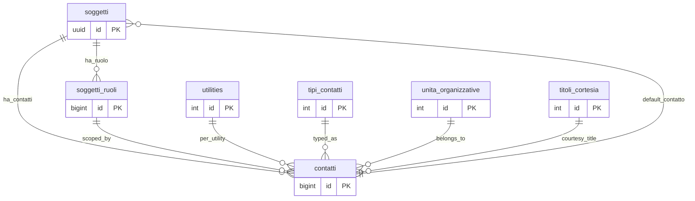

# 📘 Guida Tecnica – Gestione dei Contatti

> (latest review 06-01-26)
>
> 📋 **Destinatari:** sviluppatori database, backend, integratori e analisti funzionali
>
> 🔗 Si affianca alla guida *gestione_indirizzi* come riferimento completo per la modellazione e l’utilizzo dei contatti nel sistema.
>
> 👀 **Vedi anche**
>
> * [`Guida Soggetti & Ruoli`](/guide/soggetti-e-ruoli-anagrafici)  

---

## 🎯 Obiettivo della Guida

Questa guida definisce:

* il modello dati centralizzato dei contatti (`anagrafiche.contatti`),
* il ruolo delle tabelle `config.tipi_contatti` e `config.unita_organizzative`,
* la logica dei contesti (soggetto, ruolo, utility),
* le regole di default e i trigger associati,
* le funzioni di lettura (`fn_get_contatti`, `fn_get_contatto_default`),
* le best practice per lo sviluppo e l’integrazione.

L'obiettivo è rendere **coerente, estensibile e prevedibile** tutto il comportamento relativo ai contatti in Zero ERP.

---

## 🧩 1. Modello Concettuale

### 1.1 Tabella `anagrafiche.contatti` – il punto centrale

È la tabella che contiene **i dati di contatto veri e propri**, cioè:

* nominativo,
* email,
* telefono,
* cellulare,
* pec,
* note,
* flag `is_default`,
* contesto `default_context`.

Ogni contatto è riferito ad almeno:

* **un soggetto** (`soggetto_id` — obbligatorio).

E opzionalmente a:

* **un ruolo del soggetto** (`soggetto_ruolo_id`),
* **una utility** (`utility_id`).

### 1.2 Il contesto di un contatto

La guida sugli indirizzi introduce il concetto di *contesto*. Qui vale lo stesso principio, semplificato:

| Contesto   | Significato                                 | Condizione                      |
| ---------- | ------------------------------------------- | ------------------------------- |
| `soggetto` | Contatto generale del soggetto              | nessun ruolo e nessuna utility  |
| `ruolo`    | Contatto specifico di un ruolo del soggetto | `soggetto_ruolo_id` valorizzato |
| `utility`  | Contatto per una utility specifica          | `utility_id` valorizzato        |

> 🧠 L’esistenza di contatti a più livelli permette al sistema di risolvere fallback intelligenti.

---

## 🏷️ 2. Reparti e categorie

### 2.1 Unita organizzative (reparti)

I reparti/uffici sono gestiti nella tabella **`config.unita_organizzative`**.
Questa tabella identifica la collocazione organizzativa del referente (es. Amministrazione, Tecnico).
Esempi:

* Amministrazione (AMM)
* Tecnico (TEC)
* Assistenza (AST)
* Info (INF)
* Commerciale (COM)
* Legale (LEG)
* Supporto (SUP)
* Marketing (MKT)

Il reparto si esprime quindi con `contatti.unita_organizzativa_id`, non con il nominativo.

### 2.2 Tipi contatto (categoria)

`config.tipi_contatti` identifica la **categoria del contatto**, non il reparto,
ed e' opzionale (puo essere NULL).
Le informazioni di canale rimangono nelle colonne `email`, `telefono`, `pec`, ecc.

> Nota: inizialmente `tipi_contatti` e' stato usato come reparto.
> Il refactor sposta questo significato in `config.unita_organizzative`.

### 2.2 Perché non usare tipi “EMAIL / TELEFONO / PEC”?

Perché:

* già esistono campi specifici (`email`, `telefono`, `pec`…),
* un contatto può avere più informazioni contemporaneamente,
* la scelta del canale è responsabilità dell'applicazione, non del modello.

---

## 🏛️ 3. Trigger e automatismi

### 3.1 Trigger `trgfn_contatti_set_default_contatto`

Gestisce la regola:

> **In ogni contesto può esistere un solo contatto default.**

Il trigger:

* impone esclusività del default,
* aggiorna la colonna `default_context`,
* se il contesto è `soggetto`, aggiorna anche `soggetti.default_contatto_id`.

### 3.2 Trigger audit

Tutti i contatti sono tracciati tramite `script.trgfn_audit_data_user_generic`.

---

## 🧠 4. Recupero contatti: logica e funzioni

### 4.1 `script.fn_get_contatti`

Restituisce **per ogni tipo_contatto** il contatto più rilevante, applicando prioritizzazione:

1. soggetto + ruolo + utility
2. soggetto + ruolo
3. soggetto + utility
4. soggetto (fallback)

Permette di ottenere:

* il contatto “migliore” per un reparto,
* una lista filtrata per contesto,
* un set coerente per integrazioni API.

### 4.2 `script.fn_get_contatto_default`

Questa funzione restituisce:

* il contatto default del ruolo se indicato,
* altrimenti il contatto default del soggetto.

È la funzione consigliata per interfacce applicative che richiedono “il contatto primario”.

---

## 🧪 5. Regole di coerenza

1. **Ogni soggetto deve avere almeno un contatto.**
   È impedita la cancellazione dell’ultimo contatto.

2. **Non possono esistere due contatti default per lo stesso contesto.**

3. **Il tipo_contatto è obbligatorio** e definisce *il reparto*, non il canale.

4. **La combinazione (soggetto_id, soggetto_ruolo_id, utility_id, tipo_contatto_id)** dovrebbe essere unica.

   > In attesa dell’introduzione del vincolo UNIQUE consigliato.

5. **Il contatto del soggetto ha sempre priorità bassa come fallback**, mai come default esplicito per ruolo.

---

## 🔧 6. Best practice di sviluppo

### 6.1 Inserimento contatti

* specificare sempre `tipo_contatto_id` (reparto),
* non usare ID di default “speciali”,
* indicare `is_default = TRUE` *solo se necessario*.

### 6.2 Recupero contatti

* usare `fn_get_contatto_default` quando serve un riferimento unico,
* usare `fn_get_contatti` quando serve una mappa strutturata per reparto.

### 6.3 Refactor e consistenza

* evitare proliferazione di tipi contatto simili,
* agire sempre tramite funzioni, non via query manuali.

---

## 📚 7. Esempi

### 7.1 Contatto di ruolo

```sql
INSERT INTO anagrafiche.contatti (
  tipo_contatto_id,
  soggetto_id,
  soggetto_ruolo_id,
  email,
  is_default
) VALUES (
  2,  -- Tecnico
  'UUID-SOGGETTO',
  10, -- ruolo tecnico
  'tech@example.com',
  TRUE
);
```

### 7.2 Recupero contatto default

```sql
SELECT *
FROM script.fn_get_contatto_default(
  'UUID-SOGGETTO',
  10 -- ruolo
);
```

### 7.3 Recupero contatti per reparto

```sql
SELECT tipo_contatto_id, email
FROM script.fn_get_contatti('UUID-SOGGETTO');
```

---

## 🧩 8. Conclusione

La gestione contatti in Zero ERP è stata progettata per essere:

* **flessibile** → supporta soggetto / ruolo / utility,
* **coerente** → un solo default per contesto,
* **estendibile** → nuovi reparti senza alterare il modello,
* **robusta** → funzioni e trigger centralizzano la logica.

È un sottosistema fondamentale, correlato a rubriche, comunicazioni, automazioni, workflow e documenti.

---
##  Diagramma ER



---


