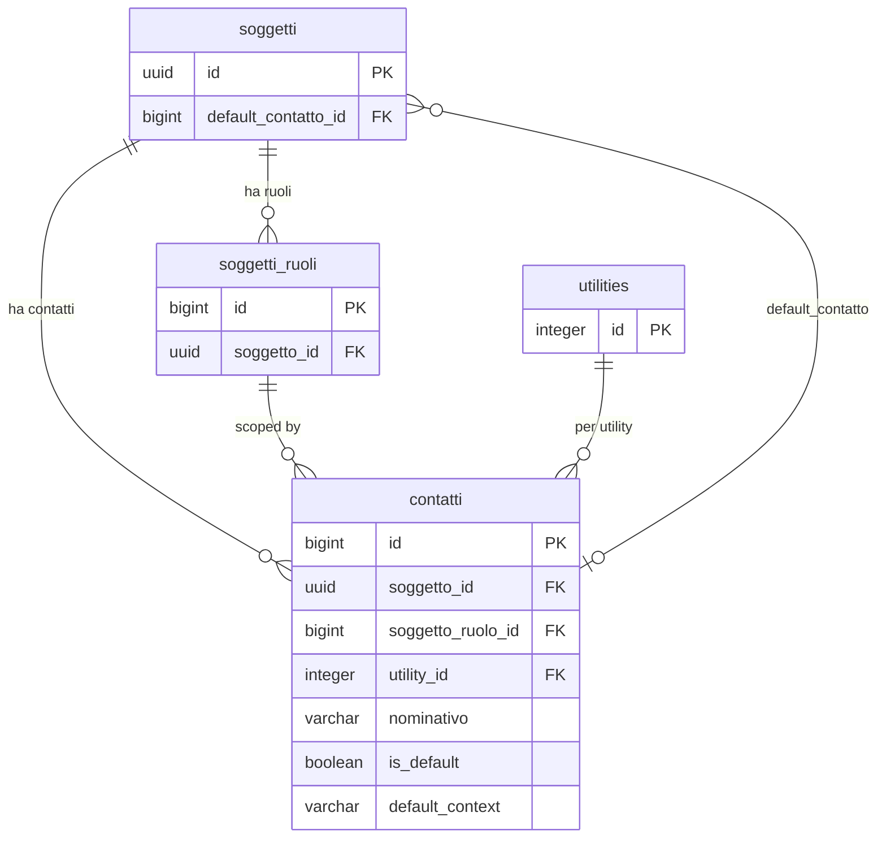
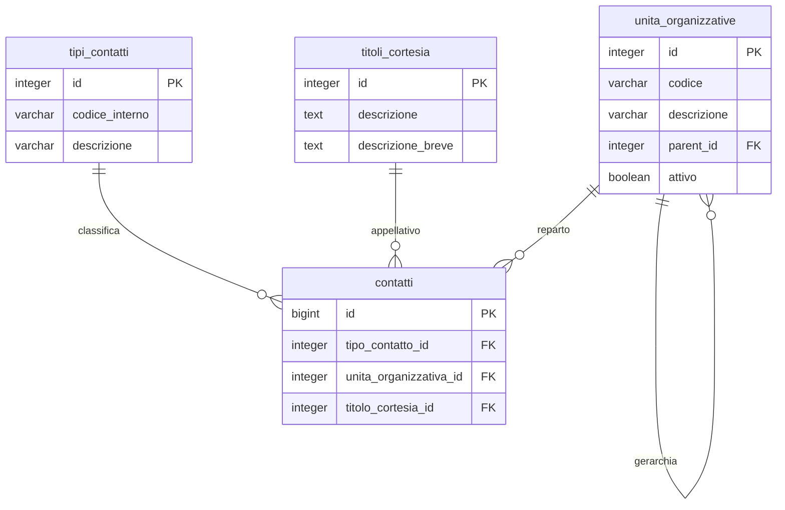

# Guida – Gestione dei Contatti

> (latest review 04-03-26)
>
> Destinatari: sviluppatori database, backend, integratori e analisti funzionali
>
> Questa guida si affianca alla guida gestione indirizzi come riferimento completo per la modellazione e l'utilizzo dei contatti nel sistema.
>
> Vedi anche
>
> * [Guida Soggetti & Ruoli](/guide/soggetti-e-ruoli-anagrafici)
> * [Guida Gestione degli Indirizzi](/guide/gestione-degli-indirizzi)
> * [Guida Generazione di un Cliente](/guide/generazione-cliente)

---

## Introduzione

In Zero ERP un **contatto** e una persona di riferimento (o un punto di comunicazione) associato a un soggetto. Mario Rossi, cliente, puo avere un referente commerciale, un referente tecnico e un contatto generico per la PEC — ciascuno con il proprio nome, email, telefono e collocazione organizzativa.

Il modello centralizza tutti i contatti in un'unica tabella (`anagrafiche.contatti`) e li organizza su **tre livelli di contesto**:

* **Soggetto**: il contatto generico della persona o azienda
* **Ruolo**: il contatto specifico per un ruolo del soggetto (es. il referente del cliente)
* **Utility**: il contatto per un servizio specifico (es. il referente per la fornitura gas)

Questa gerarchia permette al sistema di risolvere automaticamente il contatto piu appropriato: se un processo cerca il referente del cliente per un servizio e non lo trova, ricade sul referente del cliente, e poi su quello generico del soggetto.

**Cosa troverai in questa guida:**

* Come funziona il modello dei contatti e la logica dei contesti
* La distinzione tra unita organizzativa (reparto) e tipo contatto (categoria)
* Come vengono gestiti i contatti default e i trigger associati
* Le funzioni di lettura e il meccanismo di fallback
* Le regole di dominio e le best practice

---

## Tabelle coinvolte

**Anagrafiche:**

* [anagrafiche.contatti](/dbzero/anagrafiche/tabelle/contatti) — contatti del soggetto, del ruolo e della utility
* [anagrafiche.soggetti](/dbzero/anagrafiche/tabelle/soggetti) — il soggetto (contiene `default_contatto_id`)

**Configurazione:**

* [config.tipi_contatti](/dbzero/config/tabelle/tipi_contatti) — categorie di contatto (opzionale)
* [config.unita_organizzative](/dbzero/config/tabelle/unita_organizzative) — reparti/uffici (opzionale, gerarchico)
* [config.titoli_cortesia](/dbzero/config/tabelle/titoli_cortesia) — titoli di cortesia (Sig., Dott., ecc.)
* [config.utilities](/dbzero/config/tabelle/utilities) — servizi/utility

---

## Il modello in sintesi

```text
soggetti (chi sei)
    │
    ├── contatti (contesto: soggetto)
    │       contatti generici della persona/azienda
    │
    ├── soggetti_ruoli (cosa fai nel sistema)
    │       │
    │       └── contatti (contesto: ruolo)
    │               contatti specifici per il ruolo
    │
    └── utilities (quale servizio)
            │
            └── contatti (contesto: utility)
                    contatti specifici per il servizio
```

* **Contatto** = un punto di comunicazione con un nome, email, telefono, cellulare, PEC
* **Contesto** = il livello a cui il contatto e associato (soggetto, ruolo o utility)
* **Default** = un solo contatto predefinito per ogni contesto, gestito automaticamente

---

## Componenti del modello

### 1. La tabella contatti: il punto centrale

La tabella `anagrafiche.contatti` e l'unico punto in cui si registrano le informazioni di contatto. Ogni record contiene:

* **Nominativo** (obbligatorio): il nome della persona di riferimento
* **Canali di comunicazione** (opzionali): email, telefono, cellulare, PEC
* **Note**: informazioni libere
* **Default**: flag `is_default` e colonna `default_context` (gestiti dal trigger)

Ogni contatto e collegato a:

* **Un soggetto** (`soggetto_id` — obbligatorio): l'identita anagrafica
* **Un ruolo** (`soggetto_ruolo_id` — opzionale): il ruolo specifico del soggetto
* **Una utility** (`utility_id` — opzionale): il servizio specifico

La combinazione di questi tre campi determina il **contesto** del contatto.

Da un punto di vista tecnico:

* `id` (BIGINT) e la chiave primaria
* Il vincolo UNIQUE `uq_contatti_multilevel` su `(soggetto_id, soggetto_ruolo_id, utility_id, tipo_contatto_id)` impedisce contatti duplicati per la stessa combinazione
* La FK su `soggetto_id` e ON DELETE CASCADE: cancellando il soggetto si cancellano tutti i suoi contatti
* La FK su `soggetto_ruolo_id` e ON DELETE CASCADE: cancellando il ruolo si cancellano i contatti associati

---

### 2. Il contesto di un contatto

Il contesto determina a quale livello il contatto e operativo. Non viene specificato esplicitamente dall'utente: il trigger lo calcola automaticamente in base ai campi valorizzati.

| Contesto   | Significato                                 | Condizione                                        |
| ---------- | ------------------------------------------- | ------------------------------------------------- |
| `soggetto` | Contatto generale del soggetto              | `soggetto_ruolo_id` e `utility_id` entrambi NULL  |
| `ruolo`    | Contatto specifico di un ruolo              | `soggetto_ruolo_id` valorizzato                   |
| `utility`  | Contatto per un servizio specifico          | `utility_id` valorizzato                          |

L'esistenza di contatti a piu livelli permette al sistema di risolvere **fallback intelligenti**: se non esiste un contatto specifico per il ruolo, si usa quello del soggetto.

---

### 3. Unita organizzative e tipi contatto

Il modello distingue nettamente due concetti che hanno funzioni diverse.

**Unita organizzativa** (`unita_organizzativa_id`) — il **reparto/ufficio** a cui appartiene il referente. E la collocazione organizzativa della persona di contatto all'interno dell'azienda del soggetto. Esempi:

* Amministrazione (AMM)
* Tecnico (TEC)
* Commerciale (COM)
* Assistenza (AST)
* Legale (LEG)
* Supporto (SUP)
* Marketing (MKT)

La tabella `config.unita_organizzative` supporta una struttura gerarchica (`parent_id`) e un flag `attivo`. Il trigger impedisce di disattivare un'unita organizzativa se ci sono contatti che la referenziano.

**Tipo contatto** (`tipo_contatto_id`) — la **categoria** del contatto. Classifica il contatto in base alla sua funzione, non in base al reparto.

Entrambi i campi sono **opzionali** (nullable). Un contatto puo esistere senza essere classificato per reparto ne per categoria.

#### Perche non usare tipi "EMAIL / TELEFONO / PEC"?

Perche:

* i canali di comunicazione sono gia colonne dedicate sulla tabella contatti (`email`, `telefono`, `cellulare`, `pec`)
* un contatto puo avere piu canali contemporaneamente (email + telefono + PEC)
* la scelta del canale da usare e responsabilita dell'applicazione, non del modello dati

---

### 4. Titolo di cortesia

Il campo `titolo_cortesia_id` (opzionale) permette di associare un appellativo formale al contatto (Sig., Dott., Ing., ecc.) tramite la tabella `config.titoli_cortesia`.

---

## Contatto default e trigger

### Il meccanismo dei default

In ogni contesto puo esistere **un solo contatto default**. Il sistema gestisce questa regola automaticamente tramite il trigger `trgfn_contatti_set_default_contatto`, attivo su INSERT e UPDATE.

Il trigger:

1. **Determina il contesto** in base ai campi valorizzati (utility → ruolo → soggetto)
2. **Se il contatto e marcato default** (`is_default = TRUE`): rimuove il flag dagli altri contatti dello stesso soggetto con lo stesso contesto
3. **Se nessun default esiste nel contesto**: promuove automaticamente il contatto corrente a default
4. **Sincronizza il soggetto**: se il contesto e `soggetto`, aggiorna `anagrafiche.soggetti.default_contatto_id`

In pratica: il primo contatto inserito per un soggetto diventa automaticamente il default. Se un secondo contatto viene marcato come default, il primo perde il flag. Non serve gestire questa logica manualmente.

I contesti sono **indipendenti**: un soggetto puo avere un default a livello soggetto, un default diverso per il ruolo CLIENTE, e un altro per una utility. Non interferiscono tra loro.

Da un punto di vista tecnico, la logica del trigger:

```plpgsql
-- 1. Azzeramento contesto
NEW.default_context := NULL;

-- 2. Determinazione contesto
ctx := CASE
  WHEN NEW.utility_id        IS NOT NULL THEN 'utility'
  WHEN NEW.soggetto_ruolo_id IS NOT NULL THEN 'ruolo'
  ELSE 'soggetto'
END;

-- 3. Se is_default = TRUE: reset degli altri default dello stesso contesto
-- 4. Se nessun default esiste: auto-promozione
-- 5. Se contesto = 'soggetto': aggiorna soggetti.default_contatto_id
```

### Guard sull'integrita dei contatti

Il trigger `trgfn_soggetti_guard_soggetto_contatti`, attivo su `anagrafiche.soggetti` come constraint trigger DEFERRED, verifica al COMMIT che ogni soggetto abbia almeno un contatto valido (con `is_default = TRUE` o con almeno un canale valorizzato nel contesto `soggetto`).

Se la verifica fallisce, la transazione viene rifiutata con errore `E_SOGGETTO_NO_CONTATTI`.

**Quando scatta la protezione:** il guard si attiva su INSERT/UPDATE del soggetto. Questo copre lo scenario principale — la creazione di un soggetto senza contatti viene bloccata al COMMIT.

**Cosa non copre:** una DELETE diretta sull'ultimo contatto di un soggetto gia esistente non attiva il guard, perche l'evento e sulla tabella `contatti`, non su `soggetti`. In quel caso il soggetto resterebbe senza contatti validi. Attualmente la protezione su questo scenario non e implementata a livello DB: la prevenzione e affidata al livello applicativo (backend/API).

### Riepilogo trigger sulla tabella contatti

| Trigger | Timing | Evento | Cosa fa |
| --- | --- | --- | --- |
| `trgfn_contatti_set_default_contatto` | BEFORE | INSERT/UPDATE | Gestione default per contesto |
| `trgfn_audit_data_user_generic` | BEFORE | INSERT/UPDATE | Aggiorna `data_update`, `user_update` |
| `trgfn_tx_id_managed` | BEFORE | INSERT/UPDATE | Genera `tx_id` per tracciabilita |
| `trgfn_child_requires_active_parent` | AFTER | INSERT/UPDATE | Verifica che soggetto e unita organizzativa siano attivi |

---

## Recupero contatti: logica e funzioni

### `script.fn_get_contatti`

Restituisce il contatto **piu rilevante per ogni tipo contatto** (`tipo_contatto_id`), applicando una prioritizzazione a cascata:

1. soggetto + ruolo + utility (massima specificita)
2. soggetto + ruolo
3. soggetto + utility
4. soggetto (fallback)

A parita di priorita, preferisce il contatto marcato `is_default = TRUE`.

| Parametro | Tipo | Obbligatorio | Descrizione |
| --- | --- | :---: | --- |
| `p_soggetto_id` | UUID | si | Il soggetto di riferimento |
| `p_soggetto_ruolo_id` | BIGINT | no | Filtra per ruolo |
| `p_utility_id` | INTEGER | no | Filtra per utility |
| `p_tipo_contatto_id` | INTEGER | no | Filtra per tipo contatto |
| `p_unita_organizzativa_id` | INTEGER | no | Filtra per unita organizzativa |

La funzione e il punto d'ingresso consigliato quando serve una **mappa strutturata** dei contatti di un soggetto.

### `script.fn_get_contatto_default`

Richiama internamente `fn_get_contatti` e filtra il risultato per `is_default = TRUE`. Restituisce **zero o un** record: il contatto default migliore per i parametri forniti.

E la funzione consigliata quando serve **un singolo riferimento** (es. il contatto primario da usare in un documento o in una comunicazione).

---

## Regole di dominio

### R1 — Un contatto per combinazione

Il vincolo UNIQUE `uq_contatti_multilevel` su `(soggetto_id, soggetto_ruolo_id, utility_id, tipo_contatto_id)` garantisce che non possano esistere due contatti identici per la stessa combinazione di soggetto, ruolo, utility e tipo.

### R2 — Un solo default per contesto

Il trigger `trgfn_contatti_set_default_contatto` garantisce che in ogni contesto (soggetto, ruolo, utility) esista al piu un contatto con `is_default = TRUE`. Il primo contatto inserito in un contesto diventa default automaticamente.

### R3 — Integrita soggetto-contatti

Il constraint trigger DEFERRED `trgfn_soggetti_guard_soggetto_contatti` verifica al COMMIT che ogni soggetto abbia almeno un contatto valido nel contesto `soggetto` (con default o con almeno un canale attivo). Errore: `E_SOGGETTO_NO_CONTATTI`.

**Perimetro:** la verifica scatta su INSERT/UPDATE del soggetto. La cancellazione diretta dell'ultimo contatto non e intercettata a livello DB — va gestita a livello applicativo.

### R4 — Soggetto e unita organizzativa attivi

I trigger `trgfn_child_requires_active_parent` verificano che il soggetto referenziato e l'unita organizzativa (se indicata) siano attivi al momento dell'inserimento o aggiornamento.

### R5 — Fallback nella risoluzione

La funzione `fn_get_contatti` applica una catena di fallback automatica: utility → ruolo → soggetto. Il contatto del soggetto ha sempre priorita bassa come fallback, mai come override di un contatto piu specifico.

---

## Esempi pratici

### Caso 1 — Contatto globale del soggetto

Inserimento del contatto principale per un'azienda, senza specificare ruolo ne utility:

```sql
INSERT INTO anagrafiche.contatti (
  soggetto_id,
  unita_organizzativa_id,
  nominativo,
  email,
  telefono,
  is_default
) VALUES (
  'UUID-SOGGETTO',
  1,               -- Amministrazione
  'Mario Rossi',
  'info@acme.it',
  '0212345678',
  TRUE
);
```

Essendo il primo contatto, il trigger lo promuove a default nel contesto `soggetto` e aggiorna `soggetti.default_contatto_id`.

### Caso 2 — Contatto specifico per ruolo

Un referente tecnico legato al ruolo CLIENTE dello stesso soggetto:

```sql
INSERT INTO anagrafiche.contatti (
  soggetto_id,
  soggetto_ruolo_id,
  unita_organizzativa_id,
  nominativo,
  email,
  is_default
) VALUES (
  'UUID-SOGGETTO',
  10,              -- ruolo CLIENTE
  2,               -- Tecnico
  'Luca Bianchi',
  'tecnico@acme.it',
  TRUE
);
```

Il contesto sara `ruolo`. Questo contatto non interferisce con il default del contesto `soggetto`.

### Caso 3 — Recupero contatto default

```sql
-- Contatto default del ruolo (se esiste), altrimenti del soggetto
SELECT *
FROM script.fn_get_contatto_default(
  'UUID-SOGGETTO',
  10  -- ruolo
);
```

### Caso 4 — Mappa contatti per tipo

```sql
-- Un contatto per ogni tipo, con la priorita migliore
SELECT tipo_contatto_id, nominativo, email, telefono
FROM script.fn_get_contatti('UUID-SOGGETTO');
```

---

## Best practice

* Usare `fn_get_contatto_default` quando serve un singolo riferimento; `fn_get_contatti` quando serve l'elenco completo per tipo
* Non gestire manualmente `is_default` e `default_context` — sono responsabilita del trigger
* Specificare `unita_organizzativa_id` per classificare il contatto per reparto quando il dato e disponibile
* `tipo_contatto_id` e opzionale: usarlo per classificare il contatto per categoria quando serve
* Non creare tipi contatto per canale (EMAIL, TELEFONO, PEC) — i canali sono gia colonne dedicate
* Agire sempre tramite le funzioni `fn_get_*` per il recupero, non via query dirette sulla tabella
* Inserire soggetto e contatti nella stessa transazione: il guard e DEFERRED e verifica al COMMIT
* Evitare la proliferazione di tipi contatto simili: pochi tipi ben definiti sono meglio di molti ambigui

---

## Perche questo modello?

* **Centralizzazione**: tutti i contatti in un'unica tabella, nessuna frammentazione
* **Multi-contesto**: un soggetto puo avere contatti a livello globale, per ruolo e per servizio
* **Fallback intelligente**: le funzioni risolvono il contatto migliore senza logica nel chiamante
* **Default automatico**: il trigger gestisce la promozione e l'esclusivita senza intervento manuale
* **Estensibilita**: nuovi reparti e categorie si aggiungono nelle tabelle config senza toccare il modello

---

## Diagrammi ER

Il modello e suddiviso in due diagrammi per leggibilita.

### Relazioni principali (contatti e contesto)

La struttura centrale: il contatto collegato al soggetto, al ruolo e alla utility, con il riferimento `default_contatto_id` dal soggetto verso il contatto.



### Classificazione (configurazione)

Le tabelle config che classificano il contatto per categoria, reparto e appellativo.



---

## Note finali

Questa guida assume come gia compreso il modello soggetto/ruolo descritto nella [guida soggetti e ruoli](/guide/soggetti-e-ruoli-anagrafici).

Per approfondire:

* [Guida Gestione degli Indirizzi](/guide/gestione-degli-indirizzi) — modello indirizzi con policy master/fallback
* [Guida Generazione di un Cliente](/guide/generazione-cliente) — il flusso completo di creazione cliente, incluso contatto

---


