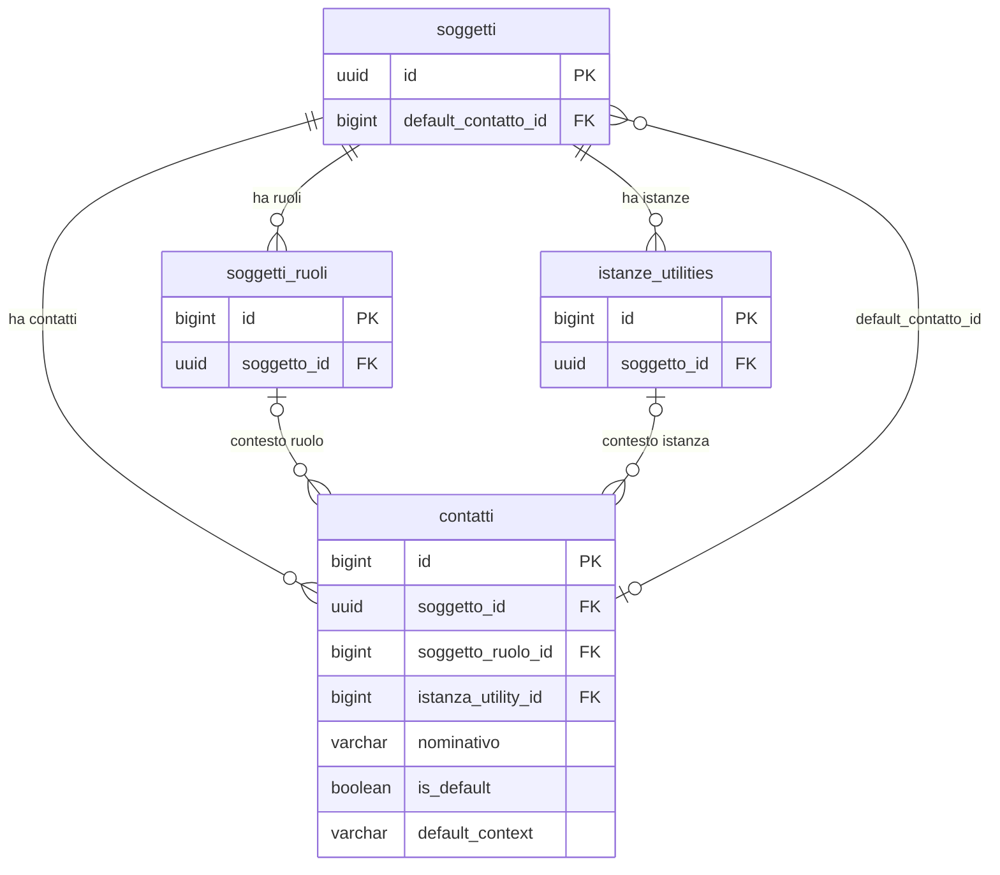
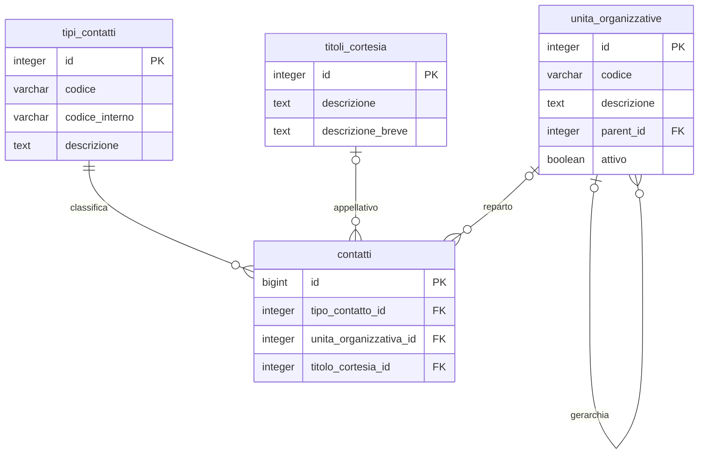

# Guida — Gestione dei Contatti

> **Ultimo aggiornamento**: 25 novembre 2026
>
> **Destinatari**: sviluppatori database, backend, integratori e analisti funzionali
>
> **Vedi anche** — schemi DB:
>
> * [anagrafiche.contatti](/dbzero/anagrafiche/tabelle/contatti) — i contatti del soggetto, col ruolo e l'istanza come contesto
> * [anagrafiche.soggetti](/dbzero/anagrafiche/tabelle/soggetti) — il soggetto, che punta al suo contatto predefinito
> * [anagrafiche.soggetti_ruoli](/dbzero/anagrafiche/tabelle/soggetti_ruoli) — i ruoli del soggetto
> * [anagrafiche.istanze_utilities](/dbzero/anagrafiche/tabelle/istanze_utilities) — le istanze di servizio del soggetto
> * [config.tipi_contatti](/dbzero/config/tabelle/tipi_contatti) — le categorie di contatto
> * [config.unita_organizzative](/dbzero/config/tabelle/unita_organizzative) — reparti e uffici, gerarchici
> * [config.titoli_cortesia](/dbzero/config/tabelle/titoli_cortesia) — gli appellativi (Sig., Dott., …)
>
> **Vedi anche** — funzioni e trigger DB:
>
> * [anagrafiche.fn_crea_contatto](/dbzero/anagrafiche/funzioni/fn_crea_contatto) — il verbo che fa nascere un contatto
> * [anagrafiche.trgfn_contatti_set_default_contatto](/dbzero/anagrafiche/funzioni/trgfn_contatti_set_default_contatto) — il predefinito di ogni riga di contesto
> * [anagrafiche.trgfn_contatti_guard_predefinito](/dbzero/anagrafiche/funzioni/trgfn_contatti_guard_predefinito) — il segno non si toglie: passa a un altro contatto
> * [anagrafiche.trgfn_contatti_guard_contesto_soggetto](/dbzero/anagrafiche/funzioni/trgfn_contatti_guard_contesto_soggetto) — ruolo e istanza sono del soggetto del contatto
> * [anagrafiche.trgfn_soggetti_guard_soggetto_contatti](/dbzero/anagrafiche/funzioni/trgfn_soggetti_guard_soggetto_contatti) — il soggetto ha almeno un contatto, al COMMIT
> * [script.fn_get_contatti](/dbzero/script/funzioni/fn_get_contatti) — un contatto per tipo, dal più specifico al soggetto
> * [script.fn_get_contatto_default](/dbzero/script/funzioni/fn_get_contatto_default) — zero o un contatto: il predefinito
>
> **Vedi anche** — guide correlate:
>
> * [Soggetti e Ruoli](/guide/soggetti-e-ruoli-anagrafici) — il modello soggetto/ruolo che questa guida dà per noto
> * [Gestione degli Indirizzi](/guide/gestione-degli-indirizzi) — l'altro modello a due livelli, soggetto e ruolo
> * [Generazione di un Cliente](/guide/generazione-cliente) — il flusso completo, contatto incluso

---

## Introduzione

In Zero ERP un **contatto** è una persona di riferimento di un soggetto, con i suoi recapiti. ACME S.r.l. può
avere un referente amministrativo, un referente tecnico per una sua fornitura e un contatto per la PEC, ciascuno
col suo nome, la sua email, il suo telefono e il suo reparto.

Tutti i contatti stanno in una tabella sola, `anagrafiche.contatti`. Ogni contatto è **del soggetto**, e può
indicare un ruolo del soggetto, una sua istanza o tutti e due come **contesto**: per che cosa quel contatto vale.

**Cosa troverai in questa guida:**

* il contatto e il suo contesto;
* come nasce un contatto;
* il contatto predefinito, e la sua chiave;
* il contatto obbligatorio del soggetto;
* come si legge il contatto da usare.

---

## Il modello in sintesi

```text
soggetti (chi è)
    │  default_contatto_id → il predefinito del contesto «soggetto»
    │
    ├── contatti senza ruolo né istanza        contesto: soggetto
    │
    ├── soggetti_ruoli (che cosa fa)
    │       └── contatti col ruolo             contesto: ruolo
    │
    └── istanze_utilities (quale fornitura)
            └── contatti con l'istanza         contesto: istanza
                (di solito anche col ruolo)
```

* **Contatto** = un nominativo, un tipo e i suoi recapiti (email, telefono, cellulare, PEC).
* **Contesto** = che cosa la riga indica oltre al soggetto: niente, un ruolo, un'istanza.
* **Predefinito** = uno e uno solo per ogni contesto che ha contatti, tenuto dal database.

---

## Il contatto

### È del soggetto; ruolo e istanza sono il contesto

Il soggetto è obbligatorio. Ruolo e istanza sono facoltativi, e devono essere **del soggetto del contatto**: il
database rifiuta il ruolo di un altro soggetto (`E_RUOLO_ALTRO_SOGGETTO`) e l'istanza di un altro soggetto
(`E_ISTANZA_ALTRO_SOGGETTO`), anche quando una modifica sposta il contatto su un altro soggetto. Vedi
[il guard del contesto](/dbzero/anagrafiche/funzioni/trgfn_contatti_guard_contesto_soggetto).

Il contesto non lo sceglie chi scrive: lo dice la riga. È la terna (soggetto, ruolo, istanza): il cliente e il
fornitore dello stesso soggetto sono due contesti, il ruolo cliente su un'istanza un terzo. Il suo **livello** è
`istanza` con un'istanza, altrimenti `ruolo` con un ruolo, altrimenti `soggetto`.

Un contatto con l'istanza ha sempre anche il ruolo: è il referente di quel ruolo per quell'istanza. L'istanza
senza ruolo è rifiutata dal vincolo `chk_contatti_istanza_con_ruolo`.

### Nominativo, tipo, reparto e recapiti

* **Nominativo** e **tipo di contatto** (`tipo_contatto_id`) sono obbligatori. Il tipo è la **categoria** del
  contatto, per la funzione che svolge.
* L'**unità organizzativa** (`unita_organizzativa_id`) è il **reparto** del referente (amministrazione, tecnico,
  commerciale, …), ed è facoltativa. Le unità organizzative sono gerarchiche, e una che un contatto nomina non si
  disattiva.
* I **recapiti** (email, telefono, cellulare, PEC) sono colonne della riga, tutte facoltative.
* Il **titolo di cortesia** dà l'appellativo al nominativo.

#### Perché non ci sono tipi «EMAIL / TELEFONO / PEC»

I canali sono già colonne del contatto, e un contatto ne ha spesso più d'uno: la categoria dice chi è il
referente, non come lo si raggiunge. La scelta del canale da usare spetta all'applicazione.

### Un contatto per tipo in ogni contesto

Sullo stesso soggetto non stanno due contatti dello stesso tipo senza ruolo né istanza; sullo stesso ruolo, due
dello stesso tipo senza istanza; sullo stesso ruolo e istanza, due dello stesso tipo. Sono tre indici unici
parziali, uno per livello, elencati nella [scheda della tabella](/dbzero/anagrafiche/tabelle/contatti). Poiché un
contatto d'istanza ha sempre il ruolo, i tre indici coprono ogni contatto.

Il secondo contatto dello stesso tipo nello stesso contesto, creato col verbo, è rifiutato con
`E_CONTATTO_TIPO_DUPLICATO` sul campo del tipo, e la frase dice il livello. Una modifica diretta che urta un indice
arriva come violazione del vincolo, col suo nome.

---

## Come nasce un contatto

Un contatto nasce con [anagrafiche.fn_crea_contatto](/dbzero/anagrafiche/funzioni/fn_crea_contatto): il soggetto,
il ruolo (vuoto per un contatto del soggetto) e i campi del contatto, in un elenco chiuso. Un contatto senza
nominativo o senza tipo, o con un tipo che non è un numero intero positivo, è rifiutato (`E_CONTATTO_INCOMPLETO`,
col campo che manca); un tipo che il catalogo non ha è `E_TIPO_CONTATTO_NON_TROVATO`; una chiave fuori elenco è
rifiutata col suo nome (`E_CAMPO_NON_AMMESSO`). `default_context` non è fra le chiavi: lo scrive il database.

È la sede unica: la usano i verbi di nascita del soggetto, che creano il suo primo contatto nella stessa
chiamata, quelli del cliente e del fornitore per il contatto del ruolo, la creazione degli utenti tecnici e
l'applicazione. Se creare un contatto facoltativo lo decide l'applicazione; come si scrive lo decide il database.

### Il tipo proposto

Quando chi crea un soggetto non dice il tipo del suo primo contatto, il database scrive il tipo **proposto**:
il parametro `TIPO_CONTATTO_PROPOSTO`, che si può cambiare per utente, per azienda o per la singola funzione.
Lo leggono le due porte di nascita del soggetto e la creazione degli utenti tecnici, tutte dalla stessa sede,
[script.fn_tipo_contatto_proposto_id](/dbzero/script/manual/fn_tipo_contatto_proposto_id). Un parametro che manca
o indica un tipo che non esiste ferma la creazione: il database non ripiega su un tipo «a caso».

---

## Il contatto predefinito

La regola la tengono [anagrafiche.trgfn_contatti_set_default_contatto](/dbzero/anagrafiche/funzioni/trgfn_contatti_set_default_contatto),
che mette il segno, e [anagrafiche.trgfn_contatti_guard_predefinito](/dbzero/anagrafiche/funzioni/trgfn_contatti_guard_predefinito),
che giudica chi lo toglie. Nelle loro schede c'è per intero; qui l'essenziale.

### La chiave è la riga di contesto

C'è **uno e un solo** predefinito per ogni contesto (soggetto, ruolo, istanza) che ha contatti, come per il conto
bancario predefinito. Ogni ruolo ha il suo: marcare il contatto del fornitore non tocca quello del cliente.
L'unicità la scrive l'indice `uq_contatti_predefinito_contesto`.

### Il primo è predefinito; si cambia marcandone un altro

* Il primo contatto che entra in un contesto senza predefinito lo diventa, anche se nessuno lo chiede. Entra nel
  contesto chi nasce, o chi cambia soggetto, ruolo o istanza.
* Un contatto marcato predefinito toglie il segno a quello di prima nello stesso contesto.
* Un contatto spostato in un contesto che ha già il suo predefinito entra senza segno.
* `is_default` e `default_context` li tiene il database: `default_context` è il livello del predefinito, e sugli
  altri è vuoto.

Il predefinito del contesto del soggetto è anche il puntatore `anagrafiche.soggetti.default_contatto_id`, che il
trigger scrive quando un contatto lo diventa.

### Che cosa è rifiutato

* Togliere il segno al predefinito: `E_CONTATTO_PREDEFINITO_OBBLIGATORIO`. Il segno non si toglie, passa a un
  altro contatto.
* Cancellare il predefinito, o spostarlo in un altro contesto, quando nel suo restano altri contatti:
  `E_CONTATTO_PREDEFINITO_DA_SOSTITUIRE`. Prima si marca un altro contatto.
* L'ultimo contatto di un contesto si cancella. Il database non promuove nessuno da solo.

Il contatto a cui il soggetto punta non si cancella finché un altro non diventa predefinito al suo posto: la
chiave esterna lo rifiuta al COMMIT.

---

## Il soggetto ha almeno un contatto

[anagrafiche.trgfn_soggetti_guard_soggetto_contatti](/dbzero/anagrafiche/funzioni/trgfn_soggetti_guard_soggetto_contatti)
controlla al COMMIT di ogni nascita e di ogni modifica del soggetto che abbia un contatto predefinito o un
contatto con un recapito, di **qualunque** contesto. Poiché il primo contatto di ogni contesto nasce predefinito,
in pratica chiede «almeno un contatto». Senza, il rifiuto è `E_SOGGETTO_NO_CONTATTI`.

Il controllo è differito perché il soggetto si scrive per primo e il contatto dopo, nella stessa transazione. I
verbi di nascita del soggetto rispettano quest'ordine da soli.

⚠️ Due cose il controllo non copre:

* **l'ultimo contatto cancellato**: il controllo scatta sulle scritture del soggetto, non su quelle dei contatti, e
  il soggetto resta senza contatti fino alla sua prossima modifica, che allora è rifiutata;
* **la disattivazione del soggetto**: i contatti la bloccano finché esistono, perché non hanno un loro `attivo`, e
  tolti tutti è la disattivazione stessa a non passare il controllo. Oggi un soggetto con contatti non si
  disattiva.

---

## La vita del contatto

* Un contatto si scrive su un soggetto **attivo** e con un'unità organizzativa attiva (controllo al COMMIT,
  quando nasce o cambia soggetto o reparto).
* Cancellare il soggetto cancella i suoi contatti.
* Un ruolo o un'istanza che un contatto nomina non si cancella finché il contatto c'è.

---

## La lettura: il contatto da usare

### `script.fn_get_contatti`

Per un soggetto, e se servono un ruolo, un'istanza, un tipo e un reparto, restituisce **un contatto per tipo**:

1. quello dell'istanza chiesta (col ruolo chiesto);
2. poi quello del ruolo chiesto, senza istanza;
3. poi quello del soggetto.

Senza reparto fra i parametri contano tutti i contatti; con un reparto contano quelli del reparto e quelli senza.
A parità di livello vince il contatto del reparto chiesto, poi il predefinito, poi quello con l'id più basso. Il
soggetto è obbligatorio (`E_CONTATTI_SOGGETTO_OBBLIGATORIO`). Firma e parametri sono nella
[scheda della funzione](/dbzero/script/funzioni/fn_get_contatti).

### `script.fn_get_contatto_default`

Prende i contatti di `fn_get_contatti` e tiene i predefiniti: restituisce **zero o un** contatto. È quella da
usare quando serve un riferimento solo (il contatto di un documento, di una comunicazione). Se fra i tipi
risultano più predefiniti, vince il contesto più specifico, l'istanza, poi il ruolo, poi il soggetto: la stessa
regola della cascata. A parità, l'id più basso.

---

## Buone pratiche

* Creare i contatti con `fn_crea_contatto`, non con una scrittura diretta sulla tabella.
* Non impostare `default_context`: lo scrive il database. Per cambiare il predefinito si marca il contatto nuovo;
  il segno non si toglie.
* Leggere con `fn_get_contatti` e `fn_get_contatto_default`, non con query dirette.
* Scegliere il tipo giusto fa parte dell'inserimento; il reparto si indica quando il dato c'è.
* Non creare tipi di contatto per canale, e tenere pochi tipi ben distinti.

---

## Diagrammi ER

### Contatti e contesto



### Classificazione (configurazione)



---

## Area tecnica — esempi

**Il contatto di un soggetto** — senza ruolo né istanza, il contesto è `soggetto`; se il soggetto non ha ancora un
predefinito in quel contesto, questo lo diventa:

```sql
SELECT anagrafiche.fn_crea_contatto(
    'UUID-SOGGETTO',
    NULL,
    jsonb_build_object('tipo_contatto_id', 1,
                       'nominativo', 'Mario Rossi',
                       'email', 'info@acme.it',
                       'telefono', '0212345678'));
```

**Il contatto del ruolo, marcato predefinito** — il contesto è quel ruolo: toglie il segno al predefinito dello
stesso ruolo, e non tocca quello degli altri ruoli né quello del soggetto:

```sql
SELECT anagrafiche.fn_crea_contatto(
    'UUID-SOGGETTO',
    10,  -- il ruolo
    jsonb_build_object('tipo_contatto_id', 1,
                       'nominativo', 'Luca Bianchi',
                       'email', 'tecnico@acme.it',
                       'unita_organizzativa_id', 2,
                       'is_default', true));
```

**Cambiare il predefinito** — si marca il contatto nuovo; il vecchio perde il segno da solo:

```sql
UPDATE anagrafiche.contatti SET is_default = true WHERE id = 1234;
```

**Il predefinito da usare in un documento** — zero o un contatto: il predefinito fra quelli che `fn_get_contatti`
sceglie per il ruolo:

```sql
SELECT *
  FROM script.fn_get_contatto_default('UUID-SOGGETTO', 10);
```

**Un contatto per tipo** — già scelto dal più specifico al soggetto:

```sql
SELECT tipo_contatto_id, nominativo, email, telefono
  FROM script.fn_get_contatti('UUID-SOGGETTO');
```

---


