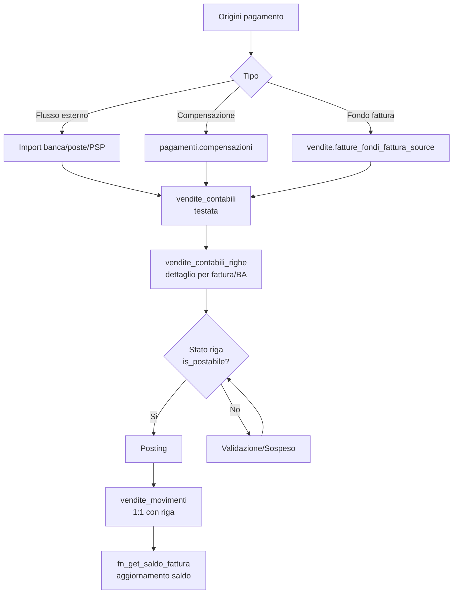
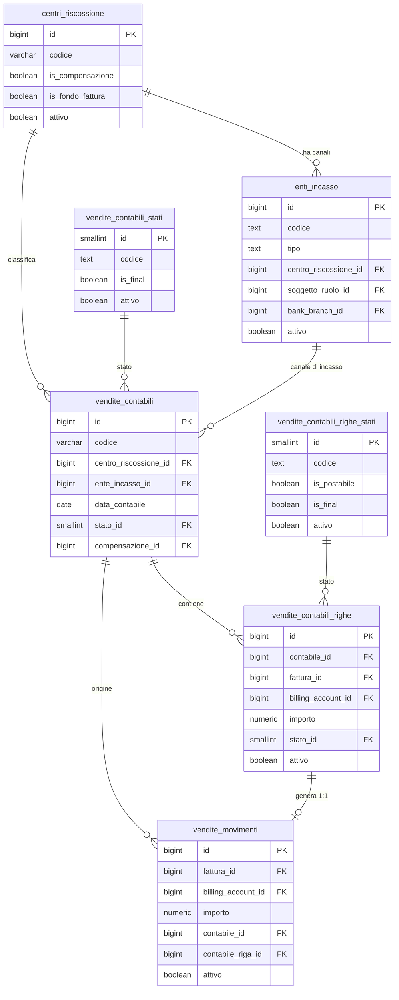
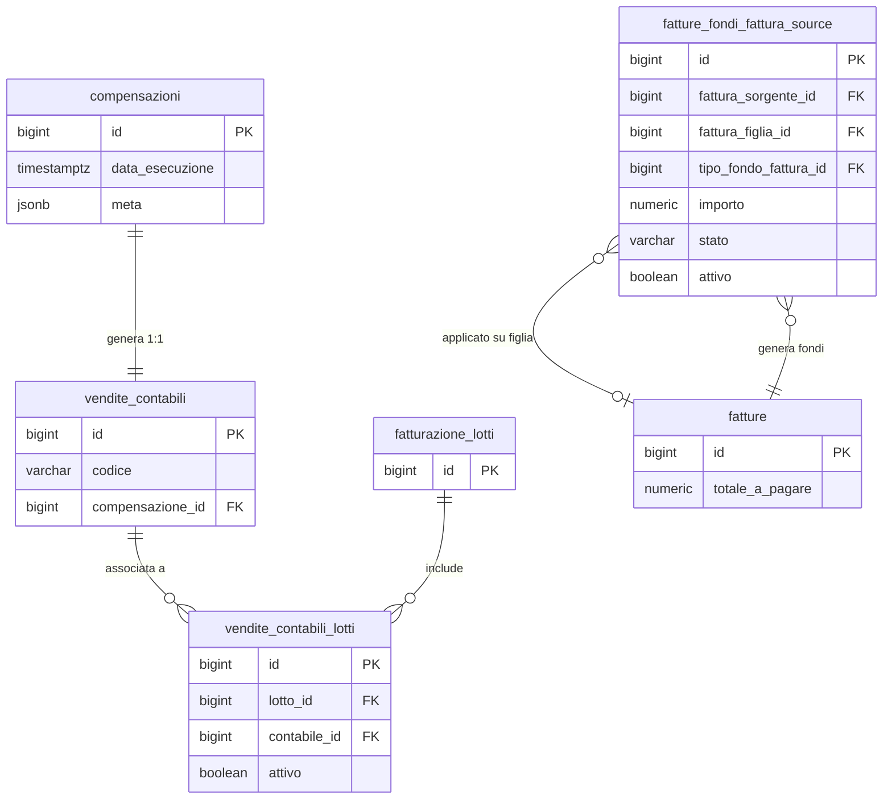

# Guida – Gestione dei Pagamenti Vendite

> (latest review 04-03-26)
>
> Destinatari: sviluppatori database e backend
>
> Questa guida descrive il modello contabile dei pagamenti vendite in Zero ERP:
> centri di riscossione, enti di incasso, testate contabili, righe, movimenti
> effettivi, compensazioni e fondi fattura.
>
> Vedi anche
>
> * [Guida Fatturazione](/fatturazione) — ciclo di vita delle fatture
> * [Guida Gestione Conti Bancari](/guide/gestione-conti-bancari) — IBAN, filiali, SEPA
> * [Guida Tracciamento Processi e Job](/guide/Analisi-tracciamento-processi-e-job) — pipeline e task run

---

## Introduzione

Il dominio pagamenti vendite gestisce il ciclo di vita dell'incasso: dalla ricezione di un flusso bancario o di un automatismo interno, fino alla registrazione del movimento effettivo sulla fattura.

Il modello non e centrato sul movimento finale, ma sulla **contabile**: un documento intermedio che raccoglie, valida e prepara gli importi prima di materializzarli come movimenti definitivi. Questa scelta architetturale permette di trattare flussi eterogenei (banche, poste, PSP, compensazioni, fondi fattura) con un unico percorso di controllo e validazione.

Il principio fondamentale e che la scrittura diretta in `vendite_movimenti` e un'eccezione tecnica, non il percorso operativo standard. Ogni incasso o rimborso deve passare attraverso una testata contabile e le relative righe, per poi generare i movimenti solo dopo il posting.

**Cosa troverai in questa guida:**

* La struttura dei centri di riscossione e degli enti di incasso
* Il modello contabile: testate, righe, stati e posting
* I movimenti effettivi e il legame 1:1 con le righe contabili
* Le compensazioni e i fondi fattura come flussi automatici
* Le funzioni di saldo e di creazione/recupero contabile
* Le regole di dominio applicate dai trigger di guardia

---

## Tabelle coinvolte

**Configurazione:**

* [pagamenti.centri_riscossione](/dbzero/pagamenti/tabelle/centri_riscossione) — origini di incasso
* [pagamenti.enti_incasso](/dbzero/pagamenti/tabelle/enti_incasso) — canali fisici di incasso

**Transazionali:**

* [pagamenti.vendite_contabili](/dbzero/pagamenti/tabelle/vendite_contabili) — testata contabile
* [pagamenti.vendite_contabili_righe](/dbzero/pagamenti/tabelle/vendite_contabili_righe) — dettaglio righe
* [pagamenti.vendite_movimenti](/dbzero/pagamenti/tabelle/vendite_movimenti) — movimenti effettivi
* [pagamenti.compensazioni](/dbzero/pagamenti/tabelle/compensazioni) — testate di compensazione
* [pagamenti.vendite_contabili_lotti](/dbzero/pagamenti/tabelle/vendite_contabili_lotti) — legame contabile-lotto

**Lookup stati:**

* [pagamenti.vendite_contabili_stati](/dbzero/pagamenti/tabelle/vendite_contabili_stati) — stati della testata
* [pagamenti.vendite_contabili_righe_stati](/dbzero/pagamenti/tabelle/vendite_contabili_righe_stati) — stati della riga (con `is_postabile`)

**Cross-schema:**

* [vendite.fatture_fondi_fattura_source](/dbzero/vendite/tabelle/fatture_fondi_fattura_source) — sorgenti fondi fattura

**Funzioni:**

* [pagamenti.fn_get_or_create_vendite_contabile](/dbzero/pagamenti/funzioni/fn_get_or_create_vendite_contabile) — creazione o recupero testata
* [pagamenti.fn_get_saldo_fattura_contabili](/dbzero/pagamenti/funzioni/fn_get_saldo_fattura_contabili) — saldo contabile in lavorazione
* [pagamenti.fn_get_saldo_fattura](/dbzero/pagamenti/funzioni/fn_get_saldo_fattura) — saldo finanziario effettivo

---

## Il modello in sintesi

```text
pagamenti
├── centri_riscossione              -- origini incasso (banca, poste, cassa, compensazione, fondo fattura)
│   └── enti_incasso                -- canali fisici (filiale, ufficio postale, PSP)
├── compensazioni                   -- processo di compensazione fatture
├── vendite_contabili               -- testata contabile (punto unico d'ingresso)
│   ├── vendite_contabili_righe     -- dettaglio per fattura/BA/importo
│   │   └── vendite_movimenti      -- movimento effettivo 1:1 con riga
│   └── vendite_contabili_lotti     -- legame N:M con lotti di fatturazione
├── vendite_contabili_stati         -- lookup stati testata (con is_final)
└── vendite_contabili_righe_stati   -- lookup stati riga (con is_postabile, is_final)

vendite
└── fatture_fondi_fattura_source    -- sorgenti fondi fattura (minimi, riaddebiti)
```

---

## Centri di riscossione e enti di incasso

### Centri di riscossione

I centri di riscossione rappresentano le **origini logiche** dell'incasso: banca, posta, cassa, compensazione, fondo fattura. Ogni centro identifica una categoria di provenienza dei pagamenti, non un canale fisico specifico.

Due flag booleani distinguono i centri speciali:

* `is_compensazione` — identifica il centro dedicato alle compensazioni (un solo centro puo averlo attivo)
* `is_fondo_fattura` — identifica il centro per i movimenti automatici di fondo fattura

Un centro non puo essere contemporaneamente di compensazione e di fondo fattura.

Da un punto di vista tecnico:

| Colonna            | Tipo            | Nullable | Descrizione                                                |
| ------------------ | --------------- | :------: | ---------------------------------------------------------- |
| `id`               | BIGINT, PK      |    no    | Chiave primaria                                            |
| `codice`           | VARCHAR, UNIQUE |    no    | Codice identificativo                                      |
| `codice_interno`   | VARCHAR         |    si    | Codice interno applicativo                                 |
| `descrizione`      | VARCHAR         |    no    | Descrizione leggibile                                      |
| `is_compensazione` | BOOLEAN         |    no    | Flag centro compensazione (default: false)                 |
| `is_fondo_fattura` | BOOLEAN         |    no    | Flag centro fondo fattura (default: false)                 |
| `attivo`           | BOOLEAN         |    no    | Flag attivo/disattivo (default: true)                      |
| `meta`             | JSONB           |    no    | Metadati estensibili                                       |
| Campi audit        | —               |    —     | `data_insert`, `user_insert`, `data_update`, `user_update` |

**Vincolo UNIQUE:** `uq_centri_riscossione_compensazione` su `(is_compensazione)` — garantisce al massimo un centro di compensazione nel sistema.

**Protezioni:** trigger `trgfn_prevent_deactivate_if_children` impedisce la disattivazione se esistono enti incasso, contabili o movimenti collegati.

> Documentazione dettagliata: [pagamenti.centri_riscossione](/dbzero/pagamenti/tabelle/centri_riscossione)

---

### Enti di incasso

Gli enti di incasso rappresentano i **canali fisici** attraverso cui arrivano i pagamenti: una filiale bancaria, un ufficio postale, un Payment Service Provider (PSP). Ogni ente appartiene a un centro di riscossione e puo essere associato a un soggetto con ruolo anagrafico.

Il campo `tipo` ammette quattro valori: `BANCA`, `POSTE`, `PSP`, `ALTRO`. Le regole di validazione dipendono dal tipo:

* Se `tipo = BANCA`: `bank_branch_id` obbligatorio (filiale bancaria)
* Se `tipo = PSP`: `soggetto_ruolo_id` obbligatorio, con validazione del ruolo tramite `trgfn_enti_incasso_guard_psp`
* Negli altri casi: `bank_branch_id` deve essere NULL

Da un punto di vista tecnico:

| Colonna                 | Tipo         | Nullable | Descrizione                                                         |
| ----------------------- | ------------ | :------: | ------------------------------------------------------------------- |
| `id`                    | BIGINT, PK   |    no    | Chiave primaria                                                     |
| `codice`                | TEXT, UNIQUE |    no    | Codice identificativo                                               |
| `codice_interno`        | TEXT         |    si    | Codice interno applicativo                                          |
| `descrizione`           | TEXT         |    no    | Descrizione leggibile                                               |
| `tipo`                  | TEXT         |    no    | Tipo canale (`BANCA`, `POSTE`, `PSP`, `ALTRO`)                      |
| `centro_riscossione_id` | BIGINT, FK   |    si    | Centro di riscossione di appartenenza                               |
| `soggetto_ruolo_id`     | BIGINT, FK   |    si    | Soggetto con ruolo anagrafico                                       |
| `bank_branch_id`        | BIGINT, FK   |    si    | Filiale bancaria (obbligatoria per `BANCA`)                         |
| `formato_flusso`        | TEXT         |    si    | Formato del flusso importato                                        |
| `regole_match`          | JSONB        |    no    | Regole di abbinamento flusso                                        |
| `attivo`                | BOOLEAN      |    no    | Flag attivo/disattivo (default: true)                               |
| `meta`                  | JSONB        |    no    | Metadati estensibili                                                |
| Campi audit             | —            |    —     | `data_insert`, `user_insert`, `data_update`, `user_update`, `tx_id` |

**Vincoli CHECK:**

* `chk_enti_incasso_tipo` — valida i valori ammessi per `tipo`
* `chk_enti_incasso_bank_branch_tipo` — `bank_branch_id` obbligatorio se e solo se `tipo = BANCA`

**Trigger di guardia PSP:** il trigger `trgfn_enti_incasso_guard_psp` (BEFORE INSERT/UPDATE) verifica che per `tipo = PSP` il `soggetto_ruolo_id` appartenga a un ruolo con `codice_interno = 'PSP'` e che esista un record attivo in `anagrafiche.psp`.

> Documentazione dettagliata: [pagamenti.enti_incasso](/dbzero/pagamenti/tabelle/enti_incasso)

---

## Testata contabile: `vendite_contabili`

La testata contabile e il punto unico d'ingresso per ogni pagamento, sia che provenga da un flusso bancario, da una compensazione automatica o da un fondo fattura. Ogni testata identifica un'operazione contabile con la sua data, il centro di riscossione, l'eventuale ente di incasso e lo stato di lavorazione.

La testata puo essere collegata a una compensazione (`compensazione_id`) oppure a uno o piu lotti di fatturazione (tramite la tabella di legame `vendite_contabili_lotti`), ma **mai a entrambi**: questa mutua esclusione e applicata dai trigger di guardia.

Da un punto di vista tecnico:

| Colonna                 | Tipo               | Nullable | Descrizione                                                         |
| ----------------------- | ------------------ | :------: | ------------------------------------------------------------------- |
| `id`                    | BIGINT, PK         |    no    | Chiave primaria                                                     |
| `codice`                | VARCHAR, UNIQUE    |    no    | Codice univoco (auto-generato: `VC_<timestamp>_<random8>`)          |
| `centro_riscossione_id` | BIGINT, FK         |    no    | Centro di riscossione                                               |
| `ente_incasso_id`       | BIGINT, FK         |    si    | Ente di incasso (opzionale)                                         |
| `data_contabile`        | DATE               |    no    | Data contabile dell'operazione                                      |
| `data_registrazione`    | DATE               |    no    | Data di registrazione                                               |
| `stato_id`              | SMALLINT, FK       |    si    | Stato della testata                                                 |
| `compensazione_id`      | BIGINT, FK, UNIQUE |    si    | Compensazione collegata (1:1)                                       |
| `data_conferma`         | TIMESTAMPTZ        |    si    | Data di conferma/posting                                            |
| `user_conferma`         | TEXT               |    si    | Utente che ha confermato                                            |
| `meta`                  | JSONB              |    no    | Metadati estensibili                                                |
| Campi audit             | —                  |    —     | `data_insert`, `user_insert`, `data_update`, `user_update`, `tx_id` |

**Vincoli UNIQUE:**

* `uq_vendite_contabili_codice` su `(codice)` — codice univoco per testata
* `uq_vendite_contabili_compensazione` su `(compensazione_id)` — una sola testata per compensazione

**Trigger principali:**

* `trgfn_vendite_contabili_guard_ente_centro` — coerenza ente/centro e regole compensazione
* `trgfn_child_requires_active_parent` — su `centri_riscossione`, `enti_incasso` e `vendite_contabili_stati`
* `trgfn_audit_data_user_generic`, `trgfn_tx_id_managed` — audit e gestione `tx_id`

> Documentazione dettagliata: [pagamenti.vendite_contabili](/dbzero/pagamenti/tabelle/vendite_contabili)

---

## Righe contabili: `vendite_contabili_righe`

Ogni testata contabile contiene una o piu righe, ciascuna riferita a una fattura e/o a un billing account. La riga specifica l'importo del pagamento, le date operative e lo stato di lavorazione.

Lo stato della riga e gestito dalla lookup `vendite_contabili_righe_stati`, che include il flag `is_postabile`: solo le righe in stato postabile possono generare movimenti effettivi tramite il processo di posting.

La disattivazione di una riga (`attivo = false`) e bloccata se esistono movimenti collegati.

Da un punto di vista tecnico:

| Colonna              | Tipo         | Nullable | Descrizione                                                         |
| -------------------- | ------------ | :------: | ------------------------------------------------------------------- |
| `id`                 | BIGINT, PK   |    no    | Chiave primaria                                                     |
| `contabile_id`       | BIGINT, FK   |    no    | Testata contabile di appartenenza                                   |
| `fattura_id`         | BIGINT, FK   |    si    | Fattura collegata                                                   |
| `billing_account_id` | BIGINT, FK   |    si    | Billing account collegato                                           |
| `importo`            | NUMERIC      |    no    | Importo (CHECK: diverso da zero)                                    |
| `stato_id`           | SMALLINT, FK |    no    | Stato della riga                                                    |
| `riferimento_ente`   | TEXT         |    si    | Riferimento dell'ente incasso                                       |
| `data_pagamento`     | DATE         |    si    | Data del pagamento                                                  |
| `data_valuta`        | DATE         |    si    | Data valuta                                                         |
| `data_operazione`    | DATE         |    si    | Data operazione                                                     |
| `motivo_sospeso`     | TEXT         |    si    | Motivazione per stato sospeso                                       |
| `attivo`             | BOOLEAN      |    no    | Flag attivo (default: true)                                         |
| `meta`               | JSONB        |    no    | Metadati estensibili                                                |
| Campi audit          | —            |    —     | `data_insert`, `user_insert`, `data_update`, `user_update`, `tx_id` |

**Vincoli CHECK:** `chk_vendite_contabili_righe_importo_non_zero` — l'importo non puo essere zero.

**Protezione disattivazione:** trigger `trgfn_prevent_deactivate_if_children` blocca la disattivazione se esistono movimenti con `contabile_riga_id` che referenziano la riga.

> Documentazione dettagliata: [pagamenti.vendite_contabili_righe](/dbzero/pagamenti/tabelle/vendite_contabili_righe)

---

## Movimenti effettivi: `vendite_movimenti`

Il movimento effettivo rappresenta l'incasso o il rimborso definitivo registrato sulla fattura. E il risultato finale del ciclo contabile: viene creato solo dopo il posting della riga contabile corrispondente.

Il legame tra riga contabile e movimento e 1:1, garantito dall'indice parziale `uq_vendite_movimenti_contabile_riga` su `(contabile_riga_id) WHERE contabile_riga_id IS NOT NULL`. Quando un movimento nasce da una riga contabile, il trigger `trgfn_vendite_movimenti_sync_contabile_from_riga` sincronizza automaticamente `contabile_id`, `fattura_id` e `billing_account_id` dalla riga, bloccando eventuali mismatch espliciti.

Da un punto di vista tecnico:

| Colonna                      | Tipo       | Nullable | Descrizione                                                         |
| ---------------------------- | ---------- | :------: | ------------------------------------------------------------------- |
| `id`                         | BIGINT, PK |    no    | Chiave primaria                                                     |
| `fattura_id`                 | BIGINT, FK |    no    | Fattura di riferimento                                              |
| `billing_account_id`         | BIGINT, FK |    no    | Billing account                                                     |
| `importo`                    | NUMERIC    |    no    | Importo del movimento                                               |
| `data_effettiva`             | DATE       |    no    | Data effettiva dell'incasso                                         |
| `data_registrazione`         | DATE       |    no    | Data registrazione                                                  |
| `data_contabile`             | DATE       |    si    | Data contabile                                                      |
| `data_contabilizzazione`     | DATE       |    si    | Data di contabilizzazione                                           |
| `data_valuta`                | DATE       |    si    | Data valuta                                                         |
| `data_per_calcolo_interessi` | DATE       |    si    | Data per il calcolo interessi                                       |
| `escluso_da_interessi`       | BOOLEAN    |    no    | Esclusione dal calcolo interessi (default: false)                   |
| `contabile_id`               | BIGINT, FK |    si    | Testata contabile di origine                                        |
| `contabile_riga_id`          | BIGINT, FK |    si    | Riga contabile di origine (UNIQUE parziale)                         |
| `centro_riscossione_id`      | BIGINT, FK |    si    | Centro di riscossione                                               |
| `attivo`                     | BOOLEAN    |    no    | Flag attivo (default: true)                                         |
| `meta`                       | JSONB      |    no    | Metadati estensibili                                                |
| Campi audit                  | —          |    —     | `data_insert`, `user_insert`, `data_update`, `user_update`, `tx_id` |

**Indice UNIQUE parziale:** `uq_vendite_movimenti_contabile_riga` su `(contabile_riga_id) WHERE contabile_riga_id IS NOT NULL` — ogni riga contabile genera al massimo un movimento.

**Trigger principali:**

* `trgfn_vendite_movimenti_sync_contabile_from_riga` — sincronizza contabile/fattura/BA dalla riga
* `trgfn_guard_emittente_scope` — verifica lo scope emittente sulla fattura
* `trgfn_child_requires_active_parent` — su `centri_riscossione` e `vendite_contabili_righe`

> Documentazione dettagliata: [pagamenti.vendite_movimenti](/dbzero/pagamenti/tabelle/vendite_movimenti)

---

## Lookup stati

### Stati testata: `vendite_contabili_stati`

Ogni testata contabile ha uno stato che ne governa il ciclo di vita. Il flag `is_final` indica se lo stato e definitivo (la testata non puo piu essere modificata).

| Colonna          | Tipo         | Descrizione                   |
| ---------------- | ------------ | ----------------------------- |
| `id`             | SMALLINT, PK | Chiave primaria               |
| `codice`         | TEXT, UNIQUE | Codice identificativo         |
| `codice_interno` | TEXT, UNIQUE | Codice interno applicativo    |
| `descrizione`    | TEXT         | Descrizione leggibile         |
| `is_final`       | BOOLEAN      | Stato finale (default: false) |
| `ordine`         | SMALLINT     | Ordinamento (default: 0)      |
| `attivo`         | BOOLEAN      | Flag attivo (default: true)   |

La disattivazione di uno stato e bloccata se esistono testate che lo referenziano.

> Documentazione dettagliata: [pagamenti.vendite_contabili_stati](/dbzero/pagamenti/tabelle/vendite_contabili_stati)

### Stati riga: `vendite_contabili_righe_stati`

Gli stati delle righe contabili includono un flag cruciale per il processo di posting: `is_postabile`. Solo le righe il cui stato ha `is_postabile = true` vengono considerate dalla funzione `fn_get_saldo_fattura_contabili` e sono candidate alla generazione dei movimenti.

| Colonna          | Tipo         | Descrizione                                |
| ---------------- | ------------ | ------------------------------------------ |
| `id`             | SMALLINT, PK | Chiave primaria                            |
| `codice`         | TEXT, UNIQUE | Codice identificativo                      |
| `codice_interno` | TEXT         | Codice interno applicativo                 |
| `descrizione`    | TEXT         | Descrizione leggibile                      |
| `is_postabile`   | BOOLEAN      | Riga candidata al posting (default: false) |
| `is_final`       | BOOLEAN      | Stato finale (default: false)              |
| `ordine`         | SMALLINT     | Ordinamento (default: 0)                   |
| `attivo`         | BOOLEAN      | Flag attivo (default: true)                |

> Documentazione dettagliata: [pagamenti.vendite_contabili_righe_stati](/dbzero/pagamenti/tabelle/vendite_contabili_righe_stati)

---

## Compensazioni

La compensazione e un processo automatico che genera una testata contabile per pareggiare importi tra fatture. La tabella `compensazioni` e leggera: registra solo `data_esecuzione` e metadati. La logica operativa passa interamente dalla testata contabile collegata.

Da un punto di vista tecnico:

| Colonna           | Tipo        | Nullable | Descrizione                                                         |
| ----------------- | ----------- | :------: | ------------------------------------------------------------------- |
| `id`              | BIGINT, PK  |    no    | Chiave primaria                                                     |
| `data_esecuzione` | TIMESTAMPTZ |    no    | Data e ora dell'esecuzione (default: `now()`)                       |
| `meta`            | JSONB       |    no    | Metadati estensibili                                                |
| Campi audit       | —           |    —     | `data_insert`, `user_insert`, `data_update`, `user_update`, `tx_id` |

Il legame con la testata contabile e 1:1 (vincolo UNIQUE su `vendite_contabili.compensazione_id`). La testata creata per una compensazione deve appartenere a un centro riscossione con `is_compensazione = true`, e non puo essere associata a lotti di fatturazione.

> Documentazione dettagliata: [pagamenti.compensazioni](/dbzero/pagamenti/tabelle/compensazioni)

---

## Legame contabile-lotto: `vendite_contabili_lotti`

Quando una testata contabile nasce nel contesto di un lotto di fatturazione, il legame e registrato nella tabella di join `vendite_contabili_lotti`. La relazione e N:M: un lotto puo avere piu testate contabili e una testata puo appartenere a piu lotti.

Da un punto di vista tecnico:

| Colonna        | Tipo       | Nullable | Descrizione                                                         |
| -------------- | ---------- | :------: | ------------------------------------------------------------------- |
| `id`           | BIGINT, PK |    no    | Chiave primaria                                                     |
| `lotto_id`     | BIGINT, FK |    no    | Lotto di fatturazione                                               |
| `contabile_id` | BIGINT, FK |    no    | Testata contabile                                                   |
| `attivo`       | BOOLEAN    |    no    | Flag attivo (default: true)                                         |
| `meta`         | JSONB      |    no    | Metadati estensibili                                                |
| Campi audit    | —          |    —     | `data_insert`, `user_insert`, `data_update`, `user_update`, `tx_id` |

**Vincolo UNIQUE:** `uq_vendite_contabili_lotti_lotto_contabile` su `(lotto_id, contabile_id)` — una coppia lotto-contabile non puo essere duplicata.

**Trigger di guardia:** `trgfn_vendite_contabili_lotti_guard_compensazione` blocca l'inserimento se la testata ha `compensazione_id IS NOT NULL`.

> Documentazione dettagliata: [pagamenti.vendite_contabili_lotti](/dbzero/pagamenti/tabelle/vendite_contabili_lotti)

---

## Fondi fattura: `fatture_fondi_fattura_source`

Il fondo fattura e un meccanismo automatico per gestire minimi e riaddebiti: quando una fattura genera un fondo (es. importo minimo non raggiunto), questo viene registrato come sorgente disponibile e poi applicato su una fattura figlia.

La tabella vive nello schema `vendite` (non `pagamenti`) perche e strettamente legata al ciclo di fatturazione, ma il suo effetto si propaga nel dominio contabile tramite la sincronizzazione su testate e righe.

Da un punto di vista tecnico:

| Colonna                       | Tipo        | Nullable | Descrizione                                                         |
| ----------------------------- | ----------- | :------: | ------------------------------------------------------------------- |
| `id`                          | BIGINT, PK  |    no    | Chiave primaria                                                     |
| `fattura_sorgente_id`         | BIGINT, FK  |    no    | Fattura che genera il fondo                                         |
| `fattura_figlia_id`           | BIGINT, FK  |    si    | Fattura che utilizza il fondo                                       |
| `tipo_fondo_fattura_id`       | BIGINT, FK  |    no    | Tipo di fondo                                                       |
| `importo`                     | NUMERIC     |    no    | Importo del fondo                                                   |
| `stato`                       | VARCHAR     |    no    | Stato: `DISPONIBILE`, `ASSEGNATO`, `ANNULLATO`                      |
| `billing_account_id`          | BIGINT, FK  |    no    | Billing account (denormalizzato dalla sorgente)                     |
| `utility_id`                  | INTEGER, FK |    no    | Utility (denormalizzata dalla sorgente)                             |
| `tipo_doc_fiscale_id`         | BIGINT, FK  |    no    | Tipo documento fiscale                                              |
| `emittente_soggetto_ruolo_id` | BIGINT, FK  |    no    | Emittente (soggetto con ruolo)                                      |
| `valuta_id`                   | BIGINT, FK  |    no    | Valuta                                                              |
| `data_assegnazione`           | TIMESTAMPTZ |    si    | Data di assegnazione alla fattura figlia                            |
| `user_assegnazione`           | TEXT        |    si    | Utente che ha effettuato l'assegnazione                             |
| `attivo`                      | BOOLEAN     |    no    | Flag attivo (default: true)                                         |
| `meta`                        | JSONB       |    no    | Metadati estensibili                                                |
| Campi audit                   | —           |    —     | `data_insert`, `user_insert`, `data_update`, `user_update`, `tx_id` |

**Ciclo di vita dello stato:**

* `DISPONIBILE` — il fondo e stato generato e attende assegnazione
* `ASSEGNATO` — il fondo e stato collegato a una fattura figlia (`fattura_figlia_id` valorizzato)
* `ANNULLATO` — il fondo non e piu utilizzabile (documento sorgente gia saldato o reset bloccato)

Il reset centralizzato in `vendite.fn_reset_fondi_fattura()` riporta i fondi `ASSEGNATO` a `DISPONIBILE` rimuovendo il `fattura_figlia_id`.

> Documentazione dettagliata: [vendite.fatture_fondi_fattura_source](/dbzero/vendite/tabelle/fatture_fondi_fattura_source)

---

## Funzioni

### `fn_get_or_create_vendite_contabile`

Questa funzione e il punto d'ingresso programmatico per ottenere una testata contabile: la cerca per i criteri forniti e, se non esiste, ne crea una nuova. E usata sia dai flussi di import esterni sia dagli automatismi interni.

Da un punto di vista tecnico:

| Parametro                 | Tipo   | Default        | Descrizione                               |
| ------------------------- | ------ | -------------- | ----------------------------------------- |
| `p_centro_riscossione_id` | BIGINT | —              | Centro di riscossione (obbligatorio, > 0) |
| `p_data_contabile`        | DATE   | —              | Data contabile (obbligatoria)             |
| `p_data_registrazione`    | DATE   | `CURRENT_DATE` | Data registrazione                        |
| `p_ente_incasso_id`       | BIGINT | NULL           | Ente di incasso (> 0 se valorizzato)      |
| `p_compensazione_id`      | BIGINT | NULL           | Compensazione collegata                   |
| `p_lotto_id`              | BIGINT | NULL           | Lotto di fatturazione                     |
| `p_codice_stato_interno`  | TEXT   | `'BOZZA'`      | Codice interno dello stato iniziale       |
| `p_meta`                  | JSONB  | `'{}'`         | Metadati                                  |

**Restituisce:** `BIGINT` — l'ID della testata (esistente o appena creata).

**Strategia di ricerca:**

1. Se `p_compensazione_id` e valorizzato: cerca per `compensazione_id` (relazione 1:1 UNIQUE). Se trovata, verifica coerenza dei parametri.
2. Se `p_lotto_id` e NULL: cerca per combinazione `(centro, ente, data_contabile, data_registrazione, stato)` senza compensazione.
3. Se `p_lotto_id` e valorizzato: cerca tramite JOIN su `vendite_contabili_lotti` con la stessa combinazione.
4. Se non trovata: INSERT con codice auto-generato `VC_<timestamp>_<random8>`.
5. Se `p_lotto_id` e valorizzato: INSERT in `vendite_contabili_lotti` con `ON CONFLICT DO NOTHING`.

**Vincolo di mutua esclusione:** `p_compensazione_id` e `p_lotto_id` sono mutuamente esclusivi (errore se entrambi valorizzati).

> Documentazione dettagliata: [pagamenti.fn_get_or_create_vendite_contabile](/dbzero/pagamenti/funzioni/fn_get_or_create_vendite_contabile)

---

### `fn_get_saldo_fattura_contabili`

Restituisce il saldo contabile "in lavorazione" per una fattura: la somma degli importi delle righe in stato postabile su testate non ancora in stato finale. Questo saldo rappresenta gli importi gia registrati nelle contabili ma non ancora materializzati come movimenti.

Da un punto di vista tecnico:

| Parametro      | Tipo   | Descrizione               |
| -------------- | ------ | ------------------------- |
| `p_fattura_id` | BIGINT | ID fattura (obbligatorio) |

**Restituisce:** `TABLE(saldo_contabile NUMERIC, has_righe_postabili BOOLEAN)`

**Logica di calcolo:**

* Somma `importo` da `vendite_contabili_righe` dove:
  * `fattura_id = p_fattura_id` e `attivo IS TRUE`
  * `stato_id` ha `is_postabile = true` nella lookup stati riga
  * La testata collegata ha `stato_id` con `is_final = false` (o NULL)
* `saldo_contabile`: COALESCE a 0 se nessuna riga
* `has_righe_postabili`: true se almeno una riga soddisfa i criteri

> Documentazione dettagliata: [pagamenti.fn_get_saldo_fattura_contabili](/dbzero/pagamenti/funzioni/fn_get_saldo_fattura_contabili)

---

### `fn_get_saldo_fattura`

Restituisce il saldo finanziario effettivo di una fattura: il residuo tra il totale a pagare e la somma dei movimenti attivi. Questo e il saldo "reale" che riflette gli incassi gia contabilizzati come movimenti definitivi.

Da un punto di vista tecnico:

| Parametro      | Tipo   | Descrizione               |
| -------------- | ------ | ------------------------- |
| `p_fattura_id` | BIGINT | ID fattura (obbligatorio) |

**Restituisce:** `TABLE(saldo NUMERIC, has_movimenti BOOLEAN)`

**Logica di calcolo:**

1. Legge `totale_a_pagare` da `vendite.fatture` (errore se fattura non trovata)
2. `saldo = COALESCE(totale_a_pagare, 0) - COALESCE(SUM(m.importo), 0)` dai movimenti attivi
3. `has_movimenti`: true se almeno un movimento esiste per la fattura

> Documentazione dettagliata: [pagamenti.fn_get_saldo_fattura](/dbzero/pagamenti/funzioni/fn_get_saldo_fattura)

---

## Saldi: due livelli di lettura

Il modello espone due livelli di saldo per ogni fattura, che rispondono a domande diverse:

| Livello               | Funzione                         | Cosa rappresenta                                              |
| --------------------- | -------------------------------- | ------------------------------------------------------------- |
| **Saldo finanziario** | `fn_get_saldo_fattura`           | Residuo effettivo: `totale_a_pagare - movimenti attivi`       |
| **Saldo contabile**   | `fn_get_saldo_fattura_contabili` | Importi in lavorazione: righe postabili su testate non finali |

Il saldo finanziario dice "quanto resta da incassare"; il saldo contabile dice "quanto e gia registrato nelle contabili ma non ancora diventato movimento". La differenza tra i due indica il margine di lavoro operativo.

Questa separazione e fondamentale per evitare duplicazioni nei processi automatici (generazione fondi fattura, sincronizzazione contabili) e per dare visibilita sullo stato di avanzamento degli incassi.

---

## Trigger di guardia

### Coerenza ente/centro: `trgfn_vendite_contabili_guard_ente_centro`

Questo trigger (BEFORE INSERT/UPDATE su `vendite_contabili`) applica due blocchi di regole:

**Blocco 1 — Coerenza ente/centro:**

Se `ente_incasso_id` e valorizzato, verifica che il `centro_riscossione_id` dell'ente corrisponda a quello della testata. Impedisce l'associazione di un ente a un centro incoerente.

**Blocco 2 — Regole compensazione:**

Se `compensazione_id` e valorizzato:

* Il centro di riscossione deve avere `is_compensazione = true`
* La testata non deve avere link in `vendite_contabili_lotti` (mutua esclusione)

---

### Sincronizzazione riga-movimento: `trgfn_vendite_movimenti_sync_contabile_from_riga`

Questo trigger (BEFORE INSERT/UPDATE su `vendite_movimenti`) garantisce la coerenza referenziale quando un movimento nasce da una riga contabile:

* Se `contabile_riga_id` e valorizzato, legge dalla riga: `contabile_id`, `fattura_id`, `billing_account_id`
* Sovrascrive questi campi sul movimento, garantendo che siano allineati
* Blocca con errore se valori espliciti sul movimento differiscono da quelli della riga

---

### Mutua esclusione lotto/compensazione: `trgfn_vendite_contabili_lotti_guard_compensazione`

Questo trigger (BEFORE INSERT/UPDATE su `vendite_contabili_lotti`) impedisce che una testata con `compensazione_id IS NOT NULL` venga associata a un lotto. Lavora in coppia con il blocco 2 del guard ente/centro per applicare la mutua esclusione da entrambi i lati.

---

## Flusso logico del pagamento



---

## Regole di dominio

1. **Punto unico d'ingresso**: ogni incasso o rimborso deve passare da una testata contabile (`vendite_contabili`). La scrittura diretta in `vendite_movimenti` e un'eccezione tecnica, non il percorso standard.

2. **Coerenza ente/centro**: se una testata ha un ente incasso, il `centro_riscossione_id` dell'ente deve coincidere con quello della testata (guard: `trgfn_vendite_contabili_guard_ente_centro`).

3. **Mutua esclusione compensazione/lotto**: una testata con `compensazione_id` non puo avere link in `vendite_contabili_lotti`, e viceversa. Applicata da due trigger simmetrici.

4. **Centro compensazione obbligatorio**: una testata con `compensazione_id` deve appartenere a un centro con `is_compensazione = true`. Un solo centro nel sistema puo avere questo flag.

5. **Relazione 1:1 riga-movimento**: ogni riga contabile genera al massimo un movimento (indice UNIQUE parziale su `contabile_riga_id`). La sincronizzazione dei campi e automatica via trigger.

6. **Importo non zero**: le righe contabili non ammettono importo pari a zero (CHECK constraint).

7. **Posting condizionato da stato**: solo le righe il cui stato ha `is_postabile = true` e la cui testata non e in stato `is_final = true` sono candidate alla generazione di movimenti.

8. **Protezione disattivazione**: centri, enti, stati e righe non possono essere disattivati se referenziati da record figli attivi.

9. **Validazione PSP**: gli enti di incasso con `tipo = PSP` richiedono un `soggetto_ruolo_id` con ruolo `PSP` e un record attivo in `anagrafiche.psp`.

---

## Best practice

* **Usare sempre `fn_get_or_create_vendite_contabile`** per ottenere una testata — non inserire direttamente in `vendite_contabili`, la funzione gestisce ricerca, deduplicazione e link lotto
* **Non scrivere direttamente in `vendite_movimenti`** salvo eccezioni tecniche documentate — usare il ciclo contabile standard
* **Impostare le righe in stato postabile** solo dopo la validazione completa — il posting deve lavorare su dati gia verificati
* **Verificare entrambi i saldi** nei processi automatici: `fn_get_saldo_fattura` per il residuo effettivo, `fn_get_saldo_fattura_contabili` per gli importi in lavorazione
* **Non disabilitare i trigger di guardia** — le regole di coerenza ente/centro e mutua esclusione sono fondamentali per l'integrita del modello
* **Usare `meta` JSONB** per dati estensibili specifici del canale (riferimenti bancari, CRO, codici di ritorno) senza modificare lo schema

---

## Dashboard Pagamenti (da implementare)

> Stato: WIP — la dashboard operativa e prevista ma non ancora implementata a livello UI/processo.

L'obiettivo e offrire un unico punto operativo per gestire il ciclo contabili-movimenti, con visibilita su errori, anomalie e saldi. Le aree previste:

1. **Import flussi** — selezione canale/ente, acquisizione file o input automatico, creazione testata/righe
2. **Validazione e abbinamento** — controlli formali, abbinamento fatture/billing account, gestione sospesi
3. **Automatismi** — monitor fondi fattura e compensazioni, evidenza righe generate da processo
4. **Posting** — filtro righe postabili, esecuzione posting idempotente, generazione movimenti
5. **Monitoraggio** — stato contabili/righe, log esecuzione, report saldi

---

## Diagrammi ER

### Configurazione e flusso contabile



### Compensazioni, lotti e fondi fattura



---

## Note finali

Questa guida copre il modello contabile dei pagamenti vendite. Per il contesto delle fatture e dei lotti di fatturazione che alimentano il ciclo contabile:

* [Guida Fatturazione](/guide/fatturazione) — ciclo di vita fatture, lotti, pipeline
* [Guida Gestione Conti Bancari](/guide/gestione-conti-bancari) — IBAN, filiali, mandati SEPA
* [Guida Tracciamento Processi e Job](/guide/Analisi-tracciamento-processi-e-job) — pipeline e task run

Per il dettaglio delle singole tabelle e funzioni:

* [pagamenti.vendite_contabili (manual)](/dbzero/pagamenti/manual/vendite_contabili) — contesto e semantica
* [pagamenti.vendite_contabili_righe (manual)](/dbzero/pagamenti/manual/vendite_contabili_righe) — dettaglio righe
* [pagamenti.vendite_movimenti (manual)](/dbzero/pagamenti/manual/vendite_movimenti) — movimenti effettivi
* [pagamenti.compensazioni (manual)](/dbzero/pagamenti/manual/compensazioni) — compensazioni
* [vendite.fatture_fondi_fattura_source (manual)](/dbzero/vendite/manual/fatture_fondi_fattura_source) — fondi fattura

---


