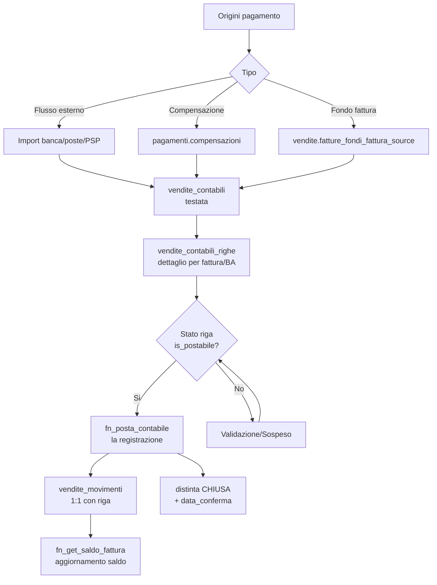
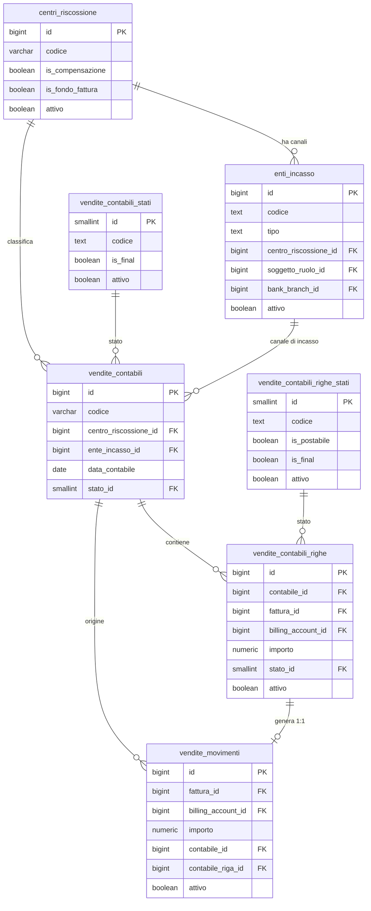
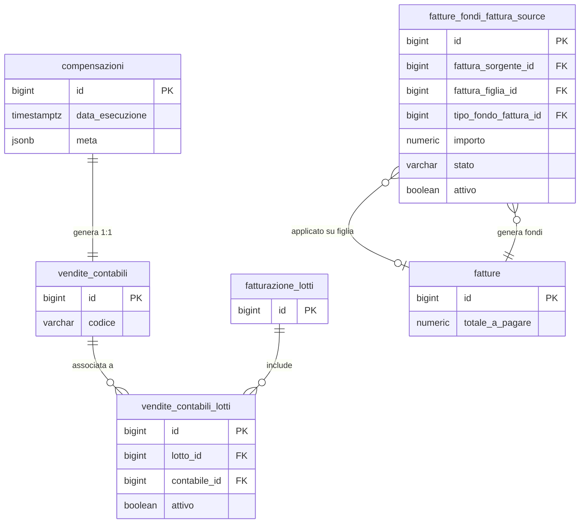

# Guida – Gestione dei Pagamenti Vendite

> (latest review 04-03-26)
>
> Destinatari: sviluppatori database e backend
>
> Questa guida descrive il modello contabile dei pagamenti vendite in Zero ERP:
> centri di riscossione, enti di incasso, testate contabili, righe, movimenti
> effettivi, compensazioni e fondi fattura.
>
> Vedi anche
>
> * [Guida Fatturazione](/guide/fatturazione) — ciclo di vita delle fatture
> * [Guida Gestione Conti Bancari](/guide/gestione-conti-bancari) — IBAN, filiali, SEPA
> * [Guida Tracciamento Processi e Job](/guide/analisi-tracciamento-processi-e-job) — pipeline e task run

---

## Introduzione

Il dominio pagamenti vendite gestisce il ciclo di vita dell'incasso: dalla ricezione di un flusso bancario o di un automatismo interno, fino alla registrazione del movimento effettivo sulla fattura.

Il modello non e centrato sul movimento finale, ma sulla **contabile**: un documento intermedio che raccoglie, valida e prepara gli importi prima di materializzarli come movimenti definitivi. Questa scelta architetturale permette di trattare flussi eterogenei (banche, poste, PSP, compensazioni, fondi fattura) con un unico percorso di controllo e validazione.

Il principio fondamentale e che la scrittura diretta in `vendite_movimenti` e un'eccezione tecnica, non il percorso operativo standard. Ogni incasso o rimborso deve passare attraverso una testata contabile e le relative righe, per poi generare i movimenti solo dopo il posting.

**Cosa troverai in questa guida:**

* La struttura dei centri di riscossione e degli enti di incasso
* Il modello contabile: testate, righe, stati e posting
* I movimenti effettivi e il legame 1:1 con le righe contabili
* Le compensazioni e i fondi fattura come flussi automatici
* Le funzioni di saldo e di creazione/recupero contabile
* Le regole di dominio applicate dai trigger di guardia

---

## Tabelle coinvolte

**Configurazione:**

* [pagamenti.centri_riscossione](/dbzero/pagamenti/tabelle/centri_riscossione) — origini di incasso
* [pagamenti.enti_incasso](/dbzero/pagamenti/tabelle/enti_incasso) — canali fisici di incasso

**Transazionali:**

* [pagamenti.vendite_contabili](/dbzero/pagamenti/tabelle/vendite_contabili) — testata contabile
* [pagamenti.vendite_contabili_righe](/dbzero/pagamenti/tabelle/vendite_contabili_righe) — dettaglio righe
* [pagamenti.vendite_movimenti](/dbzero/pagamenti/tabelle/vendite_movimenti) — movimenti effettivi
* [pagamenti.sistemazioni](/dbzero/pagamenti/tabelle/sistemazioni) — il registro delle sistemazioni (riporti, rimborsi, compensazioni)
* [pagamenti.vw_eccedenze_da_sistemare](/dbzero/pagamenti/views/vw_eccedenze_da_sistemare) — l'elenco dei documenti che hanno incassato piu' del dovuto
* [pagamenti.vendite_contabili_lotti](/dbzero/pagamenti/tabelle/vendite_contabili_lotti) — legame contabile-lotto

**Lookup stati:**

* [pagamenti.vendite_contabili_stati](/dbzero/pagamenti/tabelle/vendite_contabili_stati) — stati della testata
* [pagamenti.vendite_contabili_righe_stati](/dbzero/pagamenti/tabelle/vendite_contabili_righe_stati) — stati della riga (con `is_postabile`, `is_final` e `richiede_abbinamento`)

**Come ci si passa (dal 2026-08-21):**

* [pagamenti.transizioni_stati_contabile](/dbzero/pagamenti/tabelle/transizioni_stati_contabile) — il grafo della **distinta**
* [pagamenti.transizioni_stati_contabile_riga](/dbzero/pagamenti/tabelle/transizioni_stati_contabile_riga) — il grafo della **riga**

⭐ Fino a quella data `pagamenti` era l'unico dominio del progetto con degli
**stati** e **nessuna regola su come ci si passa**: qualunque salto era ammesso,
compreso uscire da uno stato dichiarato finale. Le due matrici sono lette da
altrettanti guard, e **nessun grafo è scritto nel codice**.

⚠️ Due regole però le matrici non le portano, perché dipendono da colonne della
riga e non dalla coppia di stati — vivono nel guard
`trgfn_vendite_contabili_guard_validazione`: la **riapertura** in bozza è solo
della distinta manuale, e entrando in `VALIDATA` la somma delle righe deve
corrispondere al **totale dichiarato**, se c'è. *Chi legge la sola matrice non le
vede.*

**Autorizzazioni all'addebito:**

* [pagamenti.sepa_mandati](/dbzero/pagamenti/tabelle/sepa_mandati) — mandati SEPA (`CORE` / `B2B`): l'autorizzazione con cui il debitore permette al creditore di addebitare il proprio conto. ⚠️ Oggi la tabella è **vuota** e nessuna funzione la legge: la struttura è pronta, il processo di addebito diretto non è ancora costruito

**Cross-schema:**

* [vendite.fatture_fondi_fattura_source](/dbzero/vendite/tabelle/fatture_fondi_fattura_source) — sorgenti fondi fattura

**Funzioni:**

* [pagamenti.fn_get_or_create_vendite_contabile](/dbzero/pagamenti/funzioni/fn_get_or_create_vendite_contabile) — creazione o recupero testata
* [pagamenti.fn_get_saldo_fattura_contabili](/dbzero/pagamenti/funzioni/fn_get_saldo_fattura_contabili) — saldo contabile in lavorazione
* [pagamenti.fn_get_saldo_fattura](/dbzero/pagamenti/funzioni/fn_get_saldo_fattura) — saldo finanziario effettivo
* [pagamenti.fn_posta_contabile](/dbzero/pagamenti/funzioni/fn_posta_contabile) — ⭐ **la registrazione**: le righe pronte diventano movimenti, e la distinta si chiude
* [pagamenti.fn_get_saldo_rata](/dbzero/pagamenti/funzioni/fn_get_saldo_rata) — il saldo per **rata**, che distingue il registrato dal dichiarato e l'incassato dal postato
* [pagamenti.fn_get_saldi_rate](/dbzero/pagamenti/funzioni/fn_get_saldi_rate) — ⭐ dal 17-09-2026 **il nucleo** dei saldi: la formula scritta una volta per N rate, con l'**imputazione** dei movimenti senza rata; `fn_get_saldo_rata` ne è la porta a un elemento
* [script.fn_check_scadenza_di_fattura](/dbzero/script/funzioni/fn_check_scadenza_di_fattura) — «questa rata e' di questa fattura?», chiesto **fuori** dalla row security

**Viste:**

* [pagamenti.vw_rate_fuori_capienza](/dbzero/pagamenti/views/vw_rate_fuori_capienza) — le rate il cui residuo e' uscito dalla banda: l'elenco senza il quale la forzatura sarebbe un modo di nascondere denaro
* [pagamenti.vw_saldi_rate](/dbzero/pagamenti/views/vw_saldi_rate) — il saldo di **tutte** le rate in un passaggio: la porta dello scadenzario
* [vendite.vw_fatture_scadenze_lista](/dbzero/vendite/views/vw_fatture_scadenze_lista) — l'identità delle rate col loro documento, **senza** saldi: la sorgente della lista rate e del picker della distinta

---

## Il modello in sintesi

```text
pagamenti
├── centri_riscossione              -- origini incasso (banca, poste, cassa, compensazione, fondo fattura)
│   └── enti_incasso                -- canali fisici (filiale, ufficio postale, PSP)
├── compensazioni                   -- processo di compensazione fatture
├── vendite_contabili               -- testata contabile (punto unico d'ingresso)
│   ├── vendite_contabili_righe     -- dettaglio per fattura/BA/rata/importo
│   │   └── vendite_movimenti      -- movimento effettivo 1:1 con riga
│   └── vendite_contabili_lotti     -- legame N:M con lotti di fatturazione
├── vendite_contabili_stati         -- lookup stati testata (con is_final)
│   └── transizioni_stati_contabile -- come ci si passa: il grafo della distinta
├── vendite_contabili_righe_stati   -- lookup stati riga (is_postabile, is_final, richiede_abbinamento)
│   └── transizioni_stati_contabile_riga  -- come ci si passa: il grafo della riga
└── sepa_mandati                    -- mandati di addebito diretto (oggi vuota, nessun lettore)

vendite
└── fatture_fondi_fattura_source    -- sorgenti fondi fattura (minimi, riaddebiti)
```

---

## Il piano rate e gli incassi: adesso si parlano

> Sezione aggiunta il **2026-08-02**, quando il piano rate e' entrato in
> esercizio. ⭐ **Riscritta il 2026-08-22**: fino a quel giorno le due meta' non
> si toccavano, e la sezione esisteva per dirlo.

Una fattura porta il proprio **piano rate**: quante rate, a quale data, per quale
importo. Lo genera la pipeline nello step EMESSA e vive in
[vendite.fatture_scadenze](/dbzero/vendite/tabelle/fatture_scadenze).

**Chi decide quante rate e con che scadenze** non e' questa guida: e' il *termine
di pagamento* del documento, scelto da un catalogo e risolto lungo la catena
documento -> commessa -> cliente -> *unica rata*. Regole, catalogo di oggi e
conseguenze (fra cui il fatto che il termine decide anche **quante fatture**
nascono) in [Termini di pagamento](/guide/termini-di-pagamento).

### ⭐ Un incasso si aggancia alla RATA — dal 2026-08-22

~~Un incasso e' agganciato alla FATTURA, non alla RATA.~~ Era vero fino al lotto
5 del cantiere incassi: `vendite_movimenti` portava la fattura e si fermava li',
e nell'intero database non esisteva nessuna colonna `scadenza_id`.

Adesso la porta la **riga contabile**, ed e' li' che l'abbinamento vive:

```text
vendite.fatture_scadenze           "questa fattura si paga in 2 rate, il 30/09 e il 31/10"
                                                |
pagamenti.vendite_contabili_righe   scadenza_id -> l'incasso dice A QUALE RATA va
                                                |
pagamenti.vendite_movimenti         scadenza_id -> copiata dalla riga quando si registra
```

⭐ **Niente tabella in mezzo**: la riga contabile *e' gia'* l'unita' di
allocazione, e chi paga due rate con un bonifico solo fa **due righe** — che e'
anche il modo in cui la banca lo racconta.

⚠️ **La rata resta facoltativa**: ci sono righe che saldano un documento senza
riferirsi a una scadenza precisa, e quella del fondo fattura e' il caso vivo
(salda per **trasferimento**).

### Che cosa si puo' chiedere adesso

| Domanda | Risposta |
|---|---|
| Quanto resta da incassare su una fattura? | ✅ `pagamenti.fn_get_saldo_fattura` |
| Come e' rateizzata questa fattura? | ✅ `vendite.fatture_scadenze` |
| **Questa rata e' stata pagata?** | ✅ `pagamenti.fn_get_saldo_rata` — e distingue il **registrato** dal **dichiarato** |
| Quanto di quel che risulta pagato e' **denaro davvero arrivato**? | ✅ la colonna `incassato`: i centri interni (fondo fattura, compensazione) non sono cassa |
| Quali rate hanno incassato piu' del dovuto? | ✅ [vw_rate_fuori_capienza](/dbzero/pagamenti/views/vw_rate_fuori_capienza) |
| Quali rate sono scadute o insolute? | 🟠 **derivabile** dal saldo per rata piu' la data: lo scadenzario e' una schermata da costruire, non piu' un dato che manca. ⭐ Dal 17-09-2026 i due pezzi DB ci sono: `vw_fatture_scadenze_lista` (chi e' la rata) + `vw_saldi_rate` (quanto resta), e «solo aperte» e' `WHERE saldo <> 0` |
| **Un incasso registrato «sulla fattura, senza rata» — dove finisce?** | ✅ dal 17-09-2026 si **imputa** alle rate per data di scadenza, fino a capienza, e l'ultima assorbe: la somma dei saldi delle rate e' sempre il saldo del documento. Nessuno lo scrive: e' un calcolo del nucleo `fn_get_saldi_rate` |
| **La nota di credito ha rate?** | ✅ dal 17-09-2026 **una**, negativa, alla prima data del termine: cosi' un pagamento o una compensazione sulla nota passa dal guard di capienza come tutto il resto |

### ⭐ Le due domande che il database tiene separate

Quando si abbina un incasso a una rata il database ne fa **due**, e risponde in
modo opposto:

| | Domanda | Che cosa fa |
| --- | --- | --- |
| **Coerenza** | «questa rata e' di questa fattura?» | 🔒 **rifiuta** — e' un'incoerenza logica, nessun cliente puo' provocarla |
| **Capienza** | «c'e' ancora spazio su questa rata?» | ⚠️ **segnala** — che un cliente paghi due volte e' un fatto del mondo |

> ⭐ **La capienza si puo' forzare, e la forzatura resta scritta.** Il primo
> tentativo viene rifiutato con i numeri («restano 40, questo importo e' 90»);
> chi conferma registra lo stesso, e sulla riga rimane il segno di quella
> decisione con un motivo facoltativo. ⛔ Nessun permesso e nessuna azione di
> processo: l'operatore non e' mai bloccato.
>
> ⚠️ Ed e' per questo che esiste l'elenco a valle: **una forzatura senza un
> elenco e' un modo per nascondere, non per registrare**.

### ⭐ Il punto cieco della rata, e come e' stato chiuso (17-09-2026)

Il saldo di una fattura somma **tutti** i suoi incassi; il saldo di una rata
sommava solo quelli che la **nominano**. Un incasso registrato «sulla fattura,
senza rata» — il fondo fattura lo scrive sempre cosi', e l'operatore puo' farlo
dal lookup — abbassava il saldo della fattura e non quello delle rate: una
fattura a rata unica pagata senza rata diceva «saldata» come documento e
«restano 100» come rata. Finche' si guardava la fattura non si notava; con il
picker delle rate della distinta quella rata sarebbe comparsa aperta, e con la
rata della nota di credito il credito riportato dal fondo sarebbe stato contato
**due volte**.

La risposta e' l'**imputazione derivata**: nel nucleo dei saldi gli incassi
senza rata si attribuiscono alle rate del documento in ordine di scadenza, fino
a capienza, e l'ultima assorbe l'eccedenza. Nessuno scrive niente sulle righe —
e' un calcolo, come lo stato della rata e' sempre stato un calcolo — e la somma
dei saldi delle rate torna sempre uguale al saldo del documento. Il guard di
capienza legge lo stesso nucleo, quindi vede lo spazio che il documento sa,
anche prima della registrazione.

⚠️ **L'ordine dei fatti conta.** Un acconto senza rata gia' imputato alla prima
rata occupa il suo spazio: una riga diretta sulla stessa rata che arriva dopo
trova quel che resta, e il guard lo dice coi numeri. Non e' un difetto: il
picker mostra esattamente i numeri del nucleo, e il guard accetta esattamente
cio' che il picker mostra. La forzatura resta la via per il caso vero.

### ⚠️ Due avvertenze che restano valide

* **Il piano rate e' uno snapshot congelato.** Oltre `DRAFT`/`EMESSA` le rate non
  si toccano piu' (guard sui satelliti della fattura). L'abbinamento infatti
  **non scrive mai** su `fatture_scadenze`: scrive sulla riga contabile, e lo
  stato della rata si **legge**, non si marca.
* **«Prossima rata» e' un concetto temporale, non di pagamento**: la prossima per
  data, e se sono tutte passate l'ultima. La regola vive gia' nel frontend ed e'
  una per tutto il prodotto — chi la ricalcolasse per conto proprio farebbe dire
  a due schermate cose diverse sullo stesso documento.

Le attivita' aperte e il loro ordine sono in
[brief-incassi-riconciliazione-rate-promemoria.md](../dev/work-in-progress/brief-incassi-riconciliazione-rate-promemoria.md).

---


## Centri di riscossione e enti di incasso

### Centri di riscossione

I centri di riscossione rappresentano le **origini logiche** dell'incasso: banca, posta, cassa, compensazione, fondo fattura. Ogni centro identifica una categoria di provenienza dei pagamenti, non un canale fisico specifico.

Due flag booleani distinguono i centri speciali:

* `is_compensazione` — identifica il centro dedicato alle compensazioni (un solo centro puo averlo attivo)
* `is_fondo_fattura` — identifica il centro per i movimenti automatici di fondo fattura

Un centro non puo essere contemporaneamente di compensazione e di fondo fattura.

> ✅ **Adesso e vero. Fino al 21-08-2026 non lo era**, e non per una svista di
> scrittura: il `CHECK chk_centri_riscossione_ruolo_esclusivo` era dichiarato
> nella migrazione `20260211-21` e **non esisteva nel database** — il blocco che
> lo crea era annidato dentro l'elenco delle colonne di un `addColumn`, e li
> dentro non viene eseguito. La colonna era nata, il vincolo no.
> Rimesso in piedi dal passo **P-1** di
> [brief-db-posting-e-abbinamento-rata.md](/dev/work-done/brief-db-posting-e-abbinamento-rata),
> applicato il 21-08-2026 insieme ai due indici unici **parziali** che rendono
> unico ciascuno dei due ruoli (prima uno dei due era un unico **totale** su un
> booleano, e teneva la tabella a due righe in tutto).

> ⚠️ **Questi due centri non sono cassa, e chi misura gli incassi deve saperlo.**
> Un movimento su `is_fondo_fattura` o `is_compensazione` non e denaro arrivato:
> e denaro **spostato** da un documento a un altro. Per la domanda «questa
> fattura e ancora da pagare?» valgono tutti i movimenti — il trasferimento la
> salda davvero. Per la domanda «quanto e **entrato**?» quei centri vanno
> **esclusi**, altrimenti si conta come incasso qualcosa che non e mai transitato
> da una banca. E i due flag esistono anche per questo.

Da un punto di vista tecnico:

| Colonna            | Tipo            | Nullable | Descrizione                                                |
| ------------------ | --------------- | :------: | ---------------------------------------------------------- |
| `id`               | BIGINT, PK      |    no    | Chiave primaria                                            |
| `codice`           | VARCHAR, UNIQUE |    no    | Codice identificativo                                      |
| `codice_interno`   | VARCHAR         |    si    | Codice interno applicativo                                 |
| `descrizione`      | VARCHAR         |    no    | Descrizione leggibile                                      |
| `is_compensazione` | BOOLEAN         |    no    | Flag centro compensazione (default: false)                 |
| `is_fondo_fattura` | BOOLEAN         |    no    | Flag centro fondo fattura (default: false)                 |
| `attivo`           | BOOLEAN         |    no    | Flag attivo/disattivo (default: true)                      |
| `meta`             | JSONB           |    no    | Metadati estensibili                                       |
| Campi audit        | —               |    —     | `data_insert`, `user_insert`, `data_update`, `user_update` |

**Vincolo UNIQUE:** `uq_centri_riscossione_compensazione` su `(is_compensazione)` — ~~garantisce al massimo un centro di compensazione nel sistema.~~

> 🔴 **Quella e l'intenzione; il vincolo vivo fa un'altra cosa, e va saputo prima
> di configurare.** Il vincolo e **totale** su una colonna booleana, non parziale:
> quindi ammette **una sola riga `true` e una sola riga `false`**, cioe`
> **`centri_riscossione` non puo contenere piu di DUE righe in tutto**. Oggi ce
> ne sono esattamente due, quindi il vincolo e saturo e sembra rispettato:
> **aggiungere il centro banca oggi fallisce.**
>
> La causa: nella migrazione `20260211-14` il `where: "is_compensazione = true"`
> e scritto su un `addUniqueConstraint`, che quell'attributo **non prevede** — e
> lo ha ignorato in silenzio. Sostituito da due indici unici **parziali** (uno
> per flag) al passo **P-1** di
> [brief-db-posting-e-abbinamento-rata.md](/dev/work-done/brief-db-posting-e-abbinamento-rata)
> — ⛔ **non ancora applicato**.
>
> ⚠️ E `is_fondo_fattura` oggi non ha **nessun** vincolo di unicita: i centri
> fondo fattura potrebbero essere N, e chi ne sceglie uno prende quello con
> l'id piu basso.

**Protezioni:** trigger `trgfn_prevent_deactivate_if_children` impedisce la disattivazione se esistono enti incasso, contabili o movimenti collegati.

> Documentazione dettagliata: [pagamenti.centri_riscossione](/dbzero/pagamenti/tabelle/centri_riscossione)

---

### Enti di incasso

Gli enti di incasso rappresentano i **canali fisici** attraverso cui arrivano i pagamenti: una filiale bancaria, un ufficio postale, un Payment Service Provider (PSP). Ogni ente appartiene a un centro di riscossione e puo essere associato a un soggetto con ruolo anagrafico.

Il campo `tipo` ammette quattro valori: `BANCA`, `POSTE`, `PSP`, `ALTRO`. Le regole di validazione dipendono dal tipo:

* Se `tipo = BANCA`: `bank_branch_id` obbligatorio (filiale bancaria)
* Se `tipo = PSP`: `soggetto_ruolo_id` obbligatorio, con validazione del ruolo tramite `trgfn_enti_incasso_guard_psp`
* Negli altri casi: `bank_branch_id` deve essere NULL

⭐ **E dal 2026-08-22 ogni canale, di qualunque tipo, deve dire su quale conto
dell'azienda atterra il suo denaro** (`soggetto_ruolo_conto_bancario_id`). Non e'
un dettaglio anagrafico: e' il modo in cui il sistema sa **di chi sono** i soldi
che arrivano prima ancora che siano attribuiti a una fattura. Si spiega piu'
avanti, in «Chi vede che cosa».

Da un punto di vista tecnico:

| Colonna                 | Tipo         | Nullable | Descrizione                                                         |
| ----------------------- | ------------ | :------: | ------------------------------------------------------------------- |
| `id`                    | BIGINT, PK   |    no    | Chiave primaria                                                     |
| `codice`                | TEXT, UNIQUE |    no    | Codice identificativo                                               |
| `codice_interno`        | TEXT         |    si    | Codice interno applicativo                                          |
| `descrizione`           | TEXT         |    no    | Descrizione leggibile                                               |
| `tipo`                  | TEXT         |    no    | Tipo canale (`BANCA`, `POSTE`, `PSP`, `ALTRO`)                      |
| `centro_riscossione_id` | BIGINT, FK   |    si    | Centro di riscossione di appartenenza                               |
| `soggetto_ruolo_id`     | BIGINT, FK   |    si    | Soggetto con ruolo anagrafico                                       |
| `bank_branch_id`        | BIGINT, FK   |    si    | Filiale bancaria (obbligatoria per `BANCA`)                         |
| `soggetto_ruolo_conto_bancario_id` | BIGINT, FK |  **no**  | ⭐ Il conto dell'azienda su cui atterra il denaro del canale — e' il perimetro |
| `formato_flusso`        | TEXT         |    si    | Formato del flusso importato                                        |
| `regole_match`          | JSONB        |    no    | Regole di abbinamento flusso                                        |
| `attivo`                | BOOLEAN      |    no    | Flag attivo/disattivo (default: true)                               |
| `meta`                  | JSONB        |    no    | Metadati estensibili                                                |
| Campi audit             | —            |    —     | `data_insert`, `user_insert`, `data_update`, `user_update`, `tx_id` |

**Vincoli CHECK:**

* `chk_enti_incasso_tipo` — valida i valori ammessi per `tipo`
* `chk_enti_incasso_bank_branch_tipo` — `bank_branch_id` obbligatorio se e solo se `tipo = BANCA`

**Trigger di guardia PSP:** il trigger `trgfn_enti_incasso_guard_psp` (BEFORE INSERT/UPDATE) verifica che per `tipo = PSP` il `soggetto_ruolo_id` appartenga a un ruolo con `codice_interno = 'PSP'` e che esista un record attivo in `anagrafiche.psp`.

**Trigger di guardia sul conto:** `trgfn_enti_incasso_guard_conto_incasso` verifica
che il conto agganciato sia registrato **per gli incassi** e non per altro (i
pagamenti, i rimborsi). Non e' una formalita': e' su quel legame che poggia il
riconoscimento di chi sono i soldi in arrivo.

> 📮 **Conseguenza pratica**: finche' le due aziende non hanno un conto «di
> incasso» censito in anagrafica, **nessun canale e' configurabile**. E' voluto:
> un canale senza conto produrrebbe una coda di incassi che nessuno vede, e
> quell'errore si scopre mesi dopo. Meglio fermarsi alla configurazione, dove chi
> se ne accorge puo' rimediare subito.

> Documentazione dettagliata: [pagamenti.enti_incasso](/dbzero/pagamenti/tabelle/enti_incasso)

---

## Testata contabile: `vendite_contabili`

La testata contabile e il punto unico d'ingresso per ogni pagamento, sia che provenga da un flusso bancario, da una compensazione automatica o da un fondo fattura. Ogni testata identifica un'operazione contabile con la sua data, il centro di riscossione, l'eventuale ente di incasso e lo stato di lavorazione.

⚠️ **Dal 2026-08-22 la testata non porta piu' il riferimento all'atto di sistemazione**: e' l'atto a tenere l'id della sua distinta. La testata puo essere collegata a uno o piu lotti di fatturazione (tramite la tabella di legame `vendite_contabili_lotti`), ma **mai a entrambi**: questa mutua esclusione e applicata dai trigger di guardia.

Da un punto di vista tecnico:

| Colonna                 | Tipo               | Nullable | Descrizione                                                         |
| ----------------------- | ------------------ | :------: | ------------------------------------------------------------------- |
| `id`                    | BIGINT, PK         |    no    | Chiave primaria                                                     |
| `codice`                | VARCHAR, UNIQUE    |    no    | Numero dal registro `DISTINTA` dell'emittente (`DIS-<SIGLA>-<ANNO>-<7 cifre>`, dal 2026-09-15): come nasce lo dice la scheda [`vendite_contabili`](../dbzero/pagamenti/manual/vendite_contabili.md) |
| `centro_riscossione_id` | BIGINT, FK         |    no    | Centro di riscossione                                               |
| `ente_incasso_id`       | BIGINT, FK         |    si    | Ente di incasso (opzionale)                                         |
| `data_contabile`        | DATE               |    no    | Data contabile dell'operazione                                      |
| `data_registrazione`    | DATE               |    no    | Data di registrazione                                               |
| `stato_id`              | SMALLINT, FK       |    si    | Stato della testata                                                 |
| ~~`compensazione_id`~~  | —                  |    —     | ⛔ **Rimossa il 2026-08-22**: il legame vive su `sistemazioni.contabile_id` (1:1)                                       |
| `data_conferma`         | TIMESTAMPTZ        |    si    | Data di conferma/posting                                            |
| `user_conferma`         | TEXT               |    si    | Utente che ha confermato                                            |
| `meta`                  | JSONB              |    no    | Metadati estensibili                                                |
| Campi audit             | —                  |    —     | `data_insert`, `user_insert`, `data_update`, `user_update`, `tx_id` |

**Vincoli UNIQUE:**

* `uq_vendite_contabili_codice` su `(codice)` — codice univoco per testata
* ~~`uq_vendite_contabili_compensazione`~~ — ⛔ rimosso: l'unicita' «una distinta per atto» vive su `uq_sistemazioni_contabile`, cioe' dall'altro lato. Una sola testata per compensazione

**Trigger principali:**

* `trgfn_vendite_contabili_guard_ente_centro` — coerenza ente/centro e regole compensazione
* `trgfn_child_requires_active_parent` — su `centri_riscossione`, `enti_incasso` e `vendite_contabili_stati`
* `trgfn_audit_data_user_generic`, `trgfn_tx_id_managed` — audit e gestione `tx_id`

> Documentazione dettagliata: [pagamenti.vendite_contabili](/dbzero/pagamenti/tabelle/vendite_contabili)

---

## Righe contabili: `vendite_contabili_righe`

Ogni testata contabile contiene una o piu righe, ciascuna riferita a una fattura e/o a un billing account. La riga specifica l'importo del pagamento, le date operative e lo stato di lavorazione.

Lo stato della riga e gestito dalla lookup `vendite_contabili_righe_stati`, che include il flag `is_postabile`: solo le righe in stato postabile possono generare movimenti effettivi tramite il processo di posting.

⭐ **Una riga si elimina, e c'e' un momento in cui il contenuto si ferma** (dal
14-09-2026, D17/D18). Una riga digitata male su una distinta **compilata a mano e
ancora in bozza** non e' un fatto — non e' denaro arrivato, e' un errore di
battitura — e si **elimina** (`attivo = false`; anche il `DELETE` fisico segue la
stessa regola). Non si «scarta»: `SCARTATA` vuol dire *denaro arrivato, non
nostro* e **conta nella quadratura** — scartare la riga sbagliata renderebbe la
distinta invalidabile. Quando la distinta viene **validata** («ho finito di
inserire»), il suo contenuto e' **fermo**: niente righe nuove, niente modifiche a
importo e date, niente eliminazioni, finche' non torna in bozza. Le decisioni —
abbinare, sospendere, scartare — restano possibili. Il perche' di ogni rifiuto lo
dice il database con una regola sola, la stessa che spegne il cestino a video:
[script.fn_check_riga_contabile_eliminabile](/dbzero/script/funzioni/fn_check_riga_contabile_eliminabile);
il guard e'
[trgfn_vendite_contabili_righe_guard_contenuto](/dbzero/pagamenti/funzioni/trgfn_vendite_contabili_righe_guard_contenuto).
Sotto una distinta **registrata** o generata dal sistema non si elimina niente.

Da un punto di vista tecnico:

| Colonna              | Tipo         | Nullable | Descrizione                                                         |
| -------------------- | ------------ | :------: | ------------------------------------------------------------------- |
| `id`                 | BIGINT, PK   |    no    | Chiave primaria                                                     |
| `contabile_id`       | BIGINT, FK   |    no    | Testata contabile di appartenenza                                   |
| `fattura_id`         | BIGINT, FK   |    si    | Fattura collegata                                                   |
| `billing_account_id` | BIGINT, FK   |    si    | Billing account collegato                                           |
| `importo`            | NUMERIC      |    no    | Importo (CHECK: diverso da zero)                                    |
| `stato_id`           | SMALLINT, FK |    no    | Stato della riga                                                    |
| `riferimento_ente`   | TEXT         |    si    | Riferimento dell'ente incasso                                       |
| `data_pagamento`     | DATE         |    si    | Data del pagamento                                                  |
| `data_valuta`        | DATE         |    si    | Data valuta                                                         |
| `data_operazione`    | DATE         |    si    | Data operazione                                                     |
| `motivo_sospeso`     | TEXT         |    si    | Motivazione per stato sospeso                                       |
| `fondo_source_id`    | BIGINT, FK   |    si    | Atto di fondo fattura da cui la riga nasce (vuoto sulle altre)      |
| `attivo`             | BOOLEAN      |    no    | Flag attivo (default: true)                                         |
| `meta`               | JSONB        |    no    | Metadati estensibili                                                |
| Campi audit          | —            |    —     | `data_insert`, `user_insert`, `data_update`, `user_update`, `tx_id` |

> ⭐ **`fondo_source_id` e cio che accade quando la riga viene registrata.**
> Dal 21-08-2026 il legame con l'atto di fondo fattura e una colonna con una
> chiave esterna vera (prima era una stringa dentro il `meta`). Non serve solo a
> ritrovare le righe: portando la riga in uno stato **registrato**, un trigger
> porta l'atto a **`ESEGUITO`** — cioe il fondo smette di essere una cosa da
> lavorare e diventa una cosa fatta. Da li non si torna indietro: se il fondo
> era sbagliato si compie un atto nuovo, non si riscrive quello vecchio.

**Vincoli CHECK:** `chk_vendite_contabili_righe_importo_non_zero` — l'importo non puo essere zero.

**Protezione disattivazione:** trigger `trgfn_prevent_deactivate_if_children` blocca la disattivazione se esistono movimenti con `contabile_riga_id` che referenziano la riga. ⚠️ Dal 14-09-2026 non e' piu' lui a parlare per primo: una riga registrata sta sotto una distinta chiusa, e il guard del contenuto la ferma prima, col messaggio della distinta finale.

> Documentazione dettagliata: [pagamenti.vendite_contabili_righe](/dbzero/pagamenti/tabelle/vendite_contabili_righe)

---

## Movimenti effettivi: `vendite_movimenti`

Il movimento effettivo rappresenta l'incasso o il rimborso definitivo registrato sulla fattura. E il risultato finale del ciclo contabile: viene creato solo dopo il posting della riga contabile corrispondente.

Il legame tra riga contabile e movimento e 1:1, garantito dall'indice parziale `uq_vendite_movimenti_contabile_riga` su `(contabile_riga_id) WHERE contabile_riga_id IS NOT NULL`. Quando un movimento nasce da una riga contabile, il trigger `trgfn_vendite_movimenti_sync_contabile_from_riga` sincronizza automaticamente `contabile_id`, `fattura_id` e `billing_account_id` dalla riga, bloccando eventuali mismatch espliciti.

Da un punto di vista tecnico:

| Colonna                      | Tipo       | Nullable | Descrizione                                                         |
| ---------------------------- | ---------- | :------: | ------------------------------------------------------------------- |
| `id`                         | BIGINT, PK |    no    | Chiave primaria                                                     |
| `fattura_id`                 | BIGINT, FK |    no    | Fattura di riferimento                                              |
| `billing_account_id`         | BIGINT, FK |    no    | Billing account                                                     |
| `importo`                    | NUMERIC    |    no    | Importo del movimento                                               |
| `data_effettiva`             | DATE       |    no    | Data effettiva dell'incasso                                         |
| `data_registrazione`         | DATE       |    no    | Data registrazione                                                  |
| `data_contabile`             | DATE       |    si    | Data contabile                                                      |
| `data_contabilizzazione`     | DATE       |    si    | Data di contabilizzazione                                           |
| `data_valuta`                | DATE       |    si    | Data valuta                                                         |
| `data_per_calcolo_interessi` | DATE       |    si    | Data per il calcolo interessi                                       |
| `escluso_da_interessi`       | BOOLEAN    |    no    | Esclusione dal calcolo interessi (default: false)                   |
| `contabile_id`               | BIGINT, FK |    si    | Testata contabile di origine                                        |
| `contabile_riga_id`          | BIGINT, FK |    si    | Riga contabile di origine (UNIQUE parziale)                         |
| `centro_riscossione_id`      | BIGINT, FK |    si    | Centro di riscossione                                               |
| `attivo`                     | BOOLEAN    |    no    | Flag attivo (default: true)                                         |
| `meta`                       | JSONB      |    no    | Metadati estensibili                                                |
| Campi audit                  | —          |    —     | `data_insert`, `user_insert`, `data_update`, `user_update`, `tx_id` |

**Indice UNIQUE parziale:** `uq_vendite_movimenti_contabile_riga` su `(contabile_riga_id) WHERE contabile_riga_id IS NOT NULL` — ogni riga contabile genera al massimo un movimento.

**Trigger principali:**

* `trgfn_vendite_movimenti_sync_contabile_from_riga` — sincronizza contabile/fattura/BA dalla riga
* `trgfn_guard_emittente_scope` — verifica l'ambito emittente sulla fattura
* `trgfn_child_requires_active_parent` — su `centri_riscossione` e `vendite_contabili_righe`

> Documentazione dettagliata: [pagamenti.vendite_movimenti](/dbzero/pagamenti/tabelle/vendite_movimenti)

---

## Lookup stati

### Stati testata: `vendite_contabili_stati`

Ogni testata contabile ha uno stato che ne governa il ciclo di vita. Il flag `is_final` indica se lo stato e definitivo (la testata non puo piu essere modificata).

| Colonna          | Tipo         | Descrizione                   |
| ---------------- | ------------ | ----------------------------- |
| `id`             | SMALLINT, PK | Chiave primaria               |
| `codice`         | TEXT, UNIQUE | Codice identificativo         |
| `codice_interno` | TEXT, UNIQUE | Codice interno applicativo    |
| `descrizione`    | TEXT         | Descrizione leggibile         |
| `is_final`       | BOOLEAN      | Stato finale (default: false) |
| `ordine`         | SMALLINT     | Ordinamento (default: 0)      |
| `attivo`         | BOOLEAN      | Flag attivo (default: true)   |

La disattivazione di uno stato e bloccata se esistono testate che lo referenziano.

> Documentazione dettagliata: [pagamenti.vendite_contabili_stati](/dbzero/pagamenti/tabelle/vendite_contabili_stati)

### Stati riga: `vendite_contabili_righe_stati`

Gli stati delle righe contabili includono un flag cruciale per il processo di posting: `is_postabile`. Solo le righe il cui stato ha `is_postabile = true` vengono considerate dalla funzione `fn_get_saldo_fattura_contabili` e sono candidate alla generazione dei movimenti.

| Colonna          | Tipo         | Descrizione                                |
| ---------------- | ------------ | ------------------------------------------ |
| `id`             | SMALLINT, PK | Chiave primaria                            |
| `codice`         | TEXT, UNIQUE | Codice identificativo                      |
| `codice_interno` | TEXT         | Codice interno applicativo                 |
| `descrizione`    | TEXT         | Descrizione leggibile                      |
| `is_postabile`   | BOOLEAN      | Riga candidata al posting (default: false) |
| `is_final`       | BOOLEAN      | Stato finale (default: false)              |
| `ordine`         | SMALLINT     | Ordinamento (default: 0)                   |
| `attivo`         | BOOLEAN      | Flag attivo (default: true)                |

> Documentazione dettagliata: [pagamenti.vendite_contabili_righe_stati](/dbzero/pagamenti/tabelle/vendite_contabili_righe_stati)

---

## Le sistemazioni: quando un cliente ha pagato piu' del dovuto

> Sezione **riscritta il 2026-08-22**. ~~Si intitolava «Compensazioni»~~ e
> descriveva un processo automatico che non esisteva ancora davvero: adesso il
> giro c'e' per intero, e la compensazione e' **una delle tre strade**, non il
> nome di tutto.

### Il problema, in una frase

Capita che su un documento entri **piu' denaro di quanto era dovuto**: un cliente
paga due volte, o paga un importo tondo, o si e' fatta una nota di credito dopo
che aveva gia' saldato. Quel credito e' suo, e prima o poi qualcuno deve
decidere che farne.

⚠️ Fino a oggi il sistema **non lo mostrava a nessuno**: il denaro restava sul
documento e chi lo cercava doveva sapere gia' dove guardare.

### Le due meta': un elenco e un registro

```text
vw_eccedenze_da_sistemare   →  che cosa c'e' DA FARE
sistemazioni                →  che cosa e' STATO FATTO
```

⭐ **L'elenco** raccoglie i documenti che hanno incassato piu' del dovuto, li
mostra **raggruppati per cliente** — perche' e' guardando il cliente che si
decide, e perche' un credito su una fattura puo' coprire un debito su un'altra —
e dice **chi e' in credito**: normalmente il cliente, ma su una nota di credito
restituita in eccesso e' l'azienda. ⚠️ Sbagliare quel verso significa rimborsare
denaro che si deve incassare, e per questo il sistema lo scrive invece di
lasciarlo dedurre.

⭐ **Il registro** tiene traccia di ogni decisione presa: che cosa si e' scelto
di fare, per quanto, su quali documenti, quando e da chi.

### Le tre strade

| Si sceglie | Che cosa succede |
|---|---|
| **Riporto** | il credito va su un'**altra fattura** del cliente, come sconto gia' disponibile |
| **Rimborso** | il denaro **esce**: si prepara un movimento in uscita da un conto dell'azienda |
| **Compensazione** | il credito di un documento copre il debito di un altro, **dello stesso cliente** |

⭐ **Nessuna di queste e' un meccanismo nuovo**: il riporto usa i fondi fattura,
il rimborso e la compensazione usano le distinte contabili — le stesse con cui si
registrano gli incassi, solo con gli importi al contrario. *Mancavano l'elenco e
il registro, non le macchine.*

### Il giro, per intero

```text
l'elenco mostra un'eccedenza
   → una PERSONA sceglie che farne          (nessun automatismo decide da solo)
   → la decisione si registra
   → alla conferma nasce il documento       (un fondo, oppure una distinta)
   → registrando quel documento il denaro si muove davvero
```

⚠️ **Fra la decisione e l'effetto ci sono due passi**, e l'elenco li distingue:
finche' la decisione e' in bozza non e' successo niente; una volta confermata il
documento c'e' ma l'eccedenza cala solo quando quel documento viene **registrato**.
⭐ E a quel punto la riga sparisce dall'elenco **da sola**: i saldi si leggono,
non si conservano.

### Tre cose che vale la pena sapere

* ⭐ **Si puo' sistemare solo una parte.** Su una fattura possono esistere piu'
  sistemazioni: si rimborsa una quota e si riporta il resto.
* ⚠️ **La verifica si fa al momento di confermare, non di decidere.** Fra i due
  momenti puo' arrivare un altro incasso, o un collega puo' aver gia' usato lo
  stesso credito: controllare prima darebbe una garanzia che scade.
* ⛔ **Una decisione confermata non si corregge: se ne registra un'altra.** Il
  denaro si e' gia' mosso, e il registro deve continuare a raccontare cio' che e'
  successo davvero. Annullare invece si puo', finche' non si e' confermato — e
  l'atto resta scritto, con la sua ragione: *annullare non e' cancellare*.

### ⚠️ Da non confondere: il centro «compensazione»

`centri_riscossione.is_compensazione` **non e' cambiato**, e parla di un'altra
cosa: e' il *luogo contabile* dove finiscono le compensazioni, non l'atto con cui
si decidono. Resta uno dei centri che **non sono cassa**.

> Documentazione dettagliata:
> [pagamenti.sistemazioni](/dbzero/pagamenti/tabelle/sistemazioni) ·
> [pagamenti.vw_eccedenze_da_sistemare](/dbzero/pagamenti/views/vw_eccedenze_da_sistemare)

---

## Legame contabile-lotto: `vendite_contabili_lotti`

Quando una testata contabile nasce nel contesto di un lotto di fatturazione, il legame e registrato nella tabella di join `vendite_contabili_lotti`. La relazione e N:M: un lotto puo avere piu testate contabili e una testata puo appartenere a piu lotti.

Da un punto di vista tecnico:

| Colonna        | Tipo       | Nullable | Descrizione                                                         |
| -------------- | ---------- | :------: | ------------------------------------------------------------------- |
| `id`           | BIGINT, PK |    no    | Chiave primaria                                                     |
| `lotto_id`     | BIGINT, FK |    no    | Lotto di fatturazione                                               |
| `contabile_id` | BIGINT, FK |    no    | Testata contabile                                                   |
| `attivo`       | BOOLEAN    |    no    | Flag attivo (default: true)                                         |
| `meta`         | JSONB      |    no    | Metadati estensibili                                                |
| Campi audit    | —          |    —     | `data_insert`, `user_insert`, `data_update`, `user_update`, `tx_id` |

**Vincolo UNIQUE:** `uq_vendite_contabili_lotti_lotto_contabile` su `(lotto_id, contabile_id)` — una coppia lotto-contabile non puo essere duplicata.

**Trigger di guardia:** `trgfn_vendite_contabili_lotti_guard_sistemazione` *(dal 2026-08-22; si chiamava `..._guard_compensazione` e copriva le sole compensazioni)* blocca l'inserimento se la testata ha `compensazione_id IS NOT NULL`.

> Documentazione dettagliata: [pagamenti.vendite_contabili_lotti](/dbzero/pagamenti/tabelle/vendite_contabili_lotti)

---

## Fondi fattura: `fatture_fondi_fattura_source`

Ci sono documenti che non conviene incassare da soli: una bolletta da pochi euro costa piu di quanto vale mandarla e riscuoterla, e un piccolo credito verso il cliente non giustifica un bonifico di rimborso. In questi casi l'importo non si perde e non si insegue: **si riporta sulla fattura successiva**. Quel riporto e il **fondo fattura**.

La tabella vive nello schema `vendite` (non `pagamenti`) perche e strettamente legata al ciclo di fatturazione, ma il suo effetto si propaga nel dominio contabile tramite la sincronizzazione su testate e righe.

### Quando una fattura diventa "di minimo": le due soglie

A decidere quali documenti si riportano avanti sono **due soglie**, configurate
per ogni coppia emittente x utility su
[anagrafiche.emittenti_fiscali_utilities](/dbzero/anagrafiche/tabelle/emittenti_fiscali_utilities)
(`minimo_soglia_max` e `minimo_soglia_min`). Non sono "un minimo e un massimo"
nel senso comune: sono i due capi di una fascia **che passa per lo zero**.

Con una configurazione da +10 e -500 euro:

| Totale della fattura | Che cosa succede |
| --- | --- |
| **sopra +10 €** | il cliente paga normalmente. Nessun fondo |
| **fra +10 € e 0** | troppo piccola per essere incassata da sola → si riporta come **addebito** sulla fattura dopo |
| **fra 0 e -500 €** | credito troppo piccolo per un rimborso → si riporta come **accredito** sulla fattura dopo |
| **sotto -500 €** | credito importante: entra nel processo di **rimborso**, non nel fondo |

> ⚠️ **Un fondo puo quindi essere negativo, ed e normale.** Meta della fascia
> serve proprio a riportare avanti dei crediti — e non e una possibilita
> aggiunta dopo: il catalogo delle tipologie
> ([tipi_fondi_fattura](/dbzero/vendite/tabelle/tipi_fondi_fattura)) parla di
> "addebiti/**accrediti**" fin dall'inizio.
>
> ⚠️ **Se le soglie non sono configurate, il meccanismo e spento**: nessuna
> fattura diventa di minimo e nessun fondo viene creato. E la configurazione va
> messa **completa**: valorizzarne una sola e un errore, non una mezza
> attivazione.

Il flag `minimo` sulla fattura non lo imposta una persona: lo **ricalcola**
`vendite.fn_ricalcola_totali_fattura` a ogni ricalcolo dei totali, confrontando
il totale da pagare con le due soglie.

Da un punto di vista tecnico:

| Colonna                       | Tipo        | Nullable | Descrizione                                                         |
| ----------------------------- | ----------- | :------: | ------------------------------------------------------------------- |
| `id`                          | BIGINT, PK  |    no    | Chiave primaria                                                     |
| `fattura_sorgente_id`         | BIGINT, FK  |    no    | Fattura che genera il fondo                                         |
| `fattura_figlia_id`           | BIGINT, FK  |    si    | Fattura che utilizza il fondo                                       |
| `tipo_fondo_fattura_id`       | BIGINT, FK  |    no    | Tipo di fondo                                                       |
| `importo`                     | NUMERIC     |    no    | Importo del fondo                                                   |
| `stato`                       | VARCHAR     |    no    | Stato: `DISPONIBILE`, `ASSEGNATO`, `ESEGUITO`, `ANNULLATO` — **quattro**, dal 21-08-2026 |
| `billing_account_id`          | BIGINT, FK  |    no    | Billing account (denormalizzato dalla sorgente)                     |
| `utility_id`                  | INTEGER, FK |    no    | Utility (denormalizzata dalla sorgente)                             |
| `tipo_doc_fiscale_id`         | BIGINT, FK  |    no    | Tipo documento fiscale                                              |
| `emittente_soggetto_ruolo_id` | BIGINT, FK  |    no    | Emittente (soggetto con ruolo)                                      |
| `valuta_id`                   | BIGINT, FK  |    no    | Valuta                                                              |
| `origine`                     | VARCHAR     |    no    | `AUTOMATICA` (il giro notturno) o `MANUALE` (una persona, oggi via riporto di una sistemazione) |
| `motivo`                      | TEXT        |    si    | **Obbligatorio** se `origine = 'MANUALE'` o se `stato = 'ANNULLATO'`: un atto deciso a mano, o disfatto, deve dire perche' |
| `data_assegnazione`           | TIMESTAMPTZ |    si    | Data di assegnazione alla fattura figlia                            |
| `user_assegnazione`           | TEXT        |    si    | Utente che ha effettuato l'assegnazione                             |
| `attivo`                      | BOOLEAN     |    no    | Flag attivo (default: true)                                         |
| `meta`                        | JSONB       |    no    | Metadati estensibili                                                |
| Campi audit                   | —           |    —     | `data_insert`, `user_insert`, `data_update`, `user_update`, `tx_id` |

**Ciclo di vita dello stato:**

* `DISPONIBILE` — il fondo e stato generato e attende assegnazione
* `ASSEGNATO` — il fondo e stato collegato a una fattura figlia (`fattura_figlia_id` valorizzato)
* `ESEGUITO` — ⭐ il trasferimento e stato **registrato in contabilita**: il fondo e una cosa fatta
* `ANNULLATO` — il fondo non e piu utilizzabile (documento sorgente gia saldato o reset bloccato)

> ⭐ **`ESEGUITO` e nato il 21-08-2026, e non e una parola in piu.** Prima
> `ANNULLATO` ne diceva **tre** di cose — «non si deve fare piu», «non si e piu
> capienti», «e gia stato eseguito» — e nell'ultimo caso lasciava un record che
> si contraddiceva: annullato, ma con la fattura figlia ancora agganciata.
> Adesso ogni fatto ha il suo nome.
>
> ⚠️ **`ESEGUITO` e `ANNULLATO` sono entrambi definitivi**, per ragioni
> opposte: dal secondo si e tolto denaro dal tavolo, nel primo lo si e **mosso**.
> In tutti e due i casi tornare indietro non disfa niente — se serve un altro
> esito si compie un **atto nuovo**.
>
> ℹ️ Non lo scrive una persona: lo scrive il database, appena la riga contabile
> nata dal fondo viene registrata.

Il reset centralizzato in `vendite.fn_reset_fondi_fattura()` **cancella** i fondi
`ASSEGNATO` che non sono stati eseguiti — un atto mai eseguito e una proposta, e
il giro successivo ne fa una nuova sul residuo di adesso — e **non tocca** quelli
`ESEGUITO`, che si limita a segnalare nel diario della fattura.

> ⚠️ **Il reset e un'operazione tecnica sulla fattura figlia** (il ritorno di un
> lotto in bozza), **non una reazione ai pagamenti**: nessun incasso riapre o
> chiude un fondo da solo.
>
> ✅ ~~**Due cose stanno per cambiare**~~ — **entrambe sono fatte**, e il
> cantiere che le ha portate e' chiuso
> ([brief-db-fondo-fattura…](/dev/work-done/brief-db-fondo-fattura-ricalcolo-e-governo)):
>
> * ~~oggi il fondo di una fattura non ancora assegnato viene **riallineato** dai
>   giri successivi. Diventera fisso~~ → ✅ **fatto il 15-08-2026**: una fattura
>   definitiva ha un fondo definitivo, la generazione e create-only e l'importo
>   dell'atto e immutabile;
> * ~~oggi il passaggio ad `ANNULLATO` per "documento sorgente gia saldato"
>   avviene **da solo**. Sparira~~ → ✅ **fatto**: verificato sul corpo vivo di
>   `fn_genera_fondi_fattura_source`, che non scrive piu `ANNULLATO` in nessun
>   ramo. Se nel frattempo la fattura di origine e stata pagata, il fondo
>   semplicemente **non viene applicato** e **resta da guardare** — ed e' proprio
>   l'elenco del paragrafo qui sotto.

### ⭐ Chi decide su un fondo, e come — dal 31-08-2026

Il giro automatico non sana niente: quando si ferma, **lascia la riga a una
persona**. Le righe che aspettano una decisione stanno in
**Vendite → Tool fatturazione → «Fondi da decidere»**, con quattro motivi.

| Il gesto | Dove | Che cosa fa |
| --- | --- | --- |
| **Cancellare l'atto** | il kebab sulla riga dell'elenco, solo sul motivo `NON_PIU_CAPIENTE` | toglie un atto che non e' mai diventato un fatto. ⛔ Si **cancella**, non si annulla: un atto mai eseguito non lascia una riga di registro, lascia il posto vuoto che aveva prima |
| **Disfare un riporto sbagliato** | il drawer della **sistemazione**, non l'elenco dei fondi | si annulla la **sistemazione** che ha deciso il riporto, e il fondo cade con lei. ⚠️ Provando dall'elenco dei fondi il sistema rifiuta e **nomina questa strada** |

> ⛔ **Non ogni fondo si cancella**, e il motivo lo dice il sistema: se il denaro
> si e' gia' mosso (atto eseguito, riga registrata, distinta chiusa) o se la
> fattura che ha ricevuto il fondo e' ormai un documento fiscale definitivo, il
> gesto viene rifiutato con la sua ragione.
>
> ⚠️ **Il gesto e' irreversibile e ha un permesso suo** (`governa_fondo_fattura`,
> azione «pericolosa»): non basta l'accesso all'area vendite. E **cancellare
> riapre la generazione automatica** — il giro successivo puo' riproporre un
> fondo nuovo, letto sul residuo di quel momento.

> ⭐ **Un fondo puo' nascere anche da `pagamenti`.** Quando un'eccedenza viene
> sistemata con destinazione **riporto**, e' il processo delle sistemazioni a
> creare l'atto, con `origine = 'MANUALE'` e il motivo di chi ha deciso. E' la
> ragione per cui esistono le due colonne `origine` e `motivo`.

> 🔒 **La tabella ha la row security** dal 31-08-2026: un operatore vede e tocca
> solo i fondi del proprio emittente e dei propri billing account.

Documentazione dettagliata: [vendite.fatture_fondi_fattura_source](/dbzero/vendite/tabelle/fatture_fondi_fattura_source)

---

## Funzioni

### `fn_get_or_create_vendite_contabile`

Questa funzione e il punto d'ingresso programmatico per ottenere una testata contabile: la cerca per i criteri forniti e, se non esiste, ne crea una nuova. E usata sia dai flussi di import esterni sia dagli automatismi interni.

Da un punto di vista tecnico:

| Parametro                 | Tipo   | Default        | Descrizione                               |
| ------------------------- | ------ | -------------- | ----------------------------------------- |
| `p_centro_riscossione_id` | BIGINT | —              | Centro di riscossione (obbligatorio, > 0) |
| `p_data_contabile`        | DATE   | —              | Data contabile (obbligatoria)             |
| `p_data_registrazione`    | DATE   | `CURRENT_DATE` | Data registrazione                        |
| `p_ente_incasso_id`       | BIGINT | NULL           | Ente di incasso (> 0 se valorizzato)      |
| ~~`p_compensazione_id`~~  | —      | —              | ⛔ **Rimosso il 2026-08-22**: le sistemazioni creano la loro distinta da se'                   |
| `p_lotto_id`              | BIGINT | NULL           | Lotto di fatturazione                     |
| `p_codice_stato_interno`  | TEXT   | `'BOZZA'`      | Codice interno dello stato iniziale       |
| `p_meta`                  | JSONB  | `'{}'`         | Metadati                                  |
| `p_emittente_fiscale_id`  | BIGINT | NULL           | Emittente della distinta (dal 2026-09-15): se manca, lo dice il lotto o il canale — regole nella scheda [`vendite_contabili`](../dbzero/pagamenti/manual/vendite_contabili.md) |

**Restituisce:** `BIGINT` — l'ID della testata (esistente o appena creata).

**Strategia di ricerca:**

1. ⛔ *(rimosso il 2026-08-22)* Se `p_compensazione_id` era valorizzato: cercava per `compensazione_id` (relazione 1:1 UNIQUE). Se trovata, verifica coerenza dei parametri.
2. Se `p_lotto_id` e NULL: cerca per combinazione `(centro, ente, data_contabile, data_registrazione, stato)` senza compensazione.
3. Se `p_lotto_id` e valorizzato: cerca tramite JOIN su `vendite_contabili_lotti` con la stessa combinazione.
4. Se non trovata: INSERT senza `codice` — il numero lo assegna il registro `DISTINTA` dell'emittente (dal 2026-09-15; prima era `VC_<timestamp>_<random8>`).
5. Se `p_lotto_id` e valorizzato: INSERT in `vendite_contabili_lotti` con `ON CONFLICT DO NOTHING`.

**Vincolo di mutua esclusione:** ⛔ *(non piu' applicabile dal 2026-08-22, il primo parametro non esiste)* `p_compensazione_id` e `p_lotto_id` erano mutuamente esclusivi (errore se entrambi valorizzati).

> Documentazione dettagliata: [pagamenti.fn_get_or_create_vendite_contabile](/dbzero/pagamenti/funzioni/fn_get_or_create_vendite_contabile)

---

### `fn_get_saldo_fattura_contabili`

Restituisce il saldo contabile "in lavorazione" per una fattura: la somma degli importi delle righe in stato postabile su testate non ancora in stato finale. Questo saldo rappresenta gli importi gia registrati nelle contabili ma non ancora materializzati come movimenti.

Da un punto di vista tecnico:

| Parametro                     | Tipo   | Descrizione               |
| ----------------------------- | ------ | ------------------------- |
| `p_fattura_id`                | BIGINT | ID fattura (obbligatorio) |
| `p_escludi_contabile_riga_id` | BIGINT | facoltativo (dal 18-09-2026): la riga contabile da **non contare** — «quanto era dichiarato *prima* di me», per chi sta scrivendo o correggendo proprio quella riga. Lo stesso parametro di `fn_get_saldo_rata` |

**Restituisce:** `TABLE(saldo_contabile NUMERIC, has_righe_postabili BOOLEAN)`

**Logica di calcolo:**

* Somma `importo` da `vendite_contabili_righe` dove:
  * `fattura_id = p_fattura_id` e `attivo IS TRUE`
  * `stato_id` ha `is_postabile = true` nella lookup stati riga
  * La testata collegata ha `stato_id` con `is_final = false` (lo stato della testata è obbligatorio dal 21-08-2026: non c'è più un ripiego per il NULL)
  * la riga non è quella esclusa
* `saldo_contabile`: COALESCE a 0 se nessuna riga
* `has_righe_postabili`: true se almeno una riga soddisfa i criteri

> Documentazione dettagliata: [pagamenti.fn_get_saldo_fattura_contabili](/dbzero/pagamenti/funzioni/fn_get_saldo_fattura_contabili)

---

### `fn_get_saldo_fattura`

Restituisce il saldo finanziario effettivo di una fattura: il residuo tra il totale a pagare e la somma dei movimenti attivi. Questo e il saldo "reale" che riflette gli incassi gia contabilizzati come movimenti definitivi.

Da un punto di vista tecnico:

| Parametro                     | Tipo   | Descrizione               |
| ----------------------------- | ------ | ------------------------- |
| `p_fattura_id`                | BIGINT | ID fattura (obbligatorio) |
| `p_escludi_contabile_riga_id` | BIGINT | facoltativo (dal 18-09-2026): la riga contabile da **non contare**, né fra i dichiarati né — se è già registrata — col suo movimento. È «quanto c'era *prima* di me» per chi corregge una riga: lo stesso parametro, con la stessa domanda, di `fn_get_saldo_rata` |

**Restituisce:** `TABLE(saldo NUMERIC, in_lavorazione NUMERIC, incassato NUMERIC, has_movimenti BOOLEAN)` — dal 25-08-2026 la **stessa forma** della sorella della rata: residuo, dichiarato non ancora registrato, cassa vera.

**Logica di calcolo:**

1. Legge `totale_a_pagare` da `vendite.fatture` (errore se fattura non trovata)
2. `saldo = COALESCE(totale_a_pagare, 0) - COALESCE(SUM(m.importo), 0)` dai movimenti attivi (senza il movimento della riga esclusa, se c'è)
3. `in_lavorazione`: **delegato** a `fn_get_saldo_fattura_contabili`, che riceve la stessa esclusione — una sede sola per il dichiarato
4. `incassato`: la somma dei soli movimenti su un centro di **cassa** (né fondo fattura né compensazione, e con un centro dichiarato)
5. `has_movimenti`: true se almeno un movimento esiste per la fattura

> Documentazione dettagliata: [pagamenti.fn_get_saldo_fattura](/dbzero/pagamenti/funzioni/fn_get_saldo_fattura)

---

### `fn_posta_contabile`

⭐ **La funzione che registra.** Trasforma in movimenti contabili le righe di una
distinta che sono pronte a diventarlo, e chiude la distinta.

E' il punto in cui **nasce il primo movimento** del progetto: fino al
22-08-2026 nessuna funzione del database scriveva `vendite_movimenti`, quindi il
residuo di una fattura coincideva col totale *per costruzione* — non perche'
nessuno avesse pagato, ma perche' non c'era modo di registrarlo.

| Parametro | Tipo | Descrizione |
| --- | --- | --- |
| `p_contabile_id` | BIGINT | La distinta da registrare (obbligatorio) |
| `p_righe_attese` | INTEGER | Quante righe pronte aveva davanti chi conferma (facoltativo) |
| `p_totale_atteso` | NUMERIC | ...e per che totale (facoltativo, ma insieme al precedente) |

**Restituisce:** `TABLE(movimenti_creati INTEGER, righe_postate INTEGER, righe_saltate INTEGER, totale_postato NUMERIC, esito TEXT)`

**In sintesi, che cosa fa e in che ordine:** blocca la distinta, pretende che sia
**validata**, quadra le righe col totale dichiarato, verifica la dichiarazione di
chi conferma, rifiuta parlando se una riga pronta non dice a quale fattura e
cliente appartiene, scrive i movimenti, porta le righe a «registrata», scrive la
conferma e chiude.

> ⭐ **Tre cose non ovvie, e conviene saperle prima di usarla.**
>
> 1. **La dichiarazione di chi conferma** (`p_righe_attese` / `p_totale_atteso`)
>    serve perche' fra il momento in cui una persona guarda l'elenco e il momento
>    in cui preme «registra» la distinta puo' cambiare. Registrare qualcosa di
>    diverso da cio' che e' stato approvato sarebbe **irreversibile**: la
>    funzione confronta e, se non torna, **rifiuta prima di scrivere**.
> 2. **«Niente da registrare» non e' un errore**: la funzione risponde
>    `NULLA_DA_POSTARE` e non solleva. Il messaggio «l'hai gia' fatto» lo mette
>    l'interfaccia leggendo l'esito.
> 3. **La chiusura e' una conseguenza, non una scelta**: registrato, la distinta
>    e' chiusa. Le righe di cui nessuno ha ancora detto che cosa ne e' stato
>    restano li' e vengono contate in `righe_saltate` — ma da quel momento **non
>    possono piu' diventare pronte**, o sarebbe denaro dichiarato che non si
>    registrera' mai.

> Documentazione dettagliata: [pagamenti.fn_posta_contabile](/dbzero/pagamenti/funzioni/fn_posta_contabile)

---

## Saldi: due livelli di lettura

Il modello espone due livelli di saldo per ogni fattura, che rispondono a domande diverse:

| Livello               | Funzione                         | Cosa rappresenta                                              |
| --------------------- | -------------------------------- | ------------------------------------------------------------- |
| **Saldo finanziario** | `fn_get_saldo_fattura`           | Residuo effettivo: `totale_a_pagare - movimenti attivi`       |
| **Saldo contabile**   | `fn_get_saldo_fattura_contabili` | Importi in lavorazione: righe postabili su testate non finali |

Il saldo finanziario dice "quanto resta da incassare"; il saldo contabile dice "quanto e gia registrato nelle contabili ma non ancora diventato movimento". La differenza tra i due indica il margine di lavoro operativo.

Questa separazione e fondamentale per evitare duplicazioni nei processi automatici (generazione fondi fattura, sincronizzazione contabili) e per dare visibilita sullo stato di avanzamento degli incassi.

---

## Chi vede che cosa — il perimetro degli incassi

> Sezione aggiunta il **2026-08-22**. Riguarda le installazioni in cui convivono
> **piu' aziende** (in questo sistema sono due, entrambe attive): chi lavora per
> l'una non deve vedere i soldi dell'altra.

### Il problema, in una frase

Il sistema capisce a chi appartiene un documento **guardando il documento**: una
fattura dice qual e' l'azienda che l'ha emessa, e da li' si decide chi puo'
vederla. ⚠️ **Ma quando mille euro arrivano in banca non hanno ancora una
fattura.** Applicare la regola normale li renderebbe invisibili — non «visibili
a chi non dovrebbe»: invisibili **a tutti**. E un elenco vuoto sembra un elenco
di cose finite, non un lavoro che nessuno riesce a vedere.

### La risposta: il conto

> Un'azienda ha una partita IVA propria, e due aziende diverse **non incassano
> sullo stesso conto corrente**. Quindi il denaro ha un padrone **dal primo
> istante**: l'ha deciso il cliente scegliendo su quale conto pagare.

⭐ Il sistema ora usa proprio questo. Ogni **canale di incasso** dichiara su quale
conto atterra il suo denaro; da quel conto si risale all'azienda; e da li' si
decide chi vede la distinta e le sue righe.

⭐ **E quella regola non e' rimasta una consuetudine: e' diventata un vincolo.**
Lo stesso conto «di incasso» non puo' piu' essere registrato su due soggetti
diversi — il sistema lo rifiuta. Finche' quel legame serviva solo a stampare un
IBAN in fattura l'ambiguita' era un fastidio; appoggiandoci il riconoscimento del
denaro, sarebbe diventata un varco che **non produce nessun errore visibile**.

### Che cosa si vede, in concreto

| Che cosa | Chi la vede |
|---|---|
| Una **distinta** arrivata da un canale | chi lavora per l'azienda titolare di quel conto |
| Le sue **righe** | gli stessi — anche quelle non ancora abbinate a una fattura |
| Una riga gia' abbinata a una **fattura** | anche chi ha quella fattura, se e' di un'altra azienda ⚠️ |
| I **movimenti** (il denaro registrato) | chi ha la fattura che quel movimento paga |
| Le distinte **interne** del sistema (fondi fattura, compensazioni) | chi lavora per l'azienda emittente della distinta (dal 2026-09-15 ogni distinta ha un emittente, anche senza canale) |
| Le **righe** di quelle distinte interne | chi vede la testata, piu' chi ha la fattura che la riga porta |

⚠️ **La terza riga della tabella non e' una svista.** Se una riga finisce per
sbaglio sulla distinta dell'azienda sbagliata, chi possiede la fattura **deve
poterla vedere**: altrimenti il suo saldo direbbe che quel denaro non e' arrivato
e non ci sarebbe modo di scoprire perche'. La riga di un errore va vista da chi
ne subisce l'effetto.

⚠️ **E una riga che non ha ne' fattura ne' canale la vedono tutti**: e' il caso
di un operatore che sta digitando incassi in un proprio blocco di lavoro. Non
c'e' nulla, in quella riga, che dica di chi sia — nasconderla non protegge
nessuno e impedisce solo di lavorarla. Appena viene abbinata a una fattura,
rientra nelle regole normali.

### Due presidi, e fanno cose diverse

| | Che cosa fa | Che cosa vede l'operatore |
|---|---|---|
| **Il filtro in lettura** | fa **sparire** dagli elenchi cio' che non e' suo | niente: gli elenchi mostrano il suo lavoro |
| **Il blocco in scrittura** | **rifiuta** di scrivere fuori dal proprio perimetro | un messaggio che dice cosa e' successo |

⭐ Servono insieme, e la ragione e' semplice: **un silenzio dove serve
riservatezza, un messaggio dove serve un rimedio**. Se ci fosse solo il filtro,
un tentativo sbagliato produrrebbe un errore tecnico incomprensibile; se ci fosse
solo il blocco, i dati altrui comparirebbero negli elenchi.

⚠️ **I lavori automatici notturni non sono toccati**: girano con un'utenza di
sistema che il filtro non riguarda, perche' devono vedere tutto per definizione.

---

## Trigger di guardia

### Coerenza ente/centro: `trgfn_vendite_contabili_guard_ente_centro`

Questo trigger (BEFORE INSERT/UPDATE su `vendite_contabili`) applica due blocchi di regole:

**Blocco 1 — Coerenza ente/centro:**

Se `ente_incasso_id` e valorizzato, verifica che il `centro_riscossione_id` dell'ente corrisponda a quello della testata. Impedisce l'associazione di un ente a un centro incoerente.

**Blocco 2 — Regole compensazione:**

⛔ *(rimosso il 2026-08-22, lotto 7)* Se `compensazione_id` era valorizzato:

* Il centro di riscossione deve avere `is_compensazione = true`
* La testata non deve avere link in `vendite_contabili_lotti` (mutua esclusione)

---

### Sincronizzazione riga-movimento: `trgfn_vendite_movimenti_sync_contabile_from_riga`

Questo trigger (BEFORE INSERT/UPDATE su `vendite_movimenti`) garantisce la coerenza referenziale quando un movimento nasce da una riga contabile:

* Se `contabile_riga_id` e valorizzato, legge dalla riga: `contabile_id`, `fattura_id`, `billing_account_id`
* Sovrascrive questi campi sul movimento, garantendo che siano allineati
* Blocca con errore se valori espliciti sul movimento differiscono da quelli della riga

---

### Il contenuto della distinta: `trgfn_vendite_contabili_righe_guard_contenuto`

Questo trigger (BEFORE INSERT / UPDATE dei fatti / DELETE su `vendite_contabili_righe`) custodisce **chi puo' togliere, aggiungere o cambiare una riga, e quando**: una riga si elimina solo su una distinta **manuale in bozza**, e sotto una manuale **validata** il contenuto e' fermo finche' non torna in bozza. Il predicato dell'eliminazione sta in una funzione sola, `script.fn_check_riga_contabile_eliminabile`, che il guard chiama e il backend legge per spegnere il cestino col perche'. Il `DELETE` del giro dei fondi passa perche' la sua madre lo dichiara. Tutto il resto — le due porte, l'ordine dei motivi, il residuo dichiarato — sta nella scheda: [trgfn_vendite_contabili_righe_guard_contenuto](/dbzero/pagamenti/funzioni/trgfn_vendite_contabili_righe_guard_contenuto).

---

### Mutua esclusione lotto/sistemazione: `trgfn_vendite_contabili_lotti_guard_sistemazione`

Questo trigger (BEFORE INSERT/UPDATE su `vendite_contabili_lotti`) impedisce che una testata **nata da una sistemazione** — la domanda si fa all'atto, non piu' alla testata — ~~con `compensazione_id IS NOT NULL` venga associata a un lotto. Lavora in coppia con il blocco 2 del guard ente/centro per applicare la mutua esclusione da entrambi i lati.

---

## Flusso logico del pagamento

⭐ **Validare non e' registrare.** Una distinta manuale passa per tre momenti:
in **bozza** si digita, si corregge, si elimina; **validata** vuol dire «ho
finito di inserire, e' pronta da registrare» — la quadratura col totale
dichiarato e' verificata e il contenuto e' fermo, ma **il denaro non e' ancora
registrato**; **registrata** (`fn_posta_contabile`, solo da validata) nascono i
movimenti, le righe vanno a `POSTATA`, la distinta si chiude — ed e'
irreversibile. Il saldo della fattura resta invariato fino alla validazione,
mostra le righe come «in lavorazione» da validata, e cambia davvero solo alla
registrazione.



---

## Regole di dominio

1. **Punto unico d'ingresso**: ogni incasso o rimborso deve passare da una testata contabile (`vendite_contabili`). La scrittura diretta in `vendite_movimenti` e un'eccezione tecnica, non il percorso standard.

2. **Coerenza ente/centro**: se una testata ha un ente incasso, il `centro_riscossione_id` dell'ente deve coincidere con quello della testata (guard: `trgfn_vendite_contabili_guard_ente_centro`).

3. **Mutua esclusione sistemazione/lotto**: una testata **nata da una sistemazione** non puo avere link in ~~`vendite_contabili_lotti`, e viceversa. Applicata da due trigger simmetrici.

4. **Centro compensazione obbligatorio**: una testata con `compensazione_id` deve appartenere a un centro con `is_compensazione = true`. Un solo centro nel sistema puo avere questo flag.

5. **Relazione 1:1 riga-movimento**: ogni riga contabile genera al massimo un movimento (indice UNIQUE parziale su `contabile_riga_id`). La sincronizzazione dei campi e automatica via trigger.

6. **Importo non zero**: le righe contabili non ammettono importo pari a zero (CHECK constraint).

7. **Posting condizionato da stato**: solo le righe il cui stato ha `is_postabile = true` e la cui testata non e in stato `is_final = true` sono candidate alla generazione di movimenti.

8. **Protezione disattivazione**: centri, enti, stati e righe non possono essere disattivati se referenziati da record figli attivi. ⭐ Per le **righe** la regola dal 14-09-2026 e' piu' precisa: si eliminano (`attivo = false`, e `DELETE`) solo su una distinta **manuale in bozza**; sotto una manuale **validata** il contenuto (righe nuove, importi, date, eliminazioni) e' fermo finche' non torna in bozza, mentre le decisioni restano libere (guard: `trgfn_vendite_contabili_righe_guard_contenuto`).

9. **Validazione PSP**: gli enti di incasso con `tipo = PSP` richiedono un `soggetto_ruolo_id` con ruolo `PSP` e un record attivo in `anagrafiche.psp`.

---

## Best practice

* **Usare sempre `fn_get_or_create_vendite_contabile`** per ottenere una testata — non inserire direttamente in `vendite_contabili`, la funzione gestisce ricerca, deduplicazione e link lotto
* **Non scrivere direttamente in `vendite_movimenti`** salvo eccezioni tecniche documentate — usare il ciclo contabile standard
* **Impostare le righe in stato postabile** solo dopo la validazione completa — il posting deve lavorare su dati gia verificati
* **Verificare entrambi i saldi** nei processi automatici: `fn_get_saldo_fattura` per il residuo effettivo, `fn_get_saldo_fattura_contabili` per gli importi in lavorazione
* **Non disabilitare i trigger di guardia** — le regole di coerenza ente/centro e mutua esclusione sono fondamentali per l'integrita del modello
* **Usare `meta` JSONB** per dati estensibili specifici del canale (riferimenti bancari, CRO, codici di ritorno) senza modificare lo schema

---

## Dashboard Pagamenti (da implementare)

> Stato: WIP — la dashboard operativa e prevista ma non ancora implementata a livello UI/processo.

L'obiettivo e offrire un unico punto operativo per gestire il ciclo contabili-movimenti, con visibilita su errori, anomalie e saldi. Le aree previste:

1. **Import flussi** — selezione canale/ente, acquisizione file o input automatico, creazione testata/righe
2. **Validazione e abbinamento** — controlli formali, abbinamento fatture/billing account, gestione sospesi
3. **Automatismi** — monitor fondi fattura e compensazioni, evidenza righe generate da processo
4. **Posting** — filtro righe postabili, esecuzione posting idempotente, generazione movimenti
5. **Monitoraggio** — stato contabili/righe, log esecuzione, report saldi

---

## Diagrammi ER

### Configurazione e flusso contabile



### Compensazioni, lotti e fondi fattura



---

## Note finali

Questa guida copre il modello contabile dei pagamenti vendite. Per il contesto delle fatture e dei lotti di fatturazione che alimentano il ciclo contabile:

* [Guida Fatturazione](/guide/fatturazione) — ciclo di vita fatture, lotti, pipeline
* [Guida Gestione Conti Bancari](/guide/gestione-conti-bancari) — IBAN, filiali, mandati SEPA
* [Guida Tracciamento Processi e Job](/guide/analisi-tracciamento-processi-e-job) — pipeline e task run

Per il dettaglio delle singole tabelle e funzioni:

* [pagamenti.vendite_contabili (manual)](/dbzero/pagamenti/manual/vendite_contabili) — contesto e semantica
* [pagamenti.vendite_contabili_righe (manual)](/dbzero/pagamenti/manual/vendite_contabili_righe) — dettaglio righe
* [pagamenti.vendite_movimenti (manual)](/dbzero/pagamenti/manual/vendite_movimenti) — movimenti effettivi
* [pagamenti.sistemazioni (manual)](/dbzero/pagamenti/manual/sistemazioni) — il registro delle sistemazioni
* [vendite.fatture_fondi_fattura_source (manual)](/dbzero/vendite/manual/fatture_fondi_fattura_source) — fondi fattura

---


