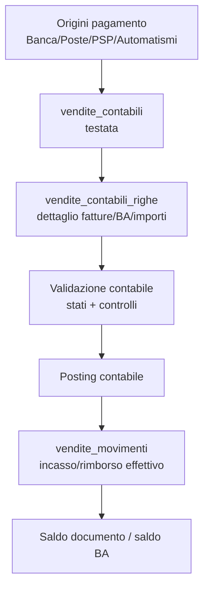
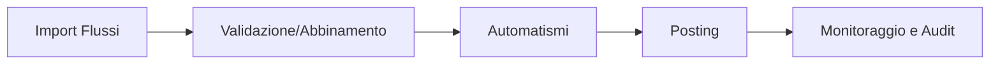

# 📘 Guida Tecnica – Pagamenti Vendite (processo end-to-end)

> 🎯 **Destinatari:** analisti funzionali, sviluppatori backend e database di Zero ERP
>
> 👀 **Vedi anche**
>
> * [`Guida Fatturazione`](/guide/fatturazione)
> * [`pagamenti.vendite_contabili`](/dbzero/pagamenti/manual/vendite_contabili)
> * [`pagamenti.vendite_contabili_righe`](/dbzero/pagamenti/manual/vendite_contabili_righe)
> * [`pagamenti.vendite_movimenti`](/dbzero/pagamenti/manual/vendite_movimenti)
> * [`pagamenti.compensazioni`](/dbzero/pagamenti/manual/compensazioni)
> * [`vendite.fatture_fondi_fattura_source`](/dbzero/vendite/manual/fatture_fondi_fattura_source)

---

## ✅ Introduzione

Nel modello Zero ERP, il fulcro dei pagamenti vendite non e` il movimento finale
(`pagamenti.vendite_movimenti`) ma la **contabile**:

* `pagamenti.vendite_contabili` (testata)
* `pagamenti.vendite_contabili_righe` (dettaglio)

La contabile canalizza sia:

1. flussi esterni (banca, poste, PSP, ecc.)
2. automatismi interni (fondo fattura, compensazioni)

Solo dopo validazione/posting della contabile si materializzano i movimenti
effettivi su `pagamenti.vendite_movimenti`.

---

## 🧱 Principio architetturale

### Regola chiave
La scrittura diretta in `pagamenti.vendite_movimenti` deve essere considerata
**eccezione tecnica**, non percorso operativo standard.

### Motivo
Centralizzando in contabile:

* si uniformano controlli e stati
* si riduce il rischio di incoerenze
* si rende tracciabile l’origine di ogni incasso/rimborso

---

## 🧭 Flusso logico pagamenti

---

## 1) Flussi esterni e canali

I flussi importati (istituti bancari, poste, PSP, altri canali) devono creare:

* una testata contabile (`vendite_contabili`)
* N righe contabili (`vendite_contabili_righe`)

Le regole di coerenza centro/ente sono applicate a livello DB tramite guard.

---

## 2) Flussi automatici

### Fondo fattura

Per i minimi e i riaddebiti si usa la catena:

* generazione source (`vendite.fatture_fondi_fattura_source`)
* applicazione su fattura figlia
* sync su contabili/righe (non su movimenti diretti)

Questo permette reset/rollback finche` la contabile non e` in stato finale.

### Compensazioni

La compensazione e` una testata processo in `pagamenti.compensazioni` e genera:

* **una** testata contabile (`vendite_contabili.compensazione_id`)
* N righe contabili collegate alle fatture coinvolte

Vincoli adottati:

* `compensazione_id` univoco su `vendite_contabili`
* testata compensazione non associabile ai lotti di fatturazione
* centro riscossione obbligatoriamente marcato `is_compensazione = true`

---

## 3) Stati e posting

Le contabili e le righe hanno lookup dedicati di stato.
Il posting deve lavorare su righe idonee (es. `is_postabile = true`) e generare
i movimenti finali in modo idempotente.

Questo separa chiaramente:

* fase di preparazione/validazione
* fase contabile definitiva

---

## 4) Saldi: vantaggio del modello

Con questo impianto il saldo e` piu` leggibile e governabile:

* saldo documento: residuo fattura meno movimenti
* saldo tecnico contabile: righe postabili non ancora postate
* saldo operativo effettivo: residuo al netto del contabile in lavorazione

Questo e` fondamentale per evitare duplicazioni in processi come:

* generazione `fondi_fattura_source`
* sync automatismi su contabili

---

## 5) Governance e controlli consigliati

1. Guard DB su coerenza centro/ente e regole compensazione.
2. Blocco dei link lotto su testate di compensazione.
3. Logging tecnico/operativo per ogni fase (import, validazione, posting).
4. API/servizi applicativi che usino contabili come unico ingresso.

---

## 6) Dashboard Pagamenti (da implementare)

> Stato: **WIP**.  
> La dashboard e` prevista ma non ancora completata a livello UI/processo.

Obiettivo: offrire un unico punto operativo per gestire il ciclo contabili ->
movimenti, con visibilita` su errori, anomalie e stato saldi.

### Aree previste

1. **Import Flussi**
* selezione canale/ente incasso
* acquisizione file o input automatico
* creazione testata/righe contabili

2. **Validazione e Abbinamento**
* controlli formali e funzionali
* abbinamento fatture/billing account
* gestione sospesi/scarti

3. **Automatismi**
* monitor flussi fondo fattura
* monitor compensazioni
* evidenza righe generate da processo

4. **Posting**
* filtro righe postabili
* esecuzione posting idempotente
* generazione movimenti finali

5. **Monitoraggio e Audit**
* stato contabili/righe
* log esecuzione
* report saldi documento e saldo BA

### Flusso operativo atteso

---

## ✅ Risultato atteso

Un dominio pagamenti vendite coerente, auditabile e scalabile:

* un solo punto di ingresso (contabili)
* automatismi e flussi esterni trattati allo stesso modo
* saldi documento/BA semplificati
* minori rischi di incoerenze operative e contabili
