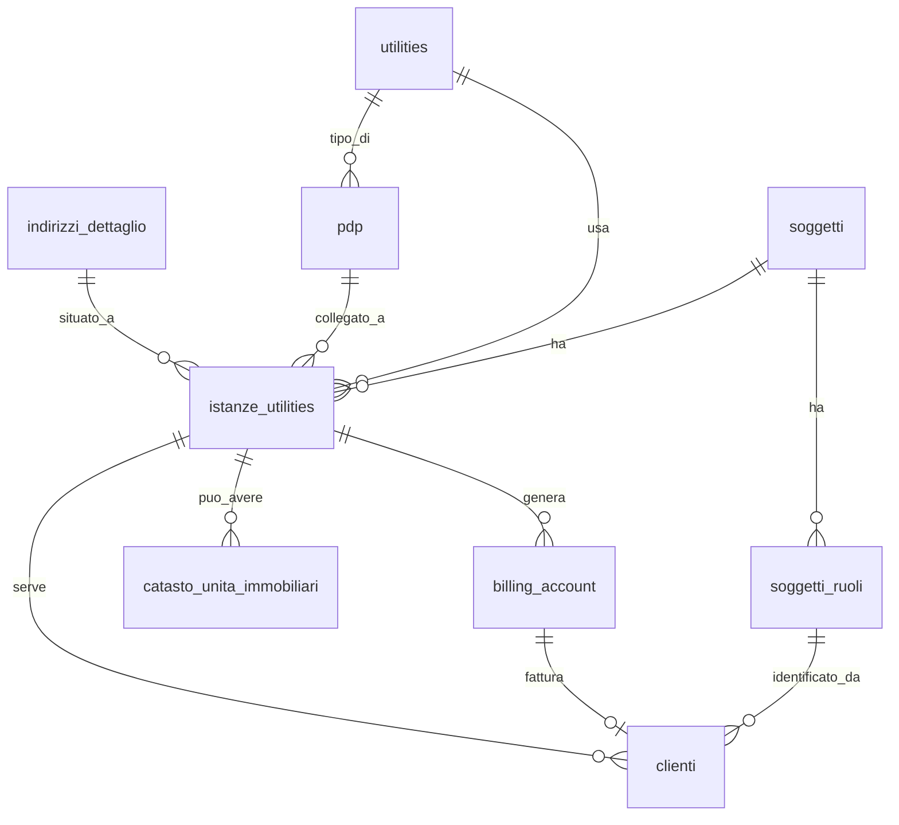

# Guida — Gestione delle Istanze Utility

> **Ultimo aggiornamento**: 4 novembre 2026
>
> **Destinatari**: sviluppatori database, backend e analisti funzionali
>
> **Vedi anche** — schemi DB:
>
> * [anagrafiche.istanze_utilities](/dbzero/anagrafiche/tabelle/istanze_utilities) — le regole strutturali del modello
> * [anagrafiche.clienti](/dbzero/anagrafiche/tabelle/clienti)
> * [anagrafiche.billing_account](/dbzero/anagrafiche/tabelle/billing_account)
> * [anagrafiche.catasto_unita_immobiliari](/dbzero/anagrafiche/tabelle/catasto_unita_immobiliari)
> * [anagrafiche.soggetti](/dbzero/anagrafiche/tabelle/soggetti)
> * [anagrafiche.pdp](/dbzero/anagrafiche/tabelle/pdp)
> * [anagrafiche.indirizzi_dettaglio](/dbzero/anagrafiche/tabelle/indirizzi_dettaglio)
> * [config.utilities](/dbzero/config/tabelle/utilities)
>
> **Vedi anche** — funzioni e trigger DB:
>
> * [anagrafiche.trgfn_clienti_sync_utility_from_ba](/dbzero/anagrafiche/funzioni/trgfn_clienti_sync_utility_from_ba) — il cliente eredita la utility dal billing account
> * [anagrafiche.trgfn_clienti_sync_stato_pdp](/dbzero/anagrafiche/funzioni/trgfn_clienti_sync_stato_pdp) — lo stato del PDP segue il cliente
> * [script.fn_check_utility_istanza_coerenza](/dbzero/script/funzioni/fn_check_utility_istanza_coerenza) — il check riusabile sulla coppia istanza/utility
> * [anagrafiche.fn_guard_istanza_ha_ba](/dbzero/anagrafiche/manual/fn_guard_istanza_ha_ba) — un'istanza non resta mai senza billing account
> * [anagrafiche.fn_guard_istanza_ba_emittente](/dbzero/anagrafiche/manual/fn_guard_istanza_ba_emittente) — i billing account di un'istanza sono di una sola azienda
> * [anagrafiche.fn_clienti_stessa_chiave](/dbzero/anagrafiche/manual/fn_clienti_stessa_chiave) — chi occupa la fornitura soggetto + servizio + azienda
> * [anagrafiche.fn_guard_cliente_chiave_unica](/dbzero/anagrafiche/manual/fn_guard_cliente_chiave_unica) — un cliente manuale per soggetto, servizio e azienda
> * [anagrafiche.trgfn_clienti_guard_stato_date](/dbzero/anagrafiche/manual/trgfn_clienti_guard_stato_date) — gli stati del cliente e le loro date
>
> **Vedi anche** — guide correlate:
>
> * [Glossario termini utility](/glossario/glossario-utility) — PDP, istanza, billing account
> * [Soggetti & Ruoli](/guide/soggetti-e-ruoli-anagrafici)
> * [Generazione di un Cliente](/guide/generazione-cliente) — creazione manuale e da pratica

---

## Cos'è un'istanza utility

L'**istanza utility** è l'entità centrale del modello Zero ERP per il settore utilities. Collega il **mondo fisico** (indirizzo, contatore) con il **mondo commerciale** (cliente, fatturazione).

In parole semplici: quando un servizio gas o energia viene associato a un civico per conto di una persona, nasce un'istanza. L'istanza rappresenta quel "ciclo di servizio" specifico — non è il cliente, non è il contatore, ma il legame tra i due.

L'istanza è progettata per essere:

* **Flessibile**: può esistere prima di un PDP e prima di un contratto
* **Coerente**: i vincoli del database impediscono configurazioni impossibili
* **Stabile nel tempo**: ogni modifica viene storicizzata per tracciabilità

### Il nome dice "utility", ma il modello è generico

Il nome "istanze_utilities" riflette il dominio in cui è nata la struttura, ma in pratica l'istanza funziona come un **ponte trasparente** tra il soggetto e la fatturazione, indipendentemente dal tipo di business.

In un'azienda non-utility (commercio, servizi, gestione pompe funebri, logistica, ecc.) l'istanza viene generata in automatico come contenitore tecnico. L'utente non se ne accorge: non deve compilare PDP, catasto o dati specifici del settore energia. Semplicemente, il sistema crea l'istanza dietro le quinte per mantenere la catena soggetto → istanza → billing account → cliente.

Perché è utile anche senza utility?

* **Fatturazione**: il billing account richiede un'istanza. L'istanza garantisce la tracciabilità del "dove e quando" anche in assenza di contatore
* **Storicizzazione**: ogni ciclo commerciale (attivazione → chiusura) resta registrato come istanza storica, utile per audit e reportistica
* **Multi-servizio**: se in futuro l'azienda aggiunge un secondo tipo di servizio, la struttura è già pronta senza modifiche

Le funzionalità specifiche delle utility — PDP (contatore), catasto, subentro, disdetta — sono **estensioni opzionali** che si attivano solo quando servono. La struttura di base non le impone e non penalizza chi non le usa.

---

## L'istanza come punto di giunzione

L'istanza unisce tre mondi:

| Mondo          | Cosa rappresenta                      | Collegamento                         |
| -------------- | ------------------------------------- | ------------------------------------ |
| Fisico         | Indirizzo + eventuale PDP (contatore) | `indirizzo_dettaglio_id`, `pdp_id`   |
| Commerciale    | Cliente e relativo ruolo              | `clienti.istanza_utility_id`         |
| Amministrativo | Account di fatturazione               | `billing_account.istanza_utility_id` |

Ogni flusso operativo del sistema passa per l'istanza, che diventa il "punto di verità" per lo stato del servizio, l'indirizzo di erogazione, il cliente attivo e il ciclo di vita tecnico-commerciale.

---

## Perché l'istanza è legata al soggetto e non al ruolo

Questa è una scelta progettuale importante che merita una spiegazione.

La tabella `istanze_utilities` ha una FK diretta a `soggetti.id` (la persona), **non** a `soggetti_ruoli.id` (il ruolo CLIENTE). Il motivo è che **l'istanza nasce prima del contratto**:

1. L'istanza identifica semplicemente "chi è associato a questo indirizzo/servizio"
2. Il ruolo CLIENTE nasce **insieme all'istanza**, perché l'istanza nasce col suo billing account e il billing account fattura a quel ruolo (vedi [Ogni istanza nasce col suo billing account](#ogni-istanza-nasce-col-suo-billing-account))
3. Il **cliente** — la specializzazione commerciale con le sue date, in `anagrafiche.clienti` — arriva dopo, con il contratto

Un soggetto può non avere mai il ruolo CLIENTE (per esempio un soggetto che è solo fornitore): in quel caso non ha nemmeno istanze.

In pratica:

* `istanze_utilities.soggetto_id` → chi è la persona (FK a `soggetti`)
* `clienti.soggetto_ruolo_id` → qual è il suo ruolo commerciale (FK a `soggetti_ruoli`)
* `billing_account.soggetto_ruolo_id` → a quale ruolo fatturare (FK a `soggetti_ruoli`)

L'istanza è "del servizio al civico per quel soggetto", non "del cliente". Il cliente è la specializzazione successiva.

---

## Componenti dell'istanza

### Indirizzo

Ogni istanza può essere:

* **reale** (`fittizia = FALSE`): richiede un `indirizzo_dettaglio_id`
* **fittizia** (`fittizia = TRUE`): indirizzo opzionale, per servizi che non richiedono un punto fisico

Regola: se l'istanza è legata a un PDP, non può essere fittizia.

### Utility

Un'istanza può avere **più utility** (GAS, ENERGIA, ecc.), ognuna col **suo** billing account (decisione di Tid del 2026-10-08). La utility serve per filtri, validazioni e per identificare i PDP compatibili.

**Nota importante:** la tabella `istanze_utilities` **non ha** una colonna `utility_id` diretta. La utility dell'istanza è un dato implicito, registrato nelle tabelle satellite:

| Tabella                        | Vincolo                                     | Quando esiste                               |
| ------------------------------ | ------------------------------------------- | ------------------------------------------- |
| `billing_account`              | `UNIQUE(istanza_utility_id, utility_id)`    | Dalla nascita dell'istanza, una riga per utility |
| `istanze_dati_precontrattuali` | `UNIQUE(istanza_utility_id, utility_id)`    | Solo per una utility che ha il suo BA            |
| `clienti`                      | `UNIQUE(billing_account_id)` + `utility_id` | Dopo creazione cliente, uno per BA               |

I vincoli UNIQUE garantiscono che, **per una data utility**, l'istanza abbia al massimo un billing account e una riga di dati precontrattuali. Non limitano il numero di utility: un'istanza ne puo' avere piu' d'una.

Il **cliente** e' uno per billing account (`UNIQUE(billing_account_id)`, decisione del 2026-10-08): un'istanza ha tanti clienti quanti billing account, cioe' uno per utility.

**Ordine cronologico di disponibilità:**

1. **Istanza creata** — nasce **insieme** al suo billing account, nella stessa operazione: `billing_account.utility_id` è il primo punto dove il legame istanza → utility viene registrato, ed esiste da subito
2. **Dati precontrattuali** — `istanze_dati_precontrattuali` si scrive solo per una coppia (istanza, utility) che ha già il suo billing account: porta dati, non dichiara la utility
3. **Cliente creato** — `clienti.utility_id` disponibile (sincronizzato dal BA via trigger `trgfn_clienti_sync_utility_from_ba`)

**Perché è importante:** il sistema usa `istanza_utility_id` come differenziatore su indirizzi, conti bancari e contatti a livello ruolo (cascata istanza → generico ruolo → soggetto). In qualsiasi fase del ciclo di vita dell'istanza, la utility deve essere reperibile per la UI e per le funzioni di risoluzione: il billing account, che nasce con l'istanza, la rende disponibile da subito.

### Istanza e billing account: relazione 1:1 per utility (invariante)

> **Invariante fondamentale — da tenere a mente ogni volta che si ragiona su
> "quale istanza usa un documento".** Per una data utility, **un'istanza ha un
> solo billing account e un billing account ha una sola istanza**: la relazione
> BA ↔ istanza è **1:1**.

Da cosa discende, a livello di modello:

* `billing_account.istanza_utility_id` è una **FK singola NOT NULL** → ogni BA
  punta a **esattamente una** istanza.
* `billing_account` ha `UNIQUE (istanza_utility_id, utility_id)`
  (`uq_billing_instance_utility`) → per una data coppia (istanza, utility)
  esiste **al massimo un** BA.
* Il risultato è che **dato il BA, l'istanza (e la utility) sono univoche**:
  non c'è nulla da "scegliere". Un'istanza con più utility ha più BA, uno per
  utility, ma ogni BA ne ha una sola.

**Conseguenza pratica (il punto che ricapita spesso).** Un BA **non** può avere
più istanze sulla stessa utility, quindi un documento che ha già un
billing_account **non deve** — e non può utilmente — "scegliere" o memorizzare
una propria istanza: la ricava in modo univoco dal BA. Questo spiega
l'asimmetria voluta fra i documenti di vendita:

| Documenti                                            | Hanno `istanza_utility_id` sulla testata? | Perché                                                                                                                             |
| ---------------------------------------------------- | ----------------------------------------- | ---------------------------------------------------------------------------------------------------------------------------------- |
| **Precontrattuali** (preventivi, offerte, contratti) | **Sì**                                    | L'istanza si **sceglie direttamente** (senza filtro utility) e viene congelata sul documento insieme al suo BA; il database pretende che il BA sia quello della coppia (istanza, utility) del documento |
| **Esecutivi** (ordini, DDT, fatture)                 | **No**                                    | Hanno **sempre** un BA (obbligatorio) → l'istanza è già univoca: si legge da `ba.istanza_utility_id`, non si duplica sulla testata |

**Regola operativa**: se il documento ha (o richiede) un billing_account,
l'istanza **viene dal BA** — non aggiungere colonne istanza a documenti
BA-backed (duplicherebbero un dato già univoco, creando solo occasioni di
disallineamento). Sui precontrattuali l'istanza è una scelta e sta sulla
testata accanto al BA: i due non possono dire cose diverse, perché il database
lega il BA del documento alla sua coppia (istanza, utility).

### PDP (opzionale)

L'istanza può essere collegata a un punto di prelievo già esistente:

* `pdp_id` può essere NULL (istanza senza contatore)
* Se `pdp_id` non e NULL → l'indirizzo dell'istanza deve coincidere con quello del PDP
* Se `pdp_id` non e NULL → l'istanza non può essere fittizia

### Cliente associato

L'istanza ospita **un cliente per ciascun suo billing account** (vincolo `uq_clienti_billing_account`, UNIQUE su `billing_account_id`): con due utility, due billing account e fino a due clienti. Fino al 2026-10-08 il vincolo era un cliente per istanza. L'associazione avviene tramite `clienti.billing_account_id` e `clienti.istanza_utility_id`. Il cliente assume utility e billing account dal suo BA, l'indirizzo dall'istanza.

Quando un cliente viene chiuso e un nuovo intestatario subentra, il sistema crea una **nuova istanza** per il nuovo cliente. L'istanza precedente resta come record storico, collegata alla nuova tramite `parent_istanza_id`. In questo modo la relazione billing account → cliente è sempre 1:1 (o 1:0 finché il contratto non arriva).

---

## Multi-utility sullo stesso indirizzo

Un punto che genera spesso confusione: il vincolo di unicita opera **per PDP**, non per indirizzo. Questo significa che sullo stesso civico possono coesistere istanze attive di utility diverse.

### Esempio concreto

Mario Rossi abita in Via Roma 1, interno 3. Ha un contratto gas e un contratto energia:

```text
Via Roma 1 int. 3
├── PDP GAS  (PDR 12345678901234) → Istanza GAS  → Cliente GAS  (attivo)
└── PDP ENERGIA (POD IT001E12345678) → Istanza ENERGIA → Cliente ENERGIA (attivo)
```

* Le due istanze puntano allo stesso `soggetti.id` (Mario Rossi)
* Entrambi i record `clienti` puntano allo stesso `soggetto_ruolo_id` (ruolo CLIENTE, unico per soggetto)
* Nessun conflitto: il vincolo `ex_clienti_no_overlap_stesso_pdp` opera su `(pdp_id, periodo)`, quindi ciascun PDP ha il proprio spazio

### Cosa impedirebbe il vincolo

Sul PDP GAS non possono esserci **due clienti attivi contemporaneamente**. Se Mario Rossi disdice il gas e Anna Verdi subentra, il sistema:

1. Chiude Mario Rossi sul PDP GAS (stato CH)
2. Crea una nuova istanza per Anna Verdi sullo stesso PDP GAS
3. Anna Verdi diventa la nuova cliente attiva

Il PDP ENERGIA di Mario Rossi non viene toccato.

---

## Collegamento istanze e PDP

### Il PDP è un'entità fisica

Il PDP rappresenta il contatore o allaccio a un indirizzo. Non cambia indirizzo, non cambia utility, e ha un proprio stato tecnico (ATTIVO, DISPONIBILE) indipendente dalle istanze.

### Regole di collegamento

Quando un'istanza viene collegata a un PDP:

* Gli indirizzi devono coincidere
* Le utility devono coincidere
* L'istanza non può essere fittizia
* Il PDP deve essere in stato DISPONIBILE (se non ha già un cliente attivo)

### Aggiornamento automatico dello stato PDP

Lo stato del PDP segue l'**occupazione**: un PDP è occupato se un suo cliente ha un periodo di
fornitura che contiene la data di oggi (trigger `trgfn_clienti_sync_stato_pdp`):

* PDP occupato e **DISPONIBILE** → diventa **ATTIVO**
* PDP libero e **ATTIVO** → torna **DISPONIBILE**

Un cliente sospeso occupa ancora il PDP; un annullato e un pre-contrattuale no. Gli stati
tecnici «staccato» e «dismesso» non cambiano da qui: li governano processi loro.

⚠️ Lo stato si ricalcola quando si scrive il cliente. Una chiusura con data futura libera il PDP
alla prossima scrittura del cliente, non il giorno della chiusura.

---

## Collegamento istanze e clienti

* Per creare un cliente serve **sempre** un'istanza: `clienti.istanza_utility_id NOT NULL`
* Il ciclo di vita del cliente dipende dall'istanza: cambio utility → nuova istanza; chiusura contratto → l'istanza diventa storica
* La coerenza utility è mantenuta automaticamente: `clienti.utility_id` è quella del billing account del cliente (`trgfn_clienti_sync_utility_from_ba`)

---

## Vincoli di dominio

### Sull'indirizzo

* `fittizia = FALSE` → indirizzo obbligatorio
* `pdp_id` non NULL → indirizzo deve coincidere col PDP
* `pdp_id` non NULL → `fittizia = FALSE`

### Sul PDP

* Unico per `(indirizzo_dettaglio_id, utility_id)`
* Stato tecnico indipendente dalle istanze
* L'istanza non può cambiare PDP senza chiusura tecnica

### Sul cliente

* Non può essere creato senza istanza
* L'attivazione del cliente modifica lo stato del PDP
* Il vincolo UNIQUE su `billing_account_id` garantisce un solo cliente per billing account, sia per istanze reali che fittizie; un'istanza con più utility ha un cliente per ciascuna
* Il vincolo di esclusione `ex_clienti_no_overlap_stesso_pdp` (su `pdp_id, periodo`) aggiunge una seconda protezione: impedisce periodi sovrapposti sullo stesso PDP **tra istanze diverse**
* Per le istanze fittizie (senza PDP) la stessa protezione la dà la regola «un cliente per soggetto, servizio e azienda» (sotto, [Un cliente manuale per soggetto, servizio e azienda](#un-cliente-manuale-per-soggetto-servizio-e-azienda)): il UNIQUE sul billing account non basta, perché ogni creazione manuale fa un'istanza e un billing account nuovi

---

## Flusso operativo: dalla pre-istanza al cliente attivo

### 1. Creazione dell'istanza col suo billing account

* Istanza e billing account nascono **insieme**, nella stessa operazione: un'istanza senza billing account non esiste
* Può essere fittizia
* Può non avere PDP
* Il soggetto prende il ruolo CLIENTE in questo momento

### 2. Associazione a un PDP

Condizioni minime: indirizzo reale, utility compatibile, PDP disponibile.

### 3. Creazione del cliente

L'istanza deve essere completa (indirizzo + BA, che esiste dalla nascita dell'istanza).

### 4. Attivazione del cliente

Il PDP passa ad ATTIVO. L'istanza è pienamente in servizio.

### 5. Chiusura del cliente

Può avvenire per **subentro** (un nuovo intestatario subentra) o per **disdetta** (il servizio si chiude senza sostituto). In entrambi i casi il PDP torna DISPONIBILE e l'istanza resta nel database come record storico.

Un cliente chiuso **non si riapre**: se la fornitura riparte, nasce una **catena nuova** (istanza,
billing account e cliente nuovi), collegata alla precedente. Il billing account vecchio resta per
le fatture finali e i conguagli. Vedi [Gli stati del cliente](#gli-stati-del-cliente-e-le-loro-date).

Per i dettagli su subentro e disdetta: [Guida Generazione Cliente – Appendici](/guide/generazione-cliente).

---

## Diagramma ER



---

## Errori comuni

* Assegnare un PDP con utility diversa dall'istanza
* Creare un'istanza senza il suo billing account, o cancellare l'ultimo billing account di un'istanza
* Creare un cliente senza istanza
* Spostare un PDP di indirizzo (vietato dal modello fisico)
* Marcare `fittizia = TRUE` con un PDP associato
* Confondere il vincolo "un cliente per PDP" con "un cliente per indirizzo"

---

## Istanze fittizie nella creazione manuale del cliente

Per le utility con `config.utilities.richiede_pdp = false` (manifatturiero, servizi generici, ecc.), la creazione del cliente avviene **manualmente** dall'interfaccia, senza passare dal motore pratiche.

In questo caso l'istanza viene generata automaticamente come **contenitore tecnico trasparente**:

* `fittizia = TRUE` — l'istanza non rappresenta un punto di erogazione fisico
* `indirizzo_dettaglio_id` — facoltativo, a discrezione dell'operatore. Se fornito, viene salvato come dato informativo
* `pdp_id = NULL` — nessun punto di prelievo associato
* `utility_id` — la utility scelta dall'operatore (solo quelle con `richiede_pdp = false`)

L'operatore non interagisce direttamente con l'istanza: il `ClienteService` la crea dietro le quinte come parte della transazione atomica di creazione cliente (istanza + billing account + cliente).

Per le utility con `richiede_pdp = true` (GAS, Energia, Idrico), la creazione del cliente passa obbligatoriamente dal motore pratiche e l'istanza è sempre reale, con indirizzo e PDP obbligatori.

Per i dettagli completi: [Guida Generazione Cliente — Creazione manuale vs creazione da pratica](/guide/generazione-cliente#creazione-manuale-vs-creazione-da-pratica).

### Un cliente manuale per soggetto, servizio e azienda

Un'istanza fittizia non rappresenta niente di fisico: senza un punto di fornitura, ciò che
distingue una fornitura è **chi la riceve, quale servizio e quale azienda la fornisce**. Due
clienti con lo stesso soggetto, lo stesso servizio e la stessa azienda, attivi negli stessi
giorni, sono la stessa fornitura scritta due volte, e il database rifiuta il secondo
(`E_CLIENTE_STESSA_CHIAVE`, decisione del 2026-10-13). Il messaggio porta il codice del billing
account del cliente che esiste già.

| Caso | Esito |
| --- | --- |
| stesso soggetto e azienda, un altro servizio | due forniture: ammesso |
| stesso soggetto e servizio, un'altra azienda | due forniture: ammesso |
| il cliente esistente è sospeso | la fornitura c'è ancora: rifiutato |
| il cliente esistente è chiuso | dalla data di chiusura la fornitura è libera: la catena nuova parte da lì |
| il cliente esistente è annullato | non conta |
| un cliente pre-contrattuale | si prepara anche se un altro è attivo; il rifiuto arriva quando lo si attiva |

L'azienda è quella **dell'installazione**: quella a cui il billing account è collegato o, se non
è collegato, l'azienda predefinita. Non dipende da chi sta lavorando. Per questo la regola si
controlla anche quando si cambia l'azienda di un billing account, quando si sposta l'azienda
predefinita e quando un'istanza diventa fittizia. Il controllo avviene **alla conferma**
dell'operazione: dentro la stessa operazione si può chiudere il cliente vecchio e aprire il
nuovo in qualunque ordine.

Quando la catena nuova si attiva, la sua istanza viene collegata da sola alla precedente
(`parent_istanza_id`): il predecessore è l'ultimo cliente con lo stesso soggetto, servizio e
azienda.

Per avvisare l'operatore mentre prepara un pre-contrattuale, il database offre la lettura
[anagrafiche.fn_clienti_stessa_chiave](/dbzero/anagrafiche/manual/fn_clienti_stessa_chiave):
è la stessa che usa il rifiuto, quindi l'avviso e il rifiuto non possono dire due cose diverse.

### Gli stati del cliente e le loro date

Lo stato del cliente segue un percorso (decisione del 2026-10-14), scritto come dato in
[config.transizioni_stati_cliente](/dbzero/config/tabelle/transizioni_stati_cliente):

| Da | Può andare a |
| --- | --- |
| Pre-contrattuale | Attivo, Annullato |
| Attivo | Richiesta sospensione, Sospeso (fatturabile o no), Chiuso, Chiuso per morosità, Chiuso per switch, Annullato |
| Richiesta sospensione | Attivo, Sospeso (fatturabile o no) |
| Sospeso | Attivo, l'altro Sospeso, Chiuso, Chiuso per morosità, Chiuso per switch |
| Chiuso, Chiuso per morosità, Chiuso per switch | solo Chiuso e fatturato |
| Chiuso e fatturato, Annullato | nessuno: sono stati finali |

Un cliente chiuso **non torna attivo**, e la sua data di chiusura non cambia più. Ogni stato
pretende la sua data: l'attivo quella di attivazione, il sospeso quella di sospensione, il chiuso
quella di chiusura, e chi torna attivo da una sospensione quella di riattivazione. La chiusura
non può precedere l'attivazione.

Lo stato «Aggregante» resta a catalogo come promemoria: non è una fornitura, non entra nel
percorso e non occupa la fornitura.

---

Le funzionalità descritte in questa guida valgono per il **modello strutturale corrente**, che definisce formalmente l'identità dell'istanza, il vincolo 1 istanza = 1 cliente e la gestione della catena di subentri tramite `parent_istanza_id`.

Per i dettagli completi e i vincoli formali: [anagrafiche.istanze_utilities](/dbzero/anagrafiche/tabelle/istanze_utilities)

---

## Ogni istanza nasce col suo billing account

**Regola** (decisione del 2026-10-08): istanza e billing account nascono
**insieme**, nella stessa operazione, e un'istanza non resta mai senza
billing account. Un'istanza «in pausa», senza billing account, non è uno stato
del ciclo di vita: è un dato fuori regola, e il database non lo accetta.

La regola vale **per utility**: ogni utility usata su un'istanza ha il suo
billing account.

### Che cosa la tiene in piedi

| Cosa si prova a fare | Che cosa succede |
| --- | --- |
| creare un'istanza senza il suo billing account | rifiutato alla conferma dell'operazione (`E_ISTANZA_SENZA_BA`) |
| cancellare l'ultimo billing account di un'istanza che resta | rifiutato alla conferma (`E_ISTANZA_SENZA_BA`); istanza e billing account si cancellano solo insieme |
| spostare un billing account su un'altra istanza o un'altra utility | rifiutato: la coppia istanza/utility è l'identità del billing account (`E_BA_ISTANZA_IMMUTABILE`) |
| scrivere dati precontrattuali per una utility che sull'istanza non ha billing account | rifiutato |
| collegare a un preventivo, un'offerta o un contratto il billing account di un'altra istanza o di un'altra utility | rifiutato |
| dare a un'istanza billing account di due aziende emittenti diverse | rifiutato (`E_ISTANZA_EMITTENTI_DIVERSI`) |

Il controllo sull'istanza avviene **alla conferma** dell'operazione, non
riga per riga: dentro la stessa operazione l'istanza può essere scritta prima
del suo billing account.

L'unica cosa che di un billing account si genera in automatico è il **codice**,
e anche quello nasce con il billing account.

### Un'istanza, un'azienda

Tutti i billing account di un'istanza appartengono alla **stessa azienda
emittente**. È ciò che rende univoca la domanda «di chi è questa istanza?»:
la risposta è l'azienda del suo billing account. Il controllo vale quando nasce
un billing account, quando si cambia l'azienda a cui è collegato e quando si
sposta l'azienda predefinita del sistema.

### Dove sta il dettaglio

* [anagrafiche.fn_guard_istanza_ha_ba](/dbzero/anagrafiche/manual/fn_guard_istanza_ha_ba) — l'istanza ha il suo billing account
* [anagrafiche.fn_guard_istanza_ba_emittente](/dbzero/anagrafiche/manual/fn_guard_istanza_ba_emittente) — un'istanza, un'azienda
* [script.fn_check_utility_istanza_coerenza](/dbzero/script/funzioni/fn_check_utility_istanza_coerenza) — la coppia istanza/utility ha il suo billing account

---


