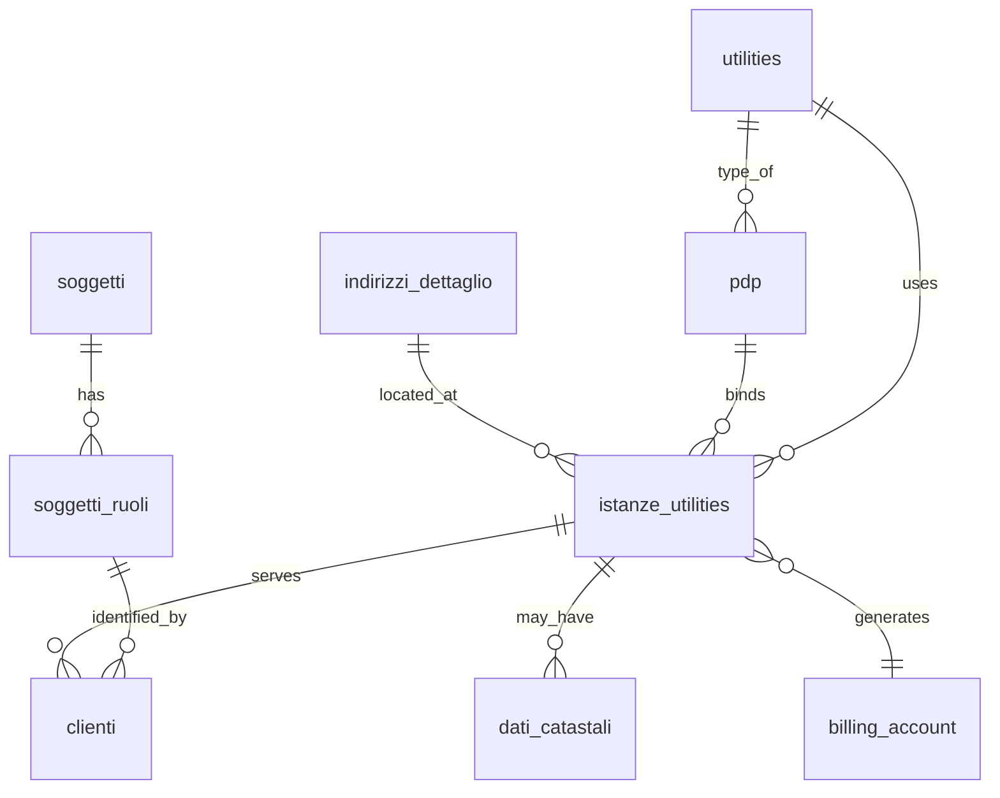

# 📘 Guida Tecnica – Gestione delle Istanze Utility e Collegamento con PDP & Clienti

> 🎯 **Destinatari:** sviluppatori database, backend e analisti funzionali di Zero ERP
>
>
> 👀 **Vedi anche**
>
> * [`Guida Soggetti & Ruoli`](/guide/soggetti-e-ruoli-anagrafici)  

---

## ✅ Introduzione

L’**istanza utility** rappresenta l’entità che collega il dominio fisico del servizio (indirizzo, eventuale punto di prelievo – PDP/PDR/POD) con il dominio commerciale (cliente e fatturazione). È l’oggetto cardine che unisce **territorio → impianto → cliente**.

È progettata per essere:

* **flessibile**, perché può esistere prima di un PDP;
* **coerente**, perché può vincolare il proprio indirizzo e stato all’infrastruttura tecnica;
* **stabile nel tempo**, grazie ai meccanismi di storicizzazione e audit.

---

## 🧱 Tabelle coinvolte

* [anagrafiche.istanze_utilities](/dbzero/anagrafiche/tabelle/istanze_utilities)
* [anagrafiche.clienti](/dbzero/anagrafiche/tabelle/clienti)
* [anagrafiche.billing_account](/dbzero/anagrafiche/tabelle/billing_account)
* [anagrafiche.dati_catastali](/dbzero/anagrafiche/tabelle/dati_catastali)
* [anagrafiche.soggetti](/dbzero/anagrafiche/tabelle/soggetti)
* [anagrafiche.pdp](/dbzero/anagrafiche/tabelle/pdp)
* [anagrafiche.indirizzi_dettaglio](/dbzero/anagrafiche/tabelle/indirizzi_dettaglio)
* [anagrafiche.indirizzi](/dbzero/anagrafiche/tabelle/indirizzi)
* [config.utilities](/dbzero/config/tabelle/utilities)

---

## 🧱 Ruolo dell'istanza nel modello Zero ERP

L’istanza è **l’anello di giunzione** tra tre mondi:

1. **Il mondo fisico**: indirizzo + eventuale PDP
2. **Il mondo commerciale**: cliente e relativo ruolo
3. **Il mondo amministrativo**: billing account

Ogni flusso operativo del sistema passa per l'istanza, che diventa il "punto di verità" per:

* stato del servizio;
* indirizzo effettivo di erogazione;
* relazione con l'impianto fisico (pdp) quando presente;
* cliente attivo o precontrattuale;
* ciclo di vita tecnico e commerciale.

---

## 🧩 Componenti fondamentali dell’istanza

### 1️⃣ Indirizzo

Ogni istanza può essere:

* **reale** → `fittizia = FALSE` → richiede un `indirizzo_dettaglio_id`
* **fittizia** → `fittizia = TRUE` → indirizzo opzionale

> 🔒 Regola di coerenza:
>
> * Se l’istanza è legata a un **PDP**, non può essere fittizia.

### 2️⃣ Utility

Ogni istanza appartiene a una (e una sola) utility: GAS, ENERGIA, ecc.
Serve per filtri, validazioni e per identificare i PDP compatibili.

### 3️⃣ PDP (opzionale ma fondamentale)

L’istanza può essere collegata a un punto di prelievo **già esistente** o generato prima della contrattualizzazione.

Regole:

* `pdp_id` può essere NULL
* se NON è NULL ⇒ indirizzo della istanza = indirizzo del PDP
* se il PDP si trova in stato tecnico **DISPONIBILE**, un’istanza può agganciarsi liberamente
* se lo stato è **ATTIVO**, l'istanza deve già essere il legittimo proprietario

### 4️⃣ Cliente associato

L’istanza genera o ospita esattamente **uno** specifico cliente.

L’associazione avviene tramite `clienti.istanza_utilities_id`.

Il cliente assume:

* utility dell’istanza;
* billing_account dell’istanza;
* indirizzo dell’istanza (o derivazioni).

---

## 🔄 Collegamento Istanze ↔ PDP

Ecco la logica completa di coerenza costruita nel sistema:

### 🧩 1. Il PDP è un’entità fisica

* Non cambia indirizzo
* Non cambia utility
* Ha un proprio **stato tecnico**

### 🧩 2. Quando l’istanza viene collegata a un PDP, devono verificarsi:

* indirizzi coincidenti;
* utility coincidenti;
* `fittizia = FALSE`;
* PDP in stato **DISPONIBILE** se non ha ancora un cliente attivo.

### 🔁 3. Aggiornamento dello stato PDP tramite trigger cliente

Quando un cliente passa a:

* **AT – Attivo** → PDP diventa **ATTIVO**
* **CH – Chiuso** → PDP torna **DISPONIBILE**

Tutti gli altri stati cliente (sospesi, annullati, aggreganti...) non influiscono sullo stato tecnico del PDP.

---

## 🔄 Collegamento Istanze ↔ Cliente

### 1️⃣ Per creare un cliente serve *sempre* un’istanza

`clienti.istanza_utilities_id NOT NULL`

### 2️⃣ Il ciclo di vita cliente dipende dall’istanza

Quando:

* cambia indirizzo → coinvolge l’istanza
* cambia utility → implica nuova istanza
* si chiude il contratto → l’istanza viene storicizzata/chiusa

### 3️⃣ Coerenza utility

`clienti.utility_id = billing_account.utility_id = istanza.utility_id`

Un trigger assicura la consistenza automatica.

---

## ⚙️ Validazioni e Vincoli di Dominio

### 🟥 Vincoli sull’indirizzo

* `fittizia = FALSE` ⇒ indirizzo obbligatorio
* `pdp_id NON NULL` ⇒ indirizzo deve coincidere col PDP
* `pdp_id NON NULL` ⇒ `fittizia = FALSE`

### 🟥 Vincoli sul PDP

* deve essere unico per `(indirizzo_dettaglio_id, utility_id)`
* ha uno stato tecnico indipendente dalle istanze
* l’istanza non può cambiare PDP senza una chiusura tecnica

### 🟥 Vincoli sul cliente

* un cliente non può essere creato senza un’istanza
* l’attivazione del cliente modifica lo stato tecnico del PDP

---

## 🔧 Flusso Operativo: dalla Pre-Istanza al Cliente Attivo

### 🟦 1. Creazione dell’istanza precontrattuale

* può essere fittizia
* può non avere PDP
* può servire per generare un billing account anticipato

### 🟦 2. Associazione a PDP

Condizioni minime:

* indirizzo reale
* utility compatibile
* PDP disponibile

### 🟦 3. Creazione Cliente

* l’istanza deve essere completa
* billing account già esistente
* ruolo CLIENTE creato automaticamente

### 🟦 4. Attivazione del Cliente

Effetti:

* stato PDP cambia in **ATTIVO**
* istanza entra pienamente in servizio

### 🟦 5. Chiusura del Cliente

Effetti:

* stato PDP torna **DISPONIBILE**
* l’istanza entra in stato storico

---

## 📐 Diagramma ER – Istanze, PDP, Clienti

---

## 🚀 Best Practice

* creare prima l’istanza, poi il cliente → mantiene ordine logico e storico
* non collegare PDP se non necessario finché non si ha certezza dell’indirizzo
* controllare sempre la coerenza indirizzo / PDP / utility prima della generazione cliente
* non usare istanze fittizie per casi reali
* evitare update diretti dell’istanza: privilegiare funzioni apposite

---

## ⚠️ Errori comuni

* assegnare un PDP con utility diversa dall’istanza
* creare un cliente senza istanza
* spostare un PDP di indirizzo (vietato dal modello fisico)
* marcare `fittizia = TRUE` con un PDP associato

---

## 🧭 Conclusione

La modellazione Istanze ↔ PDP ↔ Cliente è uno dei pilastri di Zero ERP.
Permette di mantenere una **visione completa**, **coerente** e **storica** del ciclo di vita del servizio, evitando ridondanze e garantendo tracciabilità tecnica e commerciale.

Questa guida fornisce le basi concettuali e operative per costruire servizi robusti su questo modello.

---

🆕 📌 Nota Importante sulle Regole Strutturali dell’Istanza (Modello 2025)

Le funzionalità descritte in questa guida sono basate su un modello più ampio e più restrittivo introdotto nel 2025, che definisce in modo formale:

l’identità unitaria dell’istanza come ciclo tecnico-commerciale del servizio;

il vincolo 1 istanza ⇄ 1 cliente;

la relazione deterministica tra istanza ⇄ billing account ⇄ cliente;

il comportamento delle istanze in presenza di PDP (un solo cliente attivo per PDP);

la gestione della catena lineare di istanze tramite parent_istanza_id.

Per i dettagli completi, le motivazioni progettuali e tutti i vincoli formali introdotti, consulta la sezione **7** dedicata nella documentazione :

👉 [anagrafiche.istanze_utilities](/dbzero/anagrafiche/tabelle/istanze_utilities)

---


