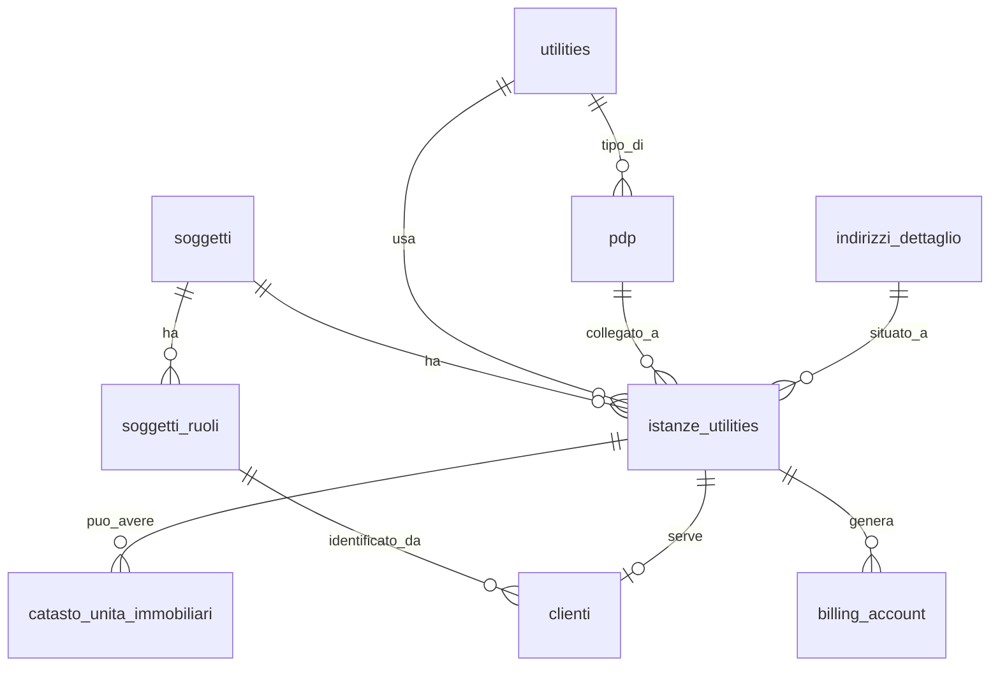

# Guida — Gestione delle Istanze Utility

> **Ultimo aggiornamento**: 20 settembre 2026
>
> **Destinatari**: sviluppatori database, backend e analisti funzionali
>
> **Vedi anche** — schemi DB:
>
> * [anagrafiche.istanze_utilities](/dbzero/anagrafiche/tabelle/istanze_utilities) — le regole strutturali del modello
> * [anagrafiche.clienti](/dbzero/anagrafiche/tabelle/clienti)
> * [anagrafiche.billing_account](/dbzero/anagrafiche/tabelle/billing_account)
> * [anagrafiche.catasto_unita_immobiliari](/dbzero/anagrafiche/tabelle/catasto_unita_immobiliari)
> * [anagrafiche.soggetti](/dbzero/anagrafiche/tabelle/soggetti)
> * [anagrafiche.pdp](/dbzero/anagrafiche/tabelle/pdp)
> * [anagrafiche.indirizzi_dettaglio](/dbzero/anagrafiche/tabelle/indirizzi_dettaglio)
> * [config.utilities](/dbzero/config/tabelle/utilities)
>
> **Vedi anche** — funzioni e trigger DB:
>
> * [anagrafiche.trgfn_clienti_sync_utility_from_ba](/dbzero/anagrafiche/funzioni/trgfn_clienti_sync_utility_from_ba) — il cliente eredita la utility dal billing account
> * [anagrafiche.trgfn_clienti_sync_stato_pdp](/dbzero/anagrafiche/funzioni/trgfn_clienti_sync_stato_pdp) — lo stato del PDP segue il cliente
> * [script.fn_check_utility_istanza_coerenza](/dbzero/script/funzioni/fn_check_utility_istanza_coerenza) — il check riusabile sulla coppia istanza/utility
>
> **Vedi anche** — guide correlate:
>
> * [Glossario termini utility](/glossario/glossario-utility) — PDP, istanza, billing account
> * [Soggetti & Ruoli](/guide/soggetti-e-ruoli-anagrafici)
> * [Generazione di un Cliente](/guide/generazione-cliente) — creazione manuale e da pratica

---

## Cos'è un'istanza utility

L'**istanza utility** è l'entità centrale del modello Zero ERP per il settore utilities. Collega il **mondo fisico** (indirizzo, contatore) con il **mondo commerciale** (cliente, fatturazione).

In parole semplici: quando un servizio gas o energia viene associato a un civico per conto di una persona, nasce un'istanza. L'istanza rappresenta quel "ciclo di servizio" specifico — non è il cliente, non è il contatore, ma il legame tra i due.

L'istanza è progettata per essere:

* **Flessibile**: può esistere prima di un PDP e prima di un contratto
* **Coerente**: i vincoli del database impediscono configurazioni impossibili
* **Stabile nel tempo**: ogni modifica viene storicizzata per tracciabilità

### Il nome dice "utility", ma il modello è generico

Il nome "istanze_utilities" riflette il dominio in cui è nata la struttura, ma in pratica l'istanza funziona come un **ponte trasparente** tra il soggetto e la fatturazione, indipendentemente dal tipo di business.

In un'azienda non-utility (commercio, servizi, gestione pompe funebri, logistica, ecc.) l'istanza viene generata in automatico come contenitore tecnico. L'utente non se ne accorge: non deve compilare PDP, catasto o dati specifici del settore energia. Semplicemente, il sistema crea l'istanza dietro le quinte per mantenere la catena soggetto → istanza → billing account → cliente.

Perché è utile anche senza utility?

* **Fatturazione**: il billing account richiede un'istanza. L'istanza garantisce la tracciabilità del "dove e quando" anche in assenza di contatore
* **Storicizzazione**: ogni ciclo commerciale (attivazione → chiusura) resta registrato come istanza storica, utile per audit e reportistica
* **Multi-servizio**: se in futuro l'azienda aggiunge un secondo tipo di servizio, la struttura è già pronta senza modifiche

Le funzionalità specifiche delle utility — PDP (contatore), catasto, subentro, disdetta — sono **estensioni opzionali** che si attivano solo quando servono. La struttura di base non le impone e non penalizza chi non le usa.

---

## L'istanza come punto di giunzione

L'istanza unisce tre mondi:

| Mondo          | Cosa rappresenta                      | Collegamento                         |
| -------------- | ------------------------------------- | ------------------------------------ |
| Fisico         | Indirizzo + eventuale PDP (contatore) | `indirizzo_dettaglio_id`, `pdp_id`   |
| Commerciale    | Cliente e relativo ruolo              | `clienti.istanza_utility_id`         |
| Amministrativo | Account di fatturazione               | `billing_account.istanza_utility_id` |

Ogni flusso operativo del sistema passa per l'istanza, che diventa il "punto di verità" per lo stato del servizio, l'indirizzo di erogazione, il cliente attivo e il ciclo di vita tecnico-commerciale.

---

## Perché l'istanza è legata al soggetto e non al ruolo

Questa è una scelta progettuale importante che merita una spiegazione.

La tabella `istanze_utilities` ha una FK diretta a `soggetti.id` (la persona), **non** a `soggetti_ruoli.id` (il ruolo CLIENTE). Il motivo è che **l'istanza nasce prima del contratto**:

1. In fase precontrattuale, il soggetto potrebbe non avere ancora il ruolo CLIENTE
2. L'istanza identifica semplicemente "chi è associato a questo indirizzo/servizio"
3. Il ruolo CLIENTE arriva dopo, con la specializzazione in `anagrafiche.clienti`

In pratica:

* `istanze_utilities.soggetto_id` → chi è la persona (FK a `soggetti`)
* `clienti.soggetto_ruolo_id` → qual è il suo ruolo commerciale (FK a `soggetti_ruoli`)
* `billing_account.soggetto_ruolo_id` → a quale ruolo fatturare (FK a `soggetti_ruoli`)

L'istanza è "del servizio al civico per quel soggetto", non "del cliente". Il cliente è la specializzazione successiva.

---

## Componenti dell'istanza

### Indirizzo

Ogni istanza può essere:

* **reale** (`fittizia = FALSE`): richiede un `indirizzo_dettaglio_id`
* **fittizia** (`fittizia = TRUE`): indirizzo opzionale, per servizi che non richiedono un punto fisico

Regola: se l'istanza è legata a un PDP, non può essere fittizia.

### Utility

Ogni istanza appartiene a una sola utility (GAS, ENERGIA, ecc.). Serve per filtri, validazioni e per identificare i PDP compatibili.

**Nota importante:** la tabella `istanze_utilities` **non ha** una colonna `utility_id` diretta. La utility dell'istanza è un dato implicito, registrato nelle tabelle satellite:

| Tabella                        | Vincolo                                     | Quando esiste                               |
| ------------------------------ | ------------------------------------------- | ------------------------------------------- |
| `istanze_dati_precontrattuali` | `UNIQUE(istanza_utility_id, utility_id)`    | Fase precontrattuale (creazione da pratica) |
| `billing_account`              | `UNIQUE(istanza_utility_id, utility_id)`    | Dopo creazione BA                           |
| `clienti`                      | `UNIQUE(istanza_utility_id)` + `utility_id` | Dopo creazione cliente                      |

Tutti e tre i vincoli UNIQUE garantiscono che **una istanza corrisponde a una sola utility**.

**Ordine cronologico di disponibilità:**

1. **Pratica aperta** — `istanze_dati_precontrattuali` è il primo punto dove il legame istanza → utility viene registrato. Nella creazione da pratica (utility con `richiede_pdp = true`: GAS, IDRICO, ENERGIA) questo record **deve** essere creato subito insieme all'istanza, perché BA e cliente non esistono ancora
2. **BA creato** — `billing_account.utility_id` disponibile
3. **Cliente creato** — `clienti.utility_id` disponibile (sincronizzato dal BA via trigger `trgfn_clienti_sync_utility_from_ba`)

Nella creazione immediata (utility con `richiede_pdp = false`) non c'è fase precontrattuale: BA e cliente vengono creati atomicamente dal `ClienteService`, e la utility è immediatamente disponibile da `billing_account` e `clienti`.

**Perché è importante:** il sistema usa `istanza_utility_id` come differenziatore su indirizzi, conti bancari e contatti a livello ruolo (cascata istanza → generico ruolo → soggetto). In qualsiasi fase del ciclo di vita dell'istanza, la utility deve essere reperibile per la UI e per le funzioni di risoluzione. Se `istanze_dati_precontrattuali` non viene popolato nella fase precontrattuale, la utility resta ignota fino alla creazione del BA.

### Istanza e billing account: relazione 1:1 per utility (invariante)

> **Invariante fondamentale — da tenere a mente ogni volta che si ragiona su
> "quale istanza usa un documento".** Per una data utility, **un'istanza ha un
> solo billing account e un billing account ha una sola istanza**: la relazione
> BA ↔ istanza è **1:1**.

Da cosa discende, a livello di modello:

* `billing_account.istanza_utility_id` è una **FK singola NOT NULL** → ogni BA
  punta a **esattamente una** istanza.
* `billing_account` ha `UNIQUE (istanza_utility_id, utility_id)`
  (`uq_billing_instance_utility`) → per una data coppia (istanza, utility)
  esiste **al massimo un** BA.
* Sommato a "1 istanza = 1 utility" (i tre UNIQUE dei satelliti, sezione
  Utility), il risultato è che **dato il BA, l'istanza è univoca**: non c'è
  nulla da "scegliere".

**Conseguenza pratica (il punto che ricapita spesso).** Un BA **non** può avere
più istanze sulla stessa utility, quindi un documento che ha già un
billing_account **non deve** — e non può utilmente — "scegliere" o memorizzare
una propria istanza: la ricava in modo univoco dal BA. Questo spiega
l'asimmetria voluta fra i documenti di vendita:

| Documenti                                            | Hanno `istanza_utility_id` sulla testata? | Perché                                                                                                                             |
| ---------------------------------------------------- | ----------------------------------------- | ---------------------------------------------------------------------------------------------------------------------------------- |
| **Precontrattuali** (preventivi, offerte, contratti) | **Sì**                                    | L'istanza si **sceglie direttamente** (senza filtro utility, eventualmente **prima** che esista un BA): va congelata sul documento |
| **Esecutivi** (ordini, DDT, fatture)                 | **No**                                    | Hanno **sempre** un BA (obbligatorio) → l'istanza è già univoca: si legge da `ba.istanza_utility_id`, non si duplica sulla testata |

**Regola operativa**: se il documento ha (o richiede) un billing_account,
l'istanza **viene dal BA** — non aggiungere colonne istanza a documenti
BA-backed (duplicherebbero un dato già univoco, creando solo occasioni di
disallineamento). Se invece il documento vive **prima** del BA
(precontrattuale), l'istanza è una scelta e va memorizzata sulla sua testata.

### PDP (opzionale)

L'istanza può essere collegata a un punto di prelievo già esistente:

* `pdp_id` può essere NULL (istanza senza contatore)
* Se `pdp_id` non e NULL → l'indirizzo dell'istanza deve coincidere con quello del PDP
* Se `pdp_id` non e NULL → l'istanza non può essere fittizia

### Cliente associato

L'istanza ospita **al massimo un cliente** (vincolo `uq_clienti_istanza_utility`, UNIQUE su `istanza_utility_id`). L'associazione avviene tramite `clienti.istanza_utility_id`. Il cliente assume utility, billing account e indirizzo dall'istanza (o derivazioni).

Quando un cliente viene chiuso e un nuovo intestatario subentra, il sistema crea una **nuova istanza** per il nuovo cliente. L'istanza precedente resta come record storico, collegata alla nuova tramite `parent_istanza_id`. In questo modo la relazione istanza → cliente è sempre 1:1 (o 1:0 se l'istanza è precontrattuale).

---

## Multi-utility sullo stesso indirizzo

Un punto che genera spesso confusione: il vincolo di unicita opera **per PDP**, non per indirizzo. Questo significa che sullo stesso civico possono coesistere istanze attive di utility diverse.

### Esempio concreto

Mario Rossi abita in Via Roma 1, interno 3. Ha un contratto gas e un contratto energia:

```text
Via Roma 1 int. 3
├── PDP GAS  (PDR 12345678901234) → Istanza GAS  → Cliente GAS  (attivo)
└── PDP ENERGIA (POD IT001E12345678) → Istanza ENERGIA → Cliente ENERGIA (attivo)
```

* Le due istanze puntano allo stesso `soggetti.id` (Mario Rossi)
* Entrambi i record `clienti` puntano allo stesso `soggetto_ruolo_id` (ruolo CLIENTE, unico per soggetto)
* Nessun conflitto: il vincolo `ex_clienti_no_overlap_stesso_pdp` opera su `(pdp_id, periodo)`, quindi ciascun PDP ha il proprio spazio

### Cosa impedirebbe il vincolo

Sul PDP GAS non possono esserci **due clienti attivi contemporaneamente**. Se Mario Rossi disdice il gas e Anna Verdi subentra, il sistema:

1. Chiude Mario Rossi sul PDP GAS (stato CH)
2. Crea una nuova istanza per Anna Verdi sullo stesso PDP GAS
3. Anna Verdi diventa la nuova cliente attiva

Il PDP ENERGIA di Mario Rossi non viene toccato.

---

## Collegamento istanze e PDP

### Il PDP è un'entità fisica

Il PDP rappresenta il contatore o allaccio a un indirizzo. Non cambia indirizzo, non cambia utility, e ha un proprio stato tecnico (ATTIVO, DISPONIBILE) indipendente dalle istanze.

### Regole di collegamento

Quando un'istanza viene collegata a un PDP:

* Gli indirizzi devono coincidere
* Le utility devono coincidere
* L'istanza non può essere fittizia
* Il PDP deve essere in stato DISPONIBILE (se non ha già un cliente attivo)

### Aggiornamento automatico dello stato PDP

Lo stato del PDP cambia automaticamente in base al cliente (tramite trigger `trgfn_clienti_sync_stato_pdp`):

* Cliente → **ATTIVO** (AT) → PDP diventa **ATTIVO**
* Cliente → **CHIUSO** (CH) → PDP torna **DISPONIBILE**

Gli altri stati cliente (sospeso, annullato, ecc.) non modificano lo stato del PDP.

---

## Collegamento istanze e clienti

* Per creare un cliente serve **sempre** un'istanza: `clienti.istanza_utility_id NOT NULL`
* Il ciclo di vita del cliente dipende dall'istanza: cambio utility → nuova istanza; chiusura contratto → l'istanza diventa storica
* La coerenza utility è mantenuta automaticamente: `clienti.utility_id = billing_account.utility_id = istanza.utility_id`

---

## Vincoli di dominio

### Sull'indirizzo

* `fittizia = FALSE` → indirizzo obbligatorio
* `pdp_id` non NULL → indirizzo deve coincidere col PDP
* `pdp_id` non NULL → `fittizia = FALSE`

### Sul PDP

* Unico per `(indirizzo_dettaglio_id, utility_id)`
* Stato tecnico indipendente dalle istanze
* L'istanza non può cambiare PDP senza chiusura tecnica

### Sul cliente

* Non può essere creato senza istanza
* L'attivazione del cliente modifica lo stato del PDP
* Il vincolo UNIQUE su `istanza_utility_id` garantisce un solo cliente per istanza, sia per istanze reali che fittizie
* Il vincolo di esclusione `ex_clienti_no_overlap_stesso_pdp` (su `pdp_id, periodo`) aggiunge una seconda protezione: impedisce periodi sovrapposti sullo stesso PDP **tra istanze diverse**. Per le istanze fittizie (senza PDP) questa seconda protezione non scatta, ma non serve: il UNIQUE su istanza basta

---

## Flusso operativo: dalla pre-istanza al cliente attivo

### 1. Creazione dell'istanza precontrattuale

* Può essere fittizia
* Può non avere PDP
* Serve per generare un billing account in anticipo

### 2. Associazione a un PDP

Condizioni minime: indirizzo reale, utility compatibile, PDP disponibile.

### 3. Creazione del cliente

L'istanza deve essere completa (indirizzo + BA già esistente). Il ruolo CLIENTE viene creato automaticamente se manca.

### 4. Attivazione del cliente

Il PDP passa ad ATTIVO. L'istanza è pienamente in servizio.

### 5. Chiusura del cliente

Può avvenire per **subentro** (un nuovo intestatario subentra) o per **disdetta** (il servizio si chiude senza sostituto). In entrambi i casi il PDP torna DISPONIBILE e l'istanza resta nel database come record storico.

Per i dettagli su subentro e disdetta: [Guida Generazione Cliente – Appendici](/guide/generazione-cliente).

---

## Diagramma ER



---

## Errori comuni

* Assegnare un PDP con utility diversa dall'istanza
* Creare un cliente senza istanza
* Spostare un PDP di indirizzo (vietato dal modello fisico)
* Marcare `fittizia = TRUE` con un PDP associato
* Confondere il vincolo "un cliente per PDP" con "un cliente per indirizzo"

---

## Istanze fittizie nella creazione manuale del cliente

Per le utility con `config.utilities.richiede_pdp = false` (manifatturiero, servizi generici, ecc.), la creazione del cliente avviene **manualmente** dall'interfaccia, senza passare dal motore pratiche.

In questo caso l'istanza viene generata automaticamente come **contenitore tecnico trasparente**:

* `fittizia = TRUE` — l'istanza non rappresenta un punto di erogazione fisico
* `indirizzo_dettaglio_id` — facoltativo, a discrezione dell'operatore. Se fornito, viene salvato come dato informativo
* `pdp_id = NULL` — nessun punto di prelievo associato
* `utility_id` — la utility scelta dall'operatore (solo quelle con `richiede_pdp = false`)

L'operatore non interagisce direttamente con l'istanza: il `ClienteService` la crea dietro le quinte come parte della transazione atomica di creazione cliente (istanza + billing account + cliente).

Per le utility con `richiede_pdp = true` (GAS, Energia, Idrico), la creazione del cliente passa obbligatoriamente dal motore pratiche e l'istanza è sempre reale, con indirizzo e PDP obbligatori.

Per i dettagli completi: [Guida Generazione Cliente — Creazione manuale vs creazione da pratica](/guide/generazione-cliente#creazione-manuale-vs-creazione-da-pratica).

---

Le funzionalità descritte in questa guida valgono per il **modello strutturale corrente**, che definisce formalmente l'identità dell'istanza, il vincolo 1 istanza = 1 cliente e la gestione della catena di subentri tramite `parent_istanza_id`.

Per i dettagli completi e i vincoli formali: [anagrafiche.istanze_utilities](/dbzero/anagrafiche/tabelle/istanze_utilities)

---

## Ogni istanza dichiara la utility (strategia C)

Ogni nuova `istanze_utilities` deve avere **almeno una riga satellite** che dichiari la utility associata, entro la transazione di creazione.

### Le 3 fonti satellite ammesse

1. `anagrafiche.billing_account` (UNIQUE su `istanza_utility_id, utility_id`)
2. `anagrafiche.istanze_dati_precontrattuali` (UNIQUE su stessa coppia)
3. `anagrafiche.clienti` (1:1 cliente–istanza con colonna `utility_id`)

### Implementazione

Constraint trigger `DEFERRABLE INITIALLY DEFERRED`:
[trg_istanze_utilities_z90_require_utility_dichiarata_ins](/dbzero/anagrafiche/tabelle/istanze_utilities).
La validazione avviene al `COMMIT`, quindi è lecito creare l'istanza prima
del satellite all'interno della stessa transazione.

In caso di violazione, viene sollevato `E_ISTANZA_UTILITY_SENZA_UTILITY`.

### Funzione di check riusabile

`script.fn_check_utility_istanza_coerenza(istanza_utility_id, utility_id)`
è un pure check (boolean) che verifica la coerenza della coppia rispetto
alle stesse 3 fonti satellite. La lista delle fonti è allineata al constraint
trigger e va mantenuta in sync se cambia una delle due.

Riusato da:

* `vendite.preventivi` (trigger guard `_a10_guard_utility_istanza_coerenza`)
* candidati futuri: `vendite.attivita_fatturabili`, `commesse_attivita`,
  `ddt`, `fatture` (qualsiasi tabella con coppia istanza/utility)

### Nota sul retroattivo

Il trigger è `AFTER INSERT`: si applica solo alle nuove istanze. Le istanze
storiche orfane (zero satelliti) non vengono toccate: per quelle che hanno già
un BA ma nessuna riga precontrattuale esiste un backfill che la crea. Le istanze
totalmente orfane vanno valutate manualmente.

---


