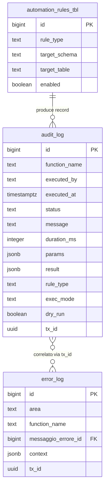

# Guida – Sistema di Audit Logging

> (latest review 04-03-26)
>
> Destinatari: sviluppatori database, backend e analisti funzionali
>
> Il sistema di audit logging e il meccanismo con cui Zero ERP registra le operazioni rilevanti
> nel database: automazioni, processi batch, eventi significativi.
> Non va confuso con il sistema di error logging (`dbops.error_log`), che traccia gli errori —
> l'audit log traccia le **attivita**.
>
> Vedi anche
>
> * [Guida Messaggi di Errore e Generazione Log](/guide/Messaggi-di-Errore-e-Generazione-Log) — error logging e dblink
> * [Guida Framework di Automazione DB](/guide/automazione-db) — il principale utilizzatore dell'audit log
> * [Guida Tracciamento Processi e Job](/guide/Analisi-tracciamento-processi-e-job) — job scheduling e task runtime

---

## Introduzione

Ogni volta che il framework di automazione crea un trigger, un processo batch esegue una migrazione o un job schedulato completa un ciclo, il sistema deve registrare **cosa e successo, quando, con quale esito e quanto ha impiegato**. Questa e la funzione dell'audit log.

A differenza dell'error log (che registra solo gli errori), l'audit log registra **tutte le operazioni rilevanti** — successi, errori, skip, simulazioni. E il registro di attivita del sistema, non il registro dei problemi.

Il modello supporta due modalita di utilizzo:

* **Sessione** (begin/end): per processi che durano nel tempo — si registra l'inizio, poi la chiusura con esito e durata
* **Evento singolo** (log once): per operazioni atomiche — un singolo record con tutti i dati

Entrambe le modalita possono scrivere **fuori transazione** via dblink, garantendo che il log sopravviva anche in caso di rollback.

**Cosa troverai in questa guida:**

* La tabella `audit_log` e i suoi campi
* Le tre funzioni di audit e quando usarle
* Il rapporto con il framework di automazione
* Il supporto al logging fuori transazione
* Esempi pratici per processi batch e operazioni singole

---

## Tabelle coinvolte

**Operazioni:**

* [dbops.audit_log](/dbzero/dbops/tabelle/audit_log) — registro centralizzato delle operazioni

**Correlate:**

* [dbops.error_log](/dbzero/dbops/tabelle/error_log) — registro errori (sistema separato ma complementare)
* [dbops.automation_rules_tbl](/dbzero/dbops/tabelle/automation_rules_tbl) — regole di automazione che producono record di audit

---

## Il modello in sintesi

```text
dbops.audit_log (registro attivita)
    │
    ├── fn_audit_begin(function_name, params, ...)
    │       apre una sessione → INSERT con status='START'
    │       restituisce audit_id
    │
    ├── fn_audit_end(audit_id, status, message, result, ...)
    │       chiude la sessione → UPDATE con esito finale
    │       calcola duration_ms automaticamente
    │
    └── fn_audit_log_once(function_name, status, params, ...)
            evento singolo → INSERT completo in una sola chiamata
```

* **Sessione** = un record che nasce con `fn_audit_begin` (status=START) e viene aggiornato con `fn_audit_end` (status=OK/ERROR/...)
* **Evento** = un record completo creato con `fn_audit_log_once`, senza bisogno di chiusura
* **Fuori transazione** = se `myapp.log_with_dblink` e attivo, la scrittura avviene su connessione separata (sopravvive al rollback)

---

## Componenti del modello

### 1. La tabella audit_log: il registro delle attivita

La tabella `dbops.audit_log` e il punto unico in cui vengono registrate tutte le operazioni rilevanti del sistema. Ogni record contiene chi ha eseguito l'operazione, quando, con quale esito, quanto ha impiegato e con quali parametri.

Il framework di automazione e il principale produttore di record: ogni trigger creato, ogni dry-run, ogni errore viene registrato qui con il tipo di regola applicata e i dettagli della tabella coinvolta.

La tabella e progettata per supportare sia operazioni rapide (un singolo insert) sia processi lunghi (begin + end con durata calcolata). I campi JSONB `params` e `result` garantiscono flessibilita per qualsiasi tipo di contesto.

Da un punto di vista tecnico:

| Colonna | Tipo | Nullable | Default | Descrizione |
| --- | --- | :---: | --- | --- |
| `id` | BIGINT | no | PK | Chiave primaria |
| `function_name` | TEXT | no | — | Nome della funzione/processo |
| `executed_by` | TEXT | no | `CURRENT_USER` | Utente che ha eseguito l'operazione |
| `executed_at` | TIMESTAMPTZ | no | `now()` | Timestamp di inizio |
| `status` | TEXT | no | — | Stato: `START`, `OK`, `ERROR`, `DRYRUN`, `SKIP_EXISTS`, `WARN` |
| `message` | TEXT | si | — | Messaggio descrittivo |
| `duration_ms` | INTEGER | si | — | Durata in millisecondi (calcolata da `fn_audit_end`) |
| `params` | JSONB | si | — | Parametri di input / contesto strutturato |
| `result` | JSONB | si | — | Risultato strutturato |
| `exec_mode` | TEXT | si | — | Modalita di esecuzione (`AUTO`, `CI`, `SCHEDULED`) |
| `parts` | TEXT[] | si | — | Parti/schemi coinvolti |
| `rule_type` | TEXT | si | — | Tipo di regola (per le automazioni: `TX_ID`, `AUDIT_UPDATE`, ...) |
| `dry_run` | BOOLEAN | si | — | Flag dry-run |
| `rows_affected` | INTEGER | si | — | Righe coinvolte |
| `sqlstate` | TEXT | si | — | Codice SQLSTATE in caso di errore |
| `error_context` | TEXT | si | — | Dettaglio errore (stack, context) |
| `host` | TEXT | si | — | Host di origine |
| `app_version` | TEXT | si | — | Versione applicazione |
| `tx_id` | UUID | si | — | Transazione correlata (gestita dal trigger `trgfn_tx_id_managed`) |
| `cleanup_at` | TIMESTAMPTZ | si | — | Timestamp per retention automatica |

**Indici:**

* `ix_audit_fn_ts` su `(function_name, executed_at DESC)` — per ricerche per funzione
* `ix_audit_status_ts` su `(status, executed_at DESC)` — per ricerche per stato
* `ix_audit_params_gin` GIN su `params` — per ricerche nel contesto
* `ix_audit_result_gin` GIN su `result` — per ricerche nei risultati
* `ix_audit_log_cleanup_at` su `cleanup_at` — per la pulizia automatica

**Check constraint:** `chk_audit_status` — vincola i valori ammessi per `status`.

> Documentazione dettagliata: [dbops.audit_log](/dbzero/dbops/tabelle/audit_log)

---

### 2. Le funzioni di audit

Il sistema espone tre funzioni, ciascuna con un caso d'uso distinto. La scelta dipende dal tipo di operazione da tracciare.

#### `dbops.fn_audit_begin`

Apre una sessione di audit per un processo che dura nel tempo. Inserisce un record con `status='START'` e restituisce l'`audit_id` da passare poi a `fn_audit_end` per chiudere la sessione.

E la funzione da usare per processi batch, migrazioni, pipeline — qualsiasi operazione con una durata misurabile e un esito finale.

Da un punto di vista tecnico:

| Parametro | Tipo | Default | Descrizione |
| --- | --- | --- | --- |
| `p_function_name` | TEXT | — | Nome del processo (obbligatorio) |
| `p_params` | JSONB | `{}` | Parametri iniziali |
| `p_exec_mode` | TEXT | NULL | Modalita esecuzione |
| `p_parts` | TEXT[] | NULL | Schemi/parti coinvolti |
| `p_rule_type` | TEXT | NULL | Tipo regola (per automazioni) |
| `p_dry_run` | BOOLEAN | NULL | Flag simulazione |
| `p_host` | TEXT | NULL | Host di origine |
| `p_app_version` | TEXT | NULL | Versione applicazione |

**Restituisce:** `BIGINT` — l'`audit_id` del record creato.

> Documentazione dettagliata: [dbops.fn_audit_begin](/dbzero/dbops/funzioni/fn_audit_begin)

#### `dbops.fn_audit_end`

Chiude una sessione aperta con `fn_audit_begin`. Aggiorna il record con lo stato finale, il messaggio, eventuali errori e il risultato. Calcola automaticamente `duration_ms` dalla differenza tra `clock_timestamp()` e `executed_at`.

Da un punto di vista tecnico:

| Parametro | Tipo | Default | Descrizione |
| --- | --- | --- | --- |
| `p_id` | BIGINT | — | ID restituito da `fn_audit_begin` (obbligatorio) |
| `p_status` | TEXT | `'OK'` | Stato finale |
| `p_message` | TEXT | NULL | Messaggio descrittivo |
| `p_sqlstate` | TEXT | NULL | SQLSTATE se errore |
| `p_error_context` | TEXT | NULL | Contesto dell'errore |
| `p_rows_affected` | INTEGER | NULL | Righe coinvolte |
| `p_result` | JSONB | NULL | Risultato strutturato |

> Documentazione dettagliata: [dbops.fn_audit_end](/dbzero/dbops/funzioni/fn_audit_end)

#### `dbops.fn_audit_log_once`

Registra un evento singolo in una sola chiamata, senza sessione. E la funzione da usare per operazioni atomiche: un trigger che rileva una condizione, un check che verifica uno stato, un'azione puntuale.

Combina i parametri di `fn_audit_begin` e `fn_audit_end` in un'unica chiamata. Restituisce l'`audit_id` del record creato.

Da un punto di vista tecnico:

| Parametro | Tipo | Default | Descrizione |
| --- | --- | --- | --- |
| `p_function_name` | TEXT | — | Nome funzione (obbligatorio) |
| `p_status` | TEXT | — | Stato (obbligatorio) |
| `p_params` | JSONB | `{}` | Parametri/contesto |
| `p_message` | TEXT | NULL | Messaggio descrittivo |
| `p_exec_mode` | TEXT | NULL | Modalita esecuzione |
| `p_parts` | TEXT[] | NULL | Parti coinvolte |
| `p_rule_type` | TEXT | NULL | Tipo regola |
| `p_dry_run` | BOOLEAN | NULL | Flag simulazione |
| `p_sqlstate` | TEXT | NULL | SQLSTATE se errore |
| `p_error_context` | TEXT | NULL | Contesto errore |
| `p_rows_affected` | INTEGER | NULL | Righe coinvolte |
| `p_result` | JSONB | NULL | Risultato strutturato |
| `p_host` | TEXT | NULL | Host origine |
| `p_app_version` | TEXT | NULL | Versione applicazione |

> Documentazione dettagliata: [dbops.fn_audit_log_once](/dbzero/dbops/funzioni/fn_audit_log_once)

---

## Logging fuori transazione

Tutte e tre le funzioni di audit supportano la scrittura **fuori transazione** via dblink. Questo e utile quando si vuole conservare il log anche se la transazione principale fallisce e va in rollback.

Il meccanismo si attiva con il GUC `myapp.log_with_dblink='on'`. Quando e attivo, la funzione:

1. Tenta di usare la connessione `logconn` (dblink)
2. Se la connessione non e disponibile, tenta di stabilirla tramite `script.fn_ensure_logconn()`
3. Se anche questo fallisce, ricade sulla scrittura locale (in-transazione)

Il fallback e silenzioso: l'operazione non viene mai bloccata per un problema di logging.

Per i dettagli sulla configurazione di dblink, vedi la [Guida Messaggi di Errore](/guide/Messaggi-di-Errore-e-Generazione-Log#setup-operativo-devops).

---

## Rapporto con il framework di automazione

L'audit log e il sistema di tracciamento principale del [framework di automazione DB](/guide/automazione-db). Ogni azione del framework produce un record con:

| Campo | Contenuto per le automazioni |
| --- | --- |
| `function_name` | Nome dell'orchestratore (es. `run_automations_tx_id`) |
| `rule_type` | Tipo regola (`TX_ID`, `AUDIT_UPDATE`, `STORICO`, ...) |
| `status` | `DRYRUN`, `OK`, `ERROR`, `SKIP_EXISTS` |
| `params` | Tabella target, trigger creato, azione eseguita |
| `exec_mode` | `AUTO`, `CI`, `SCHEDULED` |
| `duration_ms` | Tempo di esecuzione |

Questo rende possibile ricostruire l'intera sequenza di azioni di un deploy: quali trigger sono stati creati, su quali tabelle, in quanto tempo, e quali hanno dato errore.

---

## Rapporto con l'error log

L'audit log e l'error log sono sistemi **complementari ma separati**:

| Aspetto | `dbops.audit_log` | `dbops.error_log` |
| --- | --- | --- |
| **Cosa traccia** | Operazioni (successi, errori, skip) | Solo errori |
| **Chi scrive** | Funzioni `fn_audit_*` | `script.fn_log_error_only` / `fn_log_and_raise_error` |
| **Persistenza** | In-transazione (default) o dblink | Sempre dblink (fuori transazione) |
| **Messaggi** | Testo libero | Da catalogo `config.messaggi_errore` |
| **Uso principale** | Tracciamento processi, deploy, batch | Diagnosi errori, audit eccezioni |

In un processo complesso (es. automazione batch), l'audit log traccia l'avanzamento degli step e l'esito finale, mentre l'error log cattura eventuali errori specifici con il loro codice e contesto.

---

## Esempi pratici

### Caso 1 — Processo batch con sessione

Un job schedulato che applica le automazioni su uno schema:

```sql
-- 1. Apertura sessione
DO $$
DECLARE
  v_audit_id BIGINT;
BEGIN
  v_audit_id := dbops.fn_audit_begin(
    'run_automations_tx_id',
    jsonb_build_object('schemas', ARRAY['anagrafiche'], 'dry_run', false),
    'CI'                -- exec_mode
  );

  -- 2. Esecuzione processo
  -- ... logica del batch ...

  -- 3. Chiusura con successo
  PERFORM dbops.fn_audit_end(
    v_audit_id,
    'OK',
    'Trigger TX_ID applicati su 12 tabelle',
    p_rows_affected := 12
  );

EXCEPTION WHEN OTHERS THEN
  -- 3b. Chiusura con errore
  PERFORM dbops.fn_audit_end(
    v_audit_id,
    'ERROR',
    SQLERRM,
    p_sqlstate := SQLSTATE,
    p_error_context := PG_EXCEPTION_CONTEXT
  );
  RAISE;
END;
$$;
```

### Caso 2 — Evento singolo (dry-run)

Un controllo puntuale che registra il risultato senza sessione:

```sql
SELECT dbops.fn_audit_log_once(
  'run_automations_storico',
  'DRYRUN',
  jsonb_build_object(
    'table', 'anagrafiche.soggetti',
    'trigger', 'trgx_z90_soggetti_upd_dlt_storico',
    'action', 'CREATE TRIGGER'
  ),
  p_rule_type := 'STORICO',
  p_dry_run := true
);
```

### Caso 3 — Consultazione audit post-deploy

```sql
-- Ultimi 20 eventi di automazione
SELECT executed_at, status, rule_type,
       params->>'table' AS tabella,
       message, duration_ms
FROM dbops.audit_log
WHERE function_name LIKE 'run_automations%'
ORDER BY executed_at DESC
LIMIT 20;

-- Solo errori
SELECT executed_at, rule_type, sqlstate, error_context, params
FROM dbops.audit_log
WHERE status = 'ERROR'
ORDER BY executed_at DESC
LIMIT 10;
```

---

## Best practice

* Usare `fn_audit_begin` / `fn_audit_end` per processi con durata misurabile — il calcolo automatico di `duration_ms` e utile per il monitoraggio
* Usare `fn_audit_log_once` per operazioni atomiche o dry-run — evita la complessita della sessione
* Popolare sempre `params` con dati strutturati (JSONB) che identifichino l'operazione — tabella, trigger, schemi coinvolti
* Non usare l'audit log per tracciare errori di dominio — usare `dbops.error_log` e i log di dominio specifici (vedi guida errori)
* Per processi critici, attivare il logging via dblink (`myapp.log_with_dblink='on'`) per garantire la persistenza
* Sfruttare `cleanup_at` per la retention automatica dei record non piu necessari
* Interrogare regolarmente `audit_log` con `status='ERROR'` per identificare problemi ricorrenti

---

## Diagramma ER



---

## Note finali

Questa guida copre il sistema di audit logging come componente autonomo. Per i contesti specifici in cui viene utilizzato:

* [Guida Framework di Automazione DB](/guide/automazione-db) — il framework che produce la maggior parte dei record di audit
* [Guida Messaggi di Errore](/guide/Messaggi-di-Errore-e-Generazione-Log) — il sistema di error logging (complementare)
* [Guida Tracciamento Processi e Job](/guide/Analisi-tracciamento-processi-e-job) — job scheduling e task tracking

---


