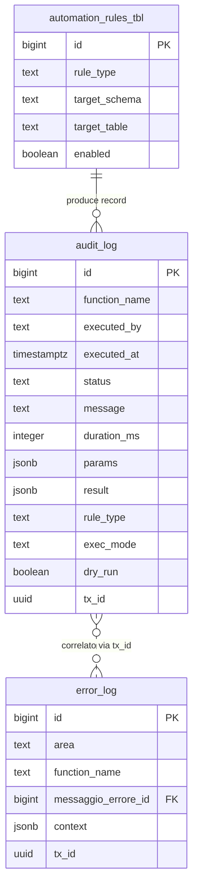

# Guida — Sistema di Audit Logging

> **Ultimo aggiornamento**: 19 settembre 2026
>
> **Destinatari**: sviluppatori database, backend e analisti funzionali
>
> **Vedi anche** — schemi DB:
>
> * [dbops.audit_log](/dbzero/dbops/tabelle/audit_log) — il registro delle attività
> * [dbops.error_log](/dbzero/dbops/tabelle/error_log) — il registro degli errori: sistema separato e complementare
> * [dbops.automation_rules_tbl](/dbzero/dbops/tabelle/automation_rules_tbl) — le regole di automazione che producono record di audit
> * [dbops.vw_audit_log_scrittori_fuori_perimetro](/dbzero/dbops/manual/vw_audit_log_scrittori_fuori_perimetro) — chi scrive nel registro senza averne titolo; **deve restare vuota**
>
> **Vedi anche** — funzioni e trigger DB:
>
> * [dbops.fn_audit_begin](/dbzero/dbops/funzioni/fn_audit_begin) — apre una sessione di audit
> * [dbops.fn_audit_end](/dbzero/dbops/funzioni/fn_audit_end) — la chiude, calcolando la durata
> * [dbops.fn_audit_log_once](/dbzero/dbops/funzioni/fn_audit_log_once) — l'evento singolo: **l'unica porta dell'applicazione**
> * [script.fn_ensure_logconn](/dbzero/script/funzioni/fn_ensure_logconn) — la connessione di log per la scrittura fuori transazione
>
> **Vedi anche** — guide correlate:
>
> * [Messaggi di Errore e Generazione Log](/guide/Messaggi-di-Errore-e-Generazione-Log) — error logging e dblink
> * [Framework di Automazione DB](/guide/automazione-db) — il principale utilizzatore dell'audit log
> * [Tracciamento Processi e Job](/guide/analisi-tracciamento-processi-e-job) — job scheduling e task runtime
> * [Audit e tracciabilità](/guide/audit-e-tracciabilita) — le tre tracce e il loro filo conduttore

---

## Introduzione

Ogni volta che il framework di automazione crea un trigger, un processo batch esegue una migrazione o un job schedulato completa un ciclo, il sistema deve registrare **cosa e successo, quando, con quale esito e quanto ha impiegato**. Questa e la funzione dell'audit log.

A differenza dell'error log (che registra solo gli errori), l'audit log registra **tutte le operazioni rilevanti** — successi, errori, skip, simulazioni. E il registro di attivita del sistema, non il registro dei problemi.

Il modello supporta due modalita di utilizzo:

* **Sessione** (begin/end): per processi che durano nel tempo — si registra l'inizio, poi la chiusura con esito e durata
* **Evento singolo** (log once): per operazioni atomiche — un singolo record con tutti i dati

Entrambe le modalita possono scrivere **fuori transazione** via dblink, garantendo che il log sopravviva anche in caso di rollback.

**Cosa troverai in questa guida:**

* La tabella `audit_log` e i suoi campi
* Le tre funzioni di audit e quando usarle
* Il rapporto con il framework di automazione
* Il supporto al logging fuori transazione
* Gli esempi pronti — sessione, evento singolo, lettura del registro — in coda, in [Area tecnica](#area-tecnica-esempi)

---

## Il modello in sintesi

```text
dbops.audit_log (registro attivita)
    │
    ├── fn_audit_begin(function_name, params, ...)
    │       apre una sessione → INSERT con status='START'
    │       restituisce audit_id
    │
    ├── fn_audit_end(audit_id, status, message, result, ...)
    │       chiude la sessione → UPDATE con esito finale
    │       calcola duration_ms automaticamente
    │
    └── fn_audit_log_once(function_name, status, params, ...)
            evento singolo → INSERT completo in una sola chiamata
```

* **Sessione** = un record che nasce con `fn_audit_begin` (status=START) e viene aggiornato con `fn_audit_end` (status=OK/ERROR/...)
* **Evento** = un record completo creato con `fn_audit_log_once`, senza bisogno di chiusura
* **Fuori transazione** = se `myapp.log_with_dblink` e attivo, la scrittura avviene su connessione separata (sopravvive al rollback)

---

## Componenti del modello

### 1. La tabella audit_log: il registro delle attivita

La tabella `dbops.audit_log` e il punto unico in cui vengono registrate tutte le operazioni rilevanti del sistema. Ogni record contiene chi ha eseguito l'operazione, quando, con quale esito, quanto ha impiegato e con quali parametri.

Il framework di automazione e il principale produttore di record: ogni trigger creato, ogni dry-run, ogni errore viene registrato qui con il tipo di regola applicata e i dettagli della tabella coinvolta.

La tabella e progettata per supportare sia operazioni rapide (un singolo insert) sia processi lunghi (begin + end con durata calcolata). I campi JSONB `params` e `result` garantiscono flessibilita per qualsiasi tipo di contesto.

Da un punto di vista tecnico:

| Colonna         | Tipo        | Nullable | Default        | Descrizione                                                                                                |
| --------------- | ----------- | :------: | -------------- | ---------------------------------------------------------------------------------------------------------- |
| `id`            | BIGINT      |    no    | PK             | Chiave primaria                                                                                            |
| `function_name` | TEXT        |    no    | —              | Nome della funzione/processo                                                                               |
| `executed_by`   | TEXT        |    no    | `current_user` | **Ruolo di database** che ha scritto la riga (non l'operatore: quello sta nelle GUC `app.*` e nel `tx_id`) |
| `executed_at`   | TIMESTAMPTZ |    no    | `now()`        | Timestamp di inizio                                                                                        |
| `status`        | TEXT        |    no    | —              | Stato: `START`, `OK`, `ERROR`, `DRYRUN`, `SKIP_EXISTS`, `WARN`                                             |
| `message`       | TEXT        |    si    | —              | Messaggio descrittivo                                                                                      |
| `duration_ms`   | INTEGER     |    si    | —              | Durata in millisecondi (calcolata da `fn_audit_end`)                                                       |
| `params`        | JSONB       |    si    | —              | Parametri di input / contesto strutturato                                                                  |
| `result`        | JSONB       |    si    | —              | Risultato strutturato                                                                                      |
| `exec_mode`     | TEXT        |    si    | —              | Modalita di esecuzione (`AUTO`, `CI`, `SCHEDULED`)                                                         |
| `parts`         | TEXT[]      |    si    | —              | Parti/schemi coinvolti                                                                                     |
| `rule_type`     | TEXT        |    si    | —              | Tipo di regola (per le automazioni: `TX_ID`, `AUDIT_UPDATE`, ...)                                          |
| `dry_run`       | BOOLEAN     |    si    | —              | Flag dry-run                                                                                               |
| `rows_affected` | INTEGER     |    si    | —              | Righe coinvolte                                                                                            |
| `sqlstate`      | TEXT        |    si    | —              | Codice SQLSTATE in caso di errore                                                                          |
| `error_context` | TEXT        |    si    | —              | Dettaglio errore (stack, context)                                                                          |
| `host`          | TEXT        |    si    | —              | Host di origine                                                                                            |
| `app_version`   | TEXT        |    si    | —              | Versione applicazione                                                                                      |
| `tx_id`         | UUID        |    si    | —              | Transazione correlata (gestita dal trigger `trgfn_tx_id_managed`)                                          |
| `cleanup_at`    | TIMESTAMPTZ |    si    | —              | Timestamp per retention automatica                                                                         |

**Indici:**

* `ix_audit_fn_ts` su `(function_name, executed_at DESC)` — per ricerche per funzione
* `ix_audit_status_ts` su `(status, executed_at DESC)` — per ricerche per stato
* `ix_audit_params_gin` GIN su `params` — per ricerche nel contesto
* `ix_audit_result_gin` GIN su `result` — per ricerche nei risultati
* `ix_audit_log_cleanup_at` su `cleanup_at` — per la pulizia automatica

**Check constraint:** `chk_audit_status` — vincola i valori ammessi per `status`.

> Documentazione dettagliata: [dbops.audit_log](/dbzero/dbops/tabelle/audit_log)

---

### 2. Le funzioni di audit

Il sistema espone tre funzioni, ciascuna con un caso d'uso distinto. La scelta dipende dal tipo di operazione da tracciare.

#### `dbops.fn_audit_begin`

Apre una sessione di audit per un processo che dura nel tempo. Inserisce un record con `status='START'` e restituisce l'`audit_id` da passare poi a `fn_audit_end` per chiudere la sessione.

E la funzione da usare per processi batch, migrazioni, pipeline — qualsiasi operazione con una durata misurabile e un esito finale. ⚠️ **Riservata a chi possiede la tabella** (migratore, job di manutenzione): l'applicazione non la può eseguire, perché la chiusura che le fa da coppia è un `UPDATE` del registro — vedi *Chi può scrivere*.

Da un punto di vista tecnico:

| Parametro         | Tipo    | Default | Descrizione                      |
| ----------------- | ------- | ------- | -------------------------------- |
| `p_function_name` | TEXT    | —       | Nome del processo (obbligatorio) |
| `p_params`        | JSONB   | `{}`    | Parametri iniziali               |
| `p_exec_mode`     | TEXT    | NULL    | Modalita esecuzione              |
| `p_parts`         | TEXT[]  | NULL    | Schemi/parti coinvolti           |
| `p_rule_type`     | TEXT    | NULL    | Tipo regola (per automazioni)    |
| `p_dry_run`       | BOOLEAN | NULL    | Flag simulazione                 |
| `p_host`          | TEXT    | NULL    | Host di origine                  |
| `p_app_version`   | TEXT    | NULL    | Versione applicazione            |

**Restituisce:** `BIGINT` — l'`audit_id` del record creato.

> Documentazione dettagliata: [dbops.fn_audit_begin](/dbzero/dbops/funzioni/fn_audit_begin)

#### `dbops.fn_audit_end`

Chiude una sessione aperta con `fn_audit_begin`. Aggiorna il record con lo stato finale, il messaggio, eventuali errori e il risultato. Calcola automaticamente `duration_ms` dalla differenza tra `clock_timestamp()` e `executed_at`.

Da un punto di vista tecnico:

| Parametro         | Tipo    | Default | Descrizione                                      |
| ----------------- | ------- | ------- | ------------------------------------------------ |
| `p_id`            | BIGINT  | —       | ID restituito da `fn_audit_begin` (obbligatorio) |
| `p_status`        | TEXT    | `'OK'`  | Stato finale                                     |
| `p_message`       | TEXT    | NULL    | Messaggio descrittivo                            |
| `p_sqlstate`      | TEXT    | NULL    | SQLSTATE se errore                               |
| `p_error_context` | TEXT    | NULL    | Contesto dell'errore                             |
| `p_rows_affected` | INTEGER | NULL    | Righe coinvolte                                  |
| `p_result`        | JSONB   | NULL    | Risultato strutturato                            |

> Documentazione dettagliata: [dbops.fn_audit_end](/dbzero/dbops/funzioni/fn_audit_end)

#### `dbops.fn_audit_log_once`

Registra un evento singolo in una sola chiamata, senza sessione. E la funzione da usare per operazioni atomiche: un trigger che rileva una condizione, un check che verifica uno stato, un'azione puntuale.

Combina i parametri di `fn_audit_begin` e `fn_audit_end` in un'unica chiamata. Restituisce l'`audit_id` del record creato.

Da un punto di vista tecnico:

| Parametro         | Tipo    | Default | Descrizione                  |
| ----------------- | ------- | ------- | ---------------------------- |
| `p_function_name` | TEXT    | —       | Nome funzione (obbligatorio) |
| `p_status`        | TEXT    | —       | Stato (obbligatorio)         |
| `p_params`        | JSONB   | `{}`    | Parametri/contesto           |
| `p_message`       | TEXT    | NULL    | Messaggio descrittivo        |
| `p_exec_mode`     | TEXT    | NULL    | Modalita esecuzione          |
| `p_parts`         | TEXT[]  | NULL    | Parti coinvolte              |
| `p_rule_type`     | TEXT    | NULL    | Tipo regola                  |
| `p_dry_run`       | BOOLEAN | NULL    | Flag simulazione             |
| `p_sqlstate`      | TEXT    | NULL    | SQLSTATE se errore           |
| `p_error_context` | TEXT    | NULL    | Contesto errore              |
| `p_rows_affected` | INTEGER | NULL    | Righe coinvolte              |
| `p_result`        | JSONB   | NULL    | Risultato strutturato        |
| `p_host`          | TEXT    | NULL    | Host origine                 |
| `p_app_version`   | TEXT    | NULL    | Versione applicazione        |

> Documentazione dettagliata: [dbops.fn_audit_log_once](/dbzero/dbops/funzioni/fn_audit_log_once)

---

## Chi può scrivere — la postura dei ruoli

> ⭐ **Un registro di audit modificabile da chi è auditato non è un registro.**

Il registro racconta ciò che l'applicazione fa. Il ruolo con cui l'applicazione
si collega al database (`zeroerp_app`) è quindi *il soggetto raccontato*, e sul
registro può fare due cose sole: **leggere** e **aggiungere**. Non riscrivere, non
cancellare, non svuotare. Lo stesso vale per il registro gemello degli errori,
`dbops.error_log`.

| Ruolo                                                         | `dbops.audit_log`  | Perché                                                                                     |
| ------------------------------------------------------------- | ------------------ | ------------------------------------------------------------------------------------------ |
| `zeroerp_app` (l'applicazione)                                | `SELECT`, `INSERT` | legge il registro dall'area di amministrazione e vi aggiunge righe con `fn_audit_log_once` |
| chi possiede la tabella (il migratore, i job di manutenzione) | tutto              | è chi scrive le automazioni e chi, un giorno, farà la retention su `cleanup_at`            |

**La modalità sessione è riservata.** Chiudere una sessione (`fn_audit_end`) è un
`UPDATE` del registro: per questo la coppia `fn_audit_begin` / `fn_audit_end` **non
è eseguibile dall'applicazione**, e nemmeno da `PUBLIC`. Se l'applicazione non può
chiudere una sessione non deve nemmeno poterla aprire, altrimenti lascerebbe righe
`START` che nessuno chiude. L'applicazione scrive l'audit con la sola
`fn_audit_log_once`, che registra l'evento intero in una volta.

⚠️ **La postura non si difende con un `REVOKE` scritto una volta.** I privilegi
dell'applicazione vengono riallineati a ogni passata `ci_apply` da un loop che li
concede in blocco su tutte le tabelle: un `REVOKE` isolato sarebbe annullato alla
passata successiva. La postura più stretta dei registri è **dichiarata dentro
quel loop** (`90_end/ci_apply/20260205-41`), che concede a questi due solo
`SELECT, INSERT` e revoca il resto — **e** in `scripts/sql/provision_zeroerp.sql`, fase `post`
(blocco «POSTURA DICHIARATA»), che in CI gira **dopo** quel loop, concede in
blocco su tutte le tabelle ed è l'ultima parola. Chi aggiunge un registro
append-only lo dichiara in **entrambi**, più il changeSet `90_end` forward che
applica subito su dev. Regola e motivazione: [linee-guida-sql](/linee-guida-sql), §11.8
*«Una postura più stretta per `zeroerp_app` si dichiara nel loop dei grant»*
(le tre sedi, in tabella).

Presidio: `db/pgtap/dbops/test-registri-append-only-postura-v1.sql` — verifica sia
i privilegi a catalogo sia ciò che l'applicazione riesce a fare davvero.

### Chi può scrivere — le funzioni: il perimetro

La postura dei ruoli dice **con quale ruolo** si scrive. C'è una seconda domanda,
e viene prima: **quali funzioni** possono scrivere qui.

`audit_log` è il **registro tecnico** delle automazioni e degli strumenti di
amministrazione: lo scrivono le funzioni di `dbops` (e `maintenance`), lo legge
l'area di amministrazione. **Non deve contenere dati di dominio** — i parametri di
una fattura, l'esito di un'operazione su un cliente — perché quelle righe
sarebbero leggibili da chiunque legga il registro, senza il perimetro che protegge
la fattura o il cliente. La decisione è che il rimedio **non** è una
regola di visibilità per riga sul log: è impedire **alla fonte** che una funzione di
`vendite`, `anagrafiche`, `pagamenti` ci scriva.

Il cancello è
[dbops.vw_audit_log_scrittori_fuori_perimetro](/dbzero/dbops/manual/vw_audit_log_scrittori_fuori_perimetro):
elenca le funzioni che scrivono nel registro — con DML diretto o passando da
`fn_audit_log_once` / `fn_audit_begin` / `fn_audit_end` — e stanno fuori dagli schemi
ammessi, dichiarati nella vista stessa. **Deve restare vuota**; la presidia
`db/pgtap/dbops/test-audit-log-perimetro-scrittori-v1.sql` in CI. Se un giorno un altro
schema dovesse scrivere l'audit, è un changeSet su quella vista, firmato — non una
riga che passa in silenzio.

⚠️ Corollario per chi scrive una funzione di dominio: se ha qualcosa da registrare,
il posto è l'`error_log` per un errore, una tabella del proprio dominio per un fatto
di dominio. `audit_log` no.

### Chi ha eseguito: `executed_by`

`executed_by` porta il **ruolo di database** che ha scritto la riga
(`zeroerp_app` per ciò che passa da Django, il migratore per le automazioni, il
ruolo del canale per le righe scritte via dblink). ⚠️ Non è l'operatore: quello
viaggia nelle GUC `app.*` e nel `tx_id`.

⚠️ **Il default è la funzione `current_user`, non la parola.** La differenza è nelle
virgolette, e conta quando si legge un registro vecchio: le righe scritte quando il
default era la *stringa* `'CURRENT_USER'` portano quella parola al posto del ruolo.
Si riconoscono così, e restano così: chi le scrisse non si può ricostruire.

---

## Logging fuori transazione

Tutte e tre le funzioni di audit supportano la scrittura **fuori transazione** via dblink. Questo e utile quando si vuole conservare il log anche se la transazione principale fallisce e va in rollback.

Il meccanismo si attiva con il GUC `myapp.log_with_dblink='on'`. Quando e attivo, la funzione:

1. Tenta di usare la connessione `logconn` (dblink)
2. Se la connessione non e disponibile, tenta di stabilirla tramite `script.fn_ensure_logconn()`
3. Se anche questo fallisce, ricade sulla scrittura locale (in-transazione)

Il fallback e silenzioso: l'operazione non viene mai bloccata per un problema di logging.

Per i dettagli sulla configurazione di dblink, vedi la [Guida Messaggi di Errore](/guide/Messaggi-di-Errore-e-Generazione-Log#setup-operativo-devops).

---

## Rapporto con il framework di automazione

L'audit log e il sistema di tracciamento principale del [framework di automazione DB](/guide/automazione-db). Ogni azione del framework produce un record con:

| Campo           | Contenuto per le automazioni                          |
| --------------- | ----------------------------------------------------- |
| `function_name` | Nome dell'orchestratore (es. `run_automations_tx_id`) |
| `rule_type`     | Tipo regola (`TX_ID`, `AUDIT_UPDATE`, `STORICO`, ...) |
| `status`        | `DRYRUN`, `OK`, `ERROR`, `SKIP_EXISTS`                |
| `params`        | Tabella target, trigger creato, azione eseguita       |
| `exec_mode`     | `AUTO`, `CI`, `SCHEDULED`                             |
| `duration_ms`   | Tempo di esecuzione                                   |

Questo rende possibile ricostruire l'intera sequenza di azioni di un deploy: quali trigger sono stati creati, su quali tabelle, in quanto tempo, e quali hanno dato errore.

---

## Rapporto con l'error log

L'audit log e l'error log sono sistemi **complementari ma separati**:

| Aspetto            | `dbops.audit_log`                    | `dbops.error_log`                                     |
| ------------------ | ------------------------------------ | ----------------------------------------------------- |
| **Cosa traccia**   | Operazioni (successi, errori, skip)  | Solo errori                                           |
| **Chi scrive**     | Funzioni `fn_audit_*`                | `script.fn_log_error_only` / `fn_log_and_raise_error` |
| **Persistenza**    | In-transazione (default) o dblink    | Sempre dblink (fuori transazione)                     |
| **Messaggi**       | Testo libero                         | Da catalogo `config.messaggi_errore`                  |
| **Uso principale** | Tracciamento processi, deploy, batch | Diagnosi errori, audit eccezioni                      |

In un processo complesso (es. automazione batch), l'audit log traccia l'avanzamento degli step e l'esito finale, mentre l'error log cattura eventuali errori specifici con il loro codice e contesto.

---

## Best practice

* Usare `fn_audit_begin` / `fn_audit_end` per processi con durata misurabile — il calcolo automatico di `duration_ms` e utile per il monitoraggio. ⚠️ **Solo da chi possiede la tabella** (migratore, job di manutenzione): la chiusura è un `UPDATE` del registro e l'applicazione non la può eseguire — vedi *Chi può scrivere*
* Usare `fn_audit_log_once` per operazioni atomiche o dry-run — evita la complessita della sessione. ⭐ **È l'unica porta dell'applicazione**
* Popolare sempre `params` con dati strutturati (JSONB) che identifichino l'operazione — tabella, trigger, schemi coinvolti
* Non usare l'audit log per tracciare errori di dominio — usare `dbops.error_log` e i log di dominio specifici (vedi guida errori)
* Per processi critici, attivare il logging via dblink (`myapp.log_with_dblink='on'`) per garantire la persistenza
* Sfruttare `cleanup_at` per la retention automatica dei record non piu necessari
* Interrogare regolarmente `audit_log` con `status='ERROR'` per identificare problemi ricorrenti

---

## Diagramma ER



---

## Area tecnica — esempi

**Un processo batch con sessione** — apertura, corpo, e chiusura in entrambi i finali possibili:
l'esito buono e l'eccezione, che chiude la sessione e **rilancia** (`RAISE`) perché il fallimento
non va inghiottito dal logging:

```sql
DO $$
DECLARE
  v_audit_id BIGINT;
BEGIN
  v_audit_id := dbops.fn_audit_begin(
    'run_automations_tx_id',
    jsonb_build_object('schemas', ARRAY['anagrafiche'], 'dry_run', false),
    'CI'                -- exec_mode
  );

  -- logica del batch

  PERFORM dbops.fn_audit_end(
    v_audit_id,
    'OK',
    'Trigger TX_ID applicati su 12 tabelle',
    p_rows_affected := 12
  );

EXCEPTION WHEN OTHERS THEN
  PERFORM dbops.fn_audit_end(
    v_audit_id,
    'ERROR',
    SQLERRM,
    p_sqlstate := SQLSTATE,
    p_error_context := PG_EXCEPTION_CONTEXT
  );
  RAISE;
END;
$$;
```

**Un evento singolo** — un controllo puntuale che registra il risultato senza aprire una
sessione. È la forma che l'applicazione può usare:

```sql
SELECT dbops.fn_audit_log_once(
  'run_automations_storico',
  'DRYRUN',
  jsonb_build_object(
    'table', 'anagrafiche.soggetti',
    'trigger', 'trg_soggetti_z90_storico_upd_dlt',
    'action', 'CREATE TRIGGER'
  ),
  p_rule_type := 'STORICO',
  p_dry_run := true
);
```

**Leggere il registro** — le due domande più frequenti dopo un deploy: cosa ha fatto
l'automazione, e cosa è andato storto:

```sql
-- ultimi eventi di automazione
SELECT executed_at, status, rule_type,
       params->>'table' AS tabella,
       message, duration_ms
FROM dbops.audit_log
WHERE function_name LIKE 'run_automations%'
ORDER BY executed_at DESC
LIMIT 20;

-- solo errori
SELECT executed_at, rule_type, sqlstate, error_context, params
FROM dbops.audit_log
WHERE status = 'ERROR'
ORDER BY executed_at DESC
LIMIT 10;
```

---


