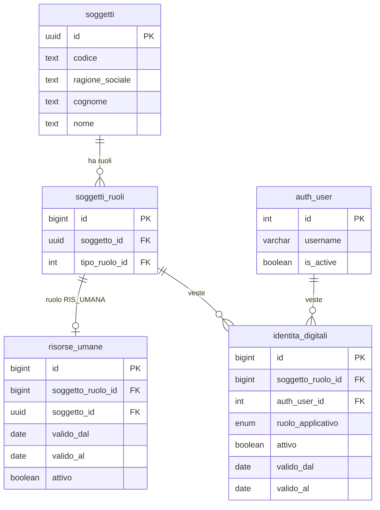
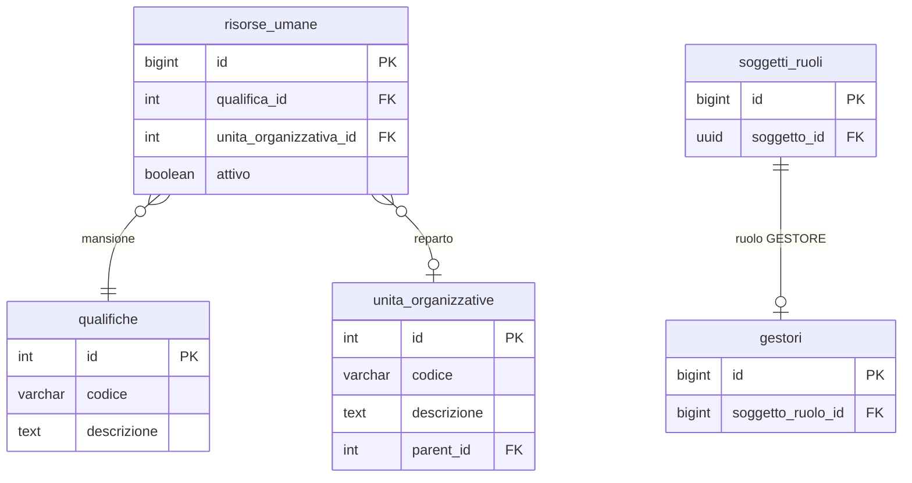

# Guida — Risorse Umane e Accessi al Software

> **Ultimo aggiornamento**: 25 ottobre 2026
>
> **Destinatari**: sviluppatori database, backend, integratori e analisti funzionali
>
> **Vedi anche** — schemi DB:
>
> * [anagrafiche.risorse_umane](/dbzero/anagrafiche/tabelle/risorse_umane) — la persona, con ruolo, qualifica e reparto
> * [anagrafiche.identita_digitali](/dbzero/anagrafiche/tabelle/identita_digitali) — la veste nel sistema: il ponte verso l'utente Django
> * [anagrafiche.soggetti](/dbzero/anagrafiche/tabelle/soggetti) — la persona fisica o giuridica
> * [anagrafiche.soggetti_ruoli](/dbzero/anagrafiche/tabelle/soggetti_ruoli) — i ruoli del soggetto (es. RIS_UMANA)
> * [anagrafiche.gestori](/dbzero/anagrafiche/tabelle/gestori) — il soggetto gestore (l'azienda)
> * [config.qualifiche](/dbzero/config/tabelle/qualifiche) — mansioni e posizioni
> * [config.unita_organizzative](/dbzero/config/tabelle/unita_organizzative) — reparti e uffici
> * [config.profili_accesso_bindings](/dbzero/config/tabelle/profili_accesso_bindings) — i binding profilo ↔ identità, fra cui `SUPER_ADMIN`
> * [config.user_emittenti_fiscali](/dbzero/config/tabelle/user_emittenti_fiscali) — il perimetro di emittenti fiscali di un operatore
> * [config.token_monouso](/dbzero/config/tabelle/token_monouso) — i token di invito e reset password
> * [config.email_account](/dbzero/config/tabelle/email_account) — gli account SMTP per l'invio email
>
> **Vedi anche** — funzioni e trigger DB:
>
> * [anagrafiche.fn_sync_auth_user_is_active](/dbzero/anagrafiche/funzioni/fn_sync_auth_user_is_active) — allinea `auth_user.is_active` allo stato delle identità
> * [anagrafiche.fn_sync_auth_user_expired](/dbzero/anagrafiche/funzioni/fn_sync_auth_user_expired) — la scadenza notturna delle finestre di validità
> * [anagrafiche.trgfn_risorse_umane_guard_identita_attiva](/dbzero/anagrafiche/funzioni/trgfn_risorse_umane_guard_identita_attiva) — «una risorsa con identità operatore attiva non si disattiva»
> * [anagrafiche.trgfn_identita_digitali_guard_coerenza](/dbzero/anagrafiche/funzioni/trgfn_identita_digitali_guard_coerenza) — coerenza della veste e vincolo di persona fisica pura
> * [anagrafiche.fn_notify_cambio_reparto](/dbzero/anagrafiche/funzioni/fn_notify_cambio_reparto) — la notifica di cambio reparto
>
> **Vedi anche** — guide correlate:
>
> * [Guida Soggetti & Ruoli](/guide/soggetti-e-ruoli-anagrafici)
> * [Gestione dei contatti](/guide/gestione-dei-contatti)
> * [Architettura Permessi e Autorizzazioni](/guide/architettura-permessi-e-autorizzazioni)
> * [Architettura Multi-Face Auth](/guide/architettura-multi-face-auth)
> * [Guida Gestione Mail](/guide/gestione-mail)

---

## Introduzione

In Zero ERP una **risorsa umana** e la rappresentazione di una persona che lavora per l'azienda: un dipendente, un consulente, un collaboratore. Non e un semplice record anagrafico — e l'identita operativa della persona all'interno del sistema.

Questa guida copre **due aspetti strettamente legati**: il modulo risorse umane (chi sono le persone nell'organico, come sono organizzate) e il **governo dell'accesso al software** (chi puo entrare, cosa puo fare, cosa succede quando qualcuno cambia reparto o lascia l'azienda). I due aspetti sono inseparabili perche in Zero ERP e proprio la risorsa umana a determinare se e come un utente accede al sistema.

**Cosa troverai in questa guida:**

* Le entita coinvolte e il loro significato nel modello
* Come funziona il collegamento tra una risorsa umana e un utente Django
* Il meccanismo automatico che blocca il login quando una risorsa viene disattivata o scade
* Come vengono gestiti i permessi (profili reparto, override individuali) e come si propagano al cambio reparto
* Il ciclo di vita completo: dall'assunzione alla cessazione, con i passi operativi per ogni fase
* **Il primo accesso**: come l'admin invita un operatore e come l'operatore attiva il suo account
* **Cambio password**: meccanismo obbligatorio e volontario
* **Reset password dimenticata**: flusso self-service senza intervento admin
* **Sicurezza login**: blocco per tentativi falliti, throttle per IP, audit sessioni

### Il collegamento a un account e opzionale

Non tutte le risorse umane accedono al software. Un magazziniere potrebbe non avere un account, mentre il responsabile amministrativo si. Il collegamento a `django.auth_user` passa da una **identita digitale**: e un passo esplicito e separato dalla creazione della risorsa, ed e consentito solo per soggetti **persona fisica pura** (con codice fiscale e senza partita IVA) — vedi [R4](#r4--collegamento-a-django-solo-persona-fisica-pura).

---

## Le entita e il loro significato

### Risorsa umana

E la persona che lavora per l'azienda. Ha una qualifica (cosa fa), un reparto (dove lavora), una finestra di validita (da quando a quando) e un flag attivo/inattivo.

La risorsa umana **non e l'utente**: e la persona. L'accesso al software e un fatto separato, che passa da una o piu **identita digitali** (vedi sotto). La stessa persona che qui compare come dipendente puo quindi avere, con lo stesso login, la veste di cliente del portale.

La risorsa e legata al soggetto tramite un **ruolo RIS_UMANA** ([R1](#r1--ruolo-corretto)): la stessa persona (soggetto PF) che nel sistema potrebbe essere anche cliente o fornitore, qui compare nel suo ruolo di dipendente/collaboratore.

Campi chiave:

* `soggetto_ruolo_id`: il ruolo `RIS_UMANA` della persona — punta a `anagrafiche.soggetti_ruoli` (UNIQUE: una sola risorsa per persona, vedi [R5](#r5--unicita-per-persona))
* `soggetto_id`: la **persona** (soggetto PF) — campo denormalizzato per comodita di join, deve coincidere con il soggetto del ruolo ([R2](#r2--coerenza-soggetto)). **Non** e l'azienda (che si ricava da `anagrafiche.gestori`)
* `qualifica_id`: mansione o posizione (es. Amministratore, Dipendente, Consulente)
* `unita_organizzativa_id`: reparto o ufficio — determina l'**ereditarieta dei permessi** (profilo reparto)
* `valido_dal`, `valido_al`: finestra di validita ([R3](#r3--validita-temporale))
* `attivo`: flag operativo

### Identita digitale (la veste nel sistema)

E il ponte tra una persona e un account Django. Non tutte le risorse lo hanno — solo quelle che devono accedere al software.

**Un account puo portare piu vesti attive contemporaneamente**: la stessa persona puo essere `OPERATORE` verso l'ERP e, con lo stesso login, `CLIENTE_PORTALE` verso il portale. Ogni veste e un record a se. L'unicita e per coppia: una sola identita *attiva* per (`auth_user_id`, `ruolo_applicativo`) e una sola per (`soggetto_ruolo_id`, `ruolo_applicativo`) — due indici parziali, non un vincolo unico globale.

Le vesti ammesse (`config.ruolo_applicativo`):

| Ruolo applicativo   | Chi e                                                  | Cosa vede                                                    |
| ------------------- | ------------------------------------------------------ | ------------------------------------------------------------ |
| `OPERATORE`         | Persona interna: dipendente, consulente, collaboratore | L'ERP, con i permessi del reparto e gli override individuali |
| `CLIENTE_PORTALE`   | Il cliente che entra dal portale                       | Il perimetro del portale                                     |
| `FORNITORE_PORTALE` | Il fornitore che entra dal portale                     | Il perimetro del portale                                     |
| `SHOP_CUSTOMER`     | Chi acquista dallo shop                                | Il perimetro dello shop                                      |
| `API_CLIENT`        | Integrazione macchina-macchina                         | Il perimetro dell'integrazione                               |
| `DISABILITATO`      | Veste sospesa                                          | Niente: l'accesso e bloccato                                 |

> Chi arriva da documentazione piu vecchia trovera due nomi che oggi non esistono: `risorse_umane_auth_user` (la tabella, poi vista, che teneva il ponte verso Django) e `ruolo_sistema` (il campo che classificava l'utente). Il primo e **`identita_digitali`**; il secondo e **`ruolo_applicativo`** piu il binding `SUPER_ADMIN`.

Campi chiave:

* `soggetto_ruolo_id`: il ruolo del soggetto a cui la veste appartiene — per un operatore e il ruolo RIS_UMANA della risorsa umana
* `auth_user_id`: l'account Django (`django.auth_user`, tabella creata e gestita dal migratore Django, non documentata in `dbzero`)
* `ruolo_applicativo`: la veste (tabella sopra)
* `attivo`, `valido_dal`, `valido_al`: stato e finestra di validita della veste
* `invito_inviato_at`: quando è partito l'ultimo invito della veste (vedi [Primo accesso e gestione credenziali](#primo-accesso-e-gestione-credenziali)). Tentativi falliti, blocco e cambio password obbligatorio **non** sono della veste: sono della credenziale (`config.credenziali`), perché la password è una sola
* `tecnica`: `false` per una persona, `true` per un **processo automatico** che opera nel sistema come utente ([R4](#r4--collegamento-a-django-solo-persona-fisica-pura))

**«Admin» non e un ruolo: e un binding.** Non esiste un `ruolo_applicativo = 'ADMIN'` — l'accesso completo si esprime con il profilo `SUPER_ADMIN` legato all'identita su `config.profili_accesso_bindings`. La funzione [`script.fn_is_super_admin`](/dbzero/script/funzioni/fn_is_super_admin) e il punto unico che risponde alla domanda «questo utente e un super admin?».

### Qualifica

La mansione o posizione della persona (Dipendente, Consulente, Amministratore). Nel modello attuale la qualifica **non influisce sui permessi** — questi dipendono dal reparto. La qualifica e un dato informativo e organizzativo.

### Unita organizzativa (reparto)

Il reparto o ufficio a cui la risorsa appartiene. E il perno del sistema permessi: ogni reparto ha un **profilo permessi** che viene ereditato automaticamente da tutte le risorse assegnate.

### Soggetto gestore

L'azienda che usa il sistema (singleton). Il gestore e il soggetto PG con ruolo GESTORE — identifica il datore di lavoro. Il guard sull'accesso al software **non** verifica l'appartenenza al gestore (sarebbe impossibile: RIS_UMANA e solo PF, GESTORE e solo PG), ma verifica che il soggetto sia una **persona fisica pura** ([R4](#r4--collegamento-a-django-solo-persona-fisica-pura)). Il vincolo emittente fiscale (su quali emittenti l'utente puo operare) e verificato al login lato Django.

---

## Regole di dominio

### R1 — Ruolo corretto
<a id="r1--ruolo-corretto"></a>

Ogni risorsa umana deve riferire un `soggetto_ruolo_id` con tipo ruolo **RISORSA_UMANA**. Il trigger `trgfn_risorse_umane_guard_ruolo` lo verifica ad ogni INSERT/UPDATE.

### R2 — Coerenza soggetto
<a id="r2--coerenza-soggetto"></a>

`risorse_umane.soggetto_id` deve corrispondere al `soggetto_id` del ruolo associato.

### R3 — Validita temporale
<a id="r3--validita-temporale"></a>

Se `valido_al` e valorizzato, deve essere >= `valido_dal`. Il check `chk_risorse_umane_date` lo garantisce.

⭐ **Le date del rapporto contano anche per l'accesso.** Un operatore entra solo se la sua
veste e accesa e nelle sue date **e** il suo rapporto e attivo e nelle sue date: l'accesso
finisce al piu tardi quando finisce il rapporto. La data «Valido al» che l'amministratore
imposta nel dettaglio dell'operatore e quella del rapporto, e chiude l'accesso dal giorno
dopo; svuotata, il rapporto torna senza scadenza. La regola
completa sta in un posto solo, [script.fn_veste_utilizzabile](/dbzero/script/funzioni/fn_veste_utilizzabile)
(dal 07-10-2026). La chiedono il login, ogni richiesta, il rinnovo della sessione, il
secondo passo del secondo fattore e il cambio password: una veste che esce dalle sue date
a sessione aperta perde la sessione alla richiesta successiva, e al login nuovo riceve lo
stesso rifiuto di una veste spenta.

### R4 — Collegamento a Django (solo persona fisica pura)
<a id="r4--collegamento-a-django-solo-persona-fisica-pura"></a>

Il collegamento a `django.auth_user` e consentito **solo** per soggetti **persona fisica pura**. Per la veste `OPERATORE` il guard [`trgfn_identita_digitali_guard_coerenza`](/dbzero/anagrafiche/funzioni/trgfn_identita_digitali_guard_coerenza) verifica due condizioni strutturali, tramite l'helper [`script.fn_guard_soggetto_pf_pura`](/dbzero/script/funzioni/fn_guard_soggetto_pf_pura):

1. **`partita_iva IS NULL`** — un soggetto con P.IVA (anche se ha CF) e un professionista o ditta individuale, non un dipendente
2. **`codice_fiscale IS NOT NULL`** — la persona deve essere identificata fiscalmente

⚠️ **L'eccezione sono le identita tecniche.** Un processo automatico che opera nel sistema (flag `tecnica = true`) non e una persona e non ha codice fiscale: il suo soggetto-ruolo e di tipo `PROC_AUTO`, e le due condizioni qui sopra non si applicano. Il verso opposto non passa: marcare `tecnica = true` l'identita di una persona viene rifiutato, perche il guard pretende la coerenza fra il flag e il tipo di soggetto-ruolo.

Il vincolo vale per la veste `OPERATORE` persona. Portale e shop **non** lo hanno: un cliente persona giuridica puo avere la sua identita digitale. Le vesti `API_CLIENT` e `DISABILITATO` non hanno vincolo di coerenza in questa fase.

Il vincolo emittente fiscale ("su quali emittenti l'utente puo operare?") **non** e verificato a livello DB ma al login lato Django (auth view), perche `config.user_emittenti_fiscali` richiede un `auth_user_id` che esiste solo dopo la creazione dell'identita. Per limitare l'operativita per emittente, esiste la whitelist `config.user_emittenti_fiscali` (vedi [Autorizzazioni e permessi](#autorizzazioni-e-permessi)).

### R5 — Unicita per persona
<a id="r5--unicita-per-persona"></a>

La catena `soggetti_ruoli(soggetto_id, tipo_ruolo_id)` UNIQUE + `risorse_umane(soggetto_ruolo_id)` UNIQUE garantisce **un solo record per persona**. Conseguenza: per il rientro di un ex-dipendente si riattiva il record esistente, non se ne crea uno nuovo.

---

## Accesso al software

L'accesso applicativo e governato da **due livelli** complementari: il primo decide *cosa puo fare* l'utente, il secondo decide *se puo entrare*.

### Livello 1 — il ruolo applicativo (enforcement permessi)

Il primo livello decide **cosa puo fare** l'utente. E il campo `identita_digitali.ruolo_applicativo` a determinare il comportamento nella catena di risoluzione permessi:

* **`OPERATORE` con binding `SUPER_ADMIN`**: bypass completo — accede a tutto senza verifiche
* **`OPERATORE`**: eredita i permessi dal profilo del suo reparto, con eventuali override individuali
* **veste non utilizzabile oggi** (spenta, fuori dalle sue date, o con il rapporto chiuso): bloccata su ogni endpoint protetto. Il valore `DISABILITATO` non esiste piu: una veste spenta resta del suo tipo, con `attivo = false`

> Per l'architettura completa della catena di risoluzione: vedi [Architettura Permessi e Autorizzazioni](/guide/architettura-permessi-e-autorizzazioni).

### Livello 2 — Sync `auth_user.is_active` (blocco login)

Il secondo livello decide **se l'utente puo entrare**. Una veste `DISABILITATO` blocca l'accesso a livello API (403), ma l'utente potrebbe ancora ottenere un token JWT. Per bloccare il **login stesso** serve che `auth_user.is_active` sia `false`. Questo allineamento avviene in automatico.

**Come funziona.** La funzione [`anagrafiche.fn_sync_auth_user_is_active`](/dbzero/anagrafiche/funzioni/fn_sync_auth_user_is_active) riceve un `auth_user_id` e calcola lo stato atteso di `auth_user.is_active`:

* l'account resta **attivo** se **esiste almeno una** veste *utilizzabile oggi*, secondo [script.fn_veste_utilizzabile](/dbzero/script/funzioni/fn_veste_utilizzabile): accesa, con la data di oggi dentro le sue date, soggetto attivo e, per l'operatore, rapporto attivo e nelle sue date ([R3](#r3--validita-temporale))
* altrimenti `is_active = false`, e il login viene bloccato

⚠️ La condizione e un **OR fra le vesti**, non un AND: se un utente ha tre vesti e due vengono disattivate, deve poter entrare con la terza. Il blocco della singola veste sospesa non passa da `is_active` — lo applicano il namespace API e le policy di visibilita dei dati. Solo quando **nessuna** veste resta utilizzabile l'account si spegne.

**Quando scatta la sync:**

| Evento               | Trigger                                               | Cosa succede                                                      |
| -------------------- | ----------------------------------------------------- | ----------------------------------------------------------------- |
| Cambio stato risorsa | `trg_risorse_umane_z90_sync_auth_user_active_upd`     | UPDATE di `attivo`, `valido_dal` o `valido_al` su `risorse_umane` |
| Cambio stato veste   | `trg_identita_digitali_z90_sync_auth_user_active_upd` | UPDATE di `attivo` su `identita_digitali`                         |
| Nuova veste          | `trg_identita_digitali_z90_sync_auth_user_active_ins` | INSERT su `identita_digitali`                                     |

**Scadenze overnight.** I trigger reagiscono a UPDATE espliciti: se ieri sera `valido_al` e scaduto e nessuno ha toccato nulla, nessun trigger parte. Se ne occupa la funzione batch [`anagrafiche.fn_sync_auth_user_expired`](/dbzero/anagrafiche/funzioni/fn_sync_auth_user_expired), eseguita ogni giorno alle 06:00 dal job schedulato: riallinea gli account alla data di oggi **nei due versi**, con la stessa regola della sync: spegne quelli che hanno delle vesti ma nessuna piu utilizzabile (veste scaduta, oppure rapporto scaduto) e **accende** quelli che ne hanno una diventata valida oggi (data di inizio arrivata). Fino al 07-10-2026 spegneva e basta, e un accesso con data di inizio futura restava spento anche il giorno in cui partiva. Al posto del job si puo usare il management command Django `sync_auth_user_active`, che offre la stessa funzionalita — con un `--dry-run` per il solo report, senza modifiche — ed e la via da preferire quando si vuole far girare il controllo a mano.

**Invalidazione cache permessi.** Il management command `sync_auth_user_active` invalida automaticamente la cache permessi per ogni utente riallineato (spento o acceso), cosi il blocco e immediato e non deve attendere la scadenza naturale della cache (TTL 300s). Per le disattivazioni real-time dei trigger la cache si rinnova alla scadenza del TTL; il listener LISTEN/NOTIFY (vedi [Cambio reparto](#cambio-reparto)) e il pattern event-driven su cui estendere anche questi scenari.

---

## Autorizzazioni e permessi

Il sistema di autorizzazioni **non** usa i gruppi e permessi nativi di Django (`auth_group`, `auth_permission`). La gestione e basata su un modello dedicato, progettato per essere piu flessibile e piu vicino alle esigenze di un ERP.

In sintesi, i permessi di un utente dipendono da tre fattori:

* **Ruolo applicativo e binding**: `OPERATORE` (accesso governato dai permessi) oppure `OPERATORE` con binding `SUPER_ADMIN` (accesso totale); `DISABILITATO` o `attivo = false` significa bloccato
* **Profilo reparto**: ogni reparto ha un set di permessi predefiniti che vengono ereditati automaticamente da tutti i suoi membri
* **Override individuali**: eccezioni per singolo utente, con priorita sul profilo reparto — utili per dare o togliere permessi specifici senza creare un reparto ad hoc

La catena di risoluzione:

```text
identita_digitali assente/non attiva? -> accesso negato
binding SUPER_ADMIN attivo?           -> accesso completo
altrimenti                            -> override utente -> profili_accesso (AD_HOC > REPARTO/PORTALE) -> BLOCCATO (default)
```

Le tabelle coinvolte:

* `config.profili_accesso`, `config.profili_accesso_aree`, `config.profili_accesso_azioni`, `config.profili_accesso_bindings` — capability generalizzate (REPARTO, PORTALE, AD_HOC, SUPER_ADMIN)
* `config.user_override_aree`, `config.user_override_oggetti`, `config.user_override_azioni` — eccezioni individuali
* `config.user_emittenti_fiscali` — il perimetro di emittenti fiscali su cui l'utente puo operare (fail-closed: senza righe non vede nessun emittente)

**Ambito emittente fiscale:** in un sistema multi-emittente (piu soggetti che emettono fatture), la tabella `config.user_emittenti_fiscali` consente di restringere su quali emittenti un utente puo operare. ⚠️ **Dal 2026-08-18 e fail-closed**: se l'utente non ha righe non vede NESSUN emittente — la riga mancante e un errore di configurazione, non un permesso (prima valeva il contrario). L'unico attore legittimamente multi-emittente e il SUPER_ADMIN, che passa da `fn_is_super_admin` e non da questa tabella. Chi resta senza assegnazione compare in `dbops.vw_operatori_senza_emittente`, che deve restare a zero righe. Questo ambito e ortogonale ai permessi reparto: un utente puo avere accesso alla fatturazione (profilo reparto) ma essere limitato a un solo emittente (whitelist). L'enforcement avviene sia a livello API (la condizione di scope dei repository, `add_emittente_scope_condition`) che a livello DB (trigger `fn_check_user_emittente_scope`).

**Permessi e scope non sono la stessa cosa.** I permessi dicono *cosa* l'utente puo fare; lo **scope** dice *su quali righe*. Lo scope si esprime con policy dichiarative che il DB applica da solo — `BA_OWNERSHIP` (i billing account dell'utente), `FORNITORE_OWNERSHIP`, `EF_WHITELIST` (il perimetro degli emittenti) — tramite funzioni `script.fn_scope_*` pensate per essere risolte inline dal pianificatore.

**Row Level Security.** Sul branch dello scope operatore la RLS e **attiva** sulle tabelle del perimetro (fatture, scadenze, lotti, ordini, preventivi, contratti, offerte, documenti generati, pratiche, billing account): la copertura include la scrittura, e i processi batch che girano come utente `postgres` ne sono esenti per costruzione. Il branch portale e shop e invece ancora **spento** — si accende insieme alle rispettive API di dominio.

> Per il modello dati completo, le policy di scope, lo stato della RLS e l'enforcement Django:
> vedi [Architettura Permessi e Autorizzazioni](/guide/architettura-permessi-e-autorizzazioni).

---

## Ciclo di vita

### Assunzione (creazione risorsa)

Quando una nuova persona entra nell'organico, la sequenza e:

1. Creare il soggetto PF (se non esiste gia nel sistema)
2. Assegnare il ruolo `RIS_UMANA` via `script.fn_get_or_create_soggetto_ruolo` ([R1](#r1--ruolo-corretto))
3. Inserire in `risorse_umane` con `valido_dal`, `qualifica_id`, `unita_organizzativa_id`
4. (Opzionale) Creare l'**identita digitale** verso `auth_user` con `ruolo_applicativo = 'OPERATORE'` — il trigger di sync imposta `is_active` automaticamente

### Cambio reparto

Quando una risorsa cambia ufficio o reparto, basta un UPDATE di `risorse_umane.unita_organizzativa_id`.

**Impatto immediato sui permessi:** l'utente eredita il profilo del nuovo reparto. I permessi cambiano all'istante.

**Invalidazione cache automatica (LISTEN/NOTIFY):**

Il sistema si occupa automaticamente di aggiornare la cache. Quando `unita_organizzativa_id` cambia, il trigger `trg_risorse_umane_z90_notify_cambio_reparto_upd` emette una notifica PostgreSQL sul canale `cambio_reparto`, con dentro gli id della risorsa, del vecchio e del nuovo reparto e dell'account Django.

Il listener backend (`PermessiListener`, avviato con `python manage.py listen_permessi`) intercetta la notifica e chiama `invalidate_user(auth_user_id)` per l'utente spostato. Lo stesso processo ascolta anche il canale `permessi_catalogo` (cambio del catalogo o dei profili dei permessi, che svuota la cache di tutti: [architettura dei permessi §6.1](architettura-permessi-e-autorizzazioni.md)). Il meccanismo e trasparente: qualsiasi strada che modifica il reparto (API, management command, operazione diretta sul DB, import massivo) ottiene l'invalidazione automatica, senza doverla ricordare caso per caso.

Il listener usa una connessione psycopg3 dedicata con riconnessione automatica (backoff esponenziale) in caso di caduta della connessione a PostgreSQL. Va eseguito come processo long-running (systemd, supervisor, o in foreground durante lo sviluppo).

### L'ultimo amministratore non scade
<a id="lultimo-amministratore-non-scade"></a>

Il sistema deve avere sempre **almeno un `SUPER_ADMIN` senza scadenza**: accesso
utilizzabile oggi, **nessuna data di fine** né sull'accesso né sul rapporto di lavoro,
credenziale non bloccata ([fn_identita_super_admin_senza_scadenza](/dbzero/script/funzioni/fn_identita_super_admin_senza_scadenza),
dal 07-10-2026).

Perché «senza scadenza» e non solo «attivo»: una data che passa non scrive niente, e
nessun controllo può fermare il calendario. Se tutti gli amministratori avessero una
data di fine, il giorno dopo l'ultima il sistema resterebbe senza amministratori. Per
questo la regola si applica quando la data di fine viene **scritta**: a un
amministratore si può dare una data di fine (o spegnerlo, o bloccarne la credenziale)
solo finché ne resta un altro che non scade. Altrimenti l'operazione è rifiutata con
`E_PROFILO_ULTIMO_SUPER_ADMIN`.

Nel dettaglio dell'operatore, per l'ultimo amministratore senza scadenza, restano spenti
col motivo l'interruttore dell'accesso, il ruolo di amministratore e il campo «Valido al».
Un amministratore che ha **già** una data di fine non è «l'ultimo»: si spegne liberamente,
e la sua data si può cambiare o togliere.

### Cambio qualifica

UPDATE di `risorse_umane.qualifica_id`.

**Nessun impatto sui permessi** nel modello attuale: i permessi dipendono dal reparto, non dalla qualifica. Si tratta di un aggiornamento puramente informativo.

### Cessazione (disattivazione)

Quando una persona lascia l'organico, la sequenza e:

1. Disattivare la veste: UPDATE `identita_digitali.attivo = false` — il trigger di sync imposta `auth_user.is_active = false` e il login viene bloccato
2. Disattivare la risorsa: UPDATE `risorse_umane.attivo = false`
3. Il backend invalida la cache permessi dell'utente

**Perche questo ordine?** Disattivare la risorsa mentre una sua identita `OPERATORE` e ancora attiva viene **rifiutato** dal guard [`trgfn_risorse_umane_guard_identita_attiva`](/dbzero/anagrafiche/funzioni/trgfn_risorse_umane_guard_identita_attiva), con l'errore `E_RISORSA_UMANA_IDENTITA_ATTIVA`: una persona che entra ancora nel sistema non si spegne. Si disattiva prima la veste, poi la risorsa. Tentare l'ordine inverso produce un errore.

Se la risorsa non ha un'identita digitale, basta il solo passo 2.

⛔ **Il passo 2 è rifiutato finché la persona governa qualcosa.** Il framework
ATTIVO monta su `risorse_umane` un block per ogni tabella che la referenzia
come persona interna: `pratiche.pratiche`, `pratiche.flussi`,
`pratiche.competenze_flussi` e `vendite.commesse`
(`responsabile_risorsa_umana_id`). ⚠️ Quest'ultimo conta **tutte** le commesse
di cui la persona è responsabile — anche chiuse, perché `commesse` non ha
`attivo` — quindi per liberare una persona si cambia il responsabile sulle sue
commesse, non si spegne la persona. Il picker con cui si sceglie il responsabile
è `GET /anagrafiche/risorse-umane/lookup/`
([scheda](/backend/anagrafiche/manual/api_risorse_umane_lookup)), che elenca
solo le risorse attive.

### Rientro

Il vincolo di unicita ([R5](#r5--unicita-per-persona)) garantisce un solo record per persona in `risorse_umane`. Non e possibile creare un secondo record — e non serve: per il rientro di un ex-dipendente si **riattiva il record esistente**.

La sequenza e l'inversa della cessazione, e si fa in due tempi, da due persone diverse:

1. **L'amministratore reinvia l'invito** (drawer dell'operatore, «Reinvia invito»). Nella stessa transazione del token la risorsa si riapre: `risorse_umane.attivo = true`, e `valido_al` si azzera se è già arrivata (una fine rapporto futura resta); `valido_dal` resta l'inizio del rapporto. La veste resta spenta.
2. **La persona attiva il link**: la veste si accende (`identita_digitali.attivo = true`), il trigger di sync imposta `auth_user.is_active = true` e il login torna possibile. Chi ha gia una password conferma con un clic.

L'interruttore «Accesso attivo» del drawer spegne soltanto: da spento resta fermo, e non c'e un comando che riaccenda la veste direttamente.

**Perche questo ordine?** E il verso inverso della cessazione, e la ragione e la stessa: la veste attiva e cio che tiene in piedi l'accesso, la risorsa attiva e cio che la rende sensata. Riaprendo prima la risorsa si evita la finestra in cui la veste risulta attiva su una persona non ancora in forza.

**Perché in due tempi?** Riaprire il rapporto è una decisione dell'amministratore; riaprire la porta è un gesto della persona. Così nessuna veste torna attiva senza che la persona lo sappia.

### Assegnazione emittente fiscale (scope operativo)

Dopo aver creato l'operatore e collegato il suo account Django, e necessario definire **su quali emittenti fiscali** l'operatore puo lavorare. Questo vincolo determina il **perimetro dati** visibile: un operatore assegnato a un emittente vedra solo documenti, fatture, pratiche e movimenti di quell'emittente.

**Tabella coinvolta:** `config.user_emittenti_fiscali` — legame N:1 tra `auth_user` e `anagrafiche.emittenti_fiscali`.

**Come si configura (da interfaccia):**

1. Andare in **Amm. Software → Operatori**
2. Aprire l'operatore in modifica (click sulla riga)
3. Passare al **tab Permessi**
4. Nella sezione **Emittenti Scope** selezionare l'emittente fiscale dal dropdown
5. Premere **Salva** nella sezione

**Regole:**

* Se l'operatore non ha nessun emittente assegnato **e fail-closed**: non vede nessun emittente, e il vuoto e un errore di configurazione, non un permesso. Gli operatori rimasti senza assegnazione si contano in `dbops.vw_operatori_senza_emittente`, che deve restare a zero righe. L'unico attore legittimamente multi-emittente e il `SUPER_ADMIN`, che passa da `fn_is_super_admin` e non da questa tabella
* L'emittente fiscale e un soggetto con ruolo EMITTENTE nel sistema anagrafico — il dropdown mostra la **ragione sociale** del soggetto associato
* Il vincolo e verificato a runtime da `get_scope_user_id(request)` negli endpoint API: se l'utente ha emittenti assegnati, le query vengono filtrate automaticamente
* La modifica dell'emittente ha effetto immediato — non richiede invalidazione cache perche il check avviene ad ogni richiesta API

**Quando serve:**

* **Azienda mono-emittente**: assegnare l'unico emittente a tutti gli operatori (il sistema lo pre-seleziona se ce n'e uno solo)
* **Gruppo multi-emittente**: assegnare a ciascun operatore solo gli emittenti su cui opera
* **Consulenti esterni**: limitare lo scope al singolo emittente del cliente che seguono

---

## Primo accesso e gestione credenziali

Questa sezione descrive come un operatore entra nel sistema per la prima volta, come gestisce
la propria password e come puo' recuperarla autonomamente. Sono meccanismi complementari
al ciclo di vita descritto sopra: l'assunzione crea la risorsa, i flussi qui sotto abilitano
l'accesso effettivo.

### Scelta architetturale: nessuna password comunicata

In Zero ERP **nessuna password viene mai comunicata verbalmente o via messaggio**. L'admin non
assegna una password all'operatore — nemmeno alla creazione: l'account nuovo nasce senza una
password utilizzabile, il sistema genera un token monouso, lo invia via email, e l'operatore
sceglie la propria password attivando l'accesso. Questa scelta elimina il rischio
di password condivise, annotate su post-it o inviate in chiaro su canali non sicuri.

### Invito operatore

L'invito è lo stesso per ogni veste (operatore, portale, shop): cambia solo la **porta** —
il link, il template dell'email, i tipi di token. Per l'operatore:

```text
1. Admin → Amm. Software → Operatori → «Nuovo»: nome utente, email, qualifica
   - la veste OPERATORE nasce SPENTA: nessuno entra prima di aver accettato
   - se l'email è già di un account (la persona è, per esempio, cliente del
     portale) si usa QUELL'account: una persona, un accesso. Il pannello lo
     dice, con il nome utente che vale
   |
2. Dettaglio operatore → «Invia invito» (compare quando il sistema lo ammette:
   veste spenta, nella sua finestra di validità, email presente — altrimenti
   il pannello dice perché)
   |
3. Il sistema genera un token monouso (72 ore) e lo invia via email:
   - account senza password → il link chiede di sceglierla
   - account che ha già una password → il link attiva con un clic
   La password esistente non viene mai toccata.
   |
4. L'operatore clicca il link
   - con la scelta della password: il token viene validato PRIMA, la password
     DOPO; se è troppo debole il token resta valido e l'operatore riprova
   |
5. La veste si accende → l'operatore entra con il nome utente e la password
```

**Reinvio invito**: se l'email non è arrivata o il token è scaduto, l'admin rinvia
l'invito. I token pendenti di quella veste vengono invalidati insieme all'emissione del
nuovo: o tutti e due, o nessuno.

**L'email di invito** viene inviata con l'account SMTP del reparto dell'operatore
(se configurato) o con l'account di sistema. Il template e' personalizzabile per reparto
(vedi [Guida Gestione Mail](/guide/gestione-mail)).

**L'ultimo accesso** di un operatore è visibile nel suo dettaglio: si registra a ogni
login riuscito.

### Cambio password obbligatorio

Il cambio password obbligatorio è della **credenziale** (`config.credenziali`): la password
è una sola per tutte le vesti della persona. Forza a cambiarla prima di poter usare il
sistema. Il meccanismo e':

1. **Al login**: se il flag e' attivo, la response JWT include `password_change_required: true`
2. **Frontend**: il router guard redirect a `/change-password` e blocca ogni altra navigazione
3. **Backend**: il cancello degli obblighi (`apps/core/api/cancello_obblighi.py`, dopo
   l'autenticazione DRF) risponde 403 `E_CAMBIO_PASSWORD_RICHIESTO` a tutte le API tranne:
   * `POST /auth/change-password/`
   * `POST /auth/logout/`
   * `GET /core/me/`
4. **Dopo il cambio**: il flag viene resettato, i vecchi token JWT invalidati, nuovi token rilasciati

Il cancello opera in **fail-closed**: se il DB non risponde durante il check, la richiesta
fallisce con `E_DATABASE` piuttosto che passare.

Chi lo accende e chi lo spegne:

| Verso    | Chi                                                                  | Quando                                |
| -------- | -------------------------------------------------------------------- | ------------------------------------- |
| Acceso   | L'admin                                                              | Quando vuole forzare un cambio        |
| Spento   | Cambio password, reset password dimenticata, attivazione di un invito | Quando la persona sceglie la password |

L'invito **non** lo accende: la password la sceglie la persona nell'attivazione stessa.

### Cambio password volontario

L'operatore puo' cambiare la propria password in qualsiasi momento: clic sul
**badge dell'utente** in alto a sinistra (le iniziali, o «Super Admin») →
**«Cambia password»** (rotta `/change-password`; «Torna all'applicazione» per
uscirne senza cambiarla). Il flusso richiede:

1. Password attuale (verifica identita')
2. Nuova password (passa i 4 validators Django)
3. Conferma nuova password

La password attuale ha lo **stesso freno del login**: sbagliata conta come un
tentativo fallito, e al blocco della postazione la sessione da cui si stava
provando si **chiude** e si torna al login («Sessione chiusa: troppe password
sbagliate…»). Lo stesso vale per la password chiesta da «Sicurezza
dell'accesso». Le altre sessioni della persona restano aperte: chiuderle tutte
darebbe a chi ne tiene una rubata il modo di buttare fuori il titolare.

Al successo: password aggiornata, tutti i token JWT precedenti invalidati,
nuova coppia JWT rilasciata, profilo ricaricato.

### Reset password dimenticata

L'operatore puo' reimpostare la password **senza intervento admin** tramite il link
"Password dimenticata?" nella pagina di login. Il flusso e' completamente self-service:

```text
1. Operatore clicca "Password dimenticata?" nel login
   |
2. Inserisce la propria email
   |
3. Il sistema risponde SEMPRE con lo stesso messaggio
   (non rivela se l'email esiste — sicurezza)
   |
4. Se l'email e' registrata e l'utente e' attivo:
   - Genera token monouso tipo RESET_PASSWORD (scadenza 1 ora)
   - Invia email con link di reset
   |
5. L'operatore clicca il link nell'email
   |
6. La pagina verifica il token (senza consumarlo)
   - Se valido: mostra il form per la nuova password
   - Se invalido/scaduto: mostra messaggio + link per nuova richiesta
   |
7. L'operatore inserisce la nuova password
   - Il token viene validato PRIMA, la password DOPO
   - Se la password e' debole, il token resta valido e l'operatore riprova
   |
8. Password reimpostata, tutti i JWT invalidati
9. Email di conferma inviata all'operatore
10. L'operatore fa login con la nuova password
```

**Scelta validate-before-consume**: il token viene consumato solo DOPO che la password
ha superato tutti i 4 validators Django. Se l'operatore inserisce una password troppo
semplice (es. "12345678"), riceve l'errore ma il token resta valido — puo' riprovare
immediatamente senza dover richiedere un nuovo link. Questa scelta evita frustrazione
e riduce il carico sul sistema email.

### Token monouso

Sia l'invito che il reset password usano lo stesso meccanismo di **token monouso generico**
(`config.token_monouso`):

| Caratteristica | Valore                                                                               |
| -------------- | ------------------------------------------------------------------------------------ |
| Lunghezza      | 32 bytes casuali → 64 caratteri hex                                                  |
| Storage        | Solo hash SHA-256 in DB — il token in chiaro **non e' recuperabile**                 |
| Invalidazione  | Alla creazione, tutti i token precedenti dello stesso tipo/utente vengono invalidati |
| Consumo        | Registra IP e timestamp                                                              |
| Pulizia        | `config.fn_cleanup_token_scaduti()` — job pgAgent periodico                          |

Il token in chiaro viaggia **solo** nell'email di invito o reset. Non e' mai salvato
in DB, non e' mai visibile nell'API, non e' mai loggato.

### Sicurezza login

Il sistema protegge il login con tre meccanismi complementari:

#### Tentativi falliti: freno, attesa, blocco

Lo stato è della **credenziale**, non della veste: la password è una sola e
vale per tutte le porte. Tre regole, prima di guardare la password: il
**blocco** dell'amministratore, il **freno** sulla provenienza dopo N password
sbagliate di fila, l'**attesa** crescente sulla credenziale. Valgono anche per
un nome che non esiste, così la risposta non dice se il nome c'è. Il modello
completo è in [Architettura multi-face §3.2](/guide/architettura-multi-face-auth#32-la-credenziale-tentativi-freno-blocco).

* [`script.fn_check_blocco_login`](/dbzero/script/funzioni/fn_check_blocco_login) — le tre regole, prima della password
* [`script.fn_registra_tentativo_login`](/dbzero/script/funzioni/fn_registra_tentativo_login) — l'esito del tentativo
* `config.credenziali`, `config.credenziali_provenienze` — lo stato della credenziale
* `config.nomi_tentati`, `config.nomi_tentati_provenienze` — lo stato di un nome che non è una credenziale

#### Throttle per IP (rate limiting)

Indipendentemente dall'utente, ogni IP e' limitato a 5 tentativi di login ogni 5 minuti
e 3 richieste di reset password ogni 15 minuti. Protegge da attacchi brute-force
distribuiti su piu' utenti dallo stesso IP.

#### Audit sessioni

Ogni evento di autenticazione viene registrato in `dbops.sessioni_utente`:

| Evento           | Quando                 | Dati registrati                     |
| ---------------- | ---------------------- | ----------------------------------- |
| LOGIN            | Login JWT riuscito     | user_id, IP, user_agent, session_id |
| REFRESH          | Refresh token          | user_id, IP, session_id             |
| LOGOUT           | Logout esplicito       | user_id, IP, session_id             |
| PASSWORD_CHANGED | Cambio password        | user_id                             |
| PASSWORD_RESET   | Reset password da link | user_id                             |
| INVITO_INVIATO   | Invito operatore       | user_id, admin_id                   |

---


### Secondo fattore di autenticazione

Dopo la password, un codice di sei cifre che cambia ogni 30 secondi, generato da
un'app sul telefono (Google Authenticator, Microsoft Authenticator, Aegis, 2FAS…).
È della **credenziale**: un dispositivo per persona, valido su tutte le porte.

**Chi deve usarlo.** Obbligo = flag sulla credenziale **oppure** un profilo che lo
richiede:

| Fonte | Chi la decide |
| --- | --- |
| Flag sulla credenziale | Il SUPER_ADMIN, dal drawer dell'operatore («Obbligatorio per questo accesso») |
| Profilo con «richiede il secondo fattore» | Chi amministra i profili (per il reparto: editor del profilo di reparto) |
| Profilo SUPER_ADMIN | Sempre: non si spegne (vincolo a DB) |

L'obbligo segue i profili: chi riceve il reparto lo ha, chi lo lascia non più.
Senza obbligo, chiunque può attivarlo lo stesso.

**Come si configura.** Badge dell'utente in alto a sinistra → «Sicurezza
dell'accesso», con la password dell'accesso; con l'obbligo
pendente la pagina si apre da sola dopo il login, e il backend non risponde ad
altro (403 `E_TOTP_CONFIGURAZIONE_RICHIESTA`). Si inquadra il QR con l'app (o si
scrive la chiave), si conservano i **dieci codici di recupero** (ognuno vale una
volta, mostrati una volta sola), si conferma col primo codice.

**Al login.** Dopo la password la scheda chiede il codice; «Non hai il telefono?»
accetta un codice di recupero. Un codice sbagliato conta come una password
sbagliata (stesso freno). Lo stesso codice non vale due volte.

**Dalla pagina Sicurezza**, dietro un codice: codici di recupero nuovi (i vecchi
non valgono più), disattivazione (per esempio per cambiare telefono: con
l'obbligo, si configura di nuovo subito).

**L'amministratore (SUPER_ADMIN)** vede lo stato nel drawer dell'operatore, accende
o spegne l'obbligo sulla credenziale e, per un telefono perso, **disattiva** il
dispositivo con un motivo. Le sessioni già aperte restano. Ogni disattivazione
lascia l'evento `TOTP_DISABILITATO` nel registro delle sessioni, con chi, perché e
da dove.

**Il caso senza via d'uscita** (l'unico SUPER_ADMIN senza telefono né codici): lo
sblocca il DBA dal server, procedura nel
[runbook](../dev/infra/comandi-utili-run-book.md), «Sblocco del secondo fattore».

Contratto degli endpoint: [API secondo fattore](../backend/core/manual/api_secondo_fattore.md).

## Diagrammi ER

Il modello e rappresentato in due diagrammi separati per facilitare la lettura.

### Catena identita e accesso

La catena principale: dalla persona al suo account Django, passando per il ruolo e la veste.



### Parte organizzativa

Qualifica, reparto e gestore: i dati che completano il profilo della risorsa.



> **Nota:** `soggetto_id` su `risorse_umane` e la persona (PF), non l'azienda.
> L'azienda (datore) si identifica tramite `anagrafiche.gestori` — un soggetto PG con ruolo GESTORE.
> Il guard `trgfn_identita_digitali_guard_coerenza` ([R4](#r4--collegamento-a-django-solo-persona-fisica-pura)) verifica che una veste `OPERATORE` di persona sia consentita solo a soggetti persona fisica pura (CF obbligatorio, P.IVA vietata).

---

## Integrazione con il sistema operativo

Ogni operazione nel sistema porta con se l'**identita** di chi l'ha eseguita: il sistema sa sempre chi sta agendo grazie alla catena `auth_user → identita_digitali → risorse_umane`.

In pratica:

* L'autenticazione JWT propaga l'utente e la sua veste come parametri di sessione PostgreSQL: `app.current_user_id` e `app.jwt_user`, piu la tripla multi-veste `app.current_identita_id`, `app.ruolo_applicativo`, `app.soggetto_ruolo_id` (vedi [Propagazione identita utente al database](#propagazione-identita-utente-al-database-guc-app))
* I trigger defense-in-depth (es. ambito emittente fiscale) usano `current_setting('app.current_user_id')` per verificare le autorizzazioni a livello DB
* L'`auth_user_id` che esegue le pipeline di fatturazione, i push commesse e i lotti e lo stesso che arriva dalla catena risorsa → veste → utente

> Per i dettagli su audit e defense-in-depth: vedi [Architettura Permessi e Autorizzazioni](/guide/architettura-permessi-e-autorizzazioni).
> Per i flussi operativi: vedi [Guida Fatturazione](/guide/fatturazione).

---

## Distinzione con i contatti

Due concetti diversi che non vanno confusi:

* `anagrafiche.contatti` = **referenti e canali di comunicazione** (email, telefono, PEC) — possono essere associati a qualsiasi soggetto
* `anagrafiche.risorse_umane` = **persone reali** con ruolo, qualifica e validita — rappresentano l'organico aziendale

I contatti non sostituiscono le risorse umane, ma possono riferirle quando serve un canale di comunicazione per un dipendente.

---

## Trigger e funzioni coinvolte

### Sync `auth_user.is_active`

| Funzione / Trigger                                    | Quando scatta                                                                   | Cosa fa                                                                                       |
| ----------------------------------------------------- | ------------------------------------------------------------------------------- | --------------------------------------------------------------------------------------------- |
| `fn_sync_auth_user_is_active`                         | Chiamata dai trigger sotto                                                      | Calcola lo stato atteso con un **OR sulle vesti** e aggiorna `auth_user.is_active` se diverso |
| `trg_risorse_umane_z90_sync_auth_user_active_upd`     | AFTER UPDATE di `attivo`, `valido_dal`, `valido_al` su `risorse_umane`          | Reagisce a cambio stato della risorsa                                                         |
| `trg_identita_digitali_z90_sync_auth_user_active_upd` | AFTER UPDATE di `attivo` su `identita_digitali`                                 | Reagisce a cambio stato di una veste                                                          |
| `trg_identita_digitali_z90_sync_auth_user_active_ins` | AFTER INSERT su `identita_digitali`                                             | Reagisce alla creazione di una veste                                                          |
| `fn_sync_auth_user_expired`                           | Job schedulato giornaliero (06:00) o management command `sync_auth_user_active` | Riallinea in batch gli account alla data di oggi: spegne gli scaduti, accende chi diventa valido |

### Invalidazione cache al cambio reparto

| Funzione / Trigger                        | Quando scatta                                                                  | Cosa fa                                                       |
| ----------------------------------------- | ------------------------------------------------------------------------------ | ------------------------------------------------------------- |
| `fn_notify_cambio_reparto`                | Chiamata dal trigger sotto                                                     | Emette `NOTIFY cambio_reparto` con gli id utili al listener   |
| `trg_risorse_umane_notify_cambio_reparto` | AFTER UPDATE di `unita_organizzativa_id` su `risorse_umane` (solo se cambiato) | Invoca `fn_notify_cambio_reparto` con vecchio e nuovo reparto |
| `PermessiListener` (backend)              | Processo long-running (`listen_permessi`)                                      | Ascolta `NOTIFY cambio_reparto` e chiama `invalidate_user()`  |

### Guard e vincoli

| Funzione / Trigger                                 | Quando scatta                                          | Cosa fa                                                                                                                                                       |
| -------------------------------------------------- | ------------------------------------------------------ | ------------------------------------------------------------------------------------------------------------------------------------------------------------- |
| `trgfn_risorse_umane_guard_ruolo`                  | BEFORE INSERT/UPDATE su `risorse_umane`                | Verifica che il ruolo sia RIS_UMANA                                                                                                                           |
| `trgfn_risorse_umane_guard_identita_attiva`        | BEFORE UPDATE di `attivo` su `risorse_umane`           | Rifiuta di spegnere una risorsa che ha ancora una veste `OPERATORE` attiva (`E_RISORSA_UMANA_IDENTITA_ATTIVA`)                                                |
| `trgfn_identita_digitali_guard_coerenza`           | BEFORE INSERT/UPDATE su `identita_digitali`            | Verifica la coerenza fra veste e tipo di soggetto-ruolo, e la persona fisica pura per `OPERATORE` ([R4](#r4--collegamento-a-django-solo-persona-fisica-pura)) |
| `trgfn_identita_digitali_guard_ultimo_super_admin` | AFTER UPDATE di `attivo` e date su `identita_digitali` | Presidia l'ultimo `SUPER_ADMIN` **senza scadenza** ([sotto](#lultimo-amministratore-non-scade)): rifiuta di spegnerlo, di dargli una data di fine, di spostarne l'inizio nel futuro |
| `trgfn_risorse_umane_guard_ultimo_super_admin`     | AFTER UPDATE di `attivo`, date e ruolo su `risorse_umane` | Lo stesso sul **rapporto** dell'ultimo `SUPER_ADMIN` senza scadenza (dal 07-10-2026) |
| `trgfn_prevent_deactivate_if_children`             | BEFORE UPDATE su `risorse_umane` e `identita_digitali` | Blocca la disattivazione finche esistono figli attivi: per la risorsa commesse, pratiche e flussi; per la veste i binding di profilo e di scope               |
| `trgfn_child_requires_active_parent`               | AFTER INSERT/UPDATE su `risorse_umane`                 | Verifica che i genitori (qualifiche, soggetti, unita organizzative) siano attivi                                                                              |

---

## Propagazione identita utente al database (GUC `app.*`)

### Il problema

Alcuni trigger PostgreSQL hanno bisogno di sapere **chi** sta eseguendo la transazione corrente. Serve per due cose: scrivere l'audit trail con lo username JWT reale — e non con l'utente tecnico `zeroerp_app` con cui l'applicazione si collega al database — e applicare a livello DB le regole di sicurezza che il backend potrebbe aver dimenticato, come il perimetro degli emittenti fiscali.

L'identita viene propagata alla sessione PostgreSQL con **sei parametri di sessione** (GUC, *Grand Unified Configuration*):

| GUC                        | Valore                                     | Chi la usa                                  |
| -------------------------- | ------------------------------------------ | ------------------------------------------- |
| `app.current_user_id`      | la PK Django dell'utente                   | Trigger di scope e defense-in-depth         |
| `app.jwt_user`             | lo username Django                         | Trigger di audit                            |
| `app.current_identita_id`  | l'id della veste in `identita_digitali`    | Policy RLS e guard che distinguono le vesti |
| `app.ruolo_applicativo`    | il `ruolo_applicativo` della veste         | Policy RLS: il «cancello» per veste         |
| `app.soggetto_ruolo_id`    | il soggetto-ruolo della veste              | Scope e ownership                           |
| `app.current_emittente_id` | l'id dell'emittente in `emittenti_fiscali` | Scope emittente: policy RLS e funzioni SQL  |

Le prime due sono di vecchia data e riguardano l'utente; le successive tre sono la tripla multi-veste, e dicono **con quale veste** l'utente sta operando; l'ultima dice **per quale emittente** quella veste sta lavorando (l'impersonazione di scope). Si popolano tutte insieme, o nessuna: la tripla senza l'utente — o viceversa — lascia i guard in uno stato ambiguo, quindi l'invariante e **tutto-o-niente**. L'emittente è l'unico dei sei a poter restare **vuoto con una veste valida**, quando il token non ne dichiara uno.

### Dove vengono impostate

L'autenticazione JWT avviene dentro il view dispatch DRF, non nei middleware Django: quando i middleware girano, per una request con bearer token l'utente non e ancora risolto. I parametri vanno quindi popolati **subito dopo** che l'utente e noto, e **prima** che il view cominci a scrivere.

Il punto scelto e la classe di autenticazione: `apps/core/api/jwt_audit_authentication.py` (classe `JwtAuditAuthentication`) estende `JWTAuthentication` e, come effetto collaterale di `authenticate()`, popola i sei parametri. Cosi **tutti** gli endpoint JWT sono coperti automaticamente: nessun boilerplate nelle view, nessuna disciplina richiesta agli sviluppatori dei domini. Il middleware `JwtAuditMiddleware` resta e si occupa del resto — azzeramento dei parametri a **inizio** richiesta (fail-closed) e controllo che la connessione web non bypassi la RLS. Il rifiuto delle vesti `DISABILITATO` non è suo: a quel punto l'utente JWT non è ancora autenticato, e lo fa la catena di `ZeroERPPermission`.

I parametri sono **session-scoped**, non `SET LOCAL`: al momento dell'autenticazione la connessione e ancora in autocommit, quindi un `SET LOCAL` andrebbe perso immediatamente. Restano sulla connessione fino all'azzeramento esplicito a fine request — ed e proprio quell'azzeramento a rendere la connessione sicura da riusare (vedi [Ottimizzazione connessioni](#ottimizzazione-connessioni-database-in-produzione)).

Nei test API il side-effect si mocka con la base class `JwtMockedApiTest` (`apps/core/tests/_helpers/jwt_mock.py`).

### Per gli entry point non-HTTP

La soluzione qui sopra copre le request HTTP con JWT. Non vede, per definizione, chi non passa dall'HTTP: management command, job schedulati, worker di background, test di integrazione che chiamano un service direttamente.

Se in futuro arrivera un entry point di questo tipo che **scrive** entita sottoposte ad audit, la strada e propagare l'identita **al livello del service** che apre la transazione, con un helper che sostituisca `transaction.atomic()` impostando i parametri con scope di transazione. Oggi non ne esiste nessuno, e non si costruisce un'astrazione per uno scenario che non c'e.

### Riferimenti

* `apps/core/api/jwt_audit_authentication.py` — la classe `JwtAuditAuthentication`
* `apps/core/middleware/jwt_audit_middleware.py` — il middleware (rifiuto anticipato e azzeramento)
* `apps/core/tests/_helpers/jwt_mock.py` — la base class `JwtMockedApiTest` per i test API
* [JwtAuditMiddleware (manual)](/backend/core/manual/jwt_audit_middleware) — dettaglio tecnico
* [Contratto GUC `app.*`](/guide/contratto-guc-app) — il contratto completo dei sei parametri
* [Architettura permessi e autorizzazioni](/guide/architettura-permessi-e-autorizzazioni) — quadro generale
* [Parametri Personalizzati GUC](/postgresql/parametri-personalizzati-(GUC)) — semantica session-scoped vs transaction-scoped

---

## Ottimizzazione connessioni database in produzione

> Questa sezione spiega come si comportano le connessioni tra Django e PostgreSQL, cosa cambia quando gli operatori collegati crescono, e quando vale la pena intervenire. Il linguaggio e volutamente semplice e operativo.

### Come funziona oggi

A ogni azione nell'interfaccia — aprire una lista, salvare un form, cercare un soggetto — il browser invia una richiesta al backend, e Django apre una connessione verso PostgreSQL, imposta i parametri di sessione per identificare l'operatore, esegue le query, li azzera e chiude la connessione.

E il comportamento determinato da `CONN_MAX_AGE = 0`, il valore di default. In sviluppo va benissimo; in produzione con molti operatori attivi diventa uno spreco, perche aprire e chiudere una connessione TCP ha un costo: handshake di rete, autenticazione, memoria sul server DB.

### Primo passo: riusare le connessioni

`CONN_MAX_AGE` dice a Django di **non chiudere** la connessione a fine richiesta, ma di tenerla aperta per le successive. Passare da 0 a 600 secondi significa che cento richieste in dieci minuti non producono piu cento connessioni: ne bastano poche, riutilizzate.

**Perche e sicuro**: i parametri di sessione vengono azzerati a fine richiesta (vedi [Propagazione identita utente al database](#propagazione-identita-utente-al-database-guc-app)), quindi quando la connessione passa a un altro operatore non porta con se l'identita del precedente. La difesa e stata progettata da subito per questo scenario.

**Limiti**: ogni worker del server applicativo tiene aperta la sua connessione, quindi quattro worker fanno al massimo quattro connessioni permanenti verso PostgreSQL. Per una squadra di 5-15 operatori e piu che sufficiente.

### Secondo passo: un pool di connessioni (pgbouncer)

Quando i worker crescono, le connessioni permanenti crescono con loro, e a quel punto serve un pool: un software leggero che si posiziona **tra Django e PostgreSQL** e distribuisce un numero limitato di connessioni reali fra tutti i worker.

```text
Senza pgbouncer:
  Worker 1 ──────────── PostgreSQL (connessione 1)
  Worker 2 ──────────── PostgreSQL (connessione 2)
  Worker 3 ──────────── PostgreSQL (connessione 3)
  Worker 4 ──────────── PostgreSQL (connessione 4)

Con pgbouncer (transaction mode):
  Worker 1 ─┐
  Worker 2 ─┤── pgbouncer ─── PostgreSQL (2-3 connessioni reali)
  Worker 3 ─┤
  Worker 4 ─┘
```

In modalita *transaction* la connessione viene assegnata per la durata di una transazione e poi rimessa nel pool, quindi PostgreSQL vede poche connessioni anche con molti worker e molti operatori collegati. PostgreSQL dedica un processo a ogni connessione: meno connessioni significa meno memoria e meno CPU sul server DB.

**Regola importante**: con pgbouncer davanti, `CONN_MAX_AGE` va **riportato a 0**. Se Django tiene la connessione aperta, occupa uno slot del pool anche quando non sta facendo nulla, e il pool perde il suo vantaggio.

| Scenario                    | `CONN_MAX_AGE` | Perche                                          |
| --------------------------- | -------------- | ----------------------------------------------- |
| Django → PostgreSQL diretto | 600            | Evita l'overhead di apertura e chiusura         |
| Django → pgbouncer          | 0              | Lascia che sia il pool a gestire le connessioni |

L'azzeramento dei parametri di sessione funziona in entrambi gli scenari: la difesa vale sia su connessioni dirette sia su connessioni riciclate dal pool. Con pgbouncer attivo basta cambiare host e porta del database nelle variabili d'ambiente e riportare `CONN_MAX_AGE` a 0.

### Quando serve pgbouncer?

Non serve subito. Indicativamente:

| Situazione                           | Soluzione                          |
| ------------------------------------ | ---------------------------------- |
| 1-15 operatori, 2-4 worker           | `CONN_MAX_AGE = 600` e sufficiente |
| 15-50 operatori, 8+ worker           | Valutare pgbouncer                 |
| 50+ operatori, o piu servizi insieme | pgbouncer e raccomandato           |

Il segnale che serve e vedere PostgreSQL con molte connessioni aperte rispetto al lavoro effettivo — lo si legge dalle viste di `pg_stat_activity` — oppure tempi di connessione che diventano visibili nelle metriche.

### Il listener LISTEN/NOTIFY non passa dal pool

Il `PermessiListener` (vedi [Cambio reparto](#cambio-reparto)) usa una connessione psycopg3 **dedicata e persistente**, perche LISTEN richiede una connessione stabile che non viene mai rilasciata. In produzione con pgbouncer va configurato per connettersi **direttamente** a PostgreSQL, bypassando il pool: in modalita *transaction* il pool riassegnerebbe la connessione e il listener smetterebbe di ascoltare.

---

## Best practice

* Usa `risorse_umane` solo per descrivere **persone interne** (dipendenti, consulenti, collaboratori). I referenti esterni vanno su `contatti`.
* Per il rientro di un ex-dipendente, **riattiva il record esistente** — non crearne uno nuovo.
* Per sospendere un utente, spegni la sua veste (`attivo = false`, il tipo resta): la sync di `is_active` segue automaticamente. `DISABILITATO` non e piu un valore ammesso di `ruolo_applicativo`.
* Per disattivare una risorsa che ha ancora una veste attiva, ricorda l'ordine: **veste prima, risorsa dopo** — il guard sulla risorsa rifiuta l'ordine inverso.
* Per riattivare: **risorsa prima, veste dopo** — la risorsa la riapre il reinvio dell'invito, la veste la accende la persona attivando.
* Al cambio reparto la cache viene invalidata automaticamente — non serve intervento manuale.
* Mantieni una policy chiara su `attivo` e periodi di validita: la scadenza overnight lavora ogni notte, ma la disattivazione esplicita e sempre preferibile per cessazioni programmate.
* Per il primo accesso, usa sempre il flusso di **invito**: l'admin non deve comunicare password a voce o via messaggio.
* Il **reinvio invito** invalida automaticamente il token precedente — non serve annullare manualmente.
* Il reset password e' **self-service**: l'operatore lo fa da solo, l'admin non deve intervenire.
* Per la configurazione email (account SMTP, template, personalizzazioni): vedi [Guida Gestione Mail](/guide/gestione-mail).

---

## Area tecnica — esempi

Questa parte raccoglie gli esempi operativi: cosa serve per invocare un comando, cosa aspettarsi da una notifica, come si configura un pezzo di infrastruttura. La documentazione dei singoli oggetti — firme, corpi, commenti — non sta qui: sta nelle schede sotto `/dbzero/...`, linkate nel corpo della guida.

### La notifica di cambio reparto

Quando `unita_organizzativa_id` cambia, il trigger emette sul canale `cambio_reparto` un payload di questa forma:

```json
{"risorsa_umana_id": 42, "old_uo_id": 1, "new_uo_id": 3, "auth_user_id": 7}
```

### Allineamento manuale di `is_active`

Il controllo gira ogni notte, ma lo si puo far girare a mano — utile dopo un import massivo, o per verificare una configurazione sospetta prima che sia il job a intervenire:

```bash
# Esecuzione diretta
python manage.py sync_auth_user_active

# Solo report, senza modifiche
python manage.py sync_auth_user_active --dry-run

# In cron, in alternativa al job schedulato
0 6 * * * /path/to/manage.py sync_auth_user_active
```

### Configurazione di riferimento pgbouncer

Serve se e quando si adotta un pool di connessioni davanti a PostgreSQL (vedi [Ottimizzazione connessioni](#ottimizzazione-connessioni-database-in-produzione)). Non va applicata adesso.

```ini
; /etc/pgbouncer/pgbouncer.ini (esempio)
[databases]
zeroerp = host=<db_host> port=5432 dbname=zeroerp

[pgbouncer]
listen_addr = 127.0.0.1
listen_port = 6432
; transaction mode: connessione condivisa, rilasciata a fine transazione
pool_mode = transaction
; connessioni reali verso PostgreSQL (regolare in base al carico)
default_pool_size = 20
; connessioni extra per picchi temporanei
reserve_pool_size = 5
; massimo connessioni client (worker Django + listener + management command)
max_client_conn = 100
```

Con pgbouncer attivo, Django si connette a `127.0.0.1:6432` invece che direttamente al server PostgreSQL: si cambiano host e porta nelle variabili d'ambiente e si riporta `CONN_MAX_AGE` a 0.

---


