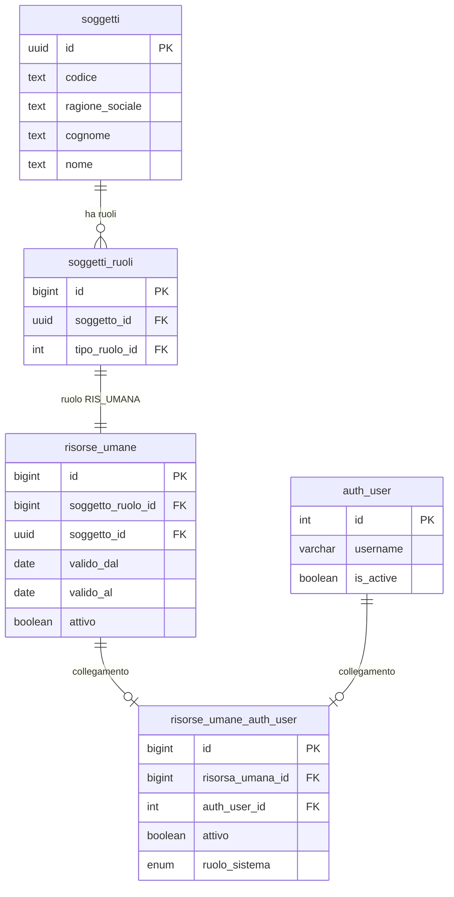
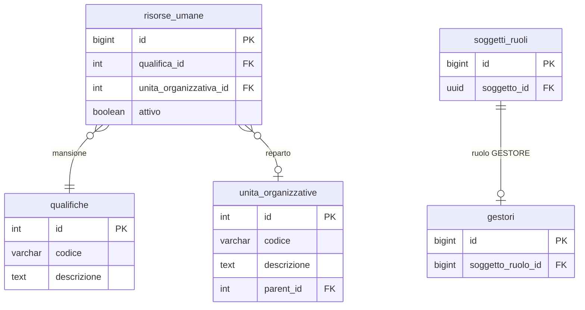

# Guida – Risorse Umane e Accessi al Software

> (latest review 19-04-2026, post-cutover multi-face-auth)
>
> Destinatari: sviluppatori database, backend, integratori e analisti funzionali
>
> Vedi anche
>
> * [Guida Soggetti & Ruoli](/guide/soggetti-e-ruoli-anagrafici)
> * [Gestione dei contatti](/guide/gestione-dei-contatti)
> * [Architettura Permessi e Autorizzazioni](/guide/architettura-permessi-e-autorizzazioni)
> * [Architettura Multi-Face Auth](/guide/architettura-multi-face-auth)
> * [Guida Gestione Mail](/guide/gestione-mail)

---

> **Multi-Face Auth — modello post-cutover (aprile 2026)**
>
> Il bridge verso `auth_user` e' stato generalizzato (cutover
> §13.3.2 del 19-04-2026). ⛔ **Dal 12-09-2026 pomeriggio il nome
> `risorse_umane_auth_user` non esiste piu' in nessuna forma**: la ex tabella
> (archiviata come `_legacy_…`) e' stata eliminata la mattina
> (`90_end/20260912-10`), la **vista** che ne aveva preso il nome la sera
> (`90_end/20260912-26`; decisione Tid: «via il nome», analisi
> `analisi-software-per-dati-morti` §2.1). I riferimenti nel corpo di questa
> guida a `risorse_umane_auth_user` vanno riletti come **`identita_digitali`
> filtrata su `ruolo_applicativo = 'OPERATORE'`**, collegata a
> `risorse_umane` per `soggetto_ruolo_id`.
> ⚠️ Il guard «una risorsa umana con un'identita' operatore attiva non si
> disattiva» vive ora scritto a mano sulla madre:
> [`trgfn_risorse_umane_guard_identita_attiva`](/dbzero/anagrafiche/funzioni/trgfn_risorse_umane_guard_identita_attiva)
> (`E_RISORSA_UMANA_IDENTITA_ATTIVA`) — prima viveva per caso, attraverso il
> nome vecchio.
>
> **Mappature chiave** (legacy → nuovo modello):
>
> | Concetto legacy | Post-cutover |
> | --- | --- |
> | `risorse_umane_auth_user` (tabella, poi vista) | **Non esiste piu'**: `identita_digitali` (`ruolo_applicativo = 'OPERATORE'`) ⋈ `risorse_umane` su `soggetto_ruolo_id`. Verso RU → utente: `script.fn_get_auth_user_id_for_risorsa_umana`; verso utente → UO: `script.fn_get_uo_id_for_user` |
> | `ruolo_sistema = 'ADMIN'` | Binding `SUPER_ADMIN` (profilo id=9100) su `profili_accesso_bindings` AD_HOC |
> | `ruolo_sistema = 'DISABILITATO'` | `identita_digitali.ruolo_applicativo = 'DISABILITATO'` oppure `attivo = false` |
> | `ruolo_sistema = 'OPERATIVO'` | `ruolo_applicativo = 'OPERATORE'` + `attivo = true` + nessun binding SUPER_ADMIN |
> | `trgfn_risorse_umane_auth_user_sync_active` (legacy) | `fn_sync_auth_user_is_active(auth_user_id)` letta solo da `identita_digitali` |
> | Vincolo R4 sul bridge (PF pura) | Guard `fn_guard_soggetto_pf_pura` su `identita_digitali` quando `ruolo_applicativo='OPERATORE'` (portali/shop non hanno il vincolo) |
>
> **Nuovi elementi** introdotti dal refactor:
>
> * [anagrafiche.identita_digitali](/dbzero/anagrafiche/tabelle/identita_digitali)
>   — bridge generalizzato per 5 ruoli applicativi
> * GUC PostgreSQL `app.current_identita_id`, `app.ruolo_applicativo`,
>   `app.soggetto_ruolo_id` propagati da `JwtAuditAuthentication`
> * Scope policy generalizzato (`BA_OWNERSHIP`, `FORNITORE_OWNERSHIP`,
>   `EF_WHITELIST`) con fn `script.fn_scope_*` inlineable
> * Policy RLS **a due velocità** (giugno 2026): branch **scope emittente
>   OPERATORI ATTIVA** (`ENABLE`, Ondata 1+2 su fatture/scadenze/lotti/ordini/
>   preventivi/contratti/offerte/documenti_generati/pratiche/billing_account —
>   vedi `dev/work-done/analisi-attivazione-rls-operatori.md`; dal **2026-06-03**
>   `FOR ALL` + `WITH CHECK` → copertura **scrittura**, no `FORCE`, batch come
>   `postgres` esenti); branch
>   **portale/shop** ancora **dry-run**, differita alle relative API di dominio
>
> Dettagli:
>
> * Guida architetturale: [architettura-multi-face-auth](/guide/architettura-multi-face-auth)
> * Piano di sviluppo: roadmap storica multi-face auth consolidata

---

## Introduzione

In Zero ERP una **risorsa umana** e la rappresentazione di una persona che lavora per l'azienda: un dipendente, un consulente, un collaboratore. Non e un semplice record anagrafico — e l'identita operativa della persona all'interno del sistema.

Questa guida copre **due aspetti strettamente legati**: il modulo risorse umane (chi sono le persone nell'organico, come sono organizzate) e il **governo dell'accesso al software** (chi puo entrare, cosa puo fare, cosa succede quando qualcuno cambia reparto o lascia l'azienda). I due aspetti sono inseparabili perche in Zero ERP e proprio la risorsa umana a determinare se e come un utente accede al sistema.

**Cosa troverai in questa guida:**

* Le entita coinvolte e il loro significato nel modello
* Come funziona il collegamento tra una risorsa umana e un utente Django
* Il meccanismo automatico che blocca il login quando una risorsa viene disattivata o scade
* Come vengono gestiti i permessi (profili reparto, override individuali) e come si propagano al cambio reparto
* Il ciclo di vita completo: dall'assunzione alla cessazione, con i passi operativi per ogni fase
* **Il primo accesso**: come l'admin invita un operatore e come l'operatore attiva il suo account
* **Cambio password**: meccanismo obbligatorio e volontario
* **Reset password dimenticata**: flusso self-service senza intervento admin
* **Sicurezza login**: blocco per tentativi falliti, throttle per IP, audit sessioni

### Il collegamento a Django e opzionale

Non tutte le risorse umane accedono al software. Un magazziniere potrebbe non avere un account, mentre il responsabile amministrativo si. Il collegamento a `auth_user` e un passo esplicito e separato dalla creazione della risorsa — e consentito solo per soggetti **persona fisica pura** (con codice fiscale e senza partita IVA).

---

## Tabelle coinvolte

* [anagrafiche.risorse_umane](/dbzero/anagrafiche/tabelle/risorse_umane) — la persona con ruolo, qualifica e reparto
* [anagrafiche.identita_digitali](/dbzero/anagrafiche/tabelle/identita_digitali) — il ponte verso l'utente Django (per gli operatori: `ruolo_applicativo = 'OPERATORE'`; il nome vecchio `risorse_umane_auth_user` e' stato ritirato il 12-09-2026)
* [anagrafiche.soggetti](/dbzero/anagrafiche/tabelle/soggetti) — la persona fisica o giuridica
* [anagrafiche.soggetti_ruoli](/dbzero/anagrafiche/tabelle/soggetti_ruoli) — i ruoli del soggetto (es. RIS_UMANA)
* [anagrafiche.gestori](/dbzero/anagrafiche/tabelle/gestori) — il soggetto gestore (l'azienda)
* `django.auth_user` — l'utente Django (tabella creata e gestita dal migratore Django, non documentata in `dbzero`)
* [config.qualifiche](/dbzero/config/tabelle/qualifiche) — mansioni e posizioni
* [config.unita_organizzative](/dbzero/config/tabelle/unita_organizzative) — reparti e uffici
* [anagrafiche.identita_digitali](/dbzero/anagrafiche/tabelle/identita_digitali) — il bridge multi-veste: `ruolo_applicativo` + `attivo` sono la classificazione utente (OPERATIVO / DISABILITATO)
* [config.profili_accesso_bindings](/dbzero/config/tabelle/profili_accesso_bindings) — i binding profilo↔identita': il binding `SUPER_ADMIN` e' cio' che un tempo era `ruolo_sistema = 'ADMIN'`
* [config.user_emittenti_fiscali](/dbzero/config/tabelle/user_emittenti_fiscali) — scope emittenti fiscali per operatore
* [config.token_monouso](/dbzero/config/tabelle/token_monouso) — token sicuri per inviti e reset password
* [config.email_account](/dbzero/config/tabelle/email_account) — account SMTP per invio email (vedi [Guida Gestione Mail](/guide/gestione-mail))

---

## Le entita e il loro significato

### Risorsa umana

E la persona che lavora per l'azienda. Ha una qualifica (cosa fa), un reparto (dove lavora), una finestra di validita (da quando a quando) e un flag attivo/inattivo.

La risorsa e legata al soggetto tramite un **ruolo RIS_UMANA** ([R1](#r1--ruolo-corretto)): la stessa persona (soggetto PF) che nel sistema potrebbe essere anche cliente o fornitore, qui compare nel suo ruolo di dipendente/collaboratore.

Campi chiave:

* `soggetto_ruolo_id`: il ruolo `RIS_UMANA` della persona — punta a `anagrafiche.soggetti_ruoli` (UNIQUE: una sola risorsa per persona, vedi [R5](#r5--unicita-per-persona))
* `soggetto_id`: la **persona** (soggetto PF) — campo denormalizzato per comodita di join, deve coincidere con il soggetto del ruolo ([R2](#r2--coerenza-soggetto)). **Non** e l'azienda (che si ricava da `anagrafiche.gestori`)
* `qualifica_id`: mansione o posizione (es. Amministratore, Dipendente, Consulente)
* `unita_organizzativa_id`: reparto o ufficio — determina l'**ereditarieta dei permessi** (profilo reparto)
* `valido_dal`, `valido_al`: finestra di validita ([R3](#r3--validita-temporale))
* `attivo`: flag operativo

### Ponte verso Django (`risorse_umane_auth_user`)

E il collegamento **1:1** tra una risorsa e un utente Django. Non tutte le risorse lo hanno — solo quelle che devono accedere al software.

Il ponte porta con se il `ruolo_sistema`, che classifica il tipo di utente:

| Tipo | Significato | Esempio |
| --- | --- | --- |
| `ADMIN` | Accesso completo, nessun controllo permessi | Titolare, responsabile IT |
| `OPERATIVO` | Accesso governato dai permessi (reparto + override) | Dipendente standard |
| `DISABILITATO` | Nessun accesso, bloccato ovunque | Ex-dipendente, utente sospeso |

### Qualifica

La mansione o posizione della persona (Dipendente, Consulente, Amministratore). Nel modello attuale la qualifica **non influisce sui permessi** — questi dipendono dal reparto. La qualifica e un dato informativo e organizzativo.

### Unita organizzativa (reparto)

Il reparto o ufficio a cui la risorsa appartiene. E il perno del sistema permessi: ogni reparto ha un **profilo permessi** che viene ereditato automaticamente da tutte le risorse assegnate.

### Soggetto gestore

L'azienda che usa il sistema (singleton). Il gestore e il soggetto PG con ruolo GESTORE — identifica il datore di lavoro. Il guard sull'accesso al software **non** verifica l'appartenenza al gestore (sarebbe impossibile: RIS_UMANA e solo PF, GESTORE e solo PG), ma verifica che il soggetto sia una **persona fisica pura** ([R4](#r4--collegamento-a-django-solo-persona-fisica-pura)). Il vincolo emittente fiscale (su quali emittenti l'utente puo operare) e verificato al login lato Django.

---

## Regole di dominio

### R1 — Ruolo corretto
<a id="r1--ruolo-corretto"></a>

Ogni risorsa umana deve riferire un `soggetto_ruolo_id` con tipo ruolo **RISORSA_UMANA**. Il trigger `trgfn_risorse_umane_guard_ruolo` lo verifica ad ogni INSERT/UPDATE.

### R2 — Coerenza soggetto
<a id="r2--coerenza-soggetto"></a>

`risorse_umane.soggetto_id` deve corrispondere al `soggetto_id` del ruolo associato.

### R3 — Validita temporale
<a id="r3--validita-temporale"></a>

Se `valido_al` e valorizzato, deve essere >= `valido_dal`. Il check `chk_risorse_umane_date` lo garantisce.

### R4 — Collegamento a Django (solo persona fisica pura)
<a id="r4--collegamento-a-django-solo-persona-fisica-pura"></a>

Il collegamento a `django.auth_user` e consentito **solo** per soggetti **persona fisica pura**. Il guard [`trgfn_risorse_umane_auth_user_guard_persona_fisica`](/dbzero/anagrafiche/funzioni/trgfn_risorse_umane_auth_user_guard_persona_fisica) verifica due condizioni strutturali:

1. **`partita_iva IS NULL`** — un soggetto con P.IVA (anche se ha CF) e un professionista o ditta individuale, non un dipendente
2. **`codice_fiscale IS NOT NULL`** — la persona deve essere identificata fiscalmente

Il vincolo emittente fiscale ("su quali emittenti l'utente puo operare?") **non** e verificato a livello DB ma al login lato Django (auth view), perche `user_emittenti_fiscali` richiede un `auth_user_id` che esiste solo dopo la creazione del ponte. Per limitare l'operativita per emittente, esiste la whitelist `config.user_emittenti_fiscali` (vedi [Autorizzazioni e permessi](#autorizzazioni-e-permessi)).

### R5 — Unicita per persona
<a id="r5--unicita-per-persona"></a>

La catena `soggetti_ruoli(soggetto_id, tipo_ruolo_id)` UNIQUE + `risorse_umane(soggetto_ruolo_id)` UNIQUE garantisce **un solo record per persona**. Conseguenza: per il rientro di un ex-dipendente si riattiva il record esistente, non se ne crea uno nuovo.

---

## Accesso al software

L'accesso applicativo e governato da **due livelli** complementari che lavorano insieme per garantire che solo gli utenti autorizzati possano operare nel sistema.

### Livello 1 — `ruolo_sistema` (enforcement permessi)

Il primo livello decide **cosa puo fare** l'utente. Il campo `ruolo_sistema` su `risorse_umane_auth_user` determina il comportamento nella catena di risoluzione permessi:

* **ADMIN**: bypass completo — accede a tutto senza verifiche
* **OPERATIVO**: eredita i permessi dal profilo del suo reparto, con eventuali override individuali
* **DISABILITATO**: bloccato su ogni endpoint protetto (403)

> Per l'architettura completa della catena di risoluzione: vedi [Architettura Permessi e Autorizzazioni](/guide/architettura-permessi-e-autorizzazioni).

### Livello 2 — Sync `auth_user.is_active` (blocco login)

Il secondo livello decide **se l'utente puo entrare**. Impostare `ruolo_sistema = DISABILITATO` blocca l'accesso a livello API (403), ma l'utente potrebbe ancora ottenere un token JWT. Per bloccare il **login stesso** serve che `auth_user.is_active` sia `false`.

Questo allineamento avviene in automatico.

**Come funziona:**

La funzione `anagrafiche.fn_sync_auth_user_is_active(p_risorsa_umana_id)` calcola lo stato atteso di `auth_user.is_active` come AND logico di tre condizioni:

1. `risorse_umane.attivo = true`
2. `risorse_umane_auth_user.attivo = true`
3. `CURRENT_DATE` dentro la finestra `[valido_dal, valido_al]` ([R3](#r3--validita-temporale))

Se una qualsiasi condizione non e soddisfatta → `is_active = false` e il login viene bloccato.

**Quando scatta la sync:**

| Evento | Trigger | Cosa succede |
| --- | --- | --- |
| Cambio stato risorsa | `trg_risorse_umane_z90_sync_auth_user_active_upd` | UPDATE di `attivo`, `valido_dal` o `valido_al` su `risorse_umane` |
| Cambio stato ponte | `trg_risorse_umane_auth_user_z90_sync_auth_user_active_upd` | UPDATE di `attivo` su `risorse_umane_auth_user` |
| Primo collegamento | `trg_risorse_umane_auth_user_z90_sync_auth_user_active_ins` | INSERT su `risorse_umane_auth_user` |

**Scadenze overnight:**

I trigger reagiscono a UPDATE espliciti. Ma cosa succede se ieri sera `valido_al` e scaduto e nessuno ha fatto alcuna operazione? La funzione batch `anagrafiche.fn_sync_auth_user_expired()` viene eseguita giornalmente alle 06:00 via pgAgent (`sync_auth_user_expired_daily`). Trova tutte le risorse con finestra scaduta ancora collegate a un `auth_user` attivo e le disattiva. In alternativa al job pgAgent, il management command Django `sync_auth_user_active` offre la stessa funzionalita via cron/systemd:

```bash
# Esecuzione diretta
python manage.py sync_auth_user_active

# Solo report, senza modifiche
python manage.py sync_auth_user_active --dry-run

# In cron (alternativa a pgAgent)
0 6 * * * /path/to/manage.py sync_auth_user_active
```

**Invalidazione cache permessi:**

Il management command `sync_auth_user_active` invalida automaticamente la cache permessi per ogni utente disattivato, in modo che il blocco sia immediato e non debba attendere la scadenza naturale della cache (TTL 300s).

Per le disattivazioni real-time (trigger DB 1.2, 1.3, 1.4), la cache si rinnova automaticamente alla scadenza del TTL. Il listener LISTEN/NOTIFY (vedi sezione Cambio reparto) offre un pattern event-driven estendibile anche a questi scenari in futuro.

---

## Autorizzazioni e permessi

Il sistema di autorizzazioni **non** usa i gruppi e permessi nativi di Django (`auth_group`, `auth_permission`). La gestione e basata su un modello dedicato, progettato per essere piu flessibile e piu vicino alle esigenze di un ERP.

In sintesi, i permessi di un utente dipendono da tre fattori:

* **`ruolo_sistema`**: ADMIN (accesso totale), OPERATIVO (governato dai permessi) o DISABILITATO (bloccato)
* **Profilo reparto**: ogni reparto ha un set di permessi predefiniti che vengono ereditati automaticamente da tutti i suoi membri
* **Override individuali**: eccezioni per singolo utente, con priorita sul profilo reparto — utili per dare o togliere permessi specifici senza creare un reparto ad hoc

La catena di risoluzione:

```text
identita_digitali assente/non attiva? -> accesso negato
binding SUPER_ADMIN attivo?           -> accesso completo
altrimenti                            -> override utente -> profili_accesso (AD_HOC > REPARTO/PORTALE) -> BLOCCATO (default)
```

Le tabelle coinvolte:

* `config.profili_accesso`, `config.profili_accesso_aree`, `config.profili_accesso_azioni`, `config.profili_accesso_bindings` — capability generalizzate (REPARTO, PORTALE, AD_HOC, SUPER_ADMIN)
* `config.user_override_aree`, `config.user_override_oggetti`, `config.user_override_azioni` — eccezioni individuali
* `config.user_emittenti_fiscali` — whitelist opzionale per limitare l'operativita per emittente fiscale

**Ambito emittente fiscale:** in un sistema multi-emittente (piu soggetti che emettono fatture), la tabella `config.user_emittenti_fiscali` consente di restringere su quali emittenti un utente puo operare. ⚠️ **Dal 2026-08-18 e fail-closed**: se l'utente non ha righe non vede NESSUN emittente — la riga mancante e un errore di configurazione, non un permesso (prima valeva il contrario). L'unico attore legittimamente multi-emittente e il SUPER_ADMIN, che passa da `fn_is_super_admin` e non da questa tabella. Chi resta senza assegnazione compare in `dbops.vw_operatori_senza_emittente`, che deve restare a zero righe. Questo ambito e ortogonale ai permessi reparto: un utente puo avere accesso alla fatturazione (profilo reparto) ma essere limitato a un solo emittente (whitelist). L'enforcement avviene sia a livello API (`EmittenteFiscaleScopeMixin`) che a livello DB (trigger `fn_check_user_emittente_scope`).

> Per il modello dati completo, le funzioni SQL di risoluzione e l'enforcement Django:
> vedi [Architettura Permessi e Autorizzazioni](/guide/architettura-permessi-e-autorizzazioni).

---

## Ciclo di vita

### Assunzione (creazione risorsa)

Quando una nuova persona entra nell'organico, la sequenza e:

1. Creare il soggetto PF (se non esiste gia nel sistema)
2. Assegnare il ruolo `RIS_UMANA` via `script.fn_get_or_create_soggetto_ruolo` ([R1](#r1--ruolo-corretto))
3. Inserire in `risorse_umane` con `valido_dal`, `qualifica_id`, `unita_organizzativa_id`
4. (Opzionale) Collegare a `auth_user` via `risorse_umane_auth_user` — il trigger sync imposta `is_active` automaticamente

### Cambio reparto

Quando una risorsa cambia ufficio o reparto, basta un UPDATE di `risorse_umane.unita_organizzativa_id`.

**Impatto immediato sui permessi:** l'utente eredita il profilo del nuovo reparto. I permessi cambiano all'istante.

**Invalidazione cache automatica (LISTEN/NOTIFY):**

Il sistema si occupa automaticamente di aggiornare la cache. Quando `unita_organizzativa_id` cambia, il trigger `trg_risorse_umane_z90_notify_cambio_reparto_upd` emette una notifica PostgreSQL sul canale `cambio_reparto` con un payload JSON:

```json
{"risorsa_umana_id": 42, "old_uo_id": 1, "new_uo_id": 3, "auth_user_id": 7}
```

Il listener backend (`CambioRepartoListener`, avviato tramite `python manage.py listen_cambio_reparto`) intercetta la notifica e chiama `invalidate_user(auth_user_id)` per l'utente spostato. Il meccanismo e trasparente: qualsiasi path che modifica il reparto (API, management command, operazione diretta sul DB, import bulk) ottiene l'invalidazione automatica senza dover ricordare di aggiungerla caso per caso.

Il listener usa una connessione psycopg3 dedicata con riconnessione automatica (backoff esponenziale) in caso di caduta connessione PostgreSQL. Va eseguito come processo long-running (systemd, supervisor, o in foreground durante lo sviluppo).

### Cambio qualifica

UPDATE di `risorse_umane.qualifica_id`.

**Nessun impatto sui permessi** nel modello attuale: i permessi dipendono dal reparto, non dalla qualifica. Si tratta di un aggiornamento puramente informativo.

### Cessazione (disattivazione)

Quando una persona lascia l'organico, la sequenza e:

1. Disattivare il ponte: UPDATE `risorse_umane_auth_user.attivo = false` — il trigger sync imposta `auth_user.is_active = false` e il login viene bloccato
2. Disattivare la risorsa: UPDATE `risorse_umane.attivo = false`
3. Il backend invalida la cache permessi dell'utente

**Perche questo ordine?** Il framework ATTIVO (`trgfn_prevent_deactivate_if_children`) impedisce di disattivare un genitore che ha figli ancora attivi. Poiche `risorse_umane_auth_user` e figlio di `risorse_umane`, bisogna disattivare il ponte (figlio) prima della risorsa (genitore). Tentare l'ordine inverso produce un errore.

Se la risorsa non ha un collegamento a `auth_user`, basta il solo passo 2.

⛔ **Il passo 2 è rifiutato finché la persona governa qualcosa.** Il framework
ATTIVO monta su `risorse_umane` un block per ogni tabella che la referenzia
come persona interna: `pratiche.pratiche`, `pratiche.flussi`,
`pratiche.competenze_flussi` e `vendite.commesse`
(`responsabile_risorsa_umana_id`). ⚠️ Quest'ultimo conta **tutte** le commesse
di cui la persona è responsabile — anche chiuse, perché `commesse` non ha
`attivo` — quindi per liberare una persona si cambia il responsabile sulle sue
commesse, non si spegne la persona. Il picker con cui si sceglie il responsabile
è `GET /anagrafiche/risorse-umane/lookup/`
([scheda](/backend/anagrafiche/manual/api_risorse_umane_lookup)), che elenca
solo le risorse attive.

### Rientro

Il vincolo di unicita ([R5](#r5--unicita-per-persona)) garantisce un solo record per persona in `risorse_umane`. Non e possibile creare un secondo record — e non serve: per il rientro di un ex-dipendente si **riattiva il record esistente**.

La sequenza e l'inversa della cessazione:

1. Riattivare la risorsa: UPDATE `risorse_umane.attivo = true`, aggiornare `valido_dal`/`valido_al`
2. Riattivare il ponte: UPDATE `risorse_umane_auth_user.attivo = true` — il trigger sync imposta `auth_user.is_active = true` e il login viene riabilitato

**Perche questo ordine?** Il framework ATTIVO (`trgfn_child_requires_active_parent`) impedisce di attivare un figlio se il genitore e inattivo. Bisogna riattivare la risorsa (genitore) prima del ponte (figlio).

### Assegnazione emittente fiscale (scope operativo)

Dopo aver creato l'operatore e collegato il suo account Django, e necessario definire **su quali emittenti fiscali** l'operatore puo lavorare. Questo vincolo determina il **perimetro dati** visibile: un operatore assegnato a un emittente vedra solo documenti, fatture, pratiche e movimenti di quell'emittente.

**Tabella coinvolta:** `config.user_emittenti_fiscali` — legame N:1 tra `auth_user` e `anagrafiche.emittenti_fiscali`.

**Come si configura (da interfaccia):**

1. Andare in **Amm. Software → Operatori**
2. Aprire l'operatore in modifica (click sulla riga)
3. Passare al **tab Permessi**
4. Nella sezione **Emittenti Scope** selezionare l'emittente fiscale dal dropdown
5. Premere **Salva** nella sezione

**Regole:**

* Se l'operatore non ha nessun emittente assegnato, il comportamento dipende dal ruolo: un ADMIN vede tutto (bypass scope), un OPERATIVO non vedra dati filtrati per emittente
* L'emittente fiscale e un soggetto con ruolo EMITTENTE nel sistema anagrafico — il dropdown mostra la **ragione sociale** del soggetto associato
* Il vincolo e verificato a runtime da `get_scope_user_id(request)` negli endpoint API: se l'utente ha emittenti assegnati, le query vengono filtrate automaticamente
* La modifica dell'emittente ha effetto immediato — non richiede invalidazione cache perche il check avviene ad ogni richiesta API

**Quando serve:**

* **Azienda mono-emittente**: assegnare l'unico emittente a tutti gli operatori (il sistema lo pre-seleziona se ce n'e uno solo)
* **Gruppo multi-emittente**: assegnare a ciascun operatore solo gli emittenti su cui opera
* **Consulenti esterni**: limitare lo scope al singolo emittente del cliente che seguono

---

## Primo accesso e gestione credenziali

Questa sezione descrive come un operatore entra nel sistema per la prima volta, come gestisce
la propria password e come puo' recuperarla autonomamente. Sono meccanismi complementari
al ciclo di vita descritto sopra: l'assunzione crea la risorsa, i flussi qui sotto abilitano
l'accesso effettivo.

### Scelta architetturale: nessuna password comunicata

In Zero ERP **nessuna password viene mai comunicata verbalmente o via messaggio**. L'admin non
assegna una password all'operatore — il sistema genera un token monouso, lo invia via email,
e l'operatore sceglie la propria password al primo accesso. Questa scelta elimina il rischio
di password condivise, annotate su post-it o inviate in chiaro su canali non sicuri.

### Invito operatore

Quando l'admin crea un operatore e decide di abilitarlo al software, il flusso e':

```text
1. Admin → Amm. Software → Operatori → seleziona operatore → "Invia invito"
   |
2. Il sistema verifica 5 condizioni di invitabilita':
   - auth_user esiste e is_active = true
   - risorse_umane_auth_user esiste e attivo = true
   - ruolo_sistema <> DISABILITATO
   - l'utente ha un indirizzo email configurato
   - last_login IS NULL (non ha mai fatto login)
   |
3. Imposta una password temporanea casuale (MAI comunicata)
4. Imposta il flag deve_cambiare_password = true
5. Genera un token monouso tipo INVITO_OPERATORE (scadenza 72 ore)
6. Invia email con link di attivazione
7. Registra invito_inviato_at
   |
8. L'operatore riceve l'email → clicca il link
   |
9. Pagina attivazione: sceglie la propria password
   - Il token viene validato PRIMA, la password DOPO
   - Se la password e' troppo debole, il token resta valido e l'operatore riprova
   |
10. Account attivato → l'operatore fa login con la password scelta
```

**Reinvio invito**: se l'email non e' arrivata o il token e' scaduto, l'admin puo'
reinviare l'invito. Il sistema invalida automaticamente il token precedente e ne genera
uno nuovo.

**L'email di invito** viene inviata con l'account SMTP del reparto dell'operatore
(se configurato) o con l'account di sistema. Il template e' personalizzabile per reparto
(vedi [Guida Gestione Mail](/guide/gestione-mail)).

### Cambio password obbligatorio

Il flag `deve_cambiare_password` su `risorse_umane_auth_user` forza l'operatore a cambiare
password prima di poter usare il sistema. Il meccanismo e':

1. **Al login**: se il flag e' attivo, la response JWT include `password_change_required: true`
2. **Frontend**: il router guard redirect a `/change-password` e blocca ogni altra navigazione
3. **Backend**: il middleware `PasswordChangeRequiredMiddleware` blocca tutte le API tranne:
   * `POST /auth/change-password/`
   * `POST /auth/logout/`
   * `GET /core/me/`
4. **Dopo il cambio**: il flag viene resettato, i vecchi token JWT invalidati, nuovi token rilasciati

Il middleware opera in **fail-closed**: se il DB non risponde durante il check, l'accesso
viene bloccato (503) piuttosto che concesso.

Il flag puo' essere impostato in tre scenari:

| Scenario | Chi lo imposta | Quando |
| --- | --- | --- |
| Primo accesso | `InvitoOperatoreService` | Alla creazione dell'invito |
| Reset admin | L'admin manualmente | Quando vuole forzare un cambio |
| Reset password dimenticata | `PasswordResetConfirmView` | Alla conferma del reset |

### Cambio password volontario

L'operatore puo' cambiare la propria password in qualsiasi momento da **Profilo → Cambia password**
(rotta `/change-password`). Il flusso richiede:

1. Password attuale (verifica identita')
2. Nuova password (passa i 4 validators Django)
3. Conferma nuova password

Al successo: password aggiornata, tutti i token JWT precedenti invalidati,
nuova coppia JWT rilasciata, profilo ricaricato.

### Reset password dimenticata

L'operatore puo' reimpostare la password **senza intervento admin** tramite il link
"Password dimenticata?" nella pagina di login. Il flusso e' completamente self-service:

```text
1. Operatore clicca "Password dimenticata?" nel login
   |
2. Inserisce la propria email
   |
3. Il sistema risponde SEMPRE con lo stesso messaggio
   (non rivela se l'email esiste — sicurezza)
   |
4. Se l'email e' registrata e l'utente e' attivo:
   - Genera token monouso tipo RESET_PASSWORD (scadenza 1 ora)
   - Invia email con link di reset
   |
5. L'operatore clicca il link nell'email
   |
6. La pagina verifica il token (senza consumarlo)
   - Se valido: mostra il form per la nuova password
   - Se invalido/scaduto: mostra messaggio + link per nuova richiesta
   |
7. L'operatore inserisce la nuova password
   - Il token viene validato PRIMA, la password DOPO
   - Se la password e' debole, il token resta valido e l'operatore riprova
   |
8. Password reimpostata, tutti i JWT invalidati
9. Email di conferma inviata all'operatore
10. L'operatore fa login con la nuova password
```

**Scelta validate-before-consume**: il token viene consumato solo DOPO che la password
ha superato tutti i 4 validators Django. Se l'operatore inserisce una password troppo
semplice (es. "12345678"), riceve l'errore ma il token resta valido — puo' riprovare
immediatamente senza dover richiedere un nuovo link. Questa scelta evita frustrazione
e riduce il carico sul sistema email.

### Token monouso

Sia l'invito che il reset password usano lo stesso meccanismo di **token monouso generico**
(`config.token_monouso`):

| Caratteristica | Valore |
| --- | --- |
| Lunghezza | 32 bytes casuali → 64 caratteri hex |
| Storage | Solo hash SHA-256 in DB — il token in chiaro **non e' recuperabile** |
| Invalidazione | Alla creazione, tutti i token precedenti dello stesso tipo/utente vengono invalidati |
| Consumo | Registra IP e timestamp |
| Pulizia | `config.fn_cleanup_token_scaduti()` — job pgAgent periodico |

Il token in chiaro viaggia **solo** nell'email di invito o reset. Non e' mai salvato
in DB, non e' mai visibile nell'API, non e' mai loggato.

### Sicurezza login

Il sistema protegge il login con tre meccanismi complementari:

#### Blocco per utente (tentativi falliti)

Dopo N tentativi falliti consecutivi, l'utente viene bloccato temporaneamente.
Il blocco si resetta automaticamente alla scadenza o al login riuscito.

* `script.fn_check_blocco_login(auth_user_id)` — verifica se l'utente e' bloccato
* `script.fn_registra_tentativo_login(auth_user_id, successo)` — registra l'esito
* `risorse_umane_auth_user.tentativi_falliti` — contatore
* `risorse_umane_auth_user.bloccato_fino_a` — timestamp fine blocco

#### Throttle per IP (rate limiting)

Indipendentemente dall'utente, ogni IP e' limitato a 5 tentativi di login ogni 5 minuti
e 3 richieste di reset password ogni 15 minuti. Protegge da attacchi brute-force
distribuiti su piu' utenti dallo stesso IP.

#### Audit sessioni

Ogni evento di autenticazione viene registrato in `dbops.sessioni_utente`:

| Evento | Quando | Dati registrati |
| --- | --- | --- |
| LOGIN | Login JWT riuscito | user_id, IP, user_agent, session_id |
| REFRESH | Refresh token | user_id, IP, session_id |
| LOGOUT | Logout esplicito | user_id, IP, session_id |
| PASSWORD_CHANGED | Cambio password | user_id |
| PASSWORD_RESET | Reset password da link | user_id |
| INVITO_INVIATO | Invito operatore | user_id, admin_id |

---

## Diagrammi ER

Il modello e rappresentato in due diagrammi separati per facilitare la lettura.

### Catena identita e accesso

La catena principale: dalla persona al suo account Django, passando per il ruolo e il ponte.



### Parte organizzativa

Qualifica, reparto e gestore: i dati che completano il profilo della risorsa.



> **Nota:** `soggetto_id` su `risorse_umane` e la persona (PF), non l'azienda.
> L'azienda (datore) si identifica tramite `anagrafiche.gestori` — un soggetto PG con ruolo GESTORE.
> Il guard `trgfn_risorse_umane_auth_user_guard_persona_fisica` ([R4](#r4--collegamento-a-django-solo-persona-fisica-pura)) verifica che il collegamento a `auth_user` sia consentito solo per soggetti persona fisica pura (CF obbligatorio, P.IVA vietata).

---

## Integrazione con il sistema operativo

La risorsa umana e l'**identita dell'operatore** nel sistema. Quando un utente accede e compie operazioni, il sistema sa sempre chi sta agendo grazie alla catena `auth_user → risorse_umane_auth_user → risorse_umane`.

In pratica:

* Il middleware `jwt_audit_middleware` propaga `auth_user_id` come `app.current_user_id` nella sessione PostgreSQL
* I trigger defense-in-depth (es. ambito emittente fiscale) usano `current_setting('app.current_user_id')` per verificare le autorizzazioni a livello DB
* L'`auth_user_id` che esegue le pipeline fatturazione, i push commesse e i lotti e lo stesso che arriva dalla catena risorsa → ponte → utente

> Per i dettagli su audit e defense-in-depth: vedi [Architettura Permessi e Autorizzazioni](/guide/architettura-permessi-e-autorizzazioni).
> Per i flussi operativi: vedi [Guida Fatturazione](/guide/fatturazione).

---

## Distinzione con i contatti

Due concetti diversi che non vanno confusi:

* `anagrafiche.contatti` = **referenti e canali di comunicazione** (email, telefono, PEC) — possono essere associati a qualsiasi soggetto
* `anagrafiche.risorse_umane` = **persone reali** con ruolo, qualifica e validita — rappresentano l'organico aziendale

I contatti non sostituiscono le risorse umane, ma possono riferirle quando serve un canale di comunicazione per un dipendente.

---

## Trigger e funzioni coinvolte

### Sync `auth_user.is_active`

| Funzione / Trigger | Quando scatta | Cosa fa |
| --- | --- | --- |
| `fn_sync_auth_user_is_active` | Chiamata dai trigger sotto | Calcola lo stato atteso e aggiorna `auth_user.is_active` se diverso |
| `trgfn_risorse_umane_sync_auth_user_active` | AFTER UPDATE di `attivo`, `valido_dal`, `valido_al` su `risorse_umane` | Reagisce a cambio stato della risorsa |
| `trgfn_risorse_umane_auth_user_sync_active` | AFTER INSERT / AFTER UPDATE di `attivo` su `risorse_umane_auth_user` | Reagisce a cambio stato del ponte o primo collegamento |
| `fn_sync_auth_user_expired` | Job pgAgent giornaliero (06:00) o management command `sync_auth_user_active` | Disattiva in batch gli utenti con finestra scaduta |

### Invalidazione cache al cambio reparto

| Funzione / Trigger | Quando scatta | Cosa fa |
| --- | --- | --- |
| `fn_notify_cambio_reparto` | Chiamata dal trigger sotto | Emette `NOTIFY cambio_reparto` con payload JSON |
| `trgfn_risorse_umane_notify_cambio_reparto` | AFTER UPDATE di `unita_organizzativa_id` su `risorse_umane` (solo se cambiato) | Invoca `fn_notify_cambio_reparto` con vecchio e nuovo reparto |
| `CambioRepartoListener` (backend) | Processo long-running (`listen_cambio_reparto`) | Ascolta `NOTIFY cambio_reparto` e chiama `invalidate_user()` |

### Guard e vincoli

| Funzione / Trigger | Quando scatta | Cosa fa |
| --- | --- | --- |
| `trgfn_risorse_umane_guard_ruolo` | BEFORE INSERT/UPDATE su `risorse_umane` | Verifica che il ruolo sia RIS_UMANA |
| `trgfn_risorse_umane_auth_user_guard_persona_fisica` | BEFORE INSERT/UPDATE su `risorse_umane_auth_user` | Verifica che il soggetto sia persona fisica pura (CF obbligatorio, P.IVA vietata) |
| `trgfn_prevent_deactivate_if_children` | BEFORE UPDATE su `risorse_umane` | Blocca disattivazione se il ponte e ancora attivo |
| `trgfn_child_requires_active_parent` | AFTER INSERT/UPDATE su `risorse_umane` e `risorse_umane_auth_user` | Verifica che i genitori (qualifiche, soggetti, unita org.) siano attivi |

---

## Propagazione identita utente al database (GUC `app.*`)

> Sezione aggiunta nello sprint 2026-04-XX a seguito del refactor operatore-emittenti.
> Risolve il bug "audit JWT inerte" e abilita i trigger di scope a livello DB.

### Il problema

Alcuni trigger PostgreSQL hanno bisogno di sapere **chi** sta eseguendo la transazione corrente, per:

1. **Audit trail JWT** — `script.trgfn_audit_data_user_generic` popola `user_insert` / `user_update`
   con lo username JWT reale (non con il ruolo DB `zeroerp_app`/`titodb`).
2. **Defense-in-depth scope emittente** — `anagrafiche.trgfn_billing_account_guard_admin_globale`,
   `anagrafiche.trgfn_billing_account_link_ef`, `script.trgfn_guard_emittente_scope` leggono
   l'utente corrente per applicare regole di sicurezza che il backend Python potrebbe aver dimenticato.

L'identita utente viene propagata via due **GUC PostgreSQL** (Grand Unified Configuration parameters):

| GUC | Valore | Letta da |
| --- | --- | --- |
| `app.jwt_user` | `str(user)` (username Django) | Trigger di audit |
| `app.current_user_id` | `str(user.id)` (PK Django) | Trigger di scope |

### Il timing problem

Per i request `/api/*` JWT in produzione, l'autenticazione **non avviene nei middleware Django** ma
nel **view dispatch DRF**: la classe `JWTAuthentication` (registrata in
`REST_FRAMEWORK.DEFAULT_AUTHENTICATION_CLASSES`) gira dentro `APIView.initial()` →
`perform_authentication()`. Questo accade **dopo** tutti i Django middleware `process_view`.

Quindi:

* Un middleware Django che provasse a settare le GUC in `process_view` vedrebbe
  `request.user = AnonymousUser` per le request JWT (Django session middleware non vede
  i bearer token) → le GUC non verrebbero mai impostate per le request JWT reali.
* La GUC deve essere settata **dopo** che `JWTAuthentication.authenticate()` ha risolto l'utente,
  ma **prima** che il view body inizi a fare INSERT/UPDATE (altrimenti i trigger non vedono nulla).

### Soluzione adottata: hook nella DRF authentication class

> **Pattern: subclass di `JWTAuthentication` che setta le GUC come side-effect di `authenticate()`**.

File: `apps/core/api/jwt_audit_authentication.py` (classe `JwtAuditAuthentication`).

Registrata in `settings.REST_FRAMEWORK["DEFAULT_AUTHENTICATION_CLASSES"]` al posto di
`rest_framework_simplejwt.authentication.JWTAuthentication`. La classe:

1. Chiama `super().authenticate(request)` (logica JWT invariata)
2. Se l'autenticazione ha avuto successo, propaga `app.jwt_user` e `app.current_user_id` come
   GUC **session-scoped** (`set_config(..., is_local=false)`) sulla connessione PostgreSQL
3. Ritorna il risultato standard `(user, token)` come ogni `BaseAuthentication`
4. Il **reset** delle GUC al termine della request e demandato a `JwtAuditMiddleware.process_response`,
   che usa un flag `request._zeroerp_jwt_guc_set` per agire solo quando la auth class ha effettivamente
   propagato l'identita

**Perche session-scoped (`false`) e non `SET LOCAL` (`true`)**: a `authenticate()` time la
connessione e in autocommit (il view body non ha ancora aperto la sua `transaction.atomic()`),
quindi `SET LOCAL` verrebbe perso al COMMIT immediato dello statement.
`set_config(..., false)` invece persiste sulla connessione fino al reset esplicito o alla
chiusura connessione (`CONN_MAX_AGE=0` di default chiude a fine request).

**Perche questo e il punto giusto**:

* E **l'unico** punto del flusso DRF dove l'identita JWT e gia risolta E il view body non e
  ancora partito → i trigger DB vedono la GUC quando le scritture avvengono.
* Copre **tutti** gli endpoint JWT automaticamente: niente boilerplate nelle view, niente
  base class da modificare, niente disciplina richiesta agli sviluppatori dei domini.
* `JwtAuditMiddleware` esistente resta semplificato: si occupa solo di rifiuto early
  `DISABILITATO` su `/api/`, pre-load cache permessi Redis L2 e reset GUC simmetrico.
* Single Responsibility: chi conosce l'utente (la auth class) e chi popola la GUC sono lo
  stesso punto.

**Test isolation**: i test API che usano `SimpleTestCase` + Django test client mockano
il side-effect via `JwtAuditAuthentication._set_gucs` (metodo separato e mockabile),
attraverso una base class `JwtMockedApiTest` in `apps/core/tests/_helpers/jwt_mock.py`.
La logica `super().authenticate()` resta mockabile come prima al livello
`rest_framework_simplejwt.authentication.JWTAuthentication.authenticate`.

### Pattern complementare per entry point non-HTTP (futuro)

> **Pattern: helper `app_atomic(auth_user_id=...)` a livello service, alternativa a `transaction.atomic()`**.

La soluzione adottata copre **tutte** le request HTTP JWT, ma per definizione non vede:

* `manage.py` command (es. import batch, migration di dati)
* Cron job / task pgAgent
* Worker background / signal handlers
* Test di integrazione che chiamano i service direttamente

Per questi casi futuri, il pattern corretto e propagare l'identita **al livello del service**
che apre la transazione, non al livello HTTP. Implementazione raccomandata:

```python
# apps/core/services/db_context.py (DA IMPLEMENTARE QUANDO SERVIRA)
from contextlib import contextmanager
from django.db import connection, transaction

@contextmanager
def app_atomic(*, auth_user_id: int | None = None, jwt_user: str | None = None):
    """Apre transaction.atomic() e propaga l'identita utente come GUC PG
    (`SET LOCAL` con scope transazione, autoreset al COMMIT/ROLLBACK).

    Da usare nei service di scrittura quando l'entry point NON e HTTP/JWT
    (CLI, cron, signal): in quei contesti JwtAuditAuthentication non gira
    e le GUC devono essere propagate esplicitamente.

    Per le request HTTP JWT NON serve: la propagazione e gia automatica
    via JwtAuditAuthentication.
    """
    with transaction.atomic():
        if auth_user_id is not None:
            with connection.cursor() as cursor:
                cursor.execute(
                    "SELECT set_config('app.current_user_id', %s, true), "
                    "       set_config('app.jwt_user',        %s, true)",
                    [str(auth_user_id), jwt_user or str(auth_user_id)],
                )
        yield
```

Uso tipico in un management command:

```python
class Command(BaseCommand):
    def handle(self, *args, **opts):
        admin_user_id = opts["admin_user_id"]
        for record in records_to_import:
            with app_atomic(auth_user_id=admin_user_id):
                ClientiService().crea_cliente(record, auth_user_id=admin_user_id)
```

**Quando implementarlo**: solo quando arriva il **primo** entry point non-HTTP che scrive
entita audited (oggi non esiste). Non si fanno preventivamente helper inutilizzati
(principio "non creare astrazioni per scenari ipotetici" — vedi `AGENTS.md`).

### Sintesi delle due soluzioni

| Aspetto | A — `JwtAuditAuthentication` (oggi) | P — `app_atomic` helper (futuro) |
| --- | --- | --- |
| Dove vive | DRF auth class, registrata in settings | Service layer, helper `apps/core/services/db_context.py` |
| Quando girare | Automatico per ogni request `/api/*` JWT | Esplicito al call site del service |
| Copre | HTTP/JWT (100% degli endpoint) | Qualsiasi entry point (CLI, cron, signal, test integration) |
| Discipline richiesta | Nessuna (auto) | Service deve usare `app_atomic` invece di `transaction.atomic()` |
| GUC scope | Session-scoped (`set_config(.., false)`) + reset in middleware | `SET LOCAL` (transazione del service, autoreset) |
| Stato | **Implementato 2026-04-XX** (BE-2.0ter del refactor operatore-emittenti) | **Da implementare quando servira** |
| Testing | Mock di `JwtAuditAuthentication._set_gucs` via base class `JwtMockedApiTest` | Mock di `app_atomic` (drop-in replacement di `transaction.atomic`) |

I due pattern **non si sovrappongono**: A copre HTTP, P copre non-HTTP. Quando saranno entrambi
attivi, P resta complementare ad A — un service chiamato sia da view HTTP che da CLI puo
ricevere l'identita per due strade diverse senza conflitti (la GUC e idempotente).

### Riferimenti

* `apps/core/api/jwt_audit_authentication.py` — classe `JwtAuditAuthentication`
* `apps/core/middleware/jwt_audit_middleware.py` — middleware semplificato (DISABILITATO + cleanup)
* `apps/core/tests/_helpers/jwt_mock.py` — base class `JwtMockedApiTest` per i test API
* [JwtAuditMiddleware (manual)](/backend/core/manual/jwt_audit_middleware) — dettaglio tecnico
* [Architettura permessi e autorizzazioni](/guide/architettura-permessi-e-autorizzazioni) — quadro generale GUC
* [Parametri Personalizzati GUC](/postgresql/parametri-personalizzati-(GUC)) — semantica session-scoped vs transaction-scoped

---

## Ottimizzazione connessioni database in produzione

> Questa sezione spiega come funzionano le connessioni tra Django e PostgreSQL,
> cosa succede quando ci sono molti operatori collegati, e come preparare il sistema
> per la produzione. Il linguaggio e volutamente semplice e operativo.

### Come funziona oggi (sviluppo)

Ogni volta che un operatore fa una qualsiasi azione nell'interfaccia (aprire una lista,
salvare un form, cercare un soggetto), il browser invia una richiesta HTTP al backend Django.
Per ogni richiesta, Django:

1. **Apre una nuova connessione** a PostgreSQL
2. Imposta le variabili GUC (`app.jwt_user`, `app.current_user_id`) per identificare l'operatore
3. Esegue le query necessarie
4. Resetta le variabili GUC
5. **Chiude la connessione**

Questo comportamento e determinato dal parametro Django `CONN_MAX_AGE = 0` (valore di default).
In sviluppo funziona perfettamente, ma in produzione con molti operatori attivi diventa
uno spreco: aprire e chiudere una connessione TCP ha un costo (handshake di rete,
autenticazione PostgreSQL, allocazione memoria sul server DB).

### Primo passo: riutilizzo connessioni (`CONN_MAX_AGE`)

Il parametro `CONN_MAX_AGE` dice a Django: "dopo aver finito con questa richiesta,
**non chiudere** la connessione — tienila aperta per le prossime richieste".

```python
# settings.py
DATABASES = {
    'default': {
        ...
        'CONN_MAX_AGE': 600,  # 10 minuti
    }
}
```

**Cosa cambia in pratica:**

* Con `CONN_MAX_AGE = 0`: 100 richieste = 100 connessioni aperte e chiuse
* Con `CONN_MAX_AGE = 600`: 100 richieste in 10 minuti = poche connessioni riutilizzate

**Perche e sicuro nel nostro caso:** il middleware `JwtAuditMiddleware` gia resetta le GUC
a fine richiesta (vedi sezione precedente). Questo significa che quando la stessa connessione
viene riutilizzata da un altro operatore, le variabili dell'operatore precedente sono gia
state cancellate. Il codice era stato scritto fin dall'inizio per supportare questo scenario.

**Limiti:** ogni processo (worker) Gunicorn tiene aperta la sua connessione. Con 4 worker
= massimo 4 connessioni permanenti verso PostgreSQL. Per un team di 5-15 operatori
e piu che sufficiente.

**Quando non basta piu:** quando il numero di worker Gunicorn cresce (perche servono
piu operatori simultanei), le connessioni permanenti verso PostgreSQL aumentano in modo
proporzionale. A quel punto serve un **pool di connessioni dedicato**.

### Secondo passo: pgbouncer (pool di connessioni)

pgbouncer e un software leggero che si posiziona **tra Django e PostgreSQL** e gestisce
un pool condiviso di connessioni. Invece di avere ogni worker con la sua connessione
diretta, tutti i worker condividono un numero limitato di connessioni reali.

```text
Senza pgbouncer:
  Worker 1 ──────────── PostgreSQL (connessione 1)
  Worker 2 ──────────── PostgreSQL (connessione 2)
  Worker 3 ──────────── PostgreSQL (connessione 3)
  Worker 4 ──────────── PostgreSQL (connessione 4)

Con pgbouncer (transaction mode):
  Worker 1 ─┐
  Worker 2 ─┤── pgbouncer ─── PostgreSQL (2-3 connessioni reali)
  Worker 3 ─┤
  Worker 4 ─┘
```

**Come funziona (transaction mode):**

1. Un worker chiede una connessione a pgbouncer
2. pgbouncer gli assegna una connessione dal pool
3. Il worker esegue la sua transazione (query, INSERT, UPDATE)
4. Appena la transazione finisce, pgbouncer **rimette la connessione nel pool**
5. Un altro worker puo usare la stessa connessione

Il vantaggio e che PostgreSQL vede solo poche connessioni (es. 10), anche se ci sono
50 worker o 100 operatori collegati. PostgreSQL gestisce ogni connessione con un processo
dedicato, quindi meno connessioni = meno memoria e CPU sul server DB.

**Regola importante:** quando si usa pgbouncer, `CONN_MAX_AGE` va **riportato a 0**.
Il motivo e semplice: se Django tiene la connessione aperta (`CONN_MAX_AGE > 0`),
sta occupando uno slot nel pool di pgbouncer anche quando non sta facendo nulla.
Questo vanifica il vantaggio del pool. Con `CONN_MAX_AGE = 0`, Django rilascia
la connessione subito e pgbouncer la ricicla per altri worker.

```text
Scenario                    │ CONN_MAX_AGE │ Perche
────────────────────────────┼──────────────┼──────────────────────────
Django → PostgreSQL diretto │ 600          │ Evita overhead apertura/chiusura
Django → pgbouncer          │ 0            │ Lascia pgbouncer gestire il pool
```

**Perche e sicuro nel nostro caso:** il reset delle GUC nel middleware funziona in entrambi
gli scenari. La difesa e stata progettata fin dall'inizio proprio per supportare sia
connessioni dirette che connessioni pooled.

### Quando serve pgbouncer?

Non serve subito. Ecco una guida orientativa:

| Situazione | Soluzione |
| --- | --- |
| 1-15 operatori, 2-4 worker Gunicorn | `CONN_MAX_AGE = 600` e sufficiente |
| 15-50 operatori, 8+ worker Gunicorn | Valutare pgbouncer |
| 50+ operatori o microservizi multipli | pgbouncer e raccomandato |

Il segnale che serve pgbouncer e quando PostgreSQL mostra molte connessioni aperte
(`SELECT count(*) FROM pg_stat_activity`) rispetto al lavoro effettivo, o quando
i tempi di connessione diventano visibili nelle metriche.

### Configurazione tipica pgbouncer (riferimento)

Questa e una configurazione di riferimento per quando si decidera di adottare pgbouncer.
Non va applicata adesso — serve come base quando il momento arrivera.

```ini
; /etc/pgbouncer/pgbouncer.ini (esempio)
[databases]
zeroerp = host=<db_host> port=5432 dbname=zeroerp

[pgbouncer]
listen_addr = 127.0.0.1
listen_port = 6432
; transaction mode: connessione condivisa, rilasciata a fine transazione
pool_mode = transaction
; connessioni reali verso PostgreSQL (regolare in base al carico)
default_pool_size = 20
; connessioni extra per picchi temporanei
reserve_pool_size = 5
; massimo connessioni client (worker Django + listener + management command)
max_client_conn = 100
```

Con pgbouncer attivo, Django si connette a `127.0.0.1:6432` invece che direttamente
al server PostgreSQL. Basta cambiare `DB_HOST` e `DB_PORT` nelle variabili d'ambiente
e riportare `CONN_MAX_AGE = 0`.

### Nota sul listener LISTEN/NOTIFY

Il `CambioRepartoListener` (descritto nella sezione cambio reparto) usa una connessione
psycopg3 **dedicata e persistente** per ascoltare le notifiche PostgreSQL. Questa
connessione **non deve passare per pgbouncer** in transaction mode, perche LISTEN
richiede una connessione stabile che non viene mai rilasciata. In produzione con pgbouncer,
il listener va configurato per connettersi **direttamente** a PostgreSQL, bypassando
il pool.

---

## Best practice

* Usa `risorse_umane` solo per descrivere **persone interne** (dipendenti, consulenti, collaboratori). I referenti esterni vanno su `contatti`.
* Per il rientro di un ex-dipendente, **riattiva il record esistente** — non crearne uno nuovo.
* `ruolo_sistema = DISABILITATO` e il modo corretto per sospendere un utente — la sync `is_active` segue automaticamente.
* Per disattivare una risorsa con ponte attivo, ricorda l'ordine: **ponte prima, risorsa dopo** (framework ATTIVO).
* Per riattivare: **risorsa prima, ponte dopo**.
* Al cambio reparto la cache viene invalidata automaticamente — non serve intervento manuale.
* Mantieni una policy chiara su `attivo` e periodi di validita: la scadenza overnight lavora ogni notte, ma la disattivazione esplicita e sempre preferibile per cessazioni programmate.
* Per il primo accesso, usa sempre il flusso di **invito**: l'admin non deve comunicare password a voce o via messaggio.
* Il **reinvio invito** invalida automaticamente il token precedente — non serve annullare manualmente.
* Il reset password e' **self-service**: l'operatore lo fa da solo, l'admin non deve intervenire.
* Per la configurazione email (account SMTP, template, personalizzazioni): vedi [Guida Gestione Mail](/guide/gestione-mail).

---


