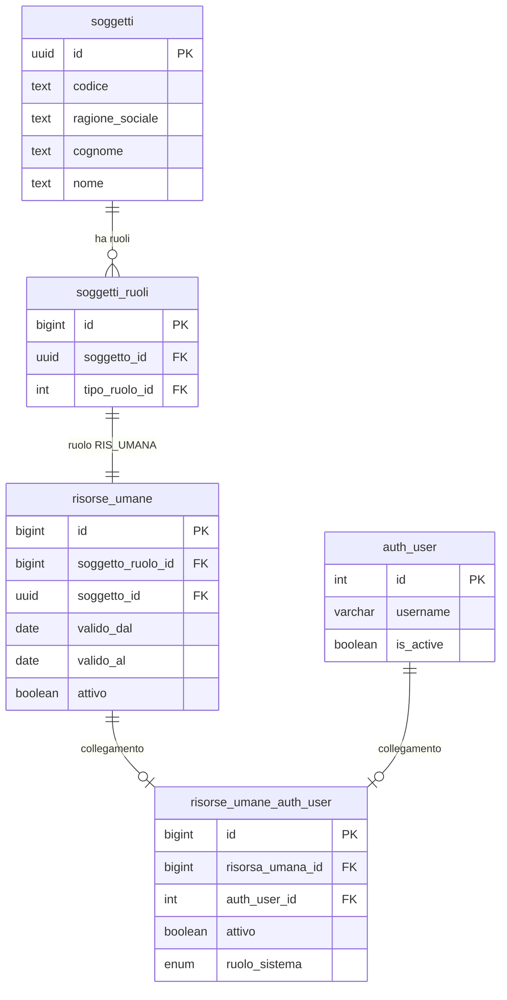
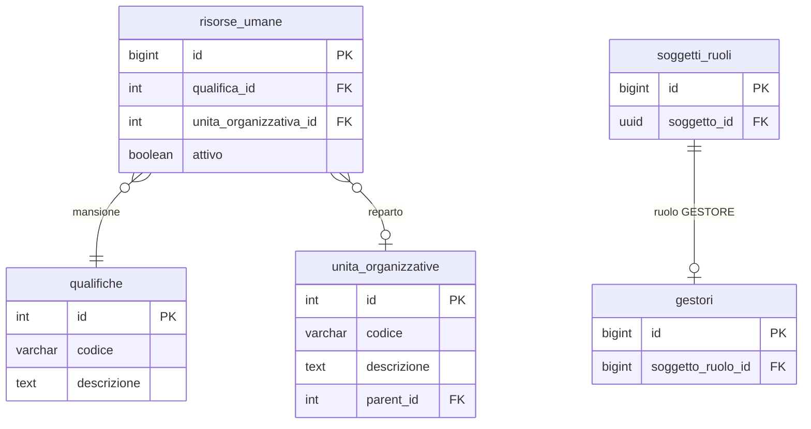

# Guida – Risorse Umane e Accessi al Software

> (latest review 02-03-2026)
>
> Destinatari: sviluppatori database, backend, integratori e analisti funzionali
>
> Vedi anche
>
> * [Guida Soggetti & Ruoli](/guide/soggetti-e-ruoli-anagrafici)
> * [Gestione dei contatti](/guide/gestione-dei-contatti)
> * [Architettura Permessi e Autorizzazioni](/guide/architettura-permessi-e-autorizzazioni)

---

## Introduzione

In Zero ERP una **risorsa umana** e la rappresentazione di una persona che lavora per l'azienda: un dipendente, un consulente, un collaboratore. Non e un semplice record anagrafico — e l'identita operativa della persona all'interno del sistema.

Questa guida copre **due aspetti strettamente legati**: il modulo risorse umane (chi sono le persone nell'organico, come sono organizzate) e il **governo dell'accesso al software** (chi puo entrare, cosa puo fare, cosa succede quando qualcuno cambia reparto o lascia l'azienda). I due aspetti sono inseparabili perche in Zero ERP e proprio la risorsa umana a determinare se e come un utente accede al sistema.

**Cosa troverai in questa guida:**

* Le entita coinvolte e il loro significato nel modello
* Come funziona il collegamento tra una risorsa umana e un utente Django
* Il meccanismo automatico che blocca il login quando una risorsa viene disattivata o scade
* Come vengono gestiti i permessi (profili reparto, override individuali) e come si propagano al cambio reparto
* Il ciclo di vita completo: dall'assunzione alla cessazione, con i passi operativi per ogni fase

### Il collegamento a Django e opzionale

Non tutte le risorse umane accedono al software. Un magazziniere potrebbe non avere un account, mentre il responsabile amministrativo si. Il collegamento a `auth_user` e un passo esplicito e separato dalla creazione della risorsa — e consentito solo per risorse appartenenti al soggetto gestore (l'azienda che usa il sistema).

---

## Tabelle coinvolte

* [anagrafiche.risorse_umane](/dbzero/anagrafiche/tabelle/risorse_umane) — la persona con ruolo, qualifica e reparto
* [anagrafiche.risorse_umane_auth_user](/dbzero/anagrafiche/tabelle/risorse_umane_auth_user) — il ponte 1:1 verso l'utente Django
* [anagrafiche.soggetti](/dbzero/anagrafiche/tabelle/soggetti) — la persona fisica o giuridica
* [anagrafiche.soggetti_ruoli](/dbzero/anagrafiche/tabelle/soggetti_ruoli) — i ruoli del soggetto (es. RIS_UMANA)
* [anagrafiche.gestori](/dbzero/anagrafiche/tabelle/gestori) — il soggetto gestore (l'azienda)
* [django.auth_user](/dbzero/django/tabelle/auth_user) — l'utente Django
* [config.qualifiche](/dbzero/config/tabelle/qualifiche) — mansioni e posizioni
* [config.unita_organizzative](/dbzero/config/tabelle/unita_organizzative) — reparti e uffici
* [config.ruolo_sistema](/dbzero/config/tabelle/ruolo_sistema) — classificazione utente (ADMIN, OPERATIVO, DISABILITATO)

---

## Le entita e il loro significato

### Risorsa umana

E la persona che lavora per l'azienda. Ha una qualifica (cosa fa), un reparto (dove lavora), una finestra di validita (da quando a quando) e un flag attivo/inattivo.

La risorsa e legata al soggetto tramite un **ruolo RIS_UMANA** ([R1](#r1--ruolo-corretto)): la stessa persona (soggetto PF) che nel sistema potrebbe essere anche cliente o fornitore, qui compare nel suo ruolo di dipendente/collaboratore.

Campi chiave:

* `soggetto_ruolo_id`: il ruolo `RIS_UMANA` della persona — punta a `anagrafiche.soggetti_ruoli` (UNIQUE: una sola risorsa per persona, vedi [R5](#r5--unicita-per-persona))
* `soggetto_id`: la **persona** (soggetto PF) — campo denormalizzato per comodita di join, deve coincidere con il soggetto del ruolo ([R2](#r2--coerenza-soggetto)). **Non** e l'azienda (che si ricava da `anagrafiche.gestori`)
* `qualifica_id`: mansione o posizione (es. Amministratore, Dipendente, Consulente)
* `unita_organizzativa_id`: reparto o ufficio — determina l'**ereditarieta dei permessi** (profilo reparto)
* `valido_dal`, `valido_al`: finestra di validita ([R3](#r3--validita-temporale))
* `attivo`: flag operativo

### Ponte verso Django (`risorse_umane_auth_user`)

E il collegamento **1:1** tra una risorsa e un utente Django. Non tutte le risorse lo hanno — solo quelle che devono accedere al software.

Il ponte porta con se il `ruolo_sistema`, che classifica il tipo di utente:

| Tipo | Significato | Esempio |
| --- | --- | --- |
| `ADMIN` | Accesso completo, nessun controllo permessi | Titolare, responsabile IT |
| `OPERATIVO` | Accesso governato dai permessi (reparto + override) | Dipendente standard |
| `DISABILITATO` | Nessun accesso, bloccato ovunque | Ex-dipendente, utente sospeso |

### Qualifica

La mansione o posizione della persona (Dipendente, Consulente, Amministratore). Nel modello attuale la qualifica **non influisce sui permessi** — questi dipendono dal reparto. La qualifica e un dato informativo e organizzativo.

### Unita organizzativa (reparto)

Il reparto o ufficio a cui la risorsa appartiene. E il perno del sistema permessi: ogni reparto ha un **profilo permessi** che viene ereditato automaticamente da tutte le risorse assegnate.

### Soggetto gestore

L'azienda che usa il sistema. Il guard `trgfn_risorse_umane_auth_user_guard_gestore` verifica che il collegamento a `auth_user` sia consentito **solo** per risorse il cui soggetto corrisponde al gestore ([R4](#r4--collegamento-a-django-solo-gestore)).

---

## Regole di dominio

### R1 — Ruolo corretto
<a id="r1--ruolo-corretto"></a>

Ogni risorsa umana deve riferire un `soggetto_ruolo_id` con tipo ruolo **RISORSA_UMANA**. Il trigger `trgfn_risorse_umane_guard_ruolo` lo verifica ad ogni INSERT/UPDATE.

### R2 — Coerenza soggetto
<a id="r2--coerenza-soggetto"></a>

`risorse_umane.soggetto_id` deve corrispondere al `soggetto_id` del ruolo associato.

### R3 — Validita temporale
<a id="r3--validita-temporale"></a>

Se `valido_al` e valorizzato, deve essere >= `valido_dal`. Il check `chk_risorse_umane_date` lo garantisce.

### R4 — Collegamento a Django (solo gestore)
<a id="r4--collegamento-a-django-solo-gestore"></a>

Il collegamento a `django.auth_user` e consentito **solo** per risorse appartenenti al **soggetto gestore**. Questo vincolo riguarda l'appartenenza organizzativa ("fa parte della nostra azienda?"), non l'ambito operativo. Per limitare su quali emittenti fiscali un utente puo operare, esiste un meccanismo separato: la whitelist `config.user_emittenti_fiscali` (vedi [Autorizzazioni e permessi](#autorizzazioni-e-permessi)).

### R5 — Unicita per persona
<a id="r5--unicita-per-persona"></a>

La catena `soggetti_ruoli(soggetto_id, tipo_ruolo_id)` UNIQUE + `risorse_umane(soggetto_ruolo_id)` UNIQUE garantisce **un solo record per persona**. Conseguenza: per il rientro di un ex-dipendente si riattiva il record esistente, non se ne crea uno nuovo.

---

## Accesso al software

L'accesso applicativo e governato da **due livelli** complementari che lavorano insieme per garantire che solo gli utenti autorizzati possano operare nel sistema.

### Livello 1 — `ruolo_sistema` (enforcement permessi)

Il primo livello decide **cosa puo fare** l'utente. Il campo `ruolo_sistema` su `risorse_umane_auth_user` determina il comportamento nella catena di risoluzione permessi:

* **ADMIN**: bypass completo — accede a tutto senza verifiche
* **OPERATIVO**: eredita i permessi dal profilo del suo reparto, con eventuali override individuali
* **DISABILITATO**: bloccato su ogni endpoint protetto (403)

> Per l'architettura completa della catena di risoluzione: vedi [Architettura Permessi e Autorizzazioni](/guide/architettura-permessi-e-autorizzazioni).

### Livello 2 — Sync `auth_user.is_active` (blocco login)

Il secondo livello decide **se l'utente puo entrare**. Impostare `ruolo_sistema = DISABILITATO` blocca l'accesso a livello API (403), ma l'utente potrebbe ancora ottenere un token JWT. Per bloccare il **login stesso** serve che `auth_user.is_active` sia `false`.

Questo allineamento avviene in automatico.

**Come funziona:**

La funzione `anagrafiche.fn_sync_auth_user_is_active(p_risorsa_umana_id)` calcola lo stato atteso di `auth_user.is_active` come AND logico di tre condizioni:

1. `risorse_umane.attivo = true`
2. `risorse_umane_auth_user.attivo = true`
3. `CURRENT_DATE` dentro la finestra `[valido_dal, valido_al]` ([R3](#r3--validita-temporale))

Se una qualsiasi condizione non e soddisfatta → `is_active = false` e il login viene bloccato.

**Quando scatta la sync:**

| Evento | Trigger | Cosa succede |
| --- | --- | --- |
| Cambio stato risorsa | `trg_risorse_umane_z90_sync_auth_user_active_upd` | UPDATE di `attivo`, `valido_dal` o `valido_al` su `risorse_umane` |
| Cambio stato ponte | `trg_risorse_umane_auth_user_z90_sync_auth_user_active_upd` | UPDATE di `attivo` su `risorse_umane_auth_user` |
| Primo collegamento | `trg_risorse_umane_auth_user_z90_sync_auth_user_active_ins` | INSERT su `risorse_umane_auth_user` |

**Scadenze overnight:**

I trigger reagiscono a UPDATE espliciti. Ma cosa succede se ieri sera `valido_al` e scaduto e nessuno ha fatto alcuna operazione? La funzione batch `anagrafiche.fn_sync_auth_user_expired()` viene eseguita giornalmente alle 06:00 via pgAgent (`sync_auth_user_expired_daily`). Trova tutte le risorse con finestra scaduta ancora collegate a un `auth_user` attivo e le disattiva. In alternativa al job pgAgent, il management command Django `sync_auth_user_active` offre la stessa funzionalita via cron/systemd:

```bash
# Esecuzione diretta
python manage.py sync_auth_user_active

# Solo report, senza modifiche
python manage.py sync_auth_user_active --dry-run

# In cron (alternativa a pgAgent)
0 6 * * * /path/to/manage.py sync_auth_user_active
```

**Invalidazione cache permessi:**

Il management command `sync_auth_user_active` invalida automaticamente la cache permessi per ogni utente disattivato, in modo che il blocco sia immediato e non debba attendere la scadenza naturale della cache (TTL 300s).

Per le disattivazioni real-time (trigger DB 1.2, 1.3, 1.4), la cache si rinnova automaticamente alla scadenza del TTL. Il listener LISTEN/NOTIFY (vedi sezione Cambio reparto) offre un pattern event-driven estendibile anche a questi scenari in futuro.

---

## Autorizzazioni e permessi

Il sistema di autorizzazioni **non** usa i gruppi e permessi nativi di Django (`auth_group`, `auth_permission`). La gestione e basata su un modello dedicato, progettato per essere piu flessibile e piu vicino alle esigenze di un ERP.

In sintesi, i permessi di un utente dipendono da tre fattori:

* **`ruolo_sistema`**: ADMIN (accesso totale), OPERATIVO (governato dai permessi) o DISABILITATO (bloccato)
* **Profilo reparto**: ogni reparto ha un set di permessi predefiniti che vengono ereditati automaticamente da tutti i suoi membri
* **Override individuali**: eccezioni per singolo utente, con priorita sul profilo reparto — utili per dare o togliere permessi specifici senza creare un reparto ad hoc

La catena di risoluzione:

```text
ruolo_sistema DISABILITATO? -> accesso negato
ruolo_sistema ADMIN?        -> accesso completo
ruolo_sistema OPERATIVO?    -> override utente -> profilo reparto -> BLOCCATO (default)
```

Le tabelle coinvolte:

* `config.profili_reparto_aree`, `config.profili_reparto_azioni` — permessi ereditati dal reparto
* `config.user_override_aree`, `config.user_override_oggetti`, `config.user_override_azioni` — eccezioni individuali
* `config.user_emittenti_fiscali` — whitelist opzionale per limitare l'operativita per emittente fiscale

**Ambito emittente fiscale:** in un sistema multi-emittente (piu soggetti che emettono fatture), la tabella `config.user_emittenti_fiscali` consente di restringere su quali emittenti un utente puo operare. Se l'utente non ha righe nella whitelist, puo operare su tutti gli emittenti; se ha almeno una riga, e limitato a quelli indicati. Questo ambito e ortogonale ai permessi reparto: un utente puo avere accesso alla fatturazione (profilo reparto) ma essere limitato a un solo emittente (whitelist). L'enforcement avviene sia a livello API (`EmittenteFiscaleScopeMixin`) che a livello DB (trigger `fn_check_user_emittente_scope`).

> Per il modello dati completo, le funzioni SQL di risoluzione e l'enforcement Django:
> vedi [Architettura Permessi e Autorizzazioni](/guide/architettura-permessi-e-autorizzazioni).

---

## Ciclo di vita

### Assunzione (creazione risorsa)

Quando una nuova persona entra nell'organico, la sequenza e:

1. Creare il soggetto PF (se non esiste gia nel sistema)
2. Assegnare il ruolo `RIS_UMANA` via `script.fn_get_or_create_soggetto_ruolo` ([R1](#r1--ruolo-corretto))
3. Inserire in `risorse_umane` con `valido_dal`, `qualifica_id`, `unita_organizzativa_id`
4. (Opzionale) Collegare a `auth_user` via `risorse_umane_auth_user` — il trigger sync imposta `is_active` automaticamente

### Cambio reparto

Quando una risorsa cambia ufficio o reparto, basta un UPDATE di `risorse_umane.unita_organizzativa_id`.

**Impatto immediato sui permessi:** l'utente eredita il profilo del nuovo reparto. I permessi cambiano all'istante.

**Invalidazione cache automatica (LISTEN/NOTIFY):**

Il sistema si occupa automaticamente di aggiornare la cache. Quando `unita_organizzativa_id` cambia, il trigger `trg_risorse_umane_z90_notify_cambio_reparto_upd` emette una notifica PostgreSQL sul canale `cambio_reparto` con un payload JSON:

```json
{"risorsa_umana_id": 42, "old_uo_id": 1, "new_uo_id": 3, "auth_user_id": 7}
```

Il listener backend (`CambioRepartoListener`, avviato tramite `python manage.py listen_cambio_reparto`) intercetta la notifica e chiama `invalidate_user(auth_user_id)` per l'utente spostato. Il meccanismo e trasparente: qualsiasi path che modifica il reparto (API, management command, operazione diretta sul DB, import bulk) ottiene l'invalidazione automatica senza dover ricordare di aggiungerla caso per caso.

Il listener usa una connessione psycopg3 dedicata con riconnessione automatica (backoff esponenziale) in caso di caduta connessione PostgreSQL. Va eseguito come processo long-running (systemd, supervisor, o in foreground durante lo sviluppo).

### Cambio qualifica

UPDATE di `risorse_umane.qualifica_id`.

**Nessun impatto sui permessi** nel modello attuale: i permessi dipendono dal reparto, non dalla qualifica. Si tratta di un aggiornamento puramente informativo.

### Cessazione (disattivazione)

Quando una persona lascia l'organico, la sequenza e:

1. Disattivare il ponte: UPDATE `risorse_umane_auth_user.attivo = false` — il trigger sync imposta `auth_user.is_active = false` e il login viene bloccato
2. Disattivare la risorsa: UPDATE `risorse_umane.attivo = false`
3. Il backend invalida la cache permessi dell'utente

**Perche questo ordine?** Il framework ATTIVO (`trgfn_prevent_deactivate_if_children`) impedisce di disattivare un genitore che ha figli ancora attivi. Poiche `risorse_umane_auth_user` e figlio di `risorse_umane`, bisogna disattivare il ponte (figlio) prima della risorsa (genitore). Tentare l'ordine inverso produce un errore.

Se la risorsa non ha un collegamento a `auth_user`, basta il solo passo 2.

### Rientro

Il vincolo di unicita ([R5](#r5--unicita-per-persona)) garantisce un solo record per persona in `risorse_umane`. Non e possibile creare un secondo record — e non serve: per il rientro di un ex-dipendente si **riattiva il record esistente**.

La sequenza e l'inversa della cessazione:

1. Riattivare la risorsa: UPDATE `risorse_umane.attivo = true`, aggiornare `valido_dal`/`valido_al`
2. Riattivare il ponte: UPDATE `risorse_umane_auth_user.attivo = true` — il trigger sync imposta `auth_user.is_active = true` e il login viene riabilitato

**Perche questo ordine?** Il framework ATTIVO (`trgfn_child_requires_active_parent`) impedisce di attivare un figlio se il genitore e inattivo. Bisogna riattivare la risorsa (genitore) prima del ponte (figlio).

---

## Diagrammi ER

Il modello e rappresentato in due diagrammi separati per facilitare la lettura.

### Catena identita e accesso

La catena principale: dalla persona al suo account Django, passando per il ruolo e il ponte.



### Parte organizzativa

Qualifica, reparto e gestore: i dati che completano il profilo della risorsa.



> **Nota:** `soggetto_id` su `risorse_umane` e la persona (PF), non l'azienda.
> L'azienda (datore) si identifica tramite `anagrafiche.gestori` — un soggetto PG con ruolo GESTORE.
> Il guard `trgfn_risorse_umane_auth_user_guard_gestore` ([R4](#r4--collegamento-a-django-solo-gestore)) verifica che il collegamento a `auth_user` sia consentito solo per risorse il cui `soggetto_id` corrisponde a un gestore.

---

## Integrazione con il sistema operativo

La risorsa umana e l'**identita dell'operatore** nel sistema. Quando un utente accede e compie operazioni, il sistema sa sempre chi sta agendo grazie alla catena `auth_user → risorse_umane_auth_user → risorse_umane`.

In pratica:

* Il middleware `jwt_audit_middleware` propaga `auth_user_id` come `app.current_user_id` nella sessione PostgreSQL
* I trigger defense-in-depth (es. ambito emittente fiscale) usano `current_setting('app.current_user_id')` per verificare le autorizzazioni a livello DB
* L'`auth_user_id` che esegue le pipeline fatturazione, i push commesse e i lotti e lo stesso che arriva dalla catena risorsa → ponte → utente

> Per i dettagli su audit e defense-in-depth: vedi [Architettura Permessi e Autorizzazioni](/guide/architettura-permessi-e-autorizzazioni).
> Per i flussi operativi: vedi [Guida Fatturazione](/guide/fatturazione).

---

## Distinzione con i contatti

Due concetti diversi che non vanno confusi:

* `anagrafiche.contatti` = **referenti e canali di comunicazione** (email, telefono, PEC) — possono essere associati a qualsiasi soggetto
* `anagrafiche.risorse_umane` = **persone reali** con ruolo, qualifica e validita — rappresentano l'organico aziendale

I contatti non sostituiscono le risorse umane, ma possono riferirle quando serve un canale di comunicazione per un dipendente.

---

## Trigger e funzioni coinvolte

### Sync `auth_user.is_active`

| Funzione / Trigger | Quando scatta | Cosa fa |
| --- | --- | --- |
| `fn_sync_auth_user_is_active` | Chiamata dai trigger sotto | Calcola lo stato atteso e aggiorna `auth_user.is_active` se diverso |
| `trgfn_risorse_umane_sync_auth_user_active` | AFTER UPDATE di `attivo`, `valido_dal`, `valido_al` su `risorse_umane` | Reagisce a cambio stato della risorsa |
| `trgfn_risorse_umane_auth_user_sync_active` | AFTER INSERT / AFTER UPDATE di `attivo` su `risorse_umane_auth_user` | Reagisce a cambio stato del ponte o primo collegamento |
| `fn_sync_auth_user_expired` | Job pgAgent giornaliero (06:00) o management command `sync_auth_user_active` | Disattiva in batch gli utenti con finestra scaduta |

### Invalidazione cache al cambio reparto

| Funzione / Trigger | Quando scatta | Cosa fa |
| --- | --- | --- |
| `fn_notify_cambio_reparto` | Chiamata dal trigger sotto | Emette `NOTIFY cambio_reparto` con payload JSON |
| `trgfn_risorse_umane_notify_cambio_reparto` | AFTER UPDATE di `unita_organizzativa_id` su `risorse_umane` (solo se cambiato) | Invoca `fn_notify_cambio_reparto` con vecchio e nuovo reparto |
| `CambioRepartoListener` (backend) | Processo long-running (`listen_cambio_reparto`) | Ascolta `NOTIFY cambio_reparto` e chiama `invalidate_user()` |

### Guard e vincoli

| Funzione / Trigger | Quando scatta | Cosa fa |
| --- | --- | --- |
| `trgfn_risorse_umane_guard_ruolo` | BEFORE INSERT/UPDATE su `risorse_umane` | Verifica che il ruolo sia RIS_UMANA |
| `trgfn_risorse_umane_auth_user_guard_gestore` | BEFORE INSERT/UPDATE su `risorse_umane_auth_user` | Verifica che la risorsa appartenga al gestore |
| `trgfn_prevent_deactivate_if_children` | BEFORE UPDATE su `risorse_umane` | Blocca disattivazione se il ponte e ancora attivo |
| `trgfn_child_requires_active_parent` | AFTER INSERT/UPDATE su `risorse_umane` e `risorse_umane_auth_user` | Verifica che i genitori (qualifiche, soggetti, unita org.) siano attivi |

---

## Best practice

* Usa `risorse_umane` solo per descrivere **persone interne** (dipendenti, consulenti, collaboratori). I referenti esterni vanno su `contatti`.
* Per il rientro di un ex-dipendente, **riattiva il record esistente** — non crearne uno nuovo.
* `ruolo_sistema = DISABILITATO` e il modo corretto per sospendere un utente — la sync `is_active` segue automaticamente.
* Per disattivare una risorsa con ponte attivo, ricorda l'ordine: **ponte prima, risorsa dopo** (framework ATTIVO).
* Per riattivare: **risorsa prima, ponte dopo**.
* Al cambio reparto la cache viene invalidata automaticamente — non serve intervento manuale.
* Mantieni una policy chiara su `attivo` e periodi di validita: la scadenza overnight lavora ogni notte, ma la disattivazione esplicita e sempre preferibile per cessazioni programmate.

---


