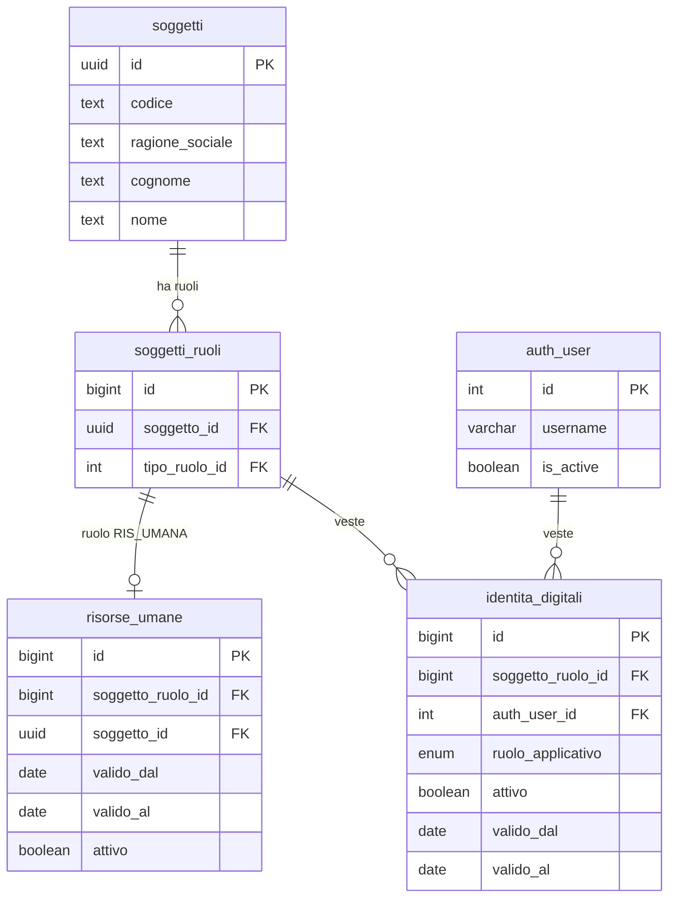
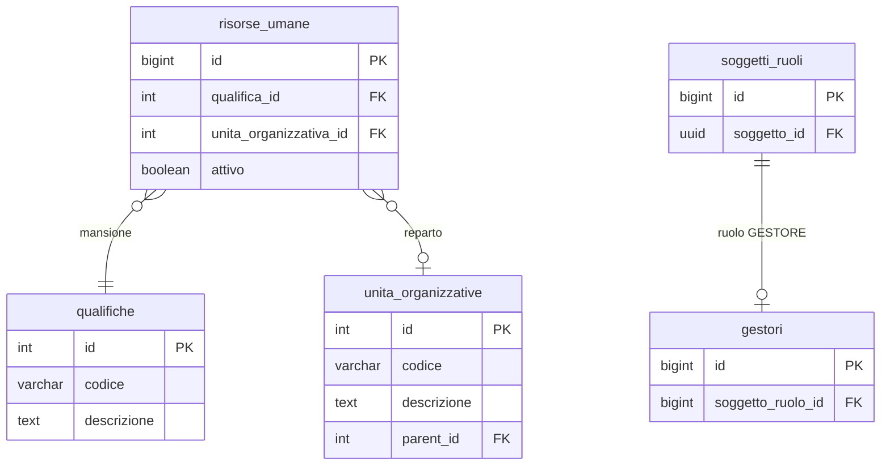

# Guida — Risorse Umane e Accessi al Software

> **Ultimo aggiornamento**: 26 novembre 2026
>
> **Destinatari**: sviluppatori database, backend, integratori e analisti funzionali
>
> **Vedi anche** — schemi DB:
>
> * [anagrafiche.risorse_umane](/dbzero/anagrafiche/tabelle/risorse_umane) — la persona, con ruolo, qualifica e reparto
> * [anagrafiche.identita_digitali](/dbzero/anagrafiche/tabelle/identita_digitali) — la veste nel sistema: il ponte verso l'utente Django
> * [anagrafiche.soggetti](/dbzero/anagrafiche/tabelle/soggetti) — la persona fisica o giuridica
> * [anagrafiche.soggetti_ruoli](/dbzero/anagrafiche/tabelle/soggetti_ruoli) — i ruoli del soggetto (es. RIS_UMANA)
> * [anagrafiche.gestori](/dbzero/anagrafiche/tabelle/gestori) — il soggetto gestore (l'azienda)
> * [anagrafiche.vw_accessi_sistema](/dbzero/anagrafiche/views/vw_accessi_sistema) — la lista degli accessi di sistema (processi e client API)
> * [anagrafiche.vw_accessi_altri](/dbzero/anagrafiche/views/vw_accessi_altri) — la lista degli altri accessi (portale, shop, credenziali senza veste)
> * [config.qualifiche](/dbzero/config/tabelle/qualifiche) — mansioni e posizioni
> * [config.unita_organizzative](/dbzero/config/tabelle/unita_organizzative) — reparti e uffici
> * [config.profili_accesso_bindings](/dbzero/config/tabelle/profili_accesso_bindings) — i binding profilo ↔ identità, fra cui `SUPER_ADMIN`
> * [config.credenziali](/dbzero/config/tabelle/credenziali) — lo stato della credenziale (tentativi, blocco, cambio password, secondo fattore)
> * [config.user_emittenti_fiscali](/dbzero/config/tabelle/user_emittenti_fiscali) — il perimetro di emittenti fiscali di un operatore
> * [config.token_monouso](/dbzero/config/tabelle/token_monouso) — i token di invito e reset password
> * [config.email_account](/dbzero/config/tabelle/email_account) — gli account SMTP per l'invio email
>
> **Vedi anche** — funzioni e trigger DB:
>
> * [anagrafiche.fn_crea_operatore](/dbzero/anagrafiche/funzioni/fn_crea_operatore) — crea un operatore: credenziale, soggetto, risorsa umana e veste spenta
> * [anagrafiche.fn_crea_primo_amministratore](/dbzero/anagrafiche/funzioni/fn_crea_primo_amministratore) — il primo SUPER_ADMIN di un'installazione nuova, con la veste accesa
> * [anagrafiche.fn_crea_indirizzi_operatore](/dbzero/anagrafiche/funzioni/fn_crea_indirizzi_operatore) — residenza e domicilio fiscale dell'operatore
> * [anagrafiche.fn_crea_risorsa_umana](/dbzero/anagrafiche/funzioni/fn_crea_risorsa_umana) — crea la risorsa umana e, se c'è la credenziale, la veste `OPERATORE`
> * [anagrafiche.fn_crea_auth_user](/dbzero/anagrafiche/funzioni/fn_crea_auth_user) — crea la credenziale Django quando l'email non ne ha una
> * [anagrafiche.fn_crea_veste_portale](/dbzero/anagrafiche/funzioni/fn_crea_veste_portale) — crea una veste di portale o di shop
> * [anagrafiche.fn_accendi_veste](/dbzero/anagrafiche/funzioni/fn_accendi_veste) — accende una veste (l'attivazione dell'invito)
> * [anagrafiche.fn_revoca_veste](/dbzero/anagrafiche/funzioni/fn_revoca_veste) — l'amministratore revoca una veste: la spegne e ci lascia il segno
> * [anagrafiche.fn_togli_revoca_veste](/dbzero/anagrafiche/funzioni/fn_togli_revoca_veste) — il nuovo invito toglie il segno della revoca
> * [anagrafiche.fn_guard_gestione_veste](/dbzero/anagrafiche/funzioni/fn_guard_gestione_veste) — chi può revocare una veste, per tipo di veste
> * [anagrafiche.trgfn_identita_digitali_guard_revoca](/dbzero/anagrafiche/funzioni/trgfn_identita_digitali_guard_revoca) — una veste revocata non si riaccende
> * [script.fn_veste_utilizzabile](/dbzero/script/funzioni/fn_veste_utilizzabile) — quando una veste conta «oggi»
> * [script.fn_stato_veste](/dbzero/script/funzioni/fn_stato_veste) — lo stato di una veste per le liste: accesa, revocata, invito pendente, invito non spedito, spenta
> * [script.fn_categoria_accesso](/dbzero/script/funzioni/fn_categoria_accesso) — in quale lista degli accessi cade una credenziale
> * [anagrafiche.fn_sync_auth_user_is_active](/dbzero/anagrafiche/funzioni/fn_sync_auth_user_is_active) — allinea `auth_user.is_active` alle vesti della credenziale
> * [anagrafiche.fn_sync_auth_user_expired](/dbzero/anagrafiche/funzioni/fn_sync_auth_user_expired) — il riallineamento periodico, per le date che arrivano
> * [anagrafiche.trgfn_identita_digitali_sync_auth_user_active](/dbzero/anagrafiche/funzioni/trgfn_identita_digitali_sync_auth_user_active) · [anagrafiche.trgfn_risorse_umane_sync_auth_user_active](/dbzero/anagrafiche/funzioni/trgfn_risorse_umane_sync_auth_user_active) — chi chiama la sincronizzazione
> * [anagrafiche.trgfn_identita_digitali_guard_coerenza](/dbzero/anagrafiche/funzioni/trgfn_identita_digitali_guard_coerenza) — coerenza della veste e vincolo di persona fisica pura
> * [anagrafiche.trgfn_identita_digitali_guard_natura_credenziale](/dbzero/anagrafiche/funzioni/trgfn_identita_digitali_guard_natura_credenziale) — una credenziale è di una persona o di una macchina, non di tutte e due
> * [anagrafiche.trgfn_risorse_umane_guard_identita_attiva](/dbzero/anagrafiche/funzioni/trgfn_risorse_umane_guard_identita_attiva) — «una risorsa con veste operatore accesa non si disattiva»
> * [anagrafiche.trgfn_identita_digitali_guard_ultimo_super_admin](/dbzero/anagrafiche/funzioni/trgfn_identita_digitali_guard_ultimo_super_admin) · [anagrafiche.trgfn_risorse_umane_guard_ultimo_super_admin](/dbzero/anagrafiche/funzioni/trgfn_risorse_umane_guard_ultimo_super_admin) — l'ultimo `SUPER_ADMIN` senza scadenza, dal lato della veste e del rapporto
> * [anagrafiche.fn_notify_cambio_reparto](/dbzero/anagrafiche/funzioni/fn_notify_cambio_reparto) — la notifica di cambio reparto
> * [script.fn_change_user_emittenti_scope](/dbzero/script/funzioni/fn_change_user_emittenti_scope) — assegna o toglie l'emittente di un operatore, riservato al SUPER_ADMIN
> * [config.trgfn_user_emittenti_fiscali_guard_delete](/dbzero/config/funzioni/trgfn_user_emittenti_fiscali_guard_delete) — l'emittente di un utente acceso si toglie solo da quel verbo
>
> **Vedi anche** — guide correlate:
>
> * [Guida Soggetti & Ruoli](/guide/soggetti-e-ruoli-anagrafici)
> * [Gli emittenti fiscali](/guide/emittenti-fiscali) — le aziende che emettono, e per quale lavora ogni operatore
> * [Gestione dei contatti](/guide/gestione-dei-contatti)
> * [Architettura Permessi e Autorizzazioni](/guide/architettura-permessi-e-autorizzazioni)
> * [Architettura Multi-Face Auth](/guide/architettura-multi-face-auth)
> * [Guida Gestione Mail](/guide/gestione-mail)

---

## Introduzione

In Zero ERP una **risorsa umana** e la rappresentazione di una persona che lavora per l'azienda: un dipendente, un consulente, un collaboratore. Non e un semplice record anagrafico — e l'identita operativa della persona all'interno del sistema.

Questa guida copre **due aspetti strettamente legati**: il modulo risorse umane (chi sono le persone nell'organico, come sono organizzate) e il **governo dell'accesso al software** (chi puo entrare, cosa puo fare, cosa succede quando qualcuno cambia reparto o lascia l'azienda). I due aspetti sono inseparabili perche in Zero ERP e proprio la risorsa umana a determinare se e come un utente accede al sistema.

**Cosa troverai in questa guida:**

* Le entita coinvolte e il loro significato nel modello
* Come funziona il collegamento tra una risorsa umana e un utente Django
* Il meccanismo automatico che blocca il login quando una risorsa viene disattivata o scade
* Come vengono gestiti i permessi (profili reparto, override individuali) e come si propagano al cambio reparto
* Il ciclo di vita completo: dall'assunzione alla cessazione, con i passi operativi per ogni fase
* **Il primo accesso**: come l'admin invita un operatore e come l'operatore attiva il suo account
* **Cambio password**: meccanismo obbligatorio e volontario
* **Reset password dimenticata**: flusso self-service senza intervento admin
* **Sicurezza login**: blocco per tentativi falliti, throttle per IP, audit sessioni

### Il collegamento a un account e opzionale

Non tutte le risorse umane accedono al software. Un magazziniere potrebbe non avere un account, mentre il responsabile amministrativo si. Il collegamento a `django.auth_user` passa da una **identita digitale**: la risorsa puo nascere con o senza, e la veste operatore di una persona e consentita solo per soggetti **persona fisica pura** (con codice fiscale e senza partita IVA) — vedi [R4](#r4--collegamento-a-django-solo-persona-fisica-pura).

---

## Le entita e il loro significato

### Risorsa umana

E la persona che lavora per l'azienda. Ha una qualifica (cosa fa), un reparto (dove lavora), una finestra di validita (da quando a quando) e un flag attivo/inattivo.

La risorsa umana **non e l'utente**: e la persona. L'accesso al software e un fatto separato, che passa da una o piu **identita digitali** (vedi sotto). La stessa persona che qui compare come dipendente puo quindi avere, con lo stesso login, la veste di cliente del portale.

La risorsa e legata al soggetto tramite un **ruolo RIS_UMANA** ([R1](#r1--ruolo-corretto)): la stessa persona (soggetto PF) che nel sistema potrebbe essere anche cliente o fornitore, qui compare nel suo ruolo di dipendente/collaboratore.

Campi chiave:

* `soggetto_ruolo_id`: il ruolo `RIS_UMANA` della persona — punta a `anagrafiche.soggetti_ruoli` (UNIQUE: una sola risorsa per persona, vedi [R5](#r5--unicita-per-persona))
* `soggetto_id`: la **persona** (soggetto PF) — campo denormalizzato per comodita di join, deve coincidere con il soggetto del ruolo ([R2](#r2--coerenza-soggetto)). **Non** e l'azienda (che si ricava da `anagrafiche.gestori`)
* `qualifica_id`: mansione o posizione (es. Amministratore, Dipendente, Consulente)
* `unita_organizzativa_id`: reparto o ufficio — determina l'**ereditarieta dei permessi** (profilo reparto)
* `valido_dal`, `valido_al`: finestra di validita ([R3](#r3--validita-temporale))
* `attivo`: flag operativo

### Identita digitale (la veste nel sistema)

E il ponte tra una persona e un account Django. Non tutte le risorse lo hanno — solo quelle che devono accedere al software.

**Un account puo portare piu vesti attive contemporaneamente**: la stessa persona puo essere `OPERATORE` verso l'ERP e, con lo stesso login, `CLIENTE_PORTALE` verso il portale. Ogni veste e un record a se. L'unicita e per coppia: una sola identita *attiva* per (`auth_user_id`, `ruolo_applicativo`) e una sola per (`soggetto_ruolo_id`, `ruolo_applicativo`) — due indici parziali, non un vincolo unico globale.

Le vesti ammesse (`config.ruolo_applicativo`):

| Ruolo applicativo   | Chi e                                                  | Cosa vede                                                    |
| ------------------- | ------------------------------------------------------ | ------------------------------------------------------------ |
| `OPERATORE`         | Persona interna: dipendente, consulente, collaboratore | L'ERP, con i permessi del reparto e gli override individuali |
| `CLIENTE_PORTALE`   | Il cliente che entra dal portale                       | Il perimetro del portale                                     |
| `FORNITORE_PORTALE` | Il fornitore che entra dal portale                     | Il perimetro del portale                                     |
| `SHOP_CUSTOMER`     | Chi acquista dallo shop                                | Il perimetro dello shop                                      |
| `API_CLIENT`        | Integrazione macchina-macchina                         | Il perimetro dell'integrazione                               |

Una veste sospesa **resta del suo tipo** e ha `attivo = false`. Il tipo `config.ruolo_applicativo` porta ancora il valore `DISABILITATO`, ma la tabella lo rifiuta: lo ferma il guard di coerenza con `E_RUOLO_APPLICATIVO_RITIRATO`, e dietro di lui il CHECK `chk_identita_digitali_ruolo_non_ritirato`.

Campi chiave:

* `soggetto_ruolo_id`: il ruolo del soggetto a cui la veste appartiene — per un operatore e il ruolo RIS_UMANA della risorsa umana
* `auth_user_id`: l'account Django (`django.auth_user`, tabella creata e gestita dal migratore Django, non documentata in `dbzero`)
* `ruolo_applicativo`: la veste (tabella sopra)
* `attivo`, `valido_dal`, `valido_al`: se la veste e accesa, e da quando a quando vale (l'inizio, se non lo si dice, e il giorno operativo)
* `invito_inviato_at`: quando è partito l'ultimo invito della veste (vedi [Primo accesso e gestione credenziali](#primo-accesso-e-gestione-credenziali)). Tentativi falliti, blocco e cambio password obbligatorio **non** sono della veste: sono della credenziale (`config.credenziali`), perché la password è una sola
* `tecnica`: `false` per una persona, `true` per un **processo automatico** che opera nel sistema come utente ([R4](#r4--collegamento-a-django-solo-persona-fisica-pura), [R6](#r6--persona-o-macchina))

**«Admin» non e un ruolo: e un binding.** Non esiste un `ruolo_applicativo = 'ADMIN'` — l'accesso completo si esprime con il profilo `SUPER_ADMIN` legato all'identita su `config.profili_accesso_bindings`. La funzione [`script.fn_is_super_admin`](/dbzero/script/funzioni/fn_is_super_admin) e il punto unico che risponde alla domanda «questo utente e un super admin?».

### Qualifica

La mansione o posizione della persona (Dipendente, Consulente, Amministratore). Nel modello attuale la qualifica **non influisce sui permessi** — questi dipendono dal reparto. La qualifica e un dato informativo e organizzativo.

### Unita organizzativa (reparto)

Il reparto o ufficio a cui la risorsa appartiene. E il perno del sistema permessi: ogni reparto ha un **profilo permessi** che viene ereditato automaticamente da tutte le risorse assegnate.

### Soggetto gestore

L'azienda che usa il sistema (singleton). Il gestore e il soggetto PG con ruolo GESTORE — identifica il datore di lavoro. Il guard sull'accesso al software **non** verifica l'appartenenza al gestore (sarebbe impossibile: RIS_UMANA e solo PF, GESTORE e solo PG), ma verifica che il soggetto sia una **persona fisica pura** ([R4](#r4--collegamento-a-django-solo-persona-fisica-pura)). L'azienda su cui l'operatore lavora non dipende dal gestore: è la sua riga in `config.user_emittenti_fiscali` (vedi [Assegnazione emittente fiscale](#assegnazione-emittente-fiscale-scope-operativo)).

---

## Regole di dominio

### R1 — Ruolo corretto
<a id="r1--ruolo-corretto"></a>

Ogni risorsa umana deve riferire un `soggetto_ruolo_id` con tipo ruolo **RISORSA_UMANA**. Il trigger `trgfn_risorse_umane_guard_ruolo` lo verifica ad ogni INSERT/UPDATE.

### R2 — Coerenza soggetto
<a id="r2--coerenza-soggetto"></a>

`risorse_umane.soggetto_id` deve corrispondere al `soggetto_id` del ruolo associato. Lo verifica lo stesso guard di R1.

### R3 — Validita temporale
<a id="r3--validita-temporale"></a>

Se `valido_al` e valorizzato, deve essere >= `valido_dal`. Il check `chk_risorse_umane_date` lo garantisce.

⭐ **Le date del rapporto contano anche per l'accesso.** Un operatore entra solo se la sua
veste e accesa e nelle sue date **e** il suo rapporto e attivo e nelle sue date: l'accesso
finisce al piu tardi quando finisce il rapporto. La data «Valido al» che l'amministratore
imposta nel dettaglio dell'operatore e quella del rapporto, e chiude l'accesso dal giorno
dopo; svuotata, il rapporto torna senza scadenza. La regola
completa sta in un posto solo, [script.fn_veste_utilizzabile](/dbzero/script/funzioni/fn_veste_utilizzabile),
e «oggi» vi e il giorno operativo del sistema. La chiedono il login, ogni richiesta, il rinnovo della sessione, il
secondo passo del secondo fattore e il cambio password: una veste che esce dalle sue date
a sessione aperta perde la sessione alla richiesta successiva, e al login nuovo riceve lo
stesso rifiuto di una veste spenta.

### R4 — Collegamento a Django (solo persona fisica pura)
<a id="r4--collegamento-a-django-solo-persona-fisica-pura"></a>

Il collegamento a `django.auth_user` e consentito **solo** per soggetti **persona fisica pura**. Per la veste `OPERATORE` il guard [`trgfn_identita_digitali_guard_coerenza`](/dbzero/anagrafiche/funzioni/trgfn_identita_digitali_guard_coerenza) verifica due condizioni strutturali, tramite l'helper [`script.fn_guard_soggetto_pf_pura`](/dbzero/script/funzioni/fn_guard_soggetto_pf_pura):

1. **`partita_iva IS NULL`** — un soggetto con P.IVA (anche se ha CF) e un professionista o ditta individuale, non un dipendente
2. **`codice_fiscale IS NOT NULL`** — la persona deve essere identificata fiscalmente

⚠️ **L'eccezione sono le identita tecniche.** Un processo automatico che opera nel sistema (flag `tecnica = true`) non e una persona e non ha codice fiscale: il suo soggetto-ruolo e di tipo `PROC_AUTO`, e le due condizioni qui sopra non si applicano. Il verso opposto non passa: marcare `tecnica = true` l'identita di una persona viene rifiutato, perche il guard pretende la coerenza fra il flag e il tipo di soggetto-ruolo.

Il vincolo vale per la veste `OPERATORE` persona. Portale e shop **non** lo hanno: un cliente persona giuridica puo avere la sua identita digitale; il guard chiede solo che la veste stia sul ruolo giusto (cliente per `CLIENTE_PORTALE` e `SHOP_CUSTOMER`, fornitore per `FORNITORE_PORTALE`). La veste `API_CLIENT` non ha vincolo di coerenza col soggetto-ruolo, ma rispetta [R6](#r6--persona-o-macchina).

L'azienda dell'operatore ("per quale emittente lavora?") **non** fa parte di questo vincolo: la riga di `config.user_emittenti_fiscali` chiede un `auth_user_id`, che esiste solo dopo la creazione dell'identità, e si scrive dopo, dal `SUPER_ADMIN`. La fa valere il database, con le policy e i guard di scope: senza la riga l'operatore non vede nessun emittente (vedi [Assegnazione emittente fiscale](#assegnazione-emittente-fiscale-scope-operativo)).

### R5 — Unicita per persona
<a id="r5--unicita-per-persona"></a>

La catena `soggetti_ruoli(soggetto_id, tipo_ruolo_id)` UNIQUE + `risorse_umane(soggetto_ruolo_id)` UNIQUE garantisce **un solo record per persona**. Conseguenza: per il rientro di un ex-dipendente si riattiva il record esistente, non se ne crea uno nuovo. Chi prova a crearne un secondo riceve `E_RISORSA_UMANA_GIA_PRESENTE` dalla funzione di creazione, anche quando la risorsa che c'e e spenta.

### R6 — Persona o macchina
<a id="r6--persona-o-macchina"></a>

Tutte le vesti di una credenziale hanno la **stessa natura**: o sono di una persona, o sono di una macchina. Una veste e «di macchina» quando e `API_CLIENT` oppure ha `tecnica = true` ([script.fn_veste_di_sistema](/dbzero/script/funzioni/fn_veste_di_sistema)). Contano anche le vesti spente: una veste spenta resta della sua credenziale, e riaccenderla non deve poter mescolare le due nature.

`tecnica = true` si scrive solo su una veste `OPERATORE`: un processo automatico entra solo dalla porta dell'operatore, e su ogni altra veste il flag e rifiutato (`E_VESTE_TECNICA_SOLO_OPERATORE`). Un'identita tecnica non ha mai il profilo `SUPER_ADMIN`: il legame si rifiuta da tutti e due i lati, il binding e la veste che diventa tecnica (`E_SUPER_ADMIN_SU_VESTE_TECNICA`), e [script.fn_is_super_admin_account](/dbzero/script/funzioni/fn_is_super_admin_account) non la conta.

Lo presidia [trgfn_identita_digitali_guard_natura_credenziale](/dbzero/anagrafiche/funzioni/trgfn_identita_digitali_guard_natura_credenziale), alla nascita della veste e quando cambiano la credenziale, il tipo o il flag `tecnica`: chi prova a mescolare riceve `E_CREDENZIALE_PERSONA_E_SISTEMA`. La stessa natura decide in quale lista degli accessi cade la credenziale (vedi [Le liste degli accessi](#le-liste-degli-accessi)).

---

## Accesso al software

L'accesso applicativo e governato da **due livelli** complementari: il primo decide *cosa puo fare* l'utente, il secondo decide *se puo entrare*.

### Livello 1 — il ruolo applicativo (enforcement permessi)

Il primo livello decide **cosa puo fare** l'utente. E il campo `identita_digitali.ruolo_applicativo` a determinare il comportamento nella catena di risoluzione permessi:

* **`OPERATORE` con binding `SUPER_ADMIN`**: bypass completo — accede a tutto senza verifiche
* **`OPERATORE`**: eredita i permessi dal profilo del suo reparto, con eventuali override individuali
* **veste non utilizzabile oggi** (spenta, fuori dalle sue date, con il soggetto spento o con il rapporto chiuso): bloccata su ogni endpoint protetto. Una veste spenta resta del suo tipo, con `attivo = false`

> Per l'architettura completa della catena di risoluzione: vedi [Architettura Permessi e Autorizzazioni](/guide/architettura-permessi-e-autorizzazioni).

### Livello 2 — Sync `auth_user.is_active` (blocco login)
<a id="sync-is-active"></a>

Il secondo livello decide **se l'utente puo entrare**. Una veste non utilizzabile blocca l'accesso a livello API (403), ma da sola non impedisce alla credenziale di chiedere un token JWT. Per bloccare il **login stesso** serve che `auth_user.is_active` sia `false`. Questo allineamento avviene in automatico.

**Come funziona.** La funzione [`anagrafiche.fn_sync_auth_user_is_active`](/dbzero/anagrafiche/funzioni/fn_sync_auth_user_is_active) riceve un `auth_user_id` e calcola lo stato atteso di `auth_user.is_active`:

* l'account resta **attivo** se **esiste almeno una** veste *utilizzabile oggi*, secondo [script.fn_veste_utilizzabile](/dbzero/script/funzioni/fn_veste_utilizzabile): accesa, con la data di oggi dentro le sue date, soggetto attivo e, per l'operatore, rapporto attivo e nelle sue date ([R3](#r3--validita-temporale))
* altrimenti `is_active = false`, e il login viene bloccato

⚠️ La condizione e un **OR fra le vesti**, non un AND: se un utente ha tre vesti e due vengono disattivate, deve poter entrare con la terza. Il blocco della singola veste sospesa non passa da `is_active` — lo applicano il namespace API e le policy di visibilita dei dati. Solo quando **nessuna** veste resta utilizzabile l'account si spegne.

**Quando scatta la sync:**

| Evento               | Trigger                                               | Cosa succede                                                                                                   |
| -------------------- | ----------------------------------------------------- | -------------------------------------------------------------------------------------------------------------- |
| Nuova veste          | `trg_identita_digitali_z90_sync_auth_user_active_ins` | AFTER INSERT su `identita_digitali`                                                                            |
| Cambio della veste   | `trg_identita_digitali_z90_sync_auth_user_active_upd` | AFTER UPDATE di `attivo`, `valido_dal`, `valido_al`, `ruolo_applicativo`, `auth_user_id`, `soggetto_ruolo_id` o `tecnica` su `identita_digitali` |
| Veste cancellata     | `trg_identita_digitali_z90_sync_auth_user_active_dlt` | AFTER DELETE su `identita_digitali`                                                                            |
| Nuovo rapporto       | `trg_risorse_umane_z90_sync_auth_user_active_ins`     | AFTER INSERT su `risorse_umane`                                                                                |
| Cambio del rapporto  | `trg_risorse_umane_z90_sync_auth_user_active_upd`     | AFTER UPDATE di `attivo`, `valido_dal`, `valido_al` o `soggetto_ruolo_id` su `risorse_umane`, solo se il valore cambia |
| Rapporto cancellato  | `trg_risorse_umane_z90_sync_auth_user_active_dlt`     | AFTER DELETE su `risorse_umane`                                                                                |

Sulla veste la sync guarda la credenziale che la veste ha **dopo** la scrittura e, quando la veste se ne va o cambia credenziale, anche quella di **prima**: una credenziale rimasta senza vesti utilizzabili si spegne. Sul rapporto guarda ogni credenziale con una veste `OPERATORE` sul ruolo del rapporto, e sul ruolo di prima se e cambiato ([trgfn_risorse_umane_sync_auth_user_active](/dbzero/anagrafiche/funzioni/trgfn_risorse_umane_sync_auth_user_active)).

Lo spegnimento del soggetto non chiama la sync, ma non si raggiunge: un soggetto con dei ruoli non si spegne, e una veste ha sempre un ruolo.

**Le date che arrivano.** I trigger reagiscono alle scritture: una data di fine che passa, o una data di inizio che arriva, non scrive niente e non fa partire nessun trigger. Se ne occupa la funzione [`anagrafiche.fn_sync_auth_user_expired`](/dbzero/anagrafiche/funzioni/fn_sync_auth_user_expired), eseguita dal job pgAgent `sync_auth_user_expired_daily` **ogni ora, al minuto 10** (il nome dice «daily», ma il job e orario: la funzione e idempotente, e una scadenza si riallinea entro l'ora). Riallinea le credenziali **nei due versi**, con la stessa regola della sync: spegne quelle che non hanno piu nessuna veste utilizzabile (veste scaduta, rapporto scaduto, o nessuna veste) e **accende** quelle che ne hanno una diventata valida (data di inizio arrivata). Una credenziale senza nessuna veste e spenta: senza una veste non c'e una porta da cui entrare. Al posto del job si puo usare il management command Django `sync_auth_user_active`, che offre la stessa funzionalita — con un `--dry-run` per il solo report, senza modifiche — ed e la via da preferire quando si vuole far girare il controllo a mano.

⚠️ **Che cosa la sincronizzazione non vede subito.** Solo il tempo: una data che arriva non scrive niente, e la riallinea il job entro l'ora. Ogni scrittura che cambia l'utilizzabilita di una veste (sulla veste, sul rapporto, la cancellazione dell'una o dell'altro) chiama la sync nella stessa istruzione.

**Invalidazione cache permessi.** Il management command `sync_auth_user_active` invalida automaticamente la cache permessi per ogni utente riallineato (spento o acceso), cosi il blocco e immediato e non deve attendere la scadenza naturale della cache (TTL 300s). Per le disattivazioni real-time dei trigger la cache si rinnova alla scadenza del TTL; il listener LISTEN/NOTIFY (vedi [Cambio reparto](#cambio-reparto)) e il pattern event-driven su cui estendere anche questi scenari.

### Lo stato della veste
<a id="lo-stato-della-veste"></a>

«Utilizzabile» risponde alla domanda *questa veste apre la porta oggi?*. Le liste degli accessi ne fanno un'altra: *a che punto e questa veste?*. La risposta e [script.fn_stato_veste](/dbzero/script/funzioni/fn_stato_veste), calcolata solo dal DB:

| Stato         | Quando                                                                      |
| ------------- | --------------------------------------------------------------------------- |
| `ATTIVO`      | la veste e accesa                                                           |
| `REVOCATA`    | spenta dall'amministratore: non si riaccende fino a un nuovo invito ([La revoca](#la-revoca)) |
| `PENDING`     | spenta, con un invito pendente la cui email e partita                       |
| `NON_SPEDITO` | spenta, con un invito pendente la cui email non e partita                   |
| `DISATTIVO`   | spenta, senza inviti pendenti                                               |

Un invito e pendente quando un token di `config.token_monouso` della veste non e usato e non e scaduto. Insieme allo stato la funzione da la scadenza del token pendente.

⚠️ `ATTIVO` legge solo `attivo`: una veste accesa ma fuori dalle sue date, o con il rapporto chiuso, compare `ATTIVO` nelle liste anche se non apre la porta. La porta la decide sempre `fn_veste_utilizzabile`.

### Le liste degli accessi
<a id="le-liste-degli-accessi"></a>

L'area Accessi divide le credenziali in tre liste, secondo [script.fn_categoria_accesso](/dbzero/script/funzioni/fn_categoria_accesso):

| Lista          | Chi ci cade                                                                                  | Da dove legge                                                                  |
| -------------- | -------------------------------------------------------------------------------------------- | ------------------------------------------------------------------------------ |
| Di sistema     | le credenziali di macchina ([R6](#r6--persona-o-macchina)): processi automatici e client API | [anagrafiche.vw_accessi_sistema](/dbzero/anagrafiche/views/vw_accessi_sistema) |
| Operatori      | le persone con almeno una veste `OPERATORE`                                                  | la lista degli operatori del backend                                           |
| Altri accessi  | le persone senza veste operatore (portale, shop) e le credenziali senza nessuna veste        | [anagrafiche.vw_accessi_altri](/dbzero/anagrafiche/views/vw_accessi_altri)     |

Ogni credenziale cade in una lista sola: la natura di macchina vince, poi la veste operatore. In «Altri accessi» ogni veste porta il suo stato ([sopra](#lo-stato-della-veste)), anche se spenta, e la credenziale ha lo stato migliore fra le sue vesti.

---

## Autorizzazioni e permessi

Il sistema di autorizzazioni **non** usa i gruppi e permessi nativi di Django (`auth_group`, `auth_permission`). La gestione e basata su un modello dedicato, progettato per essere piu flessibile e piu vicino alle esigenze di un ERP.

In sintesi, i permessi di un utente dipendono da tre fattori:

* **Ruolo applicativo e binding**: `OPERATORE` (accesso governato dai permessi) oppure `OPERATORE` con binding `SUPER_ADMIN` (accesso totale); una veste non utilizzabile oggi significa bloccato
* **Profilo reparto**: ogni reparto ha un set di permessi predefiniti che vengono ereditati automaticamente da tutti i suoi membri
* **Override individuali**: eccezioni per singolo utente, con priorita sul profilo reparto — utili per dare o togliere permessi specifici senza creare un reparto ad hoc

La catena di risoluzione:

```text
identita_digitali assente/non attiva? -> accesso negato
binding SUPER_ADMIN attivo?           -> accesso completo
altrimenti                            -> override utente -> profili_accesso (AD_HOC > REPARTO/PORTALE) -> BLOCCATO (default)
```

Le tabelle coinvolte:

* `config.profili_accesso`, `config.profili_accesso_aree`, `config.profili_accesso_azioni`, `config.profili_accesso_bindings` — capability generalizzate (REPARTO, PORTALE, AD_HOC, SUPER_ADMIN)
* `config.user_override_aree`, `config.user_override_oggetti`, `config.user_override_azioni` — eccezioni individuali
* `config.user_emittenti_fiscali` — il perimetro di emittenti fiscali su cui l'utente puo operare (fail-closed: senza righe non vede nessun emittente)

**Ambito emittente fiscale:** in un sistema multi-emittente (piu soggetti che emettono fatture), la tabella `config.user_emittenti_fiscali` consente di restringere su quali emittenti un utente puo operare. ⚠️ **E fail-closed**: se l'utente non ha righe non vede NESSUN emittente — la riga mancante e un errore di configurazione, non un permesso. L'unico attore legittimamente multi-emittente e il SUPER_ADMIN, che passa da `fn_is_super_admin` e non da questa tabella. Chi resta senza assegnazione compare in `dbops.vw_operatori_senza_emittente`, che deve restare a zero righe. Questo ambito e ortogonale ai permessi reparto: un utente puo avere accesso alla fatturazione (profilo reparto) ma essere limitato a un solo emittente (whitelist). L'enforcement avviene sia a livello API (la condizione di scope dei repository, `add_emittente_scope_condition`) che a livello DB (la funzione [`script.fn_check_user_emittente_scope`](/dbzero/script/funzioni/fn_check_user_emittente_scope) e le policy di scope).

**Permessi e scope non sono la stessa cosa.** I permessi dicono *cosa* l'utente puo fare; lo **scope** dice *su quali righe*. Lo scope si esprime con policy dichiarative che il DB applica da solo — `BA_OWNERSHIP` (i billing account dell'utente), `FORNITORE_OWNERSHIP`, `EF_WHITELIST` (il perimetro degli emittenti) — tramite funzioni `script.fn_scope_*` pensate per essere risolte inline dal pianificatore.

**Row Level Security.** Sul branch dello scope operatore la RLS e **attiva** sulle tabelle del perimetro (fatture, scadenze, lotti, ordini, preventivi, contratti, offerte, documenti generati, pratiche, billing account): la copertura include la scrittura, e i processi batch che girano come utente `postgres` ne sono esenti per costruzione. Il branch portale e shop e invece ancora **spento** — si accende insieme alle rispettive API di dominio.

> Per il modello dati completo, le policy di scope, lo stato della RLS e l'enforcement Django:
> vedi [Architettura Permessi e Autorizzazioni](/guide/architettura-permessi-e-autorizzazioni).

---

## Ciclo di vita

### Assunzione (creazione risorsa)

Una persona entra nell'organico attraverso le **funzioni di creazione** del DB, non con scritture dirette sulle tabelle. Quale si usa dipende dal caso. Creare un operatore e dargli un profilo è riservato al `SUPER_ADMIN`: lo chiede il verbo nella prima riga, come l'endpoint di amministrazione, e un altro operatore riceve `E_PERMESSO_NEGATO`.

| Caso | Funzione | Cosa fa |
| --- | --- | --- |
| Operatore che accede al software | [anagrafiche.fn_crea_operatore](/dbzero/anagrafiche/funzioni/fn_crea_operatore) | Solo dal `SUPER_ADMIN`. Tutto in una transazione: la credenziale, il soggetto, la risorsa umana, la veste `OPERATORE` **spenta**, il binding `SUPER_ADMIN` se richiesto, gli indirizzi |
| Risorsa umana, con o senza credenziale | [anagrafiche.fn_crea_risorsa_umana](/dbzero/anagrafiche/funzioni/fn_crea_risorsa_umana) | Il ruolo `RIS_UMANA` ([R1](#r1--ruolo-corretto)), la risorsa (che nasce attiva) e, se riceve la credenziale, la veste `OPERATORE` e l'eventuale binding `SUPER_ADMIN`. È il passo interno della funzione dell'operatore, e l'applicazione non la chiama da sola |
| Credenziale nuova | [anagrafiche.fn_crea_auth_user](/dbzero/anagrafiche/funzioni/fn_crea_auth_user) | Crea l'utente Django; rifiuta uno username o un'email gia presenti. È un passo interno: la chiama la funzione dell'operatore solo quando l'email non ha ancora una credenziale |
| Profilo di un'identità o di un reparto | [config.fn_lega_profilo_identita](/dbzero/config/funzioni/fn_lega_profilo_identita) / [config.fn_lega_profilo_reparto](/dbzero/config/funzioni/fn_lega_profilo_reparto) e i loro contrari | Solo dal `SUPER_ADMIN`. Il contenuto del profilo (aree e azioni) lo scrive [config.fn_scrivi_profilo_accesso](/dbzero/config/funzioni/fn_scrivi_profilo_accesso), anch'esso solo dal `SUPER_ADMIN` |
| Veste di portale o di shop | [anagrafiche.fn_crea_veste_portale](/dbzero/anagrafiche/funzioni/fn_crea_veste_portale) | Crea una veste `CLIENTE_PORTALE`, `FORNITORE_PORTALE` o `SHOP_CUSTOMER` su una credenziale; chi la chiama dice sempre se nasce accesa o spenta |
| Accensione di una veste | [anagrafiche.fn_accendi_veste](/dbzero/anagrafiche/funzioni/fn_accendi_veste) | Accende la veste di una credenziale: e il gesto dell'attivazione dell'invito |
| Revoca di una veste | [anagrafiche.fn_revoca_veste](/dbzero/anagrafiche/funzioni/fn_revoca_veste) | L'amministratore spegne la veste e ci scrive quando e chi ([La revoca](#la-revoca)) |
| Nuovo invito su una veste revocata | [anagrafiche.fn_togli_revoca_veste](/dbzero/anagrafiche/funzioni/fn_togli_revoca_veste) | Toglie il segno della revoca: la veste resta spenta e la accende il link |

La creazione dell'operatore segue due strade sul soggetto: una persona nuova (nasce persona fisica privata, con codice fiscale e sesso obbligatori) o un soggetto persona fisica che esiste gia. Sulla credenziale vale «una persona, un accesso»: se l'email ha gia una credenziale si **riusa**, ma solo con il consenso esplicito di chi crea (`E_CREDENZIALE_DA_CONFERMARE` finche non lo dichiara), e mai se la credenziale e di un'altra persona fisica (`E_CREDENZIALE_ALTRA_PERSONA`) o porta gia una veste operatore (`E_CREDENZIALE_GIA_OPERATORE`, il rimedio e il reinvito). Una persona che e gia risorsa umana riceve `E_RISORSA_UMANA_GIA_PRESENTE` ([R5](#r5--unicita-per-persona)).

La veste dell'operatore nasce spenta: la accende la persona, attivando l'invito ([Invito operatore](#invito-operatore)). Alla nascita della veste spenta il trigger di sync porta `auth_user.is_active` a `false`, se la credenziale non ha un'altra veste utilizzabile. L'utente tecnico di un processo automatico nasce invece da [script.fn_crea_utente_tecnico](/dbzero/script/funzioni/fn_crea_utente_tecnico), con la veste gia accesa: anche lui solo dal `SUPER_ADMIN`, salvo gli utenti tecnici che il software installa da sé.

Le tabelle che danno l'accesso (l'azienda dell'operatore, i legami e il contenuto dei profili) sono in sola lettura per l'applicazione: si scrivono solo da questi verbi.

### Cambio reparto

Quando una risorsa cambia ufficio o reparto, basta un UPDATE di `risorse_umane.unita_organizzativa_id`.

**Impatto immediato sui permessi:** l'utente eredita il profilo del nuovo reparto. I permessi cambiano all'istante.

**Invalidazione cache automatica (LISTEN/NOTIFY):**

Il sistema si occupa automaticamente di aggiornare la cache. Quando `unita_organizzativa_id` cambia, il trigger `trg_risorse_umane_z90_notify_cambio_reparto_upd` emette una notifica PostgreSQL sul canale `cambio_reparto`, con dentro gli id della risorsa, del vecchio e del nuovo reparto e dell'account Django.

Il listener backend (`PermessiListener`, avviato con `python manage.py listen_permessi`) intercetta la notifica e chiama `invalidate_user(auth_user_id)` per l'utente spostato. Lo stesso processo ascolta anche il canale `permessi_catalogo` (cambio del catalogo o dei profili dei permessi, che svuota la cache di tutti: [architettura dei permessi §6.1](architettura-permessi-e-autorizzazioni.md)). Il meccanismo e trasparente: qualsiasi strada che modifica il reparto (API, management command, operazione diretta sul DB, import massivo) ottiene l'invalidazione automatica, senza doverla ricordare caso per caso.

Il listener usa una connessione psycopg3 dedicata con riconnessione automatica (backoff esponenziale) in caso di caduta della connessione a PostgreSQL. Va eseguito come processo long-running (systemd, supervisor, o in foreground durante lo sviluppo).

### L'ultimo amministratore non scade
<a id="lultimo-amministratore-non-scade"></a>

Il sistema deve avere sempre **almeno un `SUPER_ADMIN` senza scadenza**: veste
utilizzabile oggi, **nessuna data di fine** né sulla veste né sul rapporto di lavoro,
credenziale non bloccata ([script.fn_identita_super_admin_senza_scadenza](/dbzero/script/funzioni/fn_identita_super_admin_senza_scadenza)).

Perché «senza scadenza» e non solo «attivo»: una data che passa non scrive niente, e
nessun controllo può fermare il calendario. Per questo la regola si applica quando si
**scrive**: spegnere l'amministratore, dargli una data di fine, spostarne l'inizio nel
futuro, bloccarne la credenziale o togliergli il profilo si può solo finché ne resta un
altro che non scade; altrimenti la scrittura è rifiutata con `E_PROFILO_ULTIMO_SUPER_ADMIN`.
Un amministratore che ha **già** una data di fine non è «l'ultimo»: si spegne liberamente.

La regola ha quattro guardiani, uno per ogni posto da cui la si può rompere; il dettaglio
sta nelle loro schede:

* la veste: [trgfn_identita_digitali_guard_ultimo_super_admin](/dbzero/anagrafiche/funzioni/trgfn_identita_digitali_guard_ultimo_super_admin)
* il rapporto: [trgfn_risorse_umane_guard_ultimo_super_admin](/dbzero/anagrafiche/funzioni/trgfn_risorse_umane_guard_ultimo_super_admin)
* la credenziale: [config.trgfn_credenziali_guard_ultimo_super_admin](/dbzero/config/funzioni/trgfn_credenziali_guard_ultimo_super_admin)
* il binding del profilo: [config.trgfn_profili_accesso_bindings_guard_ultimo_super_admin](/dbzero/config/funzioni/trgfn_profili_accesso_bindings_guard_ultimo_super_admin)

Nel dettaglio dell'operatore, per l'ultimo amministratore senza scadenza, restano spenti
col motivo l'interruttore dell'accesso, il ruolo di amministratore e il campo «Valido al».

### Cambio qualifica

UPDATE di `risorse_umane.qualifica_id`.

**Nessun impatto sui permessi** nel modello attuale: i permessi dipendono dal reparto, non dalla qualifica. Si tratta di un aggiornamento puramente informativo.

### Cessazione (disattivazione)

Quando una persona lascia l'organico, la sequenza e:

1. Spegnere la veste `OPERATORE` (`attivo = false`, il tipo resta; con [fn_revoca_veste](/dbzero/anagrafiche/funzioni/fn_revoca_veste) resta anche il segno della [revoca](#la-revoca)) — il trigger di sync porta `auth_user.is_active` a `false` se la credenziale non ha un'altra veste utilizzabile, e il login viene bloccato; se la persona e anche, per esempio, cliente del portale, entra ancora da quella porta
2. Spegnere la risorsa (`risorse_umane.attivo = false`)
3. Il backend invalida la cache permessi dell'utente

**Perche questo ordine?** Disattivare la risorsa mentre una sua veste `OPERATORE` e ancora accesa viene **rifiutato** dal guard [`trgfn_risorse_umane_guard_identita_attiva`](/dbzero/anagrafiche/funzioni/trgfn_risorse_umane_guard_identita_attiva), con l'errore `E_RISORSA_UMANA_IDENTITA_ATTIVA`: una persona che entra ancora nel sistema non si spegne. Si disattiva prima la veste, poi la risorsa. Tentare l'ordine inverso produce un errore.

Se la risorsa non ha un'identita digitale, basta il solo passo 2.

⛔ **Il passo 2 è rifiutato finché la persona governa qualcosa.** Il framework
ATTIVO monta su `risorse_umane` un block per ogni tabella che la referenzia
come persona interna: `pratiche.pratiche`, `pratiche.flussi`,
`pratiche.competenze_flussi` e `vendite.commesse`
(`responsabile_risorsa_umana_id`). ⚠️ Quest'ultimo conta **tutte** le commesse
di cui la persona è responsabile — anche chiuse, perché `commesse` non ha
`attivo` — quindi per liberare una persona si cambia il responsabile sulle sue
commesse, non si spegne la persona. Il picker con cui si sceglie il responsabile
è `GET /anagrafiche/risorse-umane/lookup/`
([scheda](/backend/anagrafiche/manual/api_risorse_umane_lookup)), che elenca
solo le risorse attive.

### Rientro

Il vincolo di unicita ([R5](#r5--unicita-per-persona)) garantisce un solo record per persona in `risorse_umane`. Non e possibile creare un secondo record — e non serve: per il rientro di un ex-dipendente si **riattiva il record esistente**.

La sequenza e l'inversa della cessazione, e si fa in due tempi, da due persone diverse:

1. **L'amministratore reinvia l'invito** (drawer dell'operatore, «Reinvia invito»). Nella stessa transazione del token si toglie il segno della [revoca](#la-revoca) e la risorsa si riapre: `risorse_umane.attivo = true`, e `valido_al` si azzera se è già arrivata (una fine rapporto futura resta); `valido_dal` resta l'inizio del rapporto. La veste resta spenta.
2. **La persona attiva il link**: la veste si accende ([fn_accendi_veste](/dbzero/anagrafiche/funzioni/fn_accendi_veste)), il trigger di sync imposta `auth_user.is_active = true` e il login torna possibile. Chi ha gia una password conferma con un clic.

L'interruttore «Accesso attivo» del drawer spegne soltanto: da spento resta fermo, e non c'e un comando che riaccenda la veste direttamente.

### La revoca
<a id="la-revoca"></a>

Una veste spenta dall'amministratore **ricorda di essere stata revocata**: [anagrafiche.fn_revoca_veste](/dbzero/anagrafiche/funzioni/fn_revoca_veste) la spegne e ci scrive quando (`revocata_at`) e chi (`revocata_da_user_id`, l'utente della sessione). Il segno lo mette anche su una veste mai accesa con l'invito ancora pendente. Vale per tutte le vesti: operatore, portale, shop, utente tecnico.

Finché il segno c'è, la veste **non si riaccende** da nessuna strada: né dal link di un invito vecchio, né da una scrittura diretta, né creando un'altra veste accesa sulla stessa coppia di credenziale, ruolo anagrafico e tipo di veste. Lo impedisce il guard della tabella, [trgfn_identita_digitali_guard_revoca](/dbzero/anagrafiche/funzioni/trgfn_identita_digitali_guard_revoca), con `E_VESTE_REVOCATA`. Lo stato della veste è `REVOCATA`.

Si torna **solo con un nuovo invito dell'amministratore**: [anagrafiche.fn_togli_revoca_veste](/dbzero/anagrafiche/funzioni/fn_togli_revoca_veste), chiamata nella transazione del token, toglie il segno dalla coppia, e il link accende. Per un utente tecnico il gesto è la riattivazione, [script.fn_riattiva_utente_tecnico](/dbzero/script/funzioni/fn_riattiva_utente_tecnico), che toglie il segno con lo stesso verbo.

I due verbi controllano il permesso dall'utente della sessione, con [anagrafiche.fn_guard_gestione_veste](/dbzero/anagrafiche/funzioni/fn_guard_gestione_veste): `SUPER_ADMIN` per una veste operatore o tecnica, il livello `TUTTO` su clienti o fornitori per le vesti dei portali e dello shop. Il segno non si scrive né si cancella in altro modo: chi prova a scriverlo direttamente, o a cancellare una veste revocata, riceve `E_VESTE_REVOCA_SOLO_DAL_VERBO`.

⚠️ Il backend non passa ancora dai due verbi: lo spegnimento dell'operatore e della veste di portale scrive `attivo = false` direttamente, e quella veste resta spenta ma **senza segno**; il reinvito non chiama ancora `fn_togli_revoca_veste`. Fino ad allora la revoca la lascia solo chi chiama `fn_revoca_veste`.

**Perche questo ordine?** E il verso inverso della cessazione, e la ragione e la stessa: la veste attiva e cio che tiene in piedi l'accesso, la risorsa attiva e cio che la rende sensata. Riaprendo prima la risorsa si evita la finestra in cui la veste risulta attiva su una persona non ancora in forza.

**Perché in due tempi?** Riaprire il rapporto è una decisione dell'amministratore; riaprire la porta è un gesto della persona. Così nessuna veste torna attiva senza che la persona lo sappia.

### Assegnazione emittente fiscale (scope operativo)

Dopo aver creato l'operatore, il `SUPER_ADMIN` gli assegna **l'emittente fiscale** per cui lavora. L'assegnazione decide il **perimetro dei dati**: l'operatore vede solo documenti, fatture, pratiche e movimenti di quell'emittente.

**Tabella coinvolta:** `config.user_emittenti_fiscali`. Ha **una riga per operatore** (`UNIQUE (auth_user_id)`): un operatore lavora per un emittente solo, e un emittente ha quanti operatori servono.

**Come si configura (da interfaccia):**

1. Andare in **Amm. Software → Operatori**
2. Aprire l'operatore in modifica (click sulla riga)
3. Nella scheda **Dati**, riquadro **Scope emittenti fiscali**, scegliere «Un solo emittente» e l'emittente dall'elenco
4. Premere **Salva**

**Regole:**

* L'emittente lo assegna o lo cambia **solo il `SUPER_ADMIN`**. Il controllo lo fa l'endpoint, e lo rifà il database nel verbo `script.fn_change_user_emittenti_scope`: chi non è `SUPER_ADMIN` riceve `E_PERMESSO_NEGATO`, e l'emittente non cambia.
* Cambiare emittente è uno **spostamento**: il verbo toglie la riga di prima e scrive la nuova nello stesso momento. Fuori dal verbo l'assegnazione di un utente attivo non si cancella e l'emittente di una riga non si riscrive.
* Un operatore **senza assegnazione non vede nessun emittente** (fail-closed): il vuoto è un errore di configurazione, non un permesso. Gli operatori rimasti senza assegnazione si contano in `dbops.vw_operatori_senza_emittente`, che deve restare a zero righe, e li segnala il banner della lista degli operatori.
* Solo il `SUPER_ADMIN` lavora su più emittenti: passa da `fn_is_super_admin`, non da questa tabella, e sceglie l'emittente di lavoro dalla barra in alto. **Un operatore normale non è mai «globale»**: il riquadro gli offre solo «Un solo emittente», e il verbo rifiuta di togliergli l'azienda (`E_OPERATORE_SCOPE_GLOBALE_SOLO_SUPER_ADMIN`). Per spostarlo si sceglie un'altra azienda; per fermarlo si spegne l'operatore.
* L'ultimo `SUPER_ADMIN` attivo non si sposta (`E_PROFILO_ULTIMO_SUPER_ADMIN`).
* L'emittente fiscale è il ruolo `EF` di un soggetto con partita IVA: l'elenco mostra la **ragione sociale** del soggetto.
* Al salvataggio il backend invalida la cache dell'operatore: la nuova azienda vale dalla richiesta successiva.

**Quando serve:**

* **Azienda con un solo emittente**: assegnare l'unico emittente a tutti gli operatori.
* **Gruppo con più emittenti**: assegnare a ciascun operatore l'emittente su cui lavora. Chi deve vedere tutte le aziende è un `SUPER_ADMIN`.
* **Consulenti esterni**: assegnarli al solo emittente del cliente che seguono.

Il modello completo (gli emittenti, il super admin che sceglie l'emittente di lavoro, l'admin di un emittente) sta nella guida [Gli emittenti fiscali](/guide/emittenti-fiscali).

---

## Primo accesso e gestione credenziali

Questa sezione descrive come un operatore entra nel sistema per la prima volta, come gestisce
la propria password e come puo' recuperarla autonomamente. Sono meccanismi complementari
al ciclo di vita descritto sopra: l'assunzione crea la risorsa, i flussi qui sotto abilitano
l'accesso effettivo.

### Scelta architetturale: nessuna password comunicata

In Zero ERP **nessuna password viene mai comunicata verbalmente o via messaggio**. L'admin non
assegna una password all'operatore — nemmeno alla creazione: l'account nuovo nasce senza una
password utilizzabile, il sistema genera un token monouso, lo invia via email, e l'operatore
sceglie la propria password attivando l'accesso. Questa scelta elimina il rischio
di password condivise, annotate su post-it o inviate in chiaro su canali non sicuri.

### Il primo amministratore di un'installazione nuova

L'invito presuppone un amministratore che inviti. Il primo di un'installazione nuova non ce l'ha: lo crea il comando
`manage.py crea_primo_amministratore` (come si lancia: [Installazione](/installazione), «Il primo amministratore»),
che si lancia una volta, dopo l'installazione, e che chiama
[`anagrafiche.fn_crea_primo_amministratore`](/dbzero/anagrafiche/funzioni/fn_crea_primo_amministratore). Chi lo lancia
è la persona che diventerà amministratore, e la password la sceglie lei: è l'unico account che nasce con una password
e con la veste già accesa, senza invito, perché non c'è nessuno che possa mandarlo.

La strada si apre solo finché nessun accesso ha mai avuto il profilo SUPER_ADMIN, e si chiude da sola appena nasce il
primo. Non serve a recuperare un sistema che ha perso i suoi amministratori: come se ne esce lo dice
[«Resta sempre almeno un SUPER_ADMIN che non scade»](/dbzero/anagrafiche/_ultimo-super-admin). Gli amministratori
successivi li crea un SUPER_ADMIN, con l'invito qui sotto.

### Invito operatore

L'invito è lo stesso per ogni veste (operatore, portale, shop): cambia solo la **porta** —
il link, il template dell'email, i tipi di token. Per l'operatore:

```text
1. Admin → Amm. Software → Operatori → «Nuovo»: nome utente, email, qualifica
   - la veste OPERATORE nasce SPENTA: nessuno entra prima di aver accettato
   - se l'email è già di un account (la persona è, per esempio, cliente del
     portale) si usa QUELL'account: una persona, un accesso. Il pannello lo
     dice, con il nome utente che vale
   |
2. Dettaglio operatore → «Invia invito» (compare quando il sistema lo ammette:
   veste spenta, nella sua finestra di validità, email presente — altrimenti
   il pannello dice perché)
   |
3. Il sistema genera un token monouso (72 ore) e lo invia via email:
   - account senza password → il link chiede di sceglierla
   - account che ha già una password → il link attiva con un clic
   La password esistente non viene mai toccata.
   |
4. L'operatore clicca il link
   - con la scelta della password: il token viene validato PRIMA, la password
     DOPO; se è troppo debole il token resta valido e l'operatore riprova
   |
5. La veste si accende → l'operatore entra con il nome utente e la password
```

**Reinvio invito**: se l'email non è arrivata o il token è scaduto, l'admin rinvia
l'invito. I token pendenti di quella veste vengono invalidati insieme all'emissione del
nuovo: o tutti e due, o nessuno.

**L'email di invito** viene inviata con l'account SMTP del reparto dell'operatore
(se configurato) o con l'account di sistema. Il template e' personalizzabile per reparto
(vedi [Guida Gestione Mail](/guide/gestione-mail)).

**L'ultimo accesso** di un operatore è visibile nel suo dettaglio: si registra a ogni
login riuscito.

### Cambio password obbligatorio

Il cambio password obbligatorio è della **credenziale** (`config.credenziali`): la password
è una sola per tutte le vesti della persona. Forza a cambiarla prima di poter usare il
sistema. Il meccanismo e':

1. **Al login**: se il flag e' attivo, la response JWT include `password_change_required: true`
2. **Frontend**: il router guard redirect a `/change-password` e blocca ogni altra navigazione
3. **Backend**: il cancello degli obblighi (`apps/core/api/cancello_obblighi.py`, dopo
   l'autenticazione DRF) risponde 403 `E_CAMBIO_PASSWORD_RICHIESTO` a tutte le API tranne:
   * `POST /auth/change-password/`
   * `POST /auth/logout/`
   * `GET /core/me/`
4. **Dopo il cambio**: il flag viene resettato, i vecchi token JWT invalidati, nuovi token rilasciati

Il cancello opera in **fail-closed**: se il DB non risponde durante il check, la richiesta
fallisce con `E_DATABASE` piuttosto che passare.

Chi lo accende e chi lo spegne:

| Verso    | Chi                                                                  | Quando                                |
| -------- | -------------------------------------------------------------------- | ------------------------------------- |
| Acceso   | L'admin                                                              | Quando vuole forzare un cambio        |
| Spento   | Cambio password, reset password dimenticata, attivazione di un invito | Quando la persona sceglie la password |

L'invito **non** lo accende: la password la sceglie la persona nell'attivazione stessa.

### Cambio password volontario

L'operatore puo' cambiare la propria password in qualsiasi momento: clic sul
**badge dell'utente** in alto a sinistra (le iniziali, o «Super Admin») →
**«Cambia password»** (rotta `/change-password`; «Torna all'applicazione» per
uscirne senza cambiarla). Il flusso richiede:

1. Password attuale (verifica identita')
2. Nuova password (passa i 4 validators Django)
3. Conferma nuova password

La password attuale ha lo **stesso freno del login**: sbagliata conta come un
tentativo fallito, e al blocco della postazione la sessione da cui si stava
provando si **chiude** e si torna al login («Sessione chiusa: troppe password
sbagliate…»). Lo stesso vale per la password chiesta da «Sicurezza
dell'accesso». Le altre sessioni della persona restano aperte: chiuderle tutte
darebbe a chi ne tiene una rubata il modo di buttare fuori il titolare.

Al successo: password aggiornata, tutti i token JWT precedenti invalidati,
nuova coppia JWT rilasciata, profilo ricaricato.

### Reset password dimenticata

L'operatore puo' reimpostare la password **senza intervento admin** tramite il link
"Password dimenticata?" nella pagina di login. Il flusso e' completamente self-service:

```text
1. Operatore clicca "Password dimenticata?" nel login
   |
2. Inserisce la propria email
   |
3. Il sistema risponde SEMPRE con lo stesso messaggio
   (non rivela se l'email esiste — sicurezza)
   |
4. Se l'email e' registrata e l'utente e' attivo:
   - Genera token monouso tipo RESET_PASSWORD (scadenza 1 ora)
   - Invia email con link di reset
   |
5. L'operatore clicca il link nell'email
   |
6. La pagina verifica il token (senza consumarlo)
   - Se valido: mostra il form per la nuova password
   - Se invalido/scaduto: mostra messaggio + link per nuova richiesta
   |
7. L'operatore inserisce la nuova password
   - Il token viene validato PRIMA, la password DOPO
   - Se la password e' debole, il token resta valido e l'operatore riprova
   |
8. Password reimpostata, tutti i JWT invalidati
9. Email di conferma inviata all'operatore
10. L'operatore fa login con la nuova password
```

**Scelta validate-before-consume**: il token viene consumato solo DOPO che la password
ha superato tutti i 4 validators Django. Se l'operatore inserisce una password troppo
semplice (es. "12345678"), riceve l'errore ma il token resta valido — puo' riprovare
immediatamente senza dover richiedere un nuovo link. Questa scelta evita frustrazione
e riduce il carico sul sistema email.

### Token monouso

Sia l'invito che il reset password usano lo stesso meccanismo di **token monouso generico**
(`config.token_monouso`):

| Caratteristica | Valore                                                                               |
| -------------- | ------------------------------------------------------------------------------------ |
| Lunghezza      | 32 bytes casuali → 64 caratteri hex                                                  |
| Storage        | Solo hash SHA-256 in DB — il token in chiaro **non e' recuperabile**                 |
| Invalidazione  | Alla creazione, tutti i token precedenti dello stesso tipo/utente vengono invalidati |
| Consumo        | Registra IP e timestamp                                                              |
| Pulizia        | `config.fn_cleanup_token_scaduti()` — job pgAgent periodico                          |

Il token in chiaro viaggia **solo** nell'email di invito o reset. Non e' mai salvato
in DB, non e' mai visibile nell'API, non e' mai loggato.

### Sicurezza login

Il sistema protegge il login con tre meccanismi complementari:

#### Tentativi falliti: freno, attesa, blocco

Lo stato è della **credenziale**, non della veste: la password è una sola e
vale per tutte le porte. Tre regole, prima di guardare la password: il
**blocco** dell'amministratore, il **freno** sulla provenienza dopo N password
sbagliate di fila, l'**attesa** crescente sulla credenziale. Valgono anche per
un nome che non esiste, così la risposta non dice se il nome c'è. Il modello
completo è in [Architettura multi-face §3.2](/guide/architettura-multi-face-auth#32-la-credenziale-tentativi-freno-blocco).

* [`script.fn_check_blocco_login`](/dbzero/script/funzioni/fn_check_blocco_login) — le tre regole, prima della password
* [`script.fn_registra_tentativo_login`](/dbzero/script/funzioni/fn_registra_tentativo_login) — l'esito del tentativo
* `config.credenziali`, `config.credenziali_provenienze` — lo stato della credenziale
* `config.nomi_tentati`, `config.nomi_tentati_provenienze` — lo stato di un nome che non è una credenziale

#### Throttle per IP (rate limiting)

Indipendentemente dall'utente, ogni IP e' limitato a 5 tentativi di login ogni 5 minuti
e 3 richieste di reset password ogni 15 minuti. Protegge da attacchi brute-force
distribuiti su piu' utenti dallo stesso IP.

#### Audit sessioni

Ogni evento di autenticazione viene registrato in `dbops.sessioni_utente`:

| Evento           | Quando                 | Dati registrati                     |
| ---------------- | ---------------------- | ----------------------------------- |
| LOGIN            | Login JWT riuscito     | user_id, IP, user_agent, session_id |
| REFRESH          | Refresh token          | user_id, IP, session_id             |
| LOGOUT           | Logout esplicito       | user_id, IP, session_id             |
| PASSWORD_CHANGED | Cambio password        | user_id                             |
| PASSWORD_RESET   | Reset password da link | user_id                             |
| INVITO_INVIATO   | Invito operatore       | user_id, admin_id                   |

---


### Secondo fattore di autenticazione

Dopo la password, un codice di sei cifre che cambia ogni 30 secondi, generato da
un'app sul telefono (Google Authenticator, Microsoft Authenticator, Aegis, 2FAS…).
È della **credenziale**: un dispositivo per persona, valido su tutte le porte.

**Chi deve usarlo.** Obbligo = flag sulla credenziale **oppure** un profilo che lo
richiede:

| Fonte | Chi la decide |
| --- | --- |
| Flag sulla credenziale | Il SUPER_ADMIN, dal drawer dell'operatore («Obbligatorio per questo accesso») |
| Profilo con «richiede il secondo fattore» | Chi amministra i profili (per il reparto: editor del profilo di reparto) |
| Profilo SUPER_ADMIN | Sempre: non si spegne (vincolo a DB) |

L'obbligo segue i profili: chi riceve il reparto lo ha, chi lo lascia non più.
Senza obbligo, chiunque può attivarlo lo stesso.

**Come si configura.** Badge dell'utente in alto a sinistra → «Sicurezza
dell'accesso», con la password dell'accesso; con l'obbligo
pendente la pagina si apre da sola dopo il login, e il backend non risponde ad
altro (403 `E_TOTP_CONFIGURAZIONE_RICHIESTA`). Si inquadra il QR con l'app (o si
scrive la chiave), si conservano i **dieci codici di recupero** (ognuno vale una
volta, mostrati una volta sola), si conferma col primo codice.

**Al login.** Dopo la password la scheda chiede il codice; «Non hai il telefono?»
accetta un codice di recupero. Un codice sbagliato conta come una password
sbagliata (stesso freno). Lo stesso codice non vale due volte.

**Dalla pagina Sicurezza**, dietro un codice: codici di recupero nuovi (i vecchi
non valgono più), disattivazione (per esempio per cambiare telefono: con
l'obbligo, si configura di nuovo subito).

**L'amministratore (SUPER_ADMIN)** vede lo stato nel drawer dell'operatore, accende
o spegne l'obbligo sulla credenziale e, per un telefono perso, **disattiva** il
dispositivo con un motivo. Le sessioni già aperte restano. Ogni disattivazione
lascia l'evento `TOTP_DISABILITATO` nel registro delle sessioni, con chi, perché e
da dove.

**Il caso senza via d'uscita** (l'unico SUPER_ADMIN senza telefono né codici): lo
sblocca il DBA dal server, procedura nel
[runbook](../dev/infra/comandi-utili-run-book.md), «Sblocco del secondo fattore».

Contratto degli endpoint: [API secondo fattore](../backend/core/manual/api_secondo_fattore.md).

## Diagrammi ER

Il modello e rappresentato in due diagrammi separati per facilitare la lettura.

### Catena identita e accesso

La catena principale: dalla persona al suo account Django, passando per il ruolo e la veste.



### Parte organizzativa

Qualifica, reparto e gestore: i dati che completano il profilo della risorsa.



> **Nota:** `soggetto_id` su `risorse_umane` e la persona (PF), non l'azienda.
> L'azienda (datore) si identifica tramite `anagrafiche.gestori` — un soggetto PG con ruolo GESTORE.
> Il guard `trgfn_identita_digitali_guard_coerenza` ([R4](#r4--collegamento-a-django-solo-persona-fisica-pura)) verifica che una veste `OPERATORE` di persona sia consentita solo a soggetti persona fisica pura (CF obbligatorio, P.IVA vietata).

---

## Integrazione con il sistema operativo

Ogni operazione nel sistema porta con se l'**identita** di chi l'ha eseguita: il sistema sa sempre chi sta agendo grazie alla catena `auth_user → identita_digitali → risorse_umane`.

In pratica:

* L'autenticazione JWT propaga l'utente e la sua veste come parametri di sessione PostgreSQL: `app.current_user_id` e `app.jwt_user`, piu la tripla multi-veste `app.current_identita_id`, `app.ruolo_applicativo`, `app.soggetto_ruolo_id` (vedi [Propagazione identita utente al database](#propagazione-identita-utente-al-database-guc-app))
* I trigger defense-in-depth (es. ambito emittente fiscale), i verbi e le policy RLS leggono l'utente con `script.fn_utente_di_sessione`, la sede unica della lettura di `app.current_user_id`, per verificare le autorizzazioni a livello DB
* L'`auth_user_id` che esegue le pipeline di fatturazione, i push commesse e i lotti e lo stesso che arriva dalla catena risorsa → veste → utente

> Per i dettagli su audit e defense-in-depth: vedi [Architettura Permessi e Autorizzazioni](/guide/architettura-permessi-e-autorizzazioni).
> Per i flussi operativi: vedi [Guida Fatturazione](/guide/fatturazione).

---

## Distinzione con i contatti

Due concetti diversi che non vanno confusi:

* `anagrafiche.contatti` = **referenti e canali di comunicazione** (email, telefono, PEC) — possono essere associati a qualsiasi soggetto
* `anagrafiche.risorse_umane` = **persone reali** con ruolo, qualifica e validita — rappresentano l'organico aziendale

I contatti non sostituiscono le risorse umane, ma possono riferirle quando serve un canale di comunicazione per un dipendente.

---

## Trigger e funzioni coinvolte

### Sync `auth_user.is_active`

| Funzione / Trigger                                    | Quando scatta                                                                   | Cosa fa                                                                                       |
| ----------------------------------------------------- | ------------------------------------------------------------------------------- | --------------------------------------------------------------------------------------------- |
| `fn_sync_auth_user_is_active`                         | Chiamata dai trigger sotto e dal riallineamento periodico                       | Calcola lo stato atteso con un **OR sulle vesti** e aggiorna `auth_user.is_active` se diverso |
| `trg_risorse_umane_z90_sync_auth_user_active_upd`     | AFTER UPDATE di `attivo`, `valido_dal`, `valido_al` su `risorse_umane`, se cambiano | Reagisce a un cambio del rapporto                                                         |
| `trg_identita_digitali_z90_sync_auth_user_active_upd` | AFTER UPDATE di `attivo`, `valido_dal`, `valido_al`, `ruolo_applicativo`, `auth_user_id` su `identita_digitali` | Reagisce a un cambio della veste                                  |
| `trg_identita_digitali_z90_sync_auth_user_active_ins` | AFTER INSERT su `identita_digitali`                                             | Reagisce alla creazione di una veste                                                          |
| `fn_sync_auth_user_expired`                           | Job pgAgent `sync_auth_user_expired_daily`, ogni ora al minuto 10, o management command `sync_auth_user_active` | Riallinea le credenziali che hanno vesti alla data di oggi: spegne le scadute, accende chi diventa valido |

### Invalidazione cache al cambio reparto

| Funzione / Trigger                        | Quando scatta                                                                  | Cosa fa                                                       |
| ----------------------------------------- | ------------------------------------------------------------------------------ | ------------------------------------------------------------- |
| `fn_notify_cambio_reparto`                | Chiamata dal trigger sotto                                                     | Emette `NOTIFY cambio_reparto` con gli id utili al listener   |
| `trg_risorse_umane_z90_notify_cambio_reparto_upd` | AFTER UPDATE di `unita_organizzativa_id` su `risorse_umane` (solo se cambiato) | Con [trgfn_risorse_umane_notify_cambio_reparto](/dbzero/anagrafiche/funzioni/trgfn_risorse_umane_notify_cambio_reparto) invoca `fn_notify_cambio_reparto` con vecchio e nuovo reparto |
| `PermessiListener` (backend)              | Processo long-running (`listen_permessi`)                                      | Ascolta `NOTIFY cambio_reparto` e chiama `invalidate_user()`  |

### Guard e vincoli

| Funzione / Trigger                                 | Quando scatta                                          | Cosa fa                                                                                                                                                       |
| -------------------------------------------------- | ------------------------------------------------------ | ------------------------------------------------------------------------------------------------------------------------------------------------------------- |
| `trgfn_risorse_umane_guard_ruolo`                  | BEFORE INSERT/UPDATE su `risorse_umane`                | Verifica che il ruolo sia RIS_UMANA e che il soggetto coincida con quello del ruolo ([R1](#r1--ruolo-corretto), [R2](#r2--coerenza-soggetto))               |
| `trgfn_risorse_umane_guard_identita_attiva`        | BEFORE UPDATE di `attivo` su `risorse_umane`           | Rifiuta di spegnere una risorsa che ha ancora una veste `OPERATORE` accesa (`E_RISORSA_UMANA_IDENTITA_ATTIVA`)                                                |
| `trgfn_identita_digitali_guard_coerenza`           | BEFORE INSERT/UPDATE su `identita_digitali`            | Rifiuta il tipo ritirato `DISABILITATO`, verifica la coerenza fra veste e tipo di soggetto-ruolo, e la persona fisica pura per `OPERATORE` persona ([R4](#r4--collegamento-a-django-solo-persona-fisica-pura)) |
| `trgfn_identita_digitali_guard_revoca`             | BEFORE INSERT/UPDATE/DELETE su `identita_digitali`     | Il segno della revoca si scrive solo dai verbi; una veste revocata non si cancella né cambia coppia; nessuna veste accesa sulla coppia di una veste revocata ([La revoca](#la-revoca)) |
| `trgfn_identita_digitali_guard_natura_credenziale` | BEFORE INSERT/UPDATE di `auth_user_id`, `ruolo_applicativo`, `tecnica` su `identita_digitali` | Rifiuta di mescolare vesti di persona e di macchina sulla stessa credenziale ([R6](#r6--persona-o-macchina)) |
| `trgfn_identita_digitali_guard_ultimo_super_admin` | AFTER UPDATE su `identita_digitali`, quando cambiano `attivo` o le date | Presidia l'ultimo `SUPER_ADMIN` **senza scadenza** ([sopra](#lultimo-amministratore-non-scade)) dal lato della veste |
| `trgfn_risorse_umane_guard_ultimo_super_admin`     | AFTER UPDATE su `risorse_umane`, quando cambiano `attivo`, le date o il soggetto-ruolo | Lo stesso dal lato del **rapporto** |
| `dbops.trgfn_prevent_deactivate_if_children`       | BEFORE UPDATE di `attivo` su `risorse_umane` e `identita_digitali` | Blocca la disattivazione finche esistono figli attivi: per la risorsa commesse, pratiche, flussi e competenze dei flussi; per la veste i binding di scope (`config.identita_scope_bindings`). I binding di profilo non la bloccano |
| `dbops.trgfn_child_requires_active_parent`         | AFTER INSERT/UPDATE su `risorse_umane`, differito a fine transazione | Verifica che i genitori (qualifiche, soggetti, unita organizzative) siano attivi                                                 |

---

## Propagazione identita utente al database (GUC `app.*`)

### Il problema

Alcuni trigger PostgreSQL hanno bisogno di sapere **chi** sta eseguendo la transazione corrente. Serve per due cose: scrivere l'audit trail con lo username JWT reale — e non con l'utente tecnico `zeroerp_app` con cui l'applicazione si collega al database — e applicare a livello DB le regole di sicurezza che il backend potrebbe aver dimenticato, come il perimetro degli emittenti fiscali.

L'identita viene propagata alla sessione PostgreSQL con **sei parametri di sessione** (GUC, *Grand Unified Configuration*):

| GUC                        | Valore                                     | Chi la usa                                  |
| -------------------------- | ------------------------------------------ | ------------------------------------------- |
| `app.current_user_id`      | la PK Django dell'utente                   | Trigger di scope e defense-in-depth         |
| `app.jwt_user`             | lo username Django                         | Trigger di audit                            |
| `app.current_identita_id`  | l'id della veste in `identita_digitali`    | Policy RLS e guard che distinguono le vesti |
| `app.ruolo_applicativo`    | il `ruolo_applicativo` della veste         | Policy RLS: il «cancello» per veste         |
| `app.soggetto_ruolo_id`    | il soggetto-ruolo della veste              | Scope e ownership                           |
| `app.current_emittente_id` | l'id dell'emittente in `emittenti_fiscali` | Scope emittente: policy RLS e funzioni SQL  |

Le prime due sono di vecchia data e riguardano l'utente; le successive tre sono la tripla multi-veste, e dicono **con quale veste** l'utente sta operando; l'ultima dice **per quale emittente** quella veste sta lavorando (l'impersonazione di scope). Si popolano tutte insieme, o nessuna: la tripla senza l'utente — o viceversa — lascia i guard in uno stato ambiguo, quindi l'invariante e **tutto-o-niente**. L'emittente è l'unico dei sei a poter restare **vuoto con una veste valida**, quando il token non ne dichiara uno.

### Dove vengono impostate

L'autenticazione JWT avviene dentro il view dispatch DRF, non nei middleware Django: quando i middleware girano, per una request con bearer token l'utente non e ancora risolto. I parametri vanno quindi popolati **subito dopo** che l'utente e noto, e **prima** che il view cominci a scrivere.

Il punto scelto e la classe di autenticazione: `apps/core/api/jwt_audit_authentication.py` (classe `JwtAuditAuthentication`) estende `JWTAuthentication` e, come effetto collaterale di `authenticate()`, popola i sei parametri. Cosi **tutti** gli endpoint JWT sono coperti automaticamente: nessun boilerplate nelle view, nessuna disciplina richiesta agli sviluppatori dei domini. Il middleware `JwtAuditMiddleware` resta e si occupa del resto — azzeramento dei parametri a **inizio** richiesta (fail-closed) e controllo che la connessione web non bypassi la RLS. Il rifiuto delle vesti non utilizzabili non è suo: a quel punto l'utente JWT non è ancora autenticato, e lo fa la catena di `ZeroERPPermission`.

I parametri sono **session-scoped**, non `SET LOCAL`: al momento dell'autenticazione la connessione e ancora in autocommit, quindi un `SET LOCAL` andrebbe perso immediatamente. Restano sulla connessione fino all'azzeramento esplicito a fine request — ed e proprio quell'azzeramento a rendere la connessione sicura da riusare (vedi [Ottimizzazione connessioni](#ottimizzazione-connessioni-database-in-produzione)).

Nei test API il side-effect si mocka con la base class `JwtMockedApiTest` (`apps/core/tests/_helpers/jwt_mock.py`).

### Per gli entry point non-HTTP

La soluzione qui sopra copre le request HTTP con JWT. Non vede, per definizione, chi non passa dall'HTTP: management command, job schedulati, worker di background, test di integrazione che chiamano un service direttamente.

Se in futuro arrivera un entry point di questo tipo che **scrive** entita sottoposte ad audit, la strada e propagare l'identita **al livello del service** che apre la transazione, con un helper che sostituisca `transaction.atomic()` impostando i parametri con scope di transazione. Oggi non ne esiste nessuno, e non si costruisce un'astrazione per uno scenario che non c'e.

### Riferimenti

* `apps/core/api/jwt_audit_authentication.py` — la classe `JwtAuditAuthentication`
* `apps/core/middleware/jwt_audit_middleware.py` — il middleware (rifiuto anticipato e azzeramento)
* `apps/core/tests/_helpers/jwt_mock.py` — la base class `JwtMockedApiTest` per i test API
* [JwtAuditMiddleware (manual)](/backend/core/manual/jwt_audit_middleware) — dettaglio tecnico
* [Contratto GUC `app.*`](/guide/contratto-guc-app) — il contratto completo dei sei parametri
* [Architettura permessi e autorizzazioni](/guide/architettura-permessi-e-autorizzazioni) — quadro generale
* [Parametri Personalizzati GUC](/postgresql/parametri-personalizzati-(GUC)) — semantica session-scoped vs transaction-scoped

---

## Ottimizzazione connessioni database in produzione

> Questa sezione spiega come si comportano le connessioni tra Django e PostgreSQL, cosa cambia quando gli operatori collegati crescono, e quando vale la pena intervenire. Il linguaggio e volutamente semplice e operativo.

### Come funziona oggi

A ogni azione nell'interfaccia — aprire una lista, salvare un form, cercare un soggetto — il browser invia una richiesta al backend, e Django apre una connessione verso PostgreSQL, imposta i parametri di sessione per identificare l'operatore, esegue le query, li azzera e chiude la connessione.

E il comportamento determinato da `CONN_MAX_AGE = 0`, il valore di default. In sviluppo va benissimo; in produzione con molti operatori attivi diventa uno spreco, perche aprire e chiudere una connessione TCP ha un costo: handshake di rete, autenticazione, memoria sul server DB.

### Primo passo: riusare le connessioni

`CONN_MAX_AGE` dice a Django di **non chiudere** la connessione a fine richiesta, ma di tenerla aperta per le successive. Passare da 0 a 600 secondi significa che cento richieste in dieci minuti non producono piu cento connessioni: ne bastano poche, riutilizzate.

**Perche e sicuro**: i parametri di sessione vengono azzerati a fine richiesta (vedi [Propagazione identita utente al database](#propagazione-identita-utente-al-database-guc-app)), quindi quando la connessione passa a un altro operatore non porta con se l'identita del precedente. La difesa e stata progettata da subito per questo scenario.

**Limiti**: ogni worker del server applicativo tiene aperta la sua connessione, quindi quattro worker fanno al massimo quattro connessioni permanenti verso PostgreSQL. Per una squadra di 5-15 operatori e piu che sufficiente.

### Secondo passo: un pool di connessioni (pgbouncer)

Quando i worker crescono, le connessioni permanenti crescono con loro, e a quel punto serve un pool: un software leggero che si posiziona **tra Django e PostgreSQL** e distribuisce un numero limitato di connessioni reali fra tutti i worker.

```text
Senza pgbouncer:
  Worker 1 ──────────── PostgreSQL (connessione 1)
  Worker 2 ──────────── PostgreSQL (connessione 2)
  Worker 3 ──────────── PostgreSQL (connessione 3)
  Worker 4 ──────────── PostgreSQL (connessione 4)

Con pgbouncer (transaction mode):
  Worker 1 ─┐
  Worker 2 ─┤── pgbouncer ─── PostgreSQL (2-3 connessioni reali)
  Worker 3 ─┤
  Worker 4 ─┘
```

In modalita *transaction* la connessione viene assegnata per la durata di una transazione e poi rimessa nel pool, quindi PostgreSQL vede poche connessioni anche con molti worker e molti operatori collegati. PostgreSQL dedica un processo a ogni connessione: meno connessioni significa meno memoria e meno CPU sul server DB.

**Regola importante**: con pgbouncer davanti, `CONN_MAX_AGE` va **riportato a 0**. Se Django tiene la connessione aperta, occupa uno slot del pool anche quando non sta facendo nulla, e il pool perde il suo vantaggio.

| Scenario                    | `CONN_MAX_AGE` | Perche                                          |
| --------------------------- | -------------- | ----------------------------------------------- |
| Django → PostgreSQL diretto | 600            | Evita l'overhead di apertura e chiusura         |
| Django → pgbouncer          | 0              | Lascia che sia il pool a gestire le connessioni |

L'azzeramento dei parametri di sessione funziona in entrambi gli scenari: la difesa vale sia su connessioni dirette sia su connessioni riciclate dal pool. Con pgbouncer attivo basta cambiare host e porta del database nelle variabili d'ambiente e riportare `CONN_MAX_AGE` a 0.

### Quando serve pgbouncer?

Non serve subito. Indicativamente:

| Situazione                           | Soluzione                          |
| ------------------------------------ | ---------------------------------- |
| 1-15 operatori, 2-4 worker           | `CONN_MAX_AGE = 600` e sufficiente |
| 15-50 operatori, 8+ worker           | Valutare pgbouncer                 |
| 50+ operatori, o piu servizi insieme | pgbouncer e raccomandato           |

Il segnale che serve e vedere PostgreSQL con molte connessioni aperte rispetto al lavoro effettivo — lo si legge dalle viste di `pg_stat_activity` — oppure tempi di connessione che diventano visibili nelle metriche.

### Il listener LISTEN/NOTIFY non passa dal pool

Il `PermessiListener` (vedi [Cambio reparto](#cambio-reparto)) usa una connessione psycopg3 **dedicata e persistente**, perche LISTEN richiede una connessione stabile che non viene mai rilasciata. In produzione con pgbouncer va configurato per connettersi **direttamente** a PostgreSQL, bypassando il pool: in modalita *transaction* il pool riassegnerebbe la connessione e il listener smetterebbe di ascoltare.

---

## Best practice

* Usa `risorse_umane` solo per descrivere **persone interne** (dipendenti, consulenti, collaboratori). I referenti esterni vanno su `contatti`.
* Per il rientro di un ex-dipendente, **riattiva il record esistente** — non crearne uno nuovo.
* Per sospendere un utente, spegni la sua veste (`attivo = false`, il tipo resta): la sync di `is_active` segue automaticamente. La tabella rifiuta il tipo `DISABILITATO`.
* Per disattivare una risorsa che ha ancora una veste attiva, ricorda l'ordine: **veste prima, risorsa dopo** — il guard sulla risorsa rifiuta l'ordine inverso.
* Per riattivare: **risorsa prima, veste dopo** — la risorsa la riapre il reinvio dell'invito, la veste la accende la persona attivando.
* Al cambio reparto la cache viene invalidata automaticamente — non serve intervento manuale.
* Mantieni una policy chiara su `attivo` e periodi di validita: il riallineamento delle scadenze lavora ogni ora, ma la disattivazione esplicita e sempre preferibile per cessazioni programmate.
* Per il primo accesso, usa sempre il flusso di **invito**: l'admin non deve comunicare password a voce o via messaggio.
* Il **reinvio invito** invalida automaticamente il token precedente — non serve annullare manualmente.
* Il reset password e' **self-service**: l'operatore lo fa da solo, l'admin non deve intervenire.
* Per la configurazione email (account SMTP, template, personalizzazioni): vedi [Guida Gestione Mail](/guide/gestione-mail).

---

## Area tecnica — esempi

Questa parte raccoglie gli esempi operativi: cosa serve per invocare un comando, cosa aspettarsi da una notifica, come si configura un pezzo di infrastruttura. La documentazione dei singoli oggetti — firme, corpi, commenti — non sta qui: sta nelle schede sotto `/dbzero/...`, linkate nel corpo della guida.

### La notifica di cambio reparto

Quando `unita_organizzativa_id` cambia, il trigger emette sul canale `cambio_reparto` un payload di questa forma:

```json
{"risorsa_umana_id": 42, "old_uo_id": 1, "new_uo_id": 3, "auth_user_id": 7}
```

### Allineamento manuale di `is_active`

Il job gira ogni ora, ma lo si puo far girare a mano — utile dopo un import massivo, o per verificare una configurazione sospetta prima che sia il job a intervenire:

```bash
# Esecuzione diretta
python manage.py sync_auth_user_active

# Solo report, senza modifiche
python manage.py sync_auth_user_active --dry-run
```

### Configurazione di riferimento pgbouncer

Serve se e quando si adotta un pool di connessioni davanti a PostgreSQL (vedi [Ottimizzazione connessioni](#ottimizzazione-connessioni-database-in-produzione)). Non va applicata adesso.

```ini
; /etc/pgbouncer/pgbouncer.ini (esempio)
[databases]
zeroerp = host=<db_host> port=5432 dbname=zeroerp

[pgbouncer]
listen_addr = 127.0.0.1
listen_port = 6432
; transaction mode: connessione condivisa, rilasciata a fine transazione
pool_mode = transaction
; connessioni reali verso PostgreSQL (regolare in base al carico)
default_pool_size = 20
; connessioni extra per picchi temporanei
reserve_pool_size = 5
; massimo connessioni client (worker Django + listener + management command)
max_client_conn = 100
```

Con pgbouncer attivo, Django si connette a `127.0.0.1:6432` invece che direttamente al server PostgreSQL: si cambiano host e porta nelle variabili d'ambiente e si riporta `CONN_MAX_AGE` a 0.

---


