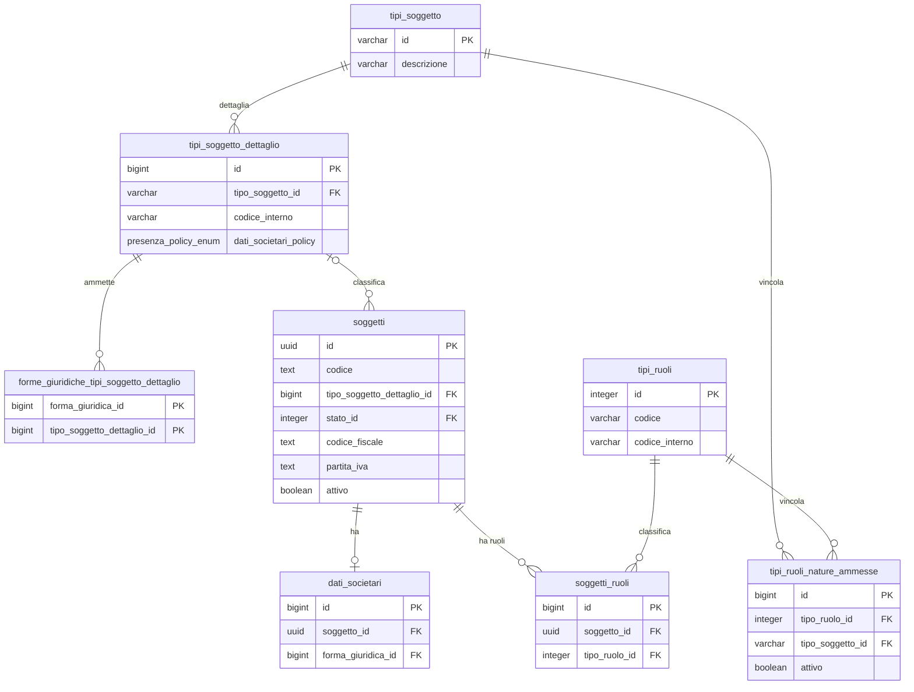
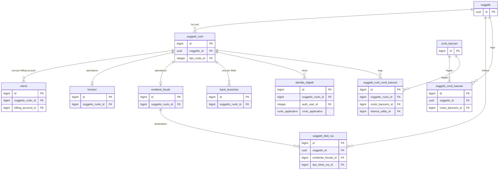

# Guida — Soggetti e Ruoli Anagrafici

> **Ultimo aggiornamento**: 24 novembre 2026
>
> **Destinatari**: sviluppatori database, backend e analisti funzionali
>
> **Vedi anche** — schemi DB:
>
> * [anagrafiche.soggetti](/dbzero/anagrafiche/tabelle/soggetti) — l'identità anagrafica (la persona o l'azienda)
> * [anagrafiche.dati_societari](/dbzero/anagrafiche/tabelle/dati_societari) — i dati camerali e il canale di fatturazione elettronica
> * [anagrafiche.soggetti_titoli_iva](/dbzero/anagrafiche/tabelle/soggetti_titoli_iva) — i titoli IVA del soggetto, uno per emittente
> * [anagrafiche.soggetti_ruoli](/dbzero/anagrafiche/tabelle/soggetti_ruoli) — il collegamento soggetto ↔ ruolo
> * [anagrafiche.identita_digitali](/dbzero/anagrafiche/tabelle/identita_digitali) — il ponte verso un account utente
> * [anagrafiche.clienti](/dbzero/anagrafiche/tabelle/clienti) — la specializzazione del ruolo CLIENTE, una per billing account
> * [anagrafiche.emittenti_fiscali](/dbzero/anagrafiche/tabelle/emittenti_fiscali) — la specializzazione del ruolo EMITTENTE FISCALE
> * [anagrafiche.emittenti_fiscali_billing_account](/dbzero/anagrafiche/tabelle/emittenti_fiscali_billing_account) — il legame fra un billing account e il suo emittente
> * [anagrafiche.soggetti_conti_bancari](/dbzero/anagrafiche/tabelle/soggetti_conti_bancari) — i conti legati al soggetto
> * [anagrafiche.soggetti_ruoli_conti_bancari](/dbzero/anagrafiche/tabelle/soggetti_ruoli_conti_bancari) — i conti legati al ruolo
> * [anagrafiche.contatti](/dbzero/anagrafiche/tabelle/contatti) — i contatti del soggetto, col ruolo come contesto
> * [config.tipi_soggetto](/dbzero/config/tabelle/tipi_soggetto) — la natura base (PF, PG, ENC)
> * [config.tipi_soggetto_dettaglio](/dbzero/config/tabelle/tipi_soggetto_dettaglio) — la natura di dettaglio e le regole che porta con sé
> * [config.forme_giuridiche_tipi_soggetto_dettaglio](/dbzero/config/tabelle/forme_giuridiche_tipi_soggetto_dettaglio) — le forme giuridiche ammesse da ogni natura
> * [config.tipi_titolo_iva_tipi_soggetto_dettaglio](/dbzero/config/tabelle/tipi_titolo_iva_tipi_soggetto_dettaglio) — i titoli IVA ammessi da ogni natura
> * [config.tipi_ruoli](/dbzero/config/tabelle/tipi_ruoli) — il catalogo dei ruoli
> * [config.tipi_ruoli_nature_ammesse](/dbzero/config/tabelle/tipi_ruoli_nature_ammesse) — la matrice natura ↔ ruolo
>
> **Vedi anche** — funzioni e trigger DB:
>
> * [anagrafiche.fn_crea_soggetto_pf](/dbzero/anagrafiche/funzioni/fn_crea_soggetto_pf) — la nascita di una persona fisica, coi suoi dati societari se ne ha
> * [anagrafiche.fn_crea_soggetto_pg](/dbzero/anagrafiche/funzioni/fn_crea_soggetto_pg) — la nascita di una società o di un ente
> * [anagrafiche.fn_scrivi_dati_societari](/dbzero/anagrafiche/funzioni/fn_scrivi_dati_societari) — crea o aggiorna i dati societari, a stato intero
> * [anagrafiche.fn_elimina_dati_societari](/dbzero/anagrafiche/funzioni/fn_elimina_dati_societari) — toglie i dati societari, se la natura lo consente
> * [anagrafiche.fn_check_cambio_natura_soggetto](/dbzero/anagrafiche/funzioni/fn_check_cambio_natura_soggetto) — i motivi che impediscono un cambio di natura
> * [anagrafiche.fn_nature_proponibili_soggetto](/dbzero/anagrafiche/funzioni/fn_nature_proponibili_soggetto) — le nature proponibili per un soggetto, con i motivi delle escluse
> * [anagrafiche.trgfn_soggetti_guard_cambio_natura](/dbzero/anagrafiche/funzioni/trgfn_soggetti_guard_cambio_natura) — il guard che rifiuta il cambio di natura col primo motivo
> * [anagrafiche.fn_id_fiscale_bloccato](/dbzero/anagrafiche/funzioni/fn_id_fiscale_bloccato) — quando codice fiscale e partita IVA non si cambiano più
> * [anagrafiche.trgfn_soggetti_ruoli_guard_natura_ammessa](/dbzero/anagrafiche/funzioni/trgfn_soggetti_ruoli_guard_natura_ammessa) — la natura ammessa per il ruolo richiesto
> * [anagrafiche.fn_titolo_iva_ammesso](/dbzero/anagrafiche/funzioni/fn_titolo_iva_ammesso) — la natura ammette il tipo di titolo IVA?
> * [script.fn_get_or_create_soggetto_ruolo](/dbzero/script/funzioni/fn_get_or_create_soggetto_ruolo) — il ruolo di un soggetto, creato se manca
> * [anagrafiche.fn_get_emittente_fiscale_id](/dbzero/anagrafiche/funzioni/fn_get_emittente_fiscale_id) — l'emittente di un billing account, come soggetto-ruolo
> * [anagrafiche.fn_get_emittente_fiscale_pk](/dbzero/anagrafiche/funzioni/fn_get_emittente_fiscale_pk) — lo stesso emittente, per chiave reale
> * [script.fn_get_emittenti_scope_sr_ids](/dbzero/script/funzioni/fn_get_emittenti_scope_sr_ids) — gli emittenti nel perimetro dell'utente, come soggetto-ruolo
> * [script.fn_get_emittenti_scope_pk_ids](/dbzero/script/funzioni/fn_get_emittenti_scope_pk_ids) — gli stessi emittenti, per chiave reale
>
> **Vedi anche** — guide correlate:
>
> * [Glossario termini utility](/glossario/glossario-utility)
> * [Guida Generazione di un Cliente](/guide/generazione-cliente) — il cliente, il billing account e il suo emittente
> * [Guida Gestione Istanze Utility](/guide/gestione-delle-istanze-utility)
> * [Guida Gestione dei Contatti](/guide/gestione-dei-contatti)
> * [Guida Gestione degli Indirizzi](/guide/gestione-degli-indirizzi)
> * [Guida Gestione Conti Bancari](/guide/gestione-conti-bancari)
> * [Il risolutore IVA di riga](/guide/iva-risolutore-di-riga) — dove i titoli IVA del soggetto cambiano l'aliquota
> * [Architettura Multi-Face Auth](/guide/architettura-multi-face-auth)

---

## Introduzione

In Zero ERP l'anagrafica si basa su un principio semplice: **una persona (o un'azienda)
esiste una volta sola, e può avere più ruoli**. ACME S.r.l. può essere cliente e fornitore
allo stesso tempo; Mario Rossi può essere cliente e, con lo stesso soggetto, una risorsa
umana dell'azienda.

Il modello separa l'**identità** (chi è la persona o l'azienda) dai **ruoli** (che cosa fa
nel sistema). L'identità porta i dati fiscali e la natura giuridica, e con la natura le
regole che li governano; i ruoli portano i dati che servono solo a quel ruolo.

**Cosa troverai in questa guida:**

* il soggetto, la sua natura e che cosa la natura decide;
* l'identificativo fiscale, che a un certo punto non si cambia più;
* il cambio di natura e i dati societari, coi verbi che li scrivono;
* i ruoli, le loro specializzazioni e i due modi di riferirli;
* perché il soggetto non ha un emittente fiscale;
* quali controlli scattano subito e quali al COMMIT.

Questa guida è il **prerequisito** delle altre guide anagrafiche (clienti, contatti,
indirizzi, conti bancari, istanze): le altre danno per compreso il modello descritto qui.

---

## Il modello in sintesi

```text
soggetti (chi è) ── natura di dettaglio (config.tipi_soggetto_dettaglio)
    │
    ├── dati_societari      (al più una riga; li ammette o li pretende la natura)
    ├── soggetti_titoli_iva (i titoli IVA, ciascuno presso un emittente)
    ├── indirizzi, contatti, conti bancari del soggetto
    │
    └── soggetti_ruoli (che cosa fa nel sistema: un ruolo per tipo)
            │
            ├── specializzazione del ruolo (clienti, fornitori, emittenti_fiscali, …)
            ├── indirizzi, contatti, conti bancari del ruolo
            └── identita_digitali (l'accesso al software, se serve)
```

* **Soggetto** = l'identità: nome o ragione sociale, codice fiscale, partita IVA, paese, natura.
* **Ruolo** = la funzione nel sistema. Un soggetto ha al più un ruolo per tipo, e più ruoli di tipo diverso.
* **Specializzazione** = la tabella con i dati che servono solo a quel ruolo.

---

## Il soggetto

Un **soggetto** è una persona fisica o giuridica registrata nel sistema. Contiene i dati
**indipendenti dal ruolo**: nome e cognome o ragione sociale, codice fiscale e partita IVA,
il paese, la natura, i flag del regime PA (`cliente_pa`, `split_payment`). Un soggetto da solo
non è ancora un cliente o un fornitore: lo diventa quando riceve un ruolo.

Il soggetto ha un **codice** che il database genera alla nascita e che poi non si cambia
(`E_CODICE_NON_MODIFICABILE`). Codice fiscale e partita IVA sono unici **per paese**: la chiave
è il paese più una colonna calcolata dai due identificativi. Il database li scrive in una forma
sola, maiuscole e senza spazi, e un campo vuoto è vuoto: lo stesso codice scritto in minuscolo
è lo stesso codice. Il doppione lo rifiuta la chiave, e i due verbi di creazione lo dicono con
`E_ADMIN_CF_DUPLICATO`. Lo stesso codice fiscale può stare su due soggetti con partite IVA diverse:
la persona e la sua ditta individuale sono due soggetti. Le colonne e i vincoli sono nella
[scheda del soggetto](/dbzero/anagrafiche/tabelle/soggetti).

### Nasce con un verbo

Un soggetto nasce con uno dei due verbi di creazione, scelti per macro-tipologia:

* [anagrafiche.fn_crea_soggetto_pf](/dbzero/anagrafiche/funzioni/fn_crea_soggetto_pf) per le persone fisiche;
* [anagrafiche.fn_crea_soggetto_pg](/dbzero/anagrafiche/funzioni/fn_crea_soggetto_pg) per società ed enti.

Un verbo che riceve una natura dell'altra famiglia la rifiuta (`E_SOGGETTO_CREAZIONE_NATURA_ERRATA`):
una ditta individuale è una persona fisica, e nasce col primo. Nella stessa chiamata il
verbo crea il contatto del soggetto e, se la natura li pretende o se ne riceve almeno un campo,
i dati societari (con [anagrafiche.fn_scrivi_dati_societari_alla_nascita](/dbzero/anagrafiche/funzioni/fn_scrivi_dati_societari_alla_nascita)).

### La natura decide le regole

Ogni soggetto ha una **natura**, su due livelli:

| Livello | Tabella | Che cosa è |
| --- | --- | --- |
| Base | `config.tipi_soggetto` | la macro-tipologia: persona fisica, persona giuridica, ente |
| Dettaglio | `config.tipi_soggetto_dettaglio` | la natura vera e propria (privato, ditta individuale, società di capitali, …) |

Sul soggetto si scrive il **dettaglio**, e il dettaglio porta con sé le regole del soggetto:

* **codice fiscale e partita IVA**: se sono obbligatori, e il loro formato. Una natura col
  formato della partita IVA «non applicabile» non ha partita IVA;
* **dati societari**: vietati, facoltativi od obbligatori (`NONE`, `OPTIONAL`, `REQUIRED`);
* **sesso**: con la stessa scala. Si indica solo per le persone fisiche;
* **regime PA**: se la natura ammette `cliente_pa` e `split_payment`;
* **forme giuridiche**, **titoli IVA** e **tipi di indirizzo** che la natura ammette, ciascuno
  con la sua matrice in `config`.

I valori di ogni natura stanno nella [scheda della natura di dettaglio](/dbzero/config/tabelle/tipi_soggetto_dettaglio).
Nella configurazione di oggi, per esempio, un privato ha il codice fiscale, nessuna partita IVA
e nessun dato societario, mentre una società di capitali ha la partita IVA e i dati societari
obbligatori.

La validazione di codice fiscale e partita IVA distingue due aspetti:

* **presenza**: il campo deve essere compilato? Lo dice la natura;
* **formato**: il valore ha la forma giusta? Si controlla per il paese del soggetto, e le
  regole scritte oggi sono quelle italiane.

La natura sul soggetto può mancare, ma solo finché non la si scrive: **una natura scritta non si
toglie** (`E_CAMBIO_NATURA_VERSO_NESSUNA`), per nessuno. Senza natura i controlli che dipendono da
lei tacciono, tranne quelli su un dato fiscale che la natura dovrebbe ammettere: un flag del
regime PA acceso o un titolo IVA vigente sono rifiutati (`E_DATO_FISCALE_SENZA_TIPO_SOGGETTO`), e
un ruolo vincolato dalla matrice non si assegna (`E_RUOLO_NATURA_TIPO_DET_NULL`).

**Il sesso non ha mai un valore di comodo.** Lo sceglie chi lo vede: `M` o `F`, oppure `X`
quando serve ma non si può stabilire (un dato storico, un codice fiscale estero o non
riconoscibile). Un campo vuoto vuol dire «non serve», ed è ammesso solo dove la natura lo
prevede. Una ditta individuale è una persona con un'attività in proprio: il sesso si può
indicare, ma non è richiesto.

### ⛔ L'identificativo fiscale, una volta scritto, non si cambia

Codice fiscale e partita IVA si scrivono quando mancano; una volta che hanno un valore, li
cambia solo un super admin. Lo stesso vale per il **paese** del soggetto, che è l'altra metà della
chiave. Gli altri ricevono `E_SOGGETTO_ID_FISCALE_IMMUTABILE`, col campo nel contesto, prima di
ogni altro controllo sullo stesso salvataggio. La regola sta in [anagrafiche.fn_id_fiscale_bloccato](/dbzero/anagrafiche/funzioni/fn_id_fiscale_bloccato),
e [anagrafiche.fn_soggetto_id_fiscale_bloccato](/dbzero/anagrafiche/funzioni/fn_soggetto_id_fiscale_bloccato)
dice per un soggetto e una colonna se il campo è ancora modificabile: è la stessa condizione
con cui il form mostra i due campi in sola lettura.

Il motivo è che l'identificativo fiscale è ciò che i documenti emessi stampano: correggerlo
dopo vuol dire cambiare l'intestatario di ciò che è già stato emesso.

### Il cambio di natura

Un soggetto può cambiare natura, ma **solo dentro la sua macro-tipologia**: una ditta
individuale può diventare un privato, una società di persone una società di capitali; una
società non diventa un ente, né una persona fisica una società
(`E_CAMBIO_NATURA_ALTRA_MACRO_TIPOLOGIA`).

Dentro la macro-tipologia, il cambio è rifiutato finché resta qualcosa che la natura nuova non
ammette. I motivi li elenca, tutti e in ordine,
[anagrafiche.fn_check_cambio_natura_soggetto](/dbzero/anagrafiche/funzioni/fn_check_cambio_natura_soggetto),
e il guard sul soggetto solleva il primo:

* l'identità fiscale cambia (la natura nuova ha la partita IVA e la vecchia no, o il contrario)
  e il soggetto compare già in un documento, in qualunque ruolo;
* la partita IVA è compilata e la natura nuova non ne ha;
* un flag del regime PA è acceso e la natura nuova non lo ammette;
* ci sono titoli IVA vigenti che la natura nuova non ammette, compresi quelli presentati ad
  altri emittenti, che chi agisce non vede;
* ci sono dati societari e la natura nuova li vieta;
* ci sono indirizzi, del soggetto o dei suoi ruoli, di un tipo che la natura nuova non ammette.

**Il cambio non pulisce niente**: chi cambia natura toglie prima ciò che la natura nuova non
ammette, oppure lo corregge nello stesso salvataggio (la partita IVA e i flag della riga si
giudicano coi valori nuovi). Per la maschera,
[anagrafiche.fn_nature_proponibili_soggetto](/dbzero/anagrafiche/funzioni/fn_nature_proponibili_soggetto)
restituisce ogni natura col suo esito e i suoi motivi: è la stessa check del guard, quindi la
lista propone ciò che il guard accetta.

Due conseguenze del cambio si giudicano **al COMMIT**, sullo stato finale: la forma giuridica
dei dati societari deve essere ammessa dalla natura nuova
(`E_TIPO_SOGGETTO_FORMA_GIURIDICA_NON_AMMESSA`), e una natura che pretende i dati societari li
deve trovare. Per questo, quando la forma va cambiata insieme alla natura, si cambia **prima la
natura, poi la forma**, nella stessa transazione: la forma nuova si giudica subito, contro la
natura che il soggetto ha in quel momento.

Il cambio di natura non riapre la compatibilità coi ruoli: la matrice dei ruoli guarda la
macro-tipologia, e la macro-tipologia non cambia.

### I dati societari

I dati societari — forma giuridica, iscrizione al REA, capitale sociale, socio unico,
liquidazione, canale di fatturazione elettronica — sono **al più una riga per soggetto**, e la
natura decide se sono vietati, facoltativi od obbligatori.

Dentro la riga, la **forma giuridica** è obbligatoria e decide il resto:

* deve essere del paese del soggetto (`E_FORMA_GIURIDICA_PAESE`) e ammessa dalla sua natura
  (`E_FORMA_GIURIDICA_NON_AMMESSA_PER_TIPO_SOGGETTO`);
* dice se l'iscrizione al REA e il capitale sociale sono obbligatori, facoltativi o non ammessi.

Il canale di fatturazione elettronica ha la sua coerenza: col canale per codice destinatario
serve il codice SDI, col canale PEC serve la PEC.

L'applicazione **non scrive la tabella**: legge e basta. I dati societari si scrivono coi verbi:

* [anagrafiche.fn_scrivi_dati_societari](/dbzero/anagrafiche/funzioni/fn_scrivi_dati_societari) crea o aggiorna
  la riga **a stato intero**: si passano tutti i campi, e un campo vuoto svuota la colonna. Socio
  unico e liquidazione, se vuoti, prendono il valore proposto dai parametri;
* [anagrafiche.fn_elimina_dati_societari](/dbzero/anagrafiche/funzioni/fn_elimina_dati_societari) toglie la
  riga, e la rifiuta se la natura del soggetto la pretende (`E_DATI_SOCIETARI_NON_ELIMINABILI`).
  [anagrafiche.fn_check_elimina_dati_societari](/dbzero/anagrafiche/funzioni/fn_check_elimina_dati_societari)
  dà lo stesso esito senza scrivere.

Le regole stanno nei trigger della tabella, non nei verbi: il verbo aggiunge solo il controllo
che il soggetto esista. La vista [anagrafiche.vw_dati_societari](/dbzero/anagrafiche/views/vw_dati_societari)
li espone con le descrizioni risolte.

### I titoli IVA ammessi dalla natura

Il soggetto influisce sull'IVA di una riga **solo attraverso un titolo IVA**: una
dichiarazione d'intento, un'agevolazione, registrata in
[anagrafiche.soggetti_titoli_iva](/dbzero/anagrafiche/tabelle/soggetti_titoli_iva). Il titolo
appartiene al soggetto ma si presenta a **un emittente preciso**: lo stesso esportatore abituale
che compra da due emittenti ha due titoli, con due plafond.

Un titolo **vigente** (attivo e valido almeno fino a oggi) deve essere di un tipo che la natura
del soggetto ammette (`E_TITOLO_IVA_NON_AMMESSO_PER_TIPO_SOGGETTO`). La matrice è
[config.tipi_titolo_iva_tipi_soggetto_dettaglio](/dbzero/config/tabelle/tipi_titolo_iva_tipi_soggetto_dettaglio),
ed è chiusa: un tipo senza riga per la natura non è ammesso. Un titolo chiuso o scaduto non si
giudica, perché non cambia più nessuna aliquota. Come il titolo entra nella riga di un
documento lo spiega [Il risolutore IVA di riga](/guide/iva-risolutore-di-riga).

---

## I ruoli

### Il catalogo

[config.tipi_ruoli](/dbzero/config/tabelle/tipi_ruoli) elenca i ruoli. Ogni ruolo ha un `codice`
(per esempio `CLIENTE`) e un `codice_interno` (per esempio `CL`), che è quello con cui il codice
del database e i verbi nominano il ruolo. Il codice interno non si cambia.

Alcuni ruoli hanno una **specializzazione**, una tabella coi dati che servono solo a loro; gli
altri vivono del solo collegamento e delle tabelle trasversali:

| Ruolo (codice interno) | Specializzazione | Righe per ruolo assegnato |
| --- | --- | --- |
| Cliente (`CL`) | `anagrafiche.clienti` | **una per billing account** |
| Fornitore (`FO`) | `anagrafiche.fornitori` | una |
| Gestore (`GE`) | `anagrafiche.gestori` | una |
| Emittente fiscale (`EF`) | `anagrafiche.emittenti_fiscali` | una |
| Reseller (`RE`) | `anagrafiche.resellers` | una |
| Vettore (`VT`) | `anagrafiche.vettori` | una |
| Payment service provider (`PSP`) | `anagrafiche.psp` | una |
| Risorsa umana (`RIS_UMANA`) | `anagrafiche.risorse_umane` | una |
| Istituto di credito (`BANK_B`) | `anagrafiche.bank_branches` | una per filiale |

Venditore (`VE`), Distributore (`DI`) e Processo automatico (`PROC_AUTO`) non hanno una
specializzazione. Ogni specializzazione controlla che il ruolo a cui si aggancia sia del tipo
giusto.

⚠️ **Il cliente è l'eccezione da ricordare.** Un cliente non è «la persona come cliente», ma
**una sua fornitura**: un soggetto con un solo ruolo CLIENTE può avere il gas a casa e la luce
in ufficio, cioè due billing account e due clienti, tutti sullo stesso ruolo. La regola è **un
cliente per ogni billing account** (vedi [Generazione di un Cliente](/guide/generazione-cliente)).

### Il collegamento soggetto ↔ ruolo

[anagrafiche.soggetti_ruoli](/dbzero/anagrafiche/tabelle/soggetti_ruoli) è il **ponte** fra
l'identità e il ruolo: una riga dice «questo soggetto ricopre il ruolo X».

* Un soggetto ha **al più un ruolo per tipo**.
* Il soggetto e il tipo di un ruolo **non si cambiano** (`E_SOGGETTO_RUOLO_SOGGETTO_IMMUTABILE`,
  `E_SOGGETTO_RUOLO_TIPO_IMMUTABILE`): un ruolo è «questo soggetto, questo tipo». Quello sbagliato
  si toglie e si mette quello giusto.
* La riga non ha date né un suo `attivo`: il ruolo c'è o non c'è. Le date, dove servono, stanno
  nella specializzazione o nei legami.
* Un ruolo si appoggia a un soggetto attivo: il controllo è al COMMIT.

Specializzazioni, contatti, indirizzi, conti bancari e identità digitali si agganciano a
`soggetti_ruoli.id`: da qualunque dato di ruolo si risale al soggetto con un passaggio. Il
ruolo di un soggetto si ottiene, creandolo se manca, con
[script.fn_get_or_create_soggetto_ruolo](/dbzero/script/funzioni/fn_get_or_create_soggetto_ruolo).

I soggetti usano un UUID come chiave, perché sono entità che possono passare fra sistemi
(import, export, API); ruoli e specializzazioni usano un BIGINT, interno al database.

### La compatibilità natura ↔ ruolo

Non ogni ruolo si assegna a ogni natura. La matrice
[config.tipi_ruoli_nature_ammesse](/dbzero/config/tabelle/tipi_ruoli_nature_ammesse) dice, per
ogni ruolo, quali **macro-tipologie** lo possono ricoprire, e
[anagrafiche.trgfn_soggetti_ruoli_guard_natura_ammessa](/dbzero/anagrafiche/funzioni/trgfn_soggetti_ruoli_guard_natura_ammessa)
lo controlla quando il ruolo nasce (`E_RUOLO_NATURA_NON_AMMESSA`, col ruolo e la natura nella frase).

* Una riga della matrice vale se è attiva e valida alla data operativa.
* Un ruolo **senza nessuna riga** nella matrice è aperto a ogni natura. Basta una riga, anche
  spenta, perché il ruolo sia vincolato.

---

### 5b. Identificazione canonica di un ruolo specializzato — PK reale vs `soggetto_ruolo_id`

Un ruolo specializzato (cliente, fornitore, emittente fiscale, reseller, …) ha **due
identificatori validi**, e convivono per disegno:

| Identificatore | Esempio | Che cosa indica |
| --- | --- | --- |
| **PK reale** della specializzazione | `emittenti_fiscali.id`, `fornitori.id` | l'entità di ruolo, con i suoi attributi (`attivo`, il codice, …) |
| **`soggetto_ruolo_id`** (SR id) | `emittenti_fiscali.soggetto_ruolo_id` | il soggetto in quel ruolo: un passaggio solo fino a `soggetti` |

Una tabella che riferisce un ruolo specializzato sceglie una delle due colonne, e il nome lo
dice: `<ruolo>_soggetto_ruolo_id` (o `soggetto_ruolo_id`) per lo SR id, `<ruolo>_fiscale_id` o
`<ruolo>_id` per la PK reale. La scheda di ogni tabella mostra a che cosa punta la sua FK.

* **SR id**: lo usano le tabelle che hanno bisogno del soggetto — fatture, commesse, listini,
  registri e lotti di fatturazione, scritture contabili, il legame fra un billing account e il
  suo emittente — e le ricerche che arrivano a `soggetti` con un join solo.
* **PK reale**: la usano le tabelle che parlano dell'entità di ruolo — il perimetro degli
  emittenti di un utente (`config.user_emittenti_fiscali`), gli override dei parametri, i
  titoli IVA, e i documenti che prendono l'emittente di lavoro di chi li crea: preventivi,
  offerte, contratti, ordini, DDT, resi.

Le due forme sono intenzionali: un lavoro che le unifica su una sola non è richiesto, e costa
più di quanto risolve. Dove serve passare dall'una all'altra:

| Funzione | Restituisce |
| --- | --- |
| [anagrafiche.fn_get_emittente_fiscale_id](/dbzero/anagrafiche/funzioni/fn_get_emittente_fiscale_id) | l'emittente di un billing account come **SR id**, nonostante il nome |
| [anagrafiche.fn_get_emittente_fiscale_pk](/dbzero/anagrafiche/funzioni/fn_get_emittente_fiscale_pk) | lo stesso emittente come **PK reale** |
| [script.fn_get_emittenti_scope_pk_ids](/dbzero/script/funzioni/fn_get_emittenti_scope_pk_ids) | gli emittenti nel perimetro di un utente, come PK reali |
| [script.fn_get_emittenti_scope_sr_ids](/dbzero/script/funzioni/fn_get_emittenti_scope_sr_ids) | gli stessi, come SR id |

Le due funzioni di perimetro hanno la stessa semantica: la versione SR traduce la versione PK, e
i guard (nessuna identità operatore, super admin, lista degli emittenti) stanno in un posto solo.

---

### ⭐ Il soggetto non ha un emittente fiscale

L'emittente fiscale **non è un attributo del soggetto**. Non c'è su `soggetti`, né su
`soggetti_ruoli`, né su `clienti`, né su `billing_account`, né su `istanze_utilities`.

Chi porta l'emittente è il **billing account**: ne ha esattamente uno, il collegamento in
[anagrafiche.emittenti_fiscali_billing_account](/dbzero/anagrafiche/tabelle/emittenti_fiscali_billing_account)
o, in sua assenza, quello che la regola di riserva gli attribuisce. Come si risolve, e quando
un billing account non può cambiare emittente, lo spiega
[Generazione di un Cliente](/guide/generazione-cliente).

Il soggetto tocca un emittente solo **attraverso qualcosa**: i suoi billing account, oppure un
suo titolo IVA, che è presentato a un emittente preciso. Le altre tabelle di `anagrafiche` che
nominano un emittente parlano dell'emittente stesso, non del soggetto:
`emittenti_fiscali_utilities` (le regole dell'emittente per utility) e
`categorie_clienti_listini` (il listino di una categoria presso un emittente).

#### Cosa ne segue, in pratica

* **un soggetto può essere cliente di più emittenti**, ed è legittimo: sono alberi di billing
  account separati;
* la regola che il database presidia **non** è «un soggetto sta sotto un solo emittente», che
  sarebbe falsa. È «un albero di billing account non attraversa due emittenti»
  ([anagrafiche.fn_guard_albero_ba_emittente](/dbzero/anagrafiche/funzioni/fn_guard_albero_ba_emittente));
* ⚠️ **quando si mostra «l'emittente» accanto a un soggetto**, si mostra una **relazione**, non
  un attributo. Se il soggetto ne tocca due, i valori sono due: l'etichetta lo dice («emittenti
  presso cui è cliente»), e la riga **non** si duplica per emittente, perché cambierebbe il
  significato di un conteggio di soggetti;
* l'emittente è un dato pulito per riga al livello del **rapporto**: ogni cliente ha un billing
  account, quindi un emittente solo.

---

### Il ponte verso l'account utente

Non tutte le coppie soggetto-ruolo accedono al software. Quando serve — un operatore interno, il
cliente di un portale, il fornitore che entra dal suo portale, chi acquista dallo shop — il
ruolo riceve una **identità digitale**:
[anagrafiche.identita_digitali](/dbzero/anagrafiche/tabelle/identita_digitali) lega un
soggetto-ruolo a un account e dice con quale **veste** quella persona entra nel sistema
(`ruolo_applicativo`).

L'identità digitale appartiene al **ruolo**, non al soggetto. Un'azienda che è cliente e
fornitore può avere una veste per il portale clienti e una per il portale fornitori; un
soggetto può essere, con lo stesso account, operatore interno e cliente del portale, perché le
vesti convivono.

Due cose che questo ponte **non** cambia nel modello anagrafico:

* **nessun attributo nuovo sul soggetto o sul ruolo**: l'accesso è un ponte in più, non una
  proprietà dell'anagrafica;
* **il vincolo «persona fisica pura» non è generale**: riguarda la sola veste `OPERATORE` di una
  persona — la persona interna, sul ruolo `RIS_UMANA`, con codice fiscale e nessuna partita
  IVA. Un soggetto persona giuridica può avere l'account del suo portale; un processo
  automatico ha una veste operatore **tecnica**, sul ruolo `PROC_AUTO`.

> Per il modello completo — vesti, profili di accesso, perimetri dei portali e dello shop —
> vedi [Architettura Multi-Face Auth](/guide/architettura-multi-face-auth).
> Per il ciclo di vita di un operatore vedi [Risorse Umane e Accessi](/guide/risorse-umane-e-accessi).

---

## Contatti, indirizzi e conti: due livelli

Contatti, indirizzi e conti bancari hanno due livelli, il **soggetto** e il **ruolo**, e il
livello del ruolo permette di tenere separati gli usi dello stesso soggetto: l'email della
contabilità fornitori non è quella degli ordini cliente.

* **Contatti** — ogni contatto è del soggetto, e può indicare un ruolo (e un'istanza) come
  contesto. Il soggetto deve avere almeno un contatto, al COMMIT. Le regole del contatto
  predefinito sono in [Gestione dei Contatti](/guide/gestione-dei-contatti).
* **Indirizzi** — quelli del soggetto (`indirizzi_soggetti`) e quelli del ruolo (`indirizzi`).
  La natura dice quali tipi sono ammessi e quali obbligatori per il soggetto, il tipo di ruolo
  quali per il ruolo; gli obbligatori si controllano al COMMIT. Vedi
  [Gestione degli Indirizzi](/guide/gestione-degli-indirizzi).
* **Conti bancari** — il conto (l'IBAN) è un'entità sua, in `conti_bancari`, e si **lega** al
  soggetto ([anagrafiche.soggetti_conti_bancari](/dbzero/anagrafiche/tabelle/soggetti_conti_bancari))
  o al ruolo ([anagrafiche.soggetti_ruoli_conti_bancari](/dbzero/anagrafiche/tabelle/soggetti_ruoli_conti_bancari),
  anche per una singola istanza), con un uso, un predefinito e un periodo. Quando si cerca il
  conto di un ruolo, il legame del ruolo vince su quello del soggetto. Un conto d'incasso si
  lega a un soggetto solo, e a un ruolo solo. Vedi [Gestione Conti Bancari](/guide/gestione-conti-bancari).

---

## Quando si controlla: subito o al COMMIT

I controlli dell'area sono trigger sulle tabelle, e sono di due specie. L'elenco completo, col
momento e l'ordine di ciascuno, è nella sezione dei trigger di ogni scheda
([soggetti](/dbzero/anagrafiche/tabelle/soggetti), [soggetti_ruoli](/dbzero/anagrafiche/tabelle/soggetti_ruoli),
[dati_societari](/dbzero/anagrafiche/tabelle/dati_societari),
[soggetti_titoli_iva](/dbzero/anagrafiche/tabelle/soggetti_titoli_iva)).

**Subito**, sulla riga che si scrive, si giudica ciò che la riga dice di sé:

* sul soggetto: prima il blocco dell'identificativo fiscale (codice fiscale, partita IVA, paese),
  poi presenza e formato di codice fiscale e partita IVA, sesso, regime PA, blocco del codice,
  cambio di natura;
* sui dati societari: la natura li ammette (alla nascita della riga, per primo), la forma
  giuridica c'è ed è del paese e della natura, REA e
  capitale come la forma li vuole, il canale di fatturazione elettronica;
* sul ruolo: la natura ammette il ruolo, il soggetto e il tipo non si cambiano;
* sul titolo IVA: la natura ammette il tipo.

**Al COMMIT** si giudica ciò che può arrivare dopo, nella stessa transazione:

* la natura che pretende i dati societari li trova (`E_DATI_SOCIETARI_REQUIRED_MANCANTI`);
* il soggetto ha almeno un contatto, e gli indirizzi obbligatori suoi e dei suoi ruoli;
* dopo un cambio di natura o di paese, la forma giuridica è ancora ammessa e del paese giusto;
* ruoli, dati societari e titoli IVA si appoggiano a un soggetto attivo.

Ne segue l'**ordine** delle scritture: il soggetto si scrive per primo, perché le righe figlie
lo riferiscono e i loro controlli lo leggono subito; dati societari, contatti, indirizzi e ruoli
vengono dopo, nella stessa transazione, e ciò che è obbligatorio deve esserci al COMMIT. I verbi
di creazione rispettano questo ordine da soli.

Un soggetto **non si disattiva** finché ha figli: ruoli, dati societari, contatti, indirizzi,
istanze, legami dei conti, titoli IVA, pratiche, risorse umane. Solo titoli IVA e risorse umane
hanno un loro `attivo`, e per loro contano le righe attive; le altre figlie contano finché
esistono. Poiché ogni soggetto ha almeno un contatto, oggi nessun soggetto arriva a spegnersi.

---

## Esempi pratici

### Caso 1 — Persona fisica, solo cliente

Mario Rossi è un privato che diventa cliente gas:

* **Soggetto**: Mario Rossi, natura «privato» (persona fisica), nato con `fn_crea_soggetto_pf`;
* codice fiscale obbligatorio, nessuna partita IVA, nessun dato societario, sesso obbligatorio;
* **Ruolo**: CLIENTE, ammesso per le persone fisiche;
* **Cliente**: uno per ogni billing account, con le sue date (vedi [Generazione di un Cliente](/guide/generazione-cliente)).

### Caso 2 — Azienda con due ruoli

ACME S.r.l. è cliente e fornitore:

* **Soggetto**: ACME S.r.l., natura «società di capitali», nato con `fn_crea_soggetto_pg`, che
  riceve nella stessa chiamata i dati societari che la natura pretende (la forma giuridica, e
  REA e capitale come la forma li vuole);
* **Ruoli**: CLIENTE e FORNITORE, due righe in `soggetti_ruoli`;
* contatti, indirizzi e conti si legano a ciascun ruolo separatamente.

### Caso 3 — Un ruolo che la natura non ammette

Il ruolo GESTORE è vincolato alle persone giuridiche: assegnarlo a un privato è rifiutato con
`E_RUOLO_NATURA_NON_AMMESSA`. Allo stesso modo RISORSA UMANA è solo delle persone fisiche.

### Caso 4 — Una ditta individuale che chiude la partita IVA

Una ditta individuale cessa l'attività e torna privato. Il cambio è nella stessa
macro-tipologia, ma la natura nuova non ha partita IVA:

* se la partita IVA resta compilata, il cambio è rifiutato con `E_CAMBIO_NATURA_PIVA_NON_APPLICABILE`;
* se il soggetto compare già in un documento, è rifiutato con `E_CAMBIO_NATURA_CON_DOCUMENTI`:
  l'identità fiscale con cui i documenti sono stati emessi non si riscrive;
* anche i dati societari, i titoli IVA e gli indirizzi che il privato non ammette vanno tolti
  prima. `fn_nature_proponibili_soggetto` mostra in anticipo che cosa ferma il cambio.

---

## Diagramma ER

Il nucleo del modello: identità, natura, dati societari e ruoli. Le colonne sono solo quelle che
reggono le relazioni; le altre sono nelle schede.



Intorno al ruolo: alcune specializzazioni, l'identità digitale, i legami dei conti e i titoli
IVA.



---


