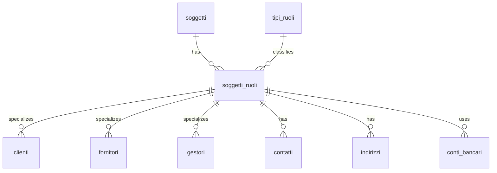

# 🌱 Guida Tecnica – Soggetti e Ruoli Anagrafici

> (latest review 16-12-25)
>
> 🎯 **Destinatari:** sviluppatori database, backend e analisti funzionali
>
> 🧩 **Fondamentale per comprendere tutte le altre guide anagrafiche (clienti, indirizzi, contatti, conti bancari, istanze)**.

---

## ✅ Introduzione e scopo

La gestione anagrafica in Zero ERP si basa su un modello potente e flessibile: **un soggetto può ricoprire più ruoli**, e ogni ruolo può avere **dati specifici e comportamenti propri**.

Questa guida descrive i principi fondamentali dei componenti:

* `anagrafiche.soggetti`
* `config.tipi_ruoli`
* `anagrafiche.soggetti_ruoli`
* Tabelle specializzate dei ruoli (es. `clienti`, `gestori`, ecc.)

L’obiettivo è fornire una visione chiara e coerente che consenta di capire **come nascono i ruoli**, come vengono **utilizzati nei processi**, e perché questo modello consente di gestire in modo naturale indirizzi, contatti, conti bancari e relazioni commerciali.

---
## 🧱 Tabelle coinvolte

* [anagrafiche.istanze_utilities](/dbzero/anagrafiche/tabelle/istanze_utilities)
* [anagrafiche.clienti](/dbzero/anagrafiche/tabelle/clienti)
* [anagrafiche.soggetti](/dbzero/anagrafiche/tabelle/soggetti)
* [anagrafiche.soggetti_ruoli](/dbzero/anagrafiche/tabelle/soggetti_ruoli)
* [anagrafiche.contatti](/dbzero/anagrafiche/tabelle/contatti)
* [anagrafiche.indirizzi_dettaglio](/dbzero/anagrafiche/tabelle/indirizzi_dettaglio)
* [anagrafiche.indirizzi](/dbzero/anagrafiche/tabelle/indirizzi)
* [config.utilities](/dbzero/config/tabelle/utilities)
* [config.tipi_ruoli](/dbzero/config/tabelle/tipi_ruoli)
* [config.tipi_contatti](/dbzero/config/tabelle/tipi_contatti)

---

## 🧩 Componenti principali

### **1. `anagrafiche.soggetti` – L'identità “nuda”**

Un **soggetto** rappresenta una persona fisica o giuridica.
È l'entità anagrafica di base e contiene solo dati **stabili** e **non dipendenti dal ruolo**, come:

* ragione sociale, nome, cognome
* codice fiscale / partita IVA
* dati di classificazione generale

> 🔑 **Un soggetto non è ancora un cliente, né un fornitore, né un gestore.**

---

### **2. `config.tipi_ruoli` – Il catalogo dei ruoli**

Contiene l'elenco dei ruoli che un soggetto può ricoprire, ad esempio:

* CLIENTE
* FORNITORE
* GESTORE
* VENDITORE
* DISTRIBUTORE

I ruoli rappresentano **proiezioni funzionali** del soggetto nel sistema gestionale.

> Ogni ruolo abilita logiche, dati e comportamenti differenti.

---

### **3. `anagrafiche.soggetti_ruoli` – Il ponte soggetto ↔ ruolo**

È la tabella **cardine** del modello anagrafico e funge da **tabella di giunzione** tra:

* l'identità "pura" (`anagrafiche.soggetti`)
* il ruolo funzionale (`config.tipi_ruoli`)

Creando un record in `soggetti_ruoli`, si afferma esplicitamente:

> "Questo soggetto ricopre il ruolo X".

Da un punto di vista tecnico:

* `id` è la **chiave primaria** (BIGINT, identity) ed è l'identificativo univoco del **singolo ruolo assegnato** a quel soggetto;
* `soggetto_id` (UUID) è una FK verso `anagrafiche.soggetti.id`;
* `tipo_ruolo_id` è una FK verso `config.tipi_ruoli.id`;
* il vincolo `UNIQUE (soggetto_id, tipo_ruolo_id)` garantisce che uno stesso soggetto non possa avere **duplicazioni** dello stesso ruolo;
* gli indici su `soggetto_id` e `tipo_ruolo_id` permettono di navigare **velocemente in entrambe le direzioni**:

  * da un soggetto → tutti i ruoli associati,
  * da un ruolo → tutti i soggetti che lo ricoprono.

L'utilizzo di `soggetto_ruolo_id` come FK nelle tabelle specializzate (es. `clienti`, `gestori`, `fornitori`, conti bancari, contatti, indirizzi) consente di:

* risalire **in un solo join** al soggetto di origine;
* mantenere chiara la separazione tra *identità* (soggetto) e *ruolo di dominio* (cliente, gestore, ecc.);
* costruire query e viste che lavorano in maniera uniforme su tutti i ruoli.

In pratica, `anagrafiche.soggetti_ruoli` è il **punto di aggancio unico** tra il mondo anagrafico e tutte le specializzazioni di ruolo usate nei moduli funzionali di Zero ERP.

---

### **4. Tabelle specializzate dei ruoli**

Per ogni ruolo che richiede dati aggiuntivi esiste una tabella dedicata, ad esempio:

* `anagrafiche.clienti`
* `anagrafiche.fornitori`
* `anagrafiche.gestori`

Queste tabelle si collegano tramite:

```
soggetto_ruolo_id → anagrafiche.soggetti_ruoli.id
```

> 🔍 In questo modo i dati specializzati appartengono **solo** al ruolo pertinente.

---

## 🧭 Esempi pratici

### **Caso 1 – Persona fisica mono-ruolo (solo cliente)**

* `soggetti`: Mario Rossi
* `soggetti_ruoli`: record CLIENTE
* `clienti`: contiene dati contrattuali, condizioni, utility_id
* indirizzi e contatti: legati al ruolo cliente

---

### **Caso 2 – Azienda multi-ruolo (cliente + fornitore)**

* `soggetti`: ACME S.r.l.
* `soggetti_ruoli`: CLIENTE, FORNITORE
* `clienti`: condizioni commerciali
* `fornitori`: dati amministrativi
* indirizzi: distinti per ruolo (es. indirizzo spedizioni CLIENTE, indirizzo amministrativo FORNITORE)

---

### **Caso 3 – Ruolo particolare: Gestore**

* Ruolo GESTORE → condizioni aggiuntive (es. partita IVA obbligatoria)
* Tabella `gestori` con vincoli specifici (es. singleton)
* Concetto distinto dal cliente, anche se riferito allo stesso soggetto

---

## 📍 Indirizzi e contatti appesi al ruolo

Grazie al modello soggetti/ruoli:

* un indirizzo o contatto può essere assegnato **al ruolo**, non all’identità generica
* si evitano collisioni tra usi diversi dello stesso soggetto
* la gestione diventa coerente: indirizzo di fatturazione CLIENTE ≠ indirizzo operativo FORNITORE

> 🔑 Questo permette una gestione nativamente multi-ruolo senza duplicazioni.

---

## 💳 Conti bancari e ruolo del cliente

La struttura ruoli semplifica enormemente la gestione dei conti bancari.

* I conti **non** vengono legati al soggetto “puro”, ma al **ruolo rilevante**.
* Un cliente può avere uno o più conti bancari collegati al suo `soggetto_ruolo_id`.
* Il conto può essere ulteriormente collegato al `billing_account` per definire modalità di addebito specifiche.

Questo approccio garantisce:

* nessuna duplicazione dei conti tra ruoli diversi
* chiarezza nel contesto di utilizzo (es. conto bancario di incasso → ruolo CLIENTE)
* coerenza con le logiche di fatturazione

---

## 🧠 Perché questo modello?

### **Vantaggi principali:**

* evita duplicazioni di dati
* permette evoluzione modulare
* semplifica l’aggiunta di nuovi ruoli
* rende naturale la gestione multi-ruolo
* centralizza l’identità anagrafica

> È uno dei pilastri che rendono Zero ERP estensibile e robusto.

---

## 🔗 Diagramma ER (Core Soggetti/Ruoli)



---

## 📌 Note finali

Questa guida fornisce le basi concettuali per comprendere:

* [`la gestione istanze utility`](/guide/gestione-delle-istanze-utility),
* [`la generazione di un cliente`](/guide/generazione-cliente),
* [`la gestione degli indirizzi`](/guide/gestione-degli-indirizzi),
* [`la logica dei conti bancari`](/guide/gestione-conti-bancari),
* [`la gestione dei contatti`](/guide/gestione-dei-contatti),

Le altre guide (clienti, indirizzi, contatti, fatturazione) assumono **come prerequisito** la comprensione di questo modello.

---


