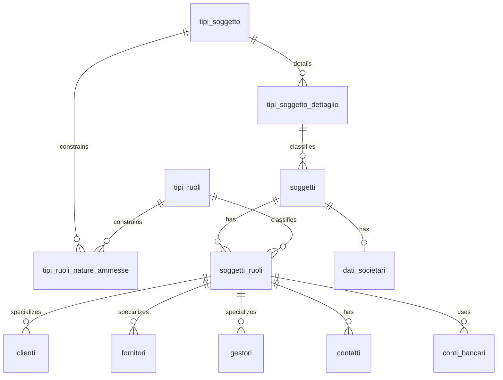

# 🌱 Guida Tecnica – Soggetti e Ruoli Anagrafici

> (latest review 01-03-26)
>
> 🎯 **Destinatari:** sviluppatori database, backend e analisti funzionali
>
> 🧩 **Fondamentale per comprendere tutte le altre guide anagrafiche (clienti, contatti, conti bancari, istanze)**.

---

## ✅ Introduzione e scopo

La gestione anagrafica in Zero ERP si basa su un modello potente e flessibile: **un soggetto può ricoprire più ruoli**, e ogni ruolo può avere **dati specifici e comportamenti propri**.

Questa guida descrive i principi fondamentali dei componenti:

* `anagrafiche.soggetti`
* `config.tipi_ruoli`
* `anagrafiche.soggetti_ruoli`
* Tabelle specializzate dei ruoli (es. `clienti`, `gestori`, ecc.)

L’obiettivo è fornire una visione chiara e coerente che consenta di capire **come nascono i ruoli**, come vengono **utilizzati nei processi**, e perché questo modello consente di gestire in modo naturale contatti, conti bancari e relazioni commerciali.

---
## 🧱 Tabelle coinvolte

**Anagrafiche:**

* [anagrafiche.soggetti](/dbzero/anagrafiche/tabelle/soggetti) — identita anagrafica
* [anagrafiche.soggetti_ruoli](/dbzero/anagrafiche/tabelle/soggetti_ruoli) — giunzione soggetto ↔ ruolo
* [anagrafiche.clienti](/dbzero/anagrafiche/tabelle/clienti) — specializzazione ruolo CL
* [anagrafiche.dati_societari](/dbzero/anagrafiche/tabelle/dati_societari) — dati camerali (per PG/ENC)
* [anagrafiche.contatti](/dbzero/anagrafiche/tabelle/contatti) — contatti soggetto e ruolo
* [anagrafiche.istanze_utilities](/dbzero/anagrafiche/tabelle/istanze_utilities) — POD/PDR/PDP collegati al ruolo

**Configurazione:**

* [config.tipi_ruoli](/dbzero/config/tabelle/tipi_ruoli) — catalogo ruoli
* [config.tipi_soggetto](/dbzero/config/tabelle/tipi_soggetto) — natura base (PF, PG, ENC)
* [config.tipi_soggetto_dettaglio](/dbzero/config/tabelle/tipi_soggetto_dettaglio) — dettaglio natura (PR, DI, SC, SP, ENC)
* [config.tipi_ruoli_nature_ammesse](/dbzero/config/tabelle/tipi_ruoli_nature_ammesse) — matrice natura ↔ ruolo
* [config.tipi_contatti](/dbzero/config/tabelle/tipi_contatti) — catalogo tipi contatto

---

## 🧩 Componenti principali

### **1. `anagrafiche.soggetti` – L'identità “nuda”**

Un **soggetto** rappresenta una persona fisica o giuridica.
È l'entità anagrafica di base e contiene solo dati **stabili** e **non dipendenti dal ruolo**, come:

* ragione sociale, nome, cognome
* codice fiscale / partita IVA
* natura giuridica (`tipo_soggetto_dettaglio_id`)
* dati di classificazione generale

> 🔑 **Un soggetto non è ancora un cliente, né un fornitore, né un gestore.**

---

### **1b. Natura del soggetto – `tipo_soggetto_dettaglio`**

Ogni soggetto ha una **natura giuridica** definita da due livelli:

| Livello | Tabella | Esempi |
|---------|---------|--------|
| Base | [`config.tipi_soggetto`](/dbzero/config/tabelle/tipi_soggetto) | PF (Persona Fisica), PG (Persona Giuridica), ENC (Ente) |
| Dettaglio | [`config.tipi_soggetto_dettaglio`](/dbzero/config/tabelle/tipi_soggetto_dettaglio) | PR (Privato), DI (Ditta Ind.), SP (Soc. Persone), SC (Soc. Capitali), ENC (Ente) |

Il `tipo_soggetto_dettaglio` configura vincoli e comportamenti specifici per natura:

| Campo | Significato |
|-------|-------------|
| `formato_cf` | Formato atteso del codice fiscale (`CF_16`, `NUM_11`, `NON_APPLICABILE`) |
| `formato_piva` | Formato atteso della partita IVA (`NUM_11`, `NON_APPLICABILE`) |
| `cf_obbligatorio` | Se `true`, il soggetto **deve** avere un codice fiscale |
| `piva_obbligatoria` | Se `true`, il soggetto **deve** avere una partita IVA |
| `dati_societari_policy` | `NONE` / `OPTIONAL` / `REQUIRED` — regola la presenza di [`dati_societari`](/dbzero/anagrafiche/tabelle/dati_societari) |

**Regole di obbligatorietà CF/PIVA per tipo:**

| Tipo | Natura | CF obbligatorio | PIVA obbligatoria |
|------|--------|:---:|:---:|
| PR (Privato) | PF | si | no |
| DI (Ditta Individuale) | PF | si | si |
| SP (Soc. Persone) | PG | si | si |
| SC (Soc. Capitali) | PG | si | si |
| ENC (Ente) | ENC | si | si |

**Dati societari per tipo:**

| Tipo | Policy | Significato |
|------|--------|-------------|
| PR | `NONE` | Dati societari vietati |
| DI | `NONE` | Dati societari vietati |
| SP | `OPTIONAL` | Dati societari ammessi ma non obbligatori |
| SC | `REQUIRED` | Dati societari obbligatori |
| ENC | `REQUIRED` | Dati societari obbligatori |

> La validazione della **presenza** (CF/PIVA obbligatori) e del **formato** (CF_16, NUM_11) sono due concern separati, gestiti da trigger distinti (vedi sezione "Vincoli e trigger" piu avanti).

---

### **2. `config.tipi_ruoli` – Il catalogo dei ruoli**

Contiene l'elenco dei ruoli che un soggetto può ricoprire, ad esempio:

* CLIENTE
* FORNITORE
* GESTORE
* VENDITORE
* DISTRIBUTORE

I ruoli rappresentano **proiezioni funzionali** del soggetto nel sistema gestionale.

> Ogni ruolo abilita logiche, dati e comportamenti differenti.

---

### **3. `anagrafiche.soggetti_ruoli` – Il ponte soggetto ↔ ruolo**

È la tabella **cardine** del modello anagrafico e funge da **tabella di giunzione** tra:

* l'identità "pura" (`anagrafiche.soggetti`)
* il ruolo funzionale (`config.tipi_ruoli`)

Creando un record in `soggetti_ruoli`, si afferma esplicitamente:

> "Questo soggetto ricopre il ruolo X".

Da un punto di vista tecnico:

* `id` è la **chiave primaria** (BIGINT, identity) ed è l'identificativo univoco del **singolo ruolo assegnato** a quel soggetto;
* `soggetto_id` (UUID) è una FK verso `anagrafiche.soggetti.id`;
* `tipo_ruolo_id` è una FK verso `config.tipi_ruoli.id`;
* il vincolo `UNIQUE (soggetto_id, tipo_ruolo_id)` garantisce che uno stesso soggetto non possa avere **duplicazioni** dello stesso ruolo;
* gli indici su `soggetto_id` e `tipo_ruolo_id` permettono di navigare **velocemente in entrambe le direzioni**:

  * da un soggetto → tutti i ruoli associati,
  * da un ruolo → tutti i soggetti che lo ricoprono.

L'utilizzo di `soggetto_ruolo_id` come FK nelle tabelle specializzate (es. `clienti`, `gestori`, `fornitori`, conti bancari, contatti) consente di:

* risalire **in un solo join** al soggetto di origine;
* mantenere chiara la separazione tra *identità* (soggetto) e *ruolo di dominio* (cliente, gestore, ecc.);
* costruire query e viste che lavorano in maniera uniforme su tutti i ruoli.

In pratica, `anagrafiche.soggetti_ruoli` è il **punto di aggancio unico** tra il mondo anagrafico e tutte le specializzazioni di ruolo usate nei moduli funzionali di Zero ERP.

---

### **3b. Compatibilita natura ↔ ruolo – `tipi_ruoli_nature_ammesse`**

Non tutti i ruoli sono assegnabili a qualsiasi natura. La matrice [`config.tipi_ruoli_nature_ammesse`](/dbzero/config/tabelle/tipi_ruoli_nature_ammesse) definisce le combinazioni ammesse:

| Ruolo | Codice | Nature ammesse |
| ----- | ------ | -------------- |
| Cliente | CL | PF, PG, ENC |
| Fornitore | FO | PF, PG, ENC |
| Gestore | GE | PG |
| Venditore | VE | PF, PG |
| Distributore | DI | PG |
| Emittente Fiscale | EF | PG |
| Risorsa Umana | RIS_UMANA | PF |
| Referente | RE | PF, PG |
| Vettore | VT | PF, PG |
| Banca | BANK | PG, ENC |
| PSP | PSP | PG |

**Logica fail-open:** se un ruolo **non ha righe** nella matrice, qualsiasi natura e ammessa. Solo i ruoli esplicitamente configurati vengono vincolati.

Il trigger [`trgfn_soggetti_ruoli_guard_natura_ammessa()`](/dbzero/anagrafiche/funzioni/trgfn_soggetti_ruoli_guard_natura_ammessa) verifica la compatibilita in `BEFORE INSERT/UPDATE` su `soggetti_ruoli`.

---

### **4. Tabelle specializzate dei ruoli**

Per ogni ruolo che richiede dati aggiuntivi esiste una tabella dedicata, ad esempio:

* `anagrafiche.clienti`
* `anagrafiche.fornitori`
* `anagrafiche.gestori`

Queste tabelle si collegano tramite:

```
soggetto_ruolo_id → anagrafiche.soggetti_ruoli.id
```

> 🔍 In questo modo i dati specializzati appartengono **solo** al ruolo pertinente.

---

## 🛡️ Vincoli e trigger

La validazione del modello soggetti/ruoli avviene su piu livelli tramite trigger PostgreSQL. I trigger seguono la convenzione di naming: `_a10_` = guard (fail-fast), `_z90_` = finale.

### Sul soggetto (`anagrafiche.soggetti`)

| Trigger function | Evento | Descrizione |
| ---------------- | ------ | ----------- |
| [`trgfn_soggetti_guard_cf_piva_obbligatori()`](/dbzero/anagrafiche/funzioni/trgfn_soggetti_guard_cf_piva_obbligatori) | BEFORE INSERT/UPDATE | Verifica **presenza** di CF e/o PIVA in base ai flag `cf_obbligatorio` e `piva_obbligatoria` di `tipi_soggetto_dettaglio` |
| [`trgfn_soggetti_valida_cf_piva_dispatch()`](/dbzero/anagrafiche/funzioni/trgfn_soggetti_valida_cf_piva_dispatch) | BEFORE INSERT/UPDATE | Verifica **formato** di CF e PIVA (dispatcha a `fn_validate_cf_piva_it` per soggetti italiani) |
| [`trgfn_soggetti_guard_dati_societari_required()`](/dbzero/anagrafiche/funzioni/trgfn_soggetti_guard_dati_societari_required) | CONSTRAINT DEFERRED | Verifica che soggetti con policy `REQUIRED` abbiano `dati_societari` presenti al commit |
| [`trgfn_soggetti_guard_indirizzi_required()`](/dbzero/anagrafiche/funzioni/trgfn_soggetti_guard_indirizzi_required) | CONSTRAINT DEFERRED | Verifica che gli indirizzi obbligatori per la natura del soggetto siano presenti al commit |

### Sull'assegnazione ruolo (`anagrafiche.soggetti_ruoli`)

| Trigger function | Evento | Descrizione |
| ---------------- | ------ | ----------- |
| [`trgfn_soggetti_ruoli_guard_natura_ammessa()`](/dbzero/anagrafiche/funzioni/trgfn_soggetti_ruoli_guard_natura_ammessa) | BEFORE INSERT/UPDATE | Verifica che la natura del soggetto sia ammessa per il ruolo richiesto (matrice `tipi_ruoli_nature_ammesse`) |
| [`trgfn_soggetti_ruoli_guard_indirizzi_required()`](/dbzero/anagrafiche/funzioni/trgfn_soggetti_ruoli_guard_indirizzi_required) | CONSTRAINT DEFERRED | Verifica che gli indirizzi obbligatori per il tipo ruolo siano presenti al commit (matrice `tipi_ruolo_tipi_indirizzo`) |

### Sui dati societari (`anagrafiche.dati_societari`)

| Trigger function | Evento | Descrizione |
| ---------------- | ------ | ----------- |
| [`trgfn_dati_societari_guard_tipo_soggetto()`](/dbzero/anagrafiche/funzioni/trgfn_dati_societari_guard_tipo_soggetto) | BEFORE INSERT/UPDATE | Impedisce l'inserimento di dati societari per soggetti con policy `NONE` |

> **Nota sui trigger DEFERRED:** i vincoli su indirizzi e dati societari sono `DEFERRABLE INITIALLY DEFERRED`, quindi vengono valutati al **commit** della transazione. Questo permette di inserire soggetto, contatto, indirizzo e dati societari in qualsiasi ordine all'interno della stessa transazione.

---

## 🧭 Esempi pratici

### **Caso 1 – Persona fisica mono-ruolo (solo cliente)**

* `soggetti`: Mario Rossi, tipo = PR (Privato, PF)
* CF obbligatorio (cf_obbligatorio = true), PIVA non richiesta
* `soggetti_ruoli`: CLIENTE — ammesso per PF dalla matrice
* `clienti`: dati contrattuali, condizioni
* contatti e indirizzi: legati sia al soggetto che al ruolo

---

### **Caso 2 – Azienda multi-ruolo (cliente + fornitore)**

* `soggetti`: ACME S.r.l., tipo = SC (Soc. Capitali, PG)
* CF e PIVA obbligatori, dati_societari REQUIRED
* `soggetti_ruoli`: CLIENTE + FORNITORE — entrambi ammessi per PG
* `dati_societari`: forma giuridica, REA, capitale sociale
* contatti: gestibili in modo separato per ruolo

---

### **Caso 3 – Ruolo particolare: Gestore**

* Ruolo GESTORE ammesso **solo per PG** (matrice `tipi_ruoli_nature_ammesse`)
* Una persona fisica (PR/DI) **non puo** essere assegnata come Gestore
* Tabella `gestori` con vincoli specifici (es. singleton)
* Concetto distinto dal cliente, anche se riferito allo stesso soggetto

---

### **Caso 4 – Assegnazione bloccata dalla natura**

* `soggetti`: ACME S.r.l., tipo = SC (PG)
* Tentativo di assegnare ruolo RIS_UMANA (ammesso solo per PF)
* Il trigger `trgfn_soggetti_ruoli_guard_natura_ammessa()` blocca l'operazione con errore `E_RUOLO_NATURA_NON_AMMESSA`

---

## 📍 Contatti appesi al ruolo

Grazie al modello soggetti/ruoli:

* un contatto può essere assegnato **al ruolo**, non all’identità generica
* si evitano collisioni tra usi diversi dello stesso soggetto
* la gestione resta coerente con i processi di dominio per cliente/fornitore/gestore

> 🔑 Questo permette una gestione nativamente multi-ruolo senza duplicazioni.

---

## 💳 Conti bancari e ruolo del cliente

La struttura ruoli semplifica enormemente la gestione dei conti bancari.

* I conti **non** vengono legati al soggetto “puro”, ma al **ruolo rilevante**.
* Un cliente può avere uno o più conti bancari collegati al suo `soggetto_ruolo_id`.
* Il conto può essere ulteriormente collegato al `billing_account` per definire modalità di addebito specifiche.

Questo approccio garantisce:

* nessuna duplicazione dei conti tra ruoli diversi
* chiarezza nel contesto di utilizzo (es. conto bancario di incasso → ruolo CLIENTE)
* coerenza con le logiche di fatturazione

---

## 🧠 Perché questo modello?

### **Vantaggi principali:**

* evita duplicazioni di dati
* permette evoluzione modulare
* semplifica l’aggiunta di nuovi ruoli
* rende naturale la gestione multi-ruolo
* centralizza l’identità anagrafica

> È uno dei pilastri che rendono Zero ERP estensibile e robusto.

---

## 🔗 Diagramma ER (Core Soggetti/Ruoli)



---

## 📌 Note finali

Questa guida fornisce le basi concettuali per comprendere:

* [`la gestione istanze utility`](/guide/gestione-delle-istanze-utility),
* [`la generazione di un cliente`](/guide/generazione-cliente),
* [`la logica dei conti bancari`](/guide/gestione-conti-bancari),
* [`la gestione dei contatti`](/guide/gestione-dei-contatti),

Le altre guide (clienti, contatti, fatturazione) assumono **come prerequisito** la comprensione di questo modello.

---


