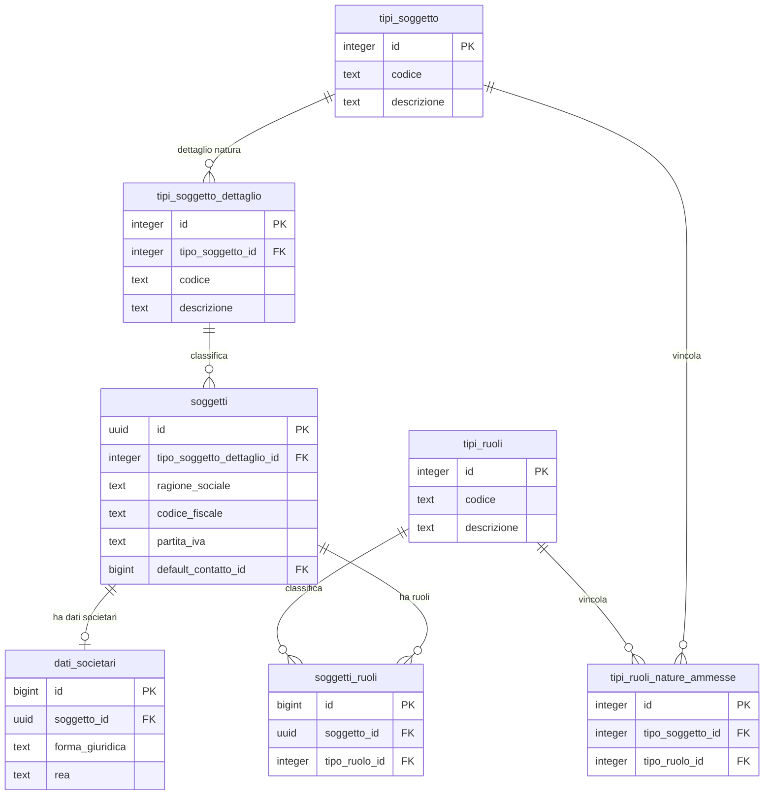

# Guida — Soggetti e Ruoli Anagrafici

> **Ultimo aggiornamento**: 19 settembre 2026
>
> **Destinatari**: sviluppatori database, backend e analisti funzionali
>
> **Vedi anche** — schemi DB:
>
> * [anagrafiche.soggetti](/dbzero/anagrafiche/tabelle/soggetti) — l'identita anagrafica (la persona o l'azienda)
> * [anagrafiche.soggetti_ruoli](/dbzero/anagrafiche/tabelle/soggetti_ruoli) — il collegamento soggetto ↔ ruolo
> * [anagrafiche.identita_digitali](/dbzero/anagrafiche/tabelle/identita_digitali) — il ponte verso un account utente
> * [anagrafiche.clienti](/dbzero/anagrafiche/tabelle/clienti) — i dati specifici del ruolo CLIENTE
> * [anagrafiche.fornitori](/dbzero/anagrafiche/tabelle/fornitori) — i dati specifici del ruolo FORNITORE
> * [anagrafiche.emittenti_fiscali](/dbzero/anagrafiche/tabelle/emittenti_fiscali) — i dati di emissione del ruolo EMITTENTE FISCALE
> * [anagrafiche.emittenti_fiscali_billing_account](/dbzero/anagrafiche/tabelle/emittenti_fiscali_billing_account) — il mapping verso i billing account: l'unico punto in cui compare l'emittente
> * [anagrafiche.dati_societari](/dbzero/anagrafiche/tabelle/dati_societari) — i dati camerali (aziende ed enti)
> * [anagrafiche.contatti](/dbzero/anagrafiche/tabelle/contatti) — i contatti del soggetto e del ruolo
> * [anagrafiche.conti_bancari](/dbzero/anagrafiche/tabelle/conti_bancari) — i conti collegati al ruolo
> * [anagrafiche.istanze_utilities](/dbzero/anagrafiche/tabelle/istanze_utilities) — i cicli di servizio collegati al soggetto
> * [config.tipi_ruoli](/dbzero/config/tabelle/tipi_ruoli) — il catalogo dei ruoli disponibili
> * [config.tipi_soggetto](/dbzero/config/tabelle/tipi_soggetto) — la natura base (PF, PG, ENC)
> * [config.tipi_soggetto_dettaglio](/dbzero/config/tabelle/tipi_soggetto_dettaglio) — il dettaglio della natura (PR, DI, SP, SC, ENC)
> * [config.tipi_ruoli_nature_ammesse](/dbzero/config/tabelle/tipi_ruoli_nature_ammesse) — la matrice natura ↔ ruolo
> * [config.tipi_contatti](/dbzero/config/tabelle/tipi_contatti) — il catalogo dei tipi contatto
>
> **Vedi anche** — funzioni e trigger DB:
>
> * [anagrafiche.trgfn_soggetti_ruoli_guard_natura_ammessa](/dbzero/anagrafiche/funzioni/trgfn_soggetti_ruoli_guard_natura_ammessa) — la natura ammessa per il ruolo richiesto
> * [anagrafiche.trgfn_soggetti_guard_cf_piva_obbligatori](/dbzero/anagrafiche/funzioni/trgfn_soggetti_guard_cf_piva_obbligatori) — presenza di CF e P.IVA per natura
> * [anagrafiche.fn_guard_albero_ba_emittente](/dbzero/anagrafiche/funzioni/fn_guard_albero_ba_emittente) — un albero di billing account non attraversa due emittenti
> * [script.fn_get_emittenti_scope_sr_ids](/dbzero/script/funzioni/fn_get_emittenti_scope_sr_ids) — gli emittenti nel perimetro dell'utente, come soggetto-ruolo
> * [script.fn_get_emittenti_scope_pk_ids](/dbzero/script/funzioni/fn_get_emittenti_scope_pk_ids) — gli stessi emittenti per chiave reale
> * [anagrafiche.fn_get_emittente_fiscale_id](/dbzero/anagrafiche/funzioni/fn_get_emittente_fiscale_id) — risale all'emittente di un documento
>
> **Vedi anche** — guide correlate:
>
> * [Glossario termini utility](/glossario/glossario-utility)
> * [Guida Generazione di un Cliente](/guide/generazione-cliente)
> * [Guida Gestione Istanze Utility](/guide/gestione-delle-istanze-utility)
> * [Guida Gestione dei Contatti](/guide/gestione-dei-contatti)
> * [Guida Gestione Conti Bancari](/guide/gestione-conti-bancari)
> * [Architettura Multi-Face Auth](/guide/architettura-multi-face-auth)

---

## Introduzione

In Zero ERP l'anagrafica si basa su un principio semplice: **una persona (o azienda) puo avere piu ruoli**. Mario Rossi puo essere contemporaneamente cliente, fornitore e referente. ACME S.r.l. puo essere cliente e fornitore allo stesso tempo.

Il modello separa l'**identita** (chi e la persona/azienda) dai **ruoli** (cosa fa nel sistema). Questa separazione evita duplicazioni, semplifica la gestione e rende naturale aggiungere nuovi ruoli in futuro senza ristrutturare tutto.

**Cosa troverai in questa guida:**

* Come funziona il modello soggetto/ruolo e perche e fatto cosi
* Cosa sono le nature giuridiche e come influenzano i vincoli
* Come vengono assegnati i ruoli e quali regole li governano
* Dove si agganciano contatti, conti bancari e dati specifici di ruolo
* Come si aggancia un account di accesso al ruolo (l'identita digitale)

Questa guida e il **prerequisito** per tutte le altre guide anagrafiche (clienti, contatti, conti bancari, istanze): le altre danno per compreso il modello soggetto/ruolo descritto qui.

---

## Il modello in sintesi

```text
soggetti (chi sei)
    │
    ├── soggetti_ruoli (cosa fai nel sistema)
    │       │
    │       ├── clienti        (dati specifici cliente)
    │       ├── fornitori      (dati specifici fornitore)
    │       ├── gestori        (dati specifici gestore)
    │       │
    │       ├── contatti       (contatti per ruolo)
    │       └── conti_bancari  (conti per ruolo)
    │
    └── dati_societari (solo per aziende/enti)
```

* **Soggetto** = l'identita. Contiene i dati stabili: nome, cognome, ragione sociale, codice fiscale, partita IVA
* **Ruolo** = la funzione nel sistema. Un soggetto puo avere piu ruoli contemporaneamente
* **Tabella specializzata** = i dati che servono solo per quel ruolo (es. condizioni contrattuali per il cliente)

---

## Componenti del modello

### 1. Il soggetto: l'identita di base

Un **soggetto** e una persona fisica o giuridica registrata nel sistema. Contiene solo i dati **stabili e indipendenti dal ruolo**:

* Ragione sociale, nome, cognome
* Codice fiscale / partita IVA
* Natura giuridica (privato, azienda, ente)
* Dati di classificazione generale

Un soggetto da solo **non e ancora un cliente, un fornitore o un gestore**. Lo diventa quando gli viene assegnato un ruolo.

### Natura giuridica del soggetto

Ogni soggetto ha una **natura** definita su due livelli:

| Livello   | Tabella                          | Esempi                                                                           |
| --------- | -------------------------------- | -------------------------------------------------------------------------------- |
| Base      | `config.tipi_soggetto`           | PF (Persona Fisica), PG (Persona Giuridica), ENC (Ente)                          |
| Dettaglio | `config.tipi_soggetto_dettaglio` | PR (Privato), DI (Ditta Ind.), SP (Soc. Persone), SC (Soc. Capitali), ENC (Ente) |

La natura determina automaticamente quali dati sono obbligatori:

| Tipo                   | Natura | CF obbligatorio | PIVA obbligatoria | Dati societari |
| ---------------------- | ------ | :-------------: | :---------------: | -------------- |
| PR (Privato)           | PF     |       si        |        no         | vietati        |
| DI (Ditta Individuale) | PF     |       si        |        si         | vietati        |
| SP (Soc. Persone)      | PG     |       si        |        si         | opzionali      |
| SC (Soc. Capitali)     | PG     |       si        |        si         | obbligatori    |
| ENC (Ente)             | ENC    |       si        |        si         | obbligatori    |

In pratica: un privato non deve avere dati societari (forma giuridica, REA, capitale sociale), mentre una S.r.l. li deve avere obbligatoriamente. Il sistema verifica automaticamente queste regole tramite trigger.

La validazione distingue due aspetti separati:

* **Presenza**: il codice fiscale e/o la partita IVA devono essere compilati? (dipende dal tipo)
* **Formato**: il codice fiscale ha 16 caratteri alfanumerici? La partita IVA ha 11 cifre? (dipende dal formato configurato)

---

### 2. Il catalogo dei ruoli

La tabella `config.tipi_ruoli` contiene l'elenco dei ruoli disponibili nel sistema:

* CLIENTE (CL)
* FORNITORE (FO)
* GESTORE (GE)
* VENDITORE (VE)
* DISTRIBUTORE (DI)
* EMITTENTE FISCALE (EF)
* RISORSA UMANA (RIS_UMANA)
* REFERENTE (RE)
* VETTORE (VT)
* BANCA (BANK)
* PSP (PSP)

Ogni ruolo abilita logiche, dati e comportamenti differenti nel sistema.

---

### 3. Il collegamento soggetto ↔ ruolo

La tabella `anagrafiche.soggetti_ruoli` e il **ponte** tra l'identita e il ruolo. Creando un record qui, si afferma: "questo soggetto ricopre il ruolo X".

Da un punto di vista tecnico:

* `id` (BIGINT) e la chiave primaria — identifica univocamente il singolo ruolo assegnato
* `soggetto_id` (UUID) → FK verso `soggetti`
* `tipo_ruolo_id` → FK verso `tipi_ruoli`
* Il vincolo `UNIQUE (soggetto_id, tipo_ruolo_id)` impedisce di assegnare lo stesso ruolo due volte

**Nota sulla scelta UUID vs BIGINT:** i soggetti usano UUID come chiave primaria perche sono entita "master" potenzialmente condivisibili tra sistemi esterni (import/export, sincronizzazione, API pubbliche). Le tabelle interne ad alta cardinalita come `soggetti_ruoli`, `clienti`, `billing_account` usano BIGINT per efficienza (indici piu compatti, join piu rapidi, nessuna necessita di distribuzione esterna).

Tutte le tabelle specializzate (clienti, fornitori, gestori) e le tabelle trasversali (contatti, conti bancari) si agganciano a `soggetti_ruoli.id`. Questo significa che con un solo join si risale dal dato specifico (es. un contatto del cliente) all'identita del soggetto.

In pratica, `soggetti_ruoli` e il **punto di aggancio unico** tra il mondo anagrafico e tutte le specializzazioni usate nei moduli funzionali di Zero ERP.

---

### 4. Compatibilita natura ↔ ruolo

Non tutti i ruoli sono assegnabili a qualsiasi natura. La matrice `config.tipi_ruoli_nature_ammesse` definisce le combinazioni ammesse:

| Ruolo             | Codice    | Nature ammesse |
| ----------------- | --------- | -------------- |
| Cliente           | CL        | PF, PG, ENC    |
| Fornitore         | FO        | PF, PG, ENC    |
| Gestore           | GE        | solo PG        |
| Venditore         | VE        | PF, PG         |
| Distributore      | DI        | solo PG        |
| Emittente Fiscale | EF        | solo PG        |
| Risorsa Umana     | RIS_UMANA | solo PF        |
| Referente         | RE        | PF, PG         |
| Vettore           | VT        | PF, PG         |
| Banca             | BANK      | PG, ENC        |
| PSP               | PSP       | solo PG        |

**Logica fail-open:** se un ruolo non ha righe nella matrice, qualsiasi natura e ammessa. Solo i ruoli esplicitamente configurati vengono vincolati.

Il trigger `trgfn_soggetti_ruoli_guard_natura_ammessa()` verifica la compatibilita automaticamente al momento dell'assegnazione.

---

### 5. Tabelle specializzate dei ruoli

Non tutti i ruoli hanno una tabella dedicata. Solo quelli che richiedono dati aggiuntivi oltre al semplice collegamento soggetto ↔ ruolo:

| Ruolo                     | Tabella specializzata           | Dati principali                                                 |
| ------------------------- | ------------------------------- | --------------------------------------------------------------- |
| CLIENTE (CL)              | `anagrafiche.clienti`           | condizioni contrattuali, fatturazione, stato, periodo           |
| FORNITORE (FO)            | `anagrafiche.fornitori`         | condizioni di acquisto, regime fiscale, ritenuta                |
| GESTORE (GE)              | `anagrafiche.gestori`           | dati operativi, codice software, valuta                         |
| RISORSA UMANA (RIS_UMANA) | `anagrafiche.risorse_umane`     | qualifica, unita organizzativa, periodo validita                |
| VETTORE (VT)              | `anagrafiche.vettori`           | codice, descrizione, stato attivo                               |
| EMITTENTE FISCALE (EF)    | `anagrafiche.emittenti_fiscali` | regime fiscale RF, bollo, valuta, policy operative di emissione |
| PSP (PSP)                 | `anagrafiche.psp`               | codice, descrizione, stato attivo                               |

I ruoli **REFERENTE** (RE), **VENDITORE** (VE), **DISTRIBUTORE** (DI) e **BANCA** (BANK) non hanno tabella specializzata: operano solo tramite il record in `soggetti_ruoli` e le tabelle trasversali (contatti, conti bancari).

Tutte le tabelle specializzate si collegano tramite `soggetto_ruolo_id → soggetti_ruoli.id` con vincolo UNIQUE: un solo record specializzato per ruolo assegnato. I dati appartengono solo al ruolo pertinente — le condizioni di pagamento del cliente non si mescolano con quelle del fornitore, anche se il soggetto e lo stesso.

---

### 5a-bis. ⭐ Il soggetto NON ha un emittente fiscale

> ⚠️ **Sezione canonica.** L'assenza di questo legame e **implicita**, e cio' che
> e' implicito viene letto al contrario: si e' gia' chiesto «l'emittente del
> soggetto» come se fosse un suo attributo. Questa sezione nasce per togliere di
> mezzo quell'equivoco una volta per tutte.

**In tutta l'anagrafica l'emittente fiscale compare in un solo posto:**

```text
anagrafiche.emittenti_fiscali_billing_account.emittente_soggetto_ruolo_id
```

Non esiste su `soggetti`, ne' su `soggetti_ruoli`, ne' su `clienti`, ne' su
`billing_account`, ne' su `istanze_utilities`. Verificato sul catalogo, non
dedotto.

| Entita'             | Legame con l'emittente                                                                                                                                                                                                         |
| ------------------- | ------------------------------------------------------------------------------------------------------------------------------------------------------------------------------------------------------------------------------ |
| **billing account** | ✅ **esattamente uno**, per costruzione: `UNIQUE (billing_account_id)` sul mapping, piu' la riserva per il BA non ancora collegato — in sessione l'emittente di chi agisce, altrimenti il gestore globale (che e' comunque uno) |
| **soggetto**        | ❌ **nessuno.** Il legame esiste solo *transitivamente*, attraverso i billing account del soggetto                                                                                                                              |

#### Cosa ne segue, in pratica

* **un soggetto puo' essere cliente di piu' emittenti**, ed e' legittimo: sono
  alberi di billing account separati, uno per emittente;
* la regola che il database presidia **non** e' *«un soggetto sta sotto un solo
  emittente»* — sarebbe falsa e dannosa. E' *«un singolo albero di billing
  account non attraversa due emittenti»*, ed e' un'altra cosa. Guard:
  [`fn_guard_albero_ba_emittente`](/dbzero/anagrafiche/manual/fn_guard_albero_ba_emittente);
* ⚠️ **quando si mostra «l'emittente» accanto a un soggetto**, si sta mostrando
  una **relazione**, non un attributo. Se il soggetto ne tocca due, i valori sono
  due: l'etichetta deve dirlo (*«emittenti presso cui e' cliente»*), e la riga
  **non** va duplicata per emittente — duplicarla cambierebbe il significato di
  un conteggio di soggetti;
* dove invece l'emittente **e'** un dato pulito per riga e' il livello del
  **rapporto**: ogni riga cliente punta a un billing account, quindi a un
  emittente solo.

---

### 5b. Identificazione canonica di un ruolo specializzato — PK reale vs `soggetto_ruolo_id`

> ⚠️ **Sezione canonica — leggere prima di disegnare nuove tabelle / FK / fn che riferiscono un ruolo specializzato (cliente, fornitore, emittente_fiscale, reseller, ecc.).**

Le tabelle specializzate dei ruoli (`emittenti_fiscali`, `clienti`, `fornitori`, `resellers`) hanno **due identificatori validi** che convivono per design:

| Identificatore                   | Esempio                                                              | Significato                                                                                                                |
| -------------------------------- | -------------------------------------------------------------------- | -------------------------------------------------------------------------------------------------------------------------- |
| **PK reale** della tabella ruolo | `emittenti_fiscali.id`, `clienti.id`, `fornitori.id`, `resellers.id` | identita' autoritativa dell'**entita' di ruolo** con i suoi attributi business (`attivo`, `is_default`, `matricola`, ecc.) |
| **Denorm `soggetto_ruolo_id`**   | `emittenti_fiscali.soggetto_ruolo_id`, idem per le altre             | riferimento al **soggetto nel ruolo** durante il periodo di validita' (`soggetti_ruoli.valido_dal/valido_al`)              |

Le tabelle che vogliono riferire un ruolo specializzato usano una delle due colonne **a seconda della semantica voluta**. **Entrambe sono pattern intenzionali**: non sono "dualita' da eliminare". I refactor che cercano di unificare su un solo pattern sono **sconsigliati**.

#### Quando usare `soggetto_ruolo_id` (SR id)

Pattern colonna FK: `<ruolo>_soggetto_ruolo_id` (es. `emittente_soggetto_ruolo_id`, `reseller_soggetto_ruolo_id`) oppure semplicemente `soggetto_ruolo_id` (es. `vendite.ordini.soggetto_ruolo_id` per cliente).

| Contesto                            | Esempio attuale                                                                                                                                                                                                                                                                                                       | Perche' SR id                                                                                                                                                                          |
| ----------------------------------- | --------------------------------------------------------------------------------------------------------------------------------------------------------------------------------------------------------------------------------------------------------------------------------------------------------------------- | -------------------------------------------------------------------------------------------------------------------------------------------------------------------------------------- |
| **Documenti contrattuali**          | `vendite.fatture.emittente_soggetto_ruolo_id`, `vendite.fatture.reseller_soggetto_ruolo_id`, `vendite.ordini.soggetto_ruolo_id` (cliente), `vendite.commesse.emittente_soggetto_ruolo_id`, `vendite.listini.emittente_soggetto_ruolo_id`, `anagrafiche.emittenti_fiscali_billing_account.emittente_soggetto_ruolo_id` | Il documento ricorda il **soggetto nel ruolo all'istante del contratto**. Ragione sociale, codice fiscale stampati sulla fattura sono quelli del SR vigente al momento dell'emissione. |
| **Snapshot legali**                 | tutti i registri fatturazione, scope arrotondamenti, source fondi fattura                                                                                                                                                                                                                                             | Devono essere stabili rispetto a future modifiche dell'entita' EF.                                                                                                                     |
| **JOIN diretto a `soggetti_ruoli`** | `fn_search_soggetti_universale`, `fn_get_search_detail`, `vw_indirizzi_resolved_*`                                                                                                                                                                                                                                    | Un solo hop a `soggetti_ruoli` invece di due (`<tabella_ruolo> → soggetti_ruoli → soggetti`).                                                                                          |
| **Pattern uniforme cross-ruolo**    | tutti i ruoli (cliente, fornitore, emittente, reseller) referenziati come parte contrattuale                                                                                                                                                                                                                          | Stesso pattern ovunque: facile riconoscere, facile generare query.                                                                                                                     |

#### Quando usare PK reale (`<ruolo>_<entita>_id`)

Pattern colonna FK: `<ruolo>_<entita>_id` (es. `emittente_fiscale_id`, `cliente_id` se mai dovesse servire).

| Contesto                                      | Esempio attuale                                                                        | Perche' PK                                                                                                                   |
| --------------------------------------------- | -------------------------------------------------------------------------------------- | ---------------------------------------------------------------------------------------------------------------------------- |
| **Scope/permessi utente**                     | `config.user_emittenti_fiscali.emittente_fiscale_id`                                   | L'utente "appartiene" all'**entita' EF**, non a un suo SR storico. Cambi di SR (rinnovo ruolo) non devono cambiare lo scope. |
| **Override parametrici**                      | `config.parameter_overrides.emittente_fiscale_id`                                      | I parametri configurano l'entita' EF in quanto tale.                                                                         |
| **Snapshot user-derived**                     | `vendite.preventivi.emittente_fiscale_id` (rev2 — operatore creatore)                  | Cattura "operatore appartiene a EF" — concetto entita'.                                                                      |
| **Filtri su attributi business dell'entita'** | view che filtrano per `attivo`, `is_default`, `matricola`                              | Le view finite consumano l'entita'.                                                                                          |
| **Chiavi di lookup parametriche**             | `vw_preventivi_list.emittente_fiscale_id` (per filtro scope con `parameter_overrides`) | Il filtro confronta entita' con entita'.                                                                                     |

#### Tabella decisionale veloce

| Domanda                                                    | Risposta SR id        | Risposta PK reale |
| ---------------------------------------------------------- | --------------------- | ----------------- |
| Devo ricordare il soggetto stampato in calce alla fattura? | ✓                     | ✗                 |
| Devo legare l'utente all'EF (scope)?                       | ✗                     | ✓                 |
| Devo fare JOIN con ragione sociale del soggetto?           | ✓ (1 hop)             | (2 hop)           |
| Devo essere stabile rispetto a rinnovi/cambi del SR?       | ✗                     | ✓                 |
| Sto referenziando da un documento contrattuale?            | ✓                     | ✗                 |
| Sto referenziando da una tabella di config/scope/override? | ✗                     | ✓                 |
| Devo filtrare per `attivo`, `is_default`, `matricola`?     | (richiede JOIN extra) | ✓                 |

Se la risposta non e' chiara, **propenderlo a SR id**: e' il pattern dominante per i documenti, e quasi sempre il riferimento contrattuale e' la cosa giusta da preservare.

#### Conseguenze sui filtri scope (es. permessi vendita)

Per filtrare quali emittenti puo' vedere un utente, esistono **due funzioni parallele**, con la stessa semantica ma return type diverso:

| Funzione                                             | Return type           | Quando usarla                                                                                                             |
| ---------------------------------------------------- | --------------------- | ------------------------------------------------------------------------------------------------------------------------- |
| `script.fn_get_emittenti_scope_sr_ids(auth_user_id)` | `bigint[]` (SR id)    | Filtri su colonne `<ruolo>_soggetto_ruolo_id` (fatture, ordini, commesse, listini, BA scope, search universale, ecc.)     |
| `script.fn_get_emittenti_scope_pk_ids(auth_user_id)` | `bigint[]` (PK reale) | Filtri su colonne `<ruolo>_fiscale_id` (vw_preventivi_list, parameter_overrides, user_emittenti_fiscali, preventivi rev2) |

Le due fn condividono i guard (no identita' OPERATORE → `'{}'`; super admin → NULL; altrimenti whitelist). `_sr_ids` e' implementata come wrapper su `_pk_ids` (single source of truth). Vedi manual `script.fn_get_emittenti_scope_pk_ids` e `script.fn_get_emittenti_scope_sr_ids` per dettagli.

#### Cosa NON fare

* ❌ **Non rinominare le colonne `<ruolo>_soggetto_ruolo_id` in `<ruolo>_<entita>_id`** "per uniformita'" — il pattern SR id e' intenzionale per i documenti.
* ❌ **Non droppare `anagrafiche.fn_get_emittente_fiscale_id`** (che ritorna SR id) — la sua logica e' corretta nei 36 caller che la usano per JOIN su SR. Il nome e' fuorviante (sembra ritornare PK ma ritorna SR), ma il refactor del nome e' una pulizia cosmetica, da fare in un brief separato e con coordinamento di tutti i caller.
* ❌ **Non aggiungere il filtro `ef.attivo` nelle fn di scope** — gia' garantito dai trigger di constraint che bloccano disattivazione di EF con figli in `user_emittenti_fiscali`.
* ❌ **Non refactorare** `clienti`/`fornitori`/`resellers` per simmetria con `emittenti_fiscali` — il pattern duale e' uniforme su tutti, e la sua eliminazione costerebbe di piu' di quanto risolva.

---

### 6. Il ponte verso l'account utente

Non tutte le coppie soggetto-ruolo accedono al software. Quando serve — un operatore interno, il cliente di un portale, il fornitore che entra dal suo portale, chi acquista dallo shop — il ruolo riceve una **identita digitale**: la tabella `anagrafiche.identita_digitali` lega un `soggetti_ruoli` a un account Django e dice con quale **veste** quella persona entra nel sistema (`ruolo_applicativo`).

Vale la stessa logica del resto dell'anagrafica: l'identita digitale appartiene al **ruolo**, non al soggetto. Un'azienda che e cliente e fornitore puo avere una veste per il portale clienti e una diversa per il portale fornitori; e un soggetto puo essere, con lo stesso account, operatore interno e cliente del portale, perche le vesti convivono.

Due cose che questo ponte **non** cambia nel modello anagrafico:

* **Nessun attributo nuovo sul soggetto o sul ruolo.** `soggetti`, `soggetti_ruoli`, `tipi_ruoli` e le tabelle specializzate restano quelli descritti in questa guida: l'accesso e un ponte in piu, non una proprieta dell'anagrafica.
* **Il vincolo «persona fisica pura» non e generale.** Riguarda la sola veste `OPERATORE` — la persona interna, che deve avere codice fiscale e nessuna partita IVA. Un soggetto persona giuridica puo avere l'account del suo portale; un processo automatico che opera nel sistema ha invece una veste **tecnica**, collegata a un soggetto-ruolo di tipo processo.

> Per il modello auth completo — ruoli applicativi, profili di accesso, scope policy dei portali e dello shop — vedi [Architettura Multi-Face Auth](/guide/architettura-multi-face-auth).
> Per il ciclo di vita di un operatore (invito, credenziali, cessazione) vedi [Risorse Umane e Accessi](/guide/risorse-umane-e-accessi).

---

## Vincoli e trigger

La validazione del modello avviene su piu livelli tramite trigger PostgreSQL. I trigger usano la convenzione `_a10_` = guard (verifica immediata), `_z90_` = finale.

### Sul soggetto (`anagrafiche.soggetti`)

| Trigger function                               | Evento               | Cosa verifica                                            |
| ---------------------------------------------- | -------------------- | -------------------------------------------------------- |
| `trgfn_soggetti_guard_cf_piva_obbligatori`     | BEFORE INSERT/UPDATE | CF e/o PIVA presenti in base alla natura                 |
| `trgfn_soggetti_valida_cf_piva_dispatch`       | BEFORE INSERT/UPDATE | Formato corretto di CF e PIVA (16 char, 11 cifre, ecc.)  |
| `trgfn_soggetti_guard_dati_societari_required` | CONSTRAINT DEFERRED  | Dati societari presenti per soggetti con policy REQUIRED |
| `trgfn_soggetti_guard_indirizzi_required`      | CONSTRAINT DEFERRED  | Indirizzi obbligatori presenti per la natura             |

### Sull'assegnazione ruolo (`anagrafiche.soggetti_ruoli`)

| Trigger function                                | Evento               | Cosa verifica                                              |
| ----------------------------------------------- | -------------------- | ---------------------------------------------------------- |
| `trgfn_soggetti_ruoli_guard_natura_ammessa`     | BEFORE INSERT/UPDATE | Natura del soggetto ammessa per il ruolo richiesto         |
| `trgfn_soggetti_ruoli_guard_indirizzi_required` | CONSTRAINT DEFERRED  | Indirizzi obbligatori per il tipo ruolo presenti al commit |

### Sui dati societari (`anagrafiche.dati_societari`)

| Trigger function                           | Evento               | Cosa verifica                                         |
| ------------------------------------------ | -------------------- | ----------------------------------------------------- |
| `trgfn_dati_societari_guard_tipo_soggetto` | BEFORE INSERT/UPDATE | Impedisce dati societari per soggetti con policy NONE |

**Nota sui trigger DEFERRED:** i vincoli su indirizzi e dati societari vengono valutati al **commit** della transazione, non all'inserimento. Questo permette di creare soggetto, contatto, indirizzo e dati societari in qualsiasi ordine, purche al commit tutto sia a posto.

---

## Esempi pratici

### Caso 1 — Persona fisica, solo cliente

Mario Rossi e un privato che diventa cliente gas:

* **Soggetto**: Mario Rossi, tipo = PR (Privato, Persona Fisica)
* CF obbligatorio, PIVA non richiesta, dati societari vietati
* **Ruolo**: CLIENTE — ammesso per PF dalla matrice
* **Clienti**: dati contrattuali, IVA, condizioni pagamento
* Contatti e indirizzi: legati sia al soggetto che al ruolo CLIENTE

### Caso 2 — Azienda multi-ruolo (cliente e fornitore)

ACME S.r.l. e contemporaneamente cliente e fornitore:

* **Soggetto**: ACME S.r.l., tipo = SC (Soc. Capitali, PG)
* CF e PIVA obbligatori, dati societari REQUIRED (forma giuridica, REA, capitale)
* **Ruoli**: CLIENTE + FORNITORE — entrambi ammessi per PG
* Due record in `soggetti_ruoli`, ciascuno con il proprio `id`
* Contatti e conti bancari gestibili separatamente per ruolo: il contatto per le forniture non e lo stesso del contatto per gli ordini cliente

### Caso 3 — Ruolo con restrizione di natura

Il ruolo GESTORE e ammesso **solo per PG** (persone giuridiche). Se si tenta di assegnare il ruolo Gestore a un privato (PF), il trigger blocca l'operazione con errore `E_RUOLO_NATURA_NON_AMMESSA`.

Allo stesso modo, il ruolo RISORSA UMANA e ammesso solo per PF. Un'azienda non puo essere una risorsa umana.

---

## Contatti appesi al ruolo

Grazie alla separazione soggetto/ruolo, un contatto puo essere assegnato al **ruolo specifico**, non all'identita generica:

* Il numero di telefono del referente commerciale → agganciato al ruolo CLIENTE
* L'email della contabilita fornitori → agganciata al ruolo FORNITORE
* Nessuna collisione tra usi diversi dello stesso soggetto

Questo permette una gestione nativamente multi-ruolo senza duplicazioni.

---

## Conti bancari e ruolo del cliente

I conti bancari non vengono legati al soggetto "puro", ma al **ruolo**:

* Un cliente puo avere uno o piu conti collegati al suo `soggetto_ruolo_id`
* Il conto puo essere ulteriormente collegato al `billing_account` per modalita di addebito specifiche
* Il conto bancario per incassare dal cliente e quello per pagare il fornitore restano separati, anche se il soggetto e lo stesso

---

## Perche questo modello?

* **Nessuna duplicazione**: un soggetto esiste una sola volta, indipendentemente da quanti ruoli ha
* **Evoluzione modulare**: aggiungere un nuovo ruolo (es. "Agente") richiede solo una nuova riga in `tipi_ruoli` e una eventuale tabella specializzata
* **Multi-ruolo naturale**: la struttura nasce per supportare piu ruoli, non e un adattamento successivo
* **Un solo join**: da qualsiasi dato specializzato si risale al soggetto in un passaggio
* **Identita centralizzata**: cambio di ragione sociale, codice fiscale o indirizzo → si aggiorna una volta, vale per tutti i ruoli

---

## Diagrammi ER

Il modello e suddiviso in due diagrammi per leggibilita.

### Identita, natura e assegnazione ruoli

La struttura centrale: il soggetto con la sua natura giuridica, la matrice di compatibilita e il collegamento ai ruoli.



### Specializzazioni e tabelle trasversali

Le tabelle specializzate dei ruoli e le tabelle trasversali (contatti, conti bancari) che si agganciano a `soggetti_ruoli`.

```mermaid
erDiagram
    soggetti_ruoli {
        bigint id PK
        uuid soggetto_id FK
        integer tipo_ruolo_id FK
    }

    clienti {
        bigint id PK
        bigint soggetto_ruolo_id FK
    }

    fornitori {
        bigint id PK
        bigint soggetto_ruolo_id FK
    }

    gestori {
        bigint id PK
        bigint soggetto_ruolo_id FK
    }

    risorse_umane {
        bigint id PK
        bigint soggetto_ruolo_id FK
    }

    vettori {
        bigint id PK
        bigint soggetto_ruolo_id FK
    }

    emittenti_fiscali {
        bigint id PK
        bigint soggetto_ruolo_id FK
    }

    psp {
        bigint id PK
        bigint soggetto_ruolo_id FK
    }

    identita_digitali {
        bigint id PK
        bigint soggetto_ruolo_id FK
        integer auth_user_id FK
        enum ruolo_applicativo
        boolean attivo
    }

    contatti {
        bigint id PK
        uuid soggetto_id FK
        bigint soggetto_ruolo_id FK
    }

    conti_bancari {
        bigint id PK
        bigint soggetto_ruolo_id FK
    }

    soggetti_ruoli ||--o| clienti : "specializza"
    soggetti_ruoli ||--o| fornitori : "specializza"
    soggetti_ruoli ||--o| gestori : "specializza"
    soggetti_ruoli ||--o| risorse_umane : "specializza"
    soggetti_ruoli ||--o| vettori : "specializza"
    soggetti_ruoli ||--o| emittenti_fiscali : "specializza"
    soggetti_ruoli ||--o| psp : "specializza"
    soggetti_ruoli ||--o{ identita_digitali : "veste"
    soggetti_ruoli ||--o{ contatti : "ha"
    soggetti_ruoli ||--o{ conti_bancari : "usa"
```



---


