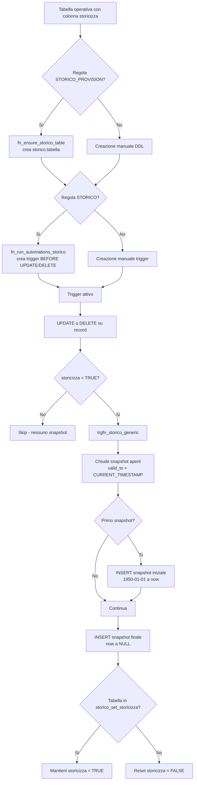
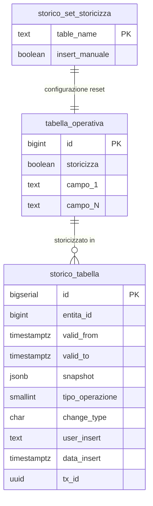
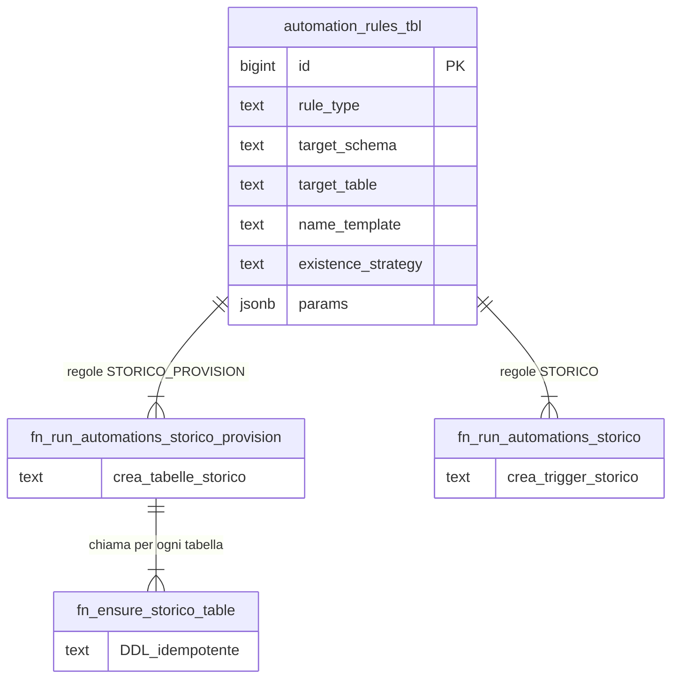

# Guida — Storicizzazione delle Tabelle

> **Ultimo aggiornamento**: 3 novembre 2026
>
> **Destinatari**: sviluppatori database e backend
>
> **Vedi anche** — schemi DB:
>
> * `storico.<nome_tabella>` — una tabella di storico per ogni tabella operativa storicizzata
> * [config.storico_set_storicizza](/dbzero/config/tabelle/storico_set_storicizza) — il registro delle tabelle con storicizzazione permanente
> * [dbops.storico_scope_policy](/dbzero/dbops/manual/storico_scope_policy) — la mappa da cui si ricava l'emittente di una versione
> * [dbops.vw_storico_scope_da_dichiarare](/dbzero/dbops/manual/vw_storico_scope_da_dichiarare) — il debito della mappa: deve restare vuota
>
> **Vedi anche** — funzioni e trigger DB:
>
> * [script.trgfn_storico_generic](/dbzero/script/funzioni/trgfn_storico_generic) — il trigger generico BEFORE UPDATE/DELETE
> * [script.fn_get_snapshot_as_of](/dbzero/script/funzioni/fn_get_snapshot_as_of) — lo snapshot JSONB a una data
> * [script.fn_get_record_id_as_of](/dbzero/script/funzioni/fn_get_record_id_as_of) — l'ID del record storico a una data
> * [dbops.fn_ensure_storico_table](/dbzero/dbops/funzioni/fn_ensure_storico_table) — il provisioning idempotente di una tabella
> * [dbops.fn_storico_arma_scope](/dbzero/dbops/manual/fn_storico_arma_scope) / [dbops.fn_storico_backfill_scope](/dbzero/dbops/manual/fn_storico_backfill_scope) — arma lo scope e converte il pregresso
> * [dbops.fn_run_automations_storico](/dbzero/dbops/funzioni/fn_run_automations_storico) / [dbops.fn_run_automations_storico_provision](/dbzero/dbops/funzioni/fn_run_automations_storico_provision) — creazione dei trigger e delle tabelle
> * [maintenance.proc_sync_storico_set_storicizza](/dbzero/maintenance/funzioni/proc_sync_storico_set_storicizza) / [maintenance.proc_apply_storicizza_defaults](/dbzero/maintenance/funzioni/proc_apply_storicizza_defaults) — sincronizzazione del catalogo e applicazione dei default
>
> **Vedi anche** — guide correlate:
>
> * [Guida Automazione DB](/guide/automazione-db) — il framework che orchestra provisioning e manutenzione
> * [Audit e tracciabilità](/guide/audit-e-tracciabilita) — chi ha modificato la riga, e quando
> * [Guida Transaction ID](/guide/tx_id_implementation_guide) — la correlazione transazionale degli snapshot
> * [I lavori automatici: che natura hanno e per conto di chi girano](/guide/processi-automatici-classe-e-identita) — il registro dei lavori a orario
> * [Linee Guida SQL](/linee-guida-sql) — convenzioni DDL e trigger
> * [Provisioning ruoli DB](/dev/backend/provisioning-db-roles) — il passaggio da superuser sulle shadow

---

## Introduzione

Questa guida descrive il sistema di storicizzazione (versioning) delle tabelle in Zero
ERP: come vengono registrate le modifiche, come si consultano gli snapshot storici e
come funziona il provisioning automatico delle tabelle e dei trigger nello schema
`storico`.

In un ERP che gestisce anagrafiche, contratti, fatture e documenti fiscali, poter ricostruire lo stato di un record a una data specifica e un requisito fondamentale. La storicizzazione in Zero ERP risponde a questa esigenza con un modello unificato basato su snapshot JSONB.

Ogni volta che un record viene modificato o cancellato, il trigger di storico cattura l'intero stato del record come oggetto JSONB e lo inserisce nella tabella corrispondente nello schema `storico`. Il risultato e una catena di snapshot con intervalli di validita (`valid_from` / `valid_to`) che permette di navigare la storia completa di qualsiasi entita.

Il modello e completamente automatizzato: il framework di automazione DB crea sia le tabelle di storico sia i trigger necessari, senza intervento manuale.

**Cosa troverai in questa guida:**

* La struttura standard delle tabelle di storico
* La colonna `storicizza` e il suo ciclo di vita
* Il trigger generico `trgfn_storico_generic` e il suo flusso dettagliato
* Le funzioni di consultazione snapshot
* Il provisioning automatico e le procedure di manutenzione
* La tabella di configurazione `storico_set_storicizza`

---

## Il modello in sintesi

```text
Schema operativo (es. anagrafiche)
└── soggetti                        -- tabella operativa
    ├── colonna storicizza BOOLEAN  -- flag per-record (default true se configurato)
    └── trigger trg_soggetti_z90_storico_upd_dlt
        └── BEFORE UPDATE OR DELETE → script.trgfn_storico_generic('soggetto_id')

Schema storico
└── soggetti                        -- tabella di storico (stesso nome, schema diverso)
    ├── id BIGSERIAL PK             -- PK indipendente dalla tabella operativa
    ├── soggetto_id (FK logica)     -- riferimento al record operativo
    ├── valid_from / valid_to       -- intervallo di validita dello snapshot
    ├── snapshot JSONB              -- stato completo del record al momento dell'evento
    ├── tipo_operazione SMALLINT    -- 1=iniziale, 2=UPDATE, 3=DELETE
    ├── change_type CHAR(1)         -- classificazione rapida A/U/D
    └── tx_id UUID                  -- correlazione transazionale

config
└── storico_set_storicizza          -- registro tabelle con storicizza permanente

dbops
├── automation_rules_tbl            -- regole STORICO e STORICO_PROVISION
├── fn_run_automations_storico()    -- provisioning trigger
├── fn_run_automations_storico_provision()  -- provisioning tabelle
└── fn_ensure_storico_table()       -- creazione DDL idempotente
```

---

## Struttura standard delle tabelle di storico

Ogni tabella nello schema `storico` segue una struttura rigida, creata automaticamente da `fn_ensure_storico_table`. Il campo `snapshot` JSONB contiene l'intero record serializzato, rendendo la tabella di storico indipendente dalle evoluzioni di schema della tabella operativa.

Da un punto di vista tecnico:

| Colonna           | Tipo                           | Nullable | Default        | Descrizione                                                   |
| ----------------- | ------------------------------ | :------: | -------------- | ------------------------------------------------------------- |
| `id`              | BIGSERIAL, PK                  |    no    | auto           | PK indipendente dalla tabella operativa                       |
| `<entita>_id`     | stesso tipo della PK operativa |    no    | —              | Riferimento al record originale (FK logica, senza constraint) |
| `valid_from`      | TIMESTAMPTZ                    |    no    | `now()`        | Inizio validita dello snapshot                                |
| `valid_to`        | TIMESTAMPTZ                    |    si    | —              | Fine validita (NULL = snapshot corrente aperto)               |
| `snapshot`        | JSONB                          |    si    | —              | Stato completo del record al momento dell'evento              |
| `tipo_operazione` | SMALLINT                       |    si    | —              | 1=snapshot iniziale, 2=UPDATE, 3=DELETE                       |
| `change_type`     | CHAR(1)                        |    si    | `'A'`          | Classificazione rapida: A (add), U (update), D (delete)       |
| `user_insert`     | TEXT                           |    no    | `CURRENT_USER` | Utente che ha generato lo snapshot                            |
| `data_insert`     | TIMESTAMPTZ                    |    no    | `now()`        | Timestamp di creazione dello snapshot                         |
| `tx_id`           | UUID                           |    si    | —              | Transaction ID (gestito da `trgfn_tx_id_managed`)             |

**Indici creati automaticamente:**

* `ix_<tabella>_<fk_col>_fk` — indice sulla colonna FK per ricerche per record operativo
* `ix_<tabella>_snapshot_gin` — indice GIN su snapshot (opzionale, se `create_gin_index=true`)

**FK non creata intenzionalmente:** la colonna `<entita>_id` non ha un vincolo FOREIGN KEY verso la tabella operativa. Questa scelta e deliberata per evitare che le operazioni di DELETE sulla tabella operativa vengano bloccate o richiedano CASCADE sulla tabella di storico.

---

## Di chi è una versione — lo scope congelato

> ⭐ **La storia di una riga protetta è la stessa informazione della riga.** Se una
> fattura si può vedere solo da certi operatori, lo stesso vale per ogni sua versione
> precedente. Per questo ogni tabella di storico porta con sé l'emittente **congelato**
> al momento in cui la riga è stata fotografata.

Il disegno, in breve:

* ogni tabella di storico ha una colonna **`scope_emittente_fiscale_id`**, scritta dal
  trigger **nel momento in cui fotografa la riga** e mai più ricalcolata — *un archivio
  che cambia col presente non è un archivio*;
* ha anche **`origine_schema`**: il nome della tabella di storico è il nome nudo della
  tabella madre, e `acquisti.ddt` e `vendite.ddt` scrivono nella stessa `storico.ddt` —
  senza lo schema le due storie si mescolano;
* **da dove** si prende l'emittente lo dice una mappa, non il codice:
  [dbops.storico_scope_policy](/dbzero/dbops/manual/storico_scope_policy) — una
  riga per tabella storicizzata, con cinque modi (colonna in riga, soggetto-ruolo,
  risalita al padre, billing account, nessuno). La legge
  [dbops.fn_storico_risolvi_scope](/dbzero/dbops/manual/fn_storico_risolvi_scope);
* una sola regola di lettura, per l'operatore, sulla colonna congelata;
* se il padre di un satellite **non è più vivo** — succede in ogni `DELETE` a
  cascata, dove il padre sparisce prima che il figlio scriva la sua versione
  finale — l'emittente si legge dall'**ultima versione del padre nello storico**:
  leggere l'archivio del padre è leggere il passato, non il presente.

Le tabelle nuove nascono **già armate** dal generatore: lo scope si dichiara nella mappa
([dbops.fn_storico_arma_scope](/dbzero/dbops/manual/fn_storico_arma_scope)) e il
provisioning fa il resto. Il pregresso si converte con il backfill
([dbops.fn_storico_backfill_scope](/dbzero/dbops/manual/fn_storico_backfill_scope)), e
l'applicazione non cancella mai una versione: è un privilegio, non una convenzione.

**Le tabelle di storico sono del proprietario.** I lavori notturni girano come il
proprietario del database, quindi le tabelle di storico che creano nascono sue, come
tutto il resto, e le migrazioni possono modificarle. Se in un database qualcuno ne ha
create da amministratore, `scripts/sql/provision_storico_scope.sql` le riporta al
proprietario e le completa. Dettagli in [Provisioning ruoli DB](/dev/backend/provisioning-db-roles).

Controlli: `db/pgtap/dbops/test-storico-scope-policy-v1.sql` (la mappa) e
`db/pgtap/storico/test-storico-scope-congelato-v1.sql` (colonne, policy,
congelamento, collisione fra omonime, cancellazione a cascata, lettura per
operatore, privilegi, proprietario delle shadow).

### Cosa sta dentro lo schema `storico`

* **La shadow è di chi possiede la madre.** Il generatore, creata e armata una
  tabella di storico, la **cede al proprietario della madre**: chiunque l'abbia
  creata, resta del proprietario, e le migrazioni non la saltano. Dettagli in
  [dbops.fn_ensure_storico_table](/dbzero/dbops/manual/fn_ensure_storico_table).
* **Il debito della mappa si vede anche fuori dalla CI.**
  [dbops.vw_storico_scope_da_dichiarare](/dbzero/dbops/manual/vw_storico_scope_da_dichiarare)
  porta nel digest settimanale i tre motivi che il controllo asserisce in CI: una
  madre col trigger senza riga di mappa, una madre in RLS dichiarata `NESSUNO`, una
  riga di mappa senza più madre. Deve restare vuota.
* **Non tutto ciò che sta in `storico` è una shadow.** `comune_trasformazioni` e
  `stradario_trasformazioni` sono i **registri delle fusioni** di comuni e vie
  (scritti da `fn_admin_merge_*`, letti da `fn_get_vie_discendenti`): non hanno una
  madre, non hanno il trigger e non entrano nella mappa. Una shadow orfana — una
  tabella di storico la cui madre non esiste più — non è ammessa: va cancellata, e
  con lei i suoi resti (trigger rimasti sul nome vecchio, righe di mappa,
  `audit_sources`, `storico_set_storicizza`). Una `storicizza = true` dimenticata su
  una tabella dismessa la farebbe ri-armare a ogni `ci_apply`.
* ⚠️ **L'ordine delle migrazioni non è un dettaglio.** Il `DROP` di una tabella legacy
  sta in `90_end`, non in `00_schema`: un changeSet di `90_end` può pretendere che
  quella tabella esista ancora, e su un database ricostruito da zero `90_end` gira
  **dopo** tutto `00_schema`. Anticipare il `DROP` lo farebbe fallire.

---

## Perche JSONB per il campo `snapshot`

La scelta di usare JSONB per memorizzare lo stato del record, invece di replicare tutte le colonne della tabella operativa, ha tre motivazioni:

1. **Evoluzione dello schema**: aggiunta o rimozione di colonne nella tabella sorgente non richiede modifiche alla tabella di storico. Lo snapshot cattura sempre tutti i campi presenti al momento dell'evento.

2. **Integrita dei dati**: garantisce che ogni snapshot rifletta esattamente lo stato dell'intero record, senza omissioni ne disallineamenti.

3. **Query ad hoc**: permette estrazioni puntuali con funzioni JSON SQL (es. `snapshot->>'codice_fiscale'`).

**Trade-off:**

* Maggiore occupazione di spazio rispetto a colonne tipizzate
* Possibili impatti di performance per query su JSONB, mitigabili con indice GIN

---

## La colonna `storicizza`

Ogni tabella operativa che partecipa alla storicizzazione ha una colonna `storicizza` di tipo `BOOLEAN`. Questa colonna controlla se il singolo record deve essere storicizzato al prossimo UPDATE o DELETE.

Il comportamento dipende dalla registrazione della tabella in `config.storico_set_storicizza`:

### Tabelle registrate (storicizzazione permanente)

Se la tabella e presente in `storico_set_storicizza`, il flag `storicizza` non viene resettato dopo l'UPDATE. Il record continua a essere storicizzato a ogni modifica successiva. Questo e il comportamento standard per le tabelle anagrafiche e di configurazione.

### Tabelle non registrate (storicizzazione one-shot)

Se la tabella non e presente in `storico_set_storicizza`, dopo ogni UPDATE il trigger resetta `storicizza = FALSE`. Il record viene storicizzato una sola volta, poi richiede un'impostazione esplicita per essere storicizzato di nuovo. Utile per tabelle ad alto volume dove si vuole storicizzare solo su richiesta.

### Controllo per-record

Se `storicizza = FALSE` al momento dell'UPDATE o DELETE, il trigger non genera alcuno snapshot e restituisce il record senza modifiche. Questo permette di escludere singoli record dalla storicizzazione.

---

## Tabella di configurazione: `storico_set_storicizza`

Questa tabella nello schema `config` registra le tabelle operative che devono mantenere il flag `storicizza` sempre attivo (non resettato dal trigger).

Da un punto di vista tecnico:

| Colonna          | Tipo        | Nullable | Default        | Descrizione                                                       |
| ---------------- | ----------- | :------: | -------------- | ----------------------------------------------------------------- |
| `table_name`     | TEXT, PK    |    no    | —              | Nome della tabella operativa, qualificato con lo schema           |
| `insert_manuale` | BOOLEAN     |    no    | true           | `true` = inserita manualmente, `false` = rilevata automaticamente |
| `data_insert`    | TIMESTAMPTZ |    no    | `now()`        | Timestamp inserimento                                             |
| `user_insert`    | TEXT        |    no    | `CURRENT_USER` | Utente inserimento                                                |

La procedura `proc_sync_storico_set_storicizza` popola automaticamente questa tabella rilevando dal catalogo PostgreSQL tutte le tabelle con colonna `storicizza` che hanno DEFAULT `true`. I record inseriti automaticamente hanno `insert_manuale = false`.

> Documentazione dettagliata: [config.storico_set_storicizza](/dbzero/config/tabelle/storico_set_storicizza)

---

## Trigger function: `trgfn_storico_generic`

Questa e la trigger function centrale del sistema di storicizzazione. Viene eseguita `BEFORE UPDATE OR DELETE` su ogni tabella storicizzata. Gestisce la chiusura degli snapshot precedenti, la creazione di nuovi snapshot e il reset opzionale del flag `storicizza`.

Da un punto di vista tecnico:

**Parametri (via `TG_ARGV`):**

| Parametro    | Tipo | Descrizione                                                       |
| ------------ | ---- | ----------------------------------------------------------------- |
| `TG_ARGV[0]` | TEXT | Nome della colonna FK nella tabella storica (es. `'soggetto_id'`) |

**Flusso di esecuzione completo:**

### Fase 0 — Configurazione e controllo flag

1. Verifica se la tabella e registrata in `config.storico_set_storicizza`
    * Se presente: `v_should_reset = FALSE` (non resettare il flag)
    * Se assente: `v_should_reset = TRUE` (resettare dopo l'UPDATE)
2. Rileva il tipo della colonna PK nella tabella operativa (introspezione catalogo)
3. Controlla il valore di `storicizza`:
    * UPDATE con `NEW.storicizza = FALSE` → restituisce `NEW` senza storicizzare
    * DELETE con `OLD.storicizza = FALSE` → restituisce `OLD` senza storicizzare

### Fase 1 — Recupero ID record

Ottiene l'ID del record: `OLD.id` per DELETE, `NEW.id` per UPDATE.

### Fase 2 — Creazione snapshot

Serializza il record come JSONB:

* UPDATE: `to_jsonb(NEW)` con `tipo_operazione = 2`
* DELETE: `to_jsonb(OLD)` con `tipo_operazione = 3`

### Fase 3 — Chiusura snapshot aperti

Aggiorna in `storico.<tabella>` tutti gli snapshot con `valid_to IS NULL` per lo stesso ID, impostando `valid_to = CURRENT_TIMESTAMP`. Usa SQL dinamico per la risoluzione tipo-sicura della colonna FK.

### Fase 4 — Inserimento nuovi snapshot

**4.1 — Snapshot iniziale (solo se non esistevano snapshot aperti):**

Se nessuno snapshot era aperto (prima storicizzazione del record), inserisce un record con `valid_from = '1950-01-01'` e `valid_to = CURRENT_TIMESTAMP`, `tipo_operazione = 1`. Questo rappresenta lo stato "originale" del record prima della modifica corrente, con `to_jsonb(OLD)`.

**4.2 — Snapshot finale (sempre):**

Inserisce il nuovo stato con `valid_from = CURRENT_TIMESTAMP` e `valid_to = NULL`. Per UPDATE contiene `to_jsonb(NEW)`, per DELETE contiene `to_jsonb(OLD)`.

### Fase 5 — Reset flag storicizza

Se `v_should_reset = TRUE` e l'operazione e UPDATE: imposta `NEW.storicizza = FALSE`.

### Gestione errori

Ogni sezione ha un blocco EXCEPTION dedicato che logga via `script.fn_log_and_raise_error` con codici specifici:

* `E_SNAPSHOT_ID_NOT_FOUND` — errore nel recupero dell'ID
* `E_SNAPSHOT_CLOSE_ERROR` — errore nella chiusura degli snapshot aperti
* `E_SNAPSHOT_INIT_INSERT_ERROR` — errore nell'inserimento dello snapshot iniziale
* `E_SNAPSHOT_FINAL_INSERT_ERROR` — errore nell'inserimento dello snapshot finale

> Documentazione dettagliata: [script.trgfn_storico_generic](/dbzero/script/funzioni/trgfn_storico_generic)

---

## Funzioni di consultazione

### `fn_get_snapshot_as_of` — snapshot a una data

Restituisce lo snapshot JSONB di un record a un dato istante temporale. Se non trova snapshot nello storico, serializza la riga corrente dalla tabella operativa come fallback.

Da un punto di vista tecnico:

| Parametro  | Tipo      | Descrizione                                            |
| ---------- | --------- | ------------------------------------------------------ |
| `p_schema` | TEXT      | Schema della tabella originaria                        |
| `p_table`  | TEXT      | Nome della tabella (uguale in operativo e storico)     |
| `p_id`     | TEXT      | PK del record originario (passato come TEXT)           |
| `p_fk_col` | TEXT      | Nome della colonna FK in storico (es. `'soggetto_id'`) |
| `p_as_of`  | TIMESTAMP | Data/ora di validita desiderata                        |

**Restituisce:** `JSONB` — lo snapshot del record, o NULL se non trovato.

**Logica:**

1. Verifica l'esistenza della tabella storica e rileva il tipo della colonna FK
2. Cerca in `storico.<tabella>` lo snapshot valido: `valid_from <= p_as_of AND (valid_to > p_as_of OR valid_to IS NULL)`
3. Se trovato: restituisce lo snapshot
4. Se non trovato: serializza la riga corrente dalla tabella operativa (`to_jsonb(t)`)

**Esempio:** una riga sola, con lo snapshot risultante. Vedi
[Area tecnica](#area-tecnica-esempi).

> Documentazione dettagliata: [script.fn_get_snapshot_as_of](/dbzero/script/funzioni/fn_get_snapshot_as_of)

---

### `fn_get_record_id_as_of` — ID record storico a una data

Restituisce solo l'ID (come TEXT) del record di storico valido a un dato istante. A differenza di `fn_get_snapshot_as_of`, non ha fallback sulla tabella operativa: cerca esclusivamente nello storico.

Da un punto di vista tecnico:

| Parametro  | Tipo      | Descrizione                      |
| ---------- | --------- | -------------------------------- |
| `p_schema` | TEXT      | Schema della tabella originaria  |
| `p_table`  | TEXT      | Nome della tabella               |
| `p_id`     | TEXT      | PK del record originario         |
| `p_fk_col` | TEXT      | Nome della colonna FK in storico |
| `p_as_of`  | TIMESTAMP | Data/ora di validita desiderata  |

**Restituisce:** `TEXT` — l'ID del record storico, o NULL se nessuno snapshot valido.

> Documentazione dettagliata: [script.fn_get_record_id_as_of](/dbzero/script/funzioni/fn_get_record_id_as_of)

---

## Provisioning automatico

Il sistema di storicizzazione si integra con il framework di automazione DB tramite due tipi di regole in `dbops.automation_rules_tbl`.

### Provisioning tabelle: `fn_run_automations_storico_provision`

Questa funzione scorre tutte le tabelle nell'ambito che hanno una colonna `storicizza` e crea automaticamente la corrispondente tabella nello schema `storico`.

Da un punto di vista tecnico:

| Parametro     | Tipo    | Descrizione                            |
| ------------- | ------- | -------------------------------------- |
| `p_exec_mode` | TEXT    | Modalita: `AUTO`, `SCHEDULED`, `FORCE` |
| `p_schemas`   | TEXT[]  | Schemi da processare (NULL = tutti)    |
| `p_dry_run`   | BOOLEAN | Simulazione senza DDL                  |

**Flusso:**

1. Risolve l'ambito (esclude lo schema `storico`)
2. Filtra tabelle con colonna `storicizza` (nome configurabile via override `STORICIZZA_COL`)
3. Applica regole `STORICO_PROVISION` da `automation_rules_tbl`
4. Per ogni tabella idonea: chiama `fn_ensure_storico_table`

### Creazione DDL: `fn_ensure_storico_table`

Funzione idempotente che crea la tabella di storico con la struttura standard se non esiste gia.

| Parametro            | Tipo    | Descrizione                    |
| -------------------- | ------- | ------------------------------ |
| `p_schema_base`      | TEXT    | Schema della tabella operativa |
| `p_table_base`       | TEXT    | Nome della tabella operativa   |
| `p_fk_col`           | TEXT    | Nome colonna FK nello storico  |
| `p_create_gin_index` | BOOLEAN | Creare indice GIN su snapshot  |
| `p_dry_run`          | BOOLEAN | Simulazione                    |

**Azioni:**

* Rileva la PK mono-colonna della tabella operativa e il suo tipo
* Crea `storico.<tabella>` con la struttura standard
* Crea indice su FK e opzionalmente indice GIN su snapshot
* Se la tabella esiste gia: return immediato (idempotente)
* Non crea FOREIGN KEY (scelta deliberata)
* **Arma lo scope** (`origine_schema`, `scope_emittente_fiscale_id`, RLS se la mappa
  dice che la madre è protetta) chiamando `fn_storico_arma_scope`
* **Cede la shadow al proprietario della madre**, se chi la crea può farlo;
  altrimenti `WARN` nell'audit e nessun errore

### Provisioning trigger: `fn_run_automations_storico`

Crea il trigger `BEFORE UPDATE OR DELETE` su tutte le tabelle operative che hanno una corrispondente tabella in `storico`.

| Parametro     | Tipo    | Descrizione                            |
| ------------- | ------- | -------------------------------------- |
| `p_exec_mode` | TEXT    | Modalita: `AUTO`, `SCHEDULED`, `FORCE` |
| `p_schemas`   | TEXT[]  | Schemi da processare (NULL = tutti)    |
| `p_dry_run`   | BOOLEAN | Simulazione senza DDL                  |

**Flusso:**

1. Risolve l'ambito (esclude `storico`)
2. Per ogni tabella: verifica che `storico.<tabella>` esista
3. Risolve la colonna FK (default `<tabella>_id`, override via `STORICO_FK`)
4. Genera il nome trigger dal template (default: `trg_{table}_z90_storico_upd_dlt`)
5. Verifica esistenza per strategia (`BY_NAME`, `BY_FUNCTION`, `BOTH`)
6. Se non esiste: crea il trigger
⛔ **Il motore non rimuove i trigger legacy.** Quel ramo esisteva e non ha mai
funzionato: puntava a `trg_{table}_upd_storico` / `trg_{table}_dlt_storico`, mentre i
trigger legacy davvero creati si chiamavano `trg_<tab>_upd_dlt_storico_<tab>` (e quelli
di oggi `trg_<tab>_z90_storico_upd_dlt`): tre forme diverse, e un
`DROP TRIGGER IF EXISTS` non poteva agganciare le altre due. È stato rimosso — se un
giorno serve togliere un trigger legacy, si fa a mano.

**Naming convention del trigger:** la forma è `trg_<tabella>_z90_storico_upd_dlt`,
e l'infisso `_z90_` garantisce che il trigger di storico venga eseguito per
ultimo nell'ordine alfabetico PostgreSQL, dopo tutti i trigger di guard e
validazione.

> ⚠️ **Non esiste nessun trigger che cominci per `trgx_`**: i trigger di
> storicizzazione usano tutti la forma qui sopra. Chi li cercasse per quel prefisso
> non ne troverebbe nemmeno uno.

---

## Procedure di manutenzione

### Sincronizzazione catalogo: `proc_sync_storico_set_storicizza`

Scansiona il catalogo PostgreSQL per rilevare automaticamente tutte le tabelle con colonna `storicizza` il cui DEFAULT e `true`, e le registra in `config.storico_set_storicizza` con `insert_manuale = false`.

> ⭐ **La sincronizzazione fa anche il contrario: POTA.** Aggiungere non basta:
> quando una tabella viene ritirata, la sua riga resterebbe lì a puntare a niente,
> per sempre, finché qualcuno non la nota — e una riga che punta a una tabella
> inesistente fa fallire il lavoro notturno che la consuma.
>
> ⚠️ Si pota **solo** ciò che la scansione ha smesso di produrre. Le righe inserite
> a mano (`insert_manuale = true`) non si toccano: quelle non sono un risultato della
> derivazione, sono una decisione di qualcuno.

**Job wrapper:** `proc_sync_storico_set_storicizza_job` — esecuzione schedulata con advisory lock e logging via `fn_run_and_log`.

### Applicazione default: `proc_apply_storicizza_defaults`

Itera tutte le tabelle registrate in `config.storico_set_storicizza` e applica `ALTER TABLE ... ALTER COLUMN storicizza SET DEFAULT true`.

> ⭐ **Una riga guasta non ferma le altre.** Una sola riga che punta a una tabella
> inesistente non deve interrompere il giro per tutte le altre.
>
> ⚠️ E non è una conseguenza della potatura qui sopra: chi produce l'elenco e chi lo
> consuma sono **due lavori distinti, su due orari diversi**. Se l'applicazione gira
> prima della sincronizzazione — e prima o poi capita — la riga vecchia c'è ancora.
> Chi consuma un elenco costruito da altri non può morire perché una riga non è
> ancora stata ripulita.

**Scheduling:** ogni sabato alle 07:00 UTC tramite pgAgent job `apply_storicizza_weekly`.

**Job wrapper:** `proc_apply_storicizza_defaults_job` — esecuzione schedulata con advisory lock e logging.

---

## Flusso operativo completo



---

## Regole di dominio

1. **Una tabella di storico per ogni tabella operativa**: la tabella ha lo stesso nome ma vive nello schema `storico`. La PK e indipendente (BIGSERIAL), non collegata alla PK operativa.

2. **Nessuna FK esplicita**: la colonna `<entita>_id` nello storico non ha vincolo FOREIGN KEY verso la tabella operativa. Questo evita blocchi su DELETE e CASCADE indesiderati.

3. **Snapshot immutabili**: i record nello storico non vengono mai aggiornati nel contenuto. L'unica modifica e la chiusura dell'intervallo di validita (`valid_to`).

4. **Trigger BEFORE, non AFTER**: il trigger deve essere `BEFORE UPDATE OR DELETE` perche modifica `NEW.storicizza`. L'uso di AFTER impedirebbe il reset del flag.

5. **Infisso `_z90_`** (forma `trg_<tabella>_z90_storico_upd_dlt`): garantisce l'esecuzione per ultima nell'ordine alfabetico, dopo tutti i trigger di guard e validazione.

6. **Colonna `storicizza` obbligatoria**: la tabella operativa deve avere la colonna `storicizza BOOLEAN` per poter usare il trigger generico. Se il flag e `FALSE`, il record non viene storicizzato.

7. **Comportamento reset dipende dalla configurazione**: tabelle registrate in `storico_set_storicizza` mantengono `storicizza = TRUE` dopo ogni UPDATE (storicizzazione permanente). Tabelle non registrate resettano a `FALSE` (one-shot).

8. **Idempotenza del provisioning**: sia `fn_ensure_storico_table` sia `fn_run_automations_storico` sono idempotenti — sicure da rieseguire.

9. **Snapshot iniziale retrodatato**: alla prima storicizzazione, viene creato un record con `valid_from = '1950-01-01'` che rappresenta lo stato "originale" del record prima di qualsiasi modifica tracciata.

---

## Best practice

* **Usare il provisioning automatico** — non creare tabelle di storico e trigger manualmente. Le regole `STORICO_PROVISION` e `STORICO` in `automation_rules_tbl` garantiscono struttura e naming coerenti
* **Registrare le tabelle anagrafiche** in `config.storico_set_storicizza` per garantire storicizzazione permanente (soggetti, indirizzi, contratti, ruoli)
* **Usare `fn_get_snapshot_as_of` per le query storiche** — non interrogare direttamente le tabelle di storico salvo per analisi massive
* **Valutare l'indice GIN** per tabelle con molti record storici e necessita di query su campi specifici dello snapshot (`snapshot->>'campo'`)
* **Eseguire `proc_sync_storico_set_storicizza` dopo il deploy** per aggiornare il registro di configurazione
* **Non creare FK tra storico e tabella operativa** — la scelta e deliberata e non deve essere aggirata
* **Verificare con dry-run** prima di applicare il provisioning in produzione: `SELECT dbops.fn_run_automations_storico_provision('AUTO', NULL, true);`

---

## Diagrammi ER

### Modello di storicizzazione



### Framework di automazione



---

## Area tecnica — esempi

### Leggere uno snapshot a una data

Una riga sola: l'oggetto JSONB del soggetto 123 come era il 15 giugno 2025.

```sql
SELECT script.fn_get_snapshot_as_of(
  'anagrafiche', 'soggetti', '123', 'soggetto_id', '2025-06-15'::timestamp
);
```

---

