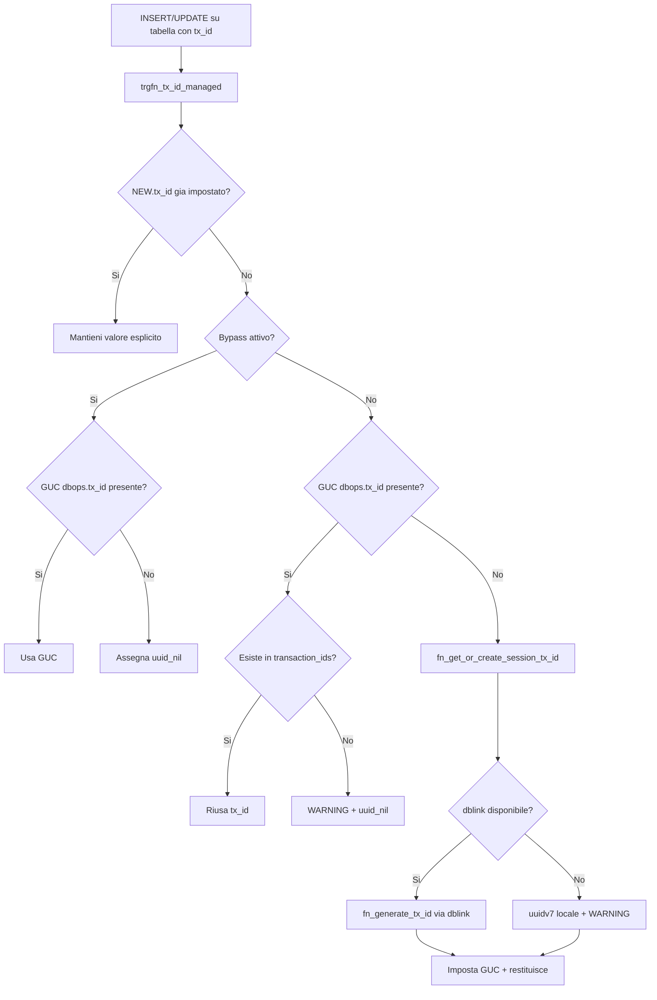
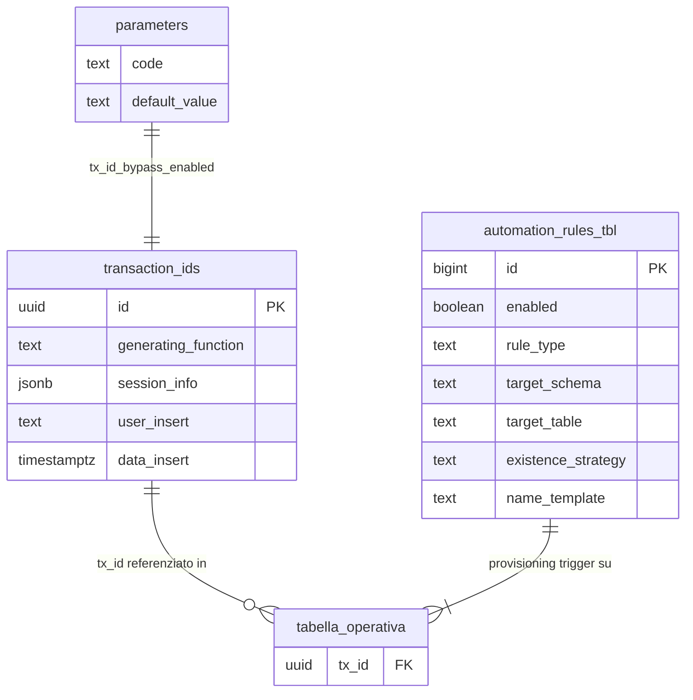

# Guida – Gestione del Transaction ID (`tx_id`)

> (latest review 05-03-26)
>
> Destinatari: sviluppatori database e backend
>
> Questa guida descrive il sistema di identificazione transazionale (`tx_id`) di
> Zero ERP: come viene generato, propagato, validato e automatizzato su tutte le
> tabelle del sistema.
>
> Vedi anche
>
> * [Guida Automazione DB](/guide/automazione-db) — framework di automazione trigger e policy
> * [Guida Messaggi di Errore e Log](/guide/Messaggi-di-Errore-e-Generazione-Log) — logging errori con tx_id
> * [Guida Messaggi Audit](/guide/messaggi-audit) — audit trail con tx_id

---

## Introduzione

In un sistema ERP che opera su decine di tabelle, schemi e processi concorrenti, poter correlare tutte le operazioni di una singola transazione e fondamentale per tracciabilita, debugging e audit.

Il `tx_id` e un UUID (formato UUIDv7, ordinabile cronologicamente) che identifica una transazione applicativa. Ogni riga inserita o aggiornata in una tabella che contiene la colonna `tx_id` riceve automaticamente questo identificativo tramite un trigger. Il valore e condiviso tra tutte le operazioni della stessa sessione, permettendo di ricostruire l'intera catena di modifiche con una singola query.

Il sistema non richiede intervento esplicito del backend: il trigger `trgfn_tx_id_managed` si occupa di tutto automaticamente. Tuttavia, il backend puo opzionalmente pre-impostare il `tx_id` di sessione per un controllo piu fine.

**Cosa troverai in questa guida:**

* La tabella registro `transaction_ids` e la sua struttura
* Le funzioni di generazione e recupero del `tx_id`
* Il trigger di gestione automatica e il suo flusso decisionale
* Il sistema di automazione per il provisioning dei trigger
* I parametri GUC e di configurazione coinvolti
* L'integrazione con il backend Django

---

## Tabelle coinvolte

**Registro:**

* [dbops.transaction_ids](/dbzero/dbops/tabelle/transaction_ids) — registro master dei tx_id generati

**Configurazione automazione:**

* [dbops.automation_rules_tbl](/dbzero/dbops/tabelle/automation_rules_tbl) — regole per il provisioning automatico dei trigger
* [config.parameters](/dbzero/config/tabelle/parameters) — parametro `tx_id_bypass_enabled`

**Funzioni:**

* [dbops.fn_generate_tx_id](/dbzero/dbops/funzioni/fn_generate_tx_id) — generazione e registrazione di un nuovo tx_id
* [dbops.fn_get_or_create_session_tx_id](/dbzero/dbops/funzioni/fn_get_or_create_session_tx_id) — recupero o creazione del tx_id di sessione
* [dbops.trgfn_tx_id_managed](/dbzero/dbops/funzioni/trgfn_tx_id_managed) — trigger function di gestione automatica
* [dbops.fn_run_automations_tx_id](/dbzero/dbops/funzioni/fn_run_automations_tx_id) — provisioning automatico dei trigger
* [maintenance.proc_automations_tx_id_job](/dbzero/maintenance/funzioni/proc_automations_tx_id_job) — procedura schedulata

---

## Il modello in sintesi

```text
config.parameters
└── tx_id_bypass_enabled          -- abilita/disabilita bypass globale

dbops
├── transaction_ids               -- registro master UUID generati (immutabile)
├── automation_rules_tbl          -- regole provisioning trigger (rule_type='TX_ID')
├── fn_generate_tx_id()           -- genera UUID + INSERT in transaction_ids
├── fn_get_or_create_session_tx_id()  -- riusa GUC o genera via dblink
├── trgfn_tx_id_managed()         -- trigger BEFORE INSERT/UPDATE su ogni tabella
└── fn_run_automations_tx_id()    -- crea trigger dove mancano

maintenance
└── proc_automations_tx_id_job()  -- wrapper schedulato con lock e logging

GUC di sessione
├── dbops.tx_id                   -- tx_id corrente (session-scoped)
├── myapp.bypass_tx_id_check      -- override bypass per sessione
└── myapp.dblink_log_connection   -- stringa di connessione dblink
```

---

## Registro: `transaction_ids`

La tabella `dbops.transaction_ids` e il registro centrale di tutti i transaction ID generati nel sistema. Ogni record e immutabile: una volta creato, non puo essere ne aggiornato ne cancellato (protetto da `trgfn_prevent_modification_generic`).

Da un punto di vista tecnico:

| Colonna | Tipo | Nullable | Default | Descrizione |
| --- | --- | :---: | --- | --- |
| `id` | UUID, PK | no | `uuidv7()` | Transaction ID (UUIDv7, ordinabile cronologicamente) |
| `generating_function` | TEXT | si | — | Nome della funzione che ha richiesto la generazione |
| `session_info` | JSONB | no | `'{}'` | Dati di contesto (utente, IP, fonte) |
| `user_insert` | TEXT | no | `CURRENT_USER` | Utente che ha creato il record |
| `data_insert` | TIMESTAMPTZ | no | `now()` | Timestamp di creazione |
| `user_update` | TEXT | si | — | Sempre NULL (record immutabile) |
| `data_update` | TIMESTAMPTZ | si | — | Sempre NULL (record immutabile) |

**Protezione immutabilita:** trigger `trgfn_prevent_modification_generic` blocca UPDATE e DELETE.

> Documentazione dettagliata: [dbops.transaction_ids](/dbzero/dbops/tabelle/transaction_ids)

---

## Funzioni di generazione

### `fn_generate_tx_id` — generazione e registrazione

Questa funzione e il punto unico di creazione di un nuovo `tx_id`. Genera un UUIDv7, lo inserisce in `transaction_ids` con il contesto di chiamata, e lo restituisce. E dichiarata `SECURITY DEFINER` per permettere l'invocazione da ruoli con privilegi limitati.

Da un punto di vista tecnico:

| Parametro | Tipo | Default | Descrizione |
| --- | --- | --- | --- |
| `p_generating_function` | TEXT | — | Nome della funzione/processo chiamante |
| `p_session_info` | JSONB | `'{}'` | Dati di contesto (utente, IP, sessione) |

**Restituisce:** `UUID` — il nuovo tx_id generato.

**Logica:**

1. Genera `v_tx := uuidv7()`
2. INSERT in `dbops.transaction_ids` con `id`, `generating_function`, `session_info`
3. Restituisce `v_tx`

> Documentazione dettagliata: [dbops.fn_generate_tx_id](/dbzero/dbops/funzioni/fn_generate_tx_id)

---

### `fn_get_or_create_session_tx_id` — recupero o creazione per sessione

Questa funzione e il punto d'ingresso consigliato sia per il trigger sia per il backend. Garantisce che all'interno di una sessione database tutte le operazioni condividano lo stesso `tx_id`, generandone uno nuovo solo se necessario.

E dichiarata `SECURITY DEFINER` e non accetta parametri.

Da un punto di vista tecnico:

**Restituisce:** `UUID` — il tx_id di sessione (mai NULL).

**Flusso di esecuzione:**

1. **Riuso GUC**: legge `current_setting('dbops.tx_id', true)`. Se esiste un UUID valido, lo restituisce immediatamente.

2. **Verifica dblink**: legge `myapp.dblink_log_connection`. Se non impostato, WARNING e fallback a `uuidv7()` locale (impostato nella GUC di sessione).

3. **Generazione via dblink**: chiama `dbops.fn_generate_tx_id` tramite dblink sulla connessione di log. Questo permette la registrazione in `transaction_ids` anche in caso di rollback della transazione principale.

4. **Fallback errore dblink**: se dblink fallisce, WARNING e fallback a `uuidv7()` locale.

5. **Impostazione GUC**: in tutti i casi, imposta `dbops.tx_id` nella sessione con `set_config`.

**Catena di fallback:**

```text
GUC dbops.tx_id gia impostato?
  SI → riusa
  NO → dblink disponibile?
         SI → fn_generate_tx_id via dblink → registrato in transaction_ids
         NO → uuidv7() locale (WARNING, non registrato)
```

> Documentazione dettagliata: [dbops.fn_get_or_create_session_tx_id](/dbzero/dbops/funzioni/fn_get_or_create_session_tx_id)

---

## Trigger function: `trgfn_tx_id_managed`

Questa e la trigger function centrale del sistema. Viene eseguita `BEFORE INSERT OR UPDATE` su ogni tabella che contiene la colonna `tx_id`. E dichiarata `SECURITY DEFINER`.

Il suo compito e assegnare a `NEW.tx_id` un valore valido, seguendo un flusso decisionale che bilancia rigore (verifica del tx_id nel registro) e flessibilita (bypass configurabili per test e migrazioni).

Da un punto di vista tecnico:

**Flusso di esecuzione completo:**

### Fase 1 — Verifica bypass globale

Legge il parametro `tx_id_bypass_enabled` da `config.parameters`.

* Se il parametro non esiste: logga via `fn_log_error_only` e prosegue con bypass disabilitato.
* Se errore di lettura: logga via `fn_log_and_raise_error` e rilancia.

### Fase 2 — Override bypass di sessione

Se il bypass non e gia attivo, prova a leggere la GUC `myapp.bypass_tx_id_check`. Se impostata a `true`, abilita il bypass per questa invocazione. Errori di lettura sono ignorati.

### Fase 3 — Lettura tx_id di sessione

Legge `current_setting('dbops.tx_id', true)` per ottenere un eventuale tx_id gia presente in sessione.

### Fase 4 — Determinazione del valore

**Se bypass attivo:**

* Usa il tx_id di sessione se presente, altrimenti `script.uuid_nil()` (`00000000-...`)

**Se bypass disattivo:**

* **Se tx_id di sessione presente:** verifica l'esistenza in `dbops.transaction_ids`
    * Se trovato: lo riusa
    * Se non trovato: logga WARNING `W_TXID_NOT_REGISTERED` e assegna `uuid_nil()`
* **Se tx_id di sessione assente:** chiama `fn_get_or_create_session_tx_id()`
    * Se errore: logga `E_TXID_GENERATION` e assegna `uuid_nil()`

### Fase 5 — Assegnazione a `NEW.tx_id`

* Se `NEW.tx_id` e gia valorizzato (impostato esplicitamente dal client): lo mantiene
* Altrimenti: `NEW.tx_id = COALESCE(GUC dbops.tx_id, v_new_tx_id, uuidv7())`

La catena COALESCE finale garantisce che `NEW.tx_id` non sia mai NULL, con `uuidv7()` come ultimo fallback.

> Documentazione dettagliata: [dbops.trgfn_tx_id_managed](/dbzero/dbops/funzioni/trgfn_tx_id_managed)

---

## Parametri GUC e configurazione

Il sistema tx_id si appoggia a una combinazione di parametri di sessione (GUC) e parametri applicativi persistenti.

### GUC di sessione (scope: connessione corrente)

| GUC | Tipo | Descrizione |
| --- | --- | --- |
| `dbops.tx_id` | UUID | Transaction ID corrente di sessione. Impostato da `fn_get_or_create_session_tx_id`, letto da `trgfn_tx_id_managed` |
| `myapp.bypass_tx_id_check` | BOOLEAN | Override di sessione per disabilitare la validazione tx_id (utile in test/migrazioni) |
| `myapp.dblink_log_connection` | TEXT | Stringa di connessione dblink per la generazione remota del tx_id |

### Parametri applicativi (in `config.parameters`)

| Codice | Tipo | Descrizione |
| --- | --- | --- |
| `tx_id_bypass_enabled` | BOOLEAN | Bypass globale della validazione tx_id. Se `true`, il trigger non genera ne verifica, usa il tx_id di sessione o `uuid_nil()` |

Il bypass ha due livelli: il parametro globale in `config.parameters` e l'override di sessione via GUC `myapp.bypass_tx_id_check`. Basta che uno dei due sia `true` per attivare il bypass.

---

## Automazione: provisioning dei trigger

### `fn_run_automations_tx_id` — scansione e creazione trigger

Questa funzione automatizza la creazione del trigger `trgfn_tx_id_managed` su tutte le tabelle che contengono una colonna `tx_id uuid`. E il componente che garantisce la copertura uniforme del sistema.

Da un punto di vista tecnico:

| Parametro | Tipo | Default | Descrizione |
| --- | --- | --- | --- |
| `p_exec_mode` | TEXT | — | Modalita: `AUTO`, `SCHEDULED`, `FORCE` |
| `p_schemas` | TEXT[] | — | Schemi da processare. Se NULL, risolti da `fn_resolve_scope` |
| `p_dry_run` | BOOLEAN | — | Se true, simula senza creare trigger |

**Restituisce:** `void`

**Flusso logico:**

1. **Scope**: risolve gli schemi target con `dbops.fn_resolve_scope`
2. **Scansione tabelle**: itera tutte le tabelle fisiche (`relkind='r'`) in scope, filtrate da `fn_table_in_scope`
3. **Selezione regole**: per ciascuna tabella, filtra in `automation_rules_tbl` le regole con `rule_type='TX_ID'`, rispettando `enabled`, `exec_mode`, `priority` e pattern di match su schema/tabella
4. **Pre-condizione**: verifica che la tabella abbia una colonna `tx_id` di tipo `uuid` (non crea colonne, solo trigger)
5. **Naming**: genera il nome trigger dal template (default: `trg_{table}_gen_tx_id_ins_upd`) tramite `fn_name_from_template`
6. **Verifica esistenza**: controlla se il trigger esiste gia, con strategia configurabile:
    * `BY_NAME` — verifica per nome trigger
    * `BY_FUNCTION` — verifica per funzione trigger
    * `BOTH` — presente se almeno uno dei due e vero
7. **Azione**: se il trigger non esiste:
    * `p_dry_run = true` → registra evento `DRYRUN_CREATE_TRIGGER` via `fn_audit_log_once`
    * `p_dry_run = false` → crea il trigger `BEFORE INSERT OR UPDATE ... EXECUTE FUNCTION dbops.trgfn_tx_id_managed()`

> Documentazione dettagliata: [dbops.fn_run_automations_tx_id](/dbzero/dbops/funzioni/fn_run_automations_tx_id)

---

### Regole di automazione: `automation_rules_tbl`

Le regole di automazione sono configurate nella tabella `dbops.automation_rules_tbl`. Per il sistema tx_id, le regole hanno `rule_type = 'TX_ID'`.

| Colonna | Tipo | Default | Descrizione |
| --- | --- | --- | --- |
| `id` | BIGINT, PK | — | Chiave primaria |
| `enabled` | BOOLEAN | true | Regola attiva |
| `rule_type` | TEXT | — | Tipo regola (es. `TX_ID`, `AUDIT`, `FK_INDEX`) |
| `target_schema` | TEXT | `*all` | Schema target (pattern o `*all`) |
| `target_table` | TEXT | `*all` | Tabella target (pattern ILIKE o `*ALL`) |
| `exec_mode` | TEXT | `AUTO` | Modalita: `AUTO`, `SCHEDULED`, `FORCE` |
| `name_template` | TEXT | — | Template nome trigger (default: `trg_{table}_gen_tx_id_ins_upd`) |
| `existence_strategy` | TEXT | `BY_NAME` | Strategia verifica: `BY_NAME`, `BY_FUNCTION`, `BOTH` |
| `params` | JSONB | `'{}'` | Parametri aggiuntivi |
| `priority` | INTEGER | 100 | Ordine di applicazione (minore = prima) |
| `note` | TEXT | — | Note descrittive |

> Documentazione dettagliata: [dbops.automation_rules_tbl](/dbzero/dbops/tabelle/automation_rules_tbl)

---

### `proc_automations_tx_id_job` — esecuzione schedulata

La procedura `maintenance.proc_automations_tx_id_job` incapsula l'esecuzione di `fn_run_automations_tx_id` in un wrapper robusto con advisory lock e logging strutturato tramite `maintenance.fn_run_and_log`.

Da un punto di vista tecnico:

```sql
CALL maintenance.proc_automations_tx_id_job();
-- Equivale a:
-- SELECT dbops.fn_run_automations_tx_id('SCHEDULED', NULL, false);
-- Con: advisory lock, logging inizio/fine, gestione errori
```

**Caratteristiche:**

* **Advisory lock**: chiave derivata da `hashtext('automations_tx_id')`, previene esecuzioni parallele
* **Logging**: registra inizio, fine, esito (OK/KO) e dettagli in `maintenance.job_run_log`
* **Idempotenza**: puo essere chiamata piu volte senza duplicazioni (i trigger esistenti non vengono ricreati)

**Scheduling consigliato:** via pgAgent o cron, in finestra di bassa attivita (es. 02:50 notturno).

> Documentazione dettagliata: [maintenance.proc_automations_tx_id_job](/dbzero/maintenance/funzioni/proc_automations_tx_id_job)

---

## Integrazione con il backend Django

In Zero ERP il trigger `trgfn_tx_id_managed` gestisce automaticamente il `tx_id` senza intervento del backend. Tuttavia, per una correlazione piu precisa, il backend Django puo pre-impostare il tx_id di sessione all'apertura della connessione.

### Approccio consigliato

Il backend esegue una volta per sessione/richiesta:

```sql
SELECT dbops.fn_get_or_create_session_tx_id() AS tx_id;
```

Questo imposta la GUC `dbops.tx_id` per tutte le operazioni successive nella stessa connessione. Il trigger `trgfn_tx_id_managed` trovera il valore gia in sessione e lo riusera senza rigenararlo.

### Quando pre-impostare il tx_id

* **Richieste API**: all'inizio della request, per correlare tutte le operazioni della stessa chiamata
* **Task asincroni**: all'inizio del task, per correlare le operazioni del batch
* **Migrazioni/import**: per identificare le righe inserite da un singolo processo

### Quando non e necessario

Se il backend non imposta il tx_id, il trigger lo genera automaticamente alla prima operazione sulla tabella. Il tx_id viene poi condiviso con le operazioni successive nella stessa sessione tramite la GUC.

---

## Regole di dominio

1. **Colonna `tx_id` nullable**: la colonna e dichiarata `UUID` nullable nelle tabelle operative. Il trigger la popola automaticamente; il valore non e mai NULL dopo l'esecuzione del trigger.

2. **Unicita per sessione**: all'interno di una connessione database, tutte le operazioni condividono lo stesso `tx_id` (memorizzato nella GUC `dbops.tx_id`).

3. **Immutabilita del registro**: i record in `transaction_ids` non possono essere modificati ne cancellati (trigger di protezione).

4. **Generazione via dblink**: quando disponibile, il tx_id e generato tramite dblink verso il DB di log. Questo garantisce la persistenza del record anche in caso di rollback della transazione principale.

5. **Fallback locale**: se dblink non e disponibile o fallisce, il sistema genera un `uuidv7()` locale con WARNING. Il tx_id resta valido ma non e registrato in `transaction_ids`.

6. **Bypass configurabile**: il bypass disabilita generazione e validazione. Attivabile globalmente (`config.parameters.tx_id_bypass_enabled`) o per sessione (`myapp.bypass_tx_id_check`). In bypass, il tx_id e `uuid_nil()` se non gia impostato.

7. **Rispetto del valore esplicito**: se il client imposta `NEW.tx_id` prima del trigger, il valore viene mantenuto. Questo permette import e migrazioni con tx_id predefiniti.

8. **Provisioning automatico**: il trigger viene creato automaticamente da `fn_run_automations_tx_id` su tutte le tabelle con colonna `tx_id uuid`, secondo le regole in `automation_rules_tbl`.

---

## Best practice

* **Non impostare `tx_id` manualmente nelle INSERT/UPDATE** — lasciare che il trigger lo gestisca, salvo casi specifici (import, migrazioni)
* **Pre-impostare il tx_id dal backend** all'inizio della request per una correlazione precisa
* **Non disabilitare il bypass in produzione** — il parametro `tx_id_bypass_enabled` deve essere `false` in ambienti operativi
* **Usare `session_info` JSONB** nella generazione per tracciare il contesto (utente, IP, processo)
* **Monitorare i WARNING** da `fn_get_or_create_session_tx_id` — indicano problemi di configurazione dblink
* **Eseguire `proc_automations_tx_id_job` regolarmente** per garantire che nuove tabelle abbiano il trigger
* **Usare il tx_id per il debugging** — query come `SELECT * FROM ... WHERE tx_id = '<uuid>'` across multiple tabelle ricostruiscono l'intera transazione

---

## Diagrammi

### Flusso di assegnazione del tx_id



### Architettura del sistema tx_id



---

## Note finali

Questa guida copre il sistema completo di gestione del transaction ID in Zero ERP. Per approfondimenti sulle componenti collegate:

* [Guida Automazione DB](/guide/automazione-db) — framework di automazione (FK index, audit, tx_id)
* [Guida Messaggi di Errore e Log](/guide/Messaggi-di-Errore-e-Generazione-Log) — `fn_log_and_raise_error` con tx_id
* [Guida Messaggi Audit](/guide/messaggi-audit) — audit trail con correlazione tx_id
* [Guida Configurazione e Parametri](/guide/configurazione-e-gestione-parametri) — sistema parametri e GUC

Per il dettaglio delle singole funzioni e tabelle:

* [dbops.transaction_ids](/dbzero/dbops/tabelle/transaction_ids) — registro master
* [dbops.fn_generate_tx_id](/dbzero/dbops/funzioni/fn_generate_tx_id) — generazione
* [dbops.fn_get_or_create_session_tx_id](/dbzero/dbops/funzioni/fn_get_or_create_session_tx_id) — sessione
* [dbops.trgfn_tx_id_managed](/dbzero/dbops/funzioni/trgfn_tx_id_managed) — trigger function
* [dbops.fn_run_automations_tx_id](/dbzero/dbops/funzioni/fn_run_automations_tx_id) — automazione
* [maintenance.proc_automations_tx_id_job](/dbzero/maintenance/funzioni/proc_automations_tx_id_job) — scheduling

---


